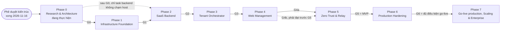

# MeshGuard ZTNA — Roadmap

> **Cập nhật:** 2026-11-16 · đã đối chiếu với Implementation Master Plan **Rev 3** (bản cuối sau vòng phản biện). File này **viết tay**, không sinh tự động: ai sửa bản master thì đối chiếu và cập nhật file này trong cùng thay đổi. Nguồn sự thật: [docs/planning/implementation-master-plan.md](docs/planning/implementation-master-plan.md) (§19–§23, §25).
> **Trạng thái dự án:** kiến trúc **đã được phê duyệt** (2026-11-16 — [biên bản](docs/planning/evidence/architecture-approval.md)); **G0 đạt ngày 2026-11-16** (8/8 đầu vào); đang ở **Phase 1** ([tiến độ G0](docs/planning/evidence/G0.md)). Hạ tầng đã khởi tạo theo chỉ đạo của chủ dự án (2026-11-16): 6 VM trên Proxmox, SSH key của dự án trên Proxmox và VPS, 3 dự án cũ trên VPS đã dừng để giải phóng cổng ([nhật ký](docs/planning/evidence/infrastructure-bootstrap.md)). Chưa có mã ứng dụng hay container MeshGuard. Thiết kế **chưa** được coi là production-ready.
> **Cần chủ dự án làm (chi tiết ở mục 6):** (1) thay token Cloudflare hiện tại bằng token chỉ sửa DNS của `gta5web.online` (token đang dùng rộng hơn yêu cầu); (2) cân nhắc tắt đăng nhập SSH bằng mật khẩu trên VPS sớm hơn P1-T15, vì repo public đã công khai tư thế bảo mật (R-29); (3) chọn cách phân giải `*.mesh.gta5web.online` trong LAN — bản ghi A công khai trỏ IP LAN, DNS nội bộ trên router, hay giữ `/etc/hosts` cho VM lab tới P1-T18 (đổi DNS cần bạn chấp thuận riêng); (4) xem lại 6 quyết định đã được ghi nhận là chấp nhận theo khuyến nghị khi bạn duyệt plan (mục 6) và báo nếu muốn đổi.

**Thuật ngữ và mã dùng trong file:** *gate* G0…G7 = điểm Go/No-Go cuối mỗi phase — có bằng chứng và chủ dự án xác nhận thì mới sang phase kế · *AC-nn* = tiêu chí nghiệm thu MVP · *ADR-nn* = quyết định kiến trúc (25 quyết định, đã được duyệt 2026-11-16) · *D-n* = quyết định cần chủ dự án đưa ra · *R-nn* = rủi ro · *P\<phase\>-Tnn* = task · *tailnet* = một mạng riêng do một Headscale instance quản lý · *edge* = cụm Caddy + CrowdSec dùng chung, đứng trước mọi tenant · *DERP* = relay mã hóa, dùng khi hai thiết bị không nối trực tiếp được · *STUN* = dịch vụ giúp thiết bị biết địa chỉ công khai của mình để nối trực tiếp · *dual control (2P)* = thao tác phá hủy phải có người thứ hai phê duyệt · *spike* = thử nghiệm kỹ thuật ngắn để lộ rủi ro sớm.

## 1. Đích đến

MeshGuard ZTNA là nền tảng SaaS Zero Trust Mesh VPN tự lưu trữ, đa tenant: mỗi doanh nghiệp có một tailnet riêng (một Headscale instance với database, khóa và policy riêng), official Tailscale Client đảm nhiệm data plane, còn Portal + backend Go/PostgreSQL quản trị tập trung. Giai đoạn phát triển và thử nghiệm chạy bằng Docker Compose trên một Ubuntu host trong LAN; các endpoint cần public đi qua một VPS làm gateway tầng 4 (VPS không giữ khóa TLS hay dữ liệu tenant).

| Mốc | Gate | Nghĩa là gì |
|---|---|---|
| **MVP** | G5 | 20 tiêu chí nghiệm thu AC-01…AC-20 có bằng chứng; các tiêu chí mạng được chứng minh trên thiết bị thật ở các mạng khác nhau |
| **Đủ điều kiện go-live** | G6 | Đã diễn tập restore, upgrade và mất host; có số đo load test; pen test không còn lỗi Nghiêm trọng/Cao; có runbook; rủi ro tồn dư được chấp nhận bằng văn bản. Tất cả được chứng minh trên **staging** (host LAN + VPS) — lúc này **chưa có môi trường production** |
| **Go-live production** | Đầu Phase 7 | Dựng môi trường production trên host do chủ dự án chốt ở D-14 (không phải host LAN staging), rồi đưa khách hàng đầu tiên vào (P7-T11, P7-T12) |
| **Mở rộng** | G7 | Multi-host và tính năng enterprise, bật từng tính năng theo nhu cầu đã đo |

## 2. Đang ở đâu

| Hạng mục | Trạng thái |
|---|---|
| Nghiên cứu 4 repository tham khảo, Headscale `v0.29.7`, Tailscale client `v1.104.7` | Xong — **chỉ đọc** mã nguồn và tài liệu, chưa chạy thử gì; các giả định trọng yếu chờ kiểm chứng thực tế ở Phase 1–5 (mục 7) |
| Implementation Master Plan và bộ tài liệu `docs/` | Xong — Rev 3: 25 mục + Appendix A–D, 149 task |
| Phản biện tự động: 8 agent AI phản biện độc lập, mỗi agent một góc nhìn — 186 phát hiện (1 nghiêm trọng, 50 cao, 106 trung bình, 29 thấp) | Đã tích hợp vào Rev 3 và được kiểm chứng lại: 183 đã xử lý, 3 xử lý một phần (hoãn có chủ đích, có task chịu trách nhiệm). Bảng xử lý từng phát hiện: [docs/planning/review-log.md](docs/planning/review-log.md). Phản biện tự động **không** thay cho thẩm định của chuyên gia; plan có rà soát bảo mật độc lập ở G2 và pen test bên ngoài ở Phase 6 |
| Phê duyệt kiến trúc và 25 ADR | **Đã phê duyệt** (2026-11-16) — [biên bản](docs/planning/evidence/architecture-approval.md) |
| Quyết định D-1…D-14 | **Đã chốt:** D-1 (`gta5web.online` tại Cloudflare, domain qua biến môi trường `MG_BASE_DOMAIN`), D-2, D-3 (Keycloak tự host, 3 realm), D-4, D-5, D-6 (lộ trình tư vấn pháp lý), D-7, D-8, D-9, D-11 (≥ 2 người vận hành), D-12 (GitHub, repo public theo quyết định lại ngày 2026-11-16 + GitHub Actions trên runner của GitHub + GHCR), D-14 (chốt host production trước G6), D-10 (SSH key đã có; chủ dự án quyết định **không đổi** mật khẩu root đã lộ, chấp nhận rủi ro; bản sao trên máy vận hành đã xóa; tắt đăng nhập SSH bằng mật khẩu ở P1-T15). **Một phần:** D-13 (`sudo` không mật khẩu tạm thời toàn quyền, thu hẹp ở Phase 1) |
| Phase 0 | Đang thực hiện. Xong: tách tài liệu (P0-T01), ghi nhận phê duyệt (P0-T02, trừ tên người chịu trách nhiệm từng rủi ro), thông tin môi trường (P0-T05 — [kết quả discovery](docs/deployment/ubuntu-server-inventory.md)), [quy ước bằng chứng và sổ kiểm chứng](docs/planning/evidence/README.md) (P0-T06), [nhật ký bằng chứng nghiên cứu](docs/architecture/research-evidence.md) (P0-T08 phần 1). Bị chặn chờ chủ dự án: P0-T07, cùng phần CI của P0-T04 và phần image tự build của P0-T03 ([danh sách](docs/planning/evidence/blocked.md)). Xong thêm (2026-11-16): phần upstream của P0-T03 (`versions.lock`, mọi digest kiểm với registry), phần không có CI của P0-T04 (khung repo, `make docs-check`, secret scan, pre-commit). Làm tiếp: P0-T08 phần 2 |
| Đầu vào của G0 (mục 6) | **Đạt 2026-11-16** — 8/8 đầu vào — [tiến độ G0](docs/planning/evidence/G0.md) |
| Hạ tầng | Đã tạo trên NVMe 2 TB của Proxmox: host staging `mg-staging`, runner CI `mg-ci-runner`, 4 VM client thử (2 trong LAN, 2 sau NAT của OPNsense). VPS: 3 dự án cũ đã dừng (giữ dữ liệu, có lệnh hoàn tác), cổng 80/443/3478 trống — [nhật ký](docs/planning/evidence/infrastructure-bootstrap.md) |
| Phase 1 | Đang thực hiện. Xong: P1-T01, P1-T03, P1-T04, P1-T05 (chứng chỉ wildcard production — [bằng chứng](docs/planning/evidence/P1-T05.md)), **P1-T05a — spike DERP qua Caddy đạt** ([bằng chứng](docs/planning/evidence/P1-T05a.md)), P1-T06 (edge + CrowdSec — [bằng chứng](docs/planning/evidence/P1-T06.md)), P1-T07, P1-T08/P1-T09 (tenant A, B — [A](docs/planning/evidence/P1-T08.md), [B](docs/planning/evidence/P1-T09.md)), P1-T10/P1-T10a (listener admin/metrics nội bộ, conformance 468/468 — [bằng chứng](docs/planning/evidence/P1-T10.md)), P1-T11, P1-T12/P1-T12a (4 client thật: cách ly chéo tenant, policy theo cổng, relay từng tenant — [bằng chứng](docs/planning/evidence/P1-T12.md)), P1-T12b (IT-09 derpprobe 6/6 — [bằng chứng](docs/planning/evidence/P1-T12b.md)), P1-T12c (IT-14 30/30 sau khi thêm bộ lọc tầng bridge — [bằng chứng](docs/planning/evidence/P1-T12c.md)), P1-T12d (V-03: không reload, 0 rò DNS — [bằng chứng](docs/planning/evidence/P1-T12d.md)), P1-T13 (restart độc lập, AC-18 — [bằng chứng](docs/planning/evidence/P1-T13.md)); phần lớn P1-T02. P1-T20 (edge với 100/300 network: restart 11 s / 33 s, ngưỡng < 60 s — [bằng chứng](docs/planning/evidence/P1-T20.md)). P1-T19 (diễn tập dựng lại: A và B ~7 s mỗi tenant, chỉ bằng script — [bằng chứng](docs/planning/evidence/P1-T19.md)). Còn lại trong LAN: P1-T12e (Windows/điện thoại — cần DNS cho `*.mesh`). Cần chủ dự án duyệt từng bước: P1-T15…P1-T18 (VPS gateway, mở public), P1-T21 (reboot host/restart `dockerd`), thu hẹp sudoers (P1-T02) |
| Phase 2 (song song, chỉ task không chạm host — §25.2) | Đã bắt đầu. Xong: P2-T01 (khung Go `api`/`worker`, cấu hình từ chối secret trong env, log che secret, `/healthz` `/readyz` `/metrics`, test kiến trúc §13.6, CI Go + image — [bằng chứng](docs/planning/evidence/P2-T01.md)). Tiếp theo: P2-T02 (OpenAPI v1), P2-T03 (migration + RLS). Triển khai backend lên host chỉ sau G1 (P2-T16) |

## 3. Toàn cảnh

| Phase | Mục tiêu | Kết quả chính | Số task | Gate ra |
|---|---|---|---|---|
| 0 — Research & Architecture | Đóng băng kiến trúc và backlog đã được phê duyệt | Plan + ADR được duyệt; phiên bản/digest được pin; khung repo, CI, registry; nhật ký bằng chứng nghiên cứu | 8 | G0 |
| 1 — Infrastructure Foundation | Chứng minh nền hạ tầng với client thật | 2 tenant dựng tay qua edge chung; PostgreSQL, lưu trữ bền vững, health check; VPS Public Gateway; các PoC rủi ro cao có kết quả | 28 | G1 |
| 2 — SaaS Backend | Backend trung tâm quản lý được cả hai tenant, có xác thực và phân quyền đầy đủ | API Go, migration PostgreSQL + Row-Level Security (RLS), OIDC đa issuer, RBAC, Headscale adapter, bộ test cách ly v1 | 24 | G2 |
| 3 — Tenant Orchestrator | Tạo, tạm dừng, xóa tenant hoàn toàn tự động và an toàn khi lỗi giữa chừng | Host Agent, state machine provisioning, dual control, backup/restore, reconcile, cảnh báo tối thiểu | 28 | G3 |
| 4 — Web Management | Portal thống nhất cho Super Admin và Tenant Admin | Platform Console, Tenant Portal, quản lý thiết bị, enrollment, policy, DNS/routes, audit; i18n vi/en | 18 | G4a, G4b |
| 5 — Zero Trust & Relay | Chứng minh đầy đủ MVP trên mạng thật | Template policy deny-by-default; 20 AC có bằng chứng; ma trận tương thích client; số đo thu hồi và lan truyền policy; Connectivity Diagnostics | 15 | **G5 (MVP)** |
| 6 — Production Hardening | Đủ điều kiện vận hành cho khách hàng đầu tiên | Monitoring, backup offsite + PITR, diễn tập DR, load test, pen test, runbook | 16 | G6 |
| 7 — Go-live, Scaling & Enterprise | Go-live production, rồi mở rộng theo nhu cầu đã đo | Môi trường production + khách hàng đầu tiên; multi-host, relocation, relay vùng (research), tier enterprise, billing | 12 | G7 (theo từng tính năng) |

Tổng cộng 149 task, mỗi task có phụ thuộc, đầu ra và cách kiểm chứng — xem [docs/planning/task-breakdown.md](docs/planning/task-breakdown.md).

Roadmap này **chưa gắn ngày**: thứ tự do phụ thuộc và gate quyết định. Mốc thời gian chỉ nên gắn sau G0, khi đã biết nhân lực và các phụ thuộc bên ngoài ở mục 6.

## 4. Từng phase

### Phase 0 — Research & Architecture

- **Làm gì:** tách plan thành bộ tài liệu `docs/` (đã xong); đưa nhật ký bằng chứng nghiên cứu vào tài liệu và đọc lại nguyên văn các dữ kiện mà thiết kế dựa vào; ghi nhận ADR đã duyệt; pin phiên bản và digest; dựng khung repo (Makefile, pre-commit quét secret, CI); chốt Git hosting, CI runner, registry; thu thập thông tin môi trường; **mở yêu cầu tư vấn pháp lý về R-01 ngay trong phase này**.
- **Gate G0:** kiến trúc được duyệt **và** đủ 8 đầu vào do chủ dự án cung cấp — G0(1)…G0(8) ở bảng mục 6.

### Phase 1 — Infrastructure Foundation

- **Làm gì:**
  - Chuẩn bị host LAN Ubuntu: discovery chỉ-đọc, Docker Engine + Compose, bố cục lưu trữ bền vững `/opt/meshguard` (mỗi tenant một thư mục dữ liệu riêng); build image edge (Caddy + module) và STUN dùng chung (`stund`).
  - Dựng compose core tối thiểu: edge, CrowdSec (chỉ quan sát), **PostgreSQL** (không publish cổng; ở phase này chỉ dựng và kiểm tra kết nối) và `stund`.
  - Cấp wildcard certificate qua DNS-01, rồi chạy ngay **spike "DERP qua Caddy"** — thất bại thì dừng trước khi dựng phần còn lại.
  - Dựng tay hai tenant A và B từ template; policy deny-all được áp trước khi instance có đường mạng.
  - Cấu hình edge (allow-list path, listener nội bộ) và conformance test tự động.
  - Thử với client thật: đăng ký, truyền TCP cùng tenant, cô lập chéo tenant, ép relay; health check cơ bản và restart độc lập từng tenant.
  - Đo edge khi gắn 100 rồi 300 network tenant, và khả năng tự phục hồi sau reboot host / restart Docker.
  - VPS Public Gateway: hardening, tunnel WireGuard, `l4proxy` + `stund`, DNS public, thử từ Internet; diễn tập dựng lại từ runbook.
- **Chưa có** SaaS backend ở phase này.
- **Gate G1:**
  - Control qua Caddy với client thật trên ít nhất 2 hệ điều hành; DERP qua Caddy truyền được dữ liệu khi ép relay.
  - Thêm tenant không làm rớt stream của tenant khác (hoặc đã chọn phương án lùi: sinh cấu hình và reload edge trong cửa sổ bảo trì).
  - Qua VPS gateway: STUN đúng; control và DERP chạy qua chuỗi VPS → tunnel → edge; edge thấy đúng IP client; stream dài không bị cắt khi nhàn rỗi.
  - Allow-list path đạt, và hostname quản trị `admin.<domain>` (dành cho Platform Console) không tới được qua VPS.
  - Restart tenant A không ảnh hưởng B; relay của A từ chối khóa của B; từ bên trong network của một tenant không tới được listener nội bộ của edge, instance của tenant khác hay Internet.
  - Diễn tập dựng lại đạt; số đo edge với nhiều network và phục hồi sau reboot đạt ngưỡng chốt ở G0.
  - Nếu VPS chưa sẵn sàng: phần Internet ghi "pending" và **không** được tuyên bố Internet-facing.

### Phase 2 — SaaS Backend

- **Làm gì:** API và worker bằng Go theo hợp đồng OpenAPI; migration PostgreSQL `0001`–`0006` với Row-Level Security cho từng bảng; SecretStore và nghi thức khóa (KEK, khóa khôi phục backup, khóa ký manifest); đăng nhập OIDC đa issuer với callback theo từng IdP; RBAC theo permission; Headscale adapter (chỉ REST) cùng contract test trên Headscale thật; Tenant Registry và lệnh adopt để đưa hai instance A/B (dựng tay ở Phase 1) vào quản lý; quản lý thiết bị với trạng thái thu hồi hai pha; bộ test cách ly v1; stack dev/CI.
- **Chạy song song:** các task không chạm host được làm song song với Phase 1 ngay sau G0; chỉ triển khai lên host sau G1.
- **Gate G2:** toàn bộ test cách ly và contract test xanh; rà soát bảo mật theo checklist OWASP ASVS do người không viết phần code đó thực hiện, không còn mục Cao; nghi thức khóa hoàn tất; có ý kiến pháp lý sơ bộ bằng văn bản về R-01.

### Phase 3 — Tenant Orchestrator

- **Làm gì:** Host Agent (thành phần duy nhất được chạm Docker) và compose driver; state machine provisioning 19 bước có compensation khi lỗi giữa chừng; placement và cấp phát tài nguyên cho từng tenant (host, UID, subnet, hostname điều khiển — không cần cổng riêng theo tenant); secret theo tenant (khóa mã hóa riêng, API key Headscale tạo lúc provisioning và xoay định kỳ); kiểm tra sức khỏe sau khi dựng (health gate, prober kiểm relay/STUN và allow-list); dual control; lời mời Tenant Owner và thông báo; lõi policy tối thiểu; suspend / resume / deprovision; backup và restore theo tenant; reconcile; reconfigure và upgrade có rollback; quarantine instance; kiểm soát quản trị IdP; đối soát sau khi restore PostgreSQL; bộ cảnh báo tối thiểu (instance down, đĩa, chứng chỉ, backup quá hạn).
- **Gate G3:** tiêm lỗi ở từng bước không để lại tài nguyên mồ côi; suspend / resume / deprovision đạt với lưu lượng thật; dual control đạt (tự duyệt và sửa nội dung sau khi duyệt đều bị từ chối); restore tenant A không ảnh hưởng tenant B (AC-19); A và B đã được chuẩn hóa qua orchestrator; reboot host khi orchestrator đang chạy thì mọi tenant tự phục hồi, không thao tác tay.

### Phase 4 — Web Management

- **Làm gì:** Platform Console và Tenant Portal trên cùng một bản build; quản lý thiết bị (danh sách, chi tiết, đổi tên, gắn tag, expire/xóa, trạng thái thu hồi hai pha); đăng ký thiết bị (web-auth do Portal môi giới và pre-auth key ngắn hạn); danh mục tag; quản lý policy (soạn, lint, duyệt, áp dụng, rollback); users, groups, lời mời; DNS, routes, resource catalog; audit; support access grant; hàng chờ phê duyệt; tiếng Việt + tiếng Anh, dark/light, accessibility.
- **Gate tách đôi:**
  - **G4a:** enrollment, áp policy, thiết bị và audit chạy end-to-end qua API + UI tối thiểu. Gate này mở các task lab của Phase 5.
  - **G4b:** toàn bộ E2E xanh và rà soát UX bảo mật đạt. Đây là điều kiện của G5.

### Phase 5 — Zero Trust & Relay

- **Làm gì:**
  - Template policy mặc định deny-all và least-privilege theo mô hình grants (kèm test sinh tự động).
  - Dựng lab mạng thật và chứng minh trên thiết bị thật các tiêu chí mạng AC-08…AC-11 và AC-13…AC-17: đăng ký, allow/deny bằng TCP thật, không lộ peer chéo tenant, direct P2P, DERP fallback khi ép relay, thu hồi thiết bị có đo.
  - Ma trận tương thích client trên Linux, Windows, macOS, iOS, Android.
  - Cô lập DNS và routing; `node.expiry` trên client thật.
  - Tính năng Connectivity Diagnostics trong Portal; đợt security test; báo cáo nghiệm thu MVP.
- **Gate G5 (MVP):**
  - 20/20 AC đạt. Ngoại lệ bằng văn bản chỉ được phép cho các tiêu chí phụ thuộc môi trường: AC-15, phần Internet của AC-16 và ngưỡng thời gian của AC-17. Các tiêu chí cách ly và bảo mật không bao giờ được miễn.
  - Không còn lỗi cách ly; G4b đạt.
  - Phần Internet của G1 đã đóng, hoặc chủ dự án đã quyết định "MVP LAN-only" bằng văn bản.
  - Ngưỡng cho load/chaos test của Phase 6 đã được chốt.

### Phase 6 — Production Hardening

- **Làm gì:** monitoring và cảnh báo đầy đủ; logging tập trung, audit có hash-chain và được đẩy ra ngoài host; PostgreSQL PITR và backup offsite; diễn tập mất host; xoay secret; supply chain (SBOM, quét, ký image); hardening egress và giới hạn tốc độ ở edge; load test 10 → 100 tenant; chaos test; diễn tập upgrade/rollback Headscale; usage và quota; pen test bên ngoài; runbook ứng phó sự cố.
- **Gate G6:** chủ dự án quyết định hệ thống **đủ điều kiện** go-live, kèm danh sách rủi ro tồn dư được chấp nhận; có ý kiến pháp lý đầy đủ bằng văn bản về R-01. Qua G6 **không** biến host LAN staging thành production.

### Phase 7 — Go-live, Scaling & Enterprise

- **Làm gì:**
  - Ngay sau G6: dựng môi trường production trên host đã chốt ở D-14, với nghi thức khóa mới, không sao chép secret hay dữ liệu từ staging; chạy lại các phép thử bảo mật trên production; go-live khách hàng đầu tiên kèm kế hoạch rollback.
  - Sau đó, theo nhu cầu đã đo: multi-host với Agent mTLS; relocation tenant; regional placement; nghiên cứu relay dùng chung/theo vùng; tier enterprise chuyên dụng; danh tính nâng cao (onboarding IdP tự phục vụ, SCIM); mở rộng Application ZTNA (JIT, time-bound); billing; adapter cho Headscale 0.30; scale validation tới 1.000 tenant.
- **Gate G7:** Go/No-Go riêng cho từng tính năng; không bật relay dùng chung khi chưa có xác thực theo tenant đã kiểm chứng.

## 5. MVP gồm những gì

MVP đạt khi 20 tiêu chí dưới đây có bằng chứng. Định nghĩa đầy đủ và phép thử: [docs/planning/acceptance-criteria.md](docs/planning/acceptance-criteria.md).

Cột cuối liệt kê các phase có chạy phép thử của tiêu chí:
- Với tiêu chí mạng, lần chạy sớm là bản thủ công hoặc "functional"; lần chạy ở Phase 5 trên thiết bị thật mới là bằng chứng mà G5 xét.
- "1 → 3" nghĩa là dựng tay ở Phase 1 rồi tự động hóa qua orchestrator ở Phase 3.
- AC-20 được chạy lại ở Phase 6 sau khi hardening.

| AC | Tiêu chí | Chạy ở phase |
|---|---|---|
| AC-01 | Có hai tenant độc lập A và B | 1 → 3 |
| AC-02 | Mỗi tenant có Headscale instance riêng | 1 |
| AC-03 | Mỗi Headscale có database và server keys riêng | 1 |
| AC-04 | Backend trung tâm quản lý được cả hai tenant | 2 |
| AC-05 | Super Admin xem và quản trị cả hai tenant đúng theo quyền | 2, 4 |
| AC-06 | Tenant Admin A không quản trị được B | 2, 4 |
| AC-07 | Tenant Admin B không quản trị được A | 2, 4 |
| AC-08 | Hai official client đăng ký thành công vào tenant A | 1, 5 |
| AC-09 | Hai official client đăng ký thành công vào tenant B | 1, 5 |
| AC-10 | Client cùng tenant truyền dữ liệu khi policy cho phép | 1, 4, 5 |
| AC-11 | Policy deny chặn luồng theo đúng phạm vi hỗ trợ (kiểm bằng kết nối TCP thật) | 1, 4, 5 |
| AC-12 | Truy cập API chéo tenant bị từ chối | 2 |
| AC-13 | Không có peer discovery chéo tenant | 1, 5 |
| AC-14 | Credential đăng ký của A không dùng được ở B | 1, 5 |
| AC-15 | Direct P2P được xác nhận khi mạng cho phép | 5 |
| AC-16 | DERP fallback hoạt động khi ép không direct | 1, 5 |
| AC-17 | Thu hồi thiết bị được kiểm thử, ghi nhận trạng thái áp dụng thực tế (đo thời gian, so với ngưỡng nghiệm thu nội bộ) | 5 |
| AC-18 | Restart Headscale của một tenant không ảnh hưởng tenant khác | 1, 3 |
| AC-19 | Backup/restore tenant A không ghi đè dữ liệu tenant B | 3 |
| AC-20 | PostgreSQL, Headscale Admin API và metrics không lộ ra Internet | 1, 5, 6 |

## 6. Cần từ chủ dự án

| Thời điểm | Cần gì | Chặn gì nếu thiếu |
|---|---|---|
| **Xong 2026-11-16** | G0(3): SSH key trên cả hai máy, user triển khai trên VPS, nâng quyền không dùng mật khẩu (D-13). Chủ dự án quyết định **không đổi** mật khẩu root đã lộ (D-10, chấp nhận rủi ro); bản sao trên máy vận hành đã xóa | — |
| **Xong 2026-11-16** | G0(5) (D-12): repo giữ **public** ⇒ CI chạy trên runner của GitHub, không self-hosted; workflow `ci` (docs-check + gitleaks) và `runner-smoke` (push/pull GHCR) đều xanh | — |
| **Xong 2026-11-16** | Phê duyệt kiến trúc: 25 ADR chuyển sang Accepted ([biên bản](docs/planning/evidence/architecture-approval.md)) | — |
| **Xong 2026-11-16** | G0(1): `gta5web.online` tại Cloudflare (D-1) — nameserver đã kiểm, không có CAA, các tên dự kiến chưa bị dùng | — |
| **Xong 2026-11-16** | G0(2): host staging = VM `mg-staging` (8 vCPU, 24 GB RAM, 250 GB); VPS 2 vCPU, 1,9 GB RAM; ngưỡng đo edge và phục hồi sau reboot theo plan đã duyệt | — |
| **Xong 2026-11-16** | G0(4): 4 VM Linux (2 trong LAN, 2 sau NAT của OPNsense) + máy Windows của chủ dự án. Thử trên máy Windows sẽ tạm cắt đường Tailscale hiện có của máy đó tới LAN | — |
| **Xong** | G0(6) (D-3): Keycloak tự host, 3 realm (platform, tenant-a, tenant-b) — đã chốt, host staging đủ RAM | — |
| **Xong** | G0(7) (D-11): từ 2 người vận hành trở lên — dual control đúng thiết kế | — |
| **Xong 2026-11-16** | G0(8): ghi nhận qua việc duyệt R-01 và D-6; chủ dự án tự mở yêu cầu tư vấn pháp lý | Ý kiến sơ bộ phải có trước G2 |
| Trước Phase 1 | DHCP reservation trên router cho `mg-staging` (192.168.1.8) và `mg-ci-runner` (192.168.1.19) | Bản ghi DNS và tunnel tới VPS; edge publish cổng trên đúng IP 192.168.1.8 (đổi IP thì edge không khởi động) |
| Trước khi thử với thiết bị ngoài VM lab (máy Windows, điện thoại) | Cách phân giải `*.mesh.gta5web.online` trong LAN: bản ghi A công khai trỏ IP LAN, DNS nội bộ trên router, hay giữ `/etc/hosts` cho VM lab tới P1-T18 — đổi DNS cần chấp thuận riêng | Thiết bị không sửa được `/etc/hosts` (điện thoại) không đăng ký được |
| **Xong 2026-11-16** | Token Cloudflare cho DNS-01 (đã lưu thành file secret trên host staging). Còn: thay bằng token hẹp chỉ sửa DNS của zone; email ACME không bắt buộc | — |
| Trước P1-T15 | ~~Tắt pipeline deploy của 3 dự án cũ~~ (xong 2026-11-16 — đã gỡ key của chúng khỏi root); quyết định giữ hay dừng dịch vụ thư `mail.vnflashlearner.click` — chứng chỉ của nó hết hạn 2027-01-02 và không còn được gia hạn | Gateway trên VPS (cổng 80/443/3478 có thể bị chiếm lại) |
| Trước G2 | Ý kiến pháp lý sơ bộ bằng văn bản về việc dùng official client cho dịch vụ thương mại (R-01, D-6); xác nhận đã cất giữ 2 bản sao offline của khóa sinh ra trong nghi thức khóa (KEK, khóa khôi phục backup) | G2, tức toàn bộ Phase 3 trở đi |
| Phase 3 | SMTP cho thư mời và thông báo | Lời mời Tenant Owner |
| Đầu Phase 5 (sau G4a, trước khi dựng lab) | Nếu phần Internet của G1 còn "pending": quyết định "MVP LAN-only" bằng văn bản (P2P và relay chỉ được chứng minh qua NAT nội bộ; phần Internet là ngoại lệ còn nợ); thiết bị cho đủ 5 hệ điều hành của ma trận tương thích | Lab mạng thật và mọi phép thử trên thiết bị thật của Phase 5 |
| Trước G5 | Quy mô kỳ vọng (số tenant, số thiết bị mỗi tenant, cho MVP và 12 tháng) | Ngưỡng load/chaos test của Phase 6; G5 |
| Phase 6 | Kho backup offsite; máy thứ hai cho diễn tập mất host; đơn vị pen test bên ngoài | G6 |
| Trước G6 | Host cho môi trường production — máy nào, ở đâu (D-14); ý kiến pháp lý đầy đủ (D-6) | G6 và go-live |

Sáu quyết định dưới đây đã được **ghi nhận là chấp nhận theo khuyến nghị** khi bạn duyệt plan ngày 2026-11-16 — báo nếu muốn đổi quyết định nào:
- D-2: đường public đi qua VPS (đã chốt).
- D-4: thời hạn đăng nhập lại của thiết bị (`node.expiry`), mặc định 90 ngày.
- D-5: chấp nhận rủi ro một host cho dev/staging, không dùng cho production.
- D-7: tài liệu bằng tiếng Việt kèm thuật ngữ tiếng Anh.
- D-8: tắt chia sẻ tín hiệu với CrowdSec Central API.
- D-9: VPS chỉ làm gateway tầng 4, không giữ khóa TLS hay dữ liệu tenant.

Chi tiết: [docs/planning/build-mode-instructions.md](docs/planning/build-mode-instructions.md) (§25.4); thông tin môi trường còn thiếu: [docs/deployment/ubuntu-server-inventory.md](docs/deployment/ubuntu-server-inventory.md).

## 7. Những điểm quyết định sớm

Lộ trình được sắp để rủi ro lớn lộ ra sớm, không phải ở cuối:

| Điểm kiểm | Khi nào | Nếu không đạt |
|---|---|---|
| DERP qua Caddy (spike sớm) | Đầu Phase 1, ngay sau khi có chứng chỉ — **đạt 2026-11-16 ở LAN NAT** ([bằng chứng](docs/planning/evidence/P1-T05a.md)); đường qua VPS kiểm ở P1-T18 | Dừng; chạy PoC phương án relay thay thế (§10.3), rồi chủ dự án chọn phương án lùi kèm chi phí IP/cổng; sửa ADR-11 |
| Edge với 100–300 network tenant; phục hồi sau reboot host | Phase 1 | Xem lại thiết kế edge dùng chung (ADR-08) trước G1 |
| Đường Internet qua VPS gateway | Cuối Phase 1 | VPS chưa sẵn sàng: ghi "pending", không tuyên bố Internet-facing; phải đóng trước khi dựng lab của Phase 5, nếu không thì chủ dự án quyết định "MVP LAN-only" bằng văn bản |
| Cách ly API và dữ liệu giữa tenant | G2 | Không sang Phase 3 |
| Provisioning an toàn khi lỗi giữa chừng | G3 | Không sang Phase 4; trong lúc sửa, tắt orchestrator và dựng tenant theo quy trình tay của Phase 1 — tenant đã tạo vẫn chạy |
| Chuyển hướng web-auth về Portal | G4a | Dùng phương án lùi: giữ trang đăng ký gốc của Headscale, người dùng dán mã Auth ID vào Portal |
| Thu hồi thiết bị và lan truyền policy trên mạng thật | G5 | Cần ngoại lệ bằng văn bản; không công bố SLA |

Chuỗi phụ thuộc ở mức task: [docs/planning/dependency-graph.md](docs/planning/dependency-graph.md).

## 8. Rủi ro chi phối lộ trình

| Rủi ro | Ảnh hưởng tới lộ trình | Cách xử lý |
|---|---|---|
| R-01 — điều khoản của Tailscale về việc dùng official client cho dịch vụ thương mại | Chặn G2 nếu chưa có ý kiến sơ bộ; có thể chặn go-live thương mại | Mở yêu cầu tư vấn ở Phase 0; ý kiến sơ bộ trước G2, đầy đủ trước G6 |
| R-05 — DERP qua Caddy chưa được upstream kiểm chứng | Spike đạt ở LAN NAT (2026-11-16); còn đường qua VPS (P1-T18) trước G1 | Spike sớm ở Phase 1; có phương án lùi |
| R-07 — một host duy nhất: SPOF và dùng chung kernel | Không dùng cho production | Backup offsite, diễn tập dựng lại; production đặt trên host chốt ở D-14, multi-host ở Phase 7 |
| R-23 — VPS gateway: mật khẩu root đã lộ, thêm điểm lỗi nối tiếp | Chặn phần Internet-facing | SSH key đã có (2026-11-16); chủ dự án không đổi mật khẩu root (chấp nhận rủi ro) ⇒ tắt đăng nhập SSH bằng mật khẩu ở P1-T15; VPS không giữ khóa TLS hay dữ liệu tenant |
| R-02, R-03 — mô hình Docker + reverse proxy nằm ngoài hỗ trợ của upstream; API Headscale thay đổi ở 0.30 | Phát sinh việc khi nâng cấp | Contract test theo phiên bản; pin phiên bản; không tự nâng minor |
| R-24 — thiếu thiết bị thử hoặc mạng ngoài LAN | Chặn G5 | Chốt danh sách thiết bị từ G0; bổ sung đủ 5 hệ điều hành trước khi dựng lab Phase 5 |
| R-25 — chỉ có một người vận hành | Đã gỡ: D-11 chốt từ 2 người trở lên | — |
| R-28 — CI runner tự host: job CI chạy code của repo trên máy runner | Runner đặt sai chỗ ⇒ một workflow lỗi hoặc bị chiếm có quyền root trên nơi giữ dữ liệu tenant | Hiện không dùng self-hosted runner (repo public, CI trên runner của GitHub); nếu dùng lại: chỉ cho repo private, VM riêng, mỗi job một runner hoặc job trong container |
| R-29 — repo công khai | Lộ sơ đồ hạ tầng, IP, domain và tư thế bảo mật (mật khẩu root đã lộ không đổi, VPS còn SSH bằng mật khẩu) | Không commit secret (gitleaks ở pre-commit và CI); tắt SSH bằng mật khẩu trên VPS sớm; không gắn self-hosted runner; cân nhắc chuyển evidence chi tiết sang kho riêng trước go-live |

Sổ rủi ro và nợ kỹ thuật đầy đủ: [docs/planning/risks-and-technical-debt.md](docs/planning/risks-and-technical-debt.md).

## 9. Quy tắc đi theo lộ trình

- Không bắt đầu phase kế tiếp khi gate của phase trước chưa đạt. Có hai ngoại lệ có chủ đích: "Chạy song song" ở Phase 2 và "Gate tách đôi" ở Phase 4. Mỗi gate có bằng chứng lưu ở `docs/planning/evidence/` và cần chủ dự án xác nhận.
- Ba môi trường:
  - **dev/CI:** máy phát triển; kết quả chỉ được ghi "functional".
  - **staging:** host LAN + VPS gateway; nơi chạy mọi gate tới G6.
  - **production:** chưa tồn tại; dựng sau G6 trên host chốt ở D-14, không phải host LAN staging.
- Kết quả từ container cùng host chỉ được ghi "functional"; "network E2E verified" phải đến từ thiết bị thật trên mạng phù hợp. Mọi con số độ trễ là giá trị đo, không phải cam kết.
- Thao tác server: chỉ dùng SSH key, không dùng hay ghi mật khẩu; bắt đầu bằng discovery chỉ-đọc; mỗi nhóm thay đổi (cài gói, firewall, DNS, mở public) cần chủ dự án chấp thuận riêng.
- Ở mỗi gate: rà lại phiên bản đã pin, sổ rủi ro và sổ kiểm chứng.
- Không mô tả hệ thống là production-ready trước G6; không công bố SLA hay giới hạn số thiết bị chưa đo.

## 10. Tài liệu chi tiết

| Cần xem | Tài liệu |
|---|---|
| Toàn bộ thiết kế và kế hoạch (bản master) | [docs/planning/implementation-master-plan.md](docs/planning/implementation-master-plan.md) |
| Bảng 17 thuộc tính của từng phase và các milestone | [docs/planning/milestones.md](docs/planning/milestones.md) |
| Danh sách task, phụ thuộc và cách kiểm chứng | [docs/planning/task-breakdown.md](docs/planning/task-breakdown.md) |
| Đồ thị phụ thuộc | [docs/planning/dependency-graph.md](docs/planning/dependency-graph.md) |
| Tiêu chí nghiệm thu MVP | [docs/planning/acceptance-criteria.md](docs/planning/acceptance-criteria.md) |
| Chiến lược kiểm thử và sổ kiểm chứng | [docs/planning/test-strategy.md](docs/planning/test-strategy.md) |
| Rủi ro và nợ kỹ thuật | [docs/planning/risks-and-technical-debt.md](docs/planning/risks-and-technical-debt.md) |
| Quyết định kiến trúc (ADR) | [docs/adr/architecture-decision-records.md](docs/adr/architecture-decision-records.md) |
| Hướng dẫn thực thi và các quyết định cần chủ dự án | [docs/planning/build-mode-instructions.md](docs/planning/build-mode-instructions.md) |
| Kết quả phản biện: bảng xử lý từng phát hiện; bản ghi nguyên văn | [docs/planning/review-log.md](docs/planning/review-log.md); [docs/planning/review-findings.md](docs/planning/review-findings.md) |
| Bằng chứng thực hiện: biên bản phê duyệt, tiến độ G0, task bị chặn, sổ kết quả kiểm chứng | [docs/planning/evidence/](docs/planning/evidence/README.md) |
| Nhật ký bằng chứng nghiên cứu (874 nhận định, trích dẫn và nguồn đã pin) | [docs/architecture/research-evidence.md](docs/architecture/research-evidence.md) |
| Mục lục toàn bộ tài liệu | [docs/README.md](docs/README.md) |
