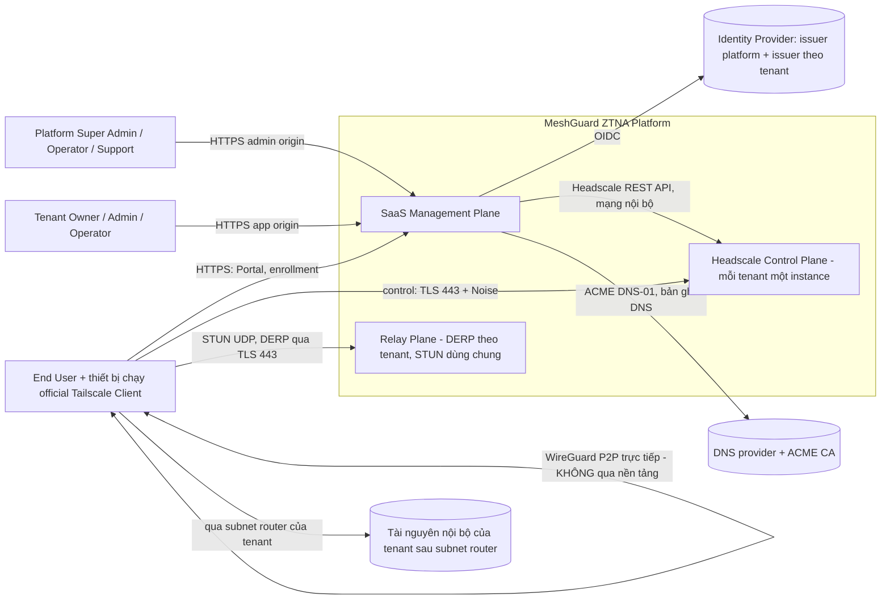
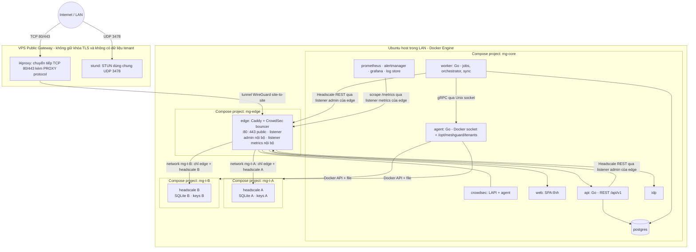
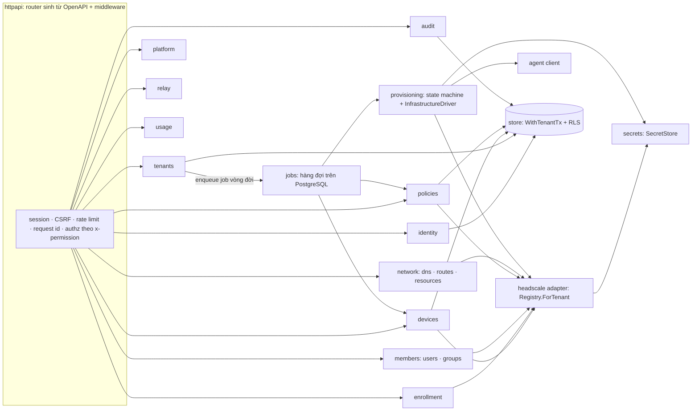

# C4 Diagrams

> **Trích sinh tự động** từ [implementation-master-plan.md](../planning/implementation-master-plan.md) bằng `tools/split_plan.py` — **không sửa tay**; sửa bản master rồi sinh lại.
> Nguồn: §3.2, §3.3, §3.4. Số mục `§` và các mã (HS-…, ADR-…, AC-…, T-…) tham chiếu theo bản master. Nhãn bằng chứng: xem [README](../README.md).

### 3.2 C4 Level 1 — System Context

Phụ thuộc bên ngoài lúc chạy: IdP, DNS/ACME. **Không** phụ thuộc relay hay coordination server của Tailscale Inc. lúc chạy (`derp.urls: []`); official client vẫn có thể tự liên lạc một số host của Tailscale Inc. (log lúc khởi động, dò captive portal, DNS fallback — CL-16); chỉ phụ thuộc phần mềm client do Tailscale phát hành (xem rủi ro pháp lý ở §23).

### 3.3 C4 Level 2 — Containers (single-host MVP)

Ghi chú: sơ đồ trên là chế độ **Internet-facing**. Ở chế độ **Local Development** không có VPS: client trong LAN vào thẳng edge (TCP 80/443) và `stund` chạy trên chính host LAN. Trong cả hai chế độ, container Headscale của tenant **không publish cổng nào**.

### 3.4 C4 Level 3 — Components của SaaS Backend (Go modular monolith)

