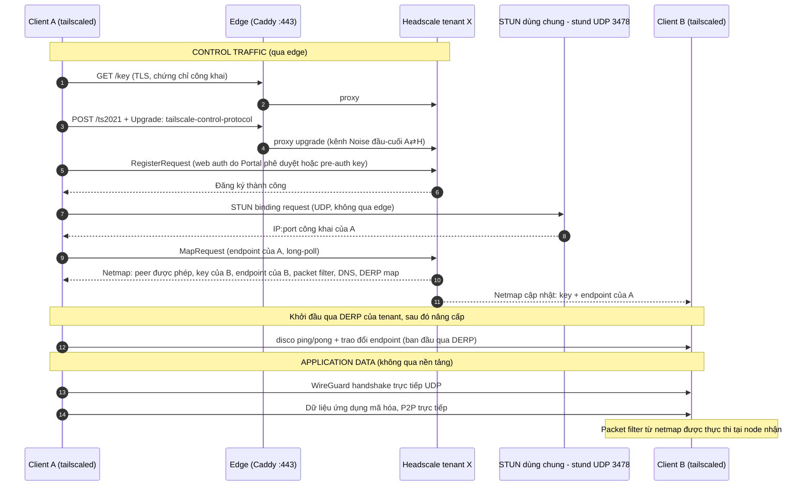
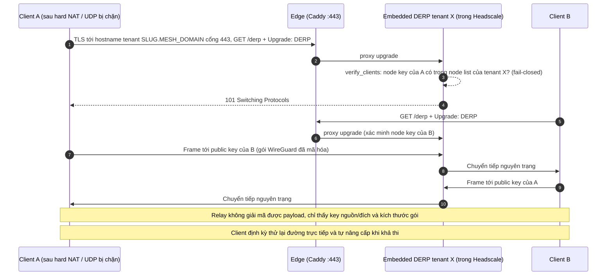

# Control & Data Flows

> **Trích sinh tự động** từ [implementation-master-plan.md](../planning/implementation-master-plan.md) bằng `tools/split_plan.py` — **không sửa tay**; sửa bản master rồi sinh lại.
> Nguồn: §9. Số mục `§` và các mã (HS-…, ADR-…, AC-…, T-…) tham chiếu theo bản master. Nhãn bằng chứng: xem [README](../README.md).

## 9. Tailscale Client Connectivity

Data plane là **official Tailscale Client** (`tailscaled`): mã hóa WireGuard, kết nối P2P, NAT traversal, DERP fallback, routing, DNS. Nền tảng **không** viết lại và **không** đứng trên đường đi của dữ liệu ứng dụng.

### 9.1 Control traffic vs application data traffic

| Loại lưu lượng | Đi qua đâu | Nội dung | Nền tảng thấy gì |
|---|---|---|---|
| Control | Client ⇄ edge (TLS 443) ⇄ Headscale của tenant, kênh Noise tại `/ts2021` | Đăng ký, node/machine key, endpoint, netmap, packet filter, DNS config, DERP map | Metadata điều phối (không có payload ứng dụng) |
| NAT discovery | Client ⇄ STUN responder dùng chung tại điểm vào công khai (UDP 3478) | STUN binding request/response (không mang danh tính tenant) | IP:port công khai của client |
| Application data — direct | Client A ⇄ Client B, UDP (mặc định cổng nguồn 41641), WireGuard | Dữ liệu ứng dụng đã mã hóa đầu-cuối | **Không gì cả** — không đi qua host |
| Application data — relayed | Client ⇄ edge (TLS 443, `/derp`) ⇄ embedded DERP của tenant ⇄ peer | Disco message + gói WireGuard **vẫn đã mã hóa** | Node key nguồn/đích, kích thước, thời điểm (DP-07); không có payload |
| Management | Browser ⇄ edge ⇄ API ⇄ (mạng nội bộ) ⇄ Headscale API | Thao tác quản trị | Toàn bộ, có audit |

Ở chế độ Internet-facing, mọi kết nối TCP tới edge (control, DERP, Portal) đi qua **VPS Public Gateway ở tầng 4**: VPS chuyển tiếp nguyên luồng TLS qua tunnel về edge trên host LAN và **không terminate TLS** (§15.3). Trong các sơ đồ dưới đây, "Edge" là edge trên host LAN; chặng VPS được lược bỏ vì trong suốt với giao thức.

### 9.2 Sequence — đăng ký, discovery, handshake WireGuard, P2P trực tiếp

### 9.3 Sequence — không thiết lập được đường trực tiếp: DERP relay

### 9.4 Yêu cầu phía client và giới hạn theo nền tảng

| Chủ đề | Thiết kế / yêu cầu |
|---|---|
| Phiên bản client | Sàn cứng của Headscale 0.29.x là v1.80.0 (RT-09); nền tảng khuyến nghị ≥ v1.104.4 theo changelog 0.29.7. Ma trận tương thích thực tế cho v1.104.7 phải được đo ở Phase 5 trên từng hệ điều hành |
| Địa chỉ control | Mỗi tenant một URL `https://<slug>.<mesh_domain>` trên cổng 443 (HS-16, CL-01) |
| Chứng chỉ | Chứng chỉ công khai cho mọi hostname tenant (CL-02, CL-03). **Không** giả định private CA/self-signed hoạt động trên mọi official client |
| Linux / macOS | `tailscale login --login-server=https://<slug>.<mesh_domain>` |
| Windows | Dòng lệnh như trên, hoặc `LoginURL` qua registry/MSI cho triển khai hàng loạt (GUI không có ô nhập — CL-04) |
| iOS / Android | Menu custom control server trong app; với iOS quản lý tập trung cần MDM |
| Thiết bị không có trình duyệt, container | Pre-auth key ngắn hạn (`--auth-key` / `TS_AUTHKEY` + `TS_EXTRA_ARGS`) |
| Nhiều tenant trên một thiết bị | Mỗi tenant một profile; chỉ một profile hoạt động (CL-01) — thiết bị không thể là cầu nối giữa hai tenant ở tầng tailnet |
| Tường lửa phía người dùng | Cho phép đi ra: TCP 443, UDP 3478 tới điểm vào công khai (STUN), UDP tùy ý cho đường trực tiếp. Nếu chỉ có TCP 443 ⇒ hoạt động qua relay |
| Hướng dẫn enrollment | Portal sinh lệnh/hướng dẫn theo hệ điều hành với đúng URL của tenant (`GET /enrollment/instructions`); trang trợ giúp gốc của Headscale (`/apple`, `/windows`) bị chặn có chủ đích ở edge và được thay bằng hướng dẫn này; với cài đặt có quản lý, hướng dẫn kèm `TS_NO_LOGS_NO_SUPPORT=true` (hoặc `--no-logs-no-support`); thông báo quyền riêng tư nêu rõ client có thể gửi log chẩn đoán về Tailscale Inc. trước lần kết nối thành công đầu tiên (HS-22) |

### 9.5 Phương pháp xác minh (dùng cho §22)

| Mục tiêu | Lệnh / quan sát | Dấu hiệu đạt |
|---|---|---|
| Đường trực tiếp | Truyền TCP thật ≥ 10 giây (`iperf3` hoặc `curl` một file lớn) rồi, trong vòng 2 phút: `tailscale ping <peer>`; `tailscale status`; `tailscale status --json` | `via <ip>:<port>`; `direct <ip:port>` — `status` chỉ in `direct`/`relay` cho peer có hoạt động trong 2 phút gần nhất (peer nhàn rỗi in `-`/`idle`, **không** phải thất bại); `CurAddr` khác rỗng và `PeerRelay` rỗng |
| Đường relay của **đúng tenant** | Chạy `tailscaled` với `TS_DEBUG_ALWAYS_USE_DERP=true` (hoặc chặn UDP giữa hai mạng client) rồi `tailscale ping --until-direct=false <peer>` | `via DERP(<region_code của tenant>)`; truyền TCP thật thành công |
| Lưu lượng trực tiếp không qua host | `tailscale metrics print` trên client trước và sau một lần truyền TCP có dung lượng đã biết + bắt gói trên host không thấy luồng tương ứng | Trong cửa sổ đo: delta `path="direct_ipv4"` xấp xỉ dung lượng truyền và lớn hơn hẳn delta `path="derp"` — vài gói đầu phiên đi qua DERP trước khi nâng lên direct là hợp lệ (CL-06); gói disco không được đếm nên `tailscale ping` đơn thuần không làm bộ đếm tăng |
| Policy deny | Kết nối TCP thật (`curl`/`nc`) tới cổng bị cấm — **không** dùng `tailscale ping` (CL-09, HS-25) | Kết nối bị chặn; cổng được phép vẫn thông |
| NAT/STUN | `tailscale netcheck` từ mạng ngoài | `UDP: true`, IP công khai đúng, DERP gần nhất là region của tenant |
| DERP map | `tailscale debug derp-map`; `tailscale debug derp <region_code>` (in JSON gồm `Info`/`Warnings`/`Errors`, luôn thoát mã 0) | Map chỉ có region của tenant; `Info` có dòng thiết lập kết nối DERP thành công và dòng STUN IPv4 trả về đúng `IP:port` công khai của client; `Errors` rỗng, trừ dòng lỗi kết nối IPv6 (MVP chỉ IPv4 — §15.4); cảnh báo "chỉ có một region" là hành vi mong đợi. Lệnh dùng khóa ngẫu nhiên nên **không** chứng minh `verify_clients` — bằng chứng admission là IT-09 |

Phép thử NAT/P2P/DERP chỉ được ghi nhận là "network E2E đã xác minh" khi chạy trên **thiết bị thật ở các mạng khác nhau**; client phải nằm ngoài host chạy Headscale (HS-24). Kết quả từ container cùng host chỉ được ghi là kiểm thử chức năng. Các lưu ý về đầu ra lệnh ở bảng trên (cột `direct`/`relay` chỉ hiện cho peer hoạt động trong 2 phút gần nhất; bộ đếm theo `path` không tính gói disco; `tailscale debug derp` in JSON, luôn thoát mã 0 và dùng khóa ngẫu nhiên) là theo phản biện — reviewer đọc source client tại tag `v1.104.7` (`[TS:cmd/tailscale/cli/status.go]`, `[TS:wgengine/magicsock/derp.go]`, `[TS:ipn/localapi/debugderp.go]`); tác giả chưa đối chiếu lại.

### 9.6 Dữ kiện WireGuard dùng trong thiết kế

WireGuard là tunnel UDP tầng 3 dùng Noise handshake với khóa tĩnh Curve25519 cho mỗi peer, cryptokey routing (AllowedIPs gắn với public key), roaming theo địa chỉ nguồn đã xác thực gần nhất, im lặng khi không có lưu lượng và có forward secrecy nhờ rekey định kỳ — `[DOC:wireguard.com]`, **ASSUMED** ở mức chi tiết tham số (chỉ dùng làm nền tảng khái niệm; plan không phụ thuộc vào giá trị timer cụ thể). Hệ quả thiết kế: private key không rời thiết bị; nền tảng và relay không giải mã được payload; thu hồi truy cập phải đi qua control plane (xóa peer khỏi netmap) chứ không qua "thu hồi chứng chỉ".
