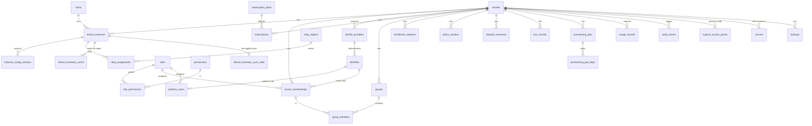

# Database Design

> **Trích sinh tự động** từ [implementation-master-plan.md](../planning/implementation-master-plan.md) bằng `tools/split_plan.py` — **không sửa tay**; sửa bản master rồi sinh lại.
> Nguồn: §6. Số mục `§` và các mã (HS-…, ADR-…, AC-…, T-…) tham chiếu theo bản master. Nhãn bằng chứng: xem [README](../README.md).

## 6. Database Architecture

### 6.1 Nguyên tắc

| Nguyên tắc | Quyết định |
|---|---|
| Phạm vi | **Một** PostgreSQL cho Management Plane (database `meshguard`). Headscale **không** dùng PostgreSQL này: mỗi instance giữ SQLite riêng (§6.5). |
| Khóa chính | UUID (ưu tiên UUIDv7 để index theo thời gian; sinh ở application nếu DB không có hàm native). Ngoại lệ có chủ đích: `permissions` (`key`), `system_settings` (`key`), `sessions` (`id_hash`), `auth_requests` (`state_hash`), `tenant_keys` (`tenant_id`), các bảng nối/khóa ghép (`role_permissions`, `group_members`, `identity_links`, `idempotency_keys`) và hai bảng partition (`audit_events`, `usage_records`: khóa ghép chứa khóa partition). |
| Tenant-scoped FK | Mọi bảng thuộc tenant có `tenant_id uuid NOT NULL`; bảng cha có `UNIQUE (tenant_id, id)`; bảng con tham chiếu bằng FK ghép `(tenant_id, parent_id)` ⇒ DB tự chặn tham chiếu chéo tenant. |
| Row-Level Security | `ENABLE` + `FORCE ROW LEVEL SECURITY` trên mọi bảng tenant-scoped. Policy **không** ép kiểu trực tiếp `current_setting(...)::uuid` (trên kết nối trong pool đã từng `SET LOCAL`, giá trị còn lại sau transaction là chuỗi rỗng và ép kiểu sẽ lỗi) mà dùng hai hàm `STABLE` tạo ở migration đầu tiên: `app_tenant_id()` = `NULLIF(current_setting('app.tenant_id', true), '')::uuid` và `app_is_platform()` = `COALESCE(current_setting('app.scope', true), '') = 'platform'`. Bảng **T**: `USING (tenant_id = app_tenant_id()) WITH CHECK (tenant_id = app_tenant_id())`; bảng **T+P**: hai policy theo role — `TO mg_app_tenant USING (tenant_id = app_tenant_id())` (không có nhánh platform) và `TO mg_app_platform USING (tenant_id = app_tenant_id() OR app_is_platform())`; riêng `tenants` so sánh cột `id`. Mọi truy vấn chạy trong `store.WithTenantTx` (đặt `app.scope='tenant'` + `app.tenant_id`) hoặc `store.WithPlatformTx` (đặt `app.scope='platform'`, xóa `app.tenant_id`); lint cấm dùng pool trực tiếp. RLS là lớp 4/5 chống lỗi BOLA (§8.8: sau route authz, kiểm tra object ở service và repository scope) — **không** chống được application đã bị chiếm quyền. |
| DB roles | `mg_migrator` (owner, chỉ chạy migration) · role đăng nhập của ứng dụng tách theo **tiến trình × phạm vi**: `mg_api_tenant`, `mg_api_platform`, `mg_worker_tenant`, `mg_worker_platform` — mỗi role là thành viên của đúng **một** role nhóm `NOLOGIN` mang policy RLS: `mg_app_tenant` (chỉ nhánh `tenant_id = app_tenant_id()`) hoặc `mg_app_platform` (thêm nhánh `app_is_platform()`), nên kết nối của pool tenant đặt `app.scope` thế nào cũng không thấy hàng của tenant khác; `WithTenantTx` chỉ lấy kết nối từ pool tenant, `WithPlatformTx` chỉ từ pool platform; mỗi tiến trình có hai DSN/mật khẩu riêng; tất cả `NOBYPASSRLS`, không DDL; quyền bảng cấp theo tiến trình, và policy theo **role** ẩn DEK/secret phạm vi `platform_ops` khỏi các role `mg_api_*` (§7.6) · `mg_audit_writer` (chỉ `INSERT` vào `audit_events`) · `mg_partition_maint` (chỉ sở hữu hai bảng cha được partition; dùng cho job `partition.maintain`) · `mg_backup` (chỉ `SELECT` + `BYPASSRLS`; chỉ service `pg-backup` dùng, vì `pg_dump` phải đọc hết các bảng `FORCE ROW LEVEL SECURITY` — VERIFIED (functional, P2-T03a): `pg_dump` đặt `row_security = off`, role không `BYPASSRLS` (kể cả owner `mg_migrator`) nhận 42501 trên các bảng đó thay vì dump thiếu hàng, `mg_backup` dump đủ và diễn tập restore khớp số hàng + băm; mật khẩu trong `mg-sec-backup`) · `mg_readonly` (chỉ `SELECT` trên view/bảng tổng hợp phục vụ báo cáo; **không** có quyền trên bảng có RLS, `identities`, `sessions`, `secrets` — biến `app.*` role nào cũng tự đặt được, nên RLS chỉ có nghĩa với role do ứng dụng kiểm soát). Không service nào dùng superuser. Quyền chỉ cấp trên bảng cha, **không** qua default privileges (RLS của bảng cha không áp dụng khi truy vấn thẳng partition); `REVOKE TRUNCATE`. |
| Platform scope | Bảng registry (`tenants`, `tenant_instances`, `hosts`, `provisioning_jobs`, `usage_records`…) có nhánh platform `app_is_platform()` (bảng **T+P** — xem hàng Row-Level Security). Bảng **nội bộ tenant** (`device_inventory_cache`, `policy_versions`, `enrollment_requests`, `groups`, `network_resources`, `dns_records`) **không** có nhánh platform: nhân sự nền tảng muốn đọc phải có Support Access Grant và đặt đúng `app.tenant_id`. `WithTenantTx` với actor loại support bắt buộc nhận `support_grant_id` và, ngay sau khi đặt ngữ cảnh, kiểm trong cùng transaction rằng grant còn hiệu lực (đúng tenant, đúng grantee, đã duyệt, chưa hết hạn/thu hồi) — không đạt ⇒ hủy transaction trước mọi truy vấn khác (áp dụng từ khi có bảng `support_access_grants`, migration `0023`). |
| Optimistic concurrency | Cột `version bigint` tăng mỗi lần cập nhật; API trả `ETag`, yêu cầu `If-Match` cho `PUT/PATCH/DELETE` trên tài nguyên có thể sửa đồng thời (tenant, policy draft [cột `revision`, vì `policy_versions.version` là số thứ tự policy], group, resource, settings). Xung đột ⇒ `409`/`412`. |
| Secrets | Không lưu plaintext. Bảng nghiệp vụ chỉ giữ **secret reference** `mgsec://<tenant_id\|platform>/<name>#<version>`; giá trị nằm trong SecretStore (§7.6). |
| Migrations | File SQL forward-only, đánh số, chạy bằng job `migrate` riêng trước khi rollout; áp dụng mẫu expand → migrate → contract; mọi migration phải có test up trên bản sao dữ liệu và kế hoạch rollback (restore hoặc migration bù). |
| Audit history & partition | `audit_events`: `PRIMARY KEY (occurred_at, id)`, `PARTITION BY RANGE (occurred_at)` theo tháng. `usage_records`: `PRIMARY KEY (period_start, id)`, `UNIQUE (tenant_id, metric, period_start)`, `PARTITION BY RANGE (period_start)` — PostgreSQL yêu cầu khóa chính/unique của bảng partition phải chứa khóa partition. Job hằng ngày `partition.maintain` (role `mg_partition_maint`, DSN riêng) tạo sẵn partition cho 3 tháng tới và, sau khi export, detach + drop partition quá hạn retention; có partition `DEFAULT` kèm cảnh báo khi có hàng rơi vào. `audit_events` append-only (REVOKE `UPDATE/DELETE/TRUNCATE`, trigger chặn); retention của audit chỉ thực hiện bằng drop partition, **không** qua `retention.sweep`. Hash-chain theo tenant là hạng mục Phase 6. |
| Đường ghi audit | Sự kiện của thao tác **thành công** được role ứng dụng ghi trong **cùng transaction** với thay đổi nghiệp vụ (trên `audit_events` role ứng dụng chỉ có `SELECT` và `INSERT`). Sự kiện `denied`/`failure` — khi transaction nghiệp vụ rollback hoặc chưa mở — ghi bằng `AuditLogger.RecordDetached()` trên pool riêng dùng role `mg_audit_writer` (policy chỉ `INSERT`). Thao tác gọi Headscale hoặc chạy bằng job ghi **hai** sự kiện nối bằng `operation_id`: `*.requested` (commit **trước** lời gọi ngoài) và `*.succeeded`/`*.failed` — tiến trình chết giữa chừng vẫn để lại `*.requested` cho reconcile. Từ chối chéo tenant: `tenant_id` = tenant của **actor** (NULL nếu actor là nhân sự nền tảng), `target_tenant_id` = tenant trong path; chuỗi từ chối chéo tenant bất thường (§8.8 — quy tắc của P2-T08: cùng một actor ≥ 5 lần trong 10 phút) sinh `security_events` phạm vi platform — tenant đích **không** thấy danh tính actor. `actor_display` là snapshot lúc ghi (`actor_identity_id` không có FK nên identity bị xóa không ảnh hưởng). Audit của tenant đã xóa **không** bị purge theo tenant: giữ tới khi partition hết retention. |
| Retention | Xem §6.4. **Hiện thực (P3-T09):** job định kỳ `tenant.keys_destroy` hủy mọi DEK + mọi version secret của tenant `deleted` khi `keys_destroy_after` (= `deleted_at` + `MG_DEPROVISION_KEY_GRACE`, mặc định 30 ngày) đã qua, sau khi purge issuer IdP; xóa vật lý dữ liệu nghiệp vụ của tenant đã xóa chưa làm (việc để lại của P3-T09). Xóa tenant = xóa dữ liệu nghiệp vụ sau grace period + hủy DEK của tenant — việc này chỉ làm mất khả năng đọc **secret** và đường restore online của tenant: wrapped DEK còn nằm trong dump/WAL PostgreSQL tới hết retention của backup PostgreSQL, còn dữ liệu nghiệp vụ không mã hóa bằng DEK nên phải được **xóa vật lý** + giữ audit của tenant tới khi partition hết retention (không purge theo tenant). |

### 6.2 ERD (rút gọn — quan hệ chính)

### 6.3 Danh mục bảng

Ký hiệu RLS: **T** = chỉ theo `app.tenant_id` · **T+P** = tenant hoặc platform scope · **P** = chỉ platform scope · **—** = bảng tham chiếu toàn cục.

| Bảng | Mục đích | Cột chính | Ràng buộc / index đáng chú ý | RLS |
|---|---|---|---|---|
| `tenants` | Tenant Registry | `id, slug (citext, bất biến, DNS label), name, status, deployment_region, settings jsonb (xem `TenantSettings` ở §13.3), desired_policy_version_id, created_at, updated_at, deleted_at, keys_destroy_after (mốc hủy DEK của tenant `deleted` — P3-T09), version` | partial `UNIQUE(slug) WHERE status <> 'deleted'` (slug của tenant đã xóa chỉ được dùng lại khi không còn object nào của instance cũ — §11.4: instance chưa `removed`, backup chưa purge, IdP chưa vô hiệu, DEK chưa hủy); `CHECK (keys_destroy_after IS NULL OR (status = 'deleted' AND keys_destroy_after >= deleted_at))`; `status ∈ {pending, provisioning, active, suspended, deprovisioning, deleted, failed}` | T+P |
| `hosts` | Host chạy instance (1 host ở MVP) | `id, name, region, agent_endpoint, agent_identity, status, capacity jsonb, public_entry jsonb (ipv4/ipv6 [để trống ở MVP — §15.4]/chế độ vào: direct \| vps_gateway), run_uid_range int4range (dải UID cấp cho instance; không trùng UID trong /etc/passwd và không chồng các dải trong /etc/subuid của host — Agent kiểm qua HostInfo), stun_port_range int4range NULL (chỉ cho phương án dự phòng per-tenant STUN), tenant_net_pool cidr (dải cấp subnet /29 cho network tenant; không chồng dải LAN, pool của Docker và 100.64.0.0/10), last_heartbeat_at` | `UNIQUE(name)`. Chi tiết của 0014 (P3-T04): `status ∈ {active, draining, disabled}` (placement chỉ chọn `active`; `draining` giữ instance đang có, không nhận mới); `capacity` đúng một khóa `max_instances` — số nguyên 0…2³¹−1, trần instance chưa `removed` (DEFAULT, và giá trị điền cho host đã có, = 100: mức tạm tính của P1-T20); `public_entry` ⊆ {`ipv4` (thập phân chuẩn, unicast dùng được, ngoài `tenant_net_pool`), `mode` ∈ {`direct`, `vps_gateway`}} — khóa `ipv6` chưa nhận ở MVP; placement không chọn host chưa có `ipv4`; `tenant_net_pool` IPv4 /8…/29, không chồng `100.64.0.0/10`; `run_uid_range` hữu hạn trong 1000…2³¹−2 (không chứa UID/GID của service core — kiểm ở code theo `versions.lock [ids]`, như Agent); `stun_port_range` hữu hạn trong 1024…65535. API `/platform/hosts` (P3-T04) kiểm trùng đúng các CHECK này trước khi ghi (`422` theo trường); bảng không có cột `version` nên `ETag` của host là hash cấu hình do người vận hành quản lý (`region`, `status`, `capacity`, `public_entry`, các dải) — `last_heartbeat_at` không làm nó đổi; `region` và các dải cấp phát không đổi được khi host còn instance chưa `removed` (`409`) | P |
| `tenant_instances` | Ánh xạ tenant → Headscale instance | `id, tenant_id, host_id, status (enum TenantInstanceStatus — §13.3), headscale_version, image_digest, control_hostname, server_url, base_domain, internal_address, stun_port (NULL khi dùng STUN chung), derp_region_id, config_version_id, api_key_secret_ref, api_key_prefix, api_key_expires_at, noise_key_fingerprint, run_uid, net_cidr cidr, data_path, last_health_at, last_health jsonb, version` | partial `UNIQUE(control_hostname) WHERE status <> 'removed'`; partial `UNIQUE(host_id, stun_port) WHERE stun_port IS NOT NULL AND status <> 'removed'`; `UNIQUE(host_id, run_uid)` — UID **không tái sử dụng**, kể cả sau khi instance `removed` (dữ liệu lưu trữ và backup cũ còn mang UID đó); dải `hosts.run_uid_range` dành riêng cho instance tenant và không chứa UID:GID số nào của service core (ghim ở `versions.lock`; các UID này có thể không có trong `/etc/passwd` của host nên được đối chiếu riêng khi khai báo dải cho host); partial `UNIQUE(tenant_id) WHERE status <> 'removed'` (MVP: 1 instance hoạt động/tenant); partial `UNIQUE(host_id, net_cidr) WHERE status <> 'removed'`. Chi tiết của 0014 (P3-T04): `net_cidr` là đúng một /29 IPv4 ⇒ partial unique trên tương đương "không chồng nhau" giữa các instance chưa `removed` của một host; `run_uid` trong 1000…2³¹−2; không role ứng dụng nào có `DELETE`/`TRUNCATE` trên bảng — điều kiện của "UID không tái sử dụng" | T+P |
| `instance_config_versions` | Lịch sử cấu hình đã render (không chứa secret) | `id, tenant_id, instance_id, version, template_version, params jsonb, rendered_config, config_sha256, status, created_by, applied_at` | `UNIQUE(instance_id, version)`. Ứng dụng (P3-T05, P3-T13): `params` = toàn bộ tham số có kiểu đã gửi Agent (render lại được một version chỉ từ nó); `status` ∈ {`pending` (đã ghi, chưa chạy), `applied` (đang hiệu lực — đúng hàng `tenant_instances.config_version_id` trỏ tới), `superseded`, `failed` (đã lùi)} — bước 8 của provisioning ghi thẳng `applied`, giá trị DEFAULT `rendered` của 0001 không dùng; chưa có CHECK (thêm bằng migration khi cần) | T+P |
| `identity_providers` | Đăng ký IdP của platform hoặc của tenant = (issuer, client, ràng buộc tổ chức) | `id, scope, tenant_id (NULL nếu platform), issuer, client_id, client_secret_ref, required_claims jsonb, require_email_verified, allowed_email_domains text[], claim_mapping jsonb, driver, driver_ref, status (pending\|active\|retiring\|disabled)` | `UNIQUE(issuer, client_id)` (một issuer có thể phục vụ nhiều tổ chức — ví dụ Google Workspace); partial `UNIQUE(tenant_id) WHERE status='active'`; `CHECK (scope='platform') = (tenant_id IS NULL)`; `CHECK` owner segment của `client_secret_ref` = `tenant_id` (`platform` khi `tenant_id` NULL) — G2 F3; `required_claims` **bắt buộc** với issuer dùng chung nhiều tổ chức; `UNIQUE(id, scope)` và `UNIQUE(id, tenant_id)` (đích FK ghép từ `identities`); `tenant_id`, `scope`, `issuer` bất biến | T+P |
| `identities` | Danh tính (iss+sub): tạo ở lần đăng nhập đầu, hoặc tạo sẵn theo `sub` bởi lệnh bootstrap/seed và `POST /platform/users` (§8.2) | `id, idp_id, tenant_id NULL, scope (platform\|tenant), subject, email citext, email_verified, display_name, status (active\|disabled), last_login_at` | `UNIQUE(idp_id, subject)`; `UNIQUE(tenant_id, id)`; `UNIQUE(id, scope)`; `CHECK (status IN ('active','disabled'))` — identity `disabled` không đăng nhập được và mọi session của nó bị từ chối (P2-T06); `tenant_id`/`scope` sao chép từ IdP và được ràng buộc bằng FK ghép `(idp_id, scope)` — và `(idp_id, tenant_id)` với hàng tenant — tới `identity_providers`; `CHECK ((scope='platform') = (tenant_id IS NULL))`; `idp_id`, `tenant_id`, `scope` bất biến (role ứng dụng không có quyền `UPDATE` trên các cột này) | T+P (module `identity` phân giải session → identity trong `WithPlatformTx`) |
| `platform_users` | Vai trò platform | `id, identity_id, role_id, status, created_by` | `UNIQUE(identity_id)`; cột `identity_scope` `CHECK (= 'platform')` + FK `(identity_id, identity_scope) → identities(id, scope)`; cột `role_scope` `CHECK (= 'platform')` + FK `(role_id, role_scope) → roles(id, scope)` (không dùng trigger); `status ∈ {active, disabled}` (CHECK của 0025 — P4-T03a: `DELETE /platform/users/{id}` = `disabled`, hàng không bị xóa; khóa/đổi role thu hồi mọi session của người đó cùng transaction); role `super_admin` chỉ đổi qua `PUT /platform/users/{id}/super-admin-role` (2P, cùng khóa advisory với `bootstrap-super-admin`) | P |
| `tenant_memberships` | Vai trò trong tenant + liên kết Headscale user | `id, tenant_id, identity_id, role_id, status, headscale_user_id, headscale_username, invited_by, version` | `UNIQUE(tenant_id, identity_id)`; `UNIQUE(tenant_id, headscale_username)`; partial `UNIQUE(tenant_id, headscale_user_id) WHERE headscale_user_id IS NOT NULL`; FK ghép `(tenant_id, identity_id) → identities(tenant_id, id)` — issuer binding khai báo, không dùng trigger (trigger không chạy khi `identities`/`identity_providers` đổi và phép tra của nó bị RLS lọc); cột `role_scope` `CHECK (= 'tenant')` + FK `(role_id, role_scope) → roles(id, scope)`. `headscale_username` = `mg-<membership_uuid>` (tính được trước khi Headscale user tồn tại). `status ∈ {active, locked, offboarded}` (CHECK của `0024`, P4-T09): `locked` khóa Portal (mở lại được), `offboarded` là trạng thái cuối — trạng thái hai pha của offboard đọc từ job `member.offboard` mới nhất của membership (index `provisioning_jobs (tenant_id, resource_type, resource_id, …)` của `0024`) | T |
| `tenant_invitations` | Lời mời người **chưa từng đăng nhập** (chưa có hàng `identities`) | `id, tenant_id, idp_id, email citext, role_id, invited_by_identity_id, token_hash, expires_at, status (pending\|accepted\|revoked\|expired), accepted_identity_id, accepted_at, version` | partial `UNIQUE(tenant_id, email) WHERE status='pending'`. Membership chỉ được tạo khi một identity đăng nhập qua **đúng IdP của tenant**, có email đã xác minh trùng lời mời, đổi token còn hạn — không bao giờ liên kết chỉ bằng email ngoài một lời mời đang chờ. Ràng buộc khai báo (0009, P3-T06): FK ghép `(idp_id, tenant_id) → identity_providers(id, tenant_id)`, `(tenant_id, accepted_identity_id) → identities(tenant_id, id)` và `(accepted_identity_id, idp_id) → identities(id, idp_id)` (UNIQUE `(id, idp_id)` thêm vào `identities` ở 0009) — identity nhận lời mời phải thuộc đúng IdP ghi trong lời mời; cột `role_scope` `CHECK (= 'tenant')` + FK `(role_id, role_scope) → roles(id, scope)`; `token_hash` = SHA-256 (32 byte, `UNIQUE`); `status='accepted'` ⇔ có `accepted_identity_id` và `accepted_at`. Ứng dụng (P3-T05a): "chưa từng đăng nhập" = `identities.last_login_at` NULL (chỉ lần đăng nhập hoàn tất — cùng transaction với session — mới đặt nó); ở lần đăng nhập đầu của identity tenant chưa có membership, callback tạo hàng `(idp_id, sub)` rồi gắn lời mời `pending` của email đã xác minh (không phân biệt hoa thường) nếu lời mời ghi đúng IdP và còn hạn — tạo membership với role và `invited_by` của lời mời, lời mời `accepted` (một lần); không gắn được ⇒ **từ chối đăng nhập** (403, lý do `no_invitation` / `invitation_idp_mismatch` / `invitation_email_not_verified` / `invitation_expired`, audit) và identity vẫn "chưa từng đăng nhập" nên lời mời gửi lại sau đó vẫn gắn được; identity đã từng đăng nhập không bao giờ được gắn theo email. Token: 32 byte ngẫu nhiên mỗi lần tạo/gửi lại, chỉ đưa cho notifier (hook của P3-T05b) trong transaction; outbox `tenant.invitation` không chứa token; API không bao giờ trả token | T |
| `identity_links` | Chuyển membership khi tenant đổi IdP | `tenant_id, old_identity_id, old_idp_id, new_identity_id, new_idp_id, linked_at, linked_by` | Người dùng phải chứng minh cả hai identity trong một phiên; có step-up + audit; **chưa dùng ở MVP** — bảng tạo sẵn ở `0023`, luồng liên kết thuộc P7-T06. Chi tiết của 0023 (P4-T05): `PRIMARY KEY (tenant_id, old_identity_id)` (mỗi identity cũ liên kết một lần), `UNIQUE (tenant_id, new_identity_id)`; FK ghép `(tenant_id, old_identity_id)`/`(tenant_id, new_identity_id) → identities(tenant_id, id)` và `(old_identity_id, old_idp_id)`/`(new_identity_id, new_idp_id) → identities(id, idp_id)`; `CHECK` hai identity khác nhau và hai IdP khác nhau; chưa cấp quyền cho role ứng dụng nào (P7-T06 cấp) | T |
| `roles` / `permissions` / `role_permissions` | Mô hình RBAC (seed `database/seeds/rbac.sql` sinh từ §8.4–§8.6, áp sau mỗi lần migrate — P2-T07) | `roles(id, scope, key, name, rank, is_system)` — `scope` ∈ {`platform`, `tenant`, `support`} (`support` = role hiệu lực của Support Access Grant, cột Staff của §8.6 — không gán được qua `platform_users`/`tenant_memberships`); `rank` = thứ bậc trong cùng phạm vi (quy tắc 3a của §8.4 so "thấp hơn hẳn"); `permissions(key, scope, description)`; `role_permissions(role_id, role_scope, permission_key, permission_scope, scope, condition)` — `scope` ∈ {`any`, `own`}; `own` là ô ○ của §8.6; `condition` = ô có điều kiện của ma trận (Authorizer từ chối grant có điều kiện khi operation chưa khai báo xử lý) | `UNIQUE(scope, key)`; `UNIQUE(id, scope)` (đích FK ghép kiểm scope của role); `permissions`: tiền tố khóa = `scope`, `UNIQUE(key, scope)`; `role_permissions`: FK ghép `(role_id, role_scope) → roles(id, scope)` và `(permission_key, permission_scope) → permissions(key, scope)`, `CHECK ((role_scope='platform') = (permission_scope='platform'))`, `CHECK (scope='any' OR role_scope='tenant')` (không trigger); role ứng dụng chỉ `SELECT` | — |
| `sessions` | Phiên đăng nhập phía server (BFF) | `id_hash, public_id, identity_id, idp_id, origin (app\|admin), created_at, last_seen_at, auth_time, idle_expires_at, absolute_expires_at, ip, user_agent, acr, amr, revoked_at` | Lưu **hash** của session id; không chứa role (§8.3 bước 8); index `(identity_id) WHERE revoked_at IS NULL` (thu hồi mọi phiên của một identity). Ngoài module identity chỉ có một người ghi: lệnh `post-restore-reconcile` (P3-T17, trong container worker) thu hồi mọi phiên tạo trước lúc nó chạy — `mg_worker_platform` có `UPDATE (revoked_at, id_token_hint_enc)` từ `0018`, không cột nào khác | — (chỉ module identity; thu hồi sau restore: P3-T17) |
| `auth_requests` | Trạng thái một lượt đăng nhập OIDC đang chờ callback | `state_hash (PK), idp_id, tenant_id NULL, scope, origin, nonce, pkce_verifier_enc, return_to, browser_binding_hash, created_at, expires_at (≤ 10 phút), consumed_at` | Dùng một lần; ràng buộc với cookie `__Host-mg_authreq`; callback phải khớp `idp_id` **trước** khi gọi token endpoint | — (chỉ module identity) |
| `approval_requests` | Dual control (2P) cho thao tác nhạy cảm | `id, scope (platform\|tenant), tenant_id NULL, action, resource_type, resource_id, payload jsonb (không chứa secret), payload_sha256, requested_by_identity_id, approved_by_identity_id, decided_at, status (pending\|approved\|rejected\|expired\|executed), reason, expires_at, job_id` | `CHECK (approved_by_identity_id <> requested_by_identity_id)`; job chỉ được enqueue sau khi duyệt; payload thay đổi sau khi duyệt ⇒ từ chối thực thi; `payload` = tham số đã chuẩn hóa, không chứa secret — hiển thị **nguyên văn** cho người duyệt và là đầu vào duy nhất của job (`payload_sha256` tính trên chính nó); yêu cầu chưa được duyệt hết hạn theo `expires_at` — thời hạn mặc định cấu hình được nêu ở §8.6; chuyển `executed` + ghi `job_id` trong **cùng transaction** enqueue job (dùng một lần, không replay). Chi tiết của 0009 (P3-T06): `CHECK ((scope='platform') = (tenant_id IS NULL))` — yêu cầu 2P của nền tảng **về** một tenant (xóa, restore) ghi đích ở `resource_type`/`resource_id`, nên pool tenant không bao giờ thấy nó; người yêu cầu/người duyệt ràng buộc bằng FK ghép `(identity_id, scope) → identities(id, scope)` và `(tenant_id, identity_id) → identities(tenant_id, id)` (identity của tenant không duyệt được yêu cầu platform, identity của tenant khác không duyệt được yêu cầu tenant); `payload_sha256` hex; `approved`/`executed` ⇒ có người duyệt + `decided_at`, `rejected` ⇒ có `decided_at`, `pending` ⇒ chưa có cả hai; `job_id` chỉ ở `executed` (FK tới `provisioning_jobs`, ghép theo tenant với hàng tenant; job bị retention xóa ⇒ `NULL`); `payload`, `payload_sha256`, người yêu cầu, đích, `expires_at` bất biến (không cấp `UPDATE`). Ứng dụng (P3-T04a, `internal/authz/approvals`): `payload` là JSON **chuẩn hóa** (khóa sắp theo byte, không khoảng trắng, không escape HTML, chỉ số nguyên, ≤ 8 KiB) và `payload_sha256` tính trên đúng chuỗi đó; người duyệt gửi lại hash đã xem (khác ⇒ `412`), trước khi duyệt và trước khi thực thi payload được chuẩn hóa + băm lại (lệch ⇒ `409` + `security_event` `approval.payload_integrity`, không chạy); `approved_by_identity_id` là **người quyết định** (duyệt hoặc từ chối — CHECK chặn cả tự từ chối); duyệt và thực thi là hai transaction: thực thi lỗi ⇒ yêu cầu ở `approved`, chính người duyệt gọi lại để thử lại (không duyệt lần hai); quá `expires_at` ⇒ `expired` khi bị chạm tới; thời hạn mặc định 24 giờ, ghi đè bằng `system_settings` khóa `approval.ttl_hours` (1–168); yêu cầu còn mở cùng thao tác + tài nguyên không được mở thêm | T+P |
| `support_access_grants` | Quyền hỗ trợ có thời hạn vào tenant | `id, tenant_id, grantee_platform_user_id, requested_by_platform_user_id, effective_role_key, reason, ticket_ref, approval_kind (tenant\|breakglass), approved_by_membership_id, approved_by_platform_user_id, decided_at, starts_at, expires_at, revoked_at, status, version` | `CHECK (expires_at - starts_at <= interval '8 hours')` (mặc định); trigger: `approval_kind='tenant'` ⇒ người duyệt phải là membership đang hoạt động của chính tenant đó có quyền `tenant.support_grant:decide`; `breakglass` ⇒ người duyệt là Super Admin đang hoạt động, khác người yêu cầu. Chi tiết của 0023 (P4-T05): người quyết định ghi bằng hai cột thay cho `approved_by_identity_id` — `approved_by_membership_id` (kiểu `tenant`, FK ghép `(tenant_id, …) → tenant_memberships`) hoặc `approved_by_platform_user_id` (kiểu `breakglass`, FK → `platform_users`), đúng một cột theo `approval_kind` — để mọi ràng buộc phạm vi là FK khai báo; người yêu cầu `requested_by_platform_user_id` (FK → `platform_users`); role hiệu lực FK `(effective_role_scope='support', effective_role_key) → roles(scope, key)`; `status ∈ {pending, approved, rejected, revoked, expired}` — grant luôn tạo ở `pending`; `approved`/`rejected` ⇒ có quyết định (`approval_kind` + người + `decided_at`), từ chối chỉ kiểu `tenant`; `revoked` ⇔ có `revoked_at`; break-glass: người duyệt ≠ người yêu cầu, ≠ grantee (CHECK), người yêu cầu cũng phải là Super Admin đang hoạt động ("hai Super Admin" — §8.7). Trigger `mg_support_grant_guard` (SECURITY INVOKER, chạy dưới RLS của người gọi — ngữ cảnh sai ⇒ từ chối): kiểm người quyết định lúc `pending → approved/rejected` (42501), cấm duyệt khi cửa sổ đã hết, cấm đổi quyết định/cửa sổ sau khi quyết định, `rejected`/`revoked`/`expired` là trạng thái cuối, `approved → revoked/expired`, `pending → revoked/expired` không mang quyết định (23514). Quyền: api tenant ghi quyết định kiểu `tenant` + thu hồi, api platform tạo + quyết định break-glass + thu hồi, worker platform chỉ `status`, `revoked_at` (job `grant.expire`; `post-restore-reconcile` của P3-T17 thu hồi grant `approved` và cho hết hạn grant `pending` của bản dump), mọi pool đọc, không ai xóa. `0026` (P4-T13): cột `grantee_display` — ảnh chụp tên hiển thị của grantee lúc xin (pool tenant không đọc được `platform_users`/identity phạm vi platform; tenant phải thấy ai xin quyền — §8.7 bước 3), không role nào được `UPDATE` | T+P |
| `groups` / `group_members` | Nhóm người dùng của tenant (biên dịch vào policy) | `groups(id, tenant_id, name, description, source, version)`; `group_members(tenant_id, group_id, membership_id)` | `UNIQUE(tenant_id, name)`; FK ghép theo tenant. Chi tiết của 0021 (P4-T05): `name ~ '^[a-z][a-z0-9-]{0,49}$'` (render thành `group:<name>`; không trùng khác hoa thường); `source ∈ {portal, idp}` (MVP chỉ `portal`); cờ *sensitive* nằm ở `TenantSettings.policy.sensitive_groups` (§13.3), không ở bảng; `group_members` khóa chính `(group_id, membership_id)`, FK ghép tới `groups` (`ON DELETE CASCADE`) và `tenant_memberships` (không `ON DELETE` — gỡ thành viên đi qua module members để sinh `policy.apply`); api tenant CRUD, worker tenant chỉ đọc (renderer) | T |
| `tenant_tags` | Danh mục tag của tenant (nguồn render `tagOwners`; đích của `tag_id` trong policy) | `id, tenant_id, name, purpose (router\|exit\|server\|custom), platform_managed, description, version` | `UNIQUE(tenant_id, name)`; `CHECK (name ~ '^tag:[a-z][a-z0-9-]{0,49}$')`; không xóa được khi còn thiết bị, key hoặc grant tham chiếu; các cột `tags text[]` ở bảng khác chỉ nhận tên có trong danh mục (kiểm ở service). Chi tiết của 0021 (P4-T05): `name`, `purpose` bất biến (thiết bị ở Headscale mang đúng chuỗi tên; router/exit là tag nền tảng cho `autoApprovers`); tag `platform_managed` chỉ đọc với api tenant — ba policy `RESTRICTIVE` (`INSERT`/`UPDATE`/`DELETE`) của `mg_api_tenant`; worker tenant chỉ đọc. Hiện thực P4-T15 (`internal/policies` tags): tenant chỉ khai báo `purpose` `server`/`custom` (`router`/`exit` là tag nền tảng); `version` = ETag (`If-Match` của `PATCH`/`DELETE`); "được tham chiếu" khi xóa = thiết bị chưa `removed` mang tag, `enrollment_requests` còn phát/dùng được key (`requested`/`pending_approval`/`approved`/`credential_issued`, hoặc `consumed` reusable còn hạn), `network_resources.tags`, hoặc policy còn áp được (version chưa `superseded`/`rejected`, version mong muốn, chuỗi đang áp) tham chiếu tag **ngoài** `tagOwners`; kiểm danh mục trong transaction của người gọi khóa `FOR SHARE` (lần xóa đồng thời — `FOR UPDATE` — chờ rồi thấy tham chiếu mới) | T |
| `device_inventory_cache` | Sổ thiết bị + cache node từ Headscale: các cột `id`, `owner_membership_id`, `enrollment_request_id`, `first_seen_at`, `revocation_*` là dữ liệu **authoritative của nền tảng** (không truncate/dựng lại); các cột còn lại là cache dựng lại được từ Headscale | `id, tenant_id, instance_id, headscale_node_id, machine_key, node_key, name, given_name, ip_addresses inet[], headscale_user_id, owner_membership_id, tags text[], register_method, online, last_seen, expiry, approved_routes cidr[], available_routes cidr[], subnet_routes cidr[], hs_created_at, first_seen_at, last_synced_at, sync_generation, removed_at, enrollment_request_id, revocation_state (none\|pending\|applied\|failed), revocation_kind (expire\|delete), revocation_requested_at, revocation_verified_at, revocation_job_id` | partial `UNIQUE(instance_id, headscale_node_id) WHERE removed_at IS NULL`; quy tắc sync: cùng `headscale_node_id` nhưng khác `machine_key` ⇒ đặt `removed_at` cho hàng cũ và chèn hàng mới (sau khi restore một bản SQLite cũ hơn, bộ đếm ID của Headscale lùi lại nên ID số được cấp lại cho node khác — VERIFIED (functional) trên 0.29.7, P2-T13: node đăng ký sau bản chụp, khôi phục bản chụp, máy khác đăng ký ⇒ nhận đúng node id cũ; sync gỡ hàng cũ, chèn thiết bị mới; ca restore đầy đủ vẫn thuộc P3-T11); index `(tenant_id, online)`, `(tenant_id, owner_membership_id)` | T |
| `device_inventory_sync_state` | Trạng thái đồng bộ sổ thiết bị theo instance (P2-T13): thế hệ và thời điểm snapshot (đồng hồ DB ngay trước `ListNodes`) của lần `inventory.sync` gần nhất **đã áp dụng** — nguồn `synced_at` của dashboard kể cả khi tailnet trống; cache, dựng lại được | `instance_id (PK), tenant_id, generation, synced_at NULL, node_count` | FK ghép `(tenant_id, instance_id) → tenant_instances(tenant_id, id)`; `instance_id`/`tenant_id` bất biến (chỉ cấp `UPDATE` cột `generation, synced_at, node_count`); lần sync khóa hàng (`FOR UPDATE`) và bỏ qua snapshot có thời điểm không mới hơn `synced_at` (snapshot cũ không đè snapshot mới; các lần sync của một instance tuần tự) | T |
| `enrollment_requests` | Yêu cầu thêm thiết bị | `id, tenant_id, instance_id, requested_by_membership_id, method (web_auth\|preauth_key\|oidc), target_membership_id, device_label, requested_tags text[], ephemeral, reusable, status (enum EnrollmentStatus — §13.3), approver_membership_id, approved_at, headscale_preauthkey_id, auth_id_hash, session_id_hash, enroll_code_hash, claimed_at, claimed_from_ip, registered_machine_key, reported_hostname, credential_expires_at, consumed_node_id, failure_code, requested_ttl_minutes` | Không lưu plaintext pre-auth key/Auth ID/mã enrollment; `status ∈ {requested, pending_approval, approved, rejected, awaiting_device, claimed, registered, verified, credential_issued, consumed, expired, revoked, failed}` (sơ đồ ở §7.4); partial `UNIQUE(tenant_id, auth_id_hash) WHERE auth_id_hash IS NOT NULL`; index `(tenant_id, status)`. Chi tiết của 0020 (P4-T05): cột thêm `issued_at` (lúc phát mã/lệnh hoặc key), `created_at`, `updated_at`, `version`; credential chỉ tồn tại sau `issued_at` và `credential_expires_at ≤ issued_at + 15 phút` (T-06); hash 32 byte; partial `UNIQUE(tenant_id, enroll_code_hash)`; người quyết định (`approver_membership_id`, duyệt hoặc từ chối) ≠ người yêu cầu, `approved` ⇒ `approved_at`; nội dung được duyệt (người yêu cầu, chủ thiết bị, phương thức, nhãn, `requested_tags`, `ephemeral`, `reusable`) bất biến; web-auth luôn là thiết bị của chính người yêu cầu, không tag; key chỉ-tag (không chủ) phải có tag; `reusable`/`ephemeral` chỉ ở pre-auth key; `awaiting_device`/`claimed` chỉ web-auth, `credential_issued`/`consumed` chỉ pre-auth key; `claimed` trở đi ⇒ `claimed_at` + Auth ID, `registered`/`verified`/`consumed` ⇒ `consumed_node_id`, `failed` ⇒ `failure_code`; FK ghép tới instance và ba membership; FK ghép `device_inventory_cache (tenant_id, enrollment_request_id)` không `ON DELETE` (liên kết authoritative — §6.4); api tenant tạo/duyệt/phát/claim, worker tenant reconcile + retention. `issued` (§7.4, `EnrollmentRequest.status` §13.3) là tên phía API của `awaiting_device`/`credential_issued`, không phải giá trị của cột. Chi tiết của 0027: `requested_ttl_minutes` (1–15, chỉ `preauth_key`, NULL = mặc định) — `ttl_minutes` người yêu cầu xin, ghi lúc tạo, không cấp `UPDATE`; `/start` của yêu cầu đã duyệt phát key theo nó (vẫn kẹp `preauth_key_ttl_max` hiện hành) | T |
| `policy_versions` | Nội dung policy đã soạn/đã duyệt (**không** chứa trạng thái áp dụng) | `id, tenant_id, version, revision, kind (user\|baseline\|suspension), source jsonb (principal là tham chiếu có kiểu — §7.2), source_hujson NULL, content_sha256, state, validation_report jsonb, parent_version_id, rollback_of, created_by, submitted_by, submitted_at, approved_by, approved_at, approved_content_sha256, review_mode (peer\|self), rejected_by, rejected_at, rejected_reason` | `UNIQUE(tenant_id, version)` (`version` = số thứ tự policy; `revision bigint` = bộ đếm khóa lạc quan của bản nháp, nguồn của `ETag`); `state ∈ {draft, validated, pending_approval, approved, rejected, superseded}`; mọi `PATCH` đưa version về `draft` và xóa phê duyệt. Chi tiết của 0013 (P3-T06): nội dung có **đúng một** dạng — `source` (mô hình có kiểu, P4-T10) hoặc cột `source_hujson` (văn bản HuJSON do nền tảng sinh hoặc nhập: baseline, suspension, fixture của lõi P3-T08a, chuỗi đang chạy nhập lại ở P3-T17 — kind `user`, trạng thái `validated` (lint lỗi ⇒ `draft`), không bao giờ `approved` do hệ thống; DB kiểm `content_sha256` = sha256 của chính chuỗi đó và chặn chuỗi rỗng — L2; lõi P3-T08a lưu fixture/baseline với `kind=baseline`, suspension với `kind=suspension`, cả hai do hệ thống duyệt); `kind ∈ {user, baseline, suspension}`; trường phê duyệt chỉ tồn tại ở `approved`/`superseded`; `approved` ⇒ `approved_at` + `approved_content_sha256 = content_sha256`, version `user` còn cần người duyệt + `review_mode` (baseline/suspension do hệ thống duyệt); `peer` ⇒ người duyệt ≠ người submit; `parent_version_id`, `rollback_of` là FK ghép trong cùng tenant; FK ghép `tenants(id, desired_policy_version_id) → policy_versions(tenant_id, id)` | T |
| `policy_applications` | Mỗi lần đẩy policy lên Headscale (đúng chuỗi byte đã gửi) | `id, tenant_id, instance_id, policy_version_id, trigger (bootstrap\|manual\|group_change\|resource_change\|tag_change\|suspend\|resume\|restore\|drift_repair\|rollback), inputs_sha256, applied_hujson, applied_sha256, state (pending\|applied\|failed\|unknown), headscale_updated_at, error_code, requested_by_identity_id, created_at, finished_at, superseded_at` | Partial unique: một hàng `applied` hiện hành cho mỗi instance — hiện hành = `superseded_at IS NULL` (0013: áp thành công lần mới ⇒ đặt `superseded_at` cho hàng cũ rồi mới đánh dấu hàng mới `applied`, cùng transaction); drift so `GetPolicy` với `applied_sha256` mới nhất. DB kiểm `applied_sha256` = sha256 của `applied_hujson` (chuỗi khác rỗng); `applied`/`failed` ⇔ có `finished_at`; `failed` ⇒ có `error_code`; nội dung đã gửi bất biến. Lõi P3-T08a: `applied_hujson` = HuJSON của version sau Standardize (bỏ comment, dấu phẩy thừa) và thụt lề chuẩn — đúng chuỗi gửi đi, so khớp nguyên văn với `GetPolicy`; `inputs_sha256` = `content_sha256` của version (chưa có phần render từ bảng). Từ P4-T15: `tagOwners` render từ `tenant_tags` lúc áp (owner rỗng, thay khóa `tagOwners` của nội dung tại chỗ hoặc thêm cuối; danh mục rỗng và nội dung không có `tagOwners` ⇒ chuỗi giữ nguyên byte) — khi có render, `inputs_sha256` = sha256 của `content_sha256` + danh sách tag đã render. Từ P4-T10 (version typed): `applied_hujson` = render tất định của `source` + bảng (`groups`, `hosts`, `tagOwners`), `inputs_sha256` = sha256 của `content_sha256` + `applied_sha256` (đổi bất kỳ đầu vào nào đều đổi chuỗi đã render) | T |
| `network_resources` | Network Resource Catalog | `id, tenant_id, name, kind (host\|subnet\|service), address, ports text[], protocol, tags text[], owner_group_id, description, version` | `UNIQUE(tenant_id, name)`. Chi tiết của 0022 (P4-T05): `name ~ '^[a-z][a-z0-9-]{0,62}$'` (alias của khóa `hosts`); `address cidr` — `host`/`service` đúng một địa chỉ, `subnet` prefix ngắn hơn, không có prefix độ dài 0; `ports` = cổng/dải (`443`, `8000-8100`; rỗng = mọi cổng), không đi với `icmp`, `service` phải có cổng; `protocol ∈ {tcp, udp, icmp}` hoặc NULL (mọi giao thức); `owner_group_id` FK ghép tới `groups` (xóa group còn sở hữu tài nguyên bị từ chối); api tenant CRUD, worker tenant chỉ đọc. Hiện thực P4-T12 (`internal/network`): CRUD qua API (`If-Match` = `version` cho `PATCH`/`DELETE`, `Idempotency-Key` khi tạo), tag kiểm theo danh mục trong cùng transaction (`policies.RequireTags`), mỗi thay đổi enqueue `policy.apply` (trigger `resource_change`); tài nguyên còn được version policy có kiểu còn áp được tham chiếu (principal `resource` — P4-T10) không xóa được (`409 resource_in_use`) | T |
| `dns_records` | Extra DNS records của tenant | `id, tenant_id, name, type (A\|AAAA), value inet, created_by` | `UNIQUE(tenant_id, name, type, value)`. Chi tiết của 0022 (P4-T05): `name` là FQDN chữ thường (≥ 2 nhãn, nhãn ≤ 63, tổng ≤ 253, không wildcard); `A` ⇔ IPv4 đơn, `AAAA` ⇔ IPv6 đơn; chỉ tạo/xóa (không có `UPDATE`); api tenant tạo/xóa, worker tenant chỉ đọc. Hiện thực P4-T12: lint T-09 — `value` phải là IP tailnet của một thiết bị của tenant hoặc nằm trong subnet route tenant đã duyệt (không tính exit node), tên dưới domain nền tảng chỉ trong MagicDNS domain của chính tenant; tối đa 1024 bản ghi; `DELETE` cần `If-Match` = hash nội dung bản ghi; mỗi thay đổi enqueue job `dns.records_write` (§13.5) | T |
| `provisioning_jobs` / `provisioning_job_steps` | Bảng job nghiệp vụ cho **mọi** job kind ở §13.5 — là read model của `GET /jobs` (tên bảng giữ theo lịch sử; tạo ở migration `0006`) | `jobs(id, tenant_id, instance_id, kind, request_key, dedupe_key, lock_key NULL, status, current_step, attempt, max_attempts, input jsonb, output jsonb, error jsonb ({code, message?, detail?}), resource_type, resource_id (Job.resource), queue_job_id (id job River đang chở job), requested_by, created_at, timeout_at, started_at, finished_at, cancel_requested_at NULL (lệnh `/cancel` trên job đang chạy — §11.3; migration `0015`))`; `steps(id, tenant_id NULL, job_id, seq, name, status (running\|succeeded\|failed\|skipped), attempt, started_at, finished_at, error_code, detail jsonb, created_resources jsonb, compensation_status (cùng tập, NULL = chưa compensation))` | `UNIQUE(requested_by, kind, request_key)` (chống lặp request của API); partial `UNIQUE(dedupe_key) WHERE status IN ('queued','running','compensating','failed_resumable')` (job đã kết thúc không chặn job mới; job `failed_resumable` chưa kết thúc nên vẫn giữ khóa, để `/retry` không bao giờ đụng job cùng khóa chen vào sau); partial `UNIQUE(lock_key) WHERE status IN ('running','compensating','failed_resumable')` (khóa chạy của nhóm lifecycle — §13.5 mục (d)); `status ∈ {queued, running, failed_resumable, compensating, rolled_back, succeeded, failed, cancelled}`; `CHECK (lock_key = 'tenant:' \|\| tenant_id \|\| ':lifecycle')` (khóa chạy luôn của chính tenant của job); `error.code` và `steps.error_code` theo `^[a-z][a-z0-9_]{0,63}$`; độ dài `request_key`/`dedupe_key` 1–255; `(resource_type IS NULL) = (resource_id IS NULL)`; `CHECK (cancel_requested_at IS NULL OR status <> 'queued')`; `UNIQUE(job_id, seq)`, `UNIQUE(job_id, name)`; index cho danh sách `(tenant_id, created_at, id)`/`(created_at, id)`, cho `job.reaper` (job chưa kết thúc) và `retention.sweep` (`finished_at`) (P2-T12) | T+P |
| `relay_regions` / `relay_assignments` | Relay plane | `regions(id, code, name, kind (embedded\|standalone\|shared), derp_region_id, hostname, ipv4, ipv6, stun_port, derp_port, verify_mode, host_id, tenant_id NULL, status)`; `assignments(id, tenant_id, instance_id, relay_region_id, priority, status)` | embedded ⇒ `tenant_id NOT NULL`. Chi tiết của 0010 (P3-T06): `CHECK ((kind='shared') = (tenant_id IS NULL))` (embedded và standalone thuộc một tenant; region dùng chung chỉ pool platform thấy); `verify_mode ∈ {in_process, verify_url}` (không có giá trị "không xác minh"), embedded ⇒ `in_process`; `derp_region_id` 900–999 (§10.1); `status ∈ {pending, active, disabled}` cho cả hai bảng (trạng thái quản trị; sức khỏe đo được nằm ở kết quả Prober); `UNIQUE NULLS NOT DISTINCT (tenant_id, code)`; assignment: FK ghép `(tenant_id, instance_id)` và `(tenant_id, relay_region_id) → relay_regions(tenant_id, id)` — ở MVP chỉ gán được region của chính tenant (gán region dùng chung — §10.5, Phase 7 — cần migration mở rộng); chỉ pool platform của worker ghi (bước 17 §11.3). Chi tiết của 0016 (P3-T05c, số hiệu tạm): `relay_regions.last_probe jsonb` + `last_probe_at` = kết quả probe gần nhất đã ghi (job `relay.probe` — §13.5: trạng thái, mã lý do ổn định, mỗi phép kiểm `derp`/`stun` đạt hay không + trạng thái HTTP + mã lỗi của prober + thời gian — không địa chỉ, không thông điệp thô) và đồng hồ DB lúc probe bắt đầu (`checked_at` của API); `CHECK` có tài liệu ⇔ có thời điểm, tài liệu là object; chỉ `mg_worker_platform` có `UPDATE` hai cột; probe bắt đầu sớm hơn không đè probe mới hơn; ghi probe không đổi `version`/`updated_at` của region | T+P |
| `secrets` / `tenant_keys` | SecretStore mặc định (envelope encryption) | `secrets(id, tenant_id NULL, scope (tenant\|platform\|platform_ops — bản sao scope của DEK, đích của policy ẩn `platform_ops`), name, version, ciphertext, nonce, aad, dek_id, created_at, expires_at, destroyed_at)`; `tenant_keys(id, scope (tenant\|platform\|platform_ops), tenant_id NULL, version, wrapped_dek, wrap_nonce, kek_id, state (active\|retired\|destroyed), created_at, destroyed_at)` — bảng DEK cho cả tenant lẫn nền tảng (tên bảng giữ theo lịch sử) | `UNIQUE NULLS NOT DISTINCT (tenant_id, name, version)` (hàng platform có `tenant_id` NULL vẫn bị ràng buộc; cần PostgreSQL ≥ 15); `secrets.dek_id` là FK tới `tenant_keys`; `tenant_keys`: `UNIQUE NULLS NOT DISTINCT (scope, tenant_id, version)`, AAD khi bọc DEK = `scope\|tenant_id\|version` (không hoán đổi được wrapped DEK giữa các tenant); `secrets.scope` ràng buộc bằng FK ghép `(dek_id, scope) → tenant_keys(id, scope)`, DEK của đúng tenant bằng `(tenant_id, dek_id) → tenant_keys(tenant_id, id)`; một DEK `active` mỗi `(scope, tenant_id)`; DEK `destroyed` ⇔ không còn `wrapped_dek`/`wrap_nonce`, phiên bản secret đã hủy ⇔ không còn `ciphertext`/`nonce`; `kek_id` theo định dạng tên file keyring (`^[A-Za-z0-9][A-Za-z0-9._-]{0,63}$`, khác `ACTIVE`); index `secrets_expiry` (TTL); `UPDATE` trên `tenant_keys` chỉ cho `mg_worker_*` (xoay DEK, rewrap, hủy DEK là job — P2-T04); policy theo **role**: các role `mg_api_*` không thấy DEK `platform_ops` và secret dùng DEK đó (§6.1); chỉ module `secrets` được truy cập | T+P (không có API đọc ra ngoài) |
| `backups` | Sổ backup | `id, tenant_id NULL, instance_id NULL, kind, status, storage_uri, size_bytes, sha256, key_ref, headscale_version, started_at, finished_at, expires_at, verified_at, job_id` | index `(instance_id, finished_at desc)`. Chi tiết của 0011 (P3-T06): `kind ∈ {instance, postgres, idp, edge}` — `instance` ⇔ có `instance_id` ⇔ có `tenant_id` (bản phạm vi platform không thuộc tenant nào); `status ∈ {running, succeeded, failed, purged}`, `running` ⇔ chưa có `finished_at`, `succeeded`/`purged` ⇒ có `size_bytes` + `sha256` (hex của ciphertext); `key_ref` (bắt buộc với `instance`) là secret reference có owner segment = `tenant_id` (như `identity_providers.client_secret_ref` — G2 F3): sổ của A không trỏ được khóa backup của B; `storage_uri` cấm userinfo (`scheme://user[:pw]@…`). Hàng phạm vi platform dành cho việc nhập sổ về sau: service `mg-backup` (P2-T03a) **không** ghi bảng này (role `mg_backup` chỉ đọc) — nguồn của bản PostgreSQL/IdP/edge là manifest + `status.json` trong `/opt/meshguard/backups`. Chi tiết của 0017 (P3-T11): `sequence` (> 0, `UNIQUE (instance_id, sequence)`), `wrapped_data_key` (đúng 60 byte: nonce + data key + tag AES-GCM), `manifest` (≤ 64 KiB) + `manifest_signature` (64 byte Ed25519) + `manifest_sha256`, `method ∈ {vacuum_into, cold_copy}`; CHECK `NOT VALID` (hàng `instance` mới phải có `sequence` + `wrapped_data_key`; `succeeded`/`purged` phải có manifest, chữ ký, `manifest_sha256` và `method`) — hàng có từ trước không bị kiểm lại; worker chỉ được `UPDATE` các cột manifest/method | T+P |
| `subscription_plans` / `subscriptions` | Gói & quota | `plans(id, key, name, limits jsonb, is_active)` — khóa của `limits`/`overrides` theo `PlanLimits` (§13.3); `subscriptions(id, tenant_id, plan_id, status, period_start, period_end, overrides jsonb)` | partial `UNIQUE(tenant_id) WHERE status IN ('trialing','active','past_due')`; khóa của `limits`: `max_devices`, `max_users`, `max_tagged_devices`, `max_live_enrollment_credentials`. Chi tiết của 0012 (P3-T06): `subscriptions.status ∈ {trialing, active, past_due, cancelled, expired}` (hai giá trị cuối là trạng thái kết thúc, giữ làm lịch sử); CHECK bằng hàm `mg_plan_limits_valid`: `limits` chỉ gồm khóa của `PlanLimits` và **bắt buộc đủ** bốn khóa quota (số nguyên 0…2³¹−1), `overrides` là tập con bất kỳ; plan `key` bất biến; gói mặc định `standard` nạp bằng seed `database/seeds/plans.sql` (chỉ chèn khi chưa có — chủ dự án chỉnh qua `/platform/plans`); trần số tenant toàn nền tảng: `system_settings` khóa `quota.max_tenants` (0012 chèn 10 khi chưa có — mức MVP §5.5); role tenant chỉ đọc và được khóa hàng subscription của mình (`SELECT … FOR UPDATE`, §7.4 bước 3) | plans: — · subscriptions: T+P |
| `usage_records` | Số đo sử dụng (không phải traffic P2P) | `id, tenant_id, metric, period_start, period_end, value, source, collected_at` — `metric` theo enum `UsageMetric` (§13.3) | `UNIQUE(tenant_id, metric, period_start)`; partition theo tháng | T+P |
| `audit_events` | Nhật ký hành động quản trị | `id, occurred_at, tenant_id NULL, actor_type (identity\|system\|support), actor_identity_id, support_grant_id, actor_ip, action, resource_type, resource_id, request_id, operation_id, target_tenant_id NULL, actor_display, outcome (success\|denied\|failure), details jsonb, prev_hash, hash` | append-only; partition theo tháng; CHECK cặp sự kiện: hậu tố `.requested`/`.succeeded`/`.failed` ⇔ có `operation_id` (P2-T08); index `(tenant_id, occurred_at desc, id desc)`, `(operation_id)` | T (sự kiện tenant) / P (sự kiện platform) |
| `security_events` | Sự kiện bảo mật (authz denied bất thường, CrowdSec, đăng ký node lạ…) | `id, tenant_id NULL, kind, severity, source, details jsonb, occurred_at, acknowledged_by` | `severity ∈ {low, medium, high, critical}` (P2-T08); index `(tenant_id, occurred_at desc)` | T+P |
| `idempotency_keys` | Idempotency cho `POST` | `tenant_id NULL, identity_id, operation_id, key, request_hash, status (in_progress\|completed\|failed), response_status, response_body jsonb (**đã loại secret**), secret_ref NULL, resource_type, resource_id, locked_until, created_at, expires_at` | `UNIQUE NULLS NOT DISTINCT (tenant_id, identity_id, operation_id, key)`; `request_hash` = SHA-256 của method, path đã chuẩn hóa (gồm `{tenantId}`) và body đã chuẩn hóa; cùng key khác `request_hash` ⇒ `422`; đang `in_progress` ⇒ `409` + `Retry-After`; secret hiển-thị-một-lần chỉ được tham chiếu qua `secret_ref` có TTL (§13.1) | T+P |
| `system_settings` | Cấu hình hệ thống | `key, value jsonb, updated_by, updated_at, version` | Khóa `idp.audit_sync.<admin\|events>.<realm>` là con trỏ đọc của job `idp.audit_sync` (P3-T15 — thời điểm + id sự kiện, không phải cấu hình): `PUT /platform/settings/{key}` (P4-T03a) từ chối các khóa này; con trỏ sai/mất không làm nhập trùng (chống trùng ở `audit_events`), con trỏ ở tương lai bị bỏ qua. Khóa `maintenance` (P3-T17) là cờ bảo trì lưu: `{enabled, reason, since, by, post_restore}` — `post_restore` ghi lần đối soát sau restore PostgreSQL (điểm khôi phục, run, `running`/`reconciled`/`failed`, mục chưa xong, `audit.gap` đã ghi); chỉ `meshguard admin maintenance` và `post-restore-reconcile` ghi (audit), mọi tiến trình api/worker đọc lại mỗi 5 giây; giá trị không đọc được ⇒ coi như bật. `GET/PUT /platform/settings[/{key}]` (P4-T03a) phục vụ **tập khóa đóng** của `internal/config`: sửa được `approval.ttl_hours` (số nguyên 1–168), `quota.max_tenants` (số nguyên ≥ 0); chỉ đọc `maintenance`; khóa lạ và con trỏ `idp.audit_sync.*` ⇒ 404; `ETag` = `version` (`"0"` khi chưa có hàng) | P |
| `notification_outbox` | Thông báo (email/in-portal) ghi cùng transaction với sự kiện gốc | `id, tenant_id NULL, recipient_membership_id NULL, recipient_email, kind, payload jsonb, status, attempts, sent_at, read_at, created_at` | Job `notification.send` gửi và retry; không chứa secret; người nhận mặc định: thông báo bảo mật (break-glass, đổi thiết lập bảo mật, đổi cấu hình IdP) → mọi Tenant Owner; thiết bị mới → chủ thiết bị + Tenant Owner; yêu cầu phê duyệt → những người có quyền duyệt tương ứng; còn lại theo `TenantSettings.notifications`. Chi tiết của 0009 (P3-T06): `status ∈ {pending, sent, failed, cancelled}` (trạng thái gửi; `sent` ⇔ có `sent_at`); người nhận là membership của chính tenant (FK ghép `(tenant_id, recipient_membership_id)`), một địa chỉ email (lời mời — người nhận chưa có membership) hoặc cả hai; hàng phạm vi platform (`tenant_id` NULL) chỉ có email; `read_at` chỉ cho thông báo của một membership. Hiện thực (P3-T05b): một hàng mỗi người nhận — membership có email **đã xác minh** nhận một hàng vừa là bản ghi Portal vừa là email (`pending` + một job `notification.send`), membership chưa xác minh email chỉ có bản ghi Portal (ghi thẳng `sent`), địa chỉ chưa có membership (lời mời) chỉ có email; người nhận được phân giải trong transaction của sự kiện, trong phạm vi RLS của tenant; `payload` chỉ gồm các trường khai báo cho `kind` + `ref` (chống trùng theo `(tenant, kind, ref)`), `tenant_name`, `tenant_slug`, `locale` | T+P |

Bảng của job queue (River, §4) nằm ở schema riêng `river`, không chứa dữ liệu nghiệp vụ ngoài tham chiếu `provisioning_jobs.id` (args của job River: `{job_id, kind}`; ngược lại `provisioning_jobs.queue_job_id` trỏ job River đang chở job). Schema tạo ở migration `0006` (owner `mg_migrator`); bảng do migrator của chính River tạo ngay sau goose (`store.MigrateQueue`, job `migrate` = `store.MigrateAll`); quyền cấp tường minh theo tên bảng ở `database/river/grants.sql`, chạy lại sau mỗi lần migrate River — không default privileges, không role nào có `TRUNCATE` (P2-T12).

**Bản đồ migration** (thứ tự bảo đảm bảng được tham chiếu tồn tại trước; cột trỏ tới bảng tạo ở migration sau được tạo **không kèm FK**, FK được thêm ở migration tạo bảng đích; `audit_events` không dùng FK):

| Migration | Phase / Task | Bảng |
|---|---|---|
| `0001` | 2 / P2-T03 | extension, DB roles (trừ `mg_migrator`, `mg_backup`: tạo ở `database/bootstrap/superuser.sql` vì chỉ superuser tạo được role `BYPASSRLS` — P2-T03), helper `app_tenant_id()`/`app_is_platform()`; `tenants`, `hosts`, `tenant_instances`, `instance_config_versions`, `system_settings` |
| `0002` | 2 / P2-T03 | `identity_providers`, `identities`, `platform_users`, `tenant_memberships`, `roles`/`permissions`/`role_permissions`, `sessions`, `auth_requests` |
| `0003` | 2 / P2-T03 | `secrets`, `tenant_keys` |
| `0004` | 2 / P2-T03 | `audit_events` (partition theo tháng), `security_events` (không partition) + role `mg_audit_writer`, `mg_partition_maint` |
| `0005` | 2 / P2-T03 (+ P2-T13) | `device_inventory_cache`, `device_inventory_sync_state` (P2-T13) |
| `0006` | 2 / P2-T03 | `provisioning_jobs`/`provisioning_job_steps`, `idempotency_keys`, schema `river` (bảng do River tạo — P2-T12) |
| `0007` | 2 / G2 (sửa F3) | không bảng mới: CHECK chủ của `identity_providers.client_secret_ref` (owner segment = `tenant_id`, hoặc `platform` khi `tenant_id` NULL) — `0007_idp_secret_ref_owner.sql` |
| `0008` | 2 / G2 vòng 2 (sửa A-1) | không bảng mới: cột `sessions.id_token_hint_enc` (ID token của lần đăng nhập, mã hóa bằng khóa dẫn xuất từ session id — `id_token_hint` của RP-Initiated Logout, §8.3 bước 6) — `0008_session_logout_hint.sql` |
| `0009` | 3 / P3-T06 | `approval_requests`, `tenant_invitations`, `notification_outbox` |
| `0010` | 3 / P3-T06 | `relay_regions`/`relay_assignments` |
| `0011` | 3 / P3-T06 | `backups` |
| `0012` | 3 / P3-T06 | `subscription_plans`/`subscriptions` |
| `0013` | 3 / P3-T06 | `policy_versions`, `policy_applications` (+ FK `tenants.desired_policy_version_id`) |
| `0014` | 3 / P3-T04 | không bảng mới: CHECK/DEFAULT của `hosts` (`status`, `capacity`, `public_entry`, các dải cấp phát) và của `tenant_instances` (`net_cidr` /29, `run_uid`) cho placement — `0014_placement.sql` |
| `0015` | 3 / P3-T05 | không bảng mới: cột `provisioning_jobs.cancel_requested_at` (lệnh `/cancel` trên job đang chạy — §11.3) + CHECK không có mốc ở hàng `queued` + quyền `UPDATE` cột cho pool platform — `0015_job_control.sql` |
| `0016` | 3 / P3-T05c | không bảng mới: cột `relay_regions.last_probe`/`last_probe_at` (kết quả probe relay — job `relay.probe`, §10.6) + `CHECK` cặp/object + quyền `UPDATE` cột cho `mg_worker_platform` — `0016_relay_probe.sql` (viết với số tạm 0019) |
| `0017` | 3 / P3-T11 | không bảng mới: cột của `backups` cho backup/restore v1 — `sequence` (UNIQUE theo instance), `wrapped_data_key` (data key bọc bằng khóa backup của tenant), `manifest`/`manifest_signature`/`manifest_sha256` (manifest ký Ed25519 của Agent), `method`; CHECK `NOT VALID` cho hàng instance mới + quyền `UPDATE` cột cho worker — `0017_backup_manifest.sql` |
| `0018` | 3 / P3-T17 | không bảng mới: quyền `UPDATE (revoked_at, id_token_hint_enc)` trên `sessions` cho `mg_worker_platform` (lệnh `post-restore-reconcile` thu hồi mọi phiên của DB vừa restore) — `0018_post_restore_sessions.sql` (viết với số tạm 0020) |
| `0019` | 3 / P3-T09 | không bảng mới: cột `tenants.keys_destroy_after` (mốc hủy DEK của tenant `deleted`) + `CHECK` (chỉ trên tenant `deleted`, không sớm hơn `deleted_at`) + quyền `UPDATE (keys_destroy_after)` cho `mg_worker_platform` (bước `access.revoke` thu hồi session bằng quyền của `0018`) — `0019_deprovision.sql` (viết với số tạm 0021) |
| `0020` | 4 / P4-T05 | `enrollment_requests` (+ FK `device_inventory_cache.enrollment_request_id`; bảng tham chiếu tạm `NO FORCE` khi thêm FK để phép kiểm hàng có sẵn không bị RLS của owner làm trống) — `0020_enrollment_requests.sql` |
| `0021` | 4 / P4-T05 | `groups`/`group_members`, `tenant_tags` — `0021_groups_tags.sql` |
| `0022` | 4 / P4-T05 | `network_resources`, `dns_records` — `0022_network_resources_dns.sql` |
| `0023` | 4 / P4-T05 | `support_access_grants` (+ trigger `mg_support_grant_guard`), `identity_links` — `0023_support_grants_identity_links.sql` |
| `0024` | 4 / P4-T09 | không bảng mới: `CHECK tenant_memberships.status IN ('active','locked','offboarded')` + index `provisioning_jobs (tenant_id, resource_type, resource_id, created_at DESC, id DESC)` (trạng thái offboard theo membership) — `0024_membership_status.sql` (số hiệu tạm; coordinator đánh lại khi gộp nếu cần) |
| `0025` | 4 / P4-T03a | không bảng mới: `CHECK platform_users.status IN ('active','disabled')` + quyền cột cho `mg_api_tenant`: `UPDATE (settings, updated_at, version) ON tenants` và `UPDATE (client_secret_ref, required_claims, allowed_email_domains, claim_mapping, updated_at, version) ON identity_providers` (thiết lập/IdP của tenant ghi trong transaction tenant, cùng transaction với audit của tenant và với việc thực thi phê duyệt phạm vi tenant) — `0025_admin_settings.sql` (số hiệu tạm) |
| `0026` | 4 / P4-T13 | không bảng mới: cột `support_access_grants.grantee_display` (ảnh chụp tên grantee, `CHECK length ≤ 200`, không quyền `UPDATE`) — `0026_support_grant_display.sql` (viết với số tạm `0028`, người điều phối đánh số lại khi gộp) |
| `0027` | 4 / P4-T06 (follow-up) | không bảng mới: cột `enrollment_requests.requested_ttl_minutes` (`smallint`, `CHECK 1–15`, chỉ ở `preauth_key`; không quyền `UPDATE` — bất biến như nội dung được duyệt) — hạn key của yêu cầu chờ duyệt, `/start` phát theo nó — `0027_enrollment_requested_ttl.sql` (người điều phối đánh số lại khi gộp nếu cần) |
| `0029` | 6 / P6-T11 | `usage_records` (partition) + bảng tổng hợp — số dời từ `0026` vì Phase 4 dùng `0026`–`0028` |

### 6.4 Data ownership & retention

| Loại dữ liệu | Nguồn authoritative | Bản sao trong PostgreSQL | Retention đề xuất (cần duyệt) |
|---|---|---|---|
| Node registry, machine/node key, IP, routes, tags, pre-auth keys, API keys, Headscale users, policy đang hiệu lực | **Headscale SQLite của tenant** | `device_inventory_cache` (cache có `last_synced_at`), `policy_applications.applied_hujson` + `applied_sha256` (đúng chuỗi byte đã gửi, dùng để phát hiện drift) | Phần cache dựng lại được từ Headscale; phần authoritative của sổ thiết bị (ID thiết bị, owner, liên kết enrollment, thu hồi) giữ theo vòng đời tenant |
| Tenant, instance, host, membership, role, group, resource catalog, enrollment request, lịch sử policy, job | **PostgreSQL** | — | Theo vòng đời tenant; job 180 ngày |
| Danh tính, MFA, mật khẩu | **IdP** | `identities` (iss, sub, email, tên hiển thị) | Theo membership |
| Audit | **PostgreSQL** (`audit_events`) | Log tập trung (bản sao phục vụ tìm kiếm) | ≥ 400 ngày (cần xác nhận yêu cầu pháp lý) |
| Metrics / log vận hành | Prometheus / log store | — | 15–30 ngày (MVP) |
| Secrets | SecretStore | — | Theo vòng đời + lịch xoay |
| Phiên và trạng thái đăng nhập (`sessions`, `auth_requests`) | **PostgreSQL** | — | Job `session.gc`: session xóa 30 ngày sau khi hết hạn/thu hồi; `auth_requests` xóa 1 giờ sau `expires_at` |
| `idempotency_keys` | **PostgreSQL** | — | 24 giờ (`retention.sweep`); secret tham chiếu bị hủy theo TTL ở §13.1 |
| `enrollment_requests`, `tenant_invitations`, `approval_requests` | **PostgreSQL** | — | 180 ngày sau trạng thái cuối (`retention.sweep`) |
| `security_events` | **PostgreSQL** | Log tập trung | ≥ 400 ngày như audit; là bảng thường nên xóa bằng `retention.sweep` |
| `notification_outbox` | **PostgreSQL** | — | 90 ngày sau `sent_at`; hàng `failed`/`cancelled` (không có `sent_at`) 90 ngày sau `created_at` (`retention.sweep`) |
| `usage_records` | **PostgreSQL** | — | 25 tháng; drop partition bằng `partition.maintain` |
| Sổ `backups` và archive | **PostgreSQL** (sổ) / kho backup (archive) | — | Archive theo lịch của plan; hàng sổ giữ 400 ngày sau khi archive bị purge |
| Hàng cache đã có `removed_at` | **Headscale SQLite của tenant** | `device_inventory_cache` | 90 ngày sau `removed_at` (`retention.sweep`) |
| Traffic P2P | **Không tồn tại ở phía nền tảng** (gói tin không đi qua SaaS) | — | — |

Quy tắc: không tạo bản sao authoritative thứ hai của dữ liệu Headscale. Ngoại lệ có chủ đích: `device_inventory_cache` giữ thêm dữ liệu **chỉ nền tảng có** (ID thiết bị công khai, owner trước khi node bị gắn tag, liên kết enrollment, trạng thái thu hồi) — phần này không được truncate hay dựng lại từ Headscale (§6.3). Mọi màn hình hiển thị dữ liệu cache phải kèm thời điểm đồng bộ; mọi thao tác ghi đi qua Headscale API rồi mới cập nhật cache; với các thao tác ghi đó, sự kiện audit `*.requested` được commit **trước** lời gọi Headscale và sự kiện kết quả được ghi sau (§6.1).

### 6.5 Headscale database (mỗi instance một SQLite)

- Mỗi instance: `/opt/meshguard/tenants/<instance_id>/data/db.sqlite` (WAL bật), cùng thư mục với `noise_private.key` và `derp_server_private.key`; chỉ container Headscale của tenant đó mount thư mục này. **VERIFIED** `[HS:config-example.yaml]` — `database.sqlite.write_ahead_log: true`, `database.type: sqlite`.
- Upstream khuyến nghị SQLite; PostgreSQL chỉ ở "maintenance mode" và "highly discouraged… only supported for legacy reasons". **VERIFIED** `[HS:docs/about/faq.md]`, `[HS:config-example.yaml]`. ⇒ Không chuyển Headscale sang shared PostgreSQL.
- Management Plane chỉ đọc/ghi qua Headscale API. **Không** sửa schema, **không** ghi trực tiếp vào bảng Headscale, **không** import SQLite của Headscale vào DB khác. Ngoại lệ duy nhất nằm trong DR runbook: lệnh upstream `headscale policy get/set --bypass-grpc-and-access-database-directly` khi instance không khởi động được vì policy lỗi. **VERIFIED** `[HS:docs/about/faq.md]`.
- Không active-active nhiều Headscale trên cùng một SQLite (§17).

### 6.6 So sánh chiến lược phân tách dữ liệu PostgreSQL

| Phương án | Cách ly | Vận hành | Chi phí | Khi nào dùng |
|---|---|---|---|---|
| **Shared DB + `tenant_id` + RLS** (chọn cho MVP) | Logic (authz + RLS + FK ghép) | Đơn giản nhất: 1 migration, 1 backup | Thấp | Tới khi benchmark cho thấy giới hạn |
| Shared DB + schema-per-tenant | Tốt hơn về namespace, vẫn chung instance | Migration nhân theo số tenant; catalog phình ở 1.000+ schema | Trung bình | Không khuyến nghị cho dữ liệu quản trị nhỏ |
| Database-per-tenant | Mạnh; backup/restore theo tenant dễ | Nhiều connection pool, nhiều migration | Cao | Tenant enterprise yêu cầu cách ly dữ liệu quản trị |
| Horizontal sharding (tenant → shard) | Như shared, chia theo shard | Cần shard map, routing, rebalancing | Cao | Khi một node PostgreSQL không còn đủ (cần benchmark) |
| Distributed PostgreSQL | Tùy sản phẩm | Phức tạp nhất | Cao nhất | Chỉ khi có yêu cầu đa vùng ghi |

**Quyết định (ADR-06):** MVP dùng một PostgreSQL với schema tenant-aware. Để ngỏ đường shard về sau bằng: (1) mọi truy vấn tenant-scoped đi qua `TenantStore` nhận `tenant_id` tường minh; (2) không JOIN chéo tenant trong code nghiệp vụ; (3) bảng lớn (`audit_events`, `usage_records`) partition theo thời gian ngay từ đầu; (4) báo cáo platform đọc từ bảng tổng hợp, không quét bảng nội bộ tenant. **Không** triển khai sharding trước khi có số liệu benchmark (Rule XIX.16). Lưu ý: khối lượng dữ liệu quản trị dự kiến nhỏ; điểm nghẽn mở rộng thực tế nằm ở số Headscale instance/host chứ không ở PostgreSQL — **ASSUMED**, kiểm chứng ở scale test Phase 7.

### 6.7 Phân tích database của `headscale-admin` (Repository 2)

Panel dùng một file SQLite 20 bảng, không có cột tenant/instance, và **không** lưu node hay user của Headscale (chỉ giữ trong bộ nhớ). VERIFIED `[R2:server/src/db/schema.sql]`.

| Nhóm bảng của panel | Phân loại | Vị trí tương ứng trong thiết kế của ta |
|---|---|---|
| `panel_users`, `panel_groups`, `panel_group_permissions`, `panel_user_groups` | Dữ liệu quản trị authoritative | **Central SaaS DB**: `identities`, `platform_users`, `tenant_memberships`, `roles`, `permissions`, `groups` — mật khẩu/TOTP **không** lưu ở ta mà ở IdP |
| `panel_user_hs_users` (ràng buộc tài khoản panel ↔ Headscale user) | Authoritative (liên kết) | `tenant_memberships.headscale_user_id` |
| `acl_versions` | Authoritative (lịch sử policy) | `policy_versions` |
| `resources` | Authoritative (catalog) | `network_resources` |
| `dns_records` | Authoritative (nguồn cho file extra-records) | `dns_records` |
| `audit_logs` | Authoritative (audit) | `audit_events` (append-only, có tenant + request id) |
| `settings` (key-value, gồm URL và API key của Headscale đã mã hóa) | **Secret** + cấu hình | `system_settings`, `tenants.settings`; API key vào SecretStore theo từng instance |
| `sessions`, `login_attempts` | Runtime / **secret** | `sessions` (lưu hash); lockout do IdP đảm nhiệm |
| `oauth_clients`, `oauth_auth_codes`, `oauth_refresh_tokens`, `oidc_keys` | **Secret** của OIDC provider tích hợp | **Không tiếp nhận** — dùng IdP chuẩn |
| Node/user/route của Headscale | Chỉ cache trong bộ nhớ | **Thuộc Headscale**; ta cache ở `device_inventory_cache` |
| Số liệu online theo thời gian (InfluxDB tùy chọn) | Chỉ phục vụ UI | Prometheus + bảng `usage_records` |
| `sync_state`, `node_sessions`, `schema_migrations`, `metric_points` | Bảng chết/nửa chết | Bỏ |

Vì chọn Option C (ADR-16) nên **không có migration dữ liệu** từ panel. Nếu về sau quyết định fork (Option B), kế hoạch migration có kiểm soát sẽ là: (1) ánh xạ từng bảng theo cột bên phải; (2) gán `tenant_id` cho mọi hàng theo instance nguồn; (3) **không** chuyển hash mật khẩu/TOTP/OAuth token — buộc đăng nhập lại qua IdP; (4) nhập `acl_versions` dưới dạng version `superseded` và chạy lại pipeline validate trước khi apply; (5) chạy song song chỉ-đọc rồi mới cắt chuyển.
