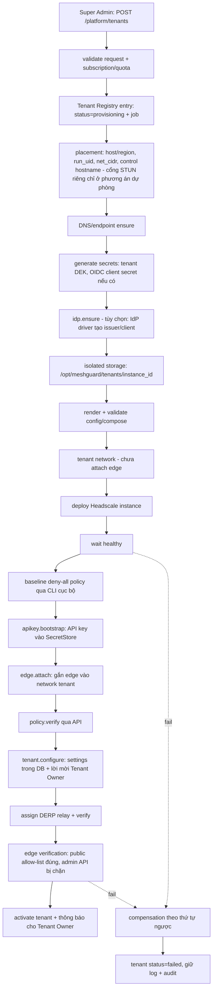

# Tenant Orchestrator

> **Trích sinh tự động** từ [implementation-master-plan.md](../planning/implementation-master-plan.md) bằng `tools/split_plan.py` — **không sửa tay**; sửa bản master rồi sinh lại.
> Nguồn: §11. Số mục `§` và các mã (HS-…, ADR-…, AC-…, T-…) tham chiếu theo bản master. Nhãn bằng chứng: xem [README](../README.md).

## 11. Tenant Orchestrator Design

### 11.1 Phân vai

| Thành phần | Đặc quyền | Trách nhiệm |
|---|---|---|
| **API** (`meshguard api`) | Không có Docker, không có filesystem tenant | Kiểm tra quyền, ghi registry, enqueue job trong cùng transaction |
| **Worker** (`meshguard worker`) | Không có Docker; có DB, SecretStore, đường gọi Headscale API qua edge nội bộ, gọi Agent | Chạy state machine, retry/backoff, compensation, health gate, audit |
| **Host Agent** (`meshguard agent`, 1 mỗi host) | **Duy nhất** được mount Docker socket, `/opt/meshguard/tenants` và `/opt/meshguard/backups/tenants` | Thực thi thao tác hạ tầng theo **spec khai báo đã kiểm tra** (không nhận lệnh tùy ý): thư mục, file render, network, compose, backup/restore, bootstrap API key |

Worker ↔ Agent: gRPC qua Unix socket (trên host: `/opt/meshguard/run/agent.sock`; thư mục này chỉ mount vào hai container đó tại `/run/meshguard/`) ở MVP; mTLS qua TCP khi multi-host. **Giao thức** (P3-T01): `api/agent/v1/agent.proto`, service `meshguard.agent.v1.AgentService` — một RPC cho mỗi phương thức của §11.5, thêm `Health`, `GetHostInfo` và `ListInstances`; mã Go sinh bằng buf (pin, chạy qua `go run`) vào `api/agent/v1`, CI sinh lại và so. Agent không có listener TCP nào. **Xác thực hai lớp, cả hai bắt buộc ở mọi lời gọi:** (1) `SO_PEERCRED` lúc kết nối — UID (tùy chọn cả GID) do kernel ghi nhận phải thuộc `MG_AGENT_PEER_UIDS` (worker, 65532), sai ⇒ đóng kết nối trước mọi RPC và ghi log; UID của chính agent chỉ được gọi `Health` (healthcheck của container); (2) token Agent (file secret nhóm `mg-sec-worker` — §14.2) gửi ở metadata `authorization: Bearer …`, so sánh thời gian hằng. Cần cả hai vì api và worker cùng UID 65532 (distroless nonroot) nên `SO_PEERCRED` không phân biệt được hai tiến trình đó (việc chỉ worker thấy socket là thuộc tính triển khai), còn token có thể lộ qua file nhưng không giả được UID do kernel ghi nhận. Socket được tạo `0600` (umask) rồi mở `0660` cho nhóm `mg-sec-worker`; thư mục chứa phải thuộc agent và không cho group/other ghi (host: `run/` = `root:mg-sec-worker 0750` — áp khi triển khai agent ở P3-T02); socket cũ bị xóa khi khởi động, thứ khác ở đường dẫn đó ⇒ không khởi động. Message tối đa 1 MiB. Mọi từ chối là status gRPC có kiểu (detail `Refusal`: lý do + đường dẫn trường, không lặp lại giá trị bị từ chối) kèm một dòng audit `agent_call` (UID/GID/PID của peer, method, `instance_id`/`job_id` khi là UUID chuẩn); trường hoặc giá trị enum mà agent không biết ⇒ từ chối (fail closed). Lớp kiểm tra nằm ở `internal/provisioning/agentspec` (dùng chung cho compose driver của P3-T02); client của worker ở `internal/agentclient`.

**API của Agent là tập tham số đóng, có kiểu.** Không RPC nào nhận YAML, đường dẫn mount, capability, tên network hay câu lệnh. Worker chỉ gửi `EnsureInstance{instance_id, tenant_id, slug, image_digest, run_uid, net_cidr, limits, target_phase, HeadscaleParams{node_expiry, dns{…}, oidc{…}, public_entry}}`; **Agent tự render** `config.yaml`/`compose.yaml` từ template nằm trong image của chính nó (marshal từ struct, không ghép chuỗi do tenant cung cấp), tự suy ra mọi tên, đường dẫn và alias từ `slug` + `instance_id`, tự kiểm các bất biến cách ly (`derp.server.verify_clients: true`, `policy.mode: database`, `derp.urls: []`, `tls_*` rỗng, `grpc_allow_insecure: false`, `trusted_proxies` đúng bằng `net_cidr`, `net_cidr` là một `/29` nằm trong dải tenant cấu hình cục bộ của host và không chồng network đang có, không publish cổng) và trả về hash cấu hình đã render để Worker lưu vào `instance_config_versions`. Trước mọi thao tác trên project/network/container, object đã tồn tại phải mang label `meshguard.instance_id` trùng spec — nếu khác thì **FAIL, không adopt**. Image digest phải thuộc allowlist; `run_uid` phải khác 0, thuộc dải dành riêng của host (`hosts.run_uid_range`) và không thuộc instance khác. Nhờ vậy Worker bị chiếm cũng không biến được thành root trên host hay đặt container của tenant này vào network của tenant khác (ADR-05).

### 11.2 Provisioning flow



Sơ đồ có đúng 19 nút hành động (từ `validate` tới `activate`), tương ứng 1–1 và theo đúng thứ tự với 19 bước của bảng ở §11.3; bảng là nguồn sự thật cho tên step, idempotency và compensation.

### 11.3 Các bước, idempotency và compensation

| # | Step | Thực thi | Hành động | Idempotency | Compensation |
|---|---|---|---|---|---|
| 1 | `validate` | API | slug theo regex `^[a-z][a-z0-9-]{1,30}[a-z0-9]$` + danh sách tên cấm; plan/quota; trùng lặp; slug của tenant đã `deleted` bị từ chối khi còn object của instance cũ (thư mục lưu trữ, backup chưa purge, network/container, issuer IdP) | thuần kiểm tra | — |
| 2 | `registry.create` | API (transaction) | `tenants`, `subscriptions`, `provisioning_jobs` | partial `UNIQUE(slug)`, `Idempotency-Key` | tenant → `failed` (giữ để audit) |
| 3 | `placement.allocate` | Worker | chọn host theo capacity/region; cấp `run_uid` từ `hosts.run_uid_range` (`UNIQUE(host_id, run_uid)`); `control_hostname = <slug>.<mesh_domain>`; `base_domain`; (chỉ ở phương án dự phòng per-tenant STUN: cấp `stun_port`); cấp `net_cidr` (một /29) từ `hosts.tenant_net_pool` | partial `UNIQUE(control_hostname)`; `SELECT … FOR UPDATE` các hàng host ứng viên (theo thứ tự `id`) rồi cấp `run_uid` nhỏ nhất chưa từng dùng trong `run_uid_range`; `UNIQUE(host_id, run_uid)` và `net_cidr` (cấp trong cùng khóa hàng host, unique theo host — §6.3); `instance_id` do job chọn trước bước (ghi ở `created_resources`) — gọi lại trả đúng phần đã cấp (P3-T04) | chuyển `removed` hàng `tenant_instances` do job tạo (đang `allocated` hoặc `failed`) — **không** xóa hàng, nên `run_uid` không bao giờ được cấp lại; hostname, `net_cidr` và chỗ instance của tenant được giải phóng |
| 4 | `dns.ensure` | Worker | chế độ wildcard: chỉ kiểm tra phân giải; chế độ per-tenant record: tạo qua DNS driver | tra trước khi tạo | xóa bản ghi do job tạo |
| 5 | `secrets.generate` | Worker | DEK của tenant (client secret OIDC: của driver `keycloak` do driver sinh ở bước 6; của IdP ngoài do API nhận write-only ở bước 1, giữ ở secret platform `idp-pending.<idp_id>.client` hết hạn 24 h, bước 6 chuyển sang secret của tenant — P3-T05) | `UNIQUE(tenant_id, name, version)` | — (DEK giữ lại: `/retry` của job `rolled_back` chạy lại từ bước 3 với chính DEK đó; crypto-shredding thuộc Deprovision — §11.4) |
| 6 | `idp.ensure` (tùy chọn) | Worker | IdP driver tạo issuer/client cho tenant; hàng `identity_providers` `pending` (thành `active` ở bước 16) | tra theo `driver_ref`; `idp_id` do job chọn trước (`created_resources`); `/retry` sau `rolled_back` bật lại hàng đã `disabled` (`disabled → pending`) | vô hiệu issuer do job tạo; hàng → `disabled` |
| 7 | `storage.create` | Agent | thư mục instance, `compose.yaml`, `config/`, `records/`, `secrets/`, `meta/` thuộc **root** (group `run_gid`, `0750`/`0440`) — tiến trình của tenant không sửa được file mà Agent sẽ thực thi; chỉ `data/` thuộc `run_uid` (`0700`). **Chỉ lần provisioning đầu tiên** được tạo `data/` rỗng | kiểm tra owner/mode; từ chối nếu đã có `meta/activated` | xóa **toàn bộ** thư mục instance nếu do job này tạo **và chưa có `meta/activated`** (khi đó `data/` chỉ chứa key/DB vừa sinh, chưa phục vụ client nào); đã có `meta/activated` ⇒ không bao giờ xóa |
| 8 | `config.render` | Agent (từ tham số có kiểu do Worker gửi) | render `config.yaml` (mọi khóa `derp.*` ghi tường minh — §10.1; `trusted_proxies` = `net_cidr` đã cấp ở bước 3, nên nội dung và hash cấu hình xác định trước khi network tồn tại), `compose.yaml`, `records/extra-records.json` (nội dung khởi tạo `[]` — không bao giờ để file rỗng hay `null`, vì Headscale bỏ qua file rỗng), `bootstrap-policy.hujson`; kiểm tra bằng validator của ta — RT-07 **và các giá trị fail-open mà `configtest` không bắt**: `node.expiry` render từ số nguyên ngày thành `<n>d` và bắt buộc > 0, `policy.mode` đúng bằng `database`, `log.level` ∈ {`info`, `warn`, `error`}, `prefixes` là tập con của `100.64.0.0/10` và `fd7a:115c:a1e0::/48` — rồi `headscale configtest` trong container tạm với **thư mục dữ liệu nháp** (RT-05; `configtest` chỉ là cổng cú pháp, không chạy tới `Serve()` — kết luận thuộc về health gate ở bước 11); ghi atomically (tmp + rename); lưu `instance_config_versions`. Tenant dùng phương thức C: `configtest` chạy kèm `HEADSCALE_OIDC_ONLY_START_IF_OIDC_IS_AVAILABLE=false` (không phải secret) và mount `secrets/oidc_client_secret` chỉ-đọc; issuer do Worker kiểm riêng (T-21) | theo `config_sha256` | khôi phục version trước (nếu có) — instance mới không có version trước: file đi cùng thư mục ở compensation bước 7 |
| 9 | `network.ensure` | Agent | tạo network `mg-t-<slug>` kiểu `internal` với `--subnet <net_cidr>` (**chưa** attach edge); network đã có mà subnet khác `net_cidr` ⇒ FAIL | inspect trước khi tạo (subnet và label phải khớp spec) | xóa network (`RemoveInstance(KEEP)`: container + network, giữ thư mục) |
| 10 | `instance.start` | Agent | kiểm trước khi start: `records/extra-records.json` tồn tại, là file thường và parse được; rồi `docker compose -p mg-t-<slug> up -d` với image pin theo **digest** | compose khai báo | `compose down` (giữ data); instance → `failed` để bước 3 giải phóng |
| 11 | `instance.wait_healthy` | Agent | healthcheck container (`headscale health`, tham số ở §14.5); phải `healthy` trong 90 s — quá hạn ⇒ lưu 50 dòng log cuối (đã redaction) vào `detail` của step rồi fail; ghi `noise_key_fingerprint` (do container trợ giúp tính — §11.5; `InstanceStatus` trả về, Worker ghi vào registry; bản sao trong `meta/instance.json` do Agent ghi ở bước 14 — P3-T03); quét log khởi động: gặp `failed to parse node.expiry` hoặc cảnh báo cấu hình đã biết ⇒ health gate thất bại | chỉ đọc | — |
| 12 | `policy.bootstrap` | Agent | chạy CLI **trong container** qua Unix socket cục bộ: `headscale policy set --file /etc/headscale/bootstrap-policy.hujson` (deny-all) rồi `headscale policy get -o json` — cờ đầu ra máy tắt log của CLI (với `log.format: json` log đi ra stdout), còn policy vẫn được in nguyên dạng HuJSON kèm **một** ký tự xuống dòng (RT-15) ⇒ bỏ đúng ký tự đó rồi so sha256 với file. Đóng "cửa sổ allow-all" của instance mới (PL-02) **trước khi** instance có bất kỳ đường mạng nào | so sánh sha256 | — |
| 13 | `apikey.bootstrap` | Agent → Worker | `headscale apikeys create -e <ttl> -o json` trong container (luôn truyền hạn tường minh, `<ttl>` dạng duration như `2160h`); stdout là **một chuỗi JSON** (không phải object — RT-15) ⇒ parse rồi kiểm định dạng `hskey-api-<prefix>-<secret>` (RT-12); kết quả đi qua socket Agent, không ghi log; lưu SecretStore; ghi `api_key_prefix`, `api_key_expires_at` | mọi thao tác API key của instance (bước này, compensation của nó, rotation P3-T10) chạy dưới khóa tenant `instance.apikey`; trước khi tạo, Agent liệt kê API key trong instance (`headscale apikeys list -o json` — CLI hiển thị prefix dạng `hskey-api-<prefix>-***`, rỗng là `null`) và expire (`apikeys expire --id <id>`) mọi key còn hạn có prefix khác prefix do Worker gửi (`tenant_instances.api_key_prefix`; rỗng ở lần đầu ⇒ expire tất cả) — key đã tạo nhưng chưa kịp lưu ở lần chạy trước không còn hiệu lực; key mang đúng prefix đó còn hạn ⇒ bỏ qua bước tạo | hủy các version secret `headscale-api-key` do job lưu và xóa tham chiếu trong registry; bản thân key không expire được qua API nữa (edge đã gỡ ở compensation bước 14 — ngược thứ tự) nên chết cùng thư mục instance ở compensation bước 7 (instance chưa từng `meta/activated`) |
| 14 | `edge.attach` | Agent | kiểm tra alias `hs-<slug>` chưa tồn tại trên bất kỳ network nào edge đang gắn; instance đang chạy và **đã có policy** (`headscale policy get` thành công — không bao giờ gắn edge trong cửa sổ allow-all, PL-02) và qua start guard (lần đầu: ghi `noise_key_fingerprint`); ghi `meta/activated` (mang `job_id`) rồi cờ `edge_attach: true` vào `meta/instance.json`; attach container edge vào network tenant; kiểm tra network có **đúng hai** thành viên (lệch ⇒ gỡ lại và hoàn tác cờ) | inspect trước | xóa cờ `edge_attach` và `meta/activated` do chính job này ghi (bước 7 đã từ chối instance có sẵn `meta/activated`) + detach |
| 15 | `policy.verify` | Worker | qua API: `GetPolicy` khớp sha256 baseline; ghi `policy_versions` v1 (`kind=baseline`, `state=approved`), đặt `tenants.desired_policy_version_id` = v1 và ghi một hàng `policy_applications` (`trigger=bootstrap`, `state=applied`, `applied_hujson` = đúng chuỗi baseline đã đặt [restore ở §17.2 bước 4 đặt lại policy từ hàng `applied` hiện hành], `applied_sha256` = sha256 baseline) | so sánh sha256 | — |
| 16 | `tenant.configure` | Worker | chỉ ghi DB: `tenants.settings`, hàng `identity_providers` của tenant ở trạng thái `active` (kết quả bước 6), tạo **lời mời** Tenant Owner (`tenant_invitations`) và đưa thông báo vào outbox; **không** gọi Headscale và không đổi file cấu hình — giá trị DNS/OIDC của instance đã render ở bước 8, đổi về sau đi qua Reconfigure (§11.4) | upsert | thu hồi lời mời — theo id đã ghi, hoặc (bước chết/lỗi giữa lúc tạo lời mời và lúc ghi id) theo email Owner ghi trong `created_resources` trước khi tạo (P3-T07) |
| 17 | `relay.assign` | Worker → Prober | `relay_regions(kind=embedded)` + `relay_assignments`; Prober kiểm tra `/derp/probe` của instance (qua listener public của edge) và STUN dùng chung phản hồi | upsert | xóa hàng |
| 18 | `edge.verify` | Worker → Prober | kiểm tra chức năng **từ trong host** qua listener public của edge (SNI/Host = hostname tenant): `GET /key?v=<capver>` trả 200 kèm `publicKey` khớp `noise_key_fingerprint` (lưu ý `/key` không có `v` trả 400); `/api/v1/*`, `/swagger*`, `/verify`, `/version`, `/health`, `/metrics`, `/debug/*` trả 404; đường nội bộ gọi `GET /api/v1/health` bằng key thành công. Kiểm tra **từ ngoài vào** (DNS, VPS gateway, STUN) là AC-20/V-02 ở G1, không thuộc job này | chỉ đọc | — |
| 19 | `activate` | Worker | `tenants.status=active`, `tenant_instances.status=running`; audit; ghi `notification_outbox` loại `tenant.activated` (job `notification.send` gửi; lỗi gửi ⇒ retry + cảnh báo, **không** rollback kích hoạt) | update có điều kiện theo `version` | — |

**Quy tắc chung:** mỗi step ghi `provisioning_job_steps`, trong đó `created_resources` được ghi **trước** khi tạo tài nguyên (để compensation chỉ gỡ đúng thứ job này đã tạo, kể cả khi tiến trình chết giữa chừng); lỗi tạm thời retry tối đa 5 lần (backoff mũ 2 s → 60 s + jitter); hết lượt retry với lỗi tạm thời ⇒ job `failed_resumable`: **không** compensation, tài nguyên giữ nguyên, edge chưa gắn, `/retry` tiếp tục từ step lỗi (mọi step idempotent); lỗi không phục hồi được, hoặc operator gọi `/rollback` trên job `failed_resumable` ⇒ compensation ngược thứ tự các step đã hoàn tất, kết thúc ở `rolled_back` (với `tenant.provision`: tenant `failed`, và `/retry` khi đó tạo **job mới** chạy lại từ step 3); `/cancel` = dừng sau step hiện tại rồi chuyển `failed_resumable` (không tự compensation; job chưa bắt đầu chạy ⇒ `cancelled`) — ghi `provisioning_jobs.cancel_requested_at`, handler đọc mốc này trước mỗi step (lỗi `cancelled`); `/retry` xóa mốc. `/retry` của job `failed_resumable` chuyển thẳng `running` (không qua `queued`, nên khóa chạy không rời job), `max_attempts` = `attempt` + số lượt của kind, job queue mới, `timeout_at` đặt lại; `/rollback` chỉ nhận kind có compensation (`tenant.provision`). Bảng chuyển trạng thái là `jobs.Transitions` (P3-T05). Lỗi tạm thời đã hết 5 lượt retry tại chỗ của step ⇒ `failed_resumable` ngay (queue không retry thêm); compensation lỗi ⇒ `failed_resumable` (`compensation_failed`), `/rollback` tiếp tục từ step chưa compensation xong (`compensation_status` theo từng step). Với `tenant.provision`, bước 17/18 không có Prober cấu hình ⇒ `failed_resumable` (`prober_not_configured`); bước 11 quá 90 s ⇒ lỗi không phục hồi (`instance_unhealthy`). Timeout toàn job 10 phút; timeout của worker và ngưỡng rescue job kẹt của queue lifecycle được đặt tường minh cho khớp (≈ 15 phút), không dùng mặc định của thư viện queue (kiểm ở P2-T12); job `job.reaper` (mỗi phút) chuyển job `running` đã quá `timeout_at`, hoặc job mà queue đã loại bỏ, sang `failed_resumable` và phát cảnh báo — worker chết không để tenant kẹt ở `running`. **Một** job nhóm lifecycle chạy tại một thời điểm cho mỗi tenant, bảo đảm **chỉ** bằng partial unique index trên khóa chạy `lock_key` (§13.5, mục (d)) — **không** dùng advisory lock (lock mức session không an toàn trên connection pool; lock mức transaction sẽ bị giữ suốt các lời gọi Agent/Headscale của một job dài tới 10 phút). `tenant.suspend` không chen ngang một `instance.upgrade` đang chạy mà chờ khóa chạy; riêng phần áp policy deny-all được enqueue ngay trong transaction của request như một job `policy.apply` (khóa riêng `tenant:<id>:policy.apply`) nên không phải chờ (P3-T08: cho tới khi job `policy.apply` level-triggered có ở P4-T10, bước áp deny-all nằm trong chính `tenant.suspend` nên cũng chờ khóa chạy — P4-T10 tách nó ra theo đúng câu này). Không step nào được ghi secret vào log, `details` hay `error`.

### 11.4 Các luồng vòng đời khác

| Luồng | Trình tự | Rollback |
|---|---|---|
| **Reconfigure** (DNS settings, OIDC, key expiry, log level…) | render version mới → `configtest` → ghi atomically → `CheckPolicy` (đúng chuỗi đang áp dụng) → restart container → health gate → post-start gate → `edge.verify` rút gọn. **Hiện thực (P3-T13, `orchestrator.InstanceReconfigurer`):** `CheckPolicy` chạy **trước** khi ghi (thuần đọc — lỗi thì không có gì phải lùi; chuỗi đang áp dụng được chuẩn hóa bằng `policies.Lint` vì adapter chỉ nhận JSON thuần mà baseline của bước 12 là HuJSON có comment; lỗi ⇒ chặn + `security_event` High, việc áp lại một lần (`drift_repair`) chờ job `policy.apply`); version mới render từ `params` của version đang hiệu lực (giới hạn CPU/RAM/PID giữ nguyên ⇒ `compose.yaml` không đổi, `compose restart` đủ) ⊕ thay đổi ⊕ `derp.server.ipv4` = điểm vào hiện tại của host; sha256 trùng version đang hiệu lực ⇒ không ghi, không restart; health gate = container `running` + `healthy` với `started_at` sau lần restart và `config_sha256` mới, fingerprint Noise key không đổi, `GET /api/v1/health` có kết nối DB, trong 90 s; post-start gate: `ErrNoPolicy` ⇒ `security_event` Critical + `RemoveEdgeAttachment(POLICY_DRIFT)` + lùi, chuỗi khác ⇒ High (không lùi); không Prober ⇒ `edge.verify` ghi `skipped`; instance `quarantined` (kể cả bị quarantine giữa job) không bao giờ bị restart | khôi phục config version trước + restart; job `rolled_back`. **Hiện thực (P3-T13):** compensation ngược thứ tự — restart (ghi lại version trước, restart, health gate), ghi (ghi lại version trước), version (`failed`, instance trỏ lại version trước); audit `.failed` + `platform.instance.config_rollback`; lùi lỗi ⇒ `failed_resumable` (`compensation_failed`) + `security_event` Critical `instance.reconfigure_rollback_failed`, `/rollback` chạy tiếp; lỗi tạm thời hết lượt ⇒ `failed_resumable` (lock giữ; `/retry` tiếp từ bước lỗi, `/rollback` lùi) |
| **Suspend** | `desired_policy_version_id` giữ nguyên (job ghi nó vào input — version mà resume áp lại); job `policy.apply` (trigger `suspend`) áp policy `suspension` (deny-all) → expire mọi pre-auth key còn hiệu lực → `status=suspended` (chặn thao tác ghi của role tenant; Portal từ chối `web-auth/claim` và mọi `enrollment/*` với `403 tenant_suspended`, nên pending auth không bao giờ được `AuthRegister` và tự hết hạn sau 15 phút — Headscale không có API liệt kê/hủy pending registration). Tenant ở chế độ `headscale_oidc`: restart instance có kiểm soát để xóa cache pending, và node đăng ký trong lúc suspend chỉ nhận policy deny-all. Instance **vẫn chạy** để phân phối policy deny tới client. **Hiện thực (P3-T08):** `POST /platform/tenants/{id}/suspend` ⇒ job `tenant.suspend` (nhóm lifecycle): `validate` (API) → `policy.suspend` (lõi policy, version `kind=suspension`) → `registry.suspend` (`status=suspended`) → `preauthkeys.expire` (mọi key chưa hết hạn và còn dùng được, đọc lại: không còn key hợp lệ) → `notify` (Owner/Admin, audit `.succeeded`) — trạng thái chuyển **trước** bước expire key: sau đó không key nào phát được nữa, nên không key nào phát trong lúc job chạy còn sống sót; lần đăng nhập đầu không gắn lời mời khi tenant `suspended`; lỗi vĩnh viễn ⇒ `failed_resumable`, **không** tự hoàn tác (`/rollback` mới đưa tenant về `active` + version mong muốn); registry Headscale riêng của job với `TenantStatuses` = active + suspended (registry chung từ chối tenant suspended — G2 L1) | `resume`: `policy.apply` (trigger `resume`) áp lại version mong muốn hiện hành. **Hiện thực (P3-T08):** job `tenant.resume`: `policy.resume` (dùng lại version mong muốn, không tạo version mới) → `registry.resume` (`active`) → `notify`; lỗi vĩnh viễn ⇒ compensation ngay (áp lại `suspension`, tenant vẫn `suspended`, `rolled_back`); pre-auth key đã expire không được khôi phục |
| **Quarantine** (instance nghi bị chiếm) | xóa cờ `edge_attach` → detach edge → dừng container → `tenant_instances.status=quarantined`; `data/` và log được giữ nguyên để điều tra; reconcile, edge supervisor và mọi job restart/backup **bỏ qua** instance ở trạng thái này, service discovery ngừng phát target của nó. Kích hoạt bằng `POST /platform/instances/{id}/quarantine` (không cần 2P để cô lập kịp thời; audit + cảnh báo Critical). **Hiện thực (P3-T18, `internal/provisioning/quarantine`) — thứ tự chính xác hóa: trạng thái registry đổi TRƯỚC**, ngay trong transaction của request (mọi trạng thái trừ `removed`; security event `instance.quarantined` critical, audit `platform.instance.quarantine.requested`, job `instance.quarantine` cùng transaction), rồi job (hàng đợi riêng `urgent`, **không** lấy khóa lifecycle) gọi Agent `QuarantineInstance`: ghi `meta/quarantined` **trước** (root 0400) → xóa cờ `edge_attach` → dừng container ngay (SIGKILL, không ân hạn — tiến trình nghi bị chiếm không trì hoãn được việc dừng; DB là ảnh crash nhất quán) → detach edge (dừng trước khi gỡ: kernel đóng kết nối giữa edge và instance khi route còn, edge không giữ kết nối chết nào tới địa chỉ không còn route — mọi request tới hostname nhận ngay `404` thống nhất của §14.6 thay vì treo, stream dài của client qua edge kết thúc theo) → `GetInstanceStatus` kiểm lại → thông báo SA/PO, audit `.succeeded`. Đổi trạng thái trước vì đó là điểm mọi thành phần khác đọc: từ lúc commit, **step gate** của framework job (`jobs.Options.StepGate`, đặt ở bookkeeping trước mỗi step và mỗi step compensation, như `/cancel`) dừng mọi job nhiều bước khác của instance trước step kế tiếp (trừ `tenant.deprovision` — 2P, P3-T09; `instance_quarantined`, Resumable: job lifecycle `failed_resumable` giữ khóa, không compensation, không xóa gì — `/rollback` cũng bị chặn), locator của adapter Headscale từ chối instance (không lời gọi API nào của job hay request tới được nó), lịch reconcile/xoay API key không chọn nó; còn `meta/quarantined` đóng cửa sổ giữa lúc kiểm và lúc làm ở phía host: dưới khóa theo instance, Agent từ chối (`STATE`) start, restart, `EnsureInstance`, `ValidateConfig`, upgrade, DNS records, bootstrap policy/API key, restore, `PostRestoreReconcile`, `EnsureEdgeAttachment`, `RemoveEdgeAttachment(COMPENSATION)` và `RemoveInstance` xóa dữ liệu — chỉ stop, detach, remove giữ dữ liệu, backup, đọc, quarantine, release đi qua. Không cô lập được (Agent bận quá số lần thử, không có Agent, instance Agent không quản lý — A/B dựng tay) ⇒ trạng thái **vẫn** `quarantined`, security event `instance.quarantine_incomplete` critical, thông báo "incomplete": cô lập bằng tay theo RUNBOOK. Backup/restore của instance đang quarantine: lịch không chọn, backup qua API và restore ⇒ `409 instance_quarantined` — restore chỉ sau release (§17.2) | Chỉ gỡ bằng `POST /platform/instances/{id}/release` — thao tác 2P (`approval_requests`); start lại qua start guard và post-start gate. **Hiện thực (P3-T18):** request ⇒ yêu cầu phê duyệt `platform.instance.release` (payload `{instance_id, tenant_id}`; instance phải `quarantined` và job quarantine đã xong); người thứ hai (Super Admin — `:decide` của PO chỉ cho restore) duyệt ⇒ job `instance.release`: `release.prepare` (sha256 của policy đang áp dụng) → Agent `ReleaseInstance` (start qua start guard, healthy ≤ 90 s, `policy get` = sha256 đó, rồi mới gỡ `meta/quarantined`) → `starting` → `EnsureEdgeAttachment` → post-start gate qua API (`Health` nhận API key, `GetPolicy` = `applied_sha256`) → `running`, security event `instance.released`. Lỗi bất kỳ ⇒ cô lập lại (`QuarantineInstance`), `starting` → `quarantined`, security event `instance.release_failed`, job `failed` (release mới cần phê duyệt mới); quarantine yêu cầu trong lúc release chạy (khóa dedupe riêng — không bao giờ bị release chặn) làm release dừng ở step kế tiếp |
| **Deprovision** | xác nhận dual control (`approval_requests`) → backup cuối (giữ theo retention) → suspend → expire toàn bộ node → thu hồi mọi session Portal của identity thuộc IdP của tenant → gỡ target scrape/probe của instance → **xóa cờ `edge_attach` → detach edge → `compose down` → xóa network** (đúng thứ tự này, để việc gỡ một tenant không làm hỏng edge dùng chung) → lưu trữ/xóa data dir → vô hiệu IdP issuer → hủy DEK sau grace period (vô hiệu đường restore online; bản DR offsite tồn tại tới khi job purge theo retention chạy xong và được xác minh) → `status=deleted` (giữ hàng registry; slug **không tái sử dụng** khi còn bất kỳ object nào của instance cũ) | Trước mốc hủy DEK: restore từ backup cuối |
| **Upgrade** | preflight phiên bản (đích là bản patch cùng minor — trường hợp bản vá bảo mật — hoặc patch mới nhất của minor kế tiếp — HS-04; contract test của adapter xanh cho version đích; cả digest cũ và mới nằm trong allowlist của Agent suốt đợt nâng; `CheckPolicy` cho chuỗi đang áp dụng trên canary ở version mới) → **cold backup** (dừng → copy, đúng hướng dẫn upstream) → **preflight bằng binary đích**: container một-lần không network với digest đích, mount config đã render lại (chỉ-đọc) và một **bản sao** của cold backup làm data, chạy `headscale configtest` — lệnh này mở và migrate database (RT-05) nên migration thật được thử trên bản sao; việc nó nạp cả policy đang lưu là theo phản biện, xác nhận bằng một ca thử ở P3-T13a; lỗi ⇒ start lại image cũ trên dữ liệu gốc, job `rolled_back`, không mất gì ngoài thời gian dừng → đổi image digest → start → health gate → post-start gate → khẳng định `GET /version` đúng version mong đợi → contract smoke qua adapter. Triển khai theo đợt: canary trước, rồi từng nhóm, tự dừng ở health gate lỗi đầu tiên | dừng → restore backup → image cũ → start (minor không hạ được — RT-10 — nên sau khi đã start bằng image mới, rollback luôn là restore) |
| **API key rotation** | tạo key mới bằng key hiện tại → kiểm tra → lưu secret version mới → expire key cũ. **Hiện thực (P3-T10):** `internal/provisioning/apikey`, dưới khóa API key của instance (`store.WithTenantLock`, tên `instance.apikey` — kiểm API key của reconcile lấy cùng khóa): `CreateAPIKey` bằng key hiện tại, hạn tường minh 90 ngày → `ListAPIKeys` **bằng key mới** qua edge → SecretStore version kế (`mgsec://<tenant>/headscale-api-key#n`) → một transaction platform: đổi `api_key_*` **có điều kiện** (hàng còn trỏ reference đã đọc) + audit `instance.apikey.rotate.succeeded` → bỏ cache registry của tiến trình (tiến trình khác nạp lại ở lần 401 đầu) → expire key cũ (và mọi key hợp lệ khác) bằng key mới → `ListAPIKeys`: chỉ còn đúng một key hợp lệ → hủy version secret cũ. Lỗi trước bước đổi ⇒ expire key mới bằng key hiện tại; key không expire được ⇒ `security_event` `apikey.leftover` nêu prefix; key hợp lệ lạ lúc bắt đầu ⇒ `apikey.stray` và xoay luôn | nếu key hiện tại mất/hết hạn: chạy lại `apikey.bootstrap` qua Agent. **Hiện thực (P3-T10):** hết hạn theo registry hoặc secret mất/đã hủy ⇒ `BootstrapApiKey` (expire mọi key khác) rồi kiểm tra, lưu, đổi như trên; không có Agent ⇒ lỗi `agent_not_configured`; key còn hạn mà bị từ chối ⇒ **không** tự bootstrap (§13.4): `security_event` Critical `apikey.rejected`, người vận hành xác minh rồi chạy `meshguard-worker admin apikey-rotate --allow-bootstrap` |
| **Relocation** (Phase 7) | dừng ở host A → backup → chuyển (đã mã hóa) → restore ở host B (giữ nguyên Noise key) → cập nhật placement/DNS → start → verify | start lại ở host A |
| **Reconcile** (định kỳ, Worker) | so sánh trạng thái mong muốn (DB) với thực tế (Agent): container, image digest, config hash, network có **đúng hai** thành viên (headscale + edge) với đúng subnet `net_cidr`, quyền file, fingerprint Noise key, tính duy nhất của alias `hs-<slug>` trên mọi network mà edge đang gắn, danh sách API key (chỉ được có key hiện hành và key trước đó trong lúc xoay) | Worker chỉ **báo cáo** drift và restart container đã thoát (trừ instance `quarantined`); không tự tạo lại thư mục dữ liệu; việc attach edge thuộc edge supervisor. **P3-T12** hiện thực phần báo cáo (`internal/provisioning/reconcile`): `instance.reconcile` theo từng instance `starting`/`running`/`stopped` (bỏ qua khi tenant có job nhóm lifecycle đang chạy) và `host.reconcile` cho inventory của host (thư mục, container, network mang label `meshguard.instance_id` không có hàng registry — báo, không nhận nuôi — và alias `hs-<slug>` trên mọi network của edge, đọc qua `ListInstances.edge_aliases`); "key trước đó khi đang xoay" = key hợp lệ mới nhất tạo trước key hiện hành, chỉ trong `RotationGrace` (15 phút) kể từ lúc key hiện hành được tạo; kiểm API key chạy dưới khóa API key của instance (P3-T10) và đọc lại prefix hiện hành dưới khóa — không bao giờ thấy trạng thái giữa chừng của một lần xoay (không lấy được khóa trong 30 giây ⇒ kiểm `unavailable`, không phải drift); báo cáo là output của job (không cột riêng), drift an ninh ⇒ `security_events` phạm vi platform (dedupe 24 giờ theo đối tượng); restart container đã thoát **chưa** làm (báo `container_not_running`) |
| **Edge supervisor** (trong Agent) | khi Agent khởi động, khi container edge start, và mỗi 30 giây: attach edge vào mọi network mang label `meshguard.role=tenant` mà `meta/instance.json` có `edge_attach: true`. Chỉ dựa trên trạng thái Docker + file cục bộ. Mỗi vòng cũng khẳng định (qua `docker inspect`) endpoint `mg-edge` của container edge vẫn là endpoint cung cấp default gateway (`gw_priority` cao nhất) — lệch ⇒ cảnh báo Critical. **Hiện thực (P3-T03):** vòng lặp `apps/agent/supervisor.go` + `EdgeCycle` của compose driver; chu kỳ `MG_AGENT_EDGE_SUPERVISOR_INTERVAL` (30 s), sự kiện Docker `start` của container edge kích một vòng ngay; mỗi instance lấy khóa theo instance **không chờ** (đang bận ⇒ để vòng sau); chỉ gắn khi có cờ **và** `meta/activated` **và** start guard đạt **và** alias không trùng (`CheckEdgeAttach`) — network gắn tay không có cờ (A/B/C dựng tay) không bị gắn cũng không bị gỡ, chỉ được báo; network đang gắn có thành viên lạ ⇒ gỡ edge + Critical; instance có `meta/quarantined` (P3-T18) không bao giờ được gắn, mỗi vòng bị cô lập lại (xóa cờ, dừng container, gỡ edge — phải làm gì ⇒ Critical `quarantine_breach`: có thứ đã start/gắn nó sau lưng Agent); start guard không kết luận được (helper lỗi) ⇒ gỡ edge nhưng **giữ cờ**, vòng kết luận được sau đó gắn lại | Edge được recreate (nâng cấp, reboot host) vẫn tự nối lại mọi tenant **kể cả khi PostgreSQL/Worker đang ngừng** |
| **Start guard** | Instance đã từng kích hoạt (`meta/activated`) chỉ được start khi `data/db.sqlite`, `data/noise_private.key` và `data/derp_server_private.key` đều tồn tại và fingerprint Noise key — do **container trợ giúp dùng một lần** tính chứ không do tiến trình Agent chạy root tự đọc (§11.5: `user: run_uid`, `network_mode: none`, mở file với `O_NOFOLLOW` + `O_NONBLOCK`, chỉ nhận file thường đúng kích thước, có timeout; Agent chỉ `lstat` để kiểm sự tồn tại và chỉ nhận về một chuỗi hex độ dài cố định; cùng quy tắc cho bước 11 ở §11.3 và job reconcile) — trùng giá trị đã ghi (`tenant_instances.noise_key_fingerprint`, có bản sao trong `meta/instance.json` để Agent kiểm được cả khi PostgreSQL/Worker ngừng); edge supervisor áp cùng kiểm tra ở mỗi chu kỳ — trước khi attach, và với network đang gắn thì gỡ edge khi kiểm tra không đạt (bao phủ cả container tự restart theo `unless-stopped`); bind mount dùng `create_host_path: false`; `docker.service` có `RequiresMountsFor=/opt/meshguard`. **Hiện thực (P3-T03):** fingerprint = khóa công khai X25519 (64 hex) của Noise key — đúng `publicKey: "mkey:<fingerprint>"` mà `/key` trả (bước 18 so được trực tiếp); helper là chính image agent (`MG_AGENT_HELPER_IMAGE`, lệnh `meshguard-agent noise-fingerprint`, `user: run_uid`, không network, rootfs chỉ-đọc, `cap_drop: ALL`, `data/` mount chỉ-đọc, timeout 20 s), kết quả được nhớ theo danh tính file (`dev`, inode, kích thước, `mtime`, `ctime` từ `lstat`) nên mỗi file key chỉ chạy helper một lần; kiểm trước `StartInstance`, `RestartInstance`, `EnsureInstance(container)`, `BootstrapPolicy`, `BootstrapApiKey`, `EnsureEdgeAttachment` và ở mỗi vòng supervisor; không kết luận được ⇒ từ chối `UNAVAILABLE` (không start theo phỏng đoán) | Sai lệch (edge supervisor kiểm lại ở mỗi vòng 30 giây, cả với network đã gắn) ⇒ cảnh báo Critical, xóa cờ `edge_attach` và gỡ edge khỏi network của tenant đó, chặn `apikey.bootstrap`, inventory sync và enrollment của tenant đó — ngăn việc Headscale lặng lẽ sinh Noise key + DB mới, tức một control plane trống và **allow-all** trên hostname của tenant (RT-06). **Hiện thực (P3-T03):** Agent còn dừng container (không start lại theo `unless-stopped`); "cảnh báo Critical" là dòng log JSON `start_guard_failed` (`severity: critical`, `reason`, `trigger`, `actions`) trên stdout của agent kèm refusal `STATE` cho RPC — rule cảnh báo dựa trên log thuộc P3-T16/P6-T01 |
| **Post-start gate** | Sau **mọi** lần start qua job (reconfigure, restart, upgrade, restore, restart do reconcile), trước khi job kết thúc: Worker gọi `GetPolicy` và so sha256 với `applied_sha256` hiện hành | Lệch ⇒ `policy.apply` (trigger `drift_repair`) ngay; `ErrNoPolicy`, hoặc API key còn hạn bị instance từ chối (dấu hiệu DB bị thay — §13.4), ⇒ cảnh báo Critical, Agent xóa cờ `edge_attach` và gỡ edge cho tới khi policy được áp lại và đọc lại khớp |

Lưu ý về suspend: dừng control plane **không** cắt được tunnel P2P đã thiết lập; biện pháp có hiệu lực là policy deny-all (được client thực thi qua packet filter); suspend **không** expire node, để resume khôi phục được ngay bằng cách áp lại policy. Expire toàn bộ node chỉ thực hiện ở Deprovision (hoặc khi thu hồi khẩn theo từng thiết bị — T-17); khi đó thiết bị phải xác thực lại. Client đang offline với control plane chỉ nhận thay đổi khi kết nối lại — **REQUIRES VALIDATION** bằng phép đo ở §22 (AC-17).

### 11.5 Infrastructure Driver interface

```go
// internal/provisioning/driver
type InfrastructureDriver interface {
    HostInfo(ctx) (HostInfo, error)
    ValidateConfig(ctx, InstanceSpec) (ValidationResult, error)      // headscale configtest trong container tạm, không network — chỉ là cổng cú pháp; health gate sau start mới là kết luận
    EnsureInstance(ctx, InstanceSpec) (InstanceStatus, error)        // idempotent; chạy tới spec.TargetPhase (storage → config → network → container): mỗi bước 7–10 của §11.3 là một lời gọi
    InstanceStatus(ctx, instanceID uuid.UUID) (InstanceStatus, error) // container (trạng thái, container_id, StartedAt), image digest, config_sha256, thành viên network (phải đúng 2), owner/mode thư mục, fingerprint Noise key — dùng cho reconcile
    StartInstance(ctx, id uuid.UUID) error
    StopInstance(ctx, id uuid.UUID) error
    RestartInstance(ctx, id uuid.UUID) error
    RemoveInstance(ctx, id uuid.UUID, opts RemoveOptions) error      // KeepData
    UpgradeInstance(ctx, id uuid.UUID, imageDigest string) error
    WriteDNSRecords(ctx, id uuid.UUID, records []DNSRecord) error      // records/extra-records.json: nhận bản ghi có kiểu; JSON sắp xếp ổn định, tmp + rename trong cùng thư mục; danh sách rỗng ghi []
    BootstrapPolicy(ctx, id uuid.UUID, policy PolicyKind) (sha256 string, err error) // CLI trong container qua Unix socket
    BootstrapAPIKey(ctx, id uuid.UUID, ttl time.Duration, keepPrefix string) (Secret, error) // expire mọi key có prefix khác keepPrefix trước khi tạo (bước 13)
    Backup(ctx, id uuid.UUID, opts BackupOptions) (BackupArtifact, error)
    Restore(ctx, id uuid.UUID, artifact BackupArtifact, key ArchiveKey, opts RestoreOptions) error
    PostRestoreReconcile(ctx, id uuid.UUID, plan ReconcilePlan) (ReconcileReport, error)
    EnsureEdgeAttachment(ctx, id uuid.UUID) error
    RemoveEdgeAttachment(ctx, id uuid.UUID) error
    QuarantineInstance(ctx, id uuid.UUID) error                        // §11.4 Quarantine (P3-T18): marker → cờ → stop → edge; giữ data/
    ReleaseInstance(ctx, id uuid.UUID, expectedPolicySHA256 string) error // start qua start guard → healthy → policy đúng → gỡ marker
}
```

Implementation: `compose` (MVP, chạy trong Host Agent). Dự kiến: `vm`, `kubernetes` — **không** làm ở MVP. **Hiện thực `compose` (P3-T02, `internal/provisioning/driver/compose`, chỉ `apps/agent` import):** `config.yaml`/`compose.yaml` render từ template **nhúng trong binary agent** (`infrastructure/headscale/templates` — cùng nguồn với `tools/render_instance.py`; test tương đương yêu cầu từng byte trùng nhau trên tham số golden, ba tenant staging và các instance thử) rồi được đọc lại dạng YAML để kiểm các bất biến cách ly của §11.1 trước khi ghi; thư mục instance mới được dựng dưới tên ẩn và rename vào chỗ (guard không bao giờ thấy thư mục thiếu `meta/instance.json`); file ghi tmp + fsync + rename + fsync thư mục, chỉ khi nội dung/owner/mode khác; mọi truy cập đi qua `os.Root` ở thư mục tenants, symlink ở chỗ Agent chờ file/thư mục ⇒ `UNSAFE_PATH` (không theo, không thay, không xóa); `data/` chỉ được tạo cùng instance — instance đã có `meta/activated` mà thiếu `data/` ⇒ từ chối, còn đủ thì `EnsureInstance` chạy bình thường (đường của Reconfigure); image của instance đã có không đổi qua `EnsureInstance` (`CONFLICT` — chỉ `UpgradeInstance`); network tạo qua Docker Engine API (moby client), compose qua `docker-compose --project-name mg-t-<slug>` (binary tĩnh trong image agent, môi trường tối thiểu, không `.env`); trạng thái và inventory qua Engine API (alias đọc bằng inspect — danh sách container của API không mang alias). `RemoveInstance` không đụng gì khi edge còn gắn (`RemoveEdgeAttachment` trước — thứ tự §11.4) hoặc network có thành viên lạ; `DELETE_ARCHIVED` chỉ xóa khi bản backup cuối được nêu tồn tại, manifest ký hợp lệ và khớp instance (hiện thực ở P3-T11, §17.1). Test tích hợp (`make agent-it`) chạy trong image agent với đúng `cap_drop: ALL` + `CHOWN`/`FOWNER`/`DAC_OVERRIDE`, rootfs chỉ đọc, không network — tập capability tối thiểu của §14.4 đủ cho storage, network và compose. `InstanceSpec` là **tham số có kiểu** (§11.1): `instance_id`, `tenant_id`, `slug`, image digest, `run_uid`, `net_cidr`, giới hạn CPU/RAM/PID, `HeadscaleParams` và `TargetPhase` (enum đóng: `storage`, `config`, `network`, `container`); driver tự suy ra tên network/container/alias và tự render cấu hình — không có trường nào là YAML hay đường dẫn tự do. Backup/restore chạy trong **container trợ giúp dùng một lần** với `user: run_uid`, `network_mode: none`, `cap_drop: ALL`, rootfs chỉ-đọc, chỉ mount `data/` của đúng instance đó (ro) và một thư mục staging có giới hạn dung lượng (`tenants/<instance_id>/.staging/`, tạo theo từng job — §14.4) — tiến trình Agent (root) không bao giờ tự đọc/parse dữ liệu do tenant ghi được; việc tính fingerprint Noise key (bước 11, start guard, reconcile) cũng chạy trong container này. Container trợ giúp có giới hạn `pids`/RAM/CPU và timeout cứng: quá hạn ⇒ bị kill, thao tác thất bại (fail-closed) kèm `security_event`, và Agent vẫn phục vụ các instance khác.

**Loại trừ theo instance và backup khi instance dừng:** Agent giữ **một khóa loại trừ theo instance** dùng chung cho backup, restore, upgrade, reconfigure, start/stop/restart và remove — thao tác đến sau phải chờ có thời hạn hoặc nhận lỗi `busy` (job retry theo backoff); khóa này bổ sung cho `dedupe_key` ở §13.5, vốn chỉ chống trùng trong cùng một kind. Việc backup online đọc DB WAL qua mount `data/` chỉ-đọc là **REQUIRES VALIDATION** (V-12): theo tài liệu SQLite, DB ở chế độ WAL chỉ mở được chỉ-đọc khi file `-wal`/`-shm` đã tồn tại, tức instance đang chạy. Quy tắc: instance **đang dừng** (đã giữ khóa) ⇒ cold copy trong cùng container trợ giúp (`db.sqlite` cùng `-wal`, `-shm` nếu có) và ghi phương pháp vào manifest; instance **đang chạy** mà `VACUUM INTO` lỗi ⇒ backup thất bại (fail-closed) + cảnh báo, không bao giờ copy file đang được ghi; nếu V-12 cho thấy mount chỉ-đọc không dùng được thì container trợ giúp mount `data/` đọc-ghi — nó chạy bằng `run_uid` nên file phụ nó tạo ra vẫn thuộc `run_uid`.

**Cơ chế của `ValidateConfig`:** config ứng viên được render vào thư mục staging `config.next/` cạnh `config/` (root, cùng quyền), rồi Agent chạy `docker run --rm --network none --read-only --cap-drop ALL --security-opt no-new-privileges --user <run_uid>:<run_gid> --tmpfs /var/lib/headscale:uid=<run_uid>,gid=<run_gid>,mode=0700 --tmpfs /var/run/headscale:uid=<run_uid>,gid=<run_gid> -v <instance>/config.next:/etc/headscale:ro -v <instance>/records:/etc/headscale-records:ro <image@digest> configtest` — thư mục nháp phải nằm **đúng đường dẫn mà config trỏ tới** và ghi được bởi `run_uid`, vì `configtest` tạo key và DB (RT-05). Chỉ khi exit code 0 mới rename từng file từ `config.next/` sang `config/` (cùng filesystem); exit code và stderr đã redaction được lưu vào `detail` của step; thất bại ⇒ xóa `config.next/`, `config/` đang chạy không đổi. **Hiện thực (P3-T03) — chính xác hóa:** `config.next/` bị xóa sau **mọi** lần chạy, không rename: `config/` do `EnsureInstance(config)` ghi ngay sau (cùng bytes, cùng `config_sha256` mà `ValidateConfig` trả — Worker so hai giá trị), nên `ValidateConfig` không có tác dụng phụ nào ngoài thư mục tạm; `valid` = exit code 0 **và** không có dòng log mức `warn`/`error` (đã đo trên 0.29.7: `failed to parse node.expiry` chỉ là cảnh báo, exit code vẫn 0); `detail` gồm stderr và các dòng đó, đã redaction, tối đa 4 KiB; container tạm tên `mg-helper-<slug>-configtest-<ngẫu nhiên>`, label `meshguard.role=agent-helper` (không mang `meshguard.instance_id` — guard sẽ coi là container thứ hai của instance), log driver `none`, giới hạn RAM/CPU/PID của chính instance, timeout 60 s rồi bị kill, luôn bị xóa; image được daemon pull nếu chưa có (Agent không có network). Phương thức C: biến `HEADSCALE_OIDC_ONLY_START_IF_OIDC_IS_AVAILABLE=false` chỉ đặt cho lần chạy này (§11.3 bước 8). Preflight nâng cấp (§11.4) dùng lại đúng helper này với digest đích và một **bản sao** của cold backup thay cho tmpfs dữ liệu.

**Ánh xạ bước → phương thức driver → compensation** (để state machine của Worker giữ idempotency, retry và tiêm lỗi theo từng bước — P3-T05, P3-T07):

| Bước §11.3 | Phương thức driver | Compensation |
|---|---|---|
| 7 `storage.create` | `EnsureInstance` với `TargetPhase=storage` | `RemoveInstance`: xóa toàn bộ thư mục do chính job này tạo, chỉ khi chưa có `meta/activated` (§11.3 bước 7) |
| 8 `config.render` | `ValidateConfig` rồi `EnsureInstance` với `TargetPhase=config` | `EnsureInstance` với config version trước (nếu có) |
| 9 `network.ensure` | `EnsureInstance` với `TargetPhase=network` | `RemoveInstance` với `KeepData`: xóa network |
| 10 `instance.start` | `EnsureInstance` với `TargetPhase=container` | `RemoveInstance` với `KeepData` (`compose down`) |
| 11 `instance.wait_healthy` | `InstanceStatus` | — |
| 12 `policy.bootstrap` | `BootstrapPolicy` | — |
| 13 `apikey.bootstrap` | `BootstrapAPIKey` | Worker hủy các version secret do job lưu và xóa tham chiếu registry; key trong instance chết cùng thư mục ở compensation bước 7 (edge đã gỡ trước — §11.3 bước 13; kiểm trên Docker thật ở P3-T07) |
| 14 `edge.attach` | `EnsureEdgeAttachment` | `RemoveEdgeAttachment` |
| Quarantine / release (§11.4, P3-T18) | `QuarantineInstance`; `ReleaseInstance` rồi `EnsureEdgeAttachment` | release lỗi ⇒ `QuarantineInstance` |
| Reconcile, start guard, post-start gate (§11.4) | `InstanceStatus` | — |
| DNS records (§13.2) | `WriteDNSRecords` | Ghi lại bản trước |
| Backup, restore, upgrade (§11.4, §17) | `Backup`; `Restore` + `PostRestoreReconcile`; `UpgradeInstance` | Theo cột Rollback ở §11.4 |

Các bước 1–6 và 15–19 do API/Worker thực hiện, không qua driver.

**Driver tương lai (phác thảo — ASSUMED, không làm ở MVP):** `kubernetes` hiện thực bốn phase của `EnsureInstance` bằng PVC → ConfigMap/Secret → NetworkPolicy/Service → StatefulSet, các thao tác `Bootstrap*` bằng exec vào pod, `EnsureEdgeAttachment`/`RemoveEdgeAttachment` bằng NetworkPolicy cho edge, `Backup`/`Restore` bằng Job một lần mount PVC; `vm` hiện thực bằng VM + cloud-init và một agent trong VM. Tiêu chí review của P3-T02: không phương thức hay tham số nào của interface để lộ khái niệm riêng của Compose (tên project, network Docker, đường dẫn mount).

### 11.6 Tài nguyên của mỗi tenant

| Tài nguyên | Hiện thực | Metadata trong registry |
|---|---|---|
| Headscale service | 1 container trong compose project `mg-t-<slug>` | `tenant_instances` (version, digest, status) |
| Persistent database + server keys | `data/db.sqlite`, `data/noise_private.key`, `data/derp_server_private.key` | `data_path`, `noise_key_fingerprint` |
| Configuration | `config/config.yaml` (render từ template có version) | `instance_config_versions` |
| Control endpoint | `https://<slug>.<mesh_domain>` qua edge | `control_hostname`, `server_url` |
| Hạn chế Admin/API | network riêng 2 thành viên; public allow-list ở edge; API key trong SecretStore | `api_key_secret_ref`, `api_key_expires_at` |
| Relay | embedded DERP riêng; STUN dùng chung tại điểm vào công khai | `relay_regions`, `relay_assignments` |
| Monitoring labels | label container + nhãn `tenant_id`, `instance_id` trên metrics | — |
| Backup policy | lịch theo plan | `backups` |

Danh sách tenant, cổng, host **không** hardcode trong source: tất cả đến từ registry; template nằm trong `infrastructure/headscale/templates/` và được ghi `template_version` vào mỗi config version.
