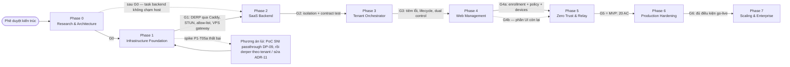
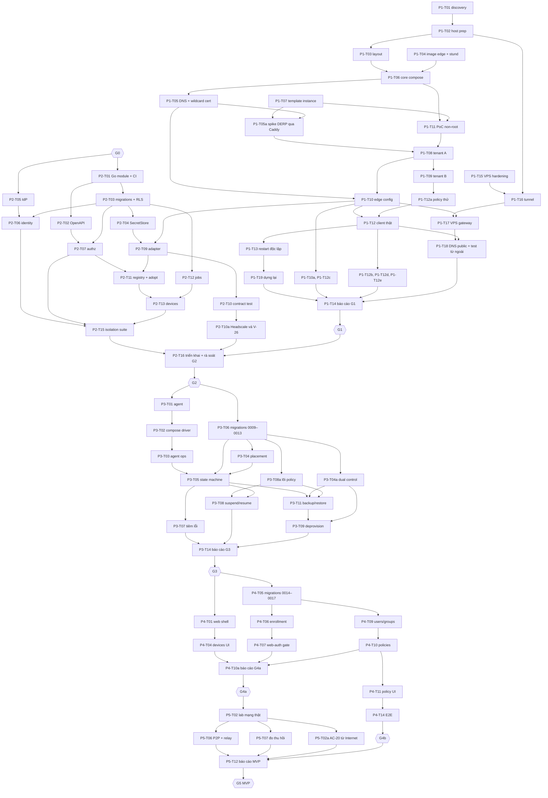

# Dependency Graph

> **Trích sinh tự động** từ [implementation-master-plan.md](../planning/implementation-master-plan.md) bằng `tools/split_plan.py` — **không sửa tay**; sửa bản master rồi sinh lại.
> Nguồn: §21. Số mục `§` và các mã (HS-…, ADR-…, AC-…, T-…) tham chiếu theo bản master. Nhãn bằng chứng: xem [README](../README.md).

## 21. Dependency Graph

### 21.1 Phụ thuộc giữa các phase và gate

### 21.2 Chuỗi phụ thuộc chính ở mức task

Sơ đồ chỉ minh họa chuỗi chính; bảng ở §20 là nguồn sự thật (ở Build Mode, `make docs-check` phải báo lỗi nếu sơ đồ có cạnh không tồn tại trong bảng).

### 21.3 Phụ thuộc bên ngoài (chặn tiến độ nếu thiếu)

| Phụ thuộc | Chặn | Người cung cấp |
|---|---|---|
| Domain + DNS provider có API | G0 và toàn bộ Phase 1 (không có ⇒ không qua G0; khi các điều kiện khác của G0 đã đủ, người dùng có thể chấp thuận bằng văn bản cho các task backend không chạm host chạy trước) | Người dùng |
| Thông số host + SSH key + cơ chế nâng quyền không dùng mật khẩu | P1-T01, P1-T02 | Người dùng |
| Git hosting, CI runner có Docker, container registry | P0-T07 ⇒ P0-T03, P0-T04, mọi task có "CI xanh" | Người dùng |
| Quyết định IdP (phương án cho ≥ 3 issuer tách biệt; đủ RAM nếu dùng Keycloak) | P2-T05 | Người dùng + kết quả discovery |
| Thiết bị thật (≥ 4, trên ≥ 2 hệ điều hành) + mạng thứ hai ngoài LAN | P1-T05a, P1-T12, P1-T18, P5-T02…T07 | Người dùng |
| VPS làm public gateway (đã có địa chỉ): **mật khẩu root đã đổi**, SSH key cho user triển khai, thông số VPS | P1-T15…P1-T18, phần Internet-facing của G1, AC-16 qua Internet | Người dùng |
| SMTP (thư mời, cảnh báo) | P3-T05b; lời mời Owner ở bước 16 của provisioning | Người dùng |
| Số người vận hành nền tảng (dual control cần ≥ 2; nếu chỉ 1 ⇒ chọn chế độ thay thế ở D-11) | P3-T04a, P3-T09, P3-T11 | Người dùng |
| Tư vấn pháp lý về việc dùng official client (R-01) | Ý kiến sơ bộ bằng văn bản: G2; đầy đủ: G6 (go-live thương mại) | Người dùng |
| Kho backup offsite; máy thứ hai cho diễn tập mất host | P6-T03, P6-T04, P6-T04a | Người dùng |
| Host production có IP công khai (D-14) | P7-T11, P7-T12 (go-live) | Người dùng |
