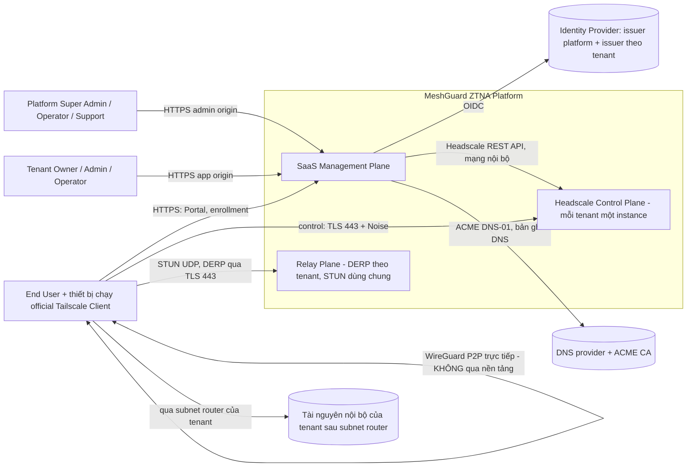
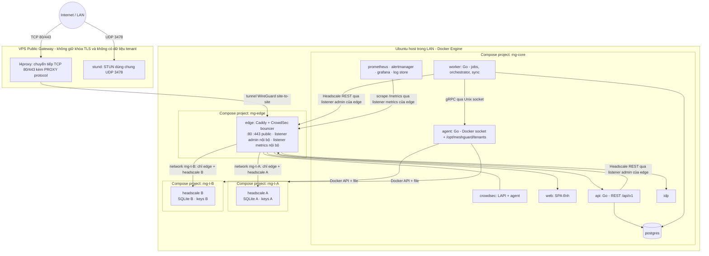
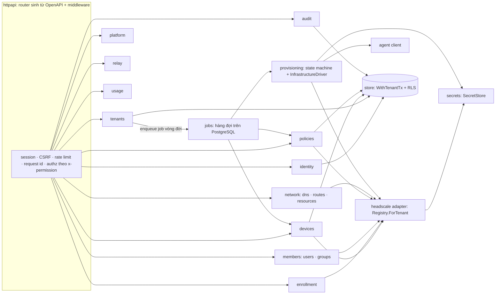
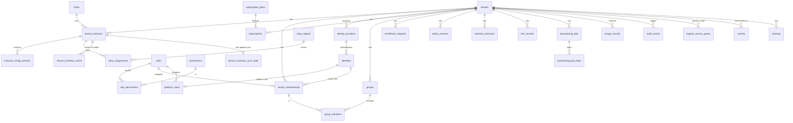
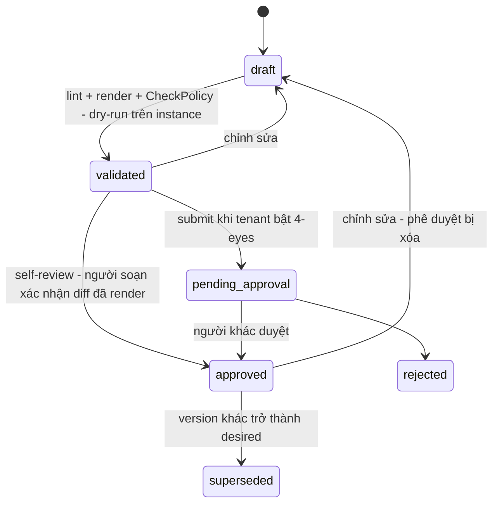
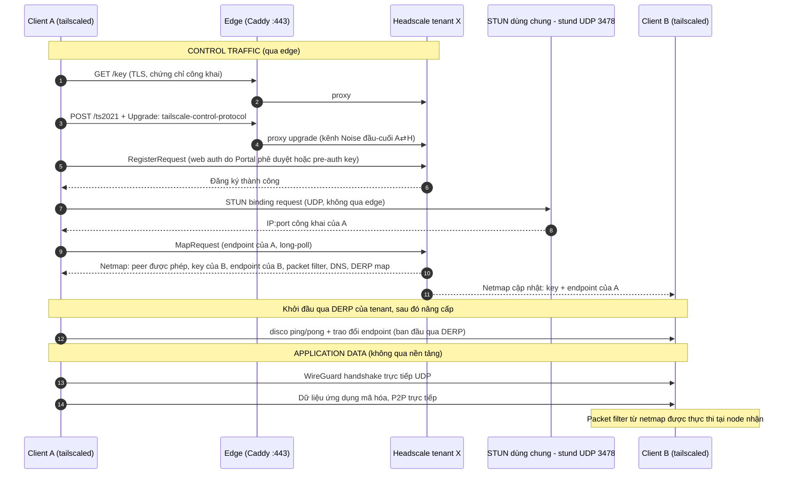
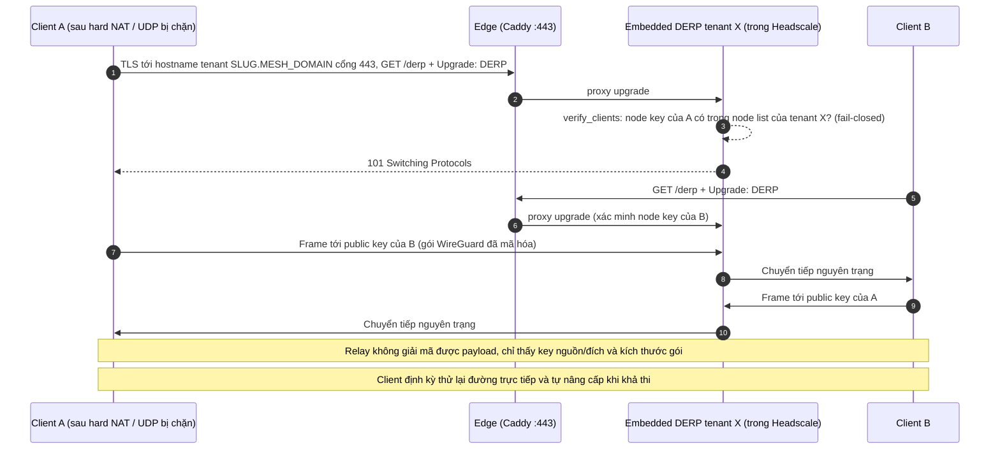
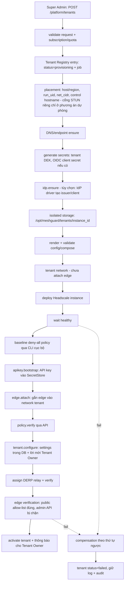
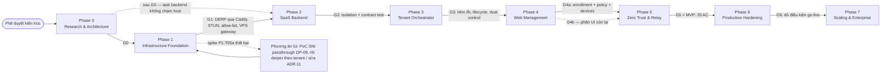
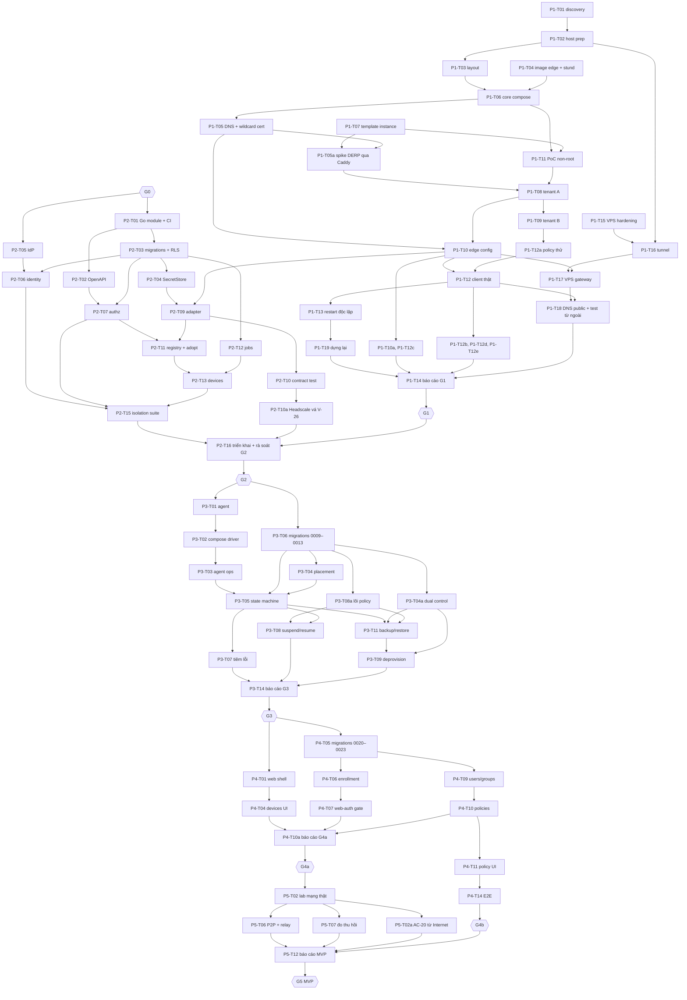

# MeshGuard ZTNA — Implementation Master Plan

> **Trạng thái:** Kiến trúc **đã được chủ dự án phê duyệt** ngày 2026-11-16 (biên bản: `docs/planning/evidence/architecture-approval.md`); dự án đang ở **Phase 1** (Build Mode) — G0 đạt ngày 2026-11-16 (`docs/planning/evidence/G0.md`). Đã có trên host staging: PostgreSQL, `stund`, edge (Caddy) với chứng chỉ wildcard production, CrowdSec, tenant A và B dựng tay (P1-T05…P1-T09); spike DERP qua Caddy đạt (P1-T05a); khung Go của api/worker (P2-T01). Chưa có migration, chưa có bản ghi DNS nào ngoài bản ghi TXT tạm thời của ACME DNS-01; firewall của host staging đã bật (P1-T02) và chỉ mở 80/443 tới edge từ LAN (P1-T06). Theo chỉ đạo của chủ dự án, ngày 2026-11-16 đã: cài SSH key của dự án lên Proxmox và VPS, tạo user triển khai trên VPS, tạo 6 VM trên Proxmox và dừng 3 dự án cũ trên VPS để giải phóng cổng 80/443/3478 (nhật ký và lệnh hoàn tác: `docs/planning/evidence/infrastructure-bootstrap.md`; kết quả discovery: Appendix A.4). Thiết kế **chưa được coi là production-ready** cho tới khi qua kiểm thử và kiểm toán bảo mật (Rule XIX.20).
> **Ngày lập:** 2026-11-16 · **Phiên bản tham chiếu đã xác minh qua GitHub Releases API:** Headscale `v0.29.7` (2026-10-30) · Tailscale client `v1.104.7` (2026-11-12).
> **Bản sửa đổi:** Rev 3 (2026-11-16). *Rev 2* — bổ sung quyết định của người dùng: các endpoint cần public đi qua **VPS Public Gateway** (§15.3, §14.9, ADR-25); chuyển STUN sang responder dùng chung tại điểm vào công khai (§10, ADR-11). *Rev 3* — tích hợp kết quả **phản biện đối kháng** của 8 reviewer độc lập — là 8 agent AI phản biện tự động, mỗi agent một góc nhìn, không thay cho thẩm định của chuyên gia bên ngoài (186 phát hiện: 1 nghiêm trọng, 50 cao, 106 trung bình, 29 thấp); tổng hợp và cách xử lý ở Appendix D, bản ghi nguyên văn ở `docs/planning/review-findings.md`. File này là **bản master**; các file khác trong `docs/` được trích sinh từ đây bằng `tools/split_plan.py` — sửa ở master rồi sinh lại.

## Context

**Vì sao có kế hoạch này.** Cần một nền tảng SaaS Zero Trust Mesh VPN tự lưu trữ, đa tenant, quản trị tập trung, nhưng **không** viết lại VPN client hay WireGuard/NAT traversal. Headscale upstream chỉ hiện thực **một tailnet cho mỗi instance**, nên bài toán thật sự là: (1) cách ly tenant bằng ranh giới control plane độc lập, (2) xây một Management Plane (Go + PostgreSQL + React) điều phối nhiều Headscale instance qua API, (3) giữ official Tailscale Client làm data plane, (4) có relay DERP/STUN an toàn theo tenant, (5) triển khai tái lập được bằng Docker Compose trên một Ubuntu host trước khi mở rộng multi-host.

**Kết quả mong đợi của Plan Mode.** Một bản thiết kế + roadmap đủ cụ thể để ở Build Mode, Coding Agent thực hiện từng task theo dependency order, có tiêu chí kiểm thử, không phải tự thiết kế lại các thành phần trọng yếu. Thư mục dự án hiện **trống (greenfield)**; mọi file nêu trong plan là file sẽ được tạo ở Build Mode.

**Phạm vi đã làm trong Plan Mode.** Chỉ đọc: mã nguồn/tài liệu 4 repository tham khảo (pin theo commit), mã nguồn + docs Headscale tại tag `v0.29.7`, mã nguồn + docs Tailscale tại tag `v1.104.7`, tài liệu Caddy/CrowdSec/Docker/PostgreSQL/SQLite. Không SSH vào server, không chạy script/Docker image của bên thứ ba, không tải `h.tar`.

## Quy ước đọc tài liệu

**Nhãn bằng chứng** (bắt buộc cho mọi nhận định kỹ thuật):

| Nhãn | Ý nghĩa |
|---|---|
| **VERIFIED** | Đã đọc trực tiếp trong mã nguồn/tài liệu được trích dẫn (pin theo tag/commit) trong phiên nghiên cứu này. |
| **VERIFIED (agent)** | Biến thể của VERIFIED: nhận định do research agent chỉ-đọc báo cáo từ nguồn đã pin và có trích dẫn trong nhật ký bằng chứng, nhưng tác giả plan **chưa** tự đọc lại nguyên văn. Mọi nhãn VERIFIED ở §2.1–§2.4, §2.6 và §2.8 được hiểu theo nghĩa này, trừ dòng ghi rõ tác giả hoặc reviewer đã tự đối chiếu (§2.5, PL-15, RT-02a, RT-15, GW-01…GW-04, §10.1). Nguồn đọc qua công cụ tóm lược (`[DOC:tailscale.com/docs]` — Appendix C) phải được đọc lại nguyên văn ở P0-T08; không đọc lại được thì hạ xuống REQUIRES VALIDATION. |
| **ASSUMED** | Suy luận kỹ thuật hợp lý, chưa có nguồn khẳng định trực tiếp. |
| **REQUIRES VALIDATION** | Không thể kết luận bằng cách đọc; phải kiểm thử thực tế trong môi trường của ta (ghi rõ phép thử), hoặc là tuyên bố của bên thứ ba chưa đối chiếu được với upstream. |
| **UNSUPPORTED** | Nguồn cho thấy tính năng không tồn tại/không được hỗ trợ, hoặc mâu thuẫn với giả định phổ biến. |

**Ký hiệu nguồn** (URL gốc ở Appendix C): `[HS:<path>]` = `juanfont/headscale@v0.29.7`; `[TS:<path>]` = `tailscale/tailscale@v1.104.7`; `[R1:<path>]` = `OLife97/headscale-stack-crowdsec@1afd96c`; `[R2:<path>]` = `fzhzyh/headscale-admin@0a4ca5e`; `[R3:<path>]` = `XavierAlpha/derper@e721396`; `[R4:<path>]` = `OwnDing/headscale-saas@25778c3`; `[DOC:<site>]` = tài liệu chính thức khác.

**Placeholder tên miền và tham số path.** `<domain>` = domain đã đăng ký của nền tảng (D-1); `<mesh_domain>` = `mesh.<domain>` — hostname control của tenant là `<slug>.<mesh_domain>` (ở §15 và ADR-09 có chỗ viết khai triển `*.mesh.<domain>`, cùng nghĩa); `<tailnet_suffix>` = hậu tố MagicDNS, mặc định `tail.<domain>` — `base_domain` của tenant là `<slug>.<tailnet_suffix>`. Trong path API, `{tenantId}` là tham số tenant của mọi route phạm vi tenant; `{t}` là cách viết tắt của `{tenantId}` trong các bảng, và `{id}` trong `/platform/tenants/{id}` cũng chính là `tenantId`.

**Tham chiếu đề bài.** `Rule XIX.n` (có chỗ viết gọn `Rule XIX`) = quy tắc thứ n ở mục XIX của đề bài — task brief người dùng cung cấp ở Plan Mode; "§2.1 đề bài" = mục 2.1 của chính đề bài đó. Đề bài không nằm trong repo; mọi số `§` không kèm chữ "đề bài" đều chỉ mục của bản master này.

**Thuật ngữ.** *Tenant* = một doanh nghiệp khách hàng. *Instance* = một tiến trình Headscale (một tailnet). *Edge* = Caddy + CrowdSec dùng chung. *Management Plane* = API/Worker/Agent/Portal/PostgreSQL. *Host Agent* = thành phần duy nhất được chạm vào Docker trên một host.

---

## 1. Executive Summary

**MeshGuard ZTNA** là nền tảng SaaS Zero Trust Mesh VPN tự lưu trữ, đa tenant: mỗi doanh nghiệp có một tailnet độc lập, Platform Super Admin quản trị tập trung, và **official Tailscale Client** đảm nhiệm toàn bộ data plane. Plan này là kết quả nghiên cứu chỉ-đọc 4 repository tham khảo cùng source/docs của Headscale `v0.29.7` và Tailscale `v1.104.7` (16 research agent + đối chiếu trực tiếp của tác giả), đã qua một vòng phản biện đối kháng của 8 agent AI phản biện độc lập và một vòng kiểm chứng lại (Appendix D), và là bản thiết kế + roadmap để Build Mode thực hiện.

**Các quyết định kiến trúc cốt lõi** (chi tiết ở §24):

1. **One Tenant = One Tailnet = One Headscale Instance** — Headscale upstream **pin theo commit, chỉ thêm bản vá bảo mật tối thiểu do dự án duy trì** (mỗi bản vá có test và điều kiện gỡ; hiện có bản vá V-26 — ADR-02 sửa đổi ngày 2026-11-17, P2-T10a), mỗi instance có SQLite, Noise/DERP key, API key, policy, DNS, relay riêng (ADR-01, 02, 07).
2. **Management Plane = Go modular monolith** (`api` / `worker` / `agent`) + PostgreSQL (shared DB, `tenant_id`, RLS) + Portal React/TypeScript viết mới (ADR-04, 06, 16). Chỉ **Host Agent** được chạm Docker (ADR-05).
3. **Shared edge** (Caddy + CrowdSec) là điểm thực thi duy nhất: mỗi tenant một hostname trên 443, **allow-list path** (chặn `/api`, `/swagger`, `/verify`, metrics), network Docker riêng chỉ gồm {Headscale của tenant, edge}, thêm tenant không cần reload (ADR-08, 09).
4. **Headscale Adapter chỉ dùng REST**, có lớp version, mỗi instance một API key không rời backend (ADR-10).
5. **Relay MVP = embedded DERP theo tenant** với `verify_clients` (fail-closed, chỉ node của tenant), bỏ DERP của Tailscale Inc.; **một STUN responder dùng chung** (`stund`, UDP 3478) đặt tại điểm vào công khai — container tenant không publish cổng nào; shared DERP chỉ là research (ADR-11).
6. **Zero Trust**: OIDC + MFA tại IdP với issuer theo tenant; RBAC theo permission, không có quyền tenant ngầm định cho nhân sự nền tảng; enrollment do Portal môi giới; policy **grants-first**, deny-by-default, có lint/version/duyệt/rollback (ADR-12…15).
7. **Internet-facing qua VPS Public Gateway** (quyết định của người dùng): VPS chỉ chuyển tiếp **tầng 4** (TCP 80/443 kèm PROXY protocol, qua tunnel WireGuard site-to-site về host LAN) và chạy STUN dùng chung; **không** đặt khóa TLS, token DNS hay dữ liệu tenant trên VPS; Platform Console không đi qua VPS (ADR-25).

**Những dữ kiện đã xác minh định hình thiết kế:** Headscale chỉ có một tailnet/instance và khuyến nghị SQLite; REST admin API và Swagger **chung listener** với endpoint của client; instance mới ở policy mode `database` là **allow-all** cho tới khi đặt policy, và policy thiếu **cả** `acls` lẫn `grants` cũng là allow-all; `node.expiry` mặc định là **không hết hạn**; API key là toàn quyền, không có scope; không có webhook/stream, không có bộ đếm traffic, không có Tailnet Lock/device posture/admin approval sau OIDC; reload Caddy đóng mọi stream đã upgrade; derper không có khái niệm tenant và mặc định fail-open; bản 0.30 sắp tới thay REST v1 và bỏ gRPC.

**Xung đột yêu cầu ↔ thực tế** và giải pháp thay thế được liệt kê ở §2.9 (12 mục), đáng chú ý: không dùng gRPC; group phải do nền tảng biên dịch vào policy; relay metrics chỉ xấp xỉ ở MVP; billing không thể theo traffic P2P; self-signed/DNS nội bộ không dùng được với mọi official client ⇒ cần domain thật + DNS-01 ngay cả trong LAN.

**Rủi ro lớn nhất:** (R-01) điều khoản của Tailscale về việc dùng official client cho dịch vụ thương mại — cần tư vấn pháp lý trước go-live; (R-05) DERP qua Caddy chưa được upstream kiểm chứng — là Go/No-Go của Phase 1; (R-07) single host là SPOF và **cách ly container không tương đương cách ly vật lý**; (R-02/R-03) mô hình Docker + reverse proxy nằm ngoài hỗ trợ chính thức của upstream và API đang thay đổi.

**MVP** được định nghĩa bằng 20 tiêu chí AC-01…AC-20 (§22.2), trong đó các tiêu chí mạng phải được chứng minh trên thiết bị thật. Lộ trình gồm 8 phase với gate bắt buộc (§19), 150 task có phụ thuộc và cách kiểm chứng (§20).

**Đã có:** phê duyệt kiến trúc và 25 ADR (2026-11-16). **Còn cần từ người dùng để qua G0:** trả lời Appendix A (đặc biệt: domain + DNS provider, phần cứng host LAN và VPS, IdP, thiết bị thử nghiệm) và các quyết định ở §25.4; **chuyển sang SSH key** trước mọi thao tác trên VPS (đã có từ 2026-11-16; mật khẩu root đã lộ trong hội thoại được chủ dự án quyết định giữ nguyên, chấp nhận rủi ro — D-10). Chưa có triển khai nào được thực hiện và thiết kế này **chưa** được coi là production-ready.

## 2. Verified Repository Research

Phương pháp: 16 research agent chỉ-đọc, mỗi agent đọc toàn bộ file được giao tại commit/tag đã pin và gắn nhãn bằng chứng cho từng nhận định; tác giả plan đối chiếu chéo bằng cách tự đọc docs, config mẫu và proto của Headscale. Không repository nào được clone, build hay chạy.

### 2.1 Repository 1 — `OLife97/headscale-stack-crowdsec` (MIT · commit `1afd96c` · 9 file · 1 maintainer)

**Kết luận: dùng làm mẫu tham khảo, không fork.** Đây là stack home-lab một tailnet: 3 service (`headscale`, `caddy`, `crowdsec`) trên **một** bridge network, điều khiển bằng một file `.env`.

| Chủ đề | Dữ kiện (VERIFIED `[R1:compose.yaml]`, `[R1:caddy/Caddyfile]`, `[R1:headscale/config/config.yaml]`, `[R1:init.sh]`, `[R1:README.md]`) |
|---|---|
| Compose | Image theo tag, hai image mặc định `latest`, không pin digest; `container_name` và tên project `headstack` hardcode; publish 80/443 (TCP+UDP) của Caddy và `0.0.0.0:3478/udp` của Headscale ⇒ **không nhân bản được theo tenant** trên một host |
| Headscale | Pin `v0.29.0` (chậm 7 bản vá so với bản bảo mật 0.29.7); `config.yaml` không có khóa nào bị 0.29.7 từ chối; SQLite WAL, policy mode database, embedded DERP bật; dùng override `HEADSCALE_*` |
| Lỗ hổng cấu hình | Caddy proxy **mọi path** ⇒ `/api/v1` và `/swagger` lộ ra Internet; không có `trusted_proxies`, `node.expiry`, PKCE; quảng bá địa chỉ DERP placeholder (`1.2.3.4`, `2001:db8::1`); giữ DERP map của Tailscale; GeoIP allow-list trả 403 cho cả node hợp lệ ngoài quốc gia cho phép |
| Caddy | Image bên thứ ba `ghcr.io/olife97/dhi-caddy-cloudflare` (plugin Cloudflare DNS, GeoIP, CrowdSec bouncer, dynamic DNS) — tag trôi; README quảng cáo DNS-01 nhưng Caddyfile không cấu hình |
| CrowdSec | Collection caddy/base-http/linux; acquisition `type: caddy` đọc JSON access log trên volume chung; bouncer là module Caddy (stream mode), key đăng ký trước qua `BOUNCER_KEY_<name>`; chỉ thấy log HTTP, không có scenario riêng cho Headscale; mặc định chia sẻ tín hiệu với Central API; `/etc/crowdsec` không được persist |
| Hardening | Không có `user`, `cap_drop`, `read_only`, giới hạn tài nguyên, phân đoạn mạng, Docker secrets, monitoring |
| Secrets | Tất cả trong một `.env` plaintext, truyền nguyên vào container Headscale |
| Khởi tạo | `init.sh`: tạo thư mục, sinh cấu hình CrowdSec, tải GeoIP từ mirror bên thứ ba (không pin), sinh bouncer key, có prompt tương tác |
| Backup/upgrade | Chỉ có lời khuyên "stop and copy" / "pull and recreate" trong README |

**Tái sử dụng được:** (1) hình dạng service Headscale cho template theo tenant (config mount read-only, data volume, healthcheck `headscale health`); (2) cách nối Caddy + CrowdSec cho **một shared edge**. **Shared edge thay vì lặp lại toàn bộ edge theo tenant** là bắt buộc trên host một IP (cổng 80/443 là độc quyền; upstream khuyến nghị mạnh 443) — đổi lại ban của CrowdSec có phạm vi toàn nền tảng và mỗi lần reload Caddy là sự kiện toàn nền tảng (§14).

### 2.2 Repository 2 — `fzhzyh/headscale-admin`

(MIT, © 2026 fzhzyh · commit `0a4ca5e` · tạo 2026-10-29, 36 commit, 0 star, một tác giả, tài liệu/chuỗi UI/log bằng tiếng Trung giản thể)

| Hạng mục | Dữ kiện (VERIFIED từ `[R2:server/src/*]`, `[R2:web/src/*]`, `[R2:docs/*]`, compose/Dockerfile) |
|---|---|
| Frontend framework | React 18.3 SPA, Vite 6, TypeScript strict, React Router 6, TanStack Query 5, Zustand, Ant Design 5 + Tailwind 3, Recharts, React Flow; ~11.400 dòng/36 file; type API viết tay, gắn với ≥ 73 endpoint riêng của panel; **không có i18n** (chuỗi tiếng Trung hardcode), chỉ light theme, không lint/unit test |
| Backend architecture | Node 22 + Fastify 5 + TypeScript monolith (REST + WebSocket + static SPA), `node:sqlite` đồng bộ, 46 file/11.627 dòng, ~100 handler; **không phải Go, không PostgreSQL** (SQL dialect SQLite viết inline) |
| Authentication | Tài khoản cục bộ (bcrypt cost 10), session phía server trong cookie httpOnly SameSite=Lax + CSRF header, TOTP tùy chọn; **không SSO**. Điểm yếu có căn cứ: lockout chỉ theo username (DoS), recovery code 32-bit lưu SHA-256 không salt, session ID/OAuth token lưu plaintext, `trustProxy` vô điều kiện |
| RBAC | 27 permission chuỗi toàn cục, 4 role dựng sẵn, **không** scope theo tài nguyên/tenant; người có `paneluser:write` hoặc `group:write` tự nâng thành superuser |
| Device / User / Key / Routes | Proxy mỏng và phần lớn chính xác trên Headscale REST v0.29 (rename, tags, expire, delete, register, approve routes, pre-auth key hiển thị một lần). Ghi chú API đã đối chiếu upstream: `ExpireNode`, `RegisterNode`, `DeletePreAuthKey` chỉ đọc **query parameter**; `approve_routes` thay thế toàn bộ tập và không kiểm tra route có được quảng bá hay không |
| ACL/Grants Management | Soạn/validate/ack allow-all–deny-all/lịch sử version/diff/rollback/drift detection theo `updatedAt`. **Engine chỉ xử lý `acls`**, bỏ qua `grants`, `via`, `app`, SSH; mặc định proto = TCP; fixture test mã hóa hành vi upstream từ chối ⇒ **không port evaluator** |
| DNS Management | Chỉ extra A/AAAA record ghi ra một file JSON để Headscale hot-reload; nameserver/split DNS/MagicDNS vẫn là cấu hình file ⇒ cần filesystem chung giữa backend và container Headscale |
| Network Topology | Cây 2 mức; trạng thái **suy ra** hoàn toàn từ engine ACL, không có số đo nào |
| Metrics | Poll node list mỗi 15 s vào InfluxDB 3 (trạng thái online, số route); **không có** traffic data plane (endpoint trả 501); không có nhãn tenant, không retention |
| Audit Logs | Bảng `audit_logs` (50+ action, ~60 điểm ghi), retention cố định 365 ngày; ghi best-effort, không chống sửa |
| Local database | Một file SQLite, 20 bảng, không bảng nào có cột tenant/instance; **không** đọc/ghi SQLite của Headscale (chỉ ghi file DNS extra-records) |
| Headscale API integration | Client REST mỏng cho 27/29 operation; một client toàn cục; cache single-flight 2 s; không phát hiện version, không retry, không xoay key; role settings có thể đổi `hs.url` và nhận được API key |
| Built-in OIDC provider | Panel tự làm issuer cho Headscale: token endpoint chỉ parse JSON (Headscale gửi form-encoded ⇒ nhiều khả năng đăng nhập thật thất bại — REQUIRES VALIDATION), access token = refresh token 30 ngày, không thu hồi được, không phát `email_verified` ⇒ **không tái dùng** |
| Deployment | Standalone: một service đã hardening (non-root, read-only, drop caps, bind loopback) cần `HS_URL` + `HS_API_KEY`. All-in-one: chèn Node vào image distroless của Headscale v0.29.7, supervisor restart cả container khi một tiến trình thoát. Không mount Docker socket, không sửa config/restart Headscale |
| Backup scripts | DB của panel dùng SQLite online-backup API; dữ liệu Headscale thì **dừng container rồi copy**; không mã hóa (gồm cả master key và Noise/DERP key); script restore không khôi phục Headscale |
| Test | Script lab chạy tay với node tổng hợp; **không** chạy Tailscale client thật; không CI |

**Đánh giá ba lựa chọn WebUI**

| Tiêu chí | **A — Giữ nguyên, mỗi tenant một WebUI** | **B — Fork, làm tenant-aware** | **C — Viết Portal mới, tham khảo có chọn lọc** |
|---|---|---|---|
| Ưu điểm | Có UI ngay cho POC | Tận dụng được nhiều màn hình sẵn có | Đúng stack mục tiêu (Go/PostgreSQL/React); tenant context và RBAC thiết kế từ đầu; i18n/a11y/dark mode đúng yêu cầu |
| Nhược điểm | Không có góc nhìn Super Admin; mỗi tenant thêm 1 tiến trình Node + 1 SQLite + 1 hostname + tài khoản cục bộ không SSO + **một policy writer thứ hai** (drift với portal trung tâm); UI chỉ tiếng Trung | Thực chất là **viết lại backend** (20 bảng, ~100 handler, 40+ call site sang Go/PostgreSQL) và refactor sâu frontend (tenant scope cho mọi route/query key/WebSocket, tách ~1.280 dòng chuỗi tiếng Trung, 73 endpoint) trên một upstream 2 tuần tuổi | Khối lượng ban đầu lớn nhất |
| Maintenance effort | Cao, tăng tuyến tính theo tenant; phụ thuộc upstream một tác giả | Rất cao: gánh fork vĩnh viễn, không kéo được thay đổi upstream | Trung bình, do ta kiểm soát |
| Security risk | Cao: N API key toàn quyền nằm rải ở N panel; RBAC leo thang được; điểm yếu auth nêu trên | Cao: thừa hưởng điểm yếu + rủi ro khi vá tenancy vào code không thiết kế cho nó | Thấp nhất: API key chỉ ở backend; authz 5 lớp |
| Khả năng mở rộng | Kém | Trung bình | Tốt |
| Giấy phép | MIT cho phép | MIT cho phép | MIT cho phép sao chép từng phần kèm ghi công |

**Quyết định (ADR-16): Option C**, kèm tái sử dụng có chọn lọc theo MIT (giữ thông báo bản quyền): ý tưởng và, sau khi review từng file, các thành phần UI thuần (`VisualEditor` cho rule, lịch sử version, quy trình draft → validate → acknowledge → drift, WebSocket hook, primitives). Không dùng: backend, evaluator ACL, OIDC provider tích hợp, access matrix N² request, chế độ all-in-one. Option A **không** được dùng kể cả cho POC vì tạo policy writer thứ hai và rải API key.

### 2.3 Repository 3 — `XavierAlpha/derper` (không có giấy phép cho phần riêng · commit `e721396`)

**Kết luận: không dùng image này, không fork; nếu cần derper độc lập thì tự build từ tag upstream.** Repo chỉ là lớp đóng gói mỏng quanh `cmd/derper` của Tailscale; mọi hành vi relay là của upstream (xem DP-01…DP-09 ở §2.6).

| Chủ đề | Dữ kiện (VERIFIED `[R3:Dockerfile]`, `[R3:entrypoint.sh]`, `[R3:.github/workflows/*]`, `[R3:LICENSE]`, registry metadata) |
|---|---|
| Build | Dockerfile 2 stage với tag trôi (`golang:alpine`, `alpine:latest`); submodule bám **`main` chưa phát hành** của Tailscale (1.105.0), không bám release tag |
| Cập nhật | Cron hằng ngày chỉ rebuild khi `cmd/derper` thay đổi ⇒ `latest` trên Docker Hub vẫn là v1.104.5 trong khi upstream đã v1.104.7; không rebuild khi base image/dependency đổi |
| Runtime | Chạy **root**, không `HEALTHCHECK`; mặc định khác upstream: `VERIFY_CLIENTS=true` (cần mount socket tailscaled của host), `CERT_MODE=manual`, `HOSTNAME=127.0.0.1`; 7 flag hiện hành (gồm `-rate-config`) không có biến môi trường tương ứng |
| Chứng chỉ | `entrypoint.sh` tự sinh self-signed P-256 365 ngày cho IP; chế độ manual không tự gia hạn (cần restart) |
| Supply chain | Action pin theo major tag, không ký image; namespace Docker Hub `camllia` là tài khoản cá nhân |
| Giấy phép | `LICENSE` chỉ chép lại BSD-3-Clause của Tailscale, **không** cấp phép cho file riêng của repo ⇒ không sao chép Dockerfile/entrypoint vào codebase |
| Upstream | Tailscale **không phát hành** image/package derper chính thức ("You must build and update the cmd/derper binary yourself"); custom DERP được tài liệu ghi là "currently in alpha" |

**So sánh standalone derper với embedded DERP của Headscale:** xem §10.3. Tóm tắt: standalone có metrics, accept limiter và `-rate-config` nhưng **không được đặt sau HTTP proxy**, cần cổng/IP riêng và mặc định fail-open; embedded DERP được cách ly theo tenant sẵn (verify in-process, fail-closed) nhưng không có metrics, rate limit hay mesh.

### 2.4 Repository 4 — `OwnDing/headscale-saas` (không có LICENSE · commit `25778c3` · một ngày commit, 409 ngày không đổi)

**Kết luận: chỉ là tài liệu đọc tham khảo. Không tải, không load, không chạy, không phụ thuộc vào `h.tar` (ADR-20).**

| Chủ đề | Dữ kiện |
|---|---|
| Nội dung repo | README song ngữ, `config.yaml`, `docker-compose.yml` (chỉ có nginx), `nginx.conf`, và `h.tar` 88,6 MB. **Không có** source, Dockerfile, `go.mod`, checksum, chữ ký, SBOM, LICENSE; 27 repo public của tác giả không có fork Headscale nào. VERIFIED `[R4:README.md]` + danh sách repo |
| `cluster_id` | Khóa cấu hình **duy nhất** không có ở upstream: "mọi bản ghi DB do instance này ghi sẽ được gắn giá trị này"; mỗi node một `cluster_id` ⇒ là **định danh shard/instance**, không phải nhóm replica. Không nói việc đọc có được lọc hay không. VERIFIED `[R4:config.yaml]` |
| Nền tảng fork | `config.yaml` trùng từng dòng với ví dụ upstream **v0.26.x** ⇒ chậm 3 minor và 11 bản phát hành so với 0.29.7. VERIFIED (so sánh) / ASSUMED (binary trong `h.tar`) |
| PostgreSQL shared storage | Mọi instance trỏ vào một PostgreSQL (ví dụ dùng superuser `postgres`) — trái khuyến nghị upstream (HS-02); mọi instance giữ credential đọc được mọi shard |
| Admission Controller | Chỉ là **một ô trong sơ đồ** + 3 dòng mô tả: chọn `clusterID`, trả địa chỉ node + thông tin đăng ký. Không có code/API/image |
| Load balancing | `nginx.conf` **không** có `upstream`, không có thuật toán cân bằng hay sticky: hai cổng ánh xạ một-một tới hai instance trên cùng một host, HTTP thuần. README lại nói "phân phối tới node bất kỳ" — mâu thuẫn nội tại |
| Horizontal scaling / "unlimited devices" | Tuyên bố không có benchmark; mâu thuẫn với upstream (nút thắt là tính lại "world map" theo tailnet — HS-23). **UNSUPPORTED** cho một tailnet |
| Database consistency | README viện dẫn "database locks and state synchronisation"; tầng DB của upstream không có row lock/advisory lock/LISTEN-NOTIFY và state nằm trong bộ nhớ tiến trình (RT-13) ⇒ nếu có thì hoàn toàn là code riêng chưa công bố. **REQUIRES VALIDATION**, không kiểm chứng được |
| Failover | Không mô tả. "High availability" chỉ là tiêu đề và là thuộc tính của PostgreSQL được khuyến nghị. **UNSUPPORTED** |
| Lập trường upstream | Yêu cầu multi-replica bị đánh dấu not-planned ("The short answer is no"); maintainer khuyến nghị **khôi phục nhanh** thay cho HA, và cho biết client tiếp tục chạy bằng netmap hiện có khi control plane gián đoạn ngắn nếu hình dạng mạng ổn định. VERIFIED (issue/discussion upstream do agent trích dẫn) |

**Phân biệt ba khái niệm:** *cluster isolation* (điều repo này tuyên bố — mỗi instance một `cluster_id`, gắn nhãn hàng ghi vào DB chung) ≠ *tenant isolation* (ranh giới bảo mật giữa khách hàng — repo **không** tuyên bố ranh giới nào; DB và credential dùng chung khiến `cluster_id` chỉ là phân vùng logic trong một trust domain) ≠ *tailnet isolation* (netmap, khóa, policy, DNS, DERP map riêng — repo không nói tới). Mô hình *one tenant = one instance + SQLite riêng* của ta đạt cả ba mà **không cần vá Headscale**.

**Ý tưởng giữ lại (chỉ khái niệm):** hàm admission/placement trong backend; định danh instance bất biến trong registry và trên log/audit; "stickiness theo cấu trúc" (một hostname ↔ đúng một tiến trình Headscale); sẵn sàng bằng restore/relocation nhanh thay vì active-active.

### 2.5 Headscale v0.29.7 — dữ kiện đã xác minh từ docs/source upstream

Các dòng dưới đây do tác giả plan đọc trực tiếp tại tag `v0.29.7` (ngoài phần các research agent báo cáo). Tất cả **VERIFIED** trừ khi ghi khác.

| ID | Dữ kiện | Nguồn |
|---|---|---|
| HS-01 | Phạm vi thiết kế: "It implements a narrow scope, a *single* Tailscale network (tailnet), suitable for a personal use, or a small open-source organisation." Đối tượng: "self-hosters and hobbyists". ⇒ Không có khái niệm multi-tenant/multi-tailnet trong một instance. | `[HS:docs/about/faq.md]`, `[HS:docs/about/features.md]` |
| HS-02 | Database: "We recommend the use of SQLite"; PostgreSQL "maintenance mode", config ghi "highly discouraged as it is only supported for legacy reasons". SQLite WAL bật mặc định (`write_ahead_log: true`). | `[HS:docs/about/faq.md]`, `[HS:config-example.yaml]` |
| HS-03 | "we don't officially support deploying headscale using Docker" (image vẫn được phát hành: `docker.io/headscale/headscale`, `ghcr.io/juanfont/headscale`; distroless, không có shell; có biến thể `-debug`; healthcheck `headscale health`; chạy được `--read-only` + tmpfs `/var/run/headscale`). | `[HS:docs/about/faq.md]`, `[HS:docs/setup/install/container.md]` |
| HS-04 | Nâng cấp bắt buộc tuần tự từng minor ("0.26.0 → 0.27.1 → 0.28.0 without skipping minor versions"), DB migration chạy khi upgrade; hướng dẫn backup upstream là **dừng Headscale rồi copy** config + data dir. | `[HS:docs/setup/upgrade.md]` |
| HS-05 | Client: "We aim to support the **last 10 releases** of the Tailscale client"; Linux/Windows/macOS/iOS/Android/tvOS/BSD đều "Yes". | `[HS:docs/about/clients.md]` |
| HS-06 | Tính năng **có**: web auth + pre-auth key, MagicDNS, split DNS, search domains, extra DNS records, Taildrop, Taildrive, Tags, subnet routers, exit nodes, route filtering với `via`, dual-stack, ephemeral nodes, embedded DERP, **peer relays**, ACLs, **Grants**, một số autogroup, auto approvers, Tailscale SSH, node attributes, **tests/sshTests**, OIDC. **Không có**: Funnel, Serve, Network flow logs, "OIDC groups cannot be used in ACLs". | `[HS:docs/about/features.md]` |
| HS-07 | Policy mặc định: "By default, no policy is loaded which means that Headscale allows all traffic between nodes". Policy thiếu cả `acls` lẫn `grants` (ví dụ `{}`) ⇒ **allow all**. `{"grants": []}` ⇒ **deny all**. Upstream khuyến nghị Grants (ACLs là legacy). | `[HS:docs/ref/policy.md]` |
| HS-08 | Giới hạn policy: device posture (`postures`, `srcPosture`) và IP sets **UNSUPPORTED**; autogroup hỗ trợ: `internet`, `member`, `tagged`, `self` (cảnh báo hiệu năng: filter biên dịch theo từng node), `nonroot`, `danger-all`. | `[HS:docs/ref/policy.md]` |
| HS-09 | Policy mode `file` (reload bằng SIGHUP) hoặc `database`. API: `GET/PUT /api/v1/policy` và **`POST /api/v1/policy/check`** (`CheckPolicy` — kiểm tra không áp dụng). Policy trong DB không hợp lệ ⇒ Headscale từ chối khởi động (có lệnh khôi phục `--bypass-grpc-and-access-database-directly`). | `[HS:proto/headscale/v1/headscale.proto]`, `[HS:docs/about/faq.md]` |
| HS-10 | Mô hình danh tính node: personal (thuộc user) vs tagged (thuộc tag, gom dưới user đặc biệt `tagged-devices`); gắn tag qua API biến personal → tagged; tagged → personal phải re-auth. | `[HS:docs/ref/registration.md]`, `[HS:docs/ref/tags.md]` |
| HS-11 | Đăng ký node: (a) **web authentication** — client khởi tạo, quản trị viên phê duyệt bằng CLI/API (`POST /api/v1/auth/register {user, authId}`) hoặc ủy quyền cho OIDC; (b) **pre-auth key** — mặc định **của CLI**: dùng 1 lần, hiệu lực 1 giờ (qua REST, bỏ trống `expiration` ⇒ key được lưu với hạn bằng 0 và bị coi là đã hết hạn ngay — §13.4, V-06); key gắn tag không cần user. Hàng đợi pending auth mặc định 1024 mục (`tuning.register_cache_max_entries`), đầy ⇒ HTTP 503 + `Retry-After`. | `[HS:docs/ref/registration.md]`, `[HS:docs/ref/api.md]` |
| HS-12 | Management API: REST tại `/api/v1` **trên cùng listener với control plane**, tài liệu tại `/swagger`, phiên bản tại `/version`; xác thực `Authorization: Bearer <API_KEY>`; key tạo bằng CLI mặc định hết hạn 90 ngày (qua REST phải gửi `expiration` tường minh, nếu không key hết hạn ngay — §13.4), "you can not retrieve an API key again". gRPC (mặc định `:50443`) truy cập từ xa cần TLS; "gRPC… may not be proxied". | `[HS:docs/ref/api.md]`, `[HS:docs/ref/integration/reverse-proxy.md]` |
| HS-13 | Danh mục RPC/REST: users (create/rename/delete/list), preauthkey (create/expire/delete/list), node (get/list/register/delete/expire[`expiry`,`disable_expiry`]/rename/tags/approve_routes/backfillips/debug), auth (register/approve/reject), apikey (create/expire/list/delete), policy (get/set/check), health. `device.proto` chỉ là bản nháp bị comment — **UNSUPPORTED**. Không có RPC stream/webhook — **UNSUPPORTED**. | `[HS:proto/headscale/v1/headscale.proto]` |
| HS-14 | `Node` trả về: id, machine/node/disco key, ip_addresses, name, given_name, user, last_seen, expiry, pre_auth_key, created_at, register_method, online, approved/available/subnet routes, tags. **Không** có hostinfo/OS/client version/endpoints/byte counters. `User`: id, name, display_name, email, provider_id, provider, profile_pic_url. | `[HS:proto/headscale/v1/node.proto]`, `[HS:proto/headscale/v1/user.proto]` |
| HS-15 | Reverse proxy (tài liệu cộng đồng, maintainer không dùng): proxy **phải** hỗ trợ WebSocket với `POST` upgrade và `Upgrade: tailscale-control-protocol`; Cloudflare Proxy/Tunnel **UNSUPPORTED**; có ví dụ Caddy (kèm `respond 204` cho `/generate_204` trên cổng 80). `trusted_proxies` quyết định có tin `True-Client-IP`/`X-Real-IP`/`X-Forwarded-For` hay không. | `[HS:docs/ref/integration/reverse-proxy.md]` |
| HS-16 | Yêu cầu: server có public IP; HTTPS trên 443 "strongly recommended" (client giả định 443 trong một số tình huống); cổng: tcp/80 (ACME HTTP-01), tcp/443, udp/3478 (STUN khi bật embedded DERP), tcp/50443 (gRPC), tcp/9090 (metrics + debug — **không** public). | `[HS:docs/setup/requirements.md]` |
| HS-17 | Embedded DERP: tắt mặc định; "server_url… MUST be using https"; `verify_clients: true` mặc định ("Only allow clients associated with this server access"); `stun_listen_addr` **bắt buộc** khi bật; `region_id: 999`; `automatically_add_embedded_derp_region`; `urls: []` để bỏ DERP của Tailscale Inc. (kèm cảnh báo SPOF); không hỗ trợ `/generate_204` trên cổng 80; "no speed or throughput optimisations". | `[HS:config-example.yaml]`, `[HS:docs/ref/derp.md]` |
| HS-18 | DERP bên ngoài: `derper -verify-client-url https://<headscale>/verify`; `-verify-client-url-fail-open` **mặc định cho phép** khi Headscale không truy cập được. | `[HS:docs/ref/derp.md]` |
| HS-19 | `node.expiry` mặc định `0` (node **không bao giờ hết hạn** nếu không cấu hình) và chỉ là giá trị **mặc định**: hạn do client yêu cầu lúc đăng ký (`RegisterRequest.Expiry`) được ưu tiên trên mọi đường đăng ký ⇒ nền tảng phải tự kẹp hạn sau đăng ký (§7.4, V-21); tagged node luôn miễn hết hạn; `node.ephemeral.inactivity_timeout`: file ví dụ ghi `30m`, default trong code là `120s`; có health-probe cho HA subnet router (`node.routes.ha`). | `[HS:config-example.yaml]` |
| HS-20 | `prefixes` phải là tập con của `100.64.0.0/10` và `fd7a:115c:a1e0::/48`; `dns.base_domain` phải khác domain của `server_url`; `dns.extra_records_path` được xử lý lại mỗi khi file đổi; `unix_socket` cho CLI "connect without authentication" (`0770`). | `[HS:config-example.yaml]` |
| HS-21 | OIDC: một khối `oidc` duy nhất mỗi instance (issuer, client_id, `client_secret_path`, scope, `allowed_domains/users/groups`, `pkce`, `email_verified_required`, `use_expiry_from_token`, `only_start_if_oidc_is_available`). | `[HS:config-example.yaml]` |
| HS-22 | `logtail.enabled: false` (mặc định) ⇒ Headscale **chỉ thị** client tắt gửi log về Tailscale Inc.; chỉ thị nằm trong netmap nên chỉ có hiệu lực **sau khi client kết nối thành công**, và client **quên** chỉ thị này mỗi khi tiến trình `tailscaled` khởi động lại (mỗi lần chạy lại gửi log cho tới map đầy đủ đầu tiên — CL-16) — trong lúc cài đặt và khi đăng nhập thất bại client vẫn có thể gửi log chẩn đoán (tắt hẳn ở phía client: `TS_NO_LOGS_NO_SUPPORT=true` / `--no-logs-no-support`). Không cấp node attribute `https://tailscale.com/cap/data-plane-audit-logs` khi logtail tắt (theo phản biện: client coi đó là tailnet bắt buộc ghi log và tự ngắt — REQUIRES VALIDATION nếu về sau mở `nodeAttrs`). | `[HS:config-example.yaml]`, `[HS:docs/about/faq.md]`, `[HS:hscontrol/types/config.go]` |
| HS-23 | Scaling: "Headscale is not enterprise software… performance is not part of the consideration"; ước lượng upstream "100s of devices (maybe more), if there is little to no change"; mỗi thay đổi tính lại "world map" cho mọi node. Không có tuyên bố HA. | `[HS:docs/about/faq.md]` |
| HS-24 | Chạy Headscale và Tailscale client (đã join tailnet đó) trên cùng máy "might work, but it is not supported". ⇒ Client kiểm thử E2E phải ở máy khác host. | `[HS:docs/about/faq.md]` |
| HS-25 | `tailscale ping` luôn được phép giữa hai node nhìn thấy nhau, bất kể policy ⇒ không dùng `tailscale ping` để chứng minh policy deny. | `[HS:docs/about/faq.md]` |

### 2.6 Dữ kiện bổ sung từ research agents (đọc trực tiếp source tại tag đã pin)

**Policy engine — `[HS:hscontrol/policy/v2/*]`, `[HS:docs/ref/routes.md]`, `[HS:CHANGELOG.md]`**

| ID | Dữ kiện | Nhãn |
|---|---|---|
| PL-01 | Policy chấp nhận **đúng 11 khóa top-level**: `groups, hosts, tagOwners, acls, grants, nodeAttrs, autoApprovers, ssh, tests, sshTests, randomizeClientPort`; khóa lạ bị từ chối ("unknown field"). Grant có 5 trường: `src, dst, ip, app, via` (Grants có từ 0.29.0, 06/2026). ACL được chuyển nội bộ thành grant; không có hành động deny. | VERIFIED |
| PL-02 | Bỏ cả `acls` lẫn `grants` (kể cả policy chỉ có `tagOwners`/`groups`/`ssh`) ⇒ allow-all; mảng rỗng tường minh ⇒ deny-all (có unit test upstream). Instance mới ở `policy.mode: database` là **allow-all cho tới lần `SetPolicy` đầu tiên**. | VERIFIED |
| PL-03 | `SetPolicy` chỉ hoạt động khi `policy.mode: database`; `GetPolicy`/`CheckPolicy` hoạt động ở cả hai mode. `CheckPolicy` là dry-run: kiểm tra với user/node **đang có** và chạy `tests`/`sshTests`, không lưu. | VERIFIED |
| PL-04 | Khi set: từ chối lỗi cú pháp, khóa lạ, tham chiếu group/tag/host chưa khai báo, user token trùng nhiều user; user không tồn tại được bỏ qua (tập rỗng). `tests` thất bại ⇒ từ chối ghi, policy đang chạy giữ nguyên (tính năng tests gắn nhãn beta). Test **fail nếu** src user chưa đăng ký hoặc src/dst không phân giải ra IP ⇒ tests phụ thuộc inventory lúc apply. | VERIFIED |
| PL-05 | API policy **không có** version/ETag/ghi có điều kiện/lịch sử/rollback và **không có** what-if trả về quyền hiệu lực. | UNSUPPORTED |
| PL-06 | PUT chuỗi policy rỗng: không đổi policy đang chạy nhưng vẫn được lưu ⇒ lần khởi động sau thành "no policy" (allow-all). | REQUIRES VALIDATION (test trước khi dựa vào; nền tảng phải **chặn** chuỗi rỗng) |
| PL-07 | User trong policy: email, `<username>@`, hoặc provider identifier (`iss/sub`) + `@`; ưu tiên provider identifier. Group là danh sách user tĩnh, **không lồng nhau**. OIDC group claim không dùng được trong rule. Không có autogroup theo vai trò (admin/owner). | VERIFIED / UNSUPPORTED |
| PL-08 | Đúng 6 autogroup: `internet` (dst), `member`, `tagged`, `self` (dst), `nonroot` (SSH users), `danger-all` (src). `*` ở **dst** bao gồm cả subnet route và exit node. | VERIFIED |
| PL-09 | Tag và quyền sở hữu của user loại trừ nhau (từ 0.28.0); tagged node không hết hạn key theo mặc định. Admin API gắn tag cho bất kỳ node nào (bỏ qua `tagOwners` nhưng tag phải có trong policy). Pre-auth key chỉ-tag tồn tại; lúc tạo key tag **chỉ được kiểm tra định dạng**, không đối chiếu `tagOwners`. | VERIFIED |
| PL-10 | Route: double opt-in (client quảng bá → server duyệt qua `POST /api/v1/node/{id}/approve_routes`, lời gọi **thay thế** toàn bộ danh sách; duyệt `0.0.0.0/0` hoặc `::/0` là duyệt cả hai). `autoApprovers` chỉ cộng thêm và **chạy lại ở mọi lần set policy** ⇒ route đã gỡ duyệt thủ công sẽ được duyệt lại nếu còn khớp. | VERIFIED |
| PL-11 | Dùng subnet route được policy kiểm soát (node chỉ nhận route nó được phép truy cập); dùng exit node cần rule tới `autogroup:internet` (có thể giới hạn bằng `via: [tag]`). HA subnet router tự động (primary "dính", probe 10 s/5 s, phát hiện tệ nhất ~15 s); exit node không có failover phía control plane. | VERIFIED |
| PL-12 | Lan truyền: batcher đẩy thay đổi tới node đang kết nối theo nhịp `tuning.batch_change_delay` (mặc định 800 ms). **Không có** cam kết về độ trễ/giao nhận; node offline chỉ cập nhật khi kết nối lại. | VERIFIED (cơ chế) / REQUIRES VALIDATION (độ trễ end-to-end) |
| PL-13 | Tailscale SSH: deny mặc định (không rule ⇒ danh sách rỗng); rule `accept` **luôn** cho phép port forwarding; `check` mode cần phê duyệt qua OIDC hoặc `POST /api/v1/auth/approve`; không có session recording. | VERIFIED / UNSUPPORTED |
| PL-14 | Không có: tailnet lock, mô hình role của user, app connectors, Tailscale Services, Funnel, Serve, network flow logs, device posture, IP sets. | UNSUPPORTED |
| PL-15 | Listener metrics/debug: `/metrics` **không có kiểm soát truy cập**; các endpoint `/debug/*` đăng ký qua `tsweb.Debugger` (`policy`, `filter`, `ssh`, `routes`, `mapresponses`, `config`, `nodestore`, `registration-cache`, `ping`…) chỉ nhận nguồn loopback hoặc dải địa chỉ Tailscale; riêng `/debug/statsviz` nhận thêm dải private (RFC 1918/4193). ⇒ container trên subnet Docker private **không** đọc được `/debug/policy`, nhưng nếu pool Docker lấy từ `100.64.0.0/10` thì mọi endpoint debug mở cho container cùng network. *(Sửa ở Rev 3 theo phản biện; tác giả đối chiếu lại `[HS:hscontrol/debug.go]`.)* | VERIFIED |

**OIDC, user và đăng ký node — `[HS:hscontrol/oidc.go]`, `[HS:hscontrol/auth.go]`, `[HS:docs/ref/oidc.md]`**

| ID | Dữ kiện | Nhãn |
|---|---|---|
| ID-01 | Một instance = **một** issuer + **một** client; redirect URI cố định `<server_url>/oidc/callback`. User khóa theo provider identifier (`issuer + '/' + subject`); đổi issuer làm đổi identifier của mọi user. | VERIFIED |
| ID-02 | Bộ lọc đăng nhập `allowed_groups/domains/users` rỗng mặc định (ai IdP xác thực cho client đó đều được nhận); so khớp chính xác, phân biệt hoa thường; tên claim nhóm cố định là `groups`; **không** kiểm tra được claim tùy biến (ví dụ tenant id). | VERIFIED / UNSUPPORTED |
| ID-03 | Headscale chỉ liên lạc IdP lúc khởi động (discovery, timeout 30 s) và trong callback đăng nhập; không refresh token, không SCIM, không trạng thái "disabled". `only_start_if_oidc_is_available: true` (mặc định) ⇒ IdP không truy cập được thì instance **không khởi động**. Mọi thay đổi OIDC cần restart. | VERIFIED |
| ID-04 | Node của user đã bị khóa/xóa ở IdP được dự đoán vẫn hoạt động tới khi key hết hạn; với `node.expiry: 0` nghĩa là vô thời hạn. | REQUIRES VALIDATION (test offboarding) |
| ID-05 | Luồng web auth: client nhận URL `<server_url>/register/<auth_id>` (`auth_id` = `hskey-authreq-` + 24 ký tự); pending registration nằm trong cache bộ nhớ 15 phút (1024 mục), mất khi restart. Không có OIDC thì trang này chỉ hiển thị lệnh phê duyệt. | VERIFIED |
| ID-06 | Phê duyệt qua API: `POST /api/v1/auth/register {user, authId}` (user khớp theo **tên**, phải duy nhất) hoạt động dù có OIDC hay không; node được ghi `register_method = CLI`. | VERIFIED |
| ID-07 | Với OIDC (từ 0.29.0): sau callback có trang `/register/confirm/{auth_id}` hiển thị hostname, OS, fingerprint machine key, user đích; node chỉ được tạo khi người dùng POST xác nhận (có CSRF). **Không** thể bắt buộc bước admin phê duyệt sau OIDC (issue upstream #2176, milestone v0.30). | VERIFIED / UNSUPPORTED |
| ID-08 | User tạo qua API (`CreateUser`: name, display_name, email, picture_url) không gán được provider identifier ⇒ user OIDC chỉ xuất hiện sau lần đăng nhập đầu; OIDC login **không** gộp với user tạo bằng API trùng tên (sinh user thứ hai, làm token theo tên trở nên mơ hồ ⇒ policy bị từ chối). Tên user: ≥ 2 ký tự, bắt đầu bằng chữ cái, chỉ gồm chữ/số/`-`/`.`/`_` và tối đa một `@`. Theo phản biện, quy tắc tên này **không** được áp trên REST `CreateUser`/`RenameUser` (chỉ áp cho claim OIDC) ⇒ nền tảng tự kiểm (§13.4). | VERIFIED |
| ID-09 | Key expiry được thực thi bởi tác vụ chạy mỗi 5 giây (đánh dấu node hết hạn là offline). Bản 0.29.4 sửa lỗi node hết hạn vẫn online và node bị xóa vẫn giữ session ⇒ **bắt buộc ≥ 0.29.7**. | VERIFIED |
| ID-10 | Mọi khóa cấu hình đặt được bằng biến môi trường tiền tố `HEADSCALE_`. Headscale không đọc `acr`/`amr`/`auth_time` ⇒ MFA hoàn toàn do IdP. Trang trình duyệt của Headscale không tùy biến thương hiệu/ngôn ngữ được. | VERIFIED / UNSUPPORTED |

**derper upstream — `[TS:cmd/derper/*]`, `[TS:derp/derpserver/*]`, `[TS:tailcfg/derpmap.go]`**

| ID | Dữ kiện | Nhãn |
|---|---|---|
| DP-01 | derper **không có khái niệm tenant/tailnet**: một map toàn cục khóa theo node public key; client đã được nhận có thể gửi frame tới bất kỳ key nào đang kết nối. | UNSUPPORTED (tenant-awareness) |
| DP-02 | Xác minh client chỉ diễn ra **một lần lúc kết nối**. `--verify-clients`: hỏi tailscaled cùng máy (một tailnet, fail-closed). `--verify-client-url`: **một** URL duy nhất; POST `{NodePublic, Source}`, chấp nhận khi HTTP 200 + `{Allow:true}`, timeout 5 s. `--verify-client-url-fail-open` mặc định `true` và chỉ áp dụng khi lỗi truyền tải (HTTP 5xx vẫn bị từ chối). Mặc định (không cấu hình gì) derper nhận **mọi** client. | VERIFIED |
| DP-03 | Node bị thu hồi sau đó **vẫn giữ** kết nối DERP tới khi rớt; chỉ bị từ chối khi kết nối lại. Cách cưỡng chế duy nhất trong giao thức là `FrameClosePeer` cần mesh key (mesh key bỏ qua mọi kiểm tra, quan sát và đóng được mọi kết nối). | VERIFIED |
| DP-04 | Upstream: "Do not put derper behind another HTTP proxy"; yêu cầu trực tiếp TCP 443 + 80 và UDP 3478; không hỗ trợ PROXY protocol; `/debug/*` (metrics, pprof, `/debug/clients`) chỉ chặn theo địa chỉ nguồn và **cho phép loopback** ⇒ đặt sau proxy cùng host có thể lộ debug. README của derper còn nêu (theo phản biện): một DERP server **không nên dùng chung địa chỉ IP** với DERP server khác; chỉ chứng chỉ Let's Encrypt được xoay tự động, các chế độ khác phải **restart** khi đổi chứng chỉ. | VERIFIED |
| DP-05 | `DERPNode`: `HostName, CertName, IPv4, IPv6, STUNPort (0 ⇒ 3478, −1 ⇒ tắt), STUNOnly, DERPPort (0 ⇒ 443), CanPort80, InsecureForTests`. Region ID 900–999 dành cho DERP tự vận hành. Tài liệu: custom DERP "currently in alpha". | VERIFIED |
| DP-06 | Giới hạn tải: chỉ có accept limiter (TLS) và `-rate-config` thử nghiệm (một giá trị toàn cục theo kết nối); **không** có quota theo key/tenant. Số đo theo kết nối lấy được từ `/debug/clients/?format=json` (node key, IP, rx/tx bytes) — không có nhãn tenant. | VERIFIED |
| DP-07 | Metadata relay nhìn thấy: node public key, IP:port nguồn, thời điểm kết nối, key đích của từng frame, số lượng/kích thước gói; payload vẫn là WireGuard đã mã hóa. | VERIFIED |
| DP-08 | Headscale đăng ký `POST /verify` trên router chính, **không xác thực**; trả `Allow=true` nếu node key đã đăng ký ⇒ là "membership oracle" nếu để public. | VERIFIED |
| DP-09 | derper có chạy được sau L4 TLS passthrough dùng chung cổng 443 hay không, và embedded DERP verify có còn hoạt động khi chặn `/verify` ở edge hay không. | REQUIRES VALIDATION |

**Headscale runtime surface, phiên bản và vòng đời — `[HS:hscontrol/app.go]`, `[HS:hscontrol/types/config.go]`, `[HS:hscontrol/db/versioncheck.go]`, `[HS:CHANGELOG.md]`**

| ID | Dữ kiện | Nhãn |
|---|---|---|
| RT-01 | Listener: (1) HTTP chính `listen_addr` — phục vụ **cùng lúc** endpoint cho client, REST admin API `/api/v1/*` và Swagger UI **không xác thực**; (2) metrics/debug `metrics_listen_addr` (rỗng = tắt): `/metrics` **không có kiểm soát truy cập**, `/debug/*` chỉ chặn theo IP nguồn; (3) gRPC TCP `grpc_listen_addr` **chỉ khởi động** khi Headscale tự terminate TLS hoặc `grpc_allow_insecure: true`; (4) gRPC Unix socket **không xác thực** (toàn quyền admin; REST gateway gọi qua socket này); (5) STUN UDP khi bật embedded DERP. | VERIFIED |
| RT-02 | Route cho client trên listener chính: `GET/POST /ts2021` (Noise upgrade; client hard-code path ở gốc host ⇒ **không** multiplex tenant theo path prefix, mỗi instance cần hostname riêng), `GET /key`, `HEAD /machine/ping-response` (callback cho HA route probing), `/register/*`, `/auth/*`, `POST /verify`; với OIDC thêm `/oidc/callback`, `/register/confirm/*`; với embedded DERP thêm `/derp`, `/derp/probe`, `/derp/latency-check`, `/bootstrap-dns`; ngoài ra `/apple*`, `/windows`, `/health`, `/version`, `/swagger*`, `GET /robots.txt`, `/favicon.ico`, `/` (không route nào trong nhóm này cần cho client). | VERIFIED |
| RT-02a | `GET /key` **bắt buộc** tham số `v=<capability version>`: thiếu hoặc thấp hơn sàn (113 cho 0.29.x) ⇒ HTTP 400. Mọi probe phải gọi `/key?v=<capver>`. `/health` chỉ nhận GET. Xác nhận bởi reviewer đọc lại `hscontrol/handlers.go`. | VERIFIED |
| RT-03 | Thiếu header `Upgrade` ở `/ts2021` ⇒ Headscale trả 500 kèm gợi ý lỗi reverse proxy. Upstream README: "we do not support nor encourage the use of reverse proxies and container". | VERIFIED |
| RT-04 | Reload lúc chạy: SIGHUP **chỉ** nạp lại policy; `dns.extra_records_path` được theo dõi file; DERP map làm mới theo timer. Mọi thay đổi khác (DNS settings, DERP, OIDC, prefixes, trusted_proxies) cần **restart**. | VERIFIED |
| RT-05 | `headscale configtest` **có side effect**: tạo key và mở/migrate database ⇒ chỉ chạy trong container tạm với thư mục dữ liệu nháp, không bao giờ trỏ vào volume đang chạy. | VERIFIED |
| RT-06 | `noise.private_key_path` bắt buộc; **thiếu file thì Headscale tự sinh key mới mà không cảnh báo**. Hành vi của client đã đăng ký sau khi Noise key đổi chưa rõ. | VERIFIED / REQUIRES VALIDATION |
| RT-07 | Ràng buộc cấu hình: `server_url` phải `http(s)://`; host của `server_url` không được bằng hoặc là subdomain của `dns.base_domain`; `trusted_proxies` từ chối `0.0.0.0/0` và `::/0`; `override_local_dns: true` cần global nameserver. Biến môi trường `HEADSCALE_*` có thể không áp dụng được cho khóa dạng list/map ⇒ render file YAML. | VERIFIED / REQUIRES VALIDATION (list qua env) |
| RT-08 | Image chính thức build bằng `ko` trên `gcr.io/distroless/base-debian13`: entrypoint `/ko-app/headscale`, **User `0` (root)**, không khai báo healthcheck/volume/port; phải truyền lệnh `serve`. `disable_check_updates: false` khiến mỗi lần gọi CLI healthcheck truy vấn GitHub ⇒ đặt `true`. | VERIFIED |
| RT-09 | Client tối thiểu cho mọi bản 0.29.x: **Tailscale v1.80.0** (capability version 113), vi phạm ⇒ HTTP 400. Bảng capability trong tag dừng ở v1.98; `go.mod` build với `tailscale.com v1.104.4`; changelog khuyến nghị client ≥ v1.104.4. Tương thích đầy đủ của **v1.104.7** chưa có trong ma trận test upstream. | VERIFIED / REQUIRES VALIDATION |
| RT-10 | Từ 0.29.0, đường nâng cấp được **cưỡng chế lúc khởi động** (bảng `database_versions`): cho phép đổi patch và +1 minor; nhảy nhiều minor, hạ minor hoặc đổi major ⇒ từ chối khởi động. | VERIFIED |
| RT-11 | Bản **0.30.0 chưa phát hành** (nhánh main) loại bỏ gRPC/Protobuf, thay REST API v1 (OpenAPI 3.1, lỗi RFC 7807), thêm API v2 với OAuth client, nâng sàn client lên v1.84.0, chỉ nâng cấp được từ 0.29.x. ⇒ Adapter phải có lớp version và dùng **REST**, không dùng gRPC. | VERIFIED (trạng thái nhánh main tại thời điểm đọc; có thể đổi trước khi phát hành) |
| RT-12 | 0.29.7 là bản vá bảo mật (12 phát hiện `ANT-2026-*` và báo cáo "Tailworm"); upstream không có SECURITY.md, không có chính sách hỗ trợ; bản vá chỉ xuất hiện trên minor mới nhất. Định dạng khóa: pre-auth `hskey-auth-{prefix}-{secret}`, API `hskey-api-{prefix}-{secret}` (lưu prefix + bcrypt hash, chỉ hiện đầy đủ lúc tạo). | VERIFIED |
| RT-13 | SQLite dùng pool một kết nối, WAL luôn bật; state của node/route/pending registration nằm trong bộ nhớ tiến trình ⇒ mỗi instance là dịch vụ **đơn tiến trình, đơn writer**. | VERIFIED / ASSUMED (hệ quả) |
| RT-14 | STUN server trả về địa chỉ nguồn UDP mà nó quan sát; region embedded lấy hostname/port từ `server_url` và **STUN port từ `stun_listen_addr`** ⇒ cổng quảng bá = cổng lắng nghe trong container (trừ khi thay bằng map tùy biến qua `derp.paths`). | VERIFIED |
| RT-15 | Mỗi lần xác thực API key, Headscale chạy `bcrypt.CompareHashAndPassword` trên secret (không có cache) ⇒ mỗi lời gọi REST tốn một lần bcrypt. CLI: `--force` tắt mọi câu hỏi xác nhận (các lệnh `policy get/set --bypass-grpc-and-access-database-directly` hỏi xác nhận tương tác nếu thiếu cờ này); `policy get` in policy bằng `Println` (thêm một ký tự xuống dòng) và bỏ qua cờ định dạng; với cờ đầu ra máy (`-o json`) log của CLI bị tắt, còn với `log.format: json` log đi ra **stdout**; `apikeys create -o json` in ra một chuỗi JSON. `/bootstrap-dns` không xác thực và tra DNS phía server cho mọi DERP node với timeout 1 phút. *(Bổ sung ở Rev 3; tác giả đọc `[HS:hscontrol/db/api_key.go]`, `[HS:cmd/headscale/cli/{root,utils,policy,api_key}.go]`, `[HS:hscontrol/derp/server/derp_server.go]`.)* | VERIFIED |
| RT-16 | API key **không có scope**: `CreateAPIKey` chỉ nhận `expiration`, bản ghi lưu prefix + hash + hạn, và `ValidateAPIKey` chỉ trả hợp lệ/không hợp lệ (prefix, bcrypt, hạn) ⇒ mọi API key là toàn quyền trên instance, không tạo được key chỉ-đọc hay key theo user. *(Bổ sung sau phản biện: đối chiếu trên bản `[HS:hscontrol/db/api_key.go]` đã tải ở Rev 3; theo reviewer, message `ApiKey` trong `[HS:proto/headscale/v1/apikey.proto]` chỉ có `id, prefix, expiration, created_at, last_seen`.)* | VERIFIED |

**Official Tailscale Client và mô hình kết nối — `[TS:control/*]`, `[TS:wgengine/magicsock/*]`, `[TS:net/netcheck/*]`, `[DOC:tailscale.com/docs]`, `[DOC:wireguard.com]`**

| ID | Dữ kiện | Nhãn |
|---|---|---|
| CL-01 | Client chỉ dial host:port của control URL, upgrade tại path cố định `/ts2021`, và khóa login profile theo đúng `ControlURL` ⇒ mỗi tenant cần hostname riêng. Một thiết bị giữ được nhiều profile nhưng **chỉ một profile hoạt động** tại một thời điểm (không tham gia hai tailnet cùng lúc). | VERIFIED |
| CL-02 | TLS: kênh Noise xác thực server bằng public key, nhưng key đó được lấy từ `<control URL>/key` bằng HTTP client **kiểm tra chứng chỉ chặt** (system roots → extra roots → ISRG roots tích hợp); DERP luôn là HTTPS có xác minh. ⇒ Chứng chỉ không được tin cậy sẽ chặn đăng nhập. Client chấp nhận scheme `http://` cho control URL (phù hợp lab, không phù hợp embedded DERP). | VERIFIED |
| CL-03 | Private CA: Linux dùng system bundle; Android chỉ hỗ trợ CA do người dùng cài từ 04/2026; iOS, Windows, macOS **chưa có nguồn xác nhận**. ⇒ Dùng chứng chỉ công khai (Let's Encrypt) cho mọi hostname tenant. | VERIFIED / REQUIRES VALIDATION |
| CL-04 | Trỏ client tới control server riêng: Linux/macOS/Windows dùng `tailscale login --login-server=<URL>` (Windows GUI **không** có đường nhập; thay thế bằng registry `HKLM\SOFTWARE\Policies\Tailscale\LoginURL` hoặc thuộc tính MSI `TS_LOGINURL`); iOS/Android có menu custom server trong app; iOS chỉ nhận policy `LoginURL`/`AuthKey` qua MDM. `tailscale up` với flag bất kỳ phải lặp lại `--login-server`. | VERIFIED |
| CL-05 | Container client chính thức: `TS_AUTHKEY`, `TS_EXTRA_ARGS=--login-server=<URL>`, mặc định userspace networking, `TS_AUTH_ONCE`. | VERIFIED |
| CL-06 | Control plane chỉ phân phối public key, endpoint, DERP map, DNS, packet filter; **không** mang lưu lượng người dùng. Mọi cặp peer **bắt đầu qua DERP** rồi nâng lên UDP trực tiếp khi NAT traversal thành công (kỳ vọng: no-NAT và easy–easy NAT trực tiếp; easy–hard và hard–hard ở lại relay). | VERIFIED |
| CL-07 | Cổng phía client (chiều đi): TCP 443 (control + DERP), UDP nguồn 41641 tới đích bất kỳ (WireGuard trực tiếp), UDP tới cổng STUN, tùy chọn TCP 80. | VERIFIED |
| CL-08 | Bằng chứng loại đường đi: `tailscale status` in `direct <ip:port>` / `relay "<region code>"` / `peer-relay …`; `tailscale ping` in `via <ip>:<port>` / `via DERP(<code>)`; `tailscale status --json` có `CurAddr`, `Relay`; client metrics `tailscaled_inbound/outbound_bytes_total{path=direct_ipv4\|derp\|…}` qua `tailscale metrics print`. | VERIFIED |
| CL-09 | Disco ping và TSMP ping được trả lời **trước** packet filter ⇒ không chứng minh được quyền theo policy; test policy phải dùng lưu lượng TCP/UDP thật (upstream dùng `curl`). | VERIFIED |
| CL-10 | Ép đường relay để test: biến môi trường `TS_DEBUG_ALWAYS_USE_DERP=true` cho `tailscaled` (không bind UDP), hoặc cô lập UDP giữa hai mạng client (cách upstream test). Knob là giao diện không ổn định, không có trên iOS. | VERIFIED |
| CL-11 | Control plane ngừng: thiết bị hiện có tiếp tục liên lạc (trực tiếp hoặc qua DERP) bằng khóa và filter đã cache tới khi node key hết hạn; không thêm/sửa/thu hồi được gì. Client **khởi động lại** chỉ giữ được peer nếu self node có thuộc tính `cache-network-maps`. Embedded DERP/STUN nằm trong tiến trình Headscale nên ngừng cùng lúc. | VERIFIED / REQUIRES VALIDATION (thời gian sống của tunnel khi tenant ngừng hẳn) |
| CL-12 | Thực thi và thu hồi: filter được thực thi ở node **nhận** sau khi giải mã WireGuard; node chỉ nhận public key của peer nó được phép nói chuyện. `DeleteNode`/expire được đẩy tới peer đang kết nối; client tự thực thi key expiry bằng timer cục bộ. **Không có** cam kết về độ trễ (batch 800 ms, quét expiry 5 s; test upstream chấp nhận 30–180 s); peer mất kết nối control tiếp tục chấp nhận node đã thu hồi. | VERIFIED / ASSUMED (hệ quả cho peer offline) |
| CL-13 | Peer relays cần control plane hỗ trợ (grant `cap/relay`); Headscale 0.29 có hỗ trợ nhưng test upstream chỉ dùng client bản `head`. | VERIFIED / REQUIRES VALIDATION với v1.104.7 |
| CL-14 | Tailnet lock, device posture, device approval, app connectors, Funnel, Serve, network flow logs, SSH session recording, webhook, SCIM, Mullvad exit node: **không có** trên Headscale v0.29.7. | UNSUPPORTED |
| CL-15 | Pháp lý: `tailscaled`/CLI và Android client là BSD-3-Clause; GUI Windows/macOS/iOS là mã đóng. Terms of Service của Tailscale (cập nhật 2026-08-25) cấp phép "Client Software" để dùng với "Tailscale Solution" và cấm khai thác thương mại; Tailscale mô tả Headscale là dự án cộng đồng cho "single-tailnet use cases". Không tìm thấy chính sách thương hiệu công khai. | VERIFIED (agent; văn bản đọc qua công cụ tóm lược, chưa đối chiếu nguyên văn — đọc lại ở P0-T08) — hệ quả pháp lý **REQUIRES VALIDATION bởi tư vấn pháp lý** |
| CL-16 | Official client **vẫn có thể tự liên lạc host của Tailscale Inc.** dù control server là Headscale: (1) *log* — client chỉ ngừng đẩy log lên dịch vụ log của Tailscale sau khi nhận map mang `Debug.DisableLogTail`, và quên chỉ thị này mỗi lần tiến trình khởi động lại; thiết bị không bao giờ đăng nhập được thì đẩy log vô thời hạn (`[TS:control/controlclient/direct.go]`; chú thích trong `mapper.go` của Headscale); (2) *captive portal* — client chỉ probe DERP node có `IPv4` **và** `CanPort80` (region embedded do Headscale sinh không đặt `CanPort80`), bằng `http://<IPv4>/generate_204` kèm header challenge, và luôn thử thêm hai URL `/generate_204` trên host control và host login của Tailscale Inc. khi STUN không trả lời nhanh — đúng trường hợp mạng chỉ cho TCP 443 (`[TS:net/captivedetection/endpoints.go]`); (3) *DNS fallback* — khi DNS hệ thống lỗi, client hỏi `/bootstrap-dns?q=<control hostname của tenant>` tới các DERP server trong map biên dịch sẵn của Tailscale (gộp với map đã cache) ⇒ lộ hostname control của tenant (`[TS:net/dnsfallback]`); (4) `tailscale netcheck` khi `tailscaled` chưa có map thì dùng DERP map mặc định của Tailscale (`[TS:cmd/tailscale/cli/netcheck.go]`). Tắt (1) ở phía client bằng `TS_NO_LOGS_NO_SUPPORT=true` hoặc `tailscaled --no-logs-no-support`; cách tắt (2)–(4) ở phía client **chưa được xác định** ⇒ khách có yêu cầu này chặn các host đó ở firewall của mình. | VERIFIED (theo phản biện — reviewer đọc source client tại tag `v1.104.7`; tác giả chưa đối chiếu lại) / REQUIRES VALIDATION (bắt gói trên client — V-27) |

**Edge: Caddy, CrowdSec, ACME, Docker networking — `[DOC:caddyserver.com]`, `[DOC:docs.crowdsec.net]`, `[DOC:letsencrypt.org]`, `[DOC:docs.docker.com]`**

| ID | Dữ kiện | Nhãn |
|---|---|---|
| EG-01 | Caddy `reverse_proxy` tunnel mọi giao thức HTTP/1.1 Upgrade (không riêng WebSocket) mà không cần directive bổ sung. Chưa tìm thấy lỗi riêng của Caddy với upgrade `ts2021`/DERP. | VERIFIED / REQUIRES VALIDATION (với client thật) |
| EG-02 | **Mọi** lần reload cấu hình Caddy (`caddy reload`, `POST /load`, mọi thay đổi qua admin API) đóng ngay toàn bộ stream đã upgrade của cấu hình cũ, trừ khi đặt `stream_close_delay` (hoãn rồi đóng đồng loạt). Tùy chọn giữ stream qua reload chỉ có trên nhánh master. | VERIFIED |
| EG-03 | Một site wildcard có thể proxy tới upstream chứa placeholder theo nhãn host (`{labels.N}` — nhãn đánh số **từ phải sang**, `0` là TLD, nên `N` phụ thuộc số nhãn của `<mesh_domain>`; quy tắc lấy nhãn tenant ở §14.6), được khai triển theo từng request ⇒ thêm tenant **không cần reload**. Nhãn do kẻ tấn công kiểm soát ⇒ phải kiểm bằng regex và thêm tiền tố trước khi thành tên upstream. | VERIFIED (cơ chế) / REQUIRES VALIDATION (đường lỗi: tên không phân giải, tenant đang dừng — V-03) |
| EG-04 | Admin API của Caddy mặc định `localhost:2019` **không xác thực**; có thể chuyển sang Unix socket; nếu tắt (`admin off`) thì `caddy reload` không dùng được (lệnh này đi qua admin API — tài liệu Caddy, theo phản biện) ⇒ mọi thay đổi cấu hình phải restart tiến trình, rớt mọi stream. | VERIFIED |
| EG-05 | Wildcard certificate cần ACME DNS-01 ⇒ phải build Caddy tùy biến (xcaddy) với module `caddy-dns` của DNS provider. DNS-01 không cần inbound reachability ⇒ edge chỉ trong LAN vẫn có chứng chỉ công khai cho tên trỏ về IP private (lưu ý rebinding protection của resolver). On-demand TLS bắt buộc có endpoint `ask`. | VERIFIED |
| EG-06 | Let's Encrypt: 50 chứng chỉ/registered domain/7 ngày; 300 order mới/account/3 giờ; 5 chứng chỉ trùng bộ tên/7 ngày; 5 lần xác thực thất bại/tên/giờ ⇒ chứng chỉ riêng từng tenant dưới một domain chạm trần ở quy mô lớn; thư mục dữ liệu Caddy phải persist. | VERIFIED |
| EG-07 | Với server URL https, client thử upgrade plaintext trên cổng **80** trước, sau 500 ms hoặc khi thất bại (mọi phản hồi khác 101) mới sang 443 ⇒ site HTTP của edge phải trả lời nhanh, khác 101. Caddy chỉ tự ghi đè `X-Forwarded-*`; `True-Client-IP`/`X-Real-IP` phải đặt tường minh. | VERIFIED |
| EG-08 | CrowdSec ↔ Caddy qua module bên thứ ba `hslatman/caddy-crowdsec-bouncer` (Apache-2.0): app toàn cục + handler theo site, poll LAPI (stream mode, mặc định 60 s). Phát hiện dựa trên JSON access log của Caddy — với stream dài, log **chỉ ghi khi đóng**. | VERIFIED |
| EG-09 | Profile mặc định của CrowdSec: ban 4 giờ theo **IP nguồn** ⇒ một quyết định chặn mọi client sau cùng NAT, và có hiệu lực cho mọi tenant sau edge chung; có allowlist (`cscli allowlists`). Mặc định đẩy tín hiệu lên Central API và kéo community blocklist; tắt bằng `DISABLE_ONLINE_API=true`. CrowdSec không thấy nội dung kênh Noise và UDP STUN. | VERIFIED |
| EG-10 | Docker: pool địa chỉ mặc định chỉ cho **31** subnet ⇒ network theo tenant cần subnet tường minh do nền tảng cấp (`default-address-pools` là **một** danh sách chung của daemon cho mọi network tự cấp, không dành riêng được cho tenant — theo phản biện); các user-defined bridge khác nhau không liên thông; container đang chạy attach thêm network được (cần ghim default gateway); cổng publish là DNAT, không SNAT cho chiều vào ở chế độ rootful ⇒ giữ IP nguồn (IPv4) — với IPv6 thì **không**: khi mapping không ghi IP của host, bridge chỉ-IPv4 và `userland-proxy` bật (mặc định), kết nối tới địa chỉ IPv6 của host được proxy vào IPv4 của container nên container chỉ thấy địa chỉ gateway của bridge (tài liệu Docker, theo phản biện) ⇒ MVP chỉ IPv4, publish với IPv4 tường minh (§15.4); Docker publish port **bỏ qua ufw** ⇒ lọc bằng chain `DOCKER-USER`/nftables. | VERIFIED / REQUIRES VALIDATION (STUN qua publish port; không còn bind `[::]` — P1-T10, P1-T17) |
| EG-11 | Rate limiting ở Caddy cần plugin không chính thức; phương án thay thế là nftables/kernel cho UDP và giới hạn ở tầng ứng dụng. Riêng STUN: README của derper ghi «Don't rate-limit UDP STUN packets» (theo phản biện) ⇒ không áp rate-limit cho STUN (T-10). | VERIFIED |

**Stack và công cụ vận hành (phiên bản hiện hành tại 2026-11-16; pin lại ở Phase 0) — nguồn: registry/module proxy và tài liệu chính thức của từng dự án**

| ID | Dữ kiện | Nhãn |
|---|---|---|
| ST-01 | Go 1.27.x; `net/http` ServeMux đủ cho routing, kết hợp `oapi-codegen` v2 strict server; `pgx` v5 + `sqlc`; `goose` v3 (Atlas bản Apache-2.0 không hỗ trợ RLS); River v0.5x (MPL-2.0, pre-1.0): enqueue trong transaction, unique job, retry backoff — periodic job bản OSS **không bền** (cần `RunOnStart`). | VERIFIED |
| ST-02 | Module `github.com/docker/docker` đã đóng băng; dùng `github.com/moby/moby/client`. Compose v5 có Go SDK nhưng kéo theo `docker/cli` ⇒ gọi CLI `docker compose -p <project>` là lựa chọn ít rủi ro hơn. Socket proxy chỉ là bộ lọc request, **không** phải sandbox. | VERIFIED |
| ST-03 | Frontend: React 19, Vite 8, React Router 8 (ESM-only) hoặc 7, TanStack Query 5, `openapi-typescript` + `openapi-fetch`, Tailwind 4, shadcn/Radix hoặc React Aria, `react-i18next`; `@xyflow/react` 12 (MIT). TypeScript phải pin về bản mà generator/linter hỗ trợ. CLDR 49 đổi nhóm số nhiều tiếng Việt. | VERIFIED |
| ST-04 | IdP có issuer theo tenant trong một triển khai mã nguồn mở: **Keycloak 26.x** (Apache-2.0; realm theo tenant hoặc Organizations trong một realm; Admin REST API; ~1,25 GB RAM cơ sở/instance) và Zitadel v4 (AGPL-3.0 từ v3). authentik: tenancy chỉ có ở bản enterprise. Kanidm, Pocket ID, Dex, Authelia: một issuer mỗi triển khai. Quy mô số realm của Keycloak **chưa có số liệu chính thức**. | VERIFIED / REQUIRES VALIDATION (số realm) |
| ST-05 | Compose secret dạng file là bind mount: thuộc tính `uid/gid/mode` **bị bỏ qua** ⇒ phải đặt quyền ở phía host. Vault dùng giấy phép BUSL; OpenBao 2.x là MPL-2.0. | VERIFIED |
| ST-06 | SQLite: copy file đang chạy có thể hỏng dữ liệu; phương pháp an toàn trên DB đang hoạt động là `VACUUM INTO`, backup API (`.backup` — sẽ khởi động lại mỗi khi có writer khác ghi, có thể không kết thúc nếu ghi dồn dập) hoặc `sqlite3_rsync`. Litestream 0.5 còn beta và **tạo thêm bảng trong DB nguồn** ⇒ không dùng (vi phạm nguyên tắc không sửa schema Headscale). | VERIFIED |
| ST-07 | PostgreSQL 18.x là major production mới nhất (có `uuidv7()`); RLS: không policy ⇒ default-deny, owner bỏ qua RLS trừ khi `FORCE`, superuser/`BYPASSRLS` luôn bỏ qua; `set_config(..., true)`/`SET LOCAL` chỉ sống trong transaction (an toàn với pooling theo transaction). PITR: pgBackRest. | VERIFIED |
| ST-08 | Observability: Prometheus 3.x, Alertmanager, Grafana (AGPL), Loki 3.x, Grafana Alloy (**Promtail đã EOL**), cAdvisor, node_exporter, blackbox_exporter (**không có** UDP/STUN prober ⇒ tự viết probe nhỏ). | VERIFIED |
| ST-09 | Supply chain: Syft (SBOM), Grype/Trivy (scan), cosign (ký). Sự cố 03/2026: bản Trivy và tag action bị chèn mã độc ⇒ pin mọi CI action theo commit SHA và mọi image theo digest. | VERIFIED |
| ST-10 | Host: Docker Engine 29.x hỗ trợ Ubuntu 22.04/24.04/26.04 LTS. Rootless Docker **mặc định** không truyền IP nguồn qua port forwarding (cả TCP lẫn UDP); giữ được IP nguồn với RootlessKit ≥ 3.0 khi tắt `userland-proxy`, hoặc với port driver `slirp4netns`/`pasta` (tài liệu Docker rootless, theo phản biện). MVP vẫn chọn rootful; rootless là ứng viên hardening của Phase 6 để giảm R-15 (đánh giá ở P6-T07). | VERIFIED (tài liệu, theo phản biện) / REQUIRES VALIDATION (với edge + PROXY protocol + `stund` host network) |

**Public gateway (bổ sung cho Rev 2) — tác giả plan tự kiểm chứng ngày 2026-11-16**

| ID | Dữ kiện | Nhãn |
|---|---|---|
| GW-01 | Source Tailscale tại tag `v1.104.7` có `cmd/stund` — "The stund binary is a standalone STUN server" (BSD-3-Clause), cờ `-stun` (mặc định `:3478`) và `-http` (HTTP debug, mặc định `:3479`); dùng chung package `net/stunserver` với derper. | VERIFIED `[TS:cmd/stund/stund.go]` |
| GW-02 | Caddy có listener wrapper `proxy_protocol` tích hợp (từ v2.7.0): `timeout`, `allow <cidrs>`, `deny <cidrs>`, `fallback_policy` (`ignore`/`use`/`reject`/`require`/`skip`); phải đặt **trước** wrapper `tls`; tùy chọn `servers [<listener_address>]` áp dụng riêng cho từng listener. Ngữ nghĩa đo trên staging (P1-T17, P1-T18): nguồn trong `allow` được `USE` (header tùy chọn); `deny` = `REJECT` của go-proxyproto, **chỉ** từ chối kết nối có header; `require` chỉ từ chối kết nối không header. Không policy nào từ chối cả hai, nên kết nối không header từ nguồn khác phải chặn ở tầng khác (guard `@direct_tunnel` — §14.9) | VERIFIED `[DOC:caddyserver.com/docs/caddyfile/options]`; ngữ nghĩa policy: VERIFIED (thử trên staging) |
| GW-03 | HAProxy gửi PROXY protocol tới backend bằng từ khóa `send-proxy` (v1) / `send-proxy-v2` (v2) trên dòng `server`; hai đầu đều phải bật giao thức. | VERIFIED `[DOC:haproxy.com]` — hành vi timeout với stream dài: REQUIRES VALIDATION (V-18) |
| GW-04 | Let's Encrypt hỗ trợ tham số CAA `validationmethods` (`http-01`, `dns-01`, `tls-alpn-01`) và `accounturi` (RFC 8657); tên định danh CAA là `letsencrypt.org`. | VERIFIED `[DOC:letsencrypt.org/docs/caa]` |
| GW-05 | Chuỗi client → VPS (TCP tầng 4 + PROXY v2) → tunnel → Caddy có truyền đúng control upgrade và DERP upgrade, và giữ được stream dài hay không. | REQUIRES VALIDATION (V-16, V-18) |

### 2.7 Compatibility Matrix

| Cặp thành phần | Trạng thái | Ghi chú |
|---|---|---|
| Headscale `0.29.7` ↔ Tailscale client `≥ 1.80.0` | VERIFIED (sàn cứng trong code) | Client cũ hơn nhận HTTP 400 |
| Headscale `0.29.7` ↔ Tailscale client `1.104.4+` | VERIFIED (khuyến nghị trong changelog; build với `tailscale.com v1.104.4`) | — |
| Headscale `0.29.7` ↔ Tailscale client `1.104.7` trên Linux/Windows/macOS/iOS/Android | **REQUIRES VALIDATION** | Ngoài bảng capability của tag; smoke test từng OS ở Phase 5 |
| Headscale `0.29.7` ↔ Caddy `2.11.x` (control upgrade + DERP upgrade) | **REQUIRES VALIDATION** | Upstream không test sau proxy; gate Phase 1 |
| STUN dùng chung (`stund`) ↔ official client | **REQUIRES VALIDATION** (V-02) | Với client, region vẫn ở dạng chuẩn `host:443` + `host:3478`; kiểm bằng `tailscale netcheck` |
| Control/DERP ↔ VPS l4proxy (PROXY v2) ↔ Caddy | **REQUIRES VALIDATION** (V-16…V-18) | Chuyển tiếp tầng 4 trong suốt với HTTP Upgrade; cần đo stream dài |
| Embedded STUN publish trực tiếp qua Docker (phương án dự phòng) | **REQUIRES VALIDATION** | IPv4 kỳ vọng giữ IP nguồn; IPv6: **UNSUPPORTED ở MVP** (mất IP nguồn qua `userland-proxy` khi bridge chỉ-IPv4 — EG-10) |
| Headscale `0.29.x` → `0.30` | VERIFIED là **breaking** (API v1 bị thay, gRPC bị bỏ) | Adapter có lớp version; không nâng tự động |
| Headscale `0.29.7` bản vá MeshGuard (`mg.1`, image `mg-headscale`) ↔ adapter, ↔ DB của image chính thức | VERIFIED (functional, P2-T10a) | `GET /version` vẫn `v0.29.7` (dấu bản vá ở `commit`), adapter nhận như bản chính thức; DB tạo bởi image chính thức mở được bằng bản vá và ngược lại, `database_versions` = `v0.29.7` cả hai chiều (RT-10); contract test đủ 7 pha xanh trên bản vá |
| derper `v1.104.x` ↔ Headscale `/verify` | VERIFIED (tài liệu + test upstream) | Chỉ dùng ở Phase 7 |
| Headscale ↔ PostgreSQL | Hỗ trợ ở mức legacy — **không dùng** | HS-02 |
| Peer relays ↔ client stable | **REQUIRES VALIDATION** | CL-13 |
| Private CA / self-signed ↔ official client | **UNSUPPORTED như giả định chung** | CL-02, CL-03 |
| Cloudflare Proxy/Tunnel ↔ Headscale | **UNSUPPORTED** | HS-15 |
| Phiên bản đã pin (P0-T03, 2026-11-16) — nguồn sự thật là `versions.lock` | Digest kiểm trực tiếp với registry chính thức | Headscale v0.29.7; Caddy 2.11.9 + `caddy-dns/cloudflare` v0.2.4 + `caddy-crowdsec-bouncer` v0.15.0 (build bằng xcaddy v0.4.7); CrowdSec v1.8.2; PostgreSQL 18.7; HAProxy 3.4.7 (l4proxy); Tailscale v1.104.7 (build `stund`); Go 1.27.4; Node 26.13.1; Alpine 3.24.4 (sqlite 3.53.4); Docker Engine 29.9.3 + Compose 5.7.1 cho host staging |
| Rootless Docker ↔ giữ IP nguồn ở cổng publish | **REQUIRES VALIDATION** | ST-10: không giữ theo mặc định; có cấu hình giữ được — chưa thử; MVP dùng rootful |

### 2.8 Repository Assessment Matrix

| Feature | Available | Reusable | Requires Development | Risk | Source |
|---|---|---|---|---|---|
| Compose architecture (R1) | Có — 3 service, 1 network, image theo tag | Một phần: hình dạng service Headscale + healthcheck | Template theo tenant, compose core riêng, pin digest, hardening, phân đoạn mạng | Trung bình–Cao (tên/cổng hardcode, `latest`) | VERIFIED `[R1:compose.yaml]` |
| Headscale config template (R1) | Có — 70 dòng, hợp lệ với 0.29.7 | Có, làm khung | Render theo tenant: `server_url`, `base_domain`, `trusted_proxies`, `node.expiry`, DERP tường minh | Trung bình (placeholder DERP, thiếu trusted_proxies) | VERIFIED `[R1:headscale/config/config.yaml]` |
| Headscale version compatibility (R1) | Pin `v0.29.0`; `config.yaml` không có khóa nào bị 0.29.7 từ chối | Có, sau khi nâng pin | Pin digest 0.29.7; contract test theo version (P2-T10) | Trung bình (chậm 7 bản vá, gồm bản vá bảo mật — RT-12) | VERIFIED `[R1:compose.yaml]`, `[R1:headscale/config/config.yaml]` (§2.1) |
| Caddy reverse proxy (R1) | Có — 1 vhost, proxy mọi path | Chỉ mẫu (site block, handler crowdsec, JSON log) | Build Caddy riêng đã pin; định tuyến theo hostname; allow-list path; `/generate_204`; chiến lược reload | Cao nếu dùng nguyên trạng (lộ `/api`, image bên thứ ba trôi) | VERIFIED `[R1:caddy/Caddyfile]` |
| CrowdSec integration (R1) | Có — engine + LAPI + bouncer module | Có, cho shared edge | Persist `/etc/crowdsec`; pin hub; quyết định Central API; allowlist; scenario riêng | Trung bình (ban toàn cục, chỉ thấy HTTP) | VERIFIED `[R1:compose.yaml]`, `[R1:crowdsec/acquis.yaml]` |
| OIDC setup (R1) | Một phần — biến môi trường, tài liệu Google | Tên biến (là khóa gốc của Headscale) | Issuer theo tenant, PKCE, `client_secret_path`, `node.expiry` | Trung bình | VERIFIED `[R1:.env.example]` |
| Embedded DERP/STUN (R1) | Có — bật, region 999, STUN 3478 | Có theo tenant, có sửa | STUN dùng chung tại điểm vào công khai; địa chỉ thật; `urls: []` | Cao như đang ship (địa chỉ placeholder) | VERIFIED `[R1:headscale/config/config.yaml]` (§2.1) |
| Secrets management (R1) | Tối thiểu — `.env` plaintext | Không | SecretStore, secret dạng file, xoay vòng | Cao | VERIFIED `[R1:.env.example]`, `[R1:compose.yaml]` (§2.1) |
| Persistent volumes (R1) | Có — bind + named volume lẫn lộn | Ý tưởng một thư mục/instance | Đặt tên/quyền theo tenant; tmpfs cho socket | Trung bình | VERIFIED `[R1:compose.yaml]` (§2.1) |
| TLS configuration (R1) | Có — automatic HTTPS; DNS-01 chỉ được quảng cáo | Hành vi mặc định | Wildcard DNS-01 / on-demand; backup chứng chỉ | Trung bình | VERIFIED `[R1:caddy/Caddyfile]`, `[R1:README.md]` (§2.1) |
| Logging (R1) | Một phần — JSON access log | Mẫu log-trên-volume cho CrowdSec | Log JSON của Headscale, thu thập tập trung, audit | Trung bình | VERIFIED `[R1:caddy/Caddyfile]` (§2.1) |
| Startup initialization (R1) | Có — `init.sh` | Không | Provisioner Go idempotent, không tương tác | Trung bình (tải không pin) | VERIFIED `[R1:init.sh]` |
| Backup strategy (R1) | Không (chỉ lời khuyên) | Không | Backup online theo tenant + restore runbook | Cao | VERIFIED `[R1:README.md]` |
| Frontend framework (R2) | React 18 + Vite + TS + TanStack Query | Lựa chọn stack + một số component | Tenant scope, i18n, dark mode, type sinh tự động | Trung bình | VERIFIED `[R2:web/package.json]` |
| Backend architecture (R2) | Node/Fastify/SQLite, single-instance | Không (sai stack) — chỉ tham khảo | Toàn bộ backend Go | Cao nếu áp dụng | VERIFIED `[R2:server/src/*]` |
| Authentication (R2) | Tài khoản cục bộ (bcrypt), session cookie httpOnly + CSRF, TOTP tùy chọn; **không SSO** | Mẫu thiết kế (session phía server, CSRF) | OIDC tại IdP, session BFF (§8.3) | Cao nếu dùng nguyên trạng (lockout theo username, recovery code yếu, token lưu plaintext) | VERIFIED `[R2:server/src/auth/*]` (§2.2) |
| RBAC (R2) | 27 permission chuỗi toàn cục, 4 role dựng sẵn; không scope theo tài nguyên/tenant | Từ vựng permission | RBAC theo tenant (§8.4–§8.6) | Cao nếu dùng nguyên trạng (leo thang quyền) | VERIFIED `[R2:server/src/auth/*]` (§2.2) |
| Device Management (R2) | Proxy mỏng trên REST v0.29: rename, tags, expire, delete, register, approve routes | Bản đồ endpoint + quirk đã đối chiếu (tham số query) | Client Go theo tenant; cache inventory | Thấp về ngữ nghĩa | VERIFIED `[R2:server/src/*]` (§2.2) |
| User Management (R2) | Proxy mỏng trên REST users của Headscale; panel không lưu user, chỉ ràng buộc tài khoản panel ↔ Headscale user | Bản đồ endpoint | Membership ↔ Headscale user theo tenant (§6.3) | Thấp về ngữ nghĩa | VERIFIED `[R2:server/src/*]` (§2.2, §6.7) |
| ACL/Grants Management (R2) | Chỉ `acls`; có version/diff/drift | Quy trình UX; `VisualEditor` | Mô hình grants-first, validator đúng upstream | Cao nếu dùng nguyên trạng | VERIFIED `[R2:server/src/acl/*]` |
| DNS Management (R2) | Chỉ extra records qua file | Mẫu ghi atomically + kiểm tra lại | Render config + restart cho phần còn lại | Trung bình | VERIFIED `[R2:server/src/*]` (§2.2) |
| Routes Management (R2) | Có | Hiểu biết về ngữ nghĩa thay-thế-toàn-bộ | Xử lý exit node cả hai họ địa chỉ; kiểm tra "đã quảng bá" | Trung bình | VERIFIED `[R2:server/src/*]` (§2.2) |
| Network Topology (R2) | Cây suy ra từ engine ACL | Ý tưởng trình bày | Nguồn reachability đúng | Cao về tính đúng | VERIFIED `[R2:web/src/*]`, `[R2:server/src/*]` (§2.2) |
| Metrics (R2) | Poll → InfluxDB; không có traffic | Cách tính uptime theo mẫu | Prometheus + nhãn tenant | Trung bình | VERIFIED `[R2:server/src/*]` (§2.2) |
| Audit Logs (R2) | Có — best-effort | Taxonomy sự kiện | Append-only, theo tenant | Trung bình | VERIFIED `[R2:server/src/*]` (§2.2) |
| Local database (R2) | SQLite 20 bảng | Ý tưởng bảng | Schema PostgreSQL theo tenant (§6.7) | Trung bình–Cao nếu port | VERIFIED `[R2:server/src/db/schema.sql]` |
| Headscale API integration (R2) | REST 27/29 operation | Ghi chú quirk | Adapter có version, retry, xoay key | Trung bình | VERIFIED `[R2:server/src/*]` (§2.2) |
| Standalone / all-in-one deployment (R2) | Có cả hai | Khối hardening của compose standalone | Không phù hợp mô hình trung tâm | Cao (all-in-one: panel chết kéo control plane) | VERIFIED `[R2:docs/*]`, compose/Dockerfile của R2 (§2.2) |
| DERP Docker image (R3) | Có — multi-arch, tag trôi | Không | Tự build từ tag upstream, non-root, ký image | Cao (root, không healthcheck, bám `main`) | VERIFIED `[R3:Dockerfile]` |
| STUN support (R3/upstream) | Có — tích hợp, UDP 3478, chạy STUN-only được | Có (hành vi upstream) | — | Thấp | VERIFIED `[TS:cmd/derper/derper.go]` |
| Network ports (R3/upstream) | derper cần trực tiếp TCP 443 + 80 và UDP 3478; `DERPPort`/`STUNPort` trong DERP map cho phép đổi cổng | Có (hành vi upstream) | Chỉ khi dùng derper độc lập (Phase 7): kế hoạch IP/cổng riêng theo tenant hoặc theo vùng | Trung bình (không được đặt sau HTTP proxy) | VERIFIED `[TS:cmd/derper/*]`, `[TS:tailcfg/derpmap.go]` (DP-04, DP-05) |
| Relay configuration (R3/upstream) | Có — cấu hình bằng biến môi trường của image; mặc định khác upstream (`VERIFY_CLIENTS=true`, `CERT_MODE=manual`, `HOSTNAME=127.0.0.1`); 7 flag hiện hành không có biến tương ứng | Có (hành vi upstream) | Kế hoạch IP/cổng riêng; đặt đủ flag bằng dòng lệnh | Trung bình (không được đặt sau proxy) | VERIFIED `[R3:entrypoint.sh]`, `[R3:Dockerfile]` (§2.3) |
| Custom domain (R3/upstream) | Có — hostname của relay là tham số (`HOSTNAME`; `HostName`/`CertName` trong DERP map) | Có (upstream) | Hostname relay theo tenant hoặc theo vùng trong DERP map | Trung bình | VERIFIED `[R3:entrypoint.sh]` (§2.3), `[TS:tailcfg/derpmap.go]` (DP-05) |
| Certificate handling (R3/upstream) | Có — `certmode` letsencrypt/manual/gcp; image tự sinh self-signed P-256 365 ngày cho IP; chế độ manual không tự gia hạn | Có (upstream) | Gia hạn chứng chỉ manual (cần restart) hoặc để derper tự xin chứng chỉ | Trung bình | VERIFIED `[R3:entrypoint.sh]` (§2.3) |
| Client verification (upstream) | Có — `--verify-clients`: hỏi tailscaled cùng máy, chỉ một tailnet, fail-closed; chỉ kiểm tra lúc kết nối | Có cho relay **một** tenant (cần tailscaled của đúng tailnet trên máy relay) | — (MVP dùng embedded DERP xác minh in-process) | Cao cho shared relay (không có khái niệm tenant — DP-01) | VERIFIED `[TS:cmd/derper/*]` (DP-02) |
| Verify URL (upstream) | Có — `--verify-client-url`: **một** URL duy nhất, POST `{NodePublic, Source}`, timeout 5 s; fail-open mặc định khi lỗi truyền tải | Có cho relay **một** tenant (trỏ `/verify` của Headscale tenant đó) | Aggregator cho relay dùng chung (§10.5) | Cao cho shared relay | VERIFIED `[TS:cmd/derper/*]` (DP-02), `[HS:docs/ref/derp.md]` (HS-18) |
| Fail-open/fail-closed (upstream) | Mặc định **fail-open** | Cấu hình được | Luôn đặt `=false` | Cao nếu để mặc định | VERIFIED `[TS:cmd/derper/*]` (DP-02), `[HS:docs/ref/derp.md]` (HS-18) |
| DERP map (upstream) | Có — schema đầy đủ | Có | Sinh map theo tenant | Thấp | VERIFIED `[TS:tailcfg/derpmap.go]` |
| Metrics (derper upstream) | Có — expvar, `/debug/clients` | Có | Kế toán theo tenant phải tự join | Trung bình (debug lộ sau proxy loopback) | VERIFIED `[TS:cmd/derper/*]`, `[TS:derp/derpserver/*]` (DP-04, DP-06) |
| Container security (R3) | Yếu — chạy **root**, không `HEALTHCHECK`, không ký image | Không | Image tự build non-root từ tag upstream, ký image | Cao | VERIFIED `[R3:Dockerfile]`, `[R3:.github/workflows/*]` (§2.3) |
| Image update strategy (R3) | Cron hằng ngày chỉ rebuild khi `cmd/derper` đổi; tag trôi, bám `main` chưa phát hành; action pin theo major tag | Không | Pipeline riêng: pin tag upstream + digest, rebuild khi base image đổi | Cao | VERIFIED `[R3:.github/workflows/*]`, `[R3:Dockerfile]` (§2.3) |
| Cluster architecture (R4) | Chỉ tuyên bố + sơ đồ: nhiều instance trỏ chung một PostgreSQL sau nginx; không có source/API | Không | Registry + placement của ta | Cao nếu áp dụng | VERIFIED (văn bản) `[R4:README.md]`, `[R4:nginx.conf]` (§2.4) |
| `cluster_id` (R4) | Một khóa cấu hình không có ở upstream: gắn nhãn mọi hàng DB do instance ghi (định danh shard/instance, không phải nhóm replica) | Ý tưởng định danh instance bất biến | Định danh instance trong registry và trên log/audit | Cao nếu áp dụng (không rõ việc đọc có được lọc hay không) | VERIFIED `[R4:config.yaml]` (§2.4) |
| PostgreSQL shared storage (R4) | Ví dụ cấu hình | Không | — | Cao | VERIFIED `[R4:config.yaml]`, `[R4:README.md]` (§2.4) / trái upstream (HS-02) |
| Admission Controller (R4) | Chỉ sơ đồ | Có, là mẫu thiết kế | Module placement trong backend | Thấp | VERIFIED (văn bản) `[R4:README.md]` (§2.4) |
| Load balancing (R4) | Không có trong cấu hình: `nginx.conf` không có `upstream`, hai cổng ánh xạ một-một tới hai instance; README lại nói "phân phối tới node bất kỳ" | Không | — | Cao | VERIFIED `[R4:nginx.conf]`, `[R4:README.md]` (§2.4) |
| Horizontal scaling (R4) | Chỉ tuyên bố ("unlimited devices"), không có benchmark; mâu thuẫn với upstream (HS-23) | Không | — | Cao | UNSUPPORTED cho một tailnet — VERIFIED (văn bản) `[R4:README.md]` (§2.4) |
| Tenant isolation claims (R4) | Repo chỉ tuyên bố *cluster isolation* (mỗi instance một `cluster_id`); không tuyên bố ranh giới tenant nào; DB và credential dùng chung | Không | — | Cao | VERIFIED (văn bản) `[R4:README.md]`, `[R4:config.yaml]` (§2.4) / REQUIRES VALIDATION (lọc theo `cluster_id` khi đọc — không kiểm chứng được vì không có source) |
| Database consistency (R4) | README viện dẫn "database locks and state synchronisation"; upstream không có cơ chế tương ứng (RT-13) | Không | — | Cao | REQUIRES VALIDATION — không kiểm chứng được (§2.4) |
| Failover design (R4) | Không mô tả; "High availability" chỉ là tiêu đề | Không | — | Cao | UNSUPPORTED (§2.4) |
| Source availability (R4) | **Không** | Không | — | Cao | VERIFIED `[R4:README.md]` + danh sách file của repo (§2.4) |
| Security and maintenance risk (R4) | Không source, không LICENSE, không checksum/chữ ký/SBOM; một ngày commit, 409 ngày không đổi; `config.yaml` trùng ví dụ upstream v0.26.x | Không | — | **Nghiêm trọng** | VERIFIED `[R4:README.md]`, `[R4:config.yaml]` + metadata repository (§2.4) / ASSUMED (phiên bản của binary trong `h.tar`) |
| Docker archive `h.tar` (R4) | Binary 88,6 MB | **Không — cấm dùng** | Dùng image upstream pin digest | **Nghiêm trọng** | VERIFIED (không tải) — danh sách file của repo (§2.4) |

### 2.9 Xung đột giữa yêu cầu và khả năng thực tế — giải pháp thay thế

| # | Yêu cầu trong đề bài | Thực tế đã xác minh | Giải pháp trong plan |
|---|---|---|---|
| X-1 | "Headscale REST/**gRPC** API" | gRPC không proxy được, không khởi động sau TLS-terminating proxy, và bị **loại bỏ ở 0.30** (RT-01, RT-11) | Adapter chỉ dùng **REST**, có lớp version (ADR-10) |
| X-2 | Group-based access "nếu ánh xạ được hợp lệ" | OIDC group không dùng được trong policy; group tĩnh, không lồng (PL-07) | Nền tảng quản lý group và biên dịch vào policy (§7.2) |
| X-3 | Admin duyệt thiết bị sau OIDC | Không có (ID-07) | Enrollment do Portal môi giới qua `auth/register` (§7.4) |
| X-4 | Kiểm tra tác động policy trước khi áp dụng | Chỉ có `CheckPolicy` + tests (beta); không có what-if (PL-05) | Dùng `CheckPolicy` + tests sinh tự động + diff; evaluator/shadow instance là backlog sau MVP (TD-07, chưa có task) |
| X-5 | Relay metrics (bytes, connections, auth failures) | Embedded DERP không xuất metrics (§10.6) | Số đo xấp xỉ theo container/edge ở MVP; metrics đầy đủ khi dùng derper (Phase 7) |
| X-6 | Usage/Billing theo lưu lượng | Không có byte counter, không flow logs (HS-14, CL-14) | Billing theo thiết bị/user/tính năng |
| X-7 | Device posture, session auditing, identity-aware proxy | Không có trong Headscale | Phân loại Enterprise Extension (§7.5) |
| X-8 | DNS nội bộ / self-signed TLS cho môi trường local | Client kiểm chứng chỉ ở `/key` và DERP (CL-02) | Domain thật + DNS-01 ngay cả khi chỉ chạy trong LAN (§15) |
| X-9 | Public VPS/reverse proxy khi host sau NAT/CGNAT | Cloudflare Proxy/Tunnel không được hỗ trợ; DERP không nên đặt sau LB tầng 7; client kiểm chứng chỉ nên nơi terminate TLS phải giữ khóa hợp lệ | **VPS Public Gateway** chỉ chuyển tiếp **tầng 4** (TCP 80/443 + PROXY protocol qua tunnel) và chạy STUN dùng chung; TLS vẫn terminate tại edge trên host LAN (§15.3, ADR-25) |
| X-10 | Một "Docker Compose cho mọi thứ" | Upstream không hỗ trợ chính thức Docker/reverse proxy (HS-03, RT-03) | Chấp nhận có điều kiện + bộ integration test riêng với client thật (§22) |
| X-11 | Thu hồi thiết bị "có hiệu lực" | Không có cam kết độ trễ; peer offline giữ netmap cũ (CL-12) | Trạng thái hai pha + đo thực tế, không hứa SLA (T-17, AC-17) |
| X-12 | Dùng official Tailscale Client cho SaaS thương mại | ToS của Tailscale giới hạn mục đích sử dụng client (CL-15) | **Bắt buộc tư vấn pháp lý trước khi thương mại hóa** (§23, R-01) |

## 3. Architecture Overview

### 3.1 Năm mặt phẳng độc lập

| Mặt phẳng | Thành phần | Trách nhiệm | **Không** làm |
|---|---|---|---|
| **SaaS Management Plane** | Portal (Super Admin + Tenant Admin), SaaS Backend API, Worker, Host Agent, PostgreSQL, IdP | IAM, Tenant Registry, Orchestrator, Headscale Adapter, device/policy/relay/infra management, monitoring, usage, audit | Không chuyển tiếp lưu lượng WireGuard; không giữ private key của node |
| **Headscale Control Plane** | Mỗi tenant một Headscale instance (upstream, không sửa) | Đăng ký node, định danh node, public key, netmap, địa chỉ, DNS config, policy, route, điều phối, phân phối DERP map | Không mang dữ liệu ứng dụng; không biết về tenant khác |
| **Tailscale Data Plane** | Official Tailscale Client trên thiết bị | Mã hóa WireGuard, P2P trực tiếp, NAT traversal, DERP fallback, routing, DNS | Không đi qua Management Plane |
| **Relay Plane** | Embedded DERP theo tenant + STUN dùng chung `stund` (MVP); derper độc lập/vùng (tương lai) | Relay gói đã mã hóa khi không có đường trực tiếp; hỗ trợ NAT discovery | Không giải mã; không định tuyến theo tenant |
| **Security Plane** | OIDC/MFA tại IdP, RBAC platform + tenant, Grants, device identity, key lifecycle, audit, phân đoạn mạng, SecretStore, edge protection | Xuyên suốt bốn mặt phẳng trên | — |

### 3.2 C4 Level 1 — System Context



Phụ thuộc bên ngoài lúc chạy: IdP, DNS/ACME. **Không** phụ thuộc relay hay coordination server của Tailscale Inc. lúc chạy (`derp.urls: []`); official client vẫn có thể tự liên lạc một số host của Tailscale Inc. (log lúc khởi động, dò captive portal, DNS fallback — CL-16); chỉ phụ thuộc phần mềm client do Tailscale phát hành (xem rủi ro pháp lý ở §23).

### 3.3 C4 Level 2 — Containers (single-host MVP)



Ghi chú: sơ đồ trên là chế độ **Internet-facing**. Ở chế độ **Local Development** không có VPS: client trong LAN vào thẳng edge (TCP 80/443) và `stund` chạy trên chính host LAN. Trong cả hai chế độ, container Headscale của tenant **không publish cổng nào**.

### 3.4 C4 Level 3 — Components của SaaS Backend (Go modular monolith)



### 3.5 Single points of failure đã biết (Rule XIX.18)

| SPOF | Ảnh hưởng | Xử lý ở MVP | Hướng loại bỏ |
|---|---|---|---|
| Host duy nhất | Toàn bộ control plane, relay, portal | Backup cục bộ đã mã hóa (P2-T03a, P3-T11) + runbook dựng lại (P1-T19); backup offsite chỉ có từ Phase 6 (P6-T03/P6-T04, trước G6) | Multi-host (Phase 7) |
| VPS Public Gateway | Mọi truy cập từ Internet (control, relay, Portal, STUN) | Gateway không có state ⇒ dựng lại nhanh từ repo; giám sát từ ngoài | Gateway thứ hai ở IP khác; hoặc chuyển tenant runtime lên host có IP công khai (Path C) |
| Tunnel VPS ↔ host LAN và đường truyền Internet của LAN | Như trên; ngoài ra toàn bộ lưu lượng control + relay đi qua uplink của LAN | Keepalive + tự nối lại; cảnh báo khi tunnel rớt | Path C / multi-host |
| Edge (Caddy) | Control + relay + portal của mọi tenant | Restart tự động; cấu hình tránh reload gây rớt stream | Nhiều edge + phân tán theo host |
| Headscale của từng tenant | Control + relay của tenant đó | Restart tự động; restore nhanh | Warm standby bằng restore (không active-active) |
| Một relay mỗi tenant | Kết nối phải relay của tenant đó | Chấp nhận (HS-17) | Thêm region (Phase 7) |
| PostgreSQL | Portal/API (không ảnh hưởng client đang chạy) | Backup; PITR ở Phase 6 | Replica + failover |
| IdP | Đăng nhập Portal; enrollment mới | Session đang mở vẫn dùng được tới khi hết hạn | IdP HA hoặc IdP của tenant |
| Một địa chỉ IP công khai | DDoS/chặn IP ảnh hưởng mọi tenant | Giới hạn tốc độ tại API (ở edge từ P6-T07); giám sát | Nhiều IP/vùng |
| Chứng chỉ wildcard + tài khoản ACME + DNS provider/registrar | Hết hạn, bị thu hồi hoặc mất quyền DNS ⇒ client của **mọi** tenant không đăng nhập/relay được (client kiểm chứng chỉ chặt — CL-02) | Theo dõi hạn chứng chỉ; persist + backup volume ACME; token của edge chỉ trên zone ủy quyền ACME (§15.4); khóa registrar | Tài khoản ACME/DNS dự phòng; chứng chỉ theo cụm tenant |
| KEK (keyring file trên host: `kek-app`, `kek-ops`) | Mất ⇒ không giải mã được SecretStore; lộ ⇒ lộ secret của mọi tenant | Hai bản offline + diễn tập nạp lại (P2-T04a) | KMS/OpenBao (Phase 7) |
| Worker / Host Agent (mỗi loại một tiến trình) | Không provision, backup, reconcile, xoay key được; client đang chạy không bị ảnh hưởng | Restart tự động; job idempotent tiếp tục sau khi lên lại; cảnh báo độ trễ hàng đợi | Worker nhân bản; Agent mỗi host |
| Docker daemon | Restart daemon ảnh hưởng mọi container trên host | `live-restore`; nâng cấp trong cửa sổ bảo trì | Multi-host |
| STUN dùng chung (`stund`) | Client không khám phá được endpoint ⇒ kết nối mới rơi về relay | Stateless, restart tự động; giám sát bằng prober | STUN ở IP thứ hai |

## 4. Component Architecture

### 4.1 Thành phần và ranh giới

| Thành phần | Trách nhiệm | State | Phơi ra ngoài | Đặc quyền |
|---|---|---|---|---|
| **edge** (Caddy tự build, pin version) | TLS 443, định tuyến theo hostname, allow-list path cho Headscale, listener admin nội bộ (`/api/v1/*` của instance), listener metrics nội bộ (`/metrics`), `/generate_204`, bouncer CrowdSec | Chứng chỉ ACME (volume) | TCP 80/443 | Thành viên của mọi network tenant; **không** có Docker socket |
| **crowdsec** | Phân tích JSON access log của edge, quyết định ban (đã tinh chỉnh) | DB quyết định + cấu hình (volume) | Không | — |
| **web** | SPA React tĩnh (hai origin `app.` và `admin.`) | Không | Qua edge | — |
| **api** (`meshguard api`) | REST `/api/v1`, session, authz, enqueue job | Không (stateless) | Qua edge | Không Docker, không filesystem tenant |
| **worker** (`meshguard worker`) | Orchestrator, inventory sync, xoay key, lịch backup, reconcile, usage | Không | Không | Gọi Agent; không Docker |
| **agent** (`meshguard agent`) | Thực thi hạ tầng theo spec đã kiểm tra (§11.5) | Không | Không (Unix socket) | **Docker socket + `/opt/meshguard/tenants` + `/opt/meshguard/backups/tenants`** — tương đương root |
| **postgres** | Dữ liệu Management Plane + hàng đợi job | Volume | Không | — |
| **idp** | OIDC issuer platform + issuer theo tenant, MFA | DB riêng | Qua edge | — |
| **monitoring** (Prometheus, Alertmanager, Grafana, log store, collector) | Metrics, log, cảnh báo | Volume | Grafana qua edge (origin admin) | Collector đọc log container |
| **headscale-<tenant>** (upstream, pin digest) | Control plane + embedded DERP của **một** tenant | `data/` của tenant | Chỉ qua edge (443); **không publish cổng nào** | `cap_drop: ALL`, read-only, UID riêng, network `internal` |
| **stund** (tự build từ tag Tailscale đã pin) | STUN responder dùng chung cho mọi tenant (UDP 3478) | Không | UDP 3478 tại điểm vào công khai | Host network; không có secret; HTTP debug chỉ bind loopback |
| **VPS Public Gateway** (`l4proxy` + `stund` + tunnel WireGuard) | Điểm vào từ Internet: chuyển tiếp TCP 80/443 ở tầng 4 về edge trên host LAN (PROXY protocol v2); trả lời STUN | Không (stateless) | TCP 80/443, UDP 3478, UDP tunnel | **Không** có khóa TLS, token DNS, dữ liệu tenant hay Docker socket của nền tảng |

### 4.2 Module của SaaS Backend (Go modular monolith — một codebase, ba chế độ chạy)

| Module (`internal/…`) | Trách nhiệm | Interface chính |
|---|---|---|
| `identity` | OIDC RP đa issuer, session, CSRF, step-up, principal | `Authenticator`, `SessionStore` |
| `authz` | Role → permission, kiểm tra theo tenant, support grant | `Authorizer.Require(ctx, tenantID, perm)` |
| `tenants` | Tenant Registry, settings, vòng đời (yêu cầu), membership (đọc) và lời mời (P3-T05a) | `TenantService` |
| `members` | Quản trị membership của tenant: đổi role, khóa/offboard (expire node và pre-auth key qua adapter, vô hiệu user qua `idp`), mời user qua lời mời của `tenants`; groups (P4-T09) | `MemberService` |
| `platform` | Host, instance, relay region, system settings | `PlatformService` |
| `headscale` | Adapter REST có version, `Registry.ForTenant`, ánh xạ lỗi | §13.4 |
| `provisioning` | State machine, compensation, `InfrastructureDriver`, agent client | §11 |
| `devices` | Inventory sync/cache, rename/tag/expire/delete | `DeviceService` |
| `enrollment` | Web-auth claim, pre-auth key, quota | `EnrollmentService` |
| `policies` | Mô hình, render, lint, vòng đời, drift | `PolicyService` |
| `network` | DNS settings/records, routes, resource catalog | `NetworkService` |
| `relay` | Relay region/assignment, probe | `RelayService` |
| `usage` | Thu thập usage, plan/quota | `UsageService`, `QuotaChecker` |
| `audit` | Ghi/đọc `audit_events`, `security_events` | `AuditLogger` |
| `secrets` | SecretStore (envelope encryption) | §7.6 |
| `monitoring` | Health tổng hợp, truy vấn metrics có ép nhãn tenant | `HealthService` |
| `store` | Repository PostgreSQL, `WithTenantTx`, RLS | `TenantStore` |
| `jobs` | Đăng ký worker, lịch, idempotency | §13.5 |
| `httpapi` | Handler sinh từ OpenAPI, middleware | — |
| `idp` | Driver IdP (`keycloak`, `external`): tạo/vô hiệu issuer, mời/vô hiệu user, kiểm discovery qua HTTP client đã hardening | `IdPDriver` (§8.2) |
| `notifications` | Ghi `notification_outbox` cùng transaction với sự kiện; gửi email/in-portal bằng job `notification.send` | `Notifier` |
| `config` | Nạp cấu hình runtime (file, secret dạng file), đọc/ghi `system_settings`, đọc `tenants.settings` có kiểu (`TenantSettings` — §13.3) | `ConfigProvider` |

Lý do chọn **modular monolith** thay vì microservices: một nhóm nhỏ, một DB, giao dịch nhất quán giữa registry và job (enqueue trong transaction), ranh giới module được ép bằng lint; đặc quyền hạ tầng vẫn được tách tiến trình (Agent). Đánh đổi: scale theo tiến trình chứ chưa theo module — chấp nhận tới mức 1.000 tenant, xem lại sau scale test.

Ngoài ba chế độ chạy chính (`api`, `worker`, `agent`), codebase còn build **prober** (`apps/probe`, §14.4): một tiến trình nhỏ không có secret, không có quyền ghi DB, chỉ thực hiện phép đo từ "phía ngoài" (STUN, HTTPS theo hostname tenant, allow-list của edge) theo yêu cầu của Worker và cho Prometheus. Tên module dùng trong lint kiến trúc (§13.6) là tên ở bảng này. Đối chiếu với danh sách module của đề bài: `usage` hiện thực module *billing* (plan, quota, usage) cho tới khi có hóa đơn ở P7-T08; `config` hiện thực module *configuration*.

### 4.3 Technology stack (ADR-04, ADR-21) — phiên bản pin lại ở Phase 0

| Lớp | Lựa chọn mặc định | Lý do | Phương án thay thế |
|---|---|---|---|
| Ngôn ngữ backend | Go (bản stable hiện hành) | Yêu cầu đề bài; một binary tĩnh | — |
| HTTP + contract | `net/http` ServeMux + `oapi-codegen` strict server | Contract-first, không thêm router | chi; ogen |
| Data access | `pgx` v5 + `sqlc` | SQL tường minh, type-safe, hợp RLS | pgx thuần |
| Migrations | `goose` (SQL nhúng) | Xử lý DDL RLS như SQL thường | golang-migrate |
| Background jobs | River (PostgreSQL) | Enqueue cùng transaction; unique job; backoff | Outbox + `SKIP LOCKED` tự viết (dự phòng vì River còn pre-1.0) |
| OIDC RP / session | `go-oidc` + `x/oauth2`; bảng session riêng trong PostgreSQL | Kiểm soát hash, thu hồi, step-up | `scs` |
| Authorization | Bảng role/permission tự quản + RLS | Đơn giản, kiểm toán được | Casbin; OpenFGA khi cần chia sẻ theo tài nguyên |
| Logging / telemetry | `log/slog` JSON + Prometheus client; OpenTelemetry ở Phase 6 | Ít phụ thuộc ở MVP | — |
| Headscale client | Client REST mỏng tự viết + contract test | API v1 sẽ bị thay ở 0.30; module Headscale quá nặng để import | Sinh từ Swagger |
| Điều khiển Docker | Agent gọi CLI `docker compose -p …`; `moby/moby/client` chỉ để inspect | Minh bạch, ít phụ thuộc | Compose Go SDK |
| Frontend | React + TypeScript + Vite; React Router (data mode, SPA tĩnh); TanStack Query; `openapi-typescript` + `openapi-fetch` | Yêu cầu đề bài; type-safe end-to-end | — |
| UI | Tailwind + shadcn trên Radix (hoặc React Aria) | Accessible, dark/light theme | Ant Design (nếu tái dùng nhiều component của R2) |
| i18n | `react-i18next`, catalog `vi` + `en` | Rủi ro tích hợp thấp | Lingui |
| Topology (Phase 4+) | `@xyflow/react` | MIT | Bảng + SVG |
| Test | Go test + testcontainers; Vitest; Playwright | — | — |
| Edge | Caddy build bằng xcaddy (module DNS provider + CrowdSec bouncer + module rate-limit [ứng viên: `mholt/caddy-ratelimit` — ASSUMED, chưa đọc source; tên và commit chốt ở P0-T03], pin version và review mã nguồn) | Wildcard DNS-01; shared edge; giới hạn tốc độ/kết nối theo hostname (EG-11) | — |
| IdP | Keycloak (realm theo tenant) — xem §8.2 | Issuer theo tenant, Admin API, MFA | Zitadel; IdP của tenant |
| Database | PostgreSQL 18.x | `uuidv7()`, RLS, partition | — |
| Secrets | Envelope encryption + file secret | Không thêm dịch vụ ở MVP | OpenBao (Phase 7) |
| Backup | `VACUUM INTO` + `age` + `restic`; pgBackRest (Phase 6) | An toàn với SQLite đang chạy | `.backup` |
| Observability | Prometheus, Alertmanager, Grafana, Loki, Alloy, cAdvisor, node_exporter, blackbox_exporter + STUN/DERP probe tự viết | — | — |
| Supply chain | Syft, Grype, cosign; pin digest + commit SHA | ST-09 | Trivy (pin chặt) |
| Host | Ubuntu LTS + Docker Engine **rootful** + Compose v5 | Rootless mặc định không giữ IP nguồn ở cổng publish (ST-10); xem lại ở Phase 6 | — |

### 4.4 Source structure (điều chỉnh từ đề xuất của đề bài)

```text
meshguard/
├── apps/
│   ├── api/            # main.go: meshguard api; cùng binary có nhóm lệnh quản trị chỉ chạy trên host: meshguard admin <lệnh> (adopt-instance, bootstrap-super-admin, seed-membership — P2-T11, P2-T11a)
│   ├── worker/         # main.go: meshguard worker
│   ├── agent/          # main.go: meshguard agent   (BỔ SUNG: thành phần duy nhất có Docker socket)
│   ├── probe/          # prober: STUN/HTTPS/allow-list từ phía ngoài (không secret)
│   └── web/            # React SPA (app + admin)
├── internal/           # identity, idp, authz, tenants, members, platform, devices, enrollment, headscale, policies, network,
│                       # provisioning (driver/compose, agentspec — lớp kiểm tra của Agent, reconcile), agentclient, relay, audit, usage, secrets, monitoring,
│                       # notifications, store, jobs, httpapi, config
├── api/
│   ├── openapi.yaml    # contract của SaaS API (nguồn sự thật)
│   └── agent/v1/agent.proto
├── database/
│   ├── migrations/     # SQL đánh số (goose)
│   ├── queries/        # sqlc
│   └── seeds/          # role, permission, plan mặc định
├── infrastructure/
│   ├── docker/         # Dockerfile: api/worker/agent/web/edge
│   ├── compose/        # compose.edge.yaml (project riêng mg-edge), compose.core.yaml, compose.monitoring.yaml, compose.idp.yaml
│   ├── caddy/          # Caddyfile, xcaddy build manifest
│   ├── crowdsec/       # acquis, profiles, allowlists
│   ├── headscale/templates/   # config.yaml.tmpl, compose.tenant.yaml.tmpl, bootstrap-policy.hujson, test-allow-intra.hujson
│   ├── gateway/        # VPS Public Gateway: compose mg-gateway, l4proxy, Dockerfile stund, mẫu tunnel (không khóa)
│   ├── derp/           # (Phase 7) Dockerfile derper từ tag upstream
│   ├── idp/            # realm template
│   ├── monitoring/     # prometheus, alert rules, dashboards, alloy
│   └── kubernetes/     # (tương lai, để trống có README)
├── tests/
│   ├── integration/    # adapter contract test với Headscale thật (testcontainers)
│   ├── isolation/      # IT-01…IT-14 (gồm công cụ derpprobe)
│   ├── e2e/            # Playwright + harness client Tailscale (container cho CI, thiết bị thật trong lab)
│   ├── security/       # authz matrix, secret scan, edge conformance (allow-list, fuzz nhãn host)
│   └── load/
├── docs/               # theo Appendix B
├── compose.yaml        # stack dev/CI (P2-T01a): postgres, IdP, edge, 2 Headscale, client container
├── .env.example        # KHÔNG chứa secret thật
├── Makefile
└── README.md
```

Khác biệt so với đề xuất gốc và lý do: (1) thêm `apps/agent` để tách đặc quyền Docker; (2) thêm `api/` cho contract; (3) unit test Go đặt cạnh mã nguồn (`*_test.go`) theo thông lệ, nên không có `tests/unit`; (4) thêm `tests/isolation` vì cách ly tenant là tiêu chí số một; (5) `internal/` bổ sung `authz`, `enrollment`, `network`, `secrets`, `store`, `jobs`, `httpapi`; (6) sau vòng phản biện thêm `apps/probe`, `internal/idp`, `internal/notifications`, `internal/members`.

## 5. Multi-Tenant Isolation Design

### 5.1 Mô hình mặc định (ADR-01): One Tenant = One Tailnet = One Headscale Instance

| Thành phần của mỗi tenant | Hiện thực | Vì sao không dùng chung |
|---|---|---|
| Headscale instance | 1 container, compose project `mg-t-<slug>`, UID riêng | Headscale chỉ hiện thực một tailnet/instance (HS-01) |
| SQLite | `tenants/<instance_id>/data/db.sqlite` | Node registry, khóa, route, policy là state của **một** tailnet |
| Server keys | `noise_private.key`, `derp_server_private.key` riêng | Định danh control plane và relay của tenant |
| API credentials | 1 API key/instance trong SecretStore | Key của Headscale là toàn quyền, không có scope (RT-16) |
| Policy | Policy riêng (mode `database`), lịch sử ở `policy_versions` | Một policy chi phối cả tailnet |
| DNS | `base_domain`, nameserver, extra records riêng | MagicDNS namespace theo tailnet |
| DERP configuration | Embedded DERP riêng + `verify_clients` (STUN dùng chung — stateless, không mang danh tính tenant) | Relay chỉ nhận node của tenant |
| Mesh network | Netmap riêng; cùng dải `100.64.0.0/10` nhưng không liên thông | Không có peer discovery chéo |

**Không dùng nhiều Headscale user trong một tailnet để thay thế tenant isolation** (Rule XIX.14): user trong cùng instance dùng chung netmap namespace, một policy, một API key toàn quyền, một relay, một DNS base domain — không có ranh giới quản trị hay ranh giới khóa nào giữa họ.

### 5.2 Mười hai ranh giới cách ly — cơ chế và phép thử

| # | Ranh giới | Cơ chế thiết kế | Phép thử chấp nhận (Isolation Test) |
|---|---|---|---|
| 1 | Identity | Issuer riêng theo tenant (hoặc `required_claims` khi issuer dùng chung); issuer binding (§8.4); callback theo từng IdP; cookie `__Host-` theo origin | IT-01: identity của IdP tenant A không tạo được session/membership ở tenant B; token của issuer A bị từ chối ở luồng đăng nhập tenant B. IT-01b: IdP do tenant kiểm soát không lái được code của IdP khác vào callback của mình (mix-up, T-20). IT-01c: user thuộc tổ chức khác trên cùng issuer dùng chung bị từ chối |
| 2 | API Authorization | 5 lớp (§8.8); tenant từ path; `404` cho ID lạ | IT-02: ma trận sinh từ OpenAPI — mọi operation tenant-scoped × (tenant khác, object của tenant khác) ⇒ `404`, không side effect |
| 3 | Database | RLS + FK ghép `(tenant_id, id)`; SQLite riêng từng instance | IT-03: không đặt `app.tenant_id` ⇒ 0 hàng; chèn tham chiếu chéo tenant bị DB từ chối; đặt tenant A không đọc được hàng tenant B, kể cả `identities` thuộc IdP của tenant B |
| 4 | Control Plane | Tiến trình/container/config/Noise key/UID/giới hạn tài nguyên riêng | IT-04 (AC-18): restart/kill instance A, client của B không gián đoạn và state của B không đổi (phương pháp ở AC-18); làm bão hòa CPU của A, đo độ trễ control của B |
| 5 | Network Peer | Netmap riêng theo instance | IT-05 (AC-13): `tailscale status --json` trên client A có peer cùng tenant và không chứa node key nào của B, và ngược lại (tiền điều kiện ở §22.1) |
| 6 | Network Policy | Policy theo instance; api/worker chỉ ghi qua `Registry.ForTenant` (ngoại lệ: baseline và policy đặt trước khi start lúc restore do Agent ghi bằng CLI cục bộ — §11.3 bước 12, §17.2) | IT-06: apply policy cho A ⇒ sha256 `GetPolicy` của B không đổi |
| 7 | DNS | `base_domain` duy nhất/tenant; file extra-records riêng | IT-07: tên MagicDNS/extra record của B không phân giải được từ client A |
| 8 | Routing | Duyệt route theo instance; subnet router chỉ thuộc một tailnet | IT-08: route duyệt ở A không xuất hiện trong netmap của B; exit node của A không chọn được từ B |
| 9 | Relay Access | Embedded DERP + `verify_clients` (fail-closed, in-process) | IT-09: node key thuộc B (hoặc key chưa đăng ký) kết nối `/derp` của A bị từ chối |
| 10 | Secret | API key và thư mục/UID riêng theo instance; `Registry.ForTenant` từ chối secret reference không thuộc đúng tenant; DEK theo tenant (phục vụ crypto-shredding — **không** là ranh giới cách ly khi api/worker bị chiếm, vì dùng chung KEK); không `.env` chung; API không bao giờ trả secret | IT-10: API key của A bị instance B trả `401`; tiến trình UID của B không đọc được file của A; quét response API không có mẫu secret |
| 11 | Backup/Restore | Archive + data key theo tenant; manifest ký ràng buộc `tenant_id`/`instance_id`; đường dẫn từ `instance_id` | IT-11 (AC-19): restore A, dữ liệu B không đổi theo phương pháp của AC-19; restore archive của A vào B bị từ chối trước khi giải mã |
| 12 | Audit/Telemetry | RLS trên `audit_events`; nhãn tenant ép ở server cho truy vấn metrics; không cấp log thô | IT-12a: API audit của A không trả sự kiện của B. IT-12b: dashboard/relay metrics của A không chứa số liệu của B; thử chèn nhãn tenant khác vào tham số bị bỏ qua. IT-12c: API usage của A không trả số liệu của B |

Bổ sung cho enrollment: IT-13 (AC-14) — pre-auth key của A bị Headscale của B từ chối; Auth ID sinh ở instance A gửi tới endpoint claim của tenant B bị từ chối, không node nào được tạo ở cả hai.

Bổ sung cho giả định "container Headscale của một tenant bị chiếm": IT-14 — từ bên trong network của một tenant (probe chạy hai lần: hardening như Headscale, và có `NET_ADMIN` + `NET_RAW` để mô phỏng lỗi capability) không gọi được listener admin/metrics hay site public nào của edge, không tới được instance của tenant khác (8080/9090), PostgreSQL, api, dịch vụ trên host và trong LAN, và không ra được Internet (kể cả qua DNS).

Bổ sung cho ranh giới 11 (thư mục dữ liệu thù địch): IT-15 — đặt trong `data/` của A một symlink trỏ sang file của instance khác, một FIFO, một file thưa rất lớn và một DB hỏng ⇒ backup và start guard thất bại (fail-closed) kèm `security_event`, archive của A không chứa byte nào của tenant khác, và Agent vẫn phản hồi cho các instance khác.

Bổ sung cho ranh giới 11 (không hồi sinh quyền sau restore): IT-16 — bản backup lấy trước khi xoay API key, thu hồi một node, gỡ duyệt một route, offboard một thành viên và siết policy ⇒ sau restore, tại thời điểm hostname trả lời lần đầu, API key cũ nhận `401`, node đã thu hồi vẫn hết hạn, route vẫn chưa được duyệt, user đã offboard không còn node hiệu lực và `GetPolicy` khớp bản đang áp dụng (ca bổ sung của AC-19).

Bổ sung cho ranh giới 3 (RLS): IT-17 — kết nối pool tái sử dụng (GUC rỗng) ⇒ 0 hàng, không lỗi; role ứng dụng `SELECT` thẳng một partition bị từ chối; pool tenant gọi `set_config('app.scope','platform',true)` vẫn không thấy hàng tenant khác hay bảng **P**; staff không có grant đang hiệu lực không mở được `WithTenantTx`.

Bổ sung cho ranh giới 12 (giả mạo telemetry tại nguồn): IT-18 — instance trả `/metrics` mang nhãn `tenant_id` của tenant khác và số series vượt trần ⇒ số liệu của B không đổi, target bị cắt theo `sample_limit`, Prometheus vẫn khỏe.

Bổ sung cho ranh giới 4 (điểm nghẽn dùng chung): IT-19 — giữ hàng nghìn stream nâng cấp nhàn rỗi trên hostname của A, làm đầy cache pending-auth của A và làm đầy quota `data/` của A ⇒ B vẫn enroll được, control của B không gián đoạn, PostgreSQL vẫn ghi.

Bổ sung cho ranh giới 10 (tiêm lỗi registry): IT-20 — hoán đổi giữa A và B trong registry của môi trường test các trường mà `Locator` dùng để chọn đích: **`tenants.slug`** (khóa định tuyến thật — listener admin của edge chuyển tới `hs-<slug>` theo header `X-MG-Instance`), riêng `api_key_secret_ref`, rồi cả hai ⇒ mọi lời gọi qua `ForTenant` thất bại (`401`, hoặc secret reference khác tenant bị từ chối trước mọi lời gọi), không dữ liệu nào của tenant kia được trả; hoán đổi riêng `internal_address` không đổi đích (`Locator` không đọc trường này — VERIFIED, P2-T15).

**Truy vết phép thử cách ly** (mỗi IT có task thực hiện, mức tự động và gate đầu tiên phải đạt):

| IT | Task thực hiện | Mức tự động | Gate đầu tiên |
|---|---|---|---|
| IT-01, 01b, 01c | P2-T06, P2-T15 | Tự động, mỗi PR | G2 |
| IT-02 | P2-T15 | Tự động (ma trận sinh từ OpenAPI), mỗi PR | G2 |
| IT-03 | P2-T03, P2-T15 | Tự động, mỗi PR | G2 |
| IT-17 | P2-T03, P2-T15; ca support grant: P4-T13 | Tự động, mỗi PR | G2; G4b (ca support grant) |
| IT-04 | P1-T13 (restart); P6-T09 (bão hòa CPU) | Thủ công có kịch bản | G1; G6 |
| IT-19 | P6-T09 | Thủ công có kịch bản | G6 |
| IT-05 | P1-T12; P5-T05 | Functional hằng đêm (client container); network-verified ở gate | G1; G5 |
| IT-06 | P2-T15 (mức adapter: `SetPolicy` qua `Registry.ForTenant`); chạy lại qua pipeline policy ở P4-T10 | Tự động, mỗi PR | G2 |
| IT-07, IT-08 | P5-T05a | Functional hằng đêm sau P4-T12; network-verified ở gate | G5 |
| IT-09 | P1-T12b; P5-T06 | Công cụ `derpprobe` | G1; G5 |
| IT-10 | P1-T09 (quyền file/UID); P2-T15 (API key, quét response) | Script + tự động | G1; G2 |
| IT-20 | P2-T15 | Tự động, mỗi PR | G2 |
| IT-11 | P3-T11 | Tự động (integration) | G3 |
| IT-15, IT-16 | P3-T11 | Tự động (integration trên Docker thật; thu hồi/gỡ duyệt/offboard của IT-16 dựng bằng adapter + fixture) | G3 |
| IT-12a | P2-T15 | Tự động, mỗi PR | G2 |
| IT-12b | P2-T13a (dashboard từ cache/health); phần relay metrics: P3-T05c, chạy lại với Prometheus ở P6-T01 | Tự động | G2 (dashboard); G3 (relay) |
| IT-12c | P6-T11 | Tự động | G6 |
| IT-18 | P6-T01 | Tự động | G6 |
| IT-13 | P1-T12 (pre-auth key); P5-T05 (Auth ID) | Thủ công → functional hằng đêm | G1; G5 |
| IT-14 | P1-T12c | Script; functional hằng đêm trên stack P2-T01a và sau mỗi thay đổi edge/template | G1 |

Tenant A không thể **xem, sửa, thu hồi hay đăng ký** thiết bị của tenant B vì: (a) không có đường API (IT-02), (b) không có credential (IT-10, IT-13), (c) không có đường mạng tới instance B ngoài các endpoint client công khai (network 2 thành viên), (d) frontend routing không tham gia vào quyết định nào.

### 5.3 Thành phần dùng chung và rủi ro tồn dư

| Thành phần dùng chung | Lý do chấp nhận ở MVP | Rủi ro tồn dư |
|---|---|---|
| Host, kernel, Docker daemon | Single-host MVP | Root/kernel bị chiếm ⇒ mọi tenant (T-14) |
| Edge (Caddy + CrowdSec), địa chỉ IP công khai | Cổng 80/443 là độc quyền trên một IP | SPOF; ban/giới hạn sai có phạm vi toàn nền tảng; lỗi cấu hình định tuyến hostname |
| VPS Public Gateway + STUN dùng chung | Host LAN không có IP công khai; STUN vốn không mang danh tính tenant | Gateway thấy metadata (IP client, hostname tenant qua SNI, dung lượng); gateway bị chiếm có thể gây gián đoạn hoặc giả mạo IP nguồn trong PROXY header (T-19) |
| PostgreSQL | Dữ liệu quản trị nhỏ; cách ly logic | Lỗi authz/RLS; lộ credential DB |
| IdP nền tảng (nếu tenant không mang IdP riêng) | Giảm chi phí vận hành | Lỗi cấu hình realm/issuer |
| Monitoring/log store | Vận hành tập trung | Lộ metadata chéo tenant cho nhân sự nền tảng (đúng thiết kế) |
| Kho backup | Một đích lưu trữ | Lộ nếu khóa backup bị lộ |
| Chứng chỉ wildcard, tài khoản ACME, zone DNS | Một chứng chỉ cho mọi hostname tenant (trần cấp phát của CA — EG-06) | Hết hạn/thu hồi/mất quyền DNS ảnh hưởng mọi tenant cùng lúc; khóa riêng của chứng chỉ nằm trên edge |
| KEK, Worker, Host Agent, hàng đợi job | Một Management Plane | KEK lộ ⇒ lộ secret của mọi tenant; Agent ≈ root trên host (R-15); job nặng của tenant này có thể làm chậm job của tenant khác |

### 5.4 Tenant mapping (Central Tenant Registry)

| Trường yêu cầu | Vị trí trong schema (§6.3) |
|---|---|
| `tenant_id`, `tenant_name`, `tenant_status`, `created_at`, `updated_at` | `tenants.id`, `.name`, `.status`, `.created_at`, `.updated_at` |
| `deployment_region` | `tenants.deployment_region` (mong muốn) · `hosts.region` (thực tế) |
| `headscale_instance_id` | `tenant_instances.id` |
| `headscale_endpoint` | `tenant_instances.server_url` (public) · `.internal_address` (nội bộ) |
| `secret_reference` | `tenant_instances.api_key_secret_ref` |
| `relay_assignment` | `relay_assignments` → `relay_regions` |
| `subscription_plan` | `subscriptions` → `subscription_plans` |

Đường đi của **mọi** lời gọi Headscale API: session → `tenantId` từ path → authz (§8.8) → `Registry.ForTenant(tenantID)` → địa chỉ nội bộ + API key từ registry/SecretStore → REST qua listener nội bộ của edge → instance của đúng tenant. Không có đường nào cho phép client chọn instance.

### 5.5 Các mức tăng trưởng (mức **kiểm thử dự kiến**, không phải hiệu năng đã chứng minh)

| Mức | Hình thái | Việc phải đo/kiểm ở mức này | Thay đổi kiến trúc cần trước khi lên mức kế |
|---|---|---|---|
| **2 tenant — POC** | 1 host, provisioning bán thủ công bằng template | IT-04 (restart), IT-05, IT-09, IT-10 (quyền file/UID), IT-13 (pre-auth key), IT-14 ở mức thủ công theo bảng truy vết §5.2 — các IT còn lại theo phase; hai gate của §10.1; RSS/CPU nhàn rỗi của một instance (P1-T20) | Orchestrator tự động (Phase 3) |
| **10 tenant — MVP** | 1 host, orchestrator đầy đủ | Thời gian provisioning; chi phí polling (mỗi lời gọi API tốn một lần bcrypt ở instance — RT-15); số Docker network và thời gian attach edge; tác động reload edge | Dải subnet tenant đủ lớn (`hosts.tenant_net_pool`); hardening; PITR; offsite backup |
| **100 tenant — Early Production** | 1–3 host; Agent theo host | Mật độ instance/host theo RAM/CPU đo được; cửa sổ backup; khối lượng log; giới hạn ACME; hành vi edge với ~100 network | Multi-host placement; tách PostgreSQL khỏi host tenant |
| **1.000 tenant — Scale Validation** | Nhiều host/vùng | Điều phối upgrade theo đợt; fleet Agent; chiến lược relay vùng; quyết định sharding PostgreSQL **dựa trên benchmark** | Tùy kết quả |

| Hạng mục đánh giá | Trạng thái hiểu biết | Cách đo |
|---|---|---|
| Memory overhead mỗi instance | **REQUIRES VALIDATION** (V-13) — upstream không công bố | `docker stats`/cAdvisor với 0, 10, 100 node |
| CPU / network-map workload | Upstream: mỗi thay đổi tính lại map cho mọi node; "100s of devices" nếu ít biến động (HS-23) | Client tổng hợp + tỉ lệ churn; theo dõi metrics `headscale_mapresponse_*` |
| Control connections | Mỗi node online giữ một long-poll qua edge | Số stream nâng cấp tại edge; giới hạn file descriptor |
| Persistent volume | SQLite + WAL + key; kích thước theo số node | `du` theo instance; tốc độ tăng |
| Provisioning speed | Chưa biết | Thời gian từng step trong `provisioning_job_steps` |
| Relay traffic | Phụ thuộc tỉ lệ kết nối không trực tiếp được | Bộ đếm network theo container + log edge (§10.6) |
| Database capacity (PostgreSQL) | Dữ liệu quản trị nhỏ — **ASSUMED** | Kích thước bảng, p95 truy vấn |
| Tenant placement | `hosts.capacity` + trọng số theo plan; trần instance/host cấu hình được; tenant enterprise có thể host riêng | Mô phỏng placement; diễn tập relocation |

**Không** công bố SLA hay giới hạn số node trước khi có số liệu đo (Rule XIX — không phỏng đoán).

## 6. Database Architecture

### 6.1 Nguyên tắc

| Nguyên tắc | Quyết định |
|---|---|
| Phạm vi | **Một** PostgreSQL cho Management Plane (database `meshguard`). Headscale **không** dùng PostgreSQL này: mỗi instance giữ SQLite riêng (§6.5). |
| Khóa chính | UUID (ưu tiên UUIDv7 để index theo thời gian; sinh ở application nếu DB không có hàm native). Ngoại lệ có chủ đích: `permissions` (`key`), `system_settings` (`key`), `sessions` (`id_hash`), `auth_requests` (`state_hash`), `tenant_keys` (`tenant_id`), các bảng nối/khóa ghép (`role_permissions`, `group_members`, `identity_links`, `idempotency_keys`) và hai bảng partition (`audit_events`, `usage_records`: khóa ghép chứa khóa partition). |
| Tenant-scoped FK | Mọi bảng thuộc tenant có `tenant_id uuid NOT NULL`; bảng cha có `UNIQUE (tenant_id, id)`; bảng con tham chiếu bằng FK ghép `(tenant_id, parent_id)` ⇒ DB tự chặn tham chiếu chéo tenant. |
| Row-Level Security | `ENABLE` + `FORCE ROW LEVEL SECURITY` trên mọi bảng tenant-scoped. Policy **không** ép kiểu trực tiếp `current_setting(...)::uuid` (trên kết nối trong pool đã từng `SET LOCAL`, giá trị còn lại sau transaction là chuỗi rỗng và ép kiểu sẽ lỗi) mà dùng hai hàm `STABLE` tạo ở migration đầu tiên: `app_tenant_id()` = `NULLIF(current_setting('app.tenant_id', true), '')::uuid` và `app_is_platform()` = `COALESCE(current_setting('app.scope', true), '') = 'platform'`. Bảng **T**: `USING (tenant_id = app_tenant_id()) WITH CHECK (tenant_id = app_tenant_id())`; bảng **T+P**: hai policy theo role — `TO mg_app_tenant USING (tenant_id = app_tenant_id())` (không có nhánh platform) và `TO mg_app_platform USING (tenant_id = app_tenant_id() OR app_is_platform())`; riêng `tenants` so sánh cột `id`. Mọi truy vấn chạy trong `store.WithTenantTx` (đặt `app.scope='tenant'` + `app.tenant_id`) hoặc `store.WithPlatformTx` (đặt `app.scope='platform'`, xóa `app.tenant_id`); lint cấm dùng pool trực tiếp. RLS là lớp 4/5 chống lỗi BOLA (§8.8: sau route authz, kiểm tra object ở service và repository scope) — **không** chống được application đã bị chiếm quyền. |
| DB roles | `mg_migrator` (owner, chỉ chạy migration) · role đăng nhập của ứng dụng tách theo **tiến trình × phạm vi**: `mg_api_tenant`, `mg_api_platform`, `mg_worker_tenant`, `mg_worker_platform` — mỗi role là thành viên của đúng **một** role nhóm `NOLOGIN` mang policy RLS: `mg_app_tenant` (chỉ nhánh `tenant_id = app_tenant_id()`) hoặc `mg_app_platform` (thêm nhánh `app_is_platform()`), nên kết nối của pool tenant đặt `app.scope` thế nào cũng không thấy hàng của tenant khác; `WithTenantTx` chỉ lấy kết nối từ pool tenant, `WithPlatformTx` chỉ từ pool platform; mỗi tiến trình có hai DSN/mật khẩu riêng; tất cả `NOBYPASSRLS`, không DDL; quyền bảng cấp theo tiến trình, và policy theo **role** ẩn DEK/secret phạm vi `platform_ops` khỏi các role `mg_api_*` (§7.6) · `mg_audit_writer` (chỉ `INSERT` vào `audit_events`) · `mg_partition_maint` (chỉ sở hữu hai bảng cha được partition; dùng cho job `partition.maintain`) · `mg_backup` (chỉ `SELECT` + `BYPASSRLS`; chỉ service `pg-backup` dùng, vì `pg_dump` phải đọc hết các bảng `FORCE ROW LEVEL SECURITY` — VERIFIED (functional, P2-T03a): `pg_dump` đặt `row_security = off`, role không `BYPASSRLS` (kể cả owner `mg_migrator`) nhận 42501 trên các bảng đó thay vì dump thiếu hàng, `mg_backup` dump đủ và diễn tập restore khớp số hàng + băm; mật khẩu trong `mg-sec-backup`) · `mg_readonly` (chỉ `SELECT` trên view/bảng tổng hợp phục vụ báo cáo; **không** có quyền trên bảng có RLS, `identities`, `sessions`, `secrets` — biến `app.*` role nào cũng tự đặt được, nên RLS chỉ có nghĩa với role do ứng dụng kiểm soát). Không service nào dùng superuser. Quyền chỉ cấp trên bảng cha, **không** qua default privileges (RLS của bảng cha không áp dụng khi truy vấn thẳng partition); `REVOKE TRUNCATE`. |
| Platform scope | Bảng registry (`tenants`, `tenant_instances`, `hosts`, `provisioning_jobs`, `usage_records`…) có nhánh platform `app_is_platform()` (bảng **T+P** — xem hàng Row-Level Security). Bảng **nội bộ tenant** (`device_inventory_cache`, `policy_versions`, `enrollment_requests`, `groups`, `network_resources`, `dns_records`) **không** có nhánh platform: nhân sự nền tảng muốn đọc phải có Support Access Grant và đặt đúng `app.tenant_id`. `WithTenantTx` với actor loại support bắt buộc nhận `support_grant_id` và, ngay sau khi đặt ngữ cảnh, kiểm trong cùng transaction rằng grant còn hiệu lực (đúng tenant, đúng grantee, đã duyệt, chưa hết hạn/thu hồi) — không đạt ⇒ hủy transaction trước mọi truy vấn khác (áp dụng từ khi có bảng `support_access_grants`, migration `0023`). |
| Optimistic concurrency | Cột `version bigint` tăng mỗi lần cập nhật; API trả `ETag`, yêu cầu `If-Match` cho `PUT/PATCH/DELETE` trên tài nguyên có thể sửa đồng thời (tenant, policy draft [cột `revision`, vì `policy_versions.version` là số thứ tự policy], group, resource, settings). Xung đột ⇒ `409`/`412`. |
| Secrets | Không lưu plaintext. Bảng nghiệp vụ chỉ giữ **secret reference** `mgsec://<tenant_id\|platform>/<name>#<version>`; giá trị nằm trong SecretStore (§7.6). |
| Migrations | File SQL forward-only, đánh số, chạy bằng job `migrate` riêng trước khi rollout; áp dụng mẫu expand → migrate → contract; mọi migration phải có test up trên bản sao dữ liệu và kế hoạch rollback (restore hoặc migration bù). |
| Audit history & partition | `audit_events`: `PRIMARY KEY (occurred_at, id)`, `PARTITION BY RANGE (occurred_at)` theo tháng. `usage_records`: `PRIMARY KEY (period_start, id)`, `UNIQUE (tenant_id, metric, period_start)`, `PARTITION BY RANGE (period_start)` — PostgreSQL yêu cầu khóa chính/unique của bảng partition phải chứa khóa partition. Job hằng ngày `partition.maintain` (role `mg_partition_maint`, DSN riêng) tạo sẵn partition cho 3 tháng tới và, sau khi export, detach + drop partition quá hạn retention; có partition `DEFAULT` kèm cảnh báo khi có hàng rơi vào. `audit_events` append-only (REVOKE `UPDATE/DELETE/TRUNCATE`, trigger chặn); retention của audit chỉ thực hiện bằng drop partition, **không** qua `retention.sweep`. Hash-chain theo tenant là hạng mục Phase 6. |
| Đường ghi audit | Sự kiện của thao tác **thành công** được role ứng dụng ghi trong **cùng transaction** với thay đổi nghiệp vụ (trên `audit_events` role ứng dụng chỉ có `SELECT` và `INSERT`). Sự kiện `denied`/`failure` — khi transaction nghiệp vụ rollback hoặc chưa mở — ghi bằng `AuditLogger.RecordDetached()` trên pool riêng dùng role `mg_audit_writer` (policy chỉ `INSERT`). Thao tác gọi Headscale hoặc chạy bằng job ghi **hai** sự kiện nối bằng `operation_id`: `*.requested` (commit **trước** lời gọi ngoài) và `*.succeeded`/`*.failed` — tiến trình chết giữa chừng vẫn để lại `*.requested` cho reconcile. Từ chối chéo tenant: `tenant_id` = tenant của **actor** (NULL nếu actor là nhân sự nền tảng), `target_tenant_id` = tenant trong path; chuỗi từ chối chéo tenant bất thường (§8.8 — quy tắc của P2-T08: cùng một actor ≥ 5 lần trong 10 phút) sinh `security_events` phạm vi platform — tenant đích **không** thấy danh tính actor. `actor_display` là snapshot lúc ghi (`actor_identity_id` không có FK nên identity bị xóa không ảnh hưởng). Audit của tenant đã xóa **không** bị purge theo tenant: giữ tới khi partition hết retention. |
| Retention | Xem §6.4. **Hiện thực (P3-T09):** job định kỳ `tenant.keys_destroy` hủy mọi DEK + mọi version secret của tenant `deleted` khi `keys_destroy_after` (= `deleted_at` + `MG_DEPROVISION_KEY_GRACE`, mặc định 30 ngày) đã qua, sau khi purge issuer IdP; xóa vật lý dữ liệu nghiệp vụ của tenant đã xóa chưa làm (việc để lại của P3-T09). Xóa tenant = xóa dữ liệu nghiệp vụ sau grace period + hủy DEK của tenant — việc này chỉ làm mất khả năng đọc **secret** và đường restore online của tenant: wrapped DEK còn nằm trong dump/WAL PostgreSQL tới hết retention của backup PostgreSQL, còn dữ liệu nghiệp vụ không mã hóa bằng DEK nên phải được **xóa vật lý** + giữ audit của tenant tới khi partition hết retention (không purge theo tenant). |

### 6.2 ERD (rút gọn — quan hệ chính)



### 6.3 Danh mục bảng

Ký hiệu RLS: **T** = chỉ theo `app.tenant_id` · **T+P** = tenant hoặc platform scope · **P** = chỉ platform scope · **—** = bảng tham chiếu toàn cục.

| Bảng | Mục đích | Cột chính | Ràng buộc / index đáng chú ý | RLS |
|---|---|---|---|---|
| `tenants` | Tenant Registry | `id, slug (citext, bất biến, DNS label), name, status, deployment_region, settings jsonb (xem `TenantSettings` ở §13.3), desired_policy_version_id, created_at, updated_at, deleted_at, keys_destroy_after (mốc hủy DEK của tenant `deleted` — P3-T09), version` | partial `UNIQUE(slug) WHERE status <> 'deleted'` (slug của tenant đã xóa chỉ được dùng lại khi không còn object nào của instance cũ — §11.4: instance chưa `removed`, backup chưa purge, IdP chưa vô hiệu, DEK chưa hủy); `CHECK (keys_destroy_after IS NULL OR (status = 'deleted' AND keys_destroy_after >= deleted_at))`; `status ∈ {pending, provisioning, active, suspended, deprovisioning, deleted, failed}` | T+P |
| `hosts` | Host chạy instance (1 host ở MVP) | `id, name, region, agent_endpoint, agent_identity, status, capacity jsonb, public_entry jsonb (ipv4/ipv6 [để trống ở MVP — §15.4]/chế độ vào: direct \| vps_gateway), run_uid_range int4range (dải UID cấp cho instance; không trùng UID trong /etc/passwd và không chồng các dải trong /etc/subuid của host — Agent kiểm qua HostInfo), stun_port_range int4range NULL (chỉ cho phương án dự phòng per-tenant STUN), tenant_net_pool cidr (dải cấp subnet /29 cho network tenant; không chồng dải LAN, pool của Docker và 100.64.0.0/10), last_heartbeat_at` | `UNIQUE(name)`. Chi tiết của 0014 (P3-T04): `status ∈ {active, draining, disabled}` (placement chỉ chọn `active`; `draining` giữ instance đang có, không nhận mới); `capacity` đúng một khóa `max_instances` — số nguyên 0…2³¹−1, trần instance chưa `removed` (DEFAULT, và giá trị điền cho host đã có, = 100: mức tạm tính của P1-T20); `public_entry` ⊆ {`ipv4` (thập phân chuẩn, unicast dùng được, ngoài `tenant_net_pool`), `mode` ∈ {`direct`, `vps_gateway`}} — khóa `ipv6` chưa nhận ở MVP; placement không chọn host chưa có `ipv4`; `tenant_net_pool` IPv4 /8…/29, không chồng `100.64.0.0/10`; `run_uid_range` hữu hạn trong 1000…2³¹−2 (không chứa UID/GID của service core — kiểm ở code theo `versions.lock [ids]`, như Agent); `stun_port_range` hữu hạn trong 1024…65535. API `/platform/hosts` (P3-T04) kiểm trùng đúng các CHECK này trước khi ghi (`422` theo trường); bảng không có cột `version` nên `ETag` của host là hash cấu hình do người vận hành quản lý (`region`, `status`, `capacity`, `public_entry`, các dải) — `last_heartbeat_at` không làm nó đổi; `region` và các dải cấp phát không đổi được khi host còn instance chưa `removed` (`409`) | P |
| `tenant_instances` | Ánh xạ tenant → Headscale instance | `id, tenant_id, host_id, status (enum TenantInstanceStatus — §13.3), headscale_version, image_digest, control_hostname, server_url, base_domain, internal_address, stun_port (NULL khi dùng STUN chung), derp_region_id, config_version_id, api_key_secret_ref, api_key_prefix, api_key_expires_at, noise_key_fingerprint, run_uid, net_cidr cidr, data_path, last_health_at, last_health jsonb, version` | partial `UNIQUE(control_hostname) WHERE status <> 'removed'`; partial `UNIQUE(host_id, stun_port) WHERE stun_port IS NOT NULL AND status <> 'removed'`; `UNIQUE(host_id, run_uid)` — UID **không tái sử dụng**, kể cả sau khi instance `removed` (dữ liệu lưu trữ và backup cũ còn mang UID đó); dải `hosts.run_uid_range` dành riêng cho instance tenant và không chứa UID:GID số nào của service core (ghim ở `versions.lock`; các UID này có thể không có trong `/etc/passwd` của host nên được đối chiếu riêng khi khai báo dải cho host); partial `UNIQUE(tenant_id) WHERE status <> 'removed'` (MVP: 1 instance hoạt động/tenant); partial `UNIQUE(host_id, net_cidr) WHERE status <> 'removed'`. Chi tiết của 0014 (P3-T04): `net_cidr` là đúng một /29 IPv4 ⇒ partial unique trên tương đương "không chồng nhau" giữa các instance chưa `removed` của một host; `run_uid` trong 1000…2³¹−2; không role ứng dụng nào có `DELETE`/`TRUNCATE` trên bảng — điều kiện của "UID không tái sử dụng" | T+P |
| `instance_config_versions` | Lịch sử cấu hình đã render (không chứa secret) | `id, tenant_id, instance_id, version, template_version, params jsonb, rendered_config, config_sha256, status, created_by, applied_at` | `UNIQUE(instance_id, version)`. Ứng dụng (P3-T05, P3-T13): `params` = toàn bộ tham số có kiểu đã gửi Agent (render lại được một version chỉ từ nó); `status` ∈ {`pending` (đã ghi, chưa chạy), `applied` (đang hiệu lực — đúng hàng `tenant_instances.config_version_id` trỏ tới), `superseded`, `failed` (đã lùi)} — bước 8 của provisioning ghi thẳng `applied`, giá trị DEFAULT `rendered` của 0001 không dùng; chưa có CHECK (thêm bằng migration khi cần) | T+P |
| `identity_providers` | Đăng ký IdP của platform hoặc của tenant = (issuer, client, ràng buộc tổ chức) | `id, scope, tenant_id (NULL nếu platform), issuer, client_id, client_secret_ref, required_claims jsonb, require_email_verified, allowed_email_domains text[], claim_mapping jsonb, driver, driver_ref, status (pending\|active\|retiring\|disabled)` | `UNIQUE(issuer, client_id)` (một issuer có thể phục vụ nhiều tổ chức — ví dụ Google Workspace); partial `UNIQUE(tenant_id) WHERE status='active'`; `CHECK (scope='platform') = (tenant_id IS NULL)`; `CHECK` owner segment của `client_secret_ref` = `tenant_id` (`platform` khi `tenant_id` NULL) — G2 F3; `required_claims` **bắt buộc** với issuer dùng chung nhiều tổ chức; `UNIQUE(id, scope)` và `UNIQUE(id, tenant_id)` (đích FK ghép từ `identities`); `tenant_id`, `scope`, `issuer` bất biến | T+P |
| `identities` | Danh tính (iss+sub): tạo ở lần đăng nhập đầu, hoặc tạo sẵn theo `sub` bởi lệnh bootstrap/seed và `POST /platform/users` (§8.2) | `id, idp_id, tenant_id NULL, scope (platform\|tenant), subject, email citext, email_verified, display_name, status (active\|disabled), last_login_at` | `UNIQUE(idp_id, subject)`; `UNIQUE(tenant_id, id)`; `UNIQUE(id, scope)`; `CHECK (status IN ('active','disabled'))` — identity `disabled` không đăng nhập được và mọi session của nó bị từ chối (P2-T06); `tenant_id`/`scope` sao chép từ IdP và được ràng buộc bằng FK ghép `(idp_id, scope)` — và `(idp_id, tenant_id)` với hàng tenant — tới `identity_providers`; `CHECK ((scope='platform') = (tenant_id IS NULL))`; `idp_id`, `tenant_id`, `scope` bất biến (role ứng dụng không có quyền `UPDATE` trên các cột này) | T+P (module `identity` phân giải session → identity trong `WithPlatformTx`) |
| `platform_users` | Vai trò platform | `id, identity_id, role_id, status, created_by` | `UNIQUE(identity_id)`; cột `identity_scope` `CHECK (= 'platform')` + FK `(identity_id, identity_scope) → identities(id, scope)`; cột `role_scope` `CHECK (= 'platform')` + FK `(role_id, role_scope) → roles(id, scope)` (không dùng trigger); `status ∈ {active, disabled}` (CHECK của 0025 — P4-T03a: `DELETE /platform/users/{id}` = `disabled`, hàng không bị xóa; khóa/đổi role thu hồi mọi session của người đó cùng transaction); role `super_admin` chỉ đổi qua `PUT /platform/users/{id}/super-admin-role` (2P, cùng khóa advisory với `bootstrap-super-admin`) | P |
| `tenant_memberships` | Vai trò trong tenant + liên kết Headscale user | `id, tenant_id, identity_id, role_id, status, headscale_user_id, headscale_username, invited_by, version` | `UNIQUE(tenant_id, identity_id)`; `UNIQUE(tenant_id, headscale_username)`; partial `UNIQUE(tenant_id, headscale_user_id) WHERE headscale_user_id IS NOT NULL`; FK ghép `(tenant_id, identity_id) → identities(tenant_id, id)` — issuer binding khai báo, không dùng trigger (trigger không chạy khi `identities`/`identity_providers` đổi và phép tra của nó bị RLS lọc); cột `role_scope` `CHECK (= 'tenant')` + FK `(role_id, role_scope) → roles(id, scope)`. `headscale_username` = `mg-<membership_uuid>` (tính được trước khi Headscale user tồn tại). `status ∈ {active, locked, offboarded}` (CHECK của `0024`, P4-T09): `locked` khóa Portal (mở lại được), `offboarded` là trạng thái cuối — trạng thái hai pha của offboard đọc từ job `member.offboard` mới nhất của membership (index `provisioning_jobs (tenant_id, resource_type, resource_id, …)` của `0024`) | T |
| `tenant_invitations` | Lời mời người **chưa từng đăng nhập** (chưa có hàng `identities`) | `id, tenant_id, idp_id, email citext, role_id, invited_by_identity_id, token_hash, expires_at, status (pending\|accepted\|revoked\|expired), accepted_identity_id, accepted_at, version` | partial `UNIQUE(tenant_id, email) WHERE status='pending'`. Membership chỉ được tạo khi một identity đăng nhập qua **đúng IdP của tenant**, có email đã xác minh trùng lời mời, đổi token còn hạn — không bao giờ liên kết chỉ bằng email ngoài một lời mời đang chờ. Ràng buộc khai báo (0009, P3-T06): FK ghép `(idp_id, tenant_id) → identity_providers(id, tenant_id)`, `(tenant_id, accepted_identity_id) → identities(tenant_id, id)` và `(accepted_identity_id, idp_id) → identities(id, idp_id)` (UNIQUE `(id, idp_id)` thêm vào `identities` ở 0009) — identity nhận lời mời phải thuộc đúng IdP ghi trong lời mời; cột `role_scope` `CHECK (= 'tenant')` + FK `(role_id, role_scope) → roles(id, scope)`; `token_hash` = SHA-256 (32 byte, `UNIQUE`); `status='accepted'` ⇔ có `accepted_identity_id` và `accepted_at`. Ứng dụng (P3-T05a): "chưa từng đăng nhập" = `identities.last_login_at` NULL (chỉ lần đăng nhập hoàn tất — cùng transaction với session — mới đặt nó); ở lần đăng nhập đầu của identity tenant chưa có membership, callback tạo hàng `(idp_id, sub)` rồi gắn lời mời `pending` của email đã xác minh (không phân biệt hoa thường) nếu lời mời ghi đúng IdP và còn hạn — tạo membership với role và `invited_by` của lời mời, lời mời `accepted` (một lần); không gắn được ⇒ **từ chối đăng nhập** (403, lý do `no_invitation` / `invitation_idp_mismatch` / `invitation_email_not_verified` / `invitation_expired`, audit) và identity vẫn "chưa từng đăng nhập" nên lời mời gửi lại sau đó vẫn gắn được; identity đã từng đăng nhập không bao giờ được gắn theo email. Token: 32 byte ngẫu nhiên mỗi lần tạo/gửi lại, chỉ đưa cho notifier (hook của P3-T05b) trong transaction; outbox `tenant.invitation` không chứa token; API không bao giờ trả token | T |
| `identity_links` | Chuyển membership khi tenant đổi IdP | `tenant_id, old_identity_id, old_idp_id, new_identity_id, new_idp_id, linked_at, linked_by` | Người dùng phải chứng minh cả hai identity trong một phiên; có step-up + audit; **chưa dùng ở MVP** — bảng tạo sẵn ở `0023`, luồng liên kết thuộc P7-T06. Chi tiết của 0023 (P4-T05): `PRIMARY KEY (tenant_id, old_identity_id)` (mỗi identity cũ liên kết một lần), `UNIQUE (tenant_id, new_identity_id)`; FK ghép `(tenant_id, old_identity_id)`/`(tenant_id, new_identity_id) → identities(tenant_id, id)` và `(old_identity_id, old_idp_id)`/`(new_identity_id, new_idp_id) → identities(id, idp_id)`; `CHECK` hai identity khác nhau và hai IdP khác nhau; chưa cấp quyền cho role ứng dụng nào (P7-T06 cấp) | T |
| `roles` / `permissions` / `role_permissions` | Mô hình RBAC (seed `database/seeds/rbac.sql` sinh từ §8.4–§8.6, áp sau mỗi lần migrate — P2-T07) | `roles(id, scope, key, name, rank, is_system)` — `scope` ∈ {`platform`, `tenant`, `support`} (`support` = role hiệu lực của Support Access Grant, cột Staff của §8.6 — không gán được qua `platform_users`/`tenant_memberships`); `rank` = thứ bậc trong cùng phạm vi (quy tắc 3a của §8.4 so "thấp hơn hẳn"); `permissions(key, scope, description)`; `role_permissions(role_id, role_scope, permission_key, permission_scope, scope, condition)` — `scope` ∈ {`any`, `own`}; `own` là ô ○ của §8.6; `condition` = ô có điều kiện của ma trận (Authorizer từ chối grant có điều kiện khi operation chưa khai báo xử lý) | `UNIQUE(scope, key)`; `UNIQUE(id, scope)` (đích FK ghép kiểm scope của role); `permissions`: tiền tố khóa = `scope`, `UNIQUE(key, scope)`; `role_permissions`: FK ghép `(role_id, role_scope) → roles(id, scope)` và `(permission_key, permission_scope) → permissions(key, scope)`, `CHECK ((role_scope='platform') = (permission_scope='platform'))`, `CHECK (scope='any' OR role_scope='tenant')` (không trigger); role ứng dụng chỉ `SELECT` | — |
| `sessions` | Phiên đăng nhập phía server (BFF) | `id_hash, public_id, identity_id, idp_id, origin (app\|admin), created_at, last_seen_at, auth_time, idle_expires_at, absolute_expires_at, ip, user_agent, acr, amr, revoked_at` | Lưu **hash** của session id; không chứa role (§8.3 bước 8); index `(identity_id) WHERE revoked_at IS NULL` (thu hồi mọi phiên của một identity). Ngoài module identity chỉ có một người ghi: lệnh `post-restore-reconcile` (P3-T17, trong container worker) thu hồi mọi phiên tạo trước lúc nó chạy — `mg_worker_platform` có `UPDATE (revoked_at, id_token_hint_enc)` từ `0018`, không cột nào khác | — (chỉ module identity; thu hồi sau restore: P3-T17) |
| `auth_requests` | Trạng thái một lượt đăng nhập OIDC đang chờ callback | `state_hash (PK), idp_id, tenant_id NULL, scope, origin, nonce, pkce_verifier_enc, return_to, browser_binding_hash, created_at, expires_at (≤ 10 phút), consumed_at` | Dùng một lần; ràng buộc với cookie `__Host-mg_authreq`; callback phải khớp `idp_id` **trước** khi gọi token endpoint | — (chỉ module identity) |
| `approval_requests` | Dual control (2P) cho thao tác nhạy cảm | `id, scope (platform\|tenant), tenant_id NULL, action, resource_type, resource_id, payload jsonb (không chứa secret), payload_sha256, requested_by_identity_id, approved_by_identity_id, decided_at, status (pending\|approved\|rejected\|expired\|executed), reason, expires_at, job_id` | `CHECK (approved_by_identity_id <> requested_by_identity_id)`; job chỉ được enqueue sau khi duyệt; payload thay đổi sau khi duyệt ⇒ từ chối thực thi; `payload` = tham số đã chuẩn hóa, không chứa secret — hiển thị **nguyên văn** cho người duyệt và là đầu vào duy nhất của job (`payload_sha256` tính trên chính nó); yêu cầu chưa được duyệt hết hạn theo `expires_at` — thời hạn mặc định cấu hình được nêu ở §8.6; chuyển `executed` + ghi `job_id` trong **cùng transaction** enqueue job (dùng một lần, không replay). Chi tiết của 0009 (P3-T06): `CHECK ((scope='platform') = (tenant_id IS NULL))` — yêu cầu 2P của nền tảng **về** một tenant (xóa, restore) ghi đích ở `resource_type`/`resource_id`, nên pool tenant không bao giờ thấy nó; người yêu cầu/người duyệt ràng buộc bằng FK ghép `(identity_id, scope) → identities(id, scope)` và `(tenant_id, identity_id) → identities(tenant_id, id)` (identity của tenant không duyệt được yêu cầu platform, identity của tenant khác không duyệt được yêu cầu tenant); `payload_sha256` hex; `approved`/`executed` ⇒ có người duyệt + `decided_at`, `rejected` ⇒ có `decided_at`, `pending` ⇒ chưa có cả hai; `job_id` chỉ ở `executed` (FK tới `provisioning_jobs`, ghép theo tenant với hàng tenant; job bị retention xóa ⇒ `NULL`); `payload`, `payload_sha256`, người yêu cầu, đích, `expires_at` bất biến (không cấp `UPDATE`). Ứng dụng (P3-T04a, `internal/authz/approvals`): `payload` là JSON **chuẩn hóa** (khóa sắp theo byte, không khoảng trắng, không escape HTML, chỉ số nguyên, ≤ 8 KiB) và `payload_sha256` tính trên đúng chuỗi đó; người duyệt gửi lại hash đã xem (khác ⇒ `412`), trước khi duyệt và trước khi thực thi payload được chuẩn hóa + băm lại (lệch ⇒ `409` + `security_event` `approval.payload_integrity`, không chạy); `approved_by_identity_id` là **người quyết định** (duyệt hoặc từ chối — CHECK chặn cả tự từ chối); duyệt và thực thi là hai transaction: thực thi lỗi ⇒ yêu cầu ở `approved`, chính người duyệt gọi lại để thử lại (không duyệt lần hai); quá `expires_at` ⇒ `expired` khi bị chạm tới; thời hạn mặc định 24 giờ, ghi đè bằng `system_settings` khóa `approval.ttl_hours` (1–168); yêu cầu còn mở cùng thao tác + tài nguyên không được mở thêm | T+P |
| `support_access_grants` | Quyền hỗ trợ có thời hạn vào tenant | `id, tenant_id, grantee_platform_user_id, requested_by_platform_user_id, effective_role_key, reason, ticket_ref, approval_kind (tenant\|breakglass), approved_by_membership_id, approved_by_platform_user_id, decided_at, starts_at, expires_at, revoked_at, status, version` | `CHECK (expires_at - starts_at <= interval '8 hours')` (mặc định); trigger: `approval_kind='tenant'` ⇒ người duyệt phải là membership đang hoạt động của chính tenant đó có quyền `tenant.support_grant:decide`; `breakglass` ⇒ người duyệt là Super Admin đang hoạt động, khác người yêu cầu. Chi tiết của 0023 (P4-T05): người quyết định ghi bằng hai cột thay cho `approved_by_identity_id` — `approved_by_membership_id` (kiểu `tenant`, FK ghép `(tenant_id, …) → tenant_memberships`) hoặc `approved_by_platform_user_id` (kiểu `breakglass`, FK → `platform_users`), đúng một cột theo `approval_kind` — để mọi ràng buộc phạm vi là FK khai báo; người yêu cầu `requested_by_platform_user_id` (FK → `platform_users`); role hiệu lực FK `(effective_role_scope='support', effective_role_key) → roles(scope, key)`; `status ∈ {pending, approved, rejected, revoked, expired}` — grant luôn tạo ở `pending`; `approved`/`rejected` ⇒ có quyết định (`approval_kind` + người + `decided_at`), từ chối chỉ kiểu `tenant`; `revoked` ⇔ có `revoked_at`; break-glass: người duyệt ≠ người yêu cầu, ≠ grantee (CHECK), người yêu cầu cũng phải là Super Admin đang hoạt động ("hai Super Admin" — §8.7). Trigger `mg_support_grant_guard` (SECURITY INVOKER, chạy dưới RLS của người gọi — ngữ cảnh sai ⇒ từ chối): kiểm người quyết định lúc `pending → approved/rejected` (42501), cấm duyệt khi cửa sổ đã hết, cấm đổi quyết định/cửa sổ sau khi quyết định, `rejected`/`revoked`/`expired` là trạng thái cuối, `approved → revoked/expired`, `pending → revoked/expired` không mang quyết định (23514). Quyền: api tenant ghi quyết định kiểu `tenant` + thu hồi, api platform tạo + quyết định break-glass + thu hồi, worker platform chỉ `status`, `revoked_at` (job `grant.expire`; `post-restore-reconcile` của P3-T17 thu hồi grant `approved` và cho hết hạn grant `pending` của bản dump), mọi pool đọc, không ai xóa. `0026` (P4-T13): cột `grantee_display` — ảnh chụp tên hiển thị của grantee lúc xin (pool tenant không đọc được `platform_users`/identity phạm vi platform; tenant phải thấy ai xin quyền — §8.7 bước 3), không role nào được `UPDATE` | T+P |
| `groups` / `group_members` | Nhóm người dùng của tenant (biên dịch vào policy) | `groups(id, tenant_id, name, description, source, version)`; `group_members(tenant_id, group_id, membership_id)` | `UNIQUE(tenant_id, name)`; FK ghép theo tenant. Chi tiết của 0021 (P4-T05): `name ~ '^[a-z][a-z0-9-]{0,49}$'` (render thành `group:<name>`; không trùng khác hoa thường); `source ∈ {portal, idp}` (MVP chỉ `portal`); cờ *sensitive* nằm ở `TenantSettings.policy.sensitive_groups` (§13.3), không ở bảng; `group_members` khóa chính `(group_id, membership_id)`, FK ghép tới `groups` (`ON DELETE CASCADE`) và `tenant_memberships` (không `ON DELETE` — gỡ thành viên đi qua module members để sinh `policy.apply`); api tenant CRUD, worker tenant chỉ đọc (renderer) | T |
| `tenant_tags` | Danh mục tag của tenant (nguồn render `tagOwners`; đích của `tag_id` trong policy) | `id, tenant_id, name, purpose (router\|exit\|server\|custom), platform_managed, description, version` | `UNIQUE(tenant_id, name)`; `CHECK (name ~ '^tag:[a-z][a-z0-9-]{0,49}$')`; không xóa được khi còn thiết bị, key hoặc grant tham chiếu; các cột `tags text[]` ở bảng khác chỉ nhận tên có trong danh mục (kiểm ở service). Chi tiết của 0021 (P4-T05): `name`, `purpose` bất biến (thiết bị ở Headscale mang đúng chuỗi tên; router/exit là tag nền tảng cho `autoApprovers`); tag `platform_managed` chỉ đọc với api tenant — ba policy `RESTRICTIVE` (`INSERT`/`UPDATE`/`DELETE`) của `mg_api_tenant`; worker tenant chỉ đọc. Hiện thực P4-T15 (`internal/policies` tags): tenant chỉ khai báo `purpose` `server`/`custom` (`router`/`exit` là tag nền tảng); `version` = ETag (`If-Match` của `PATCH`/`DELETE`); "được tham chiếu" khi xóa = thiết bị chưa `removed` mang tag, `enrollment_requests` còn phát/dùng được key (`requested`/`pending_approval`/`approved`/`credential_issued`, hoặc `consumed` reusable còn hạn), `network_resources.tags`, hoặc policy còn áp được (version chưa `superseded`/`rejected`, version mong muốn, chuỗi đang áp) tham chiếu tag **ngoài** `tagOwners`; kiểm danh mục trong transaction của người gọi khóa `FOR SHARE` (lần xóa đồng thời — `FOR UPDATE` — chờ rồi thấy tham chiếu mới) | T |
| `device_inventory_cache` | Sổ thiết bị + cache node từ Headscale: các cột `id`, `owner_membership_id`, `enrollment_request_id`, `first_seen_at`, `revocation_*` là dữ liệu **authoritative của nền tảng** (không truncate/dựng lại); các cột còn lại là cache dựng lại được từ Headscale | `id, tenant_id, instance_id, headscale_node_id, machine_key, node_key, name, given_name, ip_addresses inet[], headscale_user_id, owner_membership_id, tags text[], register_method, online, last_seen, expiry, approved_routes cidr[], available_routes cidr[], subnet_routes cidr[], hs_created_at, first_seen_at, last_synced_at, sync_generation, removed_at, enrollment_request_id, revocation_state (none\|pending\|applied\|failed), revocation_kind (expire\|delete), revocation_requested_at, revocation_verified_at, revocation_job_id` | partial `UNIQUE(instance_id, headscale_node_id) WHERE removed_at IS NULL`; quy tắc sync: cùng `headscale_node_id` nhưng khác `machine_key` ⇒ đặt `removed_at` cho hàng cũ và chèn hàng mới (sau khi restore một bản SQLite cũ hơn, bộ đếm ID của Headscale lùi lại nên ID số được cấp lại cho node khác — VERIFIED (functional) trên 0.29.7, P2-T13: node đăng ký sau bản chụp, khôi phục bản chụp, máy khác đăng ký ⇒ nhận đúng node id cũ; sync gỡ hàng cũ, chèn thiết bị mới; ca restore đầy đủ vẫn thuộc P3-T11); index `(tenant_id, online)`, `(tenant_id, owner_membership_id)` | T |
| `device_inventory_sync_state` | Trạng thái đồng bộ sổ thiết bị theo instance (P2-T13): thế hệ và thời điểm snapshot (đồng hồ DB ngay trước `ListNodes`) của lần `inventory.sync` gần nhất **đã áp dụng** — nguồn `synced_at` của dashboard kể cả khi tailnet trống; cache, dựng lại được | `instance_id (PK), tenant_id, generation, synced_at NULL, node_count` | FK ghép `(tenant_id, instance_id) → tenant_instances(tenant_id, id)`; `instance_id`/`tenant_id` bất biến (chỉ cấp `UPDATE` cột `generation, synced_at, node_count`); lần sync khóa hàng (`FOR UPDATE`) và bỏ qua snapshot có thời điểm không mới hơn `synced_at` (snapshot cũ không đè snapshot mới; các lần sync của một instance tuần tự) | T |
| `enrollment_requests` | Yêu cầu thêm thiết bị | `id, tenant_id, instance_id, requested_by_membership_id, method (web_auth\|preauth_key\|oidc), target_membership_id, device_label, requested_tags text[], ephemeral, reusable, status (enum EnrollmentStatus — §13.3), approver_membership_id, approved_at, headscale_preauthkey_id, auth_id_hash, session_id_hash, enroll_code_hash, claimed_at, claimed_from_ip, registered_machine_key, reported_hostname, credential_expires_at, consumed_node_id, failure_code` | Không lưu plaintext pre-auth key/Auth ID/mã enrollment; `status ∈ {requested, pending_approval, approved, rejected, awaiting_device, claimed, registered, verified, credential_issued, consumed, expired, revoked, failed}` (sơ đồ ở §7.4); partial `UNIQUE(tenant_id, auth_id_hash) WHERE auth_id_hash IS NOT NULL`; index `(tenant_id, status)`. Chi tiết của 0020 (P4-T05): cột thêm `issued_at` (lúc phát mã/lệnh hoặc key), `created_at`, `updated_at`, `version`; credential chỉ tồn tại sau `issued_at` và `credential_expires_at ≤ issued_at + 15 phút` (T-06); hash 32 byte; partial `UNIQUE(tenant_id, enroll_code_hash)`; người quyết định (`approver_membership_id`, duyệt hoặc từ chối) ≠ người yêu cầu, `approved` ⇒ `approved_at`; nội dung được duyệt (người yêu cầu, chủ thiết bị, phương thức, nhãn, `requested_tags`, `ephemeral`, `reusable`) bất biến; web-auth luôn là thiết bị của chính người yêu cầu, không tag; key chỉ-tag (không chủ) phải có tag; `reusable`/`ephemeral` chỉ ở pre-auth key; `awaiting_device`/`claimed` chỉ web-auth, `credential_issued`/`consumed` chỉ pre-auth key; `claimed` trở đi ⇒ `claimed_at` + Auth ID, `registered`/`verified`/`consumed` ⇒ `consumed_node_id`, `failed` ⇒ `failure_code`; FK ghép tới instance và ba membership; FK ghép `device_inventory_cache (tenant_id, enrollment_request_id)` không `ON DELETE` (liên kết authoritative — §6.4); api tenant tạo/duyệt/phát/claim, worker tenant reconcile + retention. `issued` (§7.4, `EnrollmentRequest.status` §13.3) là tên phía API của `awaiting_device`/`credential_issued`, không phải giá trị của cột | T |
| `policy_versions` | Nội dung policy đã soạn/đã duyệt (**không** chứa trạng thái áp dụng) | `id, tenant_id, version, revision, kind (user\|baseline\|suspension), source jsonb (principal là tham chiếu có kiểu — §7.2), source_hujson NULL, content_sha256, state, validation_report jsonb, parent_version_id, rollback_of, created_by, submitted_by, submitted_at, approved_by, approved_at, approved_content_sha256, review_mode (peer\|self), rejected_by, rejected_at, rejected_reason` | `UNIQUE(tenant_id, version)` (`version` = số thứ tự policy; `revision bigint` = bộ đếm khóa lạc quan của bản nháp, nguồn của `ETag`); `state ∈ {draft, validated, pending_approval, approved, rejected, superseded}`; mọi `PATCH` đưa version về `draft` và xóa phê duyệt. Chi tiết của 0013 (P3-T06): nội dung có **đúng một** dạng — `source` (mô hình có kiểu, P4-T10) hoặc cột `source_hujson` (văn bản HuJSON do nền tảng sinh hoặc nhập: baseline, suspension, fixture của lõi P3-T08a, chuỗi đang chạy nhập lại ở P3-T17 — kind `user`, trạng thái `validated` (lint lỗi ⇒ `draft`), không bao giờ `approved` do hệ thống; DB kiểm `content_sha256` = sha256 của chính chuỗi đó và chặn chuỗi rỗng — L2; lõi P3-T08a lưu fixture/baseline với `kind=baseline`, suspension với `kind=suspension`, cả hai do hệ thống duyệt); `kind ∈ {user, baseline, suspension}`; trường phê duyệt chỉ tồn tại ở `approved`/`superseded`; `approved` ⇒ `approved_at` + `approved_content_sha256 = content_sha256`, version `user` còn cần người duyệt + `review_mode` (baseline/suspension do hệ thống duyệt); `peer` ⇒ người duyệt ≠ người submit; `parent_version_id`, `rollback_of` là FK ghép trong cùng tenant; FK ghép `tenants(id, desired_policy_version_id) → policy_versions(tenant_id, id)` | T |
| `policy_applications` | Mỗi lần đẩy policy lên Headscale (đúng chuỗi byte đã gửi) | `id, tenant_id, instance_id, policy_version_id, trigger (bootstrap\|manual\|group_change\|resource_change\|tag_change\|suspend\|resume\|restore\|drift_repair\|rollback), inputs_sha256, applied_hujson, applied_sha256, state (pending\|applied\|failed\|unknown), headscale_updated_at, error_code, requested_by_identity_id, created_at, finished_at, superseded_at` | Partial unique: một hàng `applied` hiện hành cho mỗi instance — hiện hành = `superseded_at IS NULL` (0013: áp thành công lần mới ⇒ đặt `superseded_at` cho hàng cũ rồi mới đánh dấu hàng mới `applied`, cùng transaction); drift so `GetPolicy` với `applied_sha256` mới nhất. DB kiểm `applied_sha256` = sha256 của `applied_hujson` (chuỗi khác rỗng); `applied`/`failed` ⇔ có `finished_at`; `failed` ⇒ có `error_code`; nội dung đã gửi bất biến. Lõi P3-T08a: `applied_hujson` = HuJSON của version sau Standardize (bỏ comment, dấu phẩy thừa) và thụt lề chuẩn — đúng chuỗi gửi đi, so khớp nguyên văn với `GetPolicy`; `inputs_sha256` = `content_sha256` của version (chưa có phần render từ bảng). Từ P4-T15: `tagOwners` render từ `tenant_tags` lúc áp (owner rỗng, thay khóa `tagOwners` của nội dung tại chỗ hoặc thêm cuối; danh mục rỗng và nội dung không có `tagOwners` ⇒ chuỗi giữ nguyên byte) — khi có render, `inputs_sha256` = sha256 của `content_sha256` + danh sách tag đã render. Từ P4-T10 (version typed): `applied_hujson` = render tất định của `source` + bảng (`groups`, `hosts`, `tagOwners`), `inputs_sha256` = sha256 của `content_sha256` + `applied_sha256` (đổi bất kỳ đầu vào nào đều đổi chuỗi đã render) | T |
| `network_resources` | Network Resource Catalog | `id, tenant_id, name, kind (host\|subnet\|service), address, ports text[], protocol, tags text[], owner_group_id, description, version` | `UNIQUE(tenant_id, name)`. Chi tiết của 0022 (P4-T05): `name ~ '^[a-z][a-z0-9-]{0,62}$'` (alias của khóa `hosts`); `address cidr` — `host`/`service` đúng một địa chỉ, `subnet` prefix ngắn hơn, không có prefix độ dài 0; `ports` = cổng/dải (`443`, `8000-8100`; rỗng = mọi cổng), không đi với `icmp`, `service` phải có cổng; `protocol ∈ {tcp, udp, icmp}` hoặc NULL (mọi giao thức); `owner_group_id` FK ghép tới `groups` (xóa group còn sở hữu tài nguyên bị từ chối); api tenant CRUD, worker tenant chỉ đọc | T |
| `dns_records` | Extra DNS records của tenant | `id, tenant_id, name, type (A\|AAAA), value inet, created_by` | `UNIQUE(tenant_id, name, type, value)`. Chi tiết của 0022 (P4-T05): `name` là FQDN chữ thường (≥ 2 nhãn, nhãn ≤ 63, tổng ≤ 253, không wildcard); `A` ⇔ IPv4 đơn, `AAAA` ⇔ IPv6 đơn; chỉ tạo/xóa (không có `UPDATE`); api tenant tạo/xóa, worker tenant chỉ đọc | T |
| `provisioning_jobs` / `provisioning_job_steps` | Bảng job nghiệp vụ cho **mọi** job kind ở §13.5 — là read model của `GET /jobs` (tên bảng giữ theo lịch sử; tạo ở migration `0006`) | `jobs(id, tenant_id, instance_id, kind, request_key, dedupe_key, lock_key NULL, status, current_step, attempt, max_attempts, input jsonb, output jsonb, error jsonb ({code, message?, detail?}), resource_type, resource_id (Job.resource), queue_job_id (id job River đang chở job), requested_by, created_at, timeout_at, started_at, finished_at, cancel_requested_at NULL (lệnh `/cancel` trên job đang chạy — §11.3; migration `0015`))`; `steps(id, tenant_id NULL, job_id, seq, name, status (running\|succeeded\|failed\|skipped), attempt, started_at, finished_at, error_code, detail jsonb, created_resources jsonb, compensation_status (cùng tập, NULL = chưa compensation))` | `UNIQUE(requested_by, kind, request_key)` (chống lặp request của API); partial `UNIQUE(dedupe_key) WHERE status IN ('queued','running','compensating','failed_resumable')` (job đã kết thúc không chặn job mới; job `failed_resumable` chưa kết thúc nên vẫn giữ khóa, để `/retry` không bao giờ đụng job cùng khóa chen vào sau); partial `UNIQUE(lock_key) WHERE status IN ('running','compensating','failed_resumable')` (khóa chạy của nhóm lifecycle — §13.5 mục (d)); `status ∈ {queued, running, failed_resumable, compensating, rolled_back, succeeded, failed, cancelled}`; `CHECK (lock_key = 'tenant:' \|\| tenant_id \|\| ':lifecycle')` (khóa chạy luôn của chính tenant của job); `error.code` và `steps.error_code` theo `^[a-z][a-z0-9_]{0,63}$`; độ dài `request_key`/`dedupe_key` 1–255; `(resource_type IS NULL) = (resource_id IS NULL)`; `CHECK (cancel_requested_at IS NULL OR status <> 'queued')`; `UNIQUE(job_id, seq)`, `UNIQUE(job_id, name)`; index cho danh sách `(tenant_id, created_at, id)`/`(created_at, id)`, cho `job.reaper` (job chưa kết thúc) và `retention.sweep` (`finished_at`) (P2-T12) | T+P |
| `relay_regions` / `relay_assignments` | Relay plane | `regions(id, code, name, kind (embedded\|standalone\|shared), derp_region_id, hostname, ipv4, ipv6, stun_port, derp_port, verify_mode, host_id, tenant_id NULL, status)`; `assignments(id, tenant_id, instance_id, relay_region_id, priority, status)` | embedded ⇒ `tenant_id NOT NULL`. Chi tiết của 0010 (P3-T06): `CHECK ((kind='shared') = (tenant_id IS NULL))` (embedded và standalone thuộc một tenant; region dùng chung chỉ pool platform thấy); `verify_mode ∈ {in_process, verify_url}` (không có giá trị "không xác minh"), embedded ⇒ `in_process`; `derp_region_id` 900–999 (§10.1); `status ∈ {pending, active, disabled}` cho cả hai bảng (trạng thái quản trị; sức khỏe đo được nằm ở kết quả Prober); `UNIQUE NULLS NOT DISTINCT (tenant_id, code)`; assignment: FK ghép `(tenant_id, instance_id)` và `(tenant_id, relay_region_id) → relay_regions(tenant_id, id)` — ở MVP chỉ gán được region của chính tenant (gán region dùng chung — §10.5, Phase 7 — cần migration mở rộng); chỉ pool platform của worker ghi (bước 17 §11.3). Chi tiết của 0016 (P3-T05c, số hiệu tạm): `relay_regions.last_probe jsonb` + `last_probe_at` = kết quả probe gần nhất đã ghi (job `relay.probe` — §13.5: trạng thái, mã lý do ổn định, mỗi phép kiểm `derp`/`stun` đạt hay không + trạng thái HTTP + mã lỗi của prober + thời gian — không địa chỉ, không thông điệp thô) và đồng hồ DB lúc probe bắt đầu (`checked_at` của API); `CHECK` có tài liệu ⇔ có thời điểm, tài liệu là object; chỉ `mg_worker_platform` có `UPDATE` hai cột; probe bắt đầu sớm hơn không đè probe mới hơn; ghi probe không đổi `version`/`updated_at` của region | T+P |
| `secrets` / `tenant_keys` | SecretStore mặc định (envelope encryption) | `secrets(id, tenant_id NULL, scope (tenant\|platform\|platform_ops — bản sao scope của DEK, đích của policy ẩn `platform_ops`), name, version, ciphertext, nonce, aad, dek_id, created_at, expires_at, destroyed_at)`; `tenant_keys(id, scope (tenant\|platform\|platform_ops), tenant_id NULL, version, wrapped_dek, wrap_nonce, kek_id, state (active\|retired\|destroyed), created_at, destroyed_at)` — bảng DEK cho cả tenant lẫn nền tảng (tên bảng giữ theo lịch sử) | `UNIQUE NULLS NOT DISTINCT (tenant_id, name, version)` (hàng platform có `tenant_id` NULL vẫn bị ràng buộc; cần PostgreSQL ≥ 15); `secrets.dek_id` là FK tới `tenant_keys`; `tenant_keys`: `UNIQUE NULLS NOT DISTINCT (scope, tenant_id, version)`, AAD khi bọc DEK = `scope\|tenant_id\|version` (không hoán đổi được wrapped DEK giữa các tenant); `secrets.scope` ràng buộc bằng FK ghép `(dek_id, scope) → tenant_keys(id, scope)`, DEK của đúng tenant bằng `(tenant_id, dek_id) → tenant_keys(tenant_id, id)`; một DEK `active` mỗi `(scope, tenant_id)`; DEK `destroyed` ⇔ không còn `wrapped_dek`/`wrap_nonce`, phiên bản secret đã hủy ⇔ không còn `ciphertext`/`nonce`; `kek_id` theo định dạng tên file keyring (`^[A-Za-z0-9][A-Za-z0-9._-]{0,63}$`, khác `ACTIVE`); index `secrets_expiry` (TTL); `UPDATE` trên `tenant_keys` chỉ cho `mg_worker_*` (xoay DEK, rewrap, hủy DEK là job — P2-T04); policy theo **role**: các role `mg_api_*` không thấy DEK `platform_ops` và secret dùng DEK đó (§6.1); chỉ module `secrets` được truy cập | T+P (không có API đọc ra ngoài) |
| `backups` | Sổ backup | `id, tenant_id NULL, instance_id NULL, kind, status, storage_uri, size_bytes, sha256, key_ref, headscale_version, started_at, finished_at, expires_at, verified_at, job_id` | index `(instance_id, finished_at desc)`. Chi tiết của 0011 (P3-T06): `kind ∈ {instance, postgres, idp, edge}` — `instance` ⇔ có `instance_id` ⇔ có `tenant_id` (bản phạm vi platform không thuộc tenant nào); `status ∈ {running, succeeded, failed, purged}`, `running` ⇔ chưa có `finished_at`, `succeeded`/`purged` ⇒ có `size_bytes` + `sha256` (hex của ciphertext); `key_ref` (bắt buộc với `instance`) là secret reference có owner segment = `tenant_id` (như `identity_providers.client_secret_ref` — G2 F3): sổ của A không trỏ được khóa backup của B; `storage_uri` cấm userinfo (`scheme://user[:pw]@…`). Hàng phạm vi platform dành cho việc nhập sổ về sau: service `mg-backup` (P2-T03a) **không** ghi bảng này (role `mg_backup` chỉ đọc) — nguồn của bản PostgreSQL/IdP/edge là manifest + `status.json` trong `/opt/meshguard/backups`. Chi tiết của 0017 (P3-T11): `sequence` (> 0, `UNIQUE (instance_id, sequence)`), `wrapped_data_key` (đúng 60 byte: nonce + data key + tag AES-GCM), `manifest` (≤ 64 KiB) + `manifest_signature` (64 byte Ed25519) + `manifest_sha256`, `method ∈ {vacuum_into, cold_copy}`; CHECK `NOT VALID` (hàng `instance` mới phải có `sequence` + `wrapped_data_key`; `succeeded`/`purged` phải có manifest, chữ ký, `manifest_sha256` và `method`) — hàng có từ trước không bị kiểm lại; worker chỉ được `UPDATE` các cột manifest/method | T+P |
| `subscription_plans` / `subscriptions` | Gói & quota | `plans(id, key, name, limits jsonb, is_active)` — khóa của `limits`/`overrides` theo `PlanLimits` (§13.3); `subscriptions(id, tenant_id, plan_id, status, period_start, period_end, overrides jsonb)` | partial `UNIQUE(tenant_id) WHERE status IN ('trialing','active','past_due')`; khóa của `limits`: `max_devices`, `max_users`, `max_tagged_devices`, `max_live_enrollment_credentials`. Chi tiết của 0012 (P3-T06): `subscriptions.status ∈ {trialing, active, past_due, cancelled, expired}` (hai giá trị cuối là trạng thái kết thúc, giữ làm lịch sử); CHECK bằng hàm `mg_plan_limits_valid`: `limits` chỉ gồm khóa của `PlanLimits` và **bắt buộc đủ** bốn khóa quota (số nguyên 0…2³¹−1), `overrides` là tập con bất kỳ; plan `key` bất biến; gói mặc định `standard` nạp bằng seed `database/seeds/plans.sql` (chỉ chèn khi chưa có — chủ dự án chỉnh qua `/platform/plans`); trần số tenant toàn nền tảng: `system_settings` khóa `quota.max_tenants` (0012 chèn 10 khi chưa có — mức MVP §5.5); role tenant chỉ đọc và được khóa hàng subscription của mình (`SELECT … FOR UPDATE`, §7.4 bước 3) | plans: — · subscriptions: T+P |
| `usage_records` | Số đo sử dụng (không phải traffic P2P) | `id, tenant_id, metric, period_start, period_end, value, source, collected_at` — `metric` theo enum `UsageMetric` (§13.3) | `UNIQUE(tenant_id, metric, period_start)`; partition theo tháng | T+P |
| `audit_events` | Nhật ký hành động quản trị | `id, occurred_at, tenant_id NULL, actor_type (identity\|system\|support), actor_identity_id, support_grant_id, actor_ip, action, resource_type, resource_id, request_id, operation_id, target_tenant_id NULL, actor_display, outcome (success\|denied\|failure), details jsonb, prev_hash, hash` | append-only; partition theo tháng; CHECK cặp sự kiện: hậu tố `.requested`/`.succeeded`/`.failed` ⇔ có `operation_id` (P2-T08); index `(tenant_id, occurred_at desc, id desc)`, `(operation_id)` | T (sự kiện tenant) / P (sự kiện platform) |
| `security_events` | Sự kiện bảo mật (authz denied bất thường, CrowdSec, đăng ký node lạ…) | `id, tenant_id NULL, kind, severity, source, details jsonb, occurred_at, acknowledged_by` | `severity ∈ {low, medium, high, critical}` (P2-T08); index `(tenant_id, occurred_at desc)` | T+P |
| `idempotency_keys` | Idempotency cho `POST` | `tenant_id NULL, identity_id, operation_id, key, request_hash, status (in_progress\|completed\|failed), response_status, response_body jsonb (**đã loại secret**), secret_ref NULL, resource_type, resource_id, locked_until, created_at, expires_at` | `UNIQUE NULLS NOT DISTINCT (tenant_id, identity_id, operation_id, key)`; `request_hash` = SHA-256 của method, path đã chuẩn hóa (gồm `{tenantId}`) và body đã chuẩn hóa; cùng key khác `request_hash` ⇒ `422`; đang `in_progress` ⇒ `409` + `Retry-After`; secret hiển-thị-một-lần chỉ được tham chiếu qua `secret_ref` có TTL (§13.1) | T+P |
| `system_settings` | Cấu hình hệ thống | `key, value jsonb, updated_by, updated_at, version` | Khóa `idp.audit_sync.<admin\|events>.<realm>` là con trỏ đọc của job `idp.audit_sync` (P3-T15 — thời điểm + id sự kiện, không phải cấu hình): `PUT /platform/settings/{key}` (P4-T03a) từ chối các khóa này; con trỏ sai/mất không làm nhập trùng (chống trùng ở `audit_events`), con trỏ ở tương lai bị bỏ qua. Khóa `maintenance` (P3-T17) là cờ bảo trì lưu: `{enabled, reason, since, by, post_restore}` — `post_restore` ghi lần đối soát sau restore PostgreSQL (điểm khôi phục, run, `running`/`reconciled`/`failed`, mục chưa xong, `audit.gap` đã ghi); chỉ `meshguard admin maintenance` và `post-restore-reconcile` ghi (audit), mọi tiến trình api/worker đọc lại mỗi 5 giây; giá trị không đọc được ⇒ coi như bật. `GET/PUT /platform/settings[/{key}]` (P4-T03a) phục vụ **tập khóa đóng** của `internal/config`: sửa được `approval.ttl_hours` (số nguyên 1–168), `quota.max_tenants` (số nguyên ≥ 0); chỉ đọc `maintenance`; khóa lạ và con trỏ `idp.audit_sync.*` ⇒ 404; `ETag` = `version` (`"0"` khi chưa có hàng) | P |
| `notification_outbox` | Thông báo (email/in-portal) ghi cùng transaction với sự kiện gốc | `id, tenant_id NULL, recipient_membership_id NULL, recipient_email, kind, payload jsonb, status, attempts, sent_at, read_at, created_at` | Job `notification.send` gửi và retry; không chứa secret; người nhận mặc định: thông báo bảo mật (break-glass, đổi thiết lập bảo mật, đổi cấu hình IdP) → mọi Tenant Owner; thiết bị mới → chủ thiết bị + Tenant Owner; yêu cầu phê duyệt → những người có quyền duyệt tương ứng; còn lại theo `TenantSettings.notifications`. Chi tiết của 0009 (P3-T06): `status ∈ {pending, sent, failed, cancelled}` (trạng thái gửi; `sent` ⇔ có `sent_at`); người nhận là membership của chính tenant (FK ghép `(tenant_id, recipient_membership_id)`), một địa chỉ email (lời mời — người nhận chưa có membership) hoặc cả hai; hàng phạm vi platform (`tenant_id` NULL) chỉ có email; `read_at` chỉ cho thông báo của một membership. Hiện thực (P3-T05b): một hàng mỗi người nhận — membership có email **đã xác minh** nhận một hàng vừa là bản ghi Portal vừa là email (`pending` + một job `notification.send`), membership chưa xác minh email chỉ có bản ghi Portal (ghi thẳng `sent`), địa chỉ chưa có membership (lời mời) chỉ có email; người nhận được phân giải trong transaction của sự kiện, trong phạm vi RLS của tenant; `payload` chỉ gồm các trường khai báo cho `kind` + `ref` (chống trùng theo `(tenant, kind, ref)`), `tenant_name`, `tenant_slug`, `locale` | T+P |

Bảng của job queue (River, §4) nằm ở schema riêng `river`, không chứa dữ liệu nghiệp vụ ngoài tham chiếu `provisioning_jobs.id` (args của job River: `{job_id, kind}`; ngược lại `provisioning_jobs.queue_job_id` trỏ job River đang chở job). Schema tạo ở migration `0006` (owner `mg_migrator`); bảng do migrator của chính River tạo ngay sau goose (`store.MigrateQueue`, job `migrate` = `store.MigrateAll`); quyền cấp tường minh theo tên bảng ở `database/river/grants.sql`, chạy lại sau mỗi lần migrate River — không default privileges, không role nào có `TRUNCATE` (P2-T12).

**Bản đồ migration** (thứ tự bảo đảm bảng được tham chiếu tồn tại trước; cột trỏ tới bảng tạo ở migration sau được tạo **không kèm FK**, FK được thêm ở migration tạo bảng đích; `audit_events` không dùng FK):

| Migration | Phase / Task | Bảng |
|---|---|---|
| `0001` | 2 / P2-T03 | extension, DB roles (trừ `mg_migrator`, `mg_backup`: tạo ở `database/bootstrap/superuser.sql` vì chỉ superuser tạo được role `BYPASSRLS` — P2-T03), helper `app_tenant_id()`/`app_is_platform()`; `tenants`, `hosts`, `tenant_instances`, `instance_config_versions`, `system_settings` |
| `0002` | 2 / P2-T03 | `identity_providers`, `identities`, `platform_users`, `tenant_memberships`, `roles`/`permissions`/`role_permissions`, `sessions`, `auth_requests` |
| `0003` | 2 / P2-T03 | `secrets`, `tenant_keys` |
| `0004` | 2 / P2-T03 | `audit_events` (partition theo tháng), `security_events` (không partition) + role `mg_audit_writer`, `mg_partition_maint` |
| `0005` | 2 / P2-T03 (+ P2-T13) | `device_inventory_cache`, `device_inventory_sync_state` (P2-T13) |
| `0006` | 2 / P2-T03 | `provisioning_jobs`/`provisioning_job_steps`, `idempotency_keys`, schema `river` (bảng do River tạo — P2-T12) |
| `0007` | 2 / G2 (sửa F3) | không bảng mới: CHECK chủ của `identity_providers.client_secret_ref` (owner segment = `tenant_id`, hoặc `platform` khi `tenant_id` NULL) — `0007_idp_secret_ref_owner.sql` |
| `0008` | 2 / G2 vòng 2 (sửa A-1) | không bảng mới: cột `sessions.id_token_hint_enc` (ID token của lần đăng nhập, mã hóa bằng khóa dẫn xuất từ session id — `id_token_hint` của RP-Initiated Logout, §8.3 bước 6) — `0008_session_logout_hint.sql` |
| `0009` | 3 / P3-T06 | `approval_requests`, `tenant_invitations`, `notification_outbox` |
| `0010` | 3 / P3-T06 | `relay_regions`/`relay_assignments` |
| `0011` | 3 / P3-T06 | `backups` |
| `0012` | 3 / P3-T06 | `subscription_plans`/`subscriptions` |
| `0013` | 3 / P3-T06 | `policy_versions`, `policy_applications` (+ FK `tenants.desired_policy_version_id`) |
| `0014` | 3 / P3-T04 | không bảng mới: CHECK/DEFAULT của `hosts` (`status`, `capacity`, `public_entry`, các dải cấp phát) và của `tenant_instances` (`net_cidr` /29, `run_uid`) cho placement — `0014_placement.sql` |
| `0015` | 3 / P3-T05 | không bảng mới: cột `provisioning_jobs.cancel_requested_at` (lệnh `/cancel` trên job đang chạy — §11.3) + CHECK không có mốc ở hàng `queued` + quyền `UPDATE` cột cho pool platform — `0015_job_control.sql` |
| `0016` | 3 / P3-T05c | không bảng mới: cột `relay_regions.last_probe`/`last_probe_at` (kết quả probe relay — job `relay.probe`, §10.6) + `CHECK` cặp/object + quyền `UPDATE` cột cho `mg_worker_platform` — `0016_relay_probe.sql` (viết với số tạm 0019) |
| `0017` | 3 / P3-T11 | không bảng mới: cột của `backups` cho backup/restore v1 — `sequence` (UNIQUE theo instance), `wrapped_data_key` (data key bọc bằng khóa backup của tenant), `manifest`/`manifest_signature`/`manifest_sha256` (manifest ký Ed25519 của Agent), `method`; CHECK `NOT VALID` cho hàng instance mới + quyền `UPDATE` cột cho worker — `0017_backup_manifest.sql` |
| `0018` | 3 / P3-T17 | không bảng mới: quyền `UPDATE (revoked_at, id_token_hint_enc)` trên `sessions` cho `mg_worker_platform` (lệnh `post-restore-reconcile` thu hồi mọi phiên của DB vừa restore) — `0018_post_restore_sessions.sql` (viết với số tạm 0020) |
| `0019` | 3 / P3-T09 | không bảng mới: cột `tenants.keys_destroy_after` (mốc hủy DEK của tenant `deleted`) + `CHECK` (chỉ trên tenant `deleted`, không sớm hơn `deleted_at`) + quyền `UPDATE (keys_destroy_after)` cho `mg_worker_platform` (bước `access.revoke` thu hồi session bằng quyền của `0018`) — `0019_deprovision.sql` (viết với số tạm 0021) |
| `0020` | 4 / P4-T05 | `enrollment_requests` (+ FK `device_inventory_cache.enrollment_request_id`; bảng tham chiếu tạm `NO FORCE` khi thêm FK để phép kiểm hàng có sẵn không bị RLS của owner làm trống) — `0020_enrollment_requests.sql` |
| `0021` | 4 / P4-T05 | `groups`/`group_members`, `tenant_tags` — `0021_groups_tags.sql` |
| `0022` | 4 / P4-T05 | `network_resources`, `dns_records` — `0022_network_resources_dns.sql` |
| `0023` | 4 / P4-T05 | `support_access_grants` (+ trigger `mg_support_grant_guard`), `identity_links` — `0023_support_grants_identity_links.sql` |
| `0024` | 4 / P4-T09 | không bảng mới: `CHECK tenant_memberships.status IN ('active','locked','offboarded')` + index `provisioning_jobs (tenant_id, resource_type, resource_id, created_at DESC, id DESC)` (trạng thái offboard theo membership) — `0024_membership_status.sql` (số hiệu tạm; coordinator đánh lại khi gộp nếu cần) |
| `0025` | 4 / P4-T03a | không bảng mới: `CHECK platform_users.status IN ('active','disabled')` + quyền cột cho `mg_api_tenant`: `UPDATE (settings, updated_at, version) ON tenants` và `UPDATE (client_secret_ref, required_claims, allowed_email_domains, claim_mapping, updated_at, version) ON identity_providers` (thiết lập/IdP của tenant ghi trong transaction tenant, cùng transaction với audit của tenant và với việc thực thi phê duyệt phạm vi tenant) — `0025_admin_settings.sql` (số hiệu tạm) |
| `0026` | 4 / P4-T13 | không bảng mới: cột `support_access_grants.grantee_display` (ảnh chụp tên grantee, `CHECK length ≤ 200`, không quyền `UPDATE`) — `0026_support_grant_display.sql` (viết với số tạm `0028`, người điều phối đánh số lại khi gộp) |
| `0029` | 6 / P6-T11 | `usage_records` (partition) + bảng tổng hợp — số dời từ `0026` vì Phase 4 dùng `0026`–`0028` |

### 6.4 Data ownership & retention

| Loại dữ liệu | Nguồn authoritative | Bản sao trong PostgreSQL | Retention đề xuất (cần duyệt) |
|---|---|---|---|
| Node registry, machine/node key, IP, routes, tags, pre-auth keys, API keys, Headscale users, policy đang hiệu lực | **Headscale SQLite của tenant** | `device_inventory_cache` (cache có `last_synced_at`), `policy_applications.applied_hujson` + `applied_sha256` (đúng chuỗi byte đã gửi, dùng để phát hiện drift) | Phần cache dựng lại được từ Headscale; phần authoritative của sổ thiết bị (ID thiết bị, owner, liên kết enrollment, thu hồi) giữ theo vòng đời tenant |
| Tenant, instance, host, membership, role, group, resource catalog, enrollment request, lịch sử policy, job | **PostgreSQL** | — | Theo vòng đời tenant; job 180 ngày |
| Danh tính, MFA, mật khẩu | **IdP** | `identities` (iss, sub, email, tên hiển thị) | Theo membership |
| Audit | **PostgreSQL** (`audit_events`) | Log tập trung (bản sao phục vụ tìm kiếm) | ≥ 400 ngày (cần xác nhận yêu cầu pháp lý) |
| Metrics / log vận hành | Prometheus / log store | — | 15–30 ngày (MVP) |
| Secrets | SecretStore | — | Theo vòng đời + lịch xoay |
| Phiên và trạng thái đăng nhập (`sessions`, `auth_requests`) | **PostgreSQL** | — | Job `session.gc`: session xóa 30 ngày sau khi hết hạn/thu hồi; `auth_requests` xóa 1 giờ sau `expires_at` |
| `idempotency_keys` | **PostgreSQL** | — | 24 giờ (`retention.sweep`); secret tham chiếu bị hủy theo TTL ở §13.1 |
| `enrollment_requests`, `tenant_invitations`, `approval_requests` | **PostgreSQL** | — | 180 ngày sau trạng thái cuối (`retention.sweep`) |
| `security_events` | **PostgreSQL** | Log tập trung | ≥ 400 ngày như audit; là bảng thường nên xóa bằng `retention.sweep` |
| `notification_outbox` | **PostgreSQL** | — | 90 ngày sau `sent_at`; hàng `failed`/`cancelled` (không có `sent_at`) 90 ngày sau `created_at` (`retention.sweep`) |
| `usage_records` | **PostgreSQL** | — | 25 tháng; drop partition bằng `partition.maintain` |
| Sổ `backups` và archive | **PostgreSQL** (sổ) / kho backup (archive) | — | Archive theo lịch của plan; hàng sổ giữ 400 ngày sau khi archive bị purge |
| Hàng cache đã có `removed_at` | **Headscale SQLite của tenant** | `device_inventory_cache` | 90 ngày sau `removed_at` (`retention.sweep`) |
| Traffic P2P | **Không tồn tại ở phía nền tảng** (gói tin không đi qua SaaS) | — | — |

Quy tắc: không tạo bản sao authoritative thứ hai của dữ liệu Headscale. Ngoại lệ có chủ đích: `device_inventory_cache` giữ thêm dữ liệu **chỉ nền tảng có** (ID thiết bị công khai, owner trước khi node bị gắn tag, liên kết enrollment, trạng thái thu hồi) — phần này không được truncate hay dựng lại từ Headscale (§6.3). Mọi màn hình hiển thị dữ liệu cache phải kèm thời điểm đồng bộ; mọi thao tác ghi đi qua Headscale API rồi mới cập nhật cache; với các thao tác ghi đó, sự kiện audit `*.requested` được commit **trước** lời gọi Headscale và sự kiện kết quả được ghi sau (§6.1).

### 6.5 Headscale database (mỗi instance một SQLite)

- Mỗi instance: `/opt/meshguard/tenants/<instance_id>/data/db.sqlite` (WAL bật), cùng thư mục với `noise_private.key` và `derp_server_private.key`; chỉ container Headscale của tenant đó mount thư mục này. **VERIFIED** `[HS:config-example.yaml]` — `database.sqlite.write_ahead_log: true`, `database.type: sqlite`.
- Upstream khuyến nghị SQLite; PostgreSQL chỉ ở "maintenance mode" và "highly discouraged… only supported for legacy reasons". **VERIFIED** `[HS:docs/about/faq.md]`, `[HS:config-example.yaml]`. ⇒ Không chuyển Headscale sang shared PostgreSQL.
- Management Plane chỉ đọc/ghi qua Headscale API. **Không** sửa schema, **không** ghi trực tiếp vào bảng Headscale, **không** import SQLite của Headscale vào DB khác. Ngoại lệ duy nhất nằm trong DR runbook: lệnh upstream `headscale policy get/set --bypass-grpc-and-access-database-directly` khi instance không khởi động được vì policy lỗi. **VERIFIED** `[HS:docs/about/faq.md]`.
- Không active-active nhiều Headscale trên cùng một SQLite (§17).

### 6.6 So sánh chiến lược phân tách dữ liệu PostgreSQL

| Phương án | Cách ly | Vận hành | Chi phí | Khi nào dùng |
|---|---|---|---|---|
| **Shared DB + `tenant_id` + RLS** (chọn cho MVP) | Logic (authz + RLS + FK ghép) | Đơn giản nhất: 1 migration, 1 backup | Thấp | Tới khi benchmark cho thấy giới hạn |
| Shared DB + schema-per-tenant | Tốt hơn về namespace, vẫn chung instance | Migration nhân theo số tenant; catalog phình ở 1.000+ schema | Trung bình | Không khuyến nghị cho dữ liệu quản trị nhỏ |
| Database-per-tenant | Mạnh; backup/restore theo tenant dễ | Nhiều connection pool, nhiều migration | Cao | Tenant enterprise yêu cầu cách ly dữ liệu quản trị |
| Horizontal sharding (tenant → shard) | Như shared, chia theo shard | Cần shard map, routing, rebalancing | Cao | Khi một node PostgreSQL không còn đủ (cần benchmark) |
| Distributed PostgreSQL | Tùy sản phẩm | Phức tạp nhất | Cao nhất | Chỉ khi có yêu cầu đa vùng ghi |

**Quyết định (ADR-06):** MVP dùng một PostgreSQL với schema tenant-aware. Để ngỏ đường shard về sau bằng: (1) mọi truy vấn tenant-scoped đi qua `TenantStore` nhận `tenant_id` tường minh; (2) không JOIN chéo tenant trong code nghiệp vụ; (3) bảng lớn (`audit_events`, `usage_records`) partition theo thời gian ngay từ đầu; (4) báo cáo platform đọc từ bảng tổng hợp, không quét bảng nội bộ tenant. **Không** triển khai sharding trước khi có số liệu benchmark (Rule XIX.16). Lưu ý: khối lượng dữ liệu quản trị dự kiến nhỏ; điểm nghẽn mở rộng thực tế nằm ở số Headscale instance/host chứ không ở PostgreSQL — **ASSUMED**, kiểm chứng ở scale test Phase 7.

### 6.7 Phân tích database của `headscale-admin` (Repository 2)

Panel dùng một file SQLite 20 bảng, không có cột tenant/instance, và **không** lưu node hay user của Headscale (chỉ giữ trong bộ nhớ). VERIFIED `[R2:server/src/db/schema.sql]`.

| Nhóm bảng của panel | Phân loại | Vị trí tương ứng trong thiết kế của ta |
|---|---|---|
| `panel_users`, `panel_groups`, `panel_group_permissions`, `panel_user_groups` | Dữ liệu quản trị authoritative | **Central SaaS DB**: `identities`, `platform_users`, `tenant_memberships`, `roles`, `permissions`, `groups` — mật khẩu/TOTP **không** lưu ở ta mà ở IdP |
| `panel_user_hs_users` (ràng buộc tài khoản panel ↔ Headscale user) | Authoritative (liên kết) | `tenant_memberships.headscale_user_id` |
| `acl_versions` | Authoritative (lịch sử policy) | `policy_versions` |
| `resources` | Authoritative (catalog) | `network_resources` |
| `dns_records` | Authoritative (nguồn cho file extra-records) | `dns_records` |
| `audit_logs` | Authoritative (audit) | `audit_events` (append-only, có tenant + request id) |
| `settings` (key-value, gồm URL và API key của Headscale đã mã hóa) | **Secret** + cấu hình | `system_settings`, `tenants.settings`; API key vào SecretStore theo từng instance |
| `sessions`, `login_attempts` | Runtime / **secret** | `sessions` (lưu hash); lockout do IdP đảm nhiệm |
| `oauth_clients`, `oauth_auth_codes`, `oauth_refresh_tokens`, `oidc_keys` | **Secret** của OIDC provider tích hợp | **Không tiếp nhận** — dùng IdP chuẩn |
| Node/user/route của Headscale | Chỉ cache trong bộ nhớ | **Thuộc Headscale**; ta cache ở `device_inventory_cache` |
| Số liệu online theo thời gian (InfluxDB tùy chọn) | Chỉ phục vụ UI | Prometheus + bảng `usage_records` |
| `sync_state`, `node_sessions`, `schema_migrations`, `metric_points` | Bảng chết/nửa chết | Bỏ |

Vì chọn Option C (ADR-16) nên **không có migration dữ liệu** từ panel. Nếu về sau quyết định fork (Option B), kế hoạch migration có kiểm soát sẽ là: (1) ánh xạ từng bảng theo cột bên phải; (2) gán `tenant_id` cho mọi hàng theo instance nguồn; (3) **không** chuyển hash mật khẩu/TOTP/OAuth token — buộc đăng nhập lại qua IdP; (4) nhập `acl_versions` dưới dạng version `superseded` và chạy lại pipeline validate trước khi apply; (5) chạy song song chỉ-đọc rồi mới cắt chuyển.

## 7. Zero Trust Security Architecture

### 7.1 Nguyên tắc → kiểm soát cụ thể

| Nguyên tắc | Kiểm soát trong thiết kế |
|---|---|
| Never trust, always verify | Mọi request Portal qua session + authz 5 lớp (§8.8); mọi node phải đăng ký qua luồng do Portal môi giới; relay chỉ nhận node của tenant (`verify_clients`) |
| Least privilege | Role theo permission (§8.5–8.6); policy mạng theo user/group/tag + **cổng** cụ thể; API tách khỏi Docker (chỉ Agent có socket); network tenant chỉ 2 thành viên |
| Explicit identity | Portal identity = `iss+sub` từ IdP của đúng tenant; tailnet identity = Headscale user do backend tạo/ánh xạ; machine identity = node key |
| Device-level authorization | Enrollment theo thiết bị, có hạn key (`node.expiry` đặt tường minh và được nền tảng kẹp sau đăng ký — §7.4), thu hồi theo thiết bị, tag cho thiết bị dịch vụ |
| Deny-by-default | Baseline `{"grants": [], "ssh": []}` được áp **trước khi** instance có đường mạng (§11.3 bước 12); không `autoApprovers`; edge allow-list theo path |
| Resource-scoped policies | Network Resource Catalog → alias `hosts` + grant theo `ip` (proto:port) |
| Auditable administrative actions | `audit_events` append-only cho mọi thao tác ghi và mọi lần từ chối; hành động của support hiển thị cho tenant |
| Separation of duties | Platform ≠ tenant; dual control cho thao tác phá hủy; tùy chọn 4-eyes cho policy/route; người soạn ≠ người duyệt |

### 7.2 Mô hình policy (ADR-15)

- **Grants-first**: policy do nền tảng sinh chỉ dùng `grants` (upstream khuyến nghị; ACLs là legacy — HS-07). `policy.mode: database` để quản lý qua API (PL-03).
- **Nguồn sự thật là PostgreSQL** (`policy_versions`): Headscale API không có version/ETag/rollback (PL-05). Ghi policy được **tuần tự hóa theo tenant** (advisory lock) vì `SetPolicy` là last-write-wins.
- **Render tất định** từ mô hình có cấu trúc sang HuJSON gồm các phần do nền tảng quản lý:

| Khóa policy | Nguồn | Ghi chú |
|---|---|---|
| `groups` | Bảng `groups`/`group_members` | Thành viên render dạng `mg-<membership_uuid>@` (chế độ portal) hoặc `<issuer>/<sub>@` (chế độ OIDC gốc) — **không bao giờ** dùng email; group không lồng nhau (PL-07); đổi thành viên ⇒ một lần áp dụng mới (có debounce) |
| `hosts` | `network_resources` | Alias cho host/subnet nội bộ |
| `tagOwners` | Danh mục tag của tenant (bảng `tenant_tags`, §6.3) | Mọi tag được tham chiếu phải khai báo ở đây và được render với **danh sách owner rỗng** (`"tag:x": []`): chỉ nền tảng gắn tag qua API (PL-09). Owner khác rỗng cho phép user tự gắn tag bằng `--advertise-tags` khi đăng ký ⇒ node thành tagged (không còn chủ sở hữu, không hết hạn key) — bị lint chặn trừ khi Owner xác nhận kèm lý do |
| `grants` | Rule do admin soạn (form hoặc HuJSON) | **Luôn có mặt**, kể cả mảng rỗng |
| `ssh` | Mặc định `[]`; opt-in | Cảnh báo: rule `accept` luôn cho phép port forwarding; không có session recording (PL-13) |
| `autoApprovers` | Mặc định không sinh | Chỉ cho tag router/exit do nền tảng kiểm soát; lưu ý được chạy lại ở mọi lần set (PL-10) |
| `tests`, `sshTests` | **Sinh lúc apply** từ inventory hiện tại, không lưu cùng rule | Test fail khi src/dst không có node (PL-04) ⇒ test lưu sẵn có thể chặn rollback |

- **Tham chiếu principal có kiểu:** trong `policy_versions.source`, principal là `{type:user, membership_id}`, `{type:group, group_id}` hoặc `{type:tag, tag_id}` (tag phải có trong danh mục `tenant_tags` của tenant — §6.3); các kiểu còn lại (`resource`, `autogroup`, `cidr`) theo schema `PolicySource` ở §13.3 — không phải chuỗi tự do. Lý do: Headscale khớp token `x@` với cả **Email lẫn Name** của user, không có khái niệm email đã xác minh, và từ chối toàn bộ policy khi một token khớp nhiều user (kể cả lúc khởi động instance — HS-09). Vì vậy: (1) renderer chỉ phát user ở dạng `mg-<membership_uuid>@` (hoặc `<issuer>/<sub>@` ở chế độ OIDC gốc); (2) import/export HuJSON dịch email ↔ membership ở Portal (hiện thực P4-T11: bộ dịch **phía server** — `POST /policies/import` trả `PolicySource` có kiểu + phát hiện theo đường dẫn/dòng, `POST /policies/export` viết HuJSON có tên; không lưu, không gọi Headscale; editor lưu kết quả bằng `PATCH` như mọi lần sửa); (3) `CreateUser` chỉ gửi `name` + `display_name`, **không gửi email**.
- **Không bao giờ gửi nguyên văn văn bản của người dùng tới Headscale:** HuJSON do admin nhập được parse vào mô hình có kiểu rồi **render lại dạng chuẩn**; bộ parse từ chối tên khóa không đúng chính tả chuẩn ở mọi cấp (decoder của Headscale khớp tên không phân biệt hoa thường), mọi khóa bắt đầu bằng `#` (bị Headscale lặng lẽ loại bỏ), giá trị `null` cho `grants`/`acls`/`ssh`/`tagOwners`, và khóa trùng khác kiểu chữ. Lint chạy trên **mô hình** và trên **đầu ra đã render**. Hành vi decoder nêu trên đã được xác nhận trên Headscale 0.29.7 bằng contract test (VERIFIED — V-06, P2-T10): `Grants`/`GRANTS` được nhận như `grants`; khóa `#…` bị bỏ im lặng ở mọi mức (chỉ có `#grants` ⇒ allow-all); `"grants": null` ⇒ allow-all; khai cả `grants` lẫn `Grants` ⇒ bị từ chối. Contract test chạy lại ở mỗi bản Headscale để phát hiện khi decoder đổi.
- **Guardrail lint (chạy trước mọi lời gọi Headscale):**

| # | Luật | Mức |
|---|---|---|
| L1 | Thiếu khóa `grants` (hoặc chỉ có khóa khác) ⇒ sẽ thành allow-all (PL-02) | **Chặn** |
| L2 | Chuỗi policy rỗng (PL-06) | **Chặn** |
| L3 | Khóa top-level ngoài 11 khóa hợp lệ (PL-01); `nodeAttrs` không có trong mô hình `PolicySource` ⇒ bị **từ chối** ở MVP (không bỏ lặng lẽ) — khi mở về sau chỉ nhận attribute trong allow-list của nền tảng và luôn chặn `https://tailscale.com/cap/data-plane-audit-logs` (HS-22) | **Chặn** |
| L4 | `*` ở `dst` (bao gồm subnet route và exit node — PL-08) | **Chặn** (trừ khi Owner xác nhận tường minh kèm lý do) |
| L5 | `autogroup:danger-all` ở `src` | **Chặn** |
| L6 | Tag/group/host được tham chiếu nhưng chưa khai báo; user không tồn tại trong membership | **Chặn** |
| L7 | `autogroup:internet` không kèm `via` tag; `autoApprovers` ngoài tag nền tảng | Cảnh báo, cần xác nhận |
| L8 | `autogroup:self` ở tenant lớn (cảnh báo hiệu năng — HS-08) | Cảnh báo |
| L9 | Có section `acls` (legacy) | Thông tin |
| L10 | Rule SSH `accept` (forwarding luôn bật); rule SSH `check` (check mode là Post-MVP — §7.5; Auth ID của phiên SSH-check dùng chung cache với Auth ID đăng ký — §7.4) | `accept`: cảnh báo, cần xác nhận · `check`: **Chặn** — V-26 (P2-T10) xác nhận `AuthRegister` với Auth ID của phiên SSH-check làm Headscale 0.29.7 panic và thoát; chỉ gỡ khi upstream sửa và contract test chứng minh an toàn (bản vá của dự án — P2-T10a — sửa crash nhưng **không** gỡ L10: check mode là Post-MVP) |
| L11 | Token user trong đầu ra đã render không khớp `^mg-[0-9a-f-]{36}@$` hoặc dạng provider identifier | **Chặn** |
| L12 | `tagOwners` có danh sách owner khác rỗng | **Chặn** (trừ khi Owner xác nhận kèm lý do) |
| L13 | `autogroup:member` trong tenant dùng chế độ danh tính `headscale_oidc` | Cảnh báo, cần xác nhận |

### 7.3 Vòng đời policy: Validate → Version → Review → Apply → Audit → Rollback



**Review là bước bắt buộc, có hai chế độ:** *peer* — tenant bật 4-eyes: người duyệt phải khác người soạn (`submit` → `approve`); *self* — tenant không bật 4-eyes: chính người soạn gọi `approve` kèm `content_sha256` của bản đã xem, tức xác nhận tường minh diff có cấu trúc và kết quả lint của bản đã render, rồi version mới thành `approved`. Chế độ được lưu ở `policy_versions.review_mode` (`peer` hoặc `self`) và ghi trong audit event `policy.approved`; không có đường nào từ `validated` sang `approved` mà không có một lần xác nhận được ghi lại.

**Hiện thực (P4-T10):** khóa lạc quan bằng `revision` (`ETag` = `"<revision>"`, `If-Match` bắt buộc cho `PATCH`/`validate`/`submit`/`approve`/`reject`; thiếu ⇒ `428`, cũ ⇒ `412`); `validate` = render với bảng hiện tại + lint L1–L13 + `CheckPolicy` dry-run trên instance — đạt ⇒ `validated`, không đạt ⇒ `draft` kèm `validation_report`; khi `TenantSettings.policy.four_eyes` bật (chỉ đọc — đường ghi là `PUT /settings/security`, P4-T03a): duyệt chỉ từ `pending_approval`, người duyệt khác cả người soạn (`created_by`) lẫn người gửi; "apply policy nếu tenant bật" của step-up (§8.3 bước 7) được hiểu là chính cờ này — `apply` và `rollback` cần `auth_time` ≤ 15 phút (`401 reauth_required`); xác nhận L4/L12 (`source.acknowledgements` kèm lý do) chỉ có hiệu lực khi người duyệt là Tenant Owner; luật "cần xác nhận" (L7, L10 `accept`, L13) chưa có xác nhận là lỗi chặn. `tests`/`sshTests` **chưa** được sinh lúc apply (PL-04: test lưu sẵn có thể chặn rollback; V-24 chưa xác minh) — `validation_report.tests` luôn rỗng; kiểm tác động trước khi áp dựa vào `CheckPolicy` dry-run + diff có cấu trúc.

Sơ đồ trên là vòng đời của **nội dung** (`policy_versions`). Việc **áp dụng** được theo dõi riêng ở `policy_applications`:

- **Version ≠ lần áp dụng.** Chuỗi byte gửi tới Headscale gồm nội dung đã duyệt **cộng** phần render từ bảng tại thời điểm đó (`groups`, `hosts`) và `tests` sinh lúc apply — `tagOwners` thuộc nội dung version; vì thế hash dùng để đối chiếu là `applied_sha256` của đúng chuỗi đã gửi, lưu ở `policy_applications`.
- **Apply là job level-triggered theo tenant** (tham số chỉ có `tenant_id`): đọc `tenants.desired_policy_version_id` + trạng thái bảng hiện tại → render → `CheckPolicy` → `SetPolicy` → `GetPolicy`; thành công khi `GetPolicy` khớp `applied_sha256`. `SetPolicy` là thay thế toàn bộ nên **retry an toàn**. Mọi phản hồi không phải 2xx hoặc timeout ⇒ trạng thái `unknown` → **luôn** gửi lại bản `applied` gần nhất rồi mới ghi `failed`, không dựa vào so hash của `GetPolicy`: handler của Headscale hoán đổi policy trong bộ nhớ trước khi ghi DB, và trên 0.29.7 một lần ghi DB lỗi để lại policy mới **đang thực thi** trong khi `GetPolicy` (đọc DB) vẫn trả bản cũ — bản chỉ-trong-bộ-nhớ mất khi restart (VERIFIED — V-26, P2-T10).
- **Stale base:** đặt một version làm desired yêu cầu `parent_version_id` = desired hiện tại, nếu không ⇒ `409 stale_base` (tránh hai bản nháp cùng gốc ghi đè nhau).
- **Đổi thành viên group / resource / danh mục tag** tạo một `policy_applications` mới (trigger tương ứng) trên cùng version đã duyệt: không cần duyệt lại nhưng được audit và thông báo; riêng group được đánh dấu **sensitive** thì đổi thành viên cần phê duyệt qua `approval_requests` phạm vi tenant — §8.6 (để `tenant.group:manage` không lách được 4-eyes).
- **Rollback** = tạo version N+1 từ nội dung của một version trước; phê duyệt chỉ được kế thừa khi `content_sha256` trùng một nội dung đã từng được duyệt.
- Version `baseline` và `suspension` không kèm `tests`. Khi suspend, `desired_policy_version_id` giữ nguyên (là policy sẽ khôi phục); trạng thái đang áp dụng nằm ở `policy_applications` (trigger `suspend`).
- Trạng thái hiển thị tách bạch "đã áp dụng lên Headscale lúc …" với "client đã hội tụ" (không quan sát được — T-18).
- **Drift detection**: job định kỳ `policy.drift_check` (§13.5) so sha256 của `GetPolicy` với `applied_sha256` mới nhất; lệch ⇒ `security_event` + cảnh báo (có thay đổi ngoài luồng).
- **Kiểm tra tác động trước khi áp dụng** — mức độ tin cậy hiện có: (1) `POST /api/v1/policy/check` + `tests` sinh tự động (đáng tin trong phạm vi global filter; tính năng tests còn gắn nhãn beta; chưa rõ có khẳng định được quyền chỉ đến từ `via`/`autogroup:self` — REQUIRES VALIDATION, V-24); (2) diff văn bản + diff rule có cấu trúc cho người duyệt. **Chưa có** what-if trả về quyền hiệu lực (PL-05); bộ đánh giá phía nền tảng hoặc shadow instance là backlog sau MVP (TD-07, chưa có task), không được trình bày như đã có.
- **Trước mỗi lần nâng cấp, restart có kế hoạch, reconfigure và restore**: chạy `CheckPolicy` cho đúng chuỗi đang áp dụng (`policy_applications.applied_hujson`) trên instance đang chạy (với nâng cấp: thêm trên canary ở version mới); thất bại ⇒ chạy lại job `policy.apply` một lần (ghi trigger `drift_repair`) rồi kiểm lại, vì `tests` sinh lúc apply có thể sai chỉ do inventory đã đổi (PL-04); vẫn thất bại ⇒ **chặn** thao tác và cảnh báo — policy lưu không hợp lệ làm instance từ chối khởi động (HS-09). Riêng restore khi instance không còn chạy được thì bỏ qua bước này: policy được đặt lại trước khi start và đối chiếu lại sau khi gắn edge (§17.2 bước 4 và 6).

### 7.4 Device Enrollment (ADR-14)

Ba phương thức; mỗi tenant chọn **một** chế độ danh tính tailnet (`portal` hoặc `headscale_oidc`) để tránh user trùng lặp (ID-08); chế độ này **bất biến** sau khi tenant có Headscale user đầu tiên — đổi chế độ sẽ sinh user thứ hai cho cùng một người.

| Phương thức | Dùng cho | Cơ chế Headscale | Kiểm soát của nền tảng |
|---|---|---|---|
| **A. Web auth do Portal môi giới** (mặc định) | Thiết bị cá nhân | `tailscale up --login-server` → URL `/register/<auth_id>` → backend gọi `POST /api/v1/auth/register` (ID-05, ID-06) | SSO + MFA tại Portal, authz, quota, audit; không có key nào để sao chép |
| **B. Pre-auth key ngắn hạn** | Server, container, CI, thiết bị không có trình duyệt | `CreatePreAuthKey` (user-owned hoặc tag-only) | Dùng một lần, hạn ≤ 15 phút, **luôn gửi `expiration` tường minh**, hiển thị một lần; key reusable/ephemeral/gắn tag cần quyền `issue_privileged`; tag phải có trong policy |
| C. OIDC gốc của Headscale (tùy chọn) | Tenant muốn luồng đăng nhập trực tiếp | Khối `oidc` + trang xác nhận tích hợp (ID-07) | Issuer riêng theo tenant; không có bước admin phê duyệt (UNSUPPORTED); cần restart khi đổi cấu hình; phụ thuộc IdP lúc khởi động (ID-03) |

**Luồng A — ánh xạ 10 bước yêu cầu:**

1. User đăng nhập Tenant Portal (OIDC + MFA tại IdP).
2. User chọn "Thêm thiết bị".
3. Backend kiểm tra `tenant.enrollment:request`, trạng thái tenant, quota (đếm thiết bị đang có trong sổ **cộng** credential/yêu cầu enrollment còn hạn, trong cùng transaction tạo yêu cầu dưới `SELECT … FOR UPDATE` trên hàng `subscriptions` của tenant — hai yêu cầu đồng thời không cùng vượt hạn mức); bảo đảm Headscale user của membership tồn tại (`CreateUser` với tên ổn định `mg-<membership_uuid>`, chỉ kèm display name — không gửi email). Khi tenant bật phê duyệt enrollment, request dừng ở `pending_approval` cho tới khi được duyệt (đoạn "Phê duyệt enrollment" dưới danh sách).
4. Backend tạo `enrollment_requests` (method `web_auth`, gắn với phiên Portal hiện tại, hạn 10 phút) kèm một **mã enrollment dùng một lần**, và trả lệnh theo hệ điều hành: `tailscale up --login-server https://<slug>.<mesh_domain> --hostname mg-<mã>`.
5. User cài official Tailscale Client và chạy lệnh.
6. Client đăng ký với đúng Headscale của tenant; nhận URL `/register/<auth_id>`. Edge kiểm tra định dạng `auth_id` (`hskey-authreq-` + 24 ký tự) rồi chuyển hướng về trang claim của Portal (`app.<domain>`). Claim **chỉ được chấp nhận** khi chính user đó có một `enrollment_requests` đang chờ (trạng thái `issued`), được phát mã trong cùng phiên, chưa quá hạn; khi đó backend gọi `AuthRegister(user, auth_id)`. Mở link claim mà không có yêu cầu đang chờ ⇒ trang cảnh báo phishing, **không** có nút xác nhận, sự kiện được đếm và cảnh báo.
7. Headscale ghi nhận node (`register_method = CLI`).
8. Backend xác minh **node trả về**: tên phải bằng `mg-<mã>` (kẻ tự khởi tạo luồng trên máy của họ không thể biết trước mã), `user.name` đúng user mong đợi, `tags` rỗng, `register_method = CLI`. Cách xử lý tùy node là mới hay đã có: (a) node **mới** — `machine_key` chưa có trong sổ thiết bị và `created_at` không sớm hơn lúc tạo yêu cầu: sai bất kỳ điều nào ở trên ⇒ `DeleteNode` ngay + `security_event`; (b) node **đã có từ trước** — `AuthRegister` trên machine key đã có node của chính user là re-auth node hiện hữu chứ không tạo node mới (VERIFIED trên 0.29.7 — V-28, P2-T10; với user **khác**, Headscale tạo node mới và node cũ vẫn còn): **không bao giờ xóa** (xóa sẽ phá một thiết bị đang dùng: IP, tag, route đã duyệt); thiết bị thuộc chính thành viên đang claim được chấp nhận như một lần re-auth (không kiểm tên, giữ nguyên tên), mọi trường hợp khác ⇒ `ExpireNode` + `security_event` và chờ chủ thiết bị xác nhận trong Portal. Expiry vượt giới hạn của tenant **không** phải lý do xóa: áp quy tắc kẹp hạn bên dưới. Đạt ⇒ đổi tên node theo nhãn người dùng chọn, ghi `device_inventory_cache`, audit, thông báo.
9. Policy hiện hành áp dụng cho node mới (deny-by-default nếu chưa có grant).
10. Thiết bị chỉ truy cập được tài nguyên được cấp.

**Trạng thái yêu cầu (`enrollment_requests.status`).** Web-auth: `requested` → (`pending_approval` → `approved` hoặc `rejected`) → `awaiting_device` → `claimed` → `registered` → `verified`. Pre-auth key: `requested` → (`pending_approval` → `approved` hoặc `rejected`) → `credential_issued` → `consumed`. Mọi trạng thái chưa kết thúc có thể sang `expired`, `revoked` hoặc `failed` (kèm `failure_code`). Khi tenant bật `enrollment.requires_approval`, yêu cầu của người không có quyền `tenant.enrollment:approve` phải được duyệt **trước** bước thiết bị: mã enrollment/lệnh (hoặc pre-auth key) chỉ được phát khi chủ yêu cầu gọi `POST /enrollment/requests/{id}/start` trên yêu cầu đã `approved`; hạn 10 phút và ràng buộc phiên Portal tính từ lúc phát mã. Tenant không bật duyệt: bước tạo yêu cầu đi thẳng tới `awaiting_device`/`credential_issued` và trả mã/key ngay trong response tạo. Claim chỉ thành công với yêu cầu `awaiting_device` của chính thành viên đó và gọi `AuthRegister` đồng bộ; **không có bước duyệt nào sau claim** (pending registration chỉ sống 15 phút trong bộ nhớ Headscale và nền tảng không giữ Auth ID dạng rõ).

**Phê duyệt enrollment (tùy tenant; chen giữa bước 3 và 4).** `TenantSettings.enrollment.approval` ∈ {`none` (mặc định), `required`}. Khi `required` và người yêu cầu **không** có quyền `tenant.enrollment:approve` (thực tế là End User), `POST /enrollment/requests` chỉ tạo request ở trạng thái `pending_approval` — **chưa** phát mã enrollment, lệnh hay pre-auth key; TO/TA/TP gọi `/approve` hoặc `/reject` (ghi `approver_membership_id`, audit, thông báo cho người yêu cầu). Phê duyệt gắn với **request** (người yêu cầu, nhãn thiết bị, phương thức), **không** gắn với Auth ID, nên không phụ thuộc cửa sổ 15 phút của pending registration; request chờ duyệt hoặc đã duyệt mà chưa dùng hết hạn sau 24 giờ (job `enrollment.reconcile`). Sau khi `approved`, chính người yêu cầu gọi `POST /enrollment/requests/{id}/issue` trong phiên Portal của mình để nhận mã + lệnh (hoặc pre-auth key, hiển thị một lần): request chuyển `issued`, ràng buộc phiên và cửa sổ 10 phút của bước 4 và 6 tính từ lúc này. Khi `approval = none`, hoặc người yêu cầu có quyền duyệt, request được tạo và phát mã ngay trong một lời gọi (`issued`) — hành động vẫn được audit và thông báo. Key đặc quyền qua `POST /enrollment/keys` không qua bước này vì đã cần quyền `issue_privileged`.

Giới hạn đã biết của luồng A: (1) endpoint control là public nên **bất kỳ ai** cũng khởi tạo được một yêu cầu đăng ký và nhận link hợp lệ của nền tảng — vì vậy claim phải gắn với yêu cầu do chính user tạo trong Portal và với mã enrollment (bước 4, 6, 8), không dựa vào việc "user xem thông tin thiết bị"; (2) Headscale API **không** liệt kê được pending registration (UNSUPPORTED) nên Portal không hiển thị được hostname/OS **trước** khi phê duyệt; (3) pending auth sống 15 phút trong bộ nhớ và mất khi instance restart (ID-05); (4) client di động không đặt được hostname tùy ý ⇒ dùng pre-auth key một lần do Portal cấp; (5) `AuthRegister` với Auth ID của phiên SSH-check làm Headscale 0.29.7 **chính thức panic và thoát** (hai loại phiên dùng chung một cache; dữ liệu còn nguyên sau khi khởi động lại, phiên SSH-check mất — VERIFIED, V-26/P2-T10); bản vá của dự án (image `mg-headscale`, ADR-02 sửa đổi 2026-11-17 — P2-T10a) trả `400` (adapter: `validation_failed`), instance vẫn chạy, phiên SSH-check vẫn duyệt/từ chối được, và recover mọi panic của handler gRPC (VERIFIED, contract test kèm đối chứng âm trên image chính thức) ⇒ cho tới khi upstream sửa và contract test chứng minh an toàn: policy không được chứa rule SSH `check` (lint L10), `web-auth/claim` bị giới hạn tần suất theo membership, và phương án lùi "dán Auth ID" bị tắt với tenant có rule SSH `check`; `AuthApprove` trên Auth ID đăng ký trả thành công nhưng không đăng ký node nào; các ràng buộc này giữ nguyên cả khi chạy bản vá (phòng thủ nhiều lớp; check mode là Post-MVP), và chủ dự án quyết **không báo upstream** («Chưa báo», 2026-11-17; upstream không có SECURITY.md). Tenant có thể **tắt hẳn** web-auth claim và chỉ dùng phương thức B. Việc edge chuyển hướng `/register/<auth_id>` mà không ảnh hưởng client là **REQUIRES VALIDATION** (V-07, gate G4a); phương án lùi: giữ trang gốc của Headscale và để user dán Auth ID vào Portal (vẫn áp dụng ràng buộc yêu cầu đang chờ + mã).

**Vòng đời khóa:** `node.expiry` được đặt tường minh theo tenant (đề xuất mặc định 90 ngày; mặc định upstream là không hết hạn — HS-19). Lưu ý `node.expiry` chỉ là **giá trị mặc định**: client có thể tự yêu cầu expiry khác khi đăng ký và Headscale chấp nhận (VERIFIED trên 0.29.7 — V-21, P2-T10: `RegisterRequest.Expiry` do client yêu cầu luôn thắng, qua pre-auth key lẫn `AuthRegister`, kể cả `9999-12-31`). Vì vậy nền tảng **kẹp expiry**: sau mỗi lần đăng ký và ở mỗi lần inventory sync, node thuộc user có expiry rỗng hoặc vượt `thời điểm đăng ký + node_expiry` bị đặt lại bằng `ExpireNode(expiry=…)` kèm `security_event`; quyền tắt expiry (`disable_expiry`) chỉ dành cho Owner. Tagged node không hết hạn ⇒ có báo cáo rà soát định kỳ; pre-auth key ≤ 15 phút; API key của instance ≤ 90 ngày, xoay tự động; **không** tồn tại enrollment credential quyền cao vô thời hạn.

**Thu hồi thiết bị:** `ExpireNode` (giữ bản ghi, buộc re-auth) hoặc `DeleteNode` (xóa và đóng session), kèm expire mọi pre-auth key còn hiệu lực của user đó để thiết bị không tự đăng ký lại; chỉ báo "đã áp dụng" sau khi đọc lại xác minh (T-17). Không thao tác nền nào được làm thu hồi mất hiệu lực: kẹp hạn chỉ rút ngắn, không áp dụng cho thiết bị đang/đã thu hồi; snapshot `inventory.sync` cũ hơn lần chốt thu hồi không ghi đè hạn đã xác minh (§13.4).

### 7.5 Application-level ZTNA — phân loại (Mesh VPN ≠ Application ZTNA)

Headscale + WireGuard + grants cho ta **kiểm soát truy cập tầng mạng theo danh tính**; các năng lực dưới đây **không** tự có.

| Module | Phân loại | Ghi chú thực tế |
|---|---|---|
| Enrollment theo danh tính, default-deny, grant theo user/group/tag/cổng, key expiry, thu hồi, audit | **MVP Required** | Trong phạm vi Headscale hỗ trợ |
| Per-application access ở tầng 4 (host:port qua Resource Catalog) | **MVP Required** | Grant với `ip: ["tcp:443"]` |
| Time-bound access | Post-MVP (P7-T07) | Thuần ở tầng nền tảng: version policy có TTL + job tự hoàn nguyên |
| Just-in-time access | Post-MVP (P7-T07) | Yêu cầu/duyệt → thành viên group tạm thời → render lại policy |
| Tailscale SSH (check mode) | Post-MVP (opt-in; chưa có task) | Phê duyệt qua `auth/approve`; lưu ý forwarding |
| Identity-aware application proxy / HTTP application gateway | Enterprise Extension | Cần gateway node trong tailnet do nền tảng quản lý; Funnel/Serve không được hỗ trợ (HS-06) |
| Device posture integration | Enterprise Extension | Posture trong policy UNSUPPORTED (HS-08) ⇒ chỉ làm được ở tầng nền tảng: tín hiệu từ MDM/agent → cách ly/expire node qua API |
| Session auditing | Enterprise Extension | Không có SSH session recording, không có network flow logs ⇒ chỉ khả thi ở gateway tầng ứng dụng |

### 7.6 Secrets management (ADR-17)

`SecretStore` là interface (`Put/Get/Rotate/Destroy` theo secret reference). Implementation MVP: **envelope encryption trong PostgreSQL** — mỗi tenant một DEK có version, cộng hai DEK phạm vi nền tảng — `platform` (secret mà api cần khi phục vụ request, ví dụ client secret OIDC của IdP platform) và `platform_ops` (secret chỉ worker dùng: thông tin quản trị IdP, mật khẩu SMTP) — đều AES-256-GCM, được bọc bởi KEK với `wrap_nonce` riêng và AAD bọc khóa `scope|tenant_id|version` (khác với AAD của từng secret nêu ở cuối đoạn). Có **hai KEK**: `kek-app` (mount vào api và worker; bọc DEK của tenant và DEK `platform`) và `kek-ops` (**chỉ** mount vào worker; bọc DEK `platform_ops`) — api bị chiếm không giải mã được secret vận hành của nền tảng. Mỗi KEK nạp từ một **keyring** dạng file Docker secret (`/opt/meshguard/secrets/kek-app/`, `kek-ops/`: mỗi phiên bản một file `<kek_id>`, quyền đọc đặt ở phía host cho đúng service dùng KEK đó (§14.2; api/worker chạy non-root nên file chỉ root đọc được là không nạp được — ST-05), kèm file `ACTIVE` ghi `kek_id` hiện hành — KEK cũ và mới cùng tồn tại trong lúc rewrap), **không** nằm trong DB hay backup DB; AAD = `tenant_id|name|version`. Driver OpenBao/Vault là lựa chọn Phase 7.

| Secret | Nơi lưu | Thành phần dùng | Xoay |
|---|---|---|---|
| KEK | Keyring file trên host (`kek-app`, `kek-ops`) + bản sao offline | `kek-app`: api, worker · `kek-ops`: **chỉ worker** | Hằng năm / khi có sự cố (rewrap DEK) |
| Mật khẩu role PostgreSQL | Docker secret (file) | api, worker, migrate | Theo lịch |
| Headscale API key (mỗi instance) | SecretStore | api, worker | ≤ 90 ngày, tự động (§11.4) |
| Noise key, DERP key của instance | `data/` của tenant (`0600`, `run_uid`) | Chỉ container Headscale của tenant | Không xoay định kỳ (xoay Noise key có thể buộc client đăng ký lại — REQUIRES VALIDATION, V-11) |
| OIDC client secret (Portal; Headscale nếu dùng luồng C) | SecretStore; render ra `secrets/oidc_client_secret` cho `client_secret_path` | api; Headscale của tenant | Theo chính sách IdP |
| Token DNS provider (ACME DNS-01) | Docker secret | Chỉ edge | Theo lịch; chỉ có quyền trên zone ủy quyền ACME (§15.4) |
| Khóa bouncer CrowdSec, token Agent | Docker secret | edge / worker ↔ agent | Theo lịch |
| Khóa backup (mô hình hai đường — §17.1) | Mỗi archive có **data key ngẫu nhiên**, được bọc hai lần: (a) bằng khóa backup của tenant trong SecretStore (dưới DEK của tenant) — đường online; (b) bằng **recovery public key** của nền tảng, private key giữ offline — đường DR | (a) Worker mở bọc và trao data key cho Agent qua Unix socket trong thời gian của job restore/rollback/kiểm tra restore; (b) chỉ người vận hành khi mất host | Khi có sự cố; hủy DEK của tenant vô hiệu đường (a) |
| Khóa ký manifest backup (Ed25519) | Chỉ Agent giữ | Agent ký; Worker **và** Agent kiểm chữ ký + tenant/instance đích trước khi giải nén | Khi có sự cố |
| Thông tin quản trị IdP (cho driver) | SecretStore (DEK `platform_ops`) | worker (lời gọi IdP driver cần quyền quản trị luôn chạy trong job, không trong api) | Theo lịch |
| Token nội bộ của listener admin / listener metrics của edge | Docker secret (file) | edge (đối chiếu); api, worker (admin); prometheus (metrics) | Theo lịch |
| Credential SMTP (chỉ khi dùng relay ngoài có AUTH — phương án relay thật đã chốt ở hàng "Khóa HMAC của relay thư ra" bên dưới không cần); secret SSO của Grafana (nếu có); mật khẩu DB của postgres-exporter và của `pg-backup` (role `mg_backup`); URL webhook cảnh báo | Docker secret (file) | worker / grafana / postgres-exporter / pg-backup / alertmanager | Theo lịch |
| Credential kho backup offsite (append-only) | Docker secret (file) | Chỉ backup-shipper | Theo lịch; khi có sự cố |
| Mật khẩu SMTP (gửi thông báo) | Docker secret (file) `MG_SMTP_PASSWORD_FILE` — cùng hàng "Credential SMTP" ở trên (P3-T05b chốt dạng file secret, đọc lại ở mỗi lần gửi để xoay không cần restart); không dùng với relay thư ra của P3-T05b-mail (network `mail` internal, không AUTH) | worker | Theo lịch |
| Khóa HMAC của relay thư ra (cầu SMTP `mailrelay` ↔ Worker Cloudflare của Cloudflare Email Service — P3-T05b-mail) | Docker secret (file) `secrets/mail/relay_hmac_key` (`root:mg-sec-mail 0440`, sinh trên host bằng `infrastructure/host/mail-secrets.sh`, không bao giờ in) + **Worker secret** `RELAY_HMAC_KEY` (đặt bằng `wrangler secret put` qua stdin) | `mailrelay` (ký) / Worker (kiểm, so sánh thời gian hằng) | Khi có sự cố / theo lịch: `mail-secrets.sh --rotate-hmac` ghi **tại chỗ** (mailrelay đọc lại ở mỗi thư, không restart) rồi đặt ngay cho Worker |
| Khóa TLS (STARTTLS) của `mailrelay` | Docker secret (file) `secrets/mail/tls_key` (`root:mg-sec-mail 0440`); chứng chỉ và **CA nội bộ** (`tls_cert`, `ca.crt` — công khai, 0444; CA chỉ ký được `DNS:mailrelay`, khóa CA xóa ngay sau khi ký) | `mailrelay`; worker (`MG_SMTP_CA_FILE`), Keycloak (`KC_TRUSTSTORE_PATHS`), alertmanager tin CA | `mail-secrets.sh --rotate-tls` (825 ngày); client khởi động lại để tin CA mới |

Quy tắc: không secret trong biến môi trường, file compose, image, repo hay log; mọi output chứa key (bootstrap API key, pre-auth key) đi qua kênh nội bộ và chỉ hiển thị cho người dùng **một lần**.

### 7.7 Network segmentation & edge protection

- Mạng Docker: `mg-edge` (edge ↔ api/web/idp), `mg-data` (api/worker ↔ PostgreSQL), `mg-obs` (monitoring), `mg-admin` (api/worker/prober ↔ listener admin của edge), `mg-egress` (đường ra có kiểm soát), `mg-sec` (edge ↔ crowdsec), socket riêng cho worker ↔ agent, và **một network cho mỗi tenant** `mg-t-<slug>` chỉ gồm Headscale của tenant + edge. Chi tiết ở §14.
- Edge là điểm thực thi chính sách duy nhất giữa Internet/Management Plane và instance của tenant: allow-list path public, listener nội bộ cho `/api/v1/*`, listener metrics chỉ cho `/metrics`.
- CrowdSec dùng chung một bộ tại edge, phạm vi xử lý được tinh chỉnh để không khóa nhầm IP NAT egress của cả một tenant; CrowdSec **không** thấy nội dung kênh Noise và không thấy UDP STUN (§14, §16).

## 8. Authentication & Authorization

### 8.1 Bốn mặt phẳng danh tính (không được trộn lẫn)

| Mặt phẳng | Chủ thể | Cơ chế xác thực | Nơi lưu authoritative |
|---|---|---|---|
| Portal identity | Nhân sự nền tảng, Tenant Admin, End User đăng nhập Portal | OIDC tại IdP → session phía server (BFF) | IdP (thông tin đăng nhập, MFA) · PostgreSQL (`identities`, role) |
| Tailnet identity | Headscale user sở hữu node | Do backend tạo/ánh xạ khi enrollment (hoặc OIDC gốc của Headscale nếu tenant bật) | Headscale SQLite của tenant; liên kết ở `tenant_memberships.headscale_user_id` |
| Machine identity | Node (machine key / node key) | Khóa do official Tailscale Client sinh và giữ trên thiết bị | Headscale (cache ở `device_inventory_cache`) |
| Service identity | api / worker / agent / edge | Unix socket + peer credential, token nội bộ qua Docker secret; mTLS khi multi-host | Docker secret dạng file cho credential khởi động (token nội bộ của edge, token Agent — §7.6, §14.2); SecretStore cho credential cấp lúc chạy (API key của instance) |

### 8.2 Identity Provider model (ADR-12)

**Hợp đồng:** nền tảng chỉ nói **OIDC**; backend là Relying Party đa issuer (bảng `identity_providers`); **không** xây authentication server riêng; MFA do IdP thực thi (Headscale không đọc `acr`/`amr` — ID-10; backend ghi nhận `acr`/`amr` nếu IdP cung cấp và dùng `max_age`/`prompt=login` cho step-up). Đăng nhập **phạm vi platform** còn phải mang bằng chứng yếu tố thứ hai trong claim `amr` của ID token (`otp`, `mfa`, `hwk` hoặc `swk` — realm Keycloak phát qua mapper `amr` và tham chiếu `pwd`/`otp` của flow MFA); thiếu ⇒ `401 reauth_required` + audit (`mfa_evidence_missing`), không tạo session (G2 vòng 2, A-6) — kể cả lần đăng nhập vừa đăng ký TOTP (Keycloak 26.8 không ghi `otp` vào `amr` khi TOTP được cấu hình qua required action): người đó đăng nhập lại một lần với mật khẩu + OTP. IdP của tenant: tùy chọn theo từng IdP qua `required_claims` (ví dụ `{"amr": ["otp", "mfa", "hwk", "swk"]}`), mặc định tắt vì IdP `external` có thể không gửi `amr` (coi như một yếu tố).

**Issuer theo tenant:** mỗi tenant có issuer riêng, nền tảng có issuer riêng. Lợi ích: token của tenant này vô nghĩa ở tenant khác (khác issuer + khác khóa ký), tenant có thể liên kết IdP doanh nghiệp của họ, và khớp tự nhiên với giới hạn "một issuer mỗi Headscale instance" (ID-01).

| Phương án | Cách ly issuer | Vận hành | Đánh giá |
|---|---|---|---|
| **Keycloak, realm theo tenant + realm `platform`** (mặc định MVP) | Mạnh (issuer + khóa ký riêng/realm) | Tự động hóa bằng Admin REST API; ~1,25 GB RAM cơ sở (ST-04) | Chọn cho MVP **nếu** host đủ RAM (dành ≥ 1,5 GB — phụ thuộc Appendix A mục 2). Quy mô số realm chưa có số liệu chính thức ⇒ load test trước mốc 100 tenant |
| Keycloak Organizations trong một realm | Yếu hơn (một issuer; phân biệt bằng claim) | Nhẹ hơn khi nhiều tenant | Chỉ là phương án lùi **có điều kiện**: phải tuân thủ quy tắc issuer dùng chung bên dưới, ràng buộc bằng claim `organization` do IdP phát (không dùng domain email làm ranh giới), và **cấm phương thức C** cho tenant trên issuer dùng chung. Chưa đáp ứng ⇒ realm-per-tenant hoặc IdP của tenant là mô hình duy nhất được hỗ trợ; V-15 không đạt ⇒ đổi sản phẩm IdP, không chuyển sang Organizations |
| Zitadel (virtual instance theo tenant) | Mạnh | Go, nhẹ hơn; AGPL-3.0 | Cần rà soát pháp lý về AGPL |
| **IdP do tenant mang tới** (Entra ID, Google Workspace, Okta, Keycloak riêng…) | Mạnh nhất (khác tổ chức) | Tenant tự vận hành; ta chỉ lưu issuer/client | Driver `external` (issuer do tenant cung cấp, do nhân sự nền tảng khai báo) thuộc MVP nhờ cùng code path đa issuer; onboarding tự phục vụ và SCIM là P7-T06; là hướng chính cho khách enterprise |
| IdP nhẹ một-issuer cho mỗi tenant (ví dụ Pocket ID) | Mạnh | Thêm 1 container/tenant | Chỉ cân nhắc cho lab khi thiếu RAM |

**Quy tắc cho issuer dùng chung (shared-issuer rule):** một đăng ký IdP là bộ ba *(issuer, client_id, ràng buộc tổ chức)* chứ không phải chỉ issuer. Với issuer phục vụ nhiều tổ chức (Google Workspace, Entra đa tenant, Keycloak Organizations…) thì "khác issuer + khác khóa ký" **không** còn là ranh giới, nên `required_claims` (ví dụ `hd`, `tid`, `organization`) và/hoặc danh sách domain email đã xác minh là **bắt buộc**, và callback từ chối token **trước khi** upsert identity. Hai tenant dùng chung một issuer được phép nếu khác `client_id` và ràng buộc tổ chức. Khi tenant bật OIDC gốc của Headscale (phương thức C), trình render config chỉ chấp nhận khi có ít nhất một bộ lọc `allowed_domains`/`allowed_groups`/`allowed_users` không rỗng (ID-02) — nếu không, bất kỳ ai IdP xác thực cho client đó đều thành Headscale user của tenant. Với issuer **dùng chung nhiều tổ chức**, bộ lọc của Headscale không phải ranh giới tổ chức (Headscale không kiểm được claim tổ chức — ID-02; domain email không chứng minh tư cách thành viên tổ chức), nên trình render **từ chối phương thức C** trừ khi chính IdP giới hạn client đó cho đúng một tổ chức và điều này đã được chứng minh bằng phép thử cách ly riêng ở P5-T10 (user thuộc tổ chức khác trên cùng issuer không đăng ký được node).

**Đổi IdP của tenant** là một quy trình di trú tường minh (không phải sửa một trường): hàng IdP mới ở trạng thái `pending`; từng thành viên liên kết lại bằng cách chứng minh cả hai identity trong một phiên (`identity_links`) hoặc Owner mời lại hàng loạt; hàng cũ ở trạng thái `retiring` cho tới khi cắt chuyển; có step-up, audit và thông báo; **không bao giờ** tự khớp theo email. **Phạm vi MVP:** luồng di trú này (endpoint tạo hàng `pending`, đăng nhập liên kết, cắt chuyển) **chưa được xây** — thuộc P7-T06. Ở MVP `PATCH /identity-provider` chỉ sửa `claim_mapping`, `required_claims`, `allowed_email_domains` và client secret của hàng `active`; vì `issuer`/`client_id` không đổi được nên không có thao tác nào khóa cả tenant (kể cả Owner) ra ngoài.

**Khởi tạo ban đầu:** hai Super Admin đầu tiên được tạo bằng lệnh chạy trên host `meshguard admin bootstrap-super-admin --subject <sub>`: lệnh tạo trực tiếp hàng `identities` (IdP platform, `sub`) + `platform_users` — không dùng bảng lời mời, vì `tenant_invitations` chỉ có từ migration `0009` và chỉ thuộc phạm vi tenant — ghi audit `actor_type=system`, và **chỉ chạy được khi số Super Admin đang hoạt động < 2** (< 1 nếu D-11 chọn chế độ một người vận hành); từ đó trở đi việc gán Super Admin phải qua API + 2P. Thêm nhân sự nền tảng về sau (`POST /platform/users`) đi theo cùng cách: người đó phải có tài khoản ở IdP platform trước, request mang `sub` + role, backend tạo sẵn `identities` + `platform_users` — không có lời mời phạm vi platform; lần đăng nhập đầu khớp theo `(idp_id, sub)`, không bao giờ theo email. Ở Phase 2 (chưa có lời mời), membership TO/TA của hai tenant thử A/B được gán bằng `meshguard admin seed-membership` theo `(IdP của tenant, sub)`. Tenant Owner đầu tiên được tạo bằng **lời mời** (`tenant_invitations`) ở bước `tenant.configure` của orchestrator (từ P3-T05a, lần đăng nhập đầu của identity tenant không có membership mà không gắn được lời mời bị từ chối — §6.3); `TenantCreate` mang thông tin `identity_provider {driver, issuer?, client_id?, client_secret?}`. Với mô hình Keycloak do nền tảng host, gửi lời mời cần SMTP.

**IdP driver** (module `internal/idp`; bước `idp.ensure` của orchestrator; interface `EnsureIssuer, EnsureClient, InviteUser, DisableUser, RemoveIssuer, CheckDiscovery`): `keycloak` (tạo realm từ template: client Portal, chính sách MFA, brute-force detection, tùy chọn identity brokering) và `external` (chỉ ghi nhận issuer/client do tenant cung cấp, kiểm tra discovery). Driver là interface; không code nghiệp vụ nào phụ thuộc Keycloak.

**SSRF — URL do tenant cung cấp:** issuer, `jwks_uri`, token/userinfo endpoint (và sau này domain riêng) đều là URL do tenant kiểm soát nhưng được backend gọi từ bên trong mạng quản trị. Mọi lời gọi như vậy đi qua **một HTTP client đã hardening**: chỉ `https` cổng 443; không theo redirect (hoặc kiểm lại từng chặng); phân giải một lần rồi dial đúng IP đã kiểm (chống DNS rebinding); từ chối loopback, RFC1918, `169.254.0.0/16`, `100.64.0.0/10`, ULA, multicast và mọi pool Docker; giới hạn kích thước/thời gian; không đưa nội dung phản hồi upstream vào `Problem.detail`; kiểm tra `issuer` trong discovery trùng issuer đã lưu ở mỗi lần làm mới. Client này đi ra qua `mg-egress`. Vì api/worker đồng thời là thành viên `mg-admin`/`mg-data`, network **không** phải ranh giới ở đây: lớp chặn là bước kiểm IP đích trong client (từ chối cả dạng IPv4-mapped IPv6 và mọi subnet Docker của nền tảng), có test riêng cho từng subnet nội bộ (T-21). IdP do nền tảng host (driver `keycloak`) không đi qua client hardening mà qua một đường hẹp riêng: đúng host `auth.<domain>`, chỉ path `/realms/` và `/admin/realms`, dial địa chỉ nội bộ cấu hình (edge trên `mg-edge`), TLS kiểm theo tên đó; client hardening từ chối mọi tên thuộc domain nền tảng — URL do tenant cung cấp không bao giờ đi đường này (P2-T05a).

**Quản trị IdP không được là cửa sau vào tenant:** (1) `issuer` của một hàng `identity_providers` là **bất biến** — đổi IdP luôn là tạo hàng mới + liên kết lại (ở trên); mọi thay đổi do nền tảng khởi xướng lên IdP của tenant cần tenant phê duyệt hoặc break-glass 2P, và ghi audit hiển thị cho tenant. (2) Realm template của Keycloak **tắt impersonation**; IdP driver dùng service account theo từng realm với quyền tối thiểu (tạo/khóa user, gửi required action) thay vì admin của master realm; admin event của Keycloak (reset credential, sửa user, đổi client) được chuyển vào `audit_events` của tenant — job `idp.audit_sync` (P3-T15, mỗi phút): admin event và event impersonation của mọi realm do nền tảng host, đọc bằng danh tính provisioning (`view-events` của realm nó tạo/adopt, thêm đúng `view-events` của `master-realm` và realm platform), mỗi sự kiện đúng một hàng audit (`actor_type=system`, `occurred_at` = thời điểm sự kiện, `details` chỉ gồm trường trong allow-list — không bao giờ representation), thông báo `idp.admin_change` cho Tenant Owner, `security_event` cho impersonation (critical) và reset/gỡ credential do actor ngoài tenant (high). (3) Console quản trị Keycloak nằm sau cùng lớp 2P + step-up + giới hạn IP như break-glass, có cảnh báo mỗi lần đăng nhập — P3-T15: chỉ phục vụ ở `admin.<domain>` (realm master có `frontendUrl` = origin admin), mỗi request qua `forward_auth` tới api (`GET /internal/edge/idp-console`): phiên Platform Console + phiên console đã duyệt 2P (`POST /platform/idp-console/sessions`, quyền `platform.idp:console`, 5–60 phút, gắn người xin + CIDR nguồn); mỗi lần đăng nhập vào realm master ⇒ `security_event` `idp.console_login` (high) + thông báo cho SA/PO. (4) **Công bố trung thực:** với IdP do nền tảng host, người vận hành nền tảng về nguyên tắc có thể trở thành bất kỳ user nào của tenant; khách hàng cần tách bạch này nên dùng IdP của chính họ.

**Khi tenant bật OIDC gốc của Headscale (phương thức C, §7.4):** một client riêng cho instance với redirect URI `https://<slug>.<mesh_domain>/oidc/callback` (cố định — ID-01), PKCE bật, secret qua `client_secret_path`. Lựa chọn `only_start_if_oidc_is_available`: đặt `false` khi IdP chạy cùng host với instance (tránh việc IdP gián đoạn chặn control plane khởi động lại) kèm job phát hiện "instance đang chạy không có OIDC" và restart có kiểm soát (job `instance.oidc_check` — §13.5); đặt `true` khi IdP là dịch vụ độc lập có HA. Mọi thay đổi OIDC là job `instance.reconfigure` (cần restart — ID-03).

**Vòng đời danh tính:** Headscale không tự kiểm tra lại user với IdP (ID-03, ID-04) ⇒ offboarding là hành động của backend (`DELETE /users/{membershipId}`: khóa membership, thu hồi mọi session Portal, expire mọi node và pre-auth key của user); đối soát định kỳ với IdP (Admin API/SCIM) là hạng mục P7-T06; với IdP do nền tảng host, offboarding còn vô hiệu user ở IdP qua driver (P4-T09, V-23 — đã hiện thực: job `member.offboard`; realm import từ template và adopt bằng `idp-bootstrap` — `driver_ref` là tên realm trần, không có service account `mg-idp-driver` — dùng danh tính provisioning, vốn giữ các role quản trị của realm đó trừ impersonation; realm do driver tạo dùng service account của chính nó). Offboard còn đặt identity `disabled` nên lần đăng nhập sau bị callback từ chối (`identity_disabled`) bất kể IdP. Trước P4-T09: khóa user ở IdP **không** tự thu hồi session BFF, nên offboarding = khóa ở IdP → lệnh host-only `meshguard admin revoke-sessions --idp <id> --subject <sub>` (thu hồi mọi session, `identities.status = disabled`, cặp audit; `--keep-enabled` khi chỉ đặt lại credential; hoàn tác `enable-identity`) → expire thiết bị (RUNBOOK; G2 vòng 2, A-2). Đối soát tự động với sự kiện của IdP (back-channel logout / `idp.audit_sync`) là Phase 6 (§23.2 TD-18) — `idp.audit_sync` của P3-T15 mới chuyển sự kiện vào audit, thông báo và security event, chưa thu hồi session BFF.

### 8.3 Luồng đăng nhập Portal (Backend-for-Frontend)

1. Browser gọi `GET /api/v1/auth/login?scope=tenant&tenant=<slug>` (hoặc `scope=platform` trên origin quản trị). Backend tra `identity_providers` để chọn IdP đang `active` của tenant — **IdP được chọn từ DB theo tenant, không nhận từ client**. Chống login CSRF (G2 F1): `GET /auth/login` có `Sec-Fetch-Site` khác `same-origin`/`none` bị từ chối `403` trước khi ghi `auth_requests`, và callback không bao giờ thay session đang mở của một identity khác (từ chối, giữ session cũ — đổi identity phải đăng xuất trước).
2. Authorization Code + PKCE (S256). Backend ghi một hàng `auth_requests` (hash của `state`, `idp_id`, `nonce`, PKCE verifier đã mã hóa, origin, hạn ≤ 10 phút) và đặt cookie `__Host-mg_authreq` ràng buộc trình duyệt; redirect tới IdP. MFA do IdP thực thi.
3. **Mỗi IdP một redirect URI riêng**: `GET /api/v1/auth/callback/{idpId}` (đăng ký đúng URI này tại IdP tương ứng). **Trước khi gọi token endpoint**, callback từ chối nếu: `auth_requests.idp_id` ≠ `{idpId}`, origin không khớp, cookie ràng buộc không khớp, hoặc hàng đã dùng/hết hạn; nếu metadata của IdP công bố `authorization_response_iss_parameter_supported` thì tham số `iss` phải bằng issuer đã lưu (RFC 9207). Sau đó mới đổi code, kiểm tra chữ ký, `iss`, `aud`, `nonce`, `exp`, và các ràng buộc `required_claims` / email đã xác minh / domain của IdP đó (§8.2); chỉ khi tất cả đạt mới upsert `identities (idp_id, sub)` và nạp role. Thiết kế này chặn tấn công **IdP mix-up** (một tenant mang IdP độc hại để lấy code của IdP tenant khác — T-20).
4. Tạo session phía server; trả cookie `__Host-mg_session` (opaque 256-bit, lưu **hash**; `Secure; HttpOnly; SameSite=Lax; Path=/`). Browser **không** giữ ID/access token, **không** giữ Headscale API key.
5. Unsafe method yêu cầu header `X-CSRF-Token` (token lấy từ `GET /api/v1/auth/session`) + kiểm tra `Origin`/`Sec-Fetch-Site`. CORS tắt (portal same-origin).
6. Timeout: tenant user idle 30 phút / tuyệt đối 12 giờ; nhân sự nền tảng idle 15 phút / tuyệt đối 8 giờ. Xoay session id khi đăng nhập và khi đổi quyền. Thu hồi phía server có hiệu lực ngay. **Đăng xuất kết thúc cả phiên của IdP** (OIDC RP-Initiated Logout — G2 vòng 2, A-1): `POST /auth/logout` (CSRF) thu hồi session rồi trả `redirect_to` = `end_session_endpoint` của IdP kèm `client_id`, `post_logout_redirect_uri` đã đăng ký đúng một giá trị (`https://<origin>/`) và `id_token_hint` — ID token của lần đăng nhập, giữ phía server **đã mã hóa** bằng khóa dẫn xuất từ session id thô (DB chỉ có hash của nó), xóa khi session bị thu hồi, không vào cookie hay log (edge xóa nó khỏi access log). Thiếu hint (session cũ, IdP không hỗ trợ) ⇒ IdP hỏi xác nhận. Đăng nhập platform luôn gửi `prompt=login` (phòng thủ thêm: phiên SSO còn sót trên trình duyệt không mở được phiên nhân sự nền tảng).
7. **Step-up**: hành động nhạy cảm (xóa tenant, đổi Owner/Admin, đổi IdP, đổi thiết lập bảo mật của tenant, duyệt support grant, duyệt yêu cầu dual control, break-glass, apply policy nếu tenant bật) yêu cầu `auth_time` ≤ 15 phút; nếu quá hạn ⇒ `401` kèm `code=reauth_required`, portal chuyển hướng `prompt=login`.
8. **Phiên chỉ mang danh tính.** Session không chứa role: `Authorizer` nạp membership, role, trạng thái và grant từ DB ở **mỗi request** (nếu có cache thì ≤ 30 giây theo identity và bị xóa ngay khi membership/role/grant đổi); khóa, offboard hoặc đổi role thu hồi mọi session của identity đó trong cùng transaction. Middleware từ chối session có `origin` khác origin của request — không chỉ dựa vào cookie `__Host-`. CSRF token được dẫn xuất từ session id thô (`HMAC-SHA256(key = session id, msg = "csrf-v1")`): tính lại ở mỗi request, không lưu, không cần khóa riêng, và mất hiệu lực cùng lúc với phiên. Step-up chỉ được ghi nhận khi ID token **mới** có claim `auth_time` trong 15 phút; IdP không trả `auth_time` ⇒ từ chối step-up. Route phạm vi tenant (`/tenants/{t}/…`) được phục vụ trên **cả hai** origin: trên `app.<domain>` chỉ nhận session của identity thuộc tenant; trên `admin.<domain>` chỉ nhận principal platform có Support Access Grant còn hiệu lực cho đúng tenant đó (§8.7).

Hai origin tách biệt dùng chung một bản build SPA: `app.<domain>` (Tenant Portal) và `admin.<domain>` (Platform Console — có thể giới hạn theo IP/VPN ở edge). Cookie `__Host-` gắn theo host nên session không dùng chéo.

### 8.4 Role model

| Phạm vi | Role | Mô tả ngắn |
|---|---|---|
| Platform | **Super Admin (SA)** | Toàn quyền cấu hình nền tảng, role, IdP; thao tác phá hủy cần dual control |
| Platform | **Platform Operator (PO)** | Vận hành hạ tầng và vòng đời tenant/instance; không sửa role/IdP/settings bảo mật |
| Platform | **Platform Support (PS)** | Xem metadata registry + health; vào tenant **chỉ** qua Support Access Grant |
| Platform | **Platform Viewer (PV)** | Chỉ đọc metadata nền tảng; không vào dữ liệu nội bộ tenant |
| Tenant | **Tenant Owner (TO)** | Toàn quyền trong tenant, gồm membership Owner, IdP, billing, yêu cầu xóa tenant |
| Tenant | **Tenant Admin (TA)** | Quản trị thiết bị, user, group, policy, DNS, routes, enrollment, settings |
| Tenant | **Tenant Operator (TP)** | Vận hành hằng ngày: đổi tên/thu hồi thiết bị, duyệt enrollment thường, chẩn đoán |
| Tenant | **Tenant Viewer (TV)** | Chỉ đọc (kể cả audit) |
| Tenant | **End User (EU)** | Tự phục vụ: thiết bị **của chính mình** |

**Bất biến (được kiểm bằng test tự động):**

1. **IdP binding** — một identity gắn với `idp_id` (issuer + client_id + ràng buộc tổ chức); identity từ IdP của tenant X chỉ có thể có membership ở tenant X; identity từ IdP platform chỉ có thể có role platform. IdP của một tenant bị chiếm không tạo được quyền platform hay quyền ở tenant khác.
2. **Không có quyền tenant ngầm định** — role platform không bao hàm quyền nội bộ tenant. Truy cập cần Support Access Grant (§8.7).
3. **Không tự leo thang** — không gán role cao hơn role của chính mình; không gỡ/hạ Tenant Owner cuối cùng; gán role SA cần SA thứ hai phê duyệt. Ngoại lệ khởi tạo: khi có ít hơn hai SA đang hoạt động, việc gán SA được thực hiện bằng lệnh trên host `meshguard admin bootstrap-super-admin` (§8.2, P2-T11a — lệnh chỉ chạy được khi số SA đang hoạt động dưới ngưỡng nêu ở §8.2) thay cho người duyệt thứ hai; hệ thống cảnh báo khi số SA hoạt động < 2 (khi đó mọi thao tác 2P không thực hiện được).
3a. **Quy tắc role đích** — người có `tenant.user:manage`, `tenant.membership:assign` hoặc `tenant.invitation:manage` chỉ tác động được lên membership (hoặc tạo/thu hồi lời mời) mà role hiện tại **và** role mới — hoặc role ghi trong lời mời — đều thấp hơn hẳn role của mình (Owner không bị giới hạn này; role Owner chỉ được cấp qua `POST /ownership-transfer`, ngoài lời mời Owner đầu tiên do orchestrator tạo). Tenant Admin không khóa/offboard được Owner hay Admin khác, và không mời hay gán được role Admin.
3b. **"Của chính mình"** — với End User, thiết bị "của mình" là thiết bị có `owner_membership_id` = người gọi **và không có tag**.
4. **Deny-by-default** — mỗi operation trong OpenAPI khai báo đúng một `x-permission` (operation phụ thuộc nội dung body được **tách thành operation riêng** để giữ quy tắc này — ví dụ đổi role: `PUT /users/{id}/role` (`tenant.membership:assign`, chỉ giữa các role dưới Tenant Admin) và `PUT /users/{id}/admin-role` (`tenant.membership:assign_admin`, gán/gỡ Tenant Admin, hạ Owner), P4-T09; `x-permission-secondary` vẫn được spec-lint cho phép ở tối đa một operation nhưng không operation nào dùng); test duyệt toàn bộ spec, thiếu khai báo ⇒ fail build.
5. **Tenant bị suspend** — mọi thao tác ghi của role tenant bị từ chối (`403`, `code=tenant_suspended`); TO vẫn đọc được billing và audit. Thực thi ở lớp 1 (`internal/authz`) cho **mọi** operation dưới `/tenants/{tenantId}` theo method (khác `GET`/`HEAD` là ghi), từ bảng operation sinh từ spec; spec-lint bắt mọi operation của ngữ cảnh tenant phải mang quyền tenant, nên operation thêm sau (`web-auth/claim`, `enrollment/*`) tự được bao phủ; lần đăng nhập đầu không gắn lời mời khi tenant suspended (P3-T08). Tenant đang `deprovisioning` (P3-T09) bị đóng như tenant suspended (ghi ⇒ `403 tenant_suspended`, lý do audit `tenant_deprovisioning`; không đăng nhập được); tenant `deleted` ⇒ `404` như tenant không tồn tại.
6. **Che giấu tồn tại** — ID thuộc tenant khác trả `404` (không phải `403`) để không lộ sự tồn tại của tài nguyên.

### 8.5 Permission Matrix — phạm vi Platform

✔ = cho phép · **2P** = cho phép nhưng cần người thứ hai phê duyệt (dual control) · — = từ chối.

| Permission | API action | SA | PO | PS | PV |
|---|---|---|---|---|---|
| `platform.tenant:read` | `GET /platform/tenants`, `GET /platform/tenants/{id}` (chỉ metadata registry) | ✔ | ✔ | ✔ | ✔ |
| `platform.tenant:create` | `POST /platform/tenants` | ✔ | ✔ | — | — |
| `platform.tenant:update` | `PATCH /platform/tenants/{id}` (tên, plan, quota) | ✔ | ✔ | — | — |
| `platform.tenant:suspend` | `POST /platform/tenants/{id}/suspend`, `/resume` | ✔ | ✔ | — | — |
| `platform.tenant:delete` | `DELETE /platform/tenants/{id}` | 2P | — | — | — |
| `platform.approval:read` / `:decide` | `GET /platform/approvals[/{id}]` / `POST /platform/approvals/{id}/approve`, `/reject` (người duyệt ≠ người yêu cầu; step-up) | ✔ / ✔ | ✔ / chỉ cho restore | — | ✔ / — |
| `platform.instance:read` | `GET /platform/instances[/{id}]`, `GET /platform/tenants/{id}/instances` (chi tiết tenant — P4-T02), `GET /platform/instances/{id}/config-versions` (chi tiết instance — P4-T03) | ✔ | ✔ | ✔ | ✔ |
| `platform.instance:operate` | `POST /platform/instances/{id}/restart`, `/reconfigure`, `/backup` | ✔ | ✔ | — | — |
| `platform.instance:upgrade` | `POST /platform/instances/{id}/upgrade` | ✔ | ✔ | — | — |
| `platform.instance:restore` | `POST /platform/instances/{id}/restore` | 2P | 2P | — | — |
| `platform.instance:quarantine` / `:release` | `POST /platform/instances/{id}/quarantine` / `/release` | ✔ / 2P | ✔ / 2P | — | — |
| `platform.host:read` / `:manage` | `GET` / `POST,PATCH /platform/hosts` | ✔ / ✔ | ✔ / ✔ | ✔ / — | ✔ / — |
| `platform.relay:read` / `:manage` | `GET /platform/relay-regions`, `GET /platform/tenants/{id}/relay-regions` (chi tiết tenant — P4-T02) / `POST,PATCH,DELETE /platform/relay-regions` | ✔ / ✔ | ✔ / ✔ | ✔ / — | ✔ / — |
| `platform.health:read` | `GET /platform/health` | ✔ | ✔ | ✔ | ✔ |
| `platform.job:read` / `:control` | `GET /platform/jobs[/{id}]`, `GET /platform/tenants/{id}/jobs` (chi tiết tenant — P4-T02) / `POST /platform/jobs/{id}/retry`, `/cancel`, `/rollback` (ngữ nghĩa ở §11.3) | ✔ / ✔ | ✔ / ✔ | ✔ / — | ✔ / — |
| `platform.settings:read` / `:update` | `GET /platform/settings[/{key}]` / `PUT /platform/settings/{key}` (tập khóa đóng — P4-T03a) | ✔ / ✔ | ✔ / — | — / — | ✔ / — |
| `platform.idp:read` / `:manage` | `GET /platform/identity-providers`, `GET /platform/idp-console/sessions` / `POST,PATCH /platform/identity-providers` (`issuer` bất biến; thay đổi lên hàng `scope='tenant'` cần Tenant Owner phê duyệt hoặc break-glass 2P, ghi audit hiển thị cho tenant + thông báo Owner — §8.2; `idp-console/sessions`: phiên console quản trị Keycloak — P3-T15) | ✔ / ✔ (IdP của tenant: 2P) | ✔ / — | — / — | ✔ / — |
| `platform.idp:console` | `POST /platform/idp-console/sessions` (xin phiên console quản trị Keycloak có thời hạn 5–60 phút, gắn với người xin và CIDR nguồn; luôn 2P — người duyệt ≠ người xin, cả hai step-up, người duyệt cũng giữ quyền này; edge chỉ mở console ở `admin.<domain>` qua `forward_auth` khi phiên còn hiệu lực — §8.2 (3), P3-T15) | 2P | — | — | — |
| `platform.user:read` / `:assign` | `GET` / `POST,PATCH,DELETE /platform/users` | ✔ / ✔ (không gồm role SA) | ✔ / — | — / — | ✔ / — |
| `platform.user:assign_super_admin` | `PUT /platform/users/{id}/super-admin-role` (gán/gỡ role SA — operation riêng theo bất biến 4 ở §8.4; ngoại lệ khởi tạo ở bất biến 3) | 2P | — | — | — |
| `platform.plan:read` / `:manage` | `GET` / `POST,PATCH /platform/plans` | ✔ / ✔ | ✔ / — | ✔ / — | ✔ / — |
| `platform.usage:read` | `GET /platform/usage` | ✔ | ✔ | — | ✔ |
| `platform.audit:read` | `GET /platform/audit` (sự kiện platform) | ✔ | ✔ | — | ✔ |
| `platform.security_event:read` | `GET /platform/security-events` | ✔ | ✔ | ✔ | ✔ |
| `platform.support_grant:request` | `POST /platform/support-grants` | ✔ | ✔ | ✔ | — |
| `platform.support_grant:read` | `GET /platform/support-grants` | ✔ | ✔ | ✔ | ✔ |
| `platform.support_grant:revoke` | `POST /platform/support-grants/{id}/revoke` (thu hồi grant bất kỳ — §8.7) | ✔ | — | — | — |
| `platform.support_grant:breakglass` | `POST /platform/support-grants/{id}/approve-breakglass` | 2P | — | — | — |
| `platform.backup:read` | `GET /platform/backups` | ✔ | ✔ | — | ✔ |

### 8.6 Permission Matrix — phạm vi Tenant

✔ = cho phép · ○ = chỉ trên tài nguyên **của chính mình** · — = từ chối. Cột **Staff** = nhân sự nền tảng: luôn "—" nếu không có grant. Quyền của staff được định nghĩa bằng **hai system role phạm vi support** có `role_permissions` đúng bằng cột này: `support_operator` (các ô **G**) và `support_admin` (thêm các ô **G (Admin)**, chỉ cấp qua break-glass); `support_access_grants.effective_role_key` tham chiếu một trong hai role đó — không bao giờ là Tenant Owner.

Quy tắc 2P: thao tác đánh dấu **2P** trả `202` kèm `Location: /api/v1/platform/approvals/{id}`; job chỉ được enqueue sau khi người thứ hai duyệt (bảng `approval_requests`), sau khi kiểm lại hash payload, và cả hai bên đều phải step-up. Yêu cầu chưa được duyệt hết hạn sau 24 giờ (mặc định đề xuất, cấu hình ở `system_settings`). Thao tác cần người thứ hai **trong tenant** (tắt 4-eyes, đổi thành viên group *sensitive* — §7.3) dùng cùng cơ chế và cùng bảng với `tenant_id` của tenant đó: trả `202` kèm `Location: /api/v1/tenants/{tenantId}/approvals/{id}`; người duyệt cần quyền `tenant.approval:decide` và phải khác người yêu cầu. Phía tenant, thao tác **tắt** 4-eyes đang bật qua `PUT /settings/security` dùng cùng cơ chế (4-eyes của policy/route vẫn đi theo vòng đời riêng ở §7.3): trả `202` kèm `Location: /api/v1/tenants/{tenantId}/approvals/{id}`, do một Tenant Owner/Admin **khác** duyệt (`tenant.approval:decide`), dùng chung bảng `approval_requests` (hàng có `tenant_id`) với cùng quy tắc kiểm hash payload và step-up; tenant chỉ có một người đủ quyền duyệt thì chưa tắt được 4-eyes cho tới khi có người thứ hai. Thao tác cần người thứ hai **trong phạm vi tenant** (tắt 4-eyes; duyệt route khi `routes.four_eyes` bật; đổi thành viên group `sensitive`) dùng cùng bảng với `scope='tenant'` và trả `202` kèm `Location: /api/v1/tenants/{tenantId}/approvals/{id}`; người duyệt phải có `tenant.approval:decide` **và** permission của chính thao tác được duyệt (riêng yêu cầu tắt 4-eyes: một Owner hoặc Admin khác), khác người yêu cầu và phải step-up; thao tác chỉ được thực thi từ yêu cầu đã duyệt có `payload_sha256` còn khớp. Endpoint phạm vi tenant chỉ thấy yêu cầu `scope='tenant'` — yêu cầu 2P của nền tảng về tenant đó (xóa, restore) không hiện ở đây.

| Permission | API action (tiền tố `/tenants/{tenantId}`) | TO | TA | TP | TV | EU | Staff |
|---|---|---|---|---|---|---|---|
| `tenant.tenant:read` | `GET /` — tức chính `/tenants/{tenantId}` (tenant của mình) | ✔ | ✔ | ✔ | ✔ | ✔ | G |
| `tenant.dashboard:read` | `GET /dashboard` | ✔ | ✔ | ✔ | ✔ | — | G |
| `tenant.device:read` | `GET /devices`, `GET /devices/{id}` | ✔ | ✔ | ✔ | ✔ | ○ | G |
| `tenant.device:rename` | `PATCH /devices/{id}` | ✔ | ✔ | ✔ | — | ○ | G |
| `tenant.device:tag` | `PUT /devices/{id}/tags` | ✔ | ✔ | — | — | — | G (Admin) |
| `tenant.device:expire` | `POST /devices/{id}/expire` (revoke) | ✔ | ✔ | ✔ | — | ○ | G |
| `tenant.device:delete` | `DELETE /devices/{id}` | ✔ | ✔ | — | — | ○ | G (Admin) |
| `tenant.device:sync` | `POST /devices/sync` | ✔ | ✔ | ✔ | — | — | G |
| `tenant.tag:read` / `:manage` | `GET` / `POST,PATCH,DELETE /tags` (danh mục tag) | ✔ / ✔ | ✔ / ✔ | ✔ / — | ✔ / — | — | G / — |
| `tenant.user:read` | `GET /users[/{id}]` | ✔ | ✔ | ✔ | ✔ | — | G |
| `tenant.user:manage` | `PATCH /users/{id}` (trạng thái, hồ sơ), `DELETE /users/{id}` (offboard), `DELETE /users/{id}/sessions` — theo quy tắc role đích 3a | ✔ | ✔ | — | — | — | — |
| `tenant.invitation:manage` | `GET/POST /invitations`, `DELETE /invitations/{id}`, `POST /invitations/{id}/resend` — role ghi trong lời mời theo quy tắc role đích 3a | ✔ | ✔ | — | — | — | — |
| `tenant.membership:assign` | `PUT /users/{id}/role` — chỉ giữa các role dưới Tenant Admin (role hiện tại **và** role mới), theo quy tắc 3a; thay đổi chạm role Admin hoặc Owner ⇒ `422` (operation `admin-role` / `ownership-transfer`) | ✔ | ✔ | — | — | — | — |
| `tenant.membership:assign_admin` | `PUT /users/{id}/admin-role` (gán/gỡ role Tenant Admin, hạ một Owner — không bao giờ Owner hoạt động cuối; step-up), `POST /ownership-transfer` (cấp/chuyển role Owner; step-up) | ✔ | — | — | — | — | — |
| `tenant.group:read` / `:manage` | `GET` / `POST,PATCH,DELETE /groups`, `PUT /groups/{id}/members` | ✔ / ✔ | ✔ / ✔ | ✔ / — | ✔ / — | — | G / — |
| `tenant.enrollment:request` | `POST /enrollment/requests` (thiết bị của mình), `POST /enrollment/requests/{id}/start` (yêu cầu của chính mình, đã được duyệt), `POST /enrollment/web-auth/claim` | ✔ | ✔ | ✔ | — | ✔ (nếu tenant cho phép self-enroll) | — |
| `tenant.enrollment:approve` | `POST /enrollment/requests/{id}/approve`, `/reject` | ✔ | ✔ | ✔ | — | — | G |
| `tenant.enrollment:issue_privileged` | `POST /enrollment/keys` (key gắn tag / reusable / ephemeral / cho người khác) | ✔ | ✔ | — | — | — | — |
| `tenant.enrollment:read` | `GET /enrollment/requests[/{id}]`, `GET /enrollment/instructions` | ✔ | ✔ | ✔ | ✔ | ○ | G |
| `tenant.enrollment:revoke` | `POST /enrollment/requests/{id}/revoke` | ✔ | ✔ | ✔ | — | ○ | G |
| `tenant.policy:read` | `GET /policies`, `/policies/current`, `/policies/{v}`, `/policies/{v}/diff`, `POST /policies/export` (viết nội dung thành HuJSON có tên, không lưu — P4-T11) | ✔ | ✔ | ✔ | ✔ | — | G |
| `tenant.policy:edit` | `POST /policies`, `PATCH /policies/{v}`, `/validate`, `/submit`, `POST /policies/import` (dịch HuJSON sang mô hình có kiểu, không lưu — P4-T11) | ✔ | ✔ | — | — | — | — |
| `tenant.policy:approve` | `POST /policies/{v}/approve`, `/reject` (tenant bật 4-eyes: không tự duyệt bản của mình; không bật: người soạn tự xác nhận — `review_mode=self`, §7.3) | ✔ | ✔ | — | — | — | — |
| `tenant.policy:apply` | `POST /policies/{v}/apply`, `/rollback` | ✔ | ✔ | — | — | — | G (Admin) |
| `tenant.dns:read` / `:update` | `GET /dns`, `GET /dns/records` / `PUT /dns/settings`, `POST,DELETE /dns/records` | ✔ / ✔ | ✔ / ✔ | ✔ / — | ✔ / — | — | G / — |
| `tenant.route:read` | `GET /routes` | ✔ | ✔ | ✔ | ✔ | — | G |
| `tenant.route:approve` | `POST /routes/approve`, `/revoke` (gồm exit node) | ✔ | ✔ | — | — | — | — |
| `tenant.resource:read` / `:manage` | `GET` / `POST,PATCH,DELETE /resources` | ✔ / ✔ | ✔ / ✔ | ✔ / — | ✔ / — | — | G / — |
| `tenant.diagnostics:read` | `GET /diagnostics/instance` (trạng thái instance của cả tenant) | ✔ | ✔ | ✔ | — | — | G |
| `tenant.diagnostics:run` | `POST /diagnostics/connectivity` (EU: chỉ với thiết bị của chính mình) | ✔ | ✔ | ✔ | — | ○ | G |
| `tenant.relay:read` | `GET /relay` | ✔ | ✔ | ✔ | ✔ | — | G |
| `tenant.usage:read` | `GET /usage` | ✔ | ✔ | — | ✔ | — | G |
| `tenant.billing:read` | `GET /billing` | ✔ | — | — | — | — | — |
| `tenant.audit:read` | `GET /audit` | ✔ | ✔ | — | ✔ | — | G |
| `tenant.notification:read` | `GET /notifications`, `POST /notifications/{id}/read` (chỉ thông báo gửi cho chính mình) | ○ | ○ | ○ | ○ | ○ | — |
| `tenant.settings:read` / `:update` | `GET` / `PATCH /settings` (thiết lập thường) | ✔ / ✔ | ✔ / ✔ | ✔ / — | ✔ / — | — | G / — |
| `tenant.settings:update_security` | `PUT /settings/security` — bật/tắt 4-eyes, self-enroll, chế độ danh tính/enrollment, `node_expiry`; step-up + audit + thông báo; **tắt** 4-eyes khi đang bật cần người thứ hai duyệt (qua `/approvals` của tenant) | ✔ | — | — | — | — | — |
| `tenant.idp:read` / `:update` | `GET` / `PATCH /identity-provider` (không đổi `issuer`/`client_id`; step-up) | ✔ / ✔ | ✔ / — | — | — | — | — |
| `tenant.support_grant:read` / `:decide` | `GET /support-grants` / `POST /support-grants/{id}/approve`, `/reject`, `/revoke` | ✔ / ✔ | ✔ / ✔ | — | ✔ / — | — | — |
| `tenant.approval:read` / `:decide` | `GET /approvals[/{id}]` / `POST /approvals/{id}/approve`, `/reject` (thao tác trong tenant cần người thứ hai: tắt 4-eyes, duyệt route khi `routes.four_eyes` bật, đổi thành viên group *sensitive*; người duyệt ≠ người yêu cầu; step-up) | ✔ / ✔ | ✔ / ✔ | — | ✔ / — | — | — |
| `tenant.job:read` | `GET /jobs[/{id}]` | ✔ | ✔ | ✔ | ✔ | — | G |
| `tenant.lifecycle:request_delete` | `POST /request-deletion` | ✔ | — | — | — | — | — |

### 8.7 Support Access Grant (thao tác hỗ trợ có kiểm soát)

1. Nhân sự nền tảng tạo yêu cầu: tenant, role hiệu lực mong muốn, lý do, mã ticket, thời lượng (mặc định ≤ 8 giờ).
2. **Tenant Owner/Admin phê duyệt** trong Portal. Trường hợp khẩn cấp không liên lạc được tenant: **break-glass** — cần hai Super Admin (người yêu cầu ≠ người duyệt), tạo `security_event` mức cao và thông báo cho Tenant Owner.
3. Trong thời hạn grant, mọi request của nhân sự đó vào tenant mang `actor_type=support` + `support_grant_id`; audit hiển thị cho tenant (transparency).
4. Grant tự hết hạn; tenant hoặc Super Admin thu hồi được bất cứ lúc nào (có hiệu lực ở request kế tiếp).
5. Super Admin **không** có khả năng giải mã payload WireGuard: private key của node không rời thiết bị. Rủi ro còn lại — control plane có thể chèn node/policy vào tailnet — được nêu ở §18 (T-03) vì Tailnet Lock không khả dụng trên Headscale.

**Hiện thực (P4-T13):** `POST /platform/support-grants` (SA, PO, PS; step-up; `Idempotency-Key`) tạo grant `pending` với người xin là grantee, role hiệu lực `support_operator` | `support_admin`, lý do, ticket, 1–480 phút tính từ lúc xin; tenant phải `active`/`suspended`, mỗi người một grant mở trên một tenant; audit platform + audit của tenant + thông báo `support.grant_requested` cho người giữ `tenant.support_grant:decide`. Tenant duyệt (`POST /tenants/{t}/support-grants/{id}/approve`, step-up) chỉ grant `support_operator` — trần mặc định ≈ Tenant Operator; `support_admin` chỉ qua break-glass ⇒ `403`; không role tenant nào (Owner…) là role hiệu lực (schema + FK `(effective_role_scope='support', key)`); từ chối, thu hồi (kể cả grant break-glass) không cần step-up. Break-glass `POST /platform/support-grants/{id}/approve-breakglass` (ô 2P của §8.5): dual control nằm trong chính grant — người xin là Super Admin đang hoạt động, người gọi là Super Admin **khác** người xin và grantee (CHECK + trigger `mg_support_grant_guard`), step-up; cùng lượt: audit platform, rồi trong transaction của tenant audit `support_grant.breakglass`, `security_event` `support.break_glass` mức `high`, thông báo `support.break_glass` cho mọi Tenant Owner. Truy cập: lớp 1 (`internal/authz`) nạp ở **mỗi** request của staff trên route tenant grant đang hiệu lực của chính người đó vào tenant của path (`approved` ∧ `starts_at ≤ now() < expires_at`) và grant của permission trên role hiệu lực (ô G / G (Admin) của §8.6); không grant ⇒ `403 no_support_grant`; tenant suspended/deprovisioning ⇒ ghi của role support bị từ chối như role tenant. Decision mang `support_grant_id` ⇒ mọi sự kiện audit của request ghi `actor_type=support` + `support_grant_id` và thuộc audit của tenant (kể cả từ chối khi role của grant thiếu quyền); context mang support actor ⇒ mọi `WithTenantTx`/`WithTenantJobTx` của request kiểm lại grant trong cùng transaction trước mọi câu lệnh (`store.ErrSupportGrantNotLive` — IT-17 ca support); đường ghi audit tự gỡ support actor (bằng chứng vẫn được ghi khi grant vừa hết). Thu hồi/hết hạn có hiệu lực ở request kế tiếp mà không chờ job; job `grant.expire` (worker, mỗi phút) chỉ ghi `expired` cho grant `pending`/`approved` đã quá cửa sổ (+ audit hệ thống platform và tenant). `tenant.deprovision` bước `access.revoke` thu hồi mọi grant còn mở. `GET /auth/session` của staff liệt kê grant đang hiệu lực (`support_grants`, chỉ hiển thị). Chưa làm: thông báo `support.grant_used` (lần dùng đầu), gia hạn (gia hạn = grant mới).

### 8.8 Các lớp thực thi authorization (defense in depth)

| Lớp | Vị trí | Kiểm tra |
|---|---|---|
| 1 | HTTP middleware | Session hợp lệ; principal; `x-permission` của route so với role trong **tenant lấy từ path** |
| 2 | Service | Object-level: tài nguyên nạp lên phải có `tenant_id` = tenant trong path, nếu không ⇒ `404`; kiểm tra "own resource" cho EU; quota |
| 3 | Repository | `TenantStore` bắt buộc nhận `tenant_id`; mọi truy vấn chạy trong `WithTenantTx` |
| 4 | PostgreSQL | RLS + FK ghép theo tenant |
| 5 | Headscale Adapter | `Registry.ForTenant(tenantID)` là **cách duy nhất** lấy client của một instance; địa chỉ instance và API key lấy từ Tenant Registry/SecretStore, không bao giờ từ input của request |

Mọi quyết định từ chối đều ghi `audit_events (outcome=denied)` qua đường ghi detached, dưới tenant của actor (§6.1); chuỗi từ chối chéo tenant bất thường sinh `security_events`.

## 9. Tailscale Client Connectivity

Data plane là **official Tailscale Client** (`tailscaled`): mã hóa WireGuard, kết nối P2P, NAT traversal, DERP fallback, routing, DNS. Nền tảng **không** viết lại và **không** đứng trên đường đi của dữ liệu ứng dụng.

### 9.1 Control traffic vs application data traffic

| Loại lưu lượng | Đi qua đâu | Nội dung | Nền tảng thấy gì |
|---|---|---|---|
| Control | Client ⇄ edge (TLS 443) ⇄ Headscale của tenant, kênh Noise tại `/ts2021` | Đăng ký, node/machine key, endpoint, netmap, packet filter, DNS config, DERP map | Metadata điều phối (không có payload ứng dụng) |
| NAT discovery | Client ⇄ STUN responder dùng chung tại điểm vào công khai (UDP 3478) | STUN binding request/response (không mang danh tính tenant) | IP:port công khai của client |
| Application data — direct | Client A ⇄ Client B, UDP (mặc định cổng nguồn 41641), WireGuard | Dữ liệu ứng dụng đã mã hóa đầu-cuối | **Không gì cả** — không đi qua host |
| Application data — relayed | Client ⇄ edge (TLS 443, `/derp`) ⇄ embedded DERP của tenant ⇄ peer | Disco message + gói WireGuard **vẫn đã mã hóa** | Node key nguồn/đích, kích thước, thời điểm (DP-07); không có payload |
| Management | Browser ⇄ edge ⇄ API ⇄ (mạng nội bộ) ⇄ Headscale API | Thao tác quản trị | Toàn bộ, có audit |

Ở chế độ Internet-facing, mọi kết nối TCP tới edge (control, DERP, Portal) đi qua **VPS Public Gateway ở tầng 4**: VPS chuyển tiếp nguyên luồng TLS qua tunnel về edge trên host LAN và **không terminate TLS** (§15.3). Trong các sơ đồ dưới đây, "Edge" là edge trên host LAN; chặng VPS được lược bỏ vì trong suốt với giao thức.

### 9.2 Sequence — đăng ký, discovery, handshake WireGuard, P2P trực tiếp



### 9.3 Sequence — không thiết lập được đường trực tiếp: DERP relay



### 9.4 Yêu cầu phía client và giới hạn theo nền tảng

| Chủ đề | Thiết kế / yêu cầu |
|---|---|
| Phiên bản client | Sàn cứng của Headscale 0.29.x là v1.80.0 (RT-09); nền tảng khuyến nghị ≥ v1.104.4 theo changelog 0.29.7. Ma trận tương thích thực tế cho v1.104.7 phải được đo ở Phase 5 trên từng hệ điều hành |
| Địa chỉ control | Mỗi tenant một URL `https://<slug>.<mesh_domain>` trên cổng 443 (HS-16, CL-01) |
| Chứng chỉ | Chứng chỉ công khai cho mọi hostname tenant (CL-02, CL-03). **Không** giả định private CA/self-signed hoạt động trên mọi official client |
| Linux / macOS | `tailscale login --login-server=https://<slug>.<mesh_domain>` |
| Windows | Dòng lệnh như trên, hoặc `LoginURL` qua registry/MSI cho triển khai hàng loạt (GUI không có ô nhập — CL-04) |
| iOS / Android | Menu custom control server trong app; với iOS quản lý tập trung cần MDM |
| Thiết bị không có trình duyệt, container | Pre-auth key ngắn hạn (`--auth-key` / `TS_AUTHKEY` + `TS_EXTRA_ARGS`) |
| Nhiều tenant trên một thiết bị | Mỗi tenant một profile; chỉ một profile hoạt động (CL-01) — thiết bị không thể là cầu nối giữa hai tenant ở tầng tailnet |
| Tường lửa phía người dùng | Cho phép đi ra: TCP 443, UDP 3478 tới điểm vào công khai (STUN), UDP tùy ý cho đường trực tiếp. Nếu chỉ có TCP 443 ⇒ hoạt động qua relay |
| Hướng dẫn enrollment | Portal sinh lệnh/hướng dẫn theo hệ điều hành với đúng URL của tenant (`GET /enrollment/instructions`); trang trợ giúp gốc của Headscale (`/apple`, `/windows`) bị chặn có chủ đích ở edge và được thay bằng hướng dẫn này; với cài đặt có quản lý, hướng dẫn kèm `TS_NO_LOGS_NO_SUPPORT=true` (hoặc `--no-logs-no-support`); thông báo quyền riêng tư nêu rõ client có thể gửi log chẩn đoán về Tailscale Inc. trước lần kết nối thành công đầu tiên (HS-22) |

### 9.5 Phương pháp xác minh (dùng cho §22)

| Mục tiêu | Lệnh / quan sát | Dấu hiệu đạt |
|---|---|---|
| Đường trực tiếp | Truyền TCP thật ≥ 10 giây (`iperf3` hoặc `curl` một file lớn) rồi, trong vòng 2 phút: `tailscale ping <peer>`; `tailscale status`; `tailscale status --json` | `via <ip>:<port>`; `direct <ip:port>` — `status` chỉ in `direct`/`relay` cho peer có hoạt động trong 2 phút gần nhất (peer nhàn rỗi in `-`/`idle`, **không** phải thất bại); `CurAddr` khác rỗng và `PeerRelay` rỗng |
| Đường relay của **đúng tenant** | Chạy `tailscaled` với `TS_DEBUG_ALWAYS_USE_DERP=true` (hoặc chặn UDP giữa hai mạng client) rồi `tailscale ping --until-direct=false <peer>` | `via DERP(<region_code của tenant>)`; truyền TCP thật thành công |
| Lưu lượng trực tiếp không qua host | `tailscale metrics print` trên client trước và sau một lần truyền TCP có dung lượng đã biết + bắt gói trên host không thấy luồng tương ứng | Trong cửa sổ đo: delta `path="direct_ipv4"` xấp xỉ dung lượng truyền và lớn hơn hẳn delta `path="derp"` — vài gói đầu phiên đi qua DERP trước khi nâng lên direct là hợp lệ (CL-06); gói disco không được đếm nên `tailscale ping` đơn thuần không làm bộ đếm tăng |
| Policy deny | Kết nối TCP thật (`curl`/`nc`) tới cổng bị cấm — **không** dùng `tailscale ping` (CL-09, HS-25) | Kết nối bị chặn; cổng được phép vẫn thông |
| NAT/STUN | `tailscale netcheck` từ mạng ngoài | `UDP: true`, IP công khai đúng, DERP gần nhất là region của tenant |
| DERP map | `tailscale debug derp-map`; `tailscale debug derp <region_code>` (in JSON gồm `Info`/`Warnings`/`Errors`, luôn thoát mã 0) | Map chỉ có region của tenant; `Info` có dòng thiết lập kết nối DERP thành công và dòng STUN IPv4 trả về đúng `IP:port` công khai của client; `Errors` rỗng, trừ dòng lỗi kết nối IPv6 (MVP chỉ IPv4 — §15.4); cảnh báo "chỉ có một region" là hành vi mong đợi. Lệnh dùng khóa ngẫu nhiên nên **không** chứng minh `verify_clients` — bằng chứng admission là IT-09 |

Phép thử NAT/P2P/DERP chỉ được ghi nhận là "network E2E đã xác minh" khi chạy trên **thiết bị thật ở các mạng khác nhau**; client phải nằm ngoài host chạy Headscale (HS-24). Kết quả từ container cùng host chỉ được ghi là kiểm thử chức năng. Các lưu ý về đầu ra lệnh ở bảng trên (cột `direct`/`relay` chỉ hiện cho peer hoạt động trong 2 phút gần nhất; bộ đếm theo `path` không tính gói disco; `tailscale debug derp` in JSON, luôn thoát mã 0 và dùng khóa ngẫu nhiên) là theo phản biện — reviewer đọc source client tại tag `v1.104.7` (`[TS:cmd/tailscale/cli/status.go]`, `[TS:wgengine/magicsock/derp.go]`, `[TS:ipn/localapi/debugderp.go]`); tác giả chưa đối chiếu lại.

### 9.6 Dữ kiện WireGuard dùng trong thiết kế

WireGuard là tunnel UDP tầng 3 dùng Noise handshake với khóa tĩnh Curve25519 cho mỗi peer, cryptokey routing (AllowedIPs gắn với public key), roaming theo địa chỉ nguồn đã xác thực gần nhất, im lặng khi không có lưu lượng và có forward secrecy nhờ rekey định kỳ — `[DOC:wireguard.com]`, **ASSUMED** ở mức chi tiết tham số (chỉ dùng làm nền tảng khái niệm; plan không phụ thuộc vào giá trị timer cụ thể). Hệ quả thiết kế: private key không rời thiết bị; nền tảng và relay không giải mã được payload; thu hồi truy cập phải đi qua control plane (xóa peer khỏi netmap) chứ không qua "thu hồi chứng chỉ".

## 10. DERP/STUN Architecture

### 10.1 Quyết định cho MVP (ADR-11): embedded DERP riêng cho từng tenant + STUN dùng chung tại điểm vào công khai

| Khía cạnh | Thiết kế | Căn cứ |
|---|---|---|
| Relay | Bật embedded DERP trong **mỗi** Headscale instance; `verify_clients: true` | Xác minh in-process, **fail-closed**, chỉ nhận node key có trong node list của chính instance đó ⇒ node của tenant khác bị từ chối (upstream có integration test cho key lạ). VERIFIED `[HS:hscontrol/derp/server/derp_server.go]`, `[HS:integration/embedded_derp_test.go]` |
| DERP map | `derp.urls: []`, `derp.paths: []` ⇒ client của tenant chỉ thấy relay của tenant | Không phụ thuộc/không lộ metadata **relay** cho DERP của Tailscale Inc. (ngoại lệ phía client: DNS fallback và `netcheck` khi chưa có map vẫn hỏi DERP của Tailscale — CL-16); tránh việc Headscale **không khởi động** khi fetch URL thất bại. Đánh đổi: một relay = SPOF, không có đa vùng (HS-17) |
| Cấu hình | Ghi **tường minh mọi khóa** `derp.server.*` (`enabled, region_id, region_code, region_name, verify_clients, stun_listen_addr, private_key_path, automatically_add_embedded_derp_region, ipv4, ipv6`) và `auto_update_enabled` | Trong code chỉ có default cho `enabled` (false), `verify_clients` (true), `automatically_add_embedded_derp_region` (true) và `derp.update_frequency` (3h); **không** có default cho `region_id`, `region_code`, `region_name`, `stun_listen_addr`, `private_key_path`, `ipv4`, `ipv6`, `auto_update_enabled` (chỉ có trong file ví dụ). Vẫn ghi tường minh mọi khóa để hành vi không phụ thuộc default nào. VERIFIED `[HS:hscontrol/types/config.go]` (đối chiếu lại ở Rev 3) |
| Đường DERP (TCP) | Client → `https://<slug>.<mesh_domain>:443/derp` (TLS tại edge) → `Upgrade: DERP` → Headscale `:8080` trong network của tenant | Region tự sinh lấy host/port từ `server_url` (RT-14). Client luôn dial TLS và yêu cầu `101` (không có WebSocket fallback trên client native). **REQUIRES VALIDATION** (V-01): upstream không test DERP sau HTTP reverse proxy ⇒ đây là **Go/No-Go gate của Phase 1** |
| STUN (UDP) | **Một STUN responder dùng chung** — `stund`, tự build từ `tailscale.com/cmd/stund` tại tag đã pin — lắng nghe UDP 3478 ở điểm vào công khai (VPS khi Internet-facing; host LAN khi Local Development), chạy host network. Mọi tenant đặt `stun_listen_addr: 0.0.0.0:3478` (bind trong container, **không publish**) và `derp.server.ipv4` = IP của điểm vào (`ipv6` để trống — MVP chỉ IPv4, không tạo bản ghi AAAA: §15.4) ⇒ region tự sinh quảng bá DERP `<hostname tenant>:443` + STUN `:3478`. **Hệ quả phải ghi nhận:** khi `ipv4` được đặt, client dùng nguyên văn IP này cho cả STUN lẫn kết nối TCP tới DERP và **không tra DNS** (DP-05; theo phản biện đối chiếu `[TS:tailcfg/derpmap.go]`) ⇒ split DNS không đổi được đích, và đổi IP của điểm vào (chuyển từ Local Development sang VPS, thay VPS/gateway) phải render lại config + restart **mọi** instance — chỉ đổi DNS là chưa đủ. **Giá trị `ipv4` thay thế DNS ở client:** cả kết nối TCP tới DERP lẫn STUN đều đi tới đúng địa chỉ này và client không tra DNS, kể cả client trong LAN (theo phản biện — reviewer đọc `GenerateRegion` của Headscale, `derphttp`/`netcheck` của client và chú thích của `tailcfg.DERPNode.IPv4`) ⇒ split DNS không đổi được đích; đổi điểm vào (Local Development → VPS, thay gateway) phải render lại config + restart có kiểm soát **mọi** instance (RT-04) — chỉ đổi DNS là chưa đủ. Giá trị do Agent suy ra từ `hosts.public_entry`, không nhận từ tenant | Cổng quảng bá lấy từ `stun_listen_addr` (RT-14); client gửi STUN tới IPv4/IPv6 của node trên đúng `STUNPort` (VERIFIED `[TS:net/netcheck/netcheck.go]`); `stund` có sẵn trong source Tailscale (GW-01). STUN stateless, không xác thực, không mang danh tính tenant; chỉ **một** tiến trình bind UDP 3478 trên IP công khai nên không có xung đột cổng. **REQUIRES VALIDATION** (V-02): `tailscale netcheck` từ mạng ngoài báo đúng IP/port công khai |
| Tên region | `region_code` riêng theo tenant (ví dụ `mg-<slug>`) để `tailscale status`/`ping` chỉ rõ relay của tenant nào | CL-08 |
| Region | `region_id` trong dải 900–999 (dành cho DERP tự vận hành; phạm vi ID chỉ trong map của một control server nên các tenant dùng lại cùng số được) | VERIFIED `[TS:tailcfg/derpmap.go]` / ASSUMED (dùng lại ID giữa các tenant — kiểm ở P1-T12: A và B dùng cùng `region_id`, `tailscale debug derp-map` của mỗi client chỉ có region của tenant mình) |
| Captive portal | `http://<host>/generate_204` trả `204` tại edge (embedded DERP không hỗ trợ endpoint này) | HS-15, HS-17. Thực tế chỉ `tailscale debug derp` gọi endpoint này: client không dùng nó để dò captive portal vì region embedded không đặt `CanPort80`, và client vẫn thử URL trên host của Tailscale Inc. (CL-16). Dò captive portal theo tenant (map tùy biến qua `derp.paths` với `ipv4` + `canport80: true`, site `http://` bắt mọi Host trả `204` kèm header `X-Tailscale-Response` đáp lại challenge) là backlog sau MVP, chưa có task |
| `/verify` | **Chặn** ở edge public (là membership oracle cho node key — DP-08); embedded DERP không cần endpoint HTTP này vì xác minh in-process | VERIFIED (cơ chế) / REQUIRES VALIDATION (V-05: chặn `/verify` không ảnh hưởng embedded DERP) |

### 10.2 Ánh xạ host/network/port thực tế trên một host

Không giả định nhiều container cùng bind một cổng trên một IP.

| Tài nguyên | Tenant A | Tenant B | Thành phần bind cổng trên host |
|---|---|---|---|
| Control + DERP (TCP 443) | `a.<mesh_domain>` → edge → `hs-a:8080` | `b.<mesh_domain>` → edge → `hs-b:8080` | **Chỉ Caddy** (edge trên host LAN) terminate TLS và định tuyến theo hostname; ở Internet-facing, `l4proxy` trên VPS bind TCP 443 và chuyển tiếp nguyên luồng |
| HTTP (TCP 80) | redirect + `/generate_204` | như A | Caddy trên host LAN; `l4proxy` trên VPS bind TCP 80 và chuyển tiếp |
| STUN (UDP 3478) | dùng chung | dùng chung | **Chỉ `stund`** bind UDP 3478 tại điểm vào công khai; container Headscale bind `:3478` trong network namespace riêng và **không publish** |
| Metrics/debug `:9090` | chỉ trong network tenant A | chỉ trong network tenant B | Không publish; Prometheus đọc qua listener metrics nội bộ của edge (chỉ path `/metrics`) |
| gRPC `:50443` | không khởi động (RT-01) | như A | — |
| Unix socket | tmpfs trong container | như A | Không chia sẻ ra ngoài container |

Không container tenant nào publish cổng ra host ⇒ network của tenant là `internal` (không có đường ra ngoài) và không cần cấp phát/forward dải cổng UDP theo tenant. Phương án dự phòng "mỗi tenant một cổng UDP STUN publish trực tiếp" (cột `stun_port`) chỉ dùng khi instance chạy trên host có IP công khai trực tiếp **và** phép thử V-02 với STUN dùng chung không đạt.

### 10.3 So sánh các phương án relay trên một host có N tenant

| Phương án | Ưu điểm | Nhược điểm / rủi ro | Trạng thái |
|---|---|---|---|
| (a) Embedded DERP mỗi tenant + cổng STUN riêng publish trực tiếp | Chỉ dùng cơ chế gốc của Headscale; không thêm thành phần | Nhiều cổng UDP; **không đi qua được VPS gateway** nếu không DNAT giữ IP nguồn + định tuyến chính sách qua tunnel (dễ vỡ); phụ thuộc Docker publish giữ IP nguồn | Dự phòng — chỉ cho host có IP công khai trực tiếp |
| **(b) Embedded DERP mỗi tenant + một STUN responder dùng chung (`stund`) trên UDP 3478** | Cách ly relay theo tenant sẵn có (verify in-process); một cổng UDP chuẩn; container tenant không publish cổng; khớp với VPS gateway; với client, region vẫn ở dạng chuẩn `host:443` + `host:3478` | Thêm một image phải tự build; STUN là thành phần dùng chung (bị quá tải thì mọi tenant giảm khả năng kết nối trực tiếp, vẫn còn relay); DERP đi qua Caddy (chưa được upstream test); không rate limit/metrics relay; restart Headscale làm rớt phiên relay của tenant | **Chọn cho MVP** — phụ thuộc V-01 và V-02 |
| (c) derper độc lập cho từng tenant | Có metrics (`bytes_sent/received`, kết nối), accept limiter, `-rate-config` | Upstream cấm đặt sau HTTP proxy/LB (DP-04) và khuyến cáo không dùng chung IP giữa các DERP server ⇒ muốn giữ cổng 443 cần **một IP công khai cho mỗi derper** (VPS hiện có một IPv4; `l4proxy` chỉ chuyển tiếp 80/443); dùng `DERPPort` khác 443 thì mạng chỉ cho TCP 443 **không** relay được (phải sửa §15.5) và phải mở thêm cổng ở VPS; chứng chỉ manual ⇒ restart derper mỗi kỳ gia hạn, rớt phiên relay; derper không nhận PROXY protocol; phải tự build image; `fail-open` mặc định phải tắt | Dự phòng **cuối** — chỉ sau khi PoC (e) không đạt — nếu gate "DERP qua Caddy" thất bại; nền cho relay vùng |
| (d) Một derper dùng chung + verify aggregator | Ít tài nguyên; relay theo vùng | derper **không có khái niệm tenant** (DP-01): mọi client đã được nhận gửi được frame tới mọi key; cần aggregator tự viết; không quota theo tenant; node bị thu hồi vẫn giữ kết nối (DP-03) | **Chỉ là research proposal** (§10.5) — không bật ở production |
| (e) SNI passthrough tầng 4 trên cổng 443 dùng chung tới derper riêng của từng tenant (derper tự terminate TLS trên hostname DERP riêng; DERP map của tenant cấp qua `derp.paths`; verify qua `/verify` nội bộ, fail-closed) | Giữ một IP và cổng 443; không có HTTP proxy trước DERP; `l4proxy` vốn đã là tầng 4 | Chưa kiểm chứng (DP-09); vẫn vướng khuyến cáo không dùng chung IP giữa các DERP server (DP-04); derper không thấy IP nguồn thật (không có PROXY protocol); thêm khóa/chứng chỉ và một container cho mỗi tenant; ở Local Development cần thêm bộ định tuyến SNI trước Caddy | **Phương án lùi trung gian** — REQUIRES VALIDATION bằng PoC (DP-09, V-36) trước khi xét (c) |

### 10.4 Giới hạn cần công bố của DERP

| Chủ đề | Giới hạn |
|---|---|
| Bandwidth | Relay qua TCP/HTTPS, chậm hơn đường trực tiếp; embedded DERP "no speed or throughput optimisations" (HS-17); toàn bộ lưu lượng relay của mọi tenant đi qua Caddy và NIC của một host |
| Authentication | Chỉ kiểm tra **lúc kết nối**, chỉ dựa trên việc node key có được đăng ký hay không (không xét expiry/policy). Node bị thu hồi giữ kết nối DERP đang mở tới khi rớt; peer đã nhận netmap mới sẽ không còn gửi cho nó |
| Routing | Định tuyến thuần theo public key đích; không hiểu tailnet/tenant |
| Metadata | Nhà vận hành relay thấy: node public key, IP:port nguồn, thời điểm, key đích, số lượng/kích thước gói; **không** thấy payload (DP-07) |
| Vận hành | Không có API quản lý DERP; đổi cấu hình DERP = restart instance = rớt phiên relay của tenant đó |
| NAT detection | Với **một** STUN endpoint, client gửi lại probe tới cùng địa chỉ nên `MappingVariesByDestIP` luôn là `false`, kể cả sau NAT đối xứng (theo phản biện — reviewer đọc `[TS:net/netcheck/netcheck.go]`) ⇒ **không** dùng trường này để phân loại NAT; V-22 chỉ xác nhận lại hành vi này; muốn nhận diện hard NAT cần STUN ở IP thứ hai (TD-09) |

### 10.5 Research proposal: Shared/Regional DERP (Phase 7 — chưa được phép dùng ở production)

| Hạng mục | Đề xuất nghiên cứu | Điều kiện Go/No-Go |
|---|---|---|
| Regional DERP pools | derper tự build từ **tag upstream đã pin** (không dùng image cộng đồng — §2.3), mỗi vùng ≥ 1 node, IP/cổng riêng, TLS do derper tự terminate | Image có provenance; không đặt sau HTTP proxy |
| Multi-tenant authentication | **Verify aggregator** trong backend: một endpoint nhận `{NodePublic, Source}`, trả `200 {Allow}` trong < 5 s; nguồn dữ liệu là chỉ mục node key trung tâm (từ inventory) hoặc fan-out tới `/verify` của từng tenant qua mạng nội bộ | Test: node chưa đăng ký ở tenant nào bị từ chối; độ trễ đăng ký node mới → được nhận |
| Fail-closed | `--verify-client-url-fail-open=false`; aggregator phải HA (5xx từ proxy cũng là từ chối) | Diễn tập aggregator ngừng: relay từ chối client mới, không mở toang |
| Per-tenant quotas | derper không hỗ trợ; chỉ có `-rate-config` toàn cục theo kết nối; kế toán theo tenant bằng cách scrape `/debug/clients` rồi join node key ↔ tenant | Load test đường relay ép buộc; noisy-neighbour test |
| Capacity & geographic assignment | Backend sinh DERP map theo tenant (file `derp.paths`), region ID 900–999, gán vùng theo `deployment_region` | Giám sát dung lượng theo vùng |
| Multi-region fallback | ≥ 2 region trong map của tenant | Test mất một region |
| Thu hồi tức thời | Công cụ dùng mesh key gửi `FrameClosePeer`; mesh key là secret cấp cao nhất | Chỉ khi có yêu cầu nghiệp vụ |
| Lựa chọn thay thế | **Peer relays** (Headscale 0.29 liệt kê là có hỗ trợ — HS-06): relay UDP do chính node của tenant đảm nhiệm, cấp quyền bằng grant | REQUIRES VALIDATION với client hiện hành (V-29) |

Rủi ro tồn dư của mọi relay dùng chung: node của tenant này có thể gửi gói rác tới node key đã biết của tenant khác (WireGuard sẽ loại bỏ nhưng tốn hàng đợi/băng thông), và có thể dò một key có đang kết nối hay không — **ASSUMED/VERIFIED từ source derper** (§2.6 DP-01).

### 10.6 Relay monitoring và giới hạn của traffic accounting

| Dữ liệu yêu cầu | Embedded DERP (MVP) | derper độc lập (tương lai) |
|---|---|---|
| Relay ingress/egress bytes | Headscale **không** xuất metrics của relay (UNSUPPORTED). Ước lượng bằng bộ đếm network theo container và số byte của request `/derp` theo hostname trong access log của edge — là **xấp xỉ**, gộp cả lưu lượng control | `bytes_received`, `bytes_sent` |
| Concurrent connections | Số stream nâng cấp đang mở theo hostname tại edge — REQUIRES VALIDATION khả năng đo (V-25) | `gauge_current_connections` |
| Relay health | Probe tổng hợp: `GET https://<host>/derp/probe`, probe UDP STUN, `tailscale debug derp <region>` từ canary client. P3-T05c: job `relay.probe` (prober — `/derp/probe` qua listener công khai của edge + STUN tới địa chỉ STUN của region) ghi kết quả kèm `checked_at`, đọc qua `GET /tenants/{t}/relay` và `GET /platform/relay-regions`; các dòng còn lại của bảng này trả về trong `unavailable` kèm lý do, không bao giờ là con số | Như bên + `/debug/check` |
| Authentication failures | Metric dựng từ log của Headscale (định dạng dòng log cần xác nhận) | Log/counter của derper |
| Throughput | Suy ra từ bộ đếm byte | Như bên |
| Network latency | `tailscale netcheck --format=json` từ canary client ngoài host (tùy chọn) | Như bên |
| Regional availability | Không áp dụng (một region) | Probe theo region |

**Không suy ra tổng lưu lượng VPN từ số đo relay.** Lưu lượng direct P2P không đi qua nền tảng nên **không đo được** ở phía server; Headscale API không có bộ đếm byte (HS-14) và network flow logs không được hỗ trợ (HS-06). Usage/billing vì vậy dựa trên số thiết bị, user, tính năng — không dựa trên dung lượng truyền.

## 11. Tenant Orchestrator Design

### 11.1 Phân vai

| Thành phần | Đặc quyền | Trách nhiệm |
|---|---|---|
| **API** (`meshguard api`) | Không có Docker, không có filesystem tenant | Kiểm tra quyền, ghi registry, enqueue job trong cùng transaction |
| **Worker** (`meshguard worker`) | Không có Docker; có DB, SecretStore, đường gọi Headscale API qua edge nội bộ, gọi Agent | Chạy state machine, retry/backoff, compensation, health gate, audit |
| **Host Agent** (`meshguard agent`, 1 mỗi host) | **Duy nhất** được mount Docker socket, `/opt/meshguard/tenants` và `/opt/meshguard/backups/tenants` | Thực thi thao tác hạ tầng theo **spec khai báo đã kiểm tra** (không nhận lệnh tùy ý): thư mục, file render, network, compose, backup/restore, bootstrap API key |

Worker ↔ Agent: gRPC qua Unix socket (trên host: `/opt/meshguard/run/agent.sock`; thư mục này chỉ mount vào hai container đó tại `/run/meshguard/`) ở MVP; mTLS qua TCP khi multi-host. **Giao thức** (P3-T01): `api/agent/v1/agent.proto`, service `meshguard.agent.v1.AgentService` — một RPC cho mỗi phương thức của §11.5, thêm `Health`, `GetHostInfo` và `ListInstances`; mã Go sinh bằng buf (pin, chạy qua `go run`) vào `api/agent/v1`, CI sinh lại và so. Agent không có listener TCP nào. **Xác thực hai lớp, cả hai bắt buộc ở mọi lời gọi:** (1) `SO_PEERCRED` lúc kết nối — UID (tùy chọn cả GID) do kernel ghi nhận phải thuộc `MG_AGENT_PEER_UIDS` (worker, 65532), sai ⇒ đóng kết nối trước mọi RPC và ghi log; UID của chính agent chỉ được gọi `Health` (healthcheck của container); (2) token Agent (file secret nhóm `mg-sec-worker` — §14.2) gửi ở metadata `authorization: Bearer …`, so sánh thời gian hằng. Cần cả hai vì api và worker cùng UID 65532 (distroless nonroot) nên `SO_PEERCRED` không phân biệt được hai tiến trình đó (việc chỉ worker thấy socket là thuộc tính triển khai), còn token có thể lộ qua file nhưng không giả được UID do kernel ghi nhận. Socket được tạo `0600` (umask) rồi mở `0660` cho nhóm `mg-sec-worker`; thư mục chứa phải thuộc agent và không cho group/other ghi (host: `run/` = `root:mg-sec-worker 0750` — áp khi triển khai agent ở P3-T02); socket cũ bị xóa khi khởi động, thứ khác ở đường dẫn đó ⇒ không khởi động. Message tối đa 1 MiB. Mọi từ chối là status gRPC có kiểu (detail `Refusal`: lý do + đường dẫn trường, không lặp lại giá trị bị từ chối) kèm một dòng audit `agent_call` (UID/GID/PID của peer, method, `instance_id`/`job_id` khi là UUID chuẩn); trường hoặc giá trị enum mà agent không biết ⇒ từ chối (fail closed). Lớp kiểm tra nằm ở `internal/provisioning/agentspec` (dùng chung cho compose driver của P3-T02); client của worker ở `internal/agentclient`.

**API của Agent là tập tham số đóng, có kiểu.** Không RPC nào nhận YAML, đường dẫn mount, capability, tên network hay câu lệnh. Worker chỉ gửi `EnsureInstance{instance_id, tenant_id, slug, image_digest, run_uid, net_cidr, limits, target_phase, HeadscaleParams{node_expiry, dns{…}, oidc{…}, public_entry}}`; **Agent tự render** `config.yaml`/`compose.yaml` từ template nằm trong image của chính nó (marshal từ struct, không ghép chuỗi do tenant cung cấp), tự suy ra mọi tên, đường dẫn và alias từ `slug` + `instance_id`, tự kiểm các bất biến cách ly (`derp.server.verify_clients: true`, `policy.mode: database`, `derp.urls: []`, `tls_*` rỗng, `grpc_allow_insecure: false`, `trusted_proxies` đúng bằng `net_cidr`, `net_cidr` là một `/29` nằm trong dải tenant cấu hình cục bộ của host và không chồng network đang có, không publish cổng) và trả về hash cấu hình đã render để Worker lưu vào `instance_config_versions`. Trước mọi thao tác trên project/network/container, object đã tồn tại phải mang label `meshguard.instance_id` trùng spec — nếu khác thì **FAIL, không adopt**. Image digest phải thuộc allowlist; `run_uid` phải khác 0, thuộc dải dành riêng của host (`hosts.run_uid_range`) và không thuộc instance khác. Nhờ vậy Worker bị chiếm cũng không biến được thành root trên host hay đặt container của tenant này vào network của tenant khác (ADR-05).

### 11.2 Provisioning flow



Sơ đồ có đúng 19 nút hành động (từ `validate` tới `activate`), tương ứng 1–1 và theo đúng thứ tự với 19 bước của bảng ở §11.3; bảng là nguồn sự thật cho tên step, idempotency và compensation.

### 11.3 Các bước, idempotency và compensation

| # | Step | Thực thi | Hành động | Idempotency | Compensation |
|---|---|---|---|---|---|
| 1 | `validate` | API | slug theo regex `^[a-z][a-z0-9-]{1,30}[a-z0-9]$` + danh sách tên cấm; plan/quota; trùng lặp; slug của tenant đã `deleted` bị từ chối khi còn object của instance cũ (thư mục lưu trữ, backup chưa purge, network/container, issuer IdP) | thuần kiểm tra | — |
| 2 | `registry.create` | API (transaction) | `tenants`, `subscriptions`, `provisioning_jobs` | partial `UNIQUE(slug)`, `Idempotency-Key` | tenant → `failed` (giữ để audit) |
| 3 | `placement.allocate` | Worker | chọn host theo capacity/region; cấp `run_uid` từ `hosts.run_uid_range` (`UNIQUE(host_id, run_uid)`); `control_hostname = <slug>.<mesh_domain>`; `base_domain`; (chỉ ở phương án dự phòng per-tenant STUN: cấp `stun_port`); cấp `net_cidr` (một /29) từ `hosts.tenant_net_pool` | partial `UNIQUE(control_hostname)`; `SELECT … FOR UPDATE` các hàng host ứng viên (theo thứ tự `id`) rồi cấp `run_uid` nhỏ nhất chưa từng dùng trong `run_uid_range`; `UNIQUE(host_id, run_uid)` và `net_cidr` (cấp trong cùng khóa hàng host, unique theo host — §6.3); `instance_id` do job chọn trước bước (ghi ở `created_resources`) — gọi lại trả đúng phần đã cấp (P3-T04) | chuyển `removed` hàng `tenant_instances` do job tạo (đang `allocated` hoặc `failed`) — **không** xóa hàng, nên `run_uid` không bao giờ được cấp lại; hostname, `net_cidr` và chỗ instance của tenant được giải phóng |
| 4 | `dns.ensure` | Worker | chế độ wildcard: chỉ kiểm tra phân giải; chế độ per-tenant record: tạo qua DNS driver | tra trước khi tạo | xóa bản ghi do job tạo |
| 5 | `secrets.generate` | Worker | DEK của tenant (client secret OIDC: của driver `keycloak` do driver sinh ở bước 6; của IdP ngoài do API nhận write-only ở bước 1, giữ ở secret platform `idp-pending.<idp_id>.client` hết hạn 24 h, bước 6 chuyển sang secret của tenant — P3-T05) | `UNIQUE(tenant_id, name, version)` | — (DEK giữ lại: `/retry` của job `rolled_back` chạy lại từ bước 3 với chính DEK đó; crypto-shredding thuộc Deprovision — §11.4) |
| 6 | `idp.ensure` (tùy chọn) | Worker | IdP driver tạo issuer/client cho tenant; hàng `identity_providers` `pending` (thành `active` ở bước 16) | tra theo `driver_ref`; `idp_id` do job chọn trước (`created_resources`); `/retry` sau `rolled_back` bật lại hàng đã `disabled` (`disabled → pending`) | vô hiệu issuer do job tạo; hàng → `disabled` |
| 7 | `storage.create` | Agent | thư mục instance, `compose.yaml`, `config/`, `records/`, `secrets/`, `meta/` thuộc **root** (group `run_gid`, `0750`/`0440`) — tiến trình của tenant không sửa được file mà Agent sẽ thực thi; chỉ `data/` thuộc `run_uid` (`0700`). **Chỉ lần provisioning đầu tiên** được tạo `data/` rỗng | kiểm tra owner/mode; từ chối nếu đã có `meta/activated` | xóa **toàn bộ** thư mục instance nếu do job này tạo **và chưa có `meta/activated`** (khi đó `data/` chỉ chứa key/DB vừa sinh, chưa phục vụ client nào); đã có `meta/activated` ⇒ không bao giờ xóa |
| 8 | `config.render` | Agent (từ tham số có kiểu do Worker gửi) | render `config.yaml` (mọi khóa `derp.*` ghi tường minh — §10.1; `trusted_proxies` = `net_cidr` đã cấp ở bước 3, nên nội dung và hash cấu hình xác định trước khi network tồn tại), `compose.yaml`, `records/extra-records.json` (nội dung khởi tạo `[]` — không bao giờ để file rỗng hay `null`, vì Headscale bỏ qua file rỗng), `bootstrap-policy.hujson`; kiểm tra bằng validator của ta — RT-07 **và các giá trị fail-open mà `configtest` không bắt**: `node.expiry` render từ số nguyên ngày thành `<n>d` và bắt buộc > 0, `policy.mode` đúng bằng `database`, `log.level` ∈ {`info`, `warn`, `error`}, `prefixes` là tập con của `100.64.0.0/10` và `fd7a:115c:a1e0::/48` — rồi `headscale configtest` trong container tạm với **thư mục dữ liệu nháp** (RT-05; `configtest` chỉ là cổng cú pháp, không chạy tới `Serve()` — kết luận thuộc về health gate ở bước 11); ghi atomically (tmp + rename); lưu `instance_config_versions`. Tenant dùng phương thức C: `configtest` chạy kèm `HEADSCALE_OIDC_ONLY_START_IF_OIDC_IS_AVAILABLE=false` (không phải secret) và mount `secrets/oidc_client_secret` chỉ-đọc; issuer do Worker kiểm riêng (T-21) | theo `config_sha256` | khôi phục version trước (nếu có) — instance mới không có version trước: file đi cùng thư mục ở compensation bước 7 |
| 9 | `network.ensure` | Agent | tạo network `mg-t-<slug>` kiểu `internal` với `--subnet <net_cidr>` (**chưa** attach edge); network đã có mà subnet khác `net_cidr` ⇒ FAIL | inspect trước khi tạo (subnet và label phải khớp spec) | xóa network (`RemoveInstance(KEEP)`: container + network, giữ thư mục) |
| 10 | `instance.start` | Agent | kiểm trước khi start: `records/extra-records.json` tồn tại, là file thường và parse được; rồi `docker compose -p mg-t-<slug> up -d` với image pin theo **digest** | compose khai báo | `compose down` (giữ data); instance → `failed` để bước 3 giải phóng |
| 11 | `instance.wait_healthy` | Agent | healthcheck container (`headscale health`, tham số ở §14.5); phải `healthy` trong 90 s — quá hạn ⇒ lưu 50 dòng log cuối (đã redaction) vào `detail` của step rồi fail; ghi `noise_key_fingerprint` (do container trợ giúp tính — §11.5; `InstanceStatus` trả về, Worker ghi vào registry; bản sao trong `meta/instance.json` do Agent ghi ở bước 14 — P3-T03); quét log khởi động: gặp `failed to parse node.expiry` hoặc cảnh báo cấu hình đã biết ⇒ health gate thất bại | chỉ đọc | — |
| 12 | `policy.bootstrap` | Agent | chạy CLI **trong container** qua Unix socket cục bộ: `headscale policy set --file /etc/headscale/bootstrap-policy.hujson` (deny-all) rồi `headscale policy get -o json` — cờ đầu ra máy tắt log của CLI (với `log.format: json` log đi ra stdout), còn policy vẫn được in nguyên dạng HuJSON kèm **một** ký tự xuống dòng (RT-15) ⇒ bỏ đúng ký tự đó rồi so sha256 với file. Đóng "cửa sổ allow-all" của instance mới (PL-02) **trước khi** instance có bất kỳ đường mạng nào | so sánh sha256 | — |
| 13 | `apikey.bootstrap` | Agent → Worker | `headscale apikeys create -e <ttl> -o json` trong container (luôn truyền hạn tường minh, `<ttl>` dạng duration như `2160h`); stdout là **một chuỗi JSON** (không phải object — RT-15) ⇒ parse rồi kiểm định dạng `hskey-api-<prefix>-<secret>` (RT-12); kết quả đi qua socket Agent, không ghi log; lưu SecretStore; ghi `api_key_prefix`, `api_key_expires_at` | mọi thao tác API key của instance (bước này, compensation của nó, rotation P3-T10) chạy dưới khóa tenant `instance.apikey`; trước khi tạo, Agent liệt kê API key trong instance (`headscale apikeys list -o json` — CLI hiển thị prefix dạng `hskey-api-<prefix>-***`, rỗng là `null`) và expire (`apikeys expire --id <id>`) mọi key còn hạn có prefix khác prefix do Worker gửi (`tenant_instances.api_key_prefix`; rỗng ở lần đầu ⇒ expire tất cả) — key đã tạo nhưng chưa kịp lưu ở lần chạy trước không còn hiệu lực; key mang đúng prefix đó còn hạn ⇒ bỏ qua bước tạo | hủy các version secret `headscale-api-key` do job lưu và xóa tham chiếu trong registry; bản thân key không expire được qua API nữa (edge đã gỡ ở compensation bước 14 — ngược thứ tự) nên chết cùng thư mục instance ở compensation bước 7 (instance chưa từng `meta/activated`) |
| 14 | `edge.attach` | Agent | kiểm tra alias `hs-<slug>` chưa tồn tại trên bất kỳ network nào edge đang gắn; instance đang chạy và **đã có policy** (`headscale policy get` thành công — không bao giờ gắn edge trong cửa sổ allow-all, PL-02) và qua start guard (lần đầu: ghi `noise_key_fingerprint`); ghi `meta/activated` (mang `job_id`) rồi cờ `edge_attach: true` vào `meta/instance.json`; attach container edge vào network tenant; kiểm tra network có **đúng hai** thành viên (lệch ⇒ gỡ lại và hoàn tác cờ) | inspect trước | xóa cờ `edge_attach` và `meta/activated` do chính job này ghi (bước 7 đã từ chối instance có sẵn `meta/activated`) + detach |
| 15 | `policy.verify` | Worker | qua API: `GetPolicy` khớp sha256 baseline; ghi `policy_versions` v1 (`kind=baseline`, `state=approved`), đặt `tenants.desired_policy_version_id` = v1 và ghi một hàng `policy_applications` (`trigger=bootstrap`, `state=applied`, `applied_hujson` = đúng chuỗi baseline đã đặt [restore ở §17.2 bước 4 đặt lại policy từ hàng `applied` hiện hành], `applied_sha256` = sha256 baseline) | so sánh sha256 | — |
| 16 | `tenant.configure` | Worker | chỉ ghi DB: `tenants.settings`, hàng `identity_providers` của tenant ở trạng thái `active` (kết quả bước 6), tạo **lời mời** Tenant Owner (`tenant_invitations`) và đưa thông báo vào outbox; **không** gọi Headscale và không đổi file cấu hình — giá trị DNS/OIDC của instance đã render ở bước 8, đổi về sau đi qua Reconfigure (§11.4) | upsert | thu hồi lời mời — theo id đã ghi, hoặc (bước chết/lỗi giữa lúc tạo lời mời và lúc ghi id) theo email Owner ghi trong `created_resources` trước khi tạo (P3-T07) |
| 17 | `relay.assign` | Worker → Prober | `relay_regions(kind=embedded)` + `relay_assignments`; Prober kiểm tra `/derp/probe` của instance (qua listener public của edge) và STUN dùng chung phản hồi | upsert | xóa hàng |
| 18 | `edge.verify` | Worker → Prober | kiểm tra chức năng **từ trong host** qua listener public của edge (SNI/Host = hostname tenant): `GET /key?v=<capver>` trả 200 kèm `publicKey` khớp `noise_key_fingerprint` (lưu ý `/key` không có `v` trả 400); `/api/v1/*`, `/swagger*`, `/verify`, `/version`, `/health`, `/metrics`, `/debug/*` trả 404; đường nội bộ gọi `GET /api/v1/health` bằng key thành công. Kiểm tra **từ ngoài vào** (DNS, VPS gateway, STUN) là AC-20/V-02 ở G1, không thuộc job này | chỉ đọc | — |
| 19 | `activate` | Worker | `tenants.status=active`, `tenant_instances.status=running`; audit; ghi `notification_outbox` loại `tenant.activated` (job `notification.send` gửi; lỗi gửi ⇒ retry + cảnh báo, **không** rollback kích hoạt) | update có điều kiện theo `version` | — |

**Quy tắc chung:** mỗi step ghi `provisioning_job_steps`, trong đó `created_resources` được ghi **trước** khi tạo tài nguyên (để compensation chỉ gỡ đúng thứ job này đã tạo, kể cả khi tiến trình chết giữa chừng); lỗi tạm thời retry tối đa 5 lần (backoff mũ 2 s → 60 s + jitter); hết lượt retry với lỗi tạm thời ⇒ job `failed_resumable`: **không** compensation, tài nguyên giữ nguyên, edge chưa gắn, `/retry` tiếp tục từ step lỗi (mọi step idempotent); lỗi không phục hồi được, hoặc operator gọi `/rollback` trên job `failed_resumable` ⇒ compensation ngược thứ tự các step đã hoàn tất, kết thúc ở `rolled_back` (với `tenant.provision`: tenant `failed`, và `/retry` khi đó tạo **job mới** chạy lại từ step 3); `/cancel` = dừng sau step hiện tại rồi chuyển `failed_resumable` (không tự compensation; job chưa bắt đầu chạy ⇒ `cancelled`) — ghi `provisioning_jobs.cancel_requested_at`, handler đọc mốc này trước mỗi step (lỗi `cancelled`); `/retry` xóa mốc. `/retry` của job `failed_resumable` chuyển thẳng `running` (không qua `queued`, nên khóa chạy không rời job), `max_attempts` = `attempt` + số lượt của kind, job queue mới, `timeout_at` đặt lại; `/rollback` chỉ nhận kind có compensation (`tenant.provision`). Bảng chuyển trạng thái là `jobs.Transitions` (P3-T05). Lỗi tạm thời đã hết 5 lượt retry tại chỗ của step ⇒ `failed_resumable` ngay (queue không retry thêm); compensation lỗi ⇒ `failed_resumable` (`compensation_failed`), `/rollback` tiếp tục từ step chưa compensation xong (`compensation_status` theo từng step). Với `tenant.provision`, bước 17/18 không có Prober cấu hình ⇒ `failed_resumable` (`prober_not_configured`); bước 11 quá 90 s ⇒ lỗi không phục hồi (`instance_unhealthy`). Timeout toàn job 10 phút; timeout của worker và ngưỡng rescue job kẹt của queue lifecycle được đặt tường minh cho khớp (≈ 15 phút), không dùng mặc định của thư viện queue (kiểm ở P2-T12); job `job.reaper` (mỗi phút) chuyển job `running` đã quá `timeout_at`, hoặc job mà queue đã loại bỏ, sang `failed_resumable` và phát cảnh báo — worker chết không để tenant kẹt ở `running`. **Một** job nhóm lifecycle chạy tại một thời điểm cho mỗi tenant, bảo đảm **chỉ** bằng partial unique index trên khóa chạy `lock_key` (§13.5, mục (d)) — **không** dùng advisory lock (lock mức session không an toàn trên connection pool; lock mức transaction sẽ bị giữ suốt các lời gọi Agent/Headscale của một job dài tới 10 phút). `tenant.suspend` không chen ngang một `instance.upgrade` đang chạy mà chờ khóa chạy; riêng phần áp policy deny-all được enqueue ngay trong transaction của request như một job `policy.apply` (khóa riêng `tenant:<id>:policy.apply`) nên không phải chờ (P3-T08: bước áp deny-all nằm trong chính `tenant.suspend` nên chờ khóa chạy — **P4-T10 đã tách** theo đúng câu này: yêu cầu suspend enqueue `policy.apply` trigger `suspend` trong cùng transaction; handler level-triggered thấy `tenant.suspend` chưa xong ⇒ áp policy `suspension` ngay cả khi một `instance.upgrade` đang giữ khóa; bước `policy.suspend` của job lifecycle vẫn áp lại — lũy đẳng). Không step nào được ghi secret vào log, `details` hay `error`.

### 11.4 Các luồng vòng đời khác

| Luồng | Trình tự | Rollback |
|---|---|---|
| **Reconfigure** (DNS settings, OIDC, key expiry, log level…) | render version mới → `configtest` → ghi atomically → `CheckPolicy` (đúng chuỗi đang áp dụng) → restart container → health gate → post-start gate → `edge.verify` rút gọn. **Hiện thực (P3-T13, `orchestrator.InstanceReconfigurer`):** `CheckPolicy` chạy **trước** khi ghi (thuần đọc — lỗi thì không có gì phải lùi; chuỗi đang áp dụng được chuẩn hóa bằng `policies.Lint` vì adapter chỉ nhận JSON thuần mà baseline của bước 12 là HuJSON có comment; lỗi ⇒ chặn + `security_event` High, việc áp lại một lần (`drift_repair`) chờ job `policy.apply`); version mới render từ `params` của version đang hiệu lực (giới hạn CPU/RAM/PID giữ nguyên ⇒ `compose.yaml` không đổi, `compose restart` đủ) ⊕ thay đổi ⊕ `derp.server.ipv4` = điểm vào hiện tại của host; sha256 trùng version đang hiệu lực ⇒ không ghi, không restart; health gate = container `running` + `healthy` với `started_at` sau lần restart và `config_sha256` mới, fingerprint Noise key không đổi, `GET /api/v1/health` có kết nối DB, trong 90 s; post-start gate: `ErrNoPolicy` ⇒ `security_event` Critical + `RemoveEdgeAttachment(POLICY_DRIFT)` + lùi, chuỗi khác ⇒ High (không lùi); không Prober ⇒ `edge.verify` ghi `skipped`; instance `quarantined` (kể cả bị quarantine giữa job) không bao giờ bị restart | khôi phục config version trước + restart; job `rolled_back`. **Hiện thực (P3-T13):** compensation ngược thứ tự — restart (ghi lại version trước, restart, health gate), ghi (ghi lại version trước), version (`failed`, instance trỏ lại version trước); audit `.failed` + `platform.instance.config_rollback`; lùi lỗi ⇒ `failed_resumable` (`compensation_failed`) + `security_event` Critical `instance.reconfigure_rollback_failed`, `/rollback` chạy tiếp; lỗi tạm thời hết lượt ⇒ `failed_resumable` (lock giữ; `/retry` tiếp từ bước lỗi, `/rollback` lùi) |
| **Suspend** | `desired_policy_version_id` giữ nguyên (job ghi nó vào input — version mà resume áp lại); job `policy.apply` (trigger `suspend`) áp policy `suspension` (deny-all) → expire mọi pre-auth key còn hiệu lực → `status=suspended` (chặn thao tác ghi của role tenant; Portal từ chối `web-auth/claim` và mọi `enrollment/*` với `403 tenant_suspended`, nên pending auth không bao giờ được `AuthRegister` và tự hết hạn sau 15 phút — Headscale không có API liệt kê/hủy pending registration). Tenant ở chế độ `headscale_oidc`: restart instance có kiểm soát để xóa cache pending, và node đăng ký trong lúc suspend chỉ nhận policy deny-all. Instance **vẫn chạy** để phân phối policy deny tới client. **Hiện thực (P3-T08):** `POST /platform/tenants/{id}/suspend` ⇒ job `tenant.suspend` (nhóm lifecycle): `validate` (API) → `policy.suspend` (lõi policy, version `kind=suspension`) → `registry.suspend` (`status=suspended`) → `preauthkeys.expire` (mọi key chưa hết hạn và còn dùng được, đọc lại: không còn key hợp lệ) → `notify` (Owner/Admin, audit `.succeeded`) — trạng thái chuyển **trước** bước expire key: sau đó không key nào phát được nữa, nên không key nào phát trong lúc job chạy còn sống sót; lần đăng nhập đầu không gắn lời mời khi tenant `suspended`; lỗi vĩnh viễn ⇒ `failed_resumable`, **không** tự hoàn tác (`/rollback` mới đưa tenant về `active` + version mong muốn); registry Headscale riêng của job với `TenantStatuses` = active + suspended (registry chung từ chối tenant suspended — G2 L1) | `resume`: `policy.apply` (trigger `resume`) áp lại version mong muốn hiện hành. **Hiện thực (P3-T08):** job `tenant.resume`: `policy.resume` (dùng lại version mong muốn, không tạo version mới) → `registry.resume` (`active`) → `notify`; lỗi vĩnh viễn ⇒ compensation ngay (áp lại `suspension`, tenant vẫn `suspended`, `rolled_back`); pre-auth key đã expire không được khôi phục |
| **Quarantine** (instance nghi bị chiếm) | xóa cờ `edge_attach` → detach edge → dừng container → `tenant_instances.status=quarantined`; `data/` và log được giữ nguyên để điều tra; reconcile, edge supervisor và mọi job restart/backup **bỏ qua** instance ở trạng thái này, service discovery ngừng phát target của nó. Kích hoạt bằng `POST /platform/instances/{id}/quarantine` (không cần 2P để cô lập kịp thời; audit + cảnh báo Critical). **Hiện thực (P3-T18, `internal/provisioning/quarantine`) — thứ tự chính xác hóa: trạng thái registry đổi TRƯỚC**, ngay trong transaction của request (mọi trạng thái trừ `removed`; security event `instance.quarantined` critical, audit `platform.instance.quarantine.requested`, job `instance.quarantine` cùng transaction), rồi job (hàng đợi riêng `urgent`, **không** lấy khóa lifecycle) gọi Agent `QuarantineInstance`: ghi `meta/quarantined` **trước** (root 0400) → xóa cờ `edge_attach` → dừng container ngay (SIGKILL, không ân hạn — tiến trình nghi bị chiếm không trì hoãn được việc dừng; DB là ảnh crash nhất quán) → detach edge (dừng trước khi gỡ: kernel đóng kết nối giữa edge và instance khi route còn, edge không giữ kết nối chết nào tới địa chỉ không còn route — mọi request tới hostname nhận ngay `404` thống nhất của §14.6 thay vì treo, stream dài của client qua edge kết thúc theo) → `GetInstanceStatus` kiểm lại → thông báo SA/PO, audit `.succeeded`. Đổi trạng thái trước vì đó là điểm mọi thành phần khác đọc: từ lúc commit, **step gate** của framework job (`jobs.Options.StepGate`, đặt ở bookkeeping trước mỗi step và mỗi step compensation, như `/cancel`) dừng mọi job nhiều bước khác của instance trước step kế tiếp (trừ `tenant.deprovision` — 2P, P3-T09; `instance_quarantined`, Resumable: job lifecycle `failed_resumable` giữ khóa, không compensation, không xóa gì — `/rollback` cũng bị chặn), locator của adapter Headscale từ chối instance (không lời gọi API nào của job hay request tới được nó), lịch reconcile/xoay API key không chọn nó; còn `meta/quarantined` đóng cửa sổ giữa lúc kiểm và lúc làm ở phía host: dưới khóa theo instance, Agent từ chối (`STATE`) start, restart, `EnsureInstance`, `ValidateConfig`, upgrade, DNS records, bootstrap policy/API key, restore, `PostRestoreReconcile`, `EnsureEdgeAttachment`, `RemoveEdgeAttachment(COMPENSATION)` và `RemoveInstance` xóa dữ liệu — chỉ stop, detach, remove giữ dữ liệu, backup, đọc, quarantine, release đi qua. Không cô lập được (Agent bận quá số lần thử, không có Agent, instance Agent không quản lý — A/B dựng tay) ⇒ trạng thái **vẫn** `quarantined`, security event `instance.quarantine_incomplete` critical, thông báo "incomplete": cô lập bằng tay theo RUNBOOK. Backup/restore của instance đang quarantine: lịch không chọn, backup qua API và restore ⇒ `409 instance_quarantined` — restore chỉ sau release (§17.2) | Chỉ gỡ bằng `POST /platform/instances/{id}/release` — thao tác 2P (`approval_requests`); start lại qua start guard và post-start gate. **Hiện thực (P3-T18):** request ⇒ yêu cầu phê duyệt `platform.instance.release` (payload `{instance_id, tenant_id}`; instance phải `quarantined` và job quarantine đã xong); người thứ hai (Super Admin — `:decide` của PO chỉ cho restore) duyệt ⇒ job `instance.release`: `release.prepare` (sha256 của policy đang áp dụng) → Agent `ReleaseInstance` (start qua start guard, healthy ≤ 90 s, `policy get` = sha256 đó, rồi mới gỡ `meta/quarantined`) → `starting` → `EnsureEdgeAttachment` → post-start gate qua API (`Health` nhận API key, `GetPolicy` = `applied_sha256`) → `running`, security event `instance.released`. Lỗi bất kỳ ⇒ cô lập lại (`QuarantineInstance`), `starting` → `quarantined`, security event `instance.release_failed`, job `failed` (release mới cần phê duyệt mới); quarantine yêu cầu trong lúc release chạy (khóa dedupe riêng — không bao giờ bị release chặn) làm release dừng ở step kế tiếp |
| **Deprovision** | xác nhận dual control (`approval_requests`) → backup cuối (giữ theo retention) → suspend → expire toàn bộ node → thu hồi mọi session Portal của identity thuộc IdP của tenant → gỡ target scrape/probe của instance → **xóa cờ `edge_attach` → detach edge → `compose down` → xóa network** (đúng thứ tự này, để việc gỡ một tenant không làm hỏng edge dùng chung) → lưu trữ/xóa data dir → vô hiệu IdP issuer → hủy DEK sau grace period (vô hiệu đường restore online; bản DR offsite tồn tại tới khi job purge theo retention chạy xong và được xác minh) → `status=deleted` (giữ hàng registry; slug **không tái sử dụng** khi còn bất kỳ object nào của instance cũ). **Hiện thực (P3-T09, `internal/provisioning/deprovision`):** `DELETE /platform/tenants/{id}` (`platform.tenant:delete`, luôn 2P — người yêu cầu gõ lại slug, step-up; payload `{tenant_id, slug, skip_final_backup}`) ⇒ khi Super Admin thứ hai duyệt, job `tenant.deprovision` (nhóm lifecycle) 15 bước: `validate` (API, trong transaction phê duyệt; tenant `active`/`suspended`/`failed`, không job lifecycle nào khác) → `backup.final` (đường §17.1 của `instance.backup`, chạy trong chính job vì job giữ khóa lifecycle; giữ ≥ grace period; lỗi ⇒ `failed_resumable`, **không bao giờ** đi tiếp khi thiếu backup trừ khi payload đã duyệt bỏ qua — audit + `security_event` High `tenant.deprovision_without_backup`, thư mục dữ liệu khi đó được **giữ nguyên**) → `policy.suspend` (policy `suspension`) → `registry.deprovision` (`status=deprovisioning`: ghi của role tenant bị từ chối, không đăng nhập, mọi lịch theo dõi/probe/sync/backup/xoay key bỏ tenant) → `nodes.expire` (**điểm không quay lại**: ghi `created_resources` ngay trước node đầu tiên; expire mọi node và mọi pre-auth key còn dùng được, đọc lại) → `access.revoke` (session Portal, đăng nhập dở, lời mời `pending`, yêu cầu phê duyệt còn mở trên tenant/instance; Support Access Grant còn mở ⇒ `revoked` — P4-T13) → `targets.remove` (kiểm instance không còn trong danh sách target nào: `health.probe`, `relay.probe`, `inventory.sync`, `instance.backup`, `apikey.rotate`) → `edge.detach` → `instance.remove` (`RemoveInstance(KEEP)`: `compose down` rồi xóa network) → `storage.remove` (`RemoveInstance(DELETE_ARCHIVED)` đối chiếu archive ký của backup cuối) → `idp.disable` → `relay.remove` → `registry.delete` (instance `removed`, tenant `deleted`, subscription `cancelled`, các version API key của instance bị hủy) → `keys.schedule` (`keys_destroy_after` = `deleted_at` + grace) → `notify` (`tenant.deleted`, audit `platform.tenant.delete.succeeded`); job định kỳ `tenant.keys_destroy` purge issuer (realm keycloak mang tên slug) rồi hủy DEK + mọi secret khi mốc qua. Tenant `deleted`/`failed` không tính vào `quota.max_tenants` (`/retry` sau rollback kiểm lại trần). **Instance quarantined (P3-T18):** API chỉ nhận khi payload đã duyệt bỏ qua backup cuối (`409 instance_quarantined` nếu không — không backup một instance nghi bị chiếm); bị quarantine sau khi duyệt ⇒ job dừng `failed_resumable` ở `backup.final` (trước điểm không quay lại: `/rollback`); với override: `nodes.expire` ghi mốc rồi bỏ qua (quarantine đã dừng container, gỡ edge, locator từ chối — không client nào tới được Headscale đó, registry `removed` nên không bao giờ start lại), edge detach + `RemoveInstance(KEEP)`, thư mục dữ liệu **giữ nguyên** làm bằng chứng điều tra (Agent cũng từ chối xóa — `meta/quarantined`); step gate quarantine không dừng `tenant.deprovision` | Trước mốc hủy DEK: restore từ backup cuối. **Hiện thực (P3-T09):** lỗi vĩnh viễn ⇒ `failed_resumable` (không tự compensation); `/rollback` chỉ trước điểm không quay lại — tenant về trạng thái cũ (+ version policy mong muốn nếu trước đó `active`), backup cuối giữ trong sổ; từ `nodes.expire` trở đi `/rollback` ⇒ `409 point_of_no_return`, chỉ `/retry` (mọi bước idempotent). Khôi phục từ backup cuối trong grace period là thủ tục DR bằng tay (instance đã bị xóa — restore v1 cần instance sống; khôi phục sau mất host: P3-T17/P6) |
| **Upgrade** | preflight phiên bản (đích là bản patch cùng minor — trường hợp bản vá bảo mật — hoặc patch mới nhất của minor kế tiếp — HS-04; contract test của adapter xanh cho version đích; cả digest cũ và mới nằm trong allowlist của Agent suốt đợt nâng; `CheckPolicy` cho chuỗi đang áp dụng trên canary ở version mới) → **cold backup** (dừng → copy, đúng hướng dẫn upstream) → **preflight bằng binary đích**: container một-lần không network với digest đích, mount config đã render lại (chỉ-đọc) và một **bản sao** của cold backup làm data, chạy `headscale configtest` — lệnh này mở và migrate database (RT-05) nên migration thật được thử trên bản sao; nó nạp cả policy đang lưu (`configtest` → `NewHeadscale` → `NewState`: migrate + policy trong DB + `NewPolicyManager` — đã xác nhận ở P3-T13a bằng đọc mã nguồn 0.29.7 và ca thử Docker thật: một policy không hợp lệ ghi vào DB của bản sao ⇒ `configtest` lỗi `initializing policy manager`); lỗi ⇒ start lại image cũ trên dữ liệu gốc, job `rolled_back`, không mất gì ngoài thời gian dừng → đổi image digest → start → health gate → post-start gate → khẳng định `GET /version` đúng version mong đợi → contract smoke qua adapter. Triển khai theo đợt: canary trước, rồi từng nhóm, tự dừng ở health gate lỗi đầu tiên. **Hiện thực (P3-T13a):** job `instance.upgrade` (nhóm lifecycle, có compensation) 11 bước `upgrade.preflight` (digest trong allowlist, `InspectImage` hai image, `backupfmt.UpgradePath` — patch cùng minor hoặc minor kế tiếp, version đích được adapter hỗ trợ, `ValidateConfig` với image đích, `CheckPolicy`; instance phải đã kích hoạt ở Agent — `GetInstanceStatus.activated`, nếu không ⇒ `instance_not_upgradable` **trước** khi dừng: sửa lỗi khóa restore 2026-11-18) → `instance.stop` → `backup.cold` (`cold_copy`) → `upgrade.configtest` (`PreflightUpgrade`: giải mã archive vào staging, container một lần không network của image đích, config render lại chỉ-đọc, `data/` gốc không bao giờ được mount) → `image.switch` (`UpgradeInstance`: CAS digest, `compose up --no-start`) → `instance.start` → `instance.health` → `policy.gate` → `upgrade.smoke` (`GET /version` = version đích + đọc users/nodes/pre-auth key/API key) → `edge.verify` → `upgrade.finish` (version cấu hình mới cùng sha256 với digest mới, registry đổi image chỉ ở bước này); job `instance.restart` (start guard → health gate → post-start gate → `edge.verify`); API `POST /platform/instances/{id}/restart` (`platform.instance:operate`) và `/upgrade` (`platform.instance:upgrade`), `Idempotency-Key`, 202; đợt nâng cấp qua lệnh `meshguard-worker admin upgrade-wave` (canary → tối đa N job chưa kết thúc, dừng ở lỗi đầu tiên; bỏ qua instance đã ở đích); instance `quarantined` bị từ chối (API `409`, step gate của P3-T18, Agent từ chối `UpgradeInstance`/`PreflightUpgrade`) | dừng → restore backup → image cũ → start (minor không hạ được — RT-10 — nên sau khi đã start bằng image mới, rollback luôn là restore). **Hiện thực (P3-T13a):** lỗi trước khi đổi image ⇒ start lại image cũ trên `data/` gốc (không đổi từng byte); lỗi sau khi đổi image nhưng image mới chưa từng start ⇒ đổi lại image cũ rồi start; đã start ⇒ dừng, đổi lại image cũ, restore cold backup (`data/` cũ giữ ở `data.prev-*`), `PostRestoreReconcile`, gắn lại edge, health + post-start gate; job `rolled_back`, audit `.failed` + `platform.instance.upgrade_rollback`, thông báo SA/PO `instance.operation_failed`; lùi lỗi ⇒ `failed_resumable` (`compensation_failed`) + `security_event` Critical |
| **API key rotation** | tạo key mới bằng key hiện tại → kiểm tra → lưu secret version mới → expire key cũ. **Hiện thực (P3-T10):** `internal/provisioning/apikey`, dưới khóa API key của instance (`store.WithTenantLock`, tên `instance.apikey` — kiểm API key của reconcile lấy cùng khóa): `CreateAPIKey` bằng key hiện tại, hạn tường minh 90 ngày → `ListAPIKeys` **bằng key mới** qua edge → SecretStore version kế (`mgsec://<tenant>/headscale-api-key#n`) → một transaction platform: đổi `api_key_*` **có điều kiện** (hàng còn trỏ reference đã đọc) + audit `instance.apikey.rotate.succeeded` → bỏ cache registry của tiến trình (tiến trình khác nạp lại ở lần 401 đầu) → expire key cũ (và mọi key hợp lệ khác) bằng key mới → `ListAPIKeys`: chỉ còn đúng một key hợp lệ → hủy version secret cũ. Lỗi trước bước đổi ⇒ expire key mới bằng key hiện tại; key không expire được ⇒ `security_event` `apikey.leftover` nêu prefix; key hợp lệ lạ lúc bắt đầu ⇒ `apikey.stray` và xoay luôn | nếu key hiện tại mất/hết hạn: chạy lại `apikey.bootstrap` qua Agent. **Hiện thực (P3-T10):** hết hạn theo registry hoặc secret mất/đã hủy ⇒ `BootstrapApiKey` (expire mọi key khác) rồi kiểm tra, lưu, đổi như trên; không có Agent ⇒ lỗi `agent_not_configured`; key còn hạn mà bị từ chối ⇒ **không** tự bootstrap (§13.4): `security_event` Critical `apikey.rejected`, người vận hành xác minh rồi chạy `meshguard-worker admin apikey-rotate --allow-bootstrap` |
| **Relocation** (Phase 7) | dừng ở host A → backup → chuyển (đã mã hóa) → restore ở host B (giữ nguyên Noise key) → cập nhật placement/DNS → start → verify | start lại ở host A |
| **Reconcile** (định kỳ, Worker) | so sánh trạng thái mong muốn (DB) với thực tế (Agent): container, image digest, config hash, network có **đúng hai** thành viên (headscale + edge) với đúng subnet `net_cidr`, quyền file, fingerprint Noise key, tính duy nhất của alias `hs-<slug>` trên mọi network mà edge đang gắn, danh sách API key (chỉ được có key hiện hành và key trước đó trong lúc xoay) | Worker chỉ **báo cáo** drift và restart container đã thoát (trừ instance `quarantined`); không tự tạo lại thư mục dữ liệu; việc attach edge thuộc edge supervisor. **P3-T12** hiện thực phần báo cáo (`internal/provisioning/reconcile`): `instance.reconcile` theo từng instance `starting`/`running`/`stopped` (bỏ qua khi tenant có job nhóm lifecycle đang chạy) và `host.reconcile` cho inventory của host (thư mục, container, network mang label `meshguard.instance_id` không có hàng registry — báo, không nhận nuôi — và alias `hs-<slug>` trên mọi network của edge, đọc qua `ListInstances.edge_aliases`); "key trước đó khi đang xoay" = key hợp lệ mới nhất tạo trước key hiện hành, chỉ trong `RotationGrace` (15 phút) kể từ lúc key hiện hành được tạo; kiểm API key chạy dưới khóa API key của instance (P3-T10) và đọc lại prefix hiện hành dưới khóa — không bao giờ thấy trạng thái giữa chừng của một lần xoay (không lấy được khóa trong 30 giây ⇒ kiểm `unavailable`, không phải drift); báo cáo là output của job (không cột riêng), drift an ninh ⇒ `security_events` phạm vi platform (dedupe 24 giờ theo đối tượng); restart container đã thoát **chưa** làm (báo `container_not_running`) |
| **Edge supervisor** (trong Agent) | khi Agent khởi động, khi container edge start, và mỗi 30 giây: attach edge vào mọi network mang label `meshguard.role=tenant` mà `meta/instance.json` có `edge_attach: true`. Chỉ dựa trên trạng thái Docker + file cục bộ. Mỗi vòng cũng khẳng định (qua `docker inspect`) endpoint `mg-edge` của container edge vẫn là endpoint cung cấp default gateway (`gw_priority` cao nhất) — lệch ⇒ cảnh báo Critical. **Hiện thực (P3-T03):** vòng lặp `apps/agent/supervisor.go` + `EdgeCycle` của compose driver; chu kỳ `MG_AGENT_EDGE_SUPERVISOR_INTERVAL` (30 s), sự kiện Docker `start` của container edge kích một vòng ngay; mỗi instance lấy khóa theo instance **không chờ** (đang bận ⇒ để vòng sau); chỉ gắn khi có cờ **và** `meta/activated` **và** start guard đạt **và** alias không trùng (`CheckEdgeAttach`) — network gắn tay không có cờ (A/B/C dựng tay) không bị gắn cũng không bị gỡ, chỉ được báo; network đang gắn có thành viên lạ ⇒ gỡ edge + Critical; instance có `meta/quarantined` (P3-T18) không bao giờ được gắn, mỗi vòng bị cô lập lại (xóa cờ, dừng container, gỡ edge — phải làm gì ⇒ Critical `quarantine_breach`: có thứ đã start/gắn nó sau lưng Agent); start guard không kết luận được (helper lỗi) ⇒ gỡ edge nhưng **giữ cờ**, vòng kết luận được sau đó gắn lại | Edge được recreate (nâng cấp, reboot host) vẫn tự nối lại mọi tenant **kể cả khi PostgreSQL/Worker đang ngừng** |
| **Start guard** | Instance đã từng kích hoạt (`meta/activated`) chỉ được start khi `data/db.sqlite`, `data/noise_private.key` và `data/derp_server_private.key` đều tồn tại và fingerprint Noise key — do **container trợ giúp dùng một lần** tính chứ không do tiến trình Agent chạy root tự đọc (§11.5: `user: run_uid`, `network_mode: none`, mở file với `O_NOFOLLOW` + `O_NONBLOCK`, chỉ nhận file thường đúng kích thước, có timeout; Agent chỉ `lstat` để kiểm sự tồn tại và chỉ nhận về một chuỗi hex độ dài cố định; cùng quy tắc cho bước 11 ở §11.3 và job reconcile) — trùng giá trị đã ghi (`tenant_instances.noise_key_fingerprint`, có bản sao trong `meta/instance.json` để Agent kiểm được cả khi PostgreSQL/Worker ngừng); edge supervisor áp cùng kiểm tra ở mỗi chu kỳ — trước khi attach, và với network đang gắn thì gỡ edge khi kiểm tra không đạt (bao phủ cả container tự restart theo `unless-stopped`); bind mount dùng `create_host_path: false`; `docker.service` có `RequiresMountsFor=/opt/meshguard`. **Hiện thực (P3-T03):** fingerprint = khóa công khai X25519 (64 hex) của Noise key — đúng `publicKey: "mkey:<fingerprint>"` mà `/key` trả (bước 18 so được trực tiếp); helper là chính image agent (`MG_AGENT_HELPER_IMAGE`, lệnh `meshguard-agent noise-fingerprint`, `user: run_uid`, không network, rootfs chỉ-đọc, `cap_drop: ALL`, `data/` mount chỉ-đọc, timeout 20 s), kết quả được nhớ theo danh tính file (`dev`, inode, kích thước, `mtime`, `ctime` từ `lstat`) nên mỗi file key chỉ chạy helper một lần; kiểm trước `StartInstance`, `RestartInstance`, `EnsureInstance(container)`, `BootstrapPolicy`, `BootstrapApiKey`, `EnsureEdgeAttachment` và ở mỗi vòng supervisor; không kết luận được ⇒ từ chối `UNAVAILABLE` (không start theo phỏng đoán) | Sai lệch (edge supervisor kiểm lại ở mỗi vòng 30 giây, cả với network đã gắn) ⇒ cảnh báo Critical, xóa cờ `edge_attach` và gỡ edge khỏi network của tenant đó, chặn `apikey.bootstrap`, inventory sync và enrollment của tenant đó — ngăn việc Headscale lặng lẽ sinh Noise key + DB mới, tức một control plane trống và **allow-all** trên hostname của tenant (RT-06). **Hiện thực (P3-T03):** Agent còn dừng container (không start lại theo `unless-stopped`); "cảnh báo Critical" là dòng log JSON `start_guard_failed` (`severity: critical`, `reason`, `trigger`, `actions`) trên stdout của agent kèm refusal `STATE` cho RPC — rule cảnh báo dựa trên log thuộc P3-T16/P6-T01 |
| **Post-start gate** | Sau **mọi** lần start qua job (reconfigure, restart, upgrade, restore, restart do reconcile), trước khi job kết thúc: Worker gọi `GetPolicy` và so sha256 với `applied_sha256` hiện hành | Lệch ⇒ `policy.apply` (trigger `drift_repair`) ngay; `ErrNoPolicy`, hoặc API key còn hạn bị instance từ chối (dấu hiệu DB bị thay — §13.4), ⇒ cảnh báo Critical, Agent xóa cờ `edge_attach` và gỡ edge cho tới khi policy được áp lại và đọc lại khớp. **Hiện thực (P3-T13a, cho `instance.restart` và `instance.upgrade`):** lệch ⇒ `security_event` High `instance.policy_drift` + `policies.Service.Apply` (trigger `drift_repair`, chuỗi `applied` hiện hành) rồi đọc lại; đọc lại vẫn lệch ⇒ lỗi `policy_repair_failed`; `ErrNoPolicy` hoặc API key bị từ chối (`instance.database_replaced`) ⇒ Critical, `RemoveEdgeAttachment`, job lỗi không phục hồi (lifecycle lock được nhả để `instance.restore` chạy được) |

Lưu ý về suspend: dừng control plane **không** cắt được tunnel P2P đã thiết lập; biện pháp có hiệu lực là policy deny-all (được client thực thi qua packet filter); suspend **không** expire node, để resume khôi phục được ngay bằng cách áp lại policy. Expire toàn bộ node chỉ thực hiện ở Deprovision (hoặc khi thu hồi khẩn theo từng thiết bị — T-17); khi đó thiết bị phải xác thực lại. Client đang offline với control plane chỉ nhận thay đổi khi kết nối lại — **REQUIRES VALIDATION** bằng phép đo ở §22 (AC-17).

### 11.5 Infrastructure Driver interface

```go
// internal/provisioning/driver
type InfrastructureDriver interface {
    HostInfo(ctx) (HostInfo, error)
    ValidateConfig(ctx, InstanceSpec) (ValidationResult, error)      // headscale configtest trong container tạm, không network — chỉ là cổng cú pháp; health gate sau start mới là kết luận
    EnsureInstance(ctx, InstanceSpec) (InstanceStatus, error)        // idempotent; chạy tới spec.TargetPhase (storage → config → network → container): mỗi bước 7–10 của §11.3 là một lời gọi
    InstanceStatus(ctx, instanceID uuid.UUID) (InstanceStatus, error) // container (trạng thái, container_id, StartedAt), image digest, config_sha256, thành viên network (phải đúng 2), owner/mode thư mục, fingerprint Noise key — dùng cho reconcile
    StartInstance(ctx, id uuid.UUID) error
    StopInstance(ctx, id uuid.UUID) error
    RestartInstance(ctx, id uuid.UUID) error
    RemoveInstance(ctx, id uuid.UUID, opts RemoveOptions) error      // KeepData
    UpgradeInstance(ctx, id uuid.UUID, imageDigest string) error
    InspectImage(ctx, id uuid.UUID, imageDigest string) (ImageInfo, error)       // P3-T13a: `headscale version -o json` một lần, không network, chỉ image trong allowlist
    PreflightUpgrade(ctx, spec InstanceSpec, from string, artifact BackupArtifact, key ArchiveKey) (PreflightResult, error) // P3-T13a: configtest của binary đích trên bản sao giải mã của cold backup
    WriteDNSRecords(ctx, id uuid.UUID, records []DNSRecord) error      // records/extra-records.json: nhận bản ghi có kiểu; JSON sắp xếp ổn định, tmp + rename trong cùng thư mục; danh sách rỗng ghi []
    BootstrapPolicy(ctx, id uuid.UUID, policy PolicyKind) (sha256 string, err error) // CLI trong container qua Unix socket
    BootstrapAPIKey(ctx, id uuid.UUID, ttl time.Duration, keepPrefix string) (Secret, error) // expire mọi key có prefix khác keepPrefix trước khi tạo (bước 13)
    Backup(ctx, id uuid.UUID, opts BackupOptions) (BackupArtifact, error)
    Restore(ctx, id uuid.UUID, artifact BackupArtifact, key ArchiveKey, opts RestoreOptions) error
    PostRestoreReconcile(ctx, id uuid.UUID, plan ReconcilePlan) (ReconcileReport, error)
    EnsureEdgeAttachment(ctx, id uuid.UUID) error
    RemoveEdgeAttachment(ctx, id uuid.UUID) error
    QuarantineInstance(ctx, id uuid.UUID) error                        // §11.4 Quarantine (P3-T18): marker → cờ → stop → edge; giữ data/
    ReleaseInstance(ctx, id uuid.UUID, expectedPolicySHA256 string) error // start qua start guard → healthy → policy đúng → gỡ marker
}
```

Implementation: `compose` (MVP, chạy trong Host Agent). Dự kiến: `vm`, `kubernetes` — **không** làm ở MVP. **Hiện thực `compose` (P3-T02, `internal/provisioning/driver/compose`, chỉ `apps/agent` import):** `config.yaml`/`compose.yaml` render từ template **nhúng trong binary agent** (`infrastructure/headscale/templates` — cùng nguồn với `tools/render_instance.py`; test tương đương yêu cầu từng byte trùng nhau trên tham số golden, ba tenant staging và các instance thử) rồi được đọc lại dạng YAML để kiểm các bất biến cách ly của §11.1 trước khi ghi; thư mục instance mới được dựng dưới tên ẩn và rename vào chỗ (guard không bao giờ thấy thư mục thiếu `meta/instance.json`); file ghi tmp + fsync + rename + fsync thư mục, chỉ khi nội dung/owner/mode khác; mọi truy cập đi qua `os.Root` ở thư mục tenants, symlink ở chỗ Agent chờ file/thư mục ⇒ `UNSAFE_PATH` (không theo, không thay, không xóa); `data/` chỉ được tạo cùng instance — instance đã có `meta/activated` mà thiếu `data/` ⇒ từ chối, còn đủ thì `EnsureInstance` chạy bình thường (đường của Reconfigure); image của instance đã có không đổi qua `EnsureInstance` (`CONFLICT` — chỉ `UpgradeInstance`); network tạo qua Docker Engine API (moby client), compose qua `docker-compose --project-name mg-t-<slug>` (binary tĩnh trong image agent, môi trường tối thiểu, không `.env`); trạng thái và inventory qua Engine API (alias đọc bằng inspect — danh sách container của API không mang alias). `RemoveInstance` không đụng gì khi edge còn gắn (`RemoveEdgeAttachment` trước — thứ tự §11.4) hoặc network có thành viên lạ; `DELETE_ARCHIVED` chỉ xóa khi bản backup cuối được nêu tồn tại, manifest ký hợp lệ và khớp instance (hiện thực ở P3-T11, §17.1). Test tích hợp (`make agent-it`) chạy trong image agent với đúng `cap_drop: ALL` + `CHOWN`/`FOWNER`/`DAC_OVERRIDE`, rootfs chỉ đọc, không network — tập capability tối thiểu của §14.4 đủ cho storage, network và compose. `InstanceSpec` là **tham số có kiểu** (§11.1): `instance_id`, `tenant_id`, `slug`, image digest, `run_uid`, `net_cidr`, giới hạn CPU/RAM/PID, `HeadscaleParams` và `TargetPhase` (enum đóng: `storage`, `config`, `network`, `container`); driver tự suy ra tên network/container/alias và tự render cấu hình — không có trường nào là YAML hay đường dẫn tự do. Backup/restore chạy trong **container trợ giúp dùng một lần** với `user: run_uid`, `network_mode: none`, `cap_drop: ALL`, rootfs chỉ-đọc, chỉ mount `data/` của đúng instance đó (ro) và một thư mục staging có giới hạn dung lượng (`tenants/<instance_id>/.staging/`, tạo theo từng job — §14.4) — tiến trình Agent (root) không bao giờ tự đọc/parse dữ liệu do tenant ghi được; việc tính fingerprint Noise key (bước 11, start guard, reconcile) cũng chạy trong container này. Container trợ giúp có giới hạn `pids`/RAM/CPU và timeout cứng: quá hạn ⇒ bị kill, thao tác thất bại (fail-closed) kèm `security_event`, và Agent vẫn phục vụ các instance khác.

**Loại trừ theo instance và backup khi instance dừng:** Agent giữ **một khóa loại trừ theo instance** dùng chung cho backup, restore, upgrade, reconfigure, start/stop/restart và remove — thao tác đến sau phải chờ có thời hạn hoặc nhận lỗi `busy` (job retry theo backoff); khóa này bổ sung cho `dedupe_key` ở §13.5, vốn chỉ chống trùng trong cùng một kind. Việc backup online đọc DB WAL qua mount `data/` chỉ-đọc là **REQUIRES VALIDATION** (V-12): theo tài liệu SQLite, DB ở chế độ WAL chỉ mở được chỉ-đọc khi file `-wal`/`-shm` đã tồn tại, tức instance đang chạy. Quy tắc: instance **đang dừng** (đã giữ khóa) ⇒ cold copy trong cùng container trợ giúp (`db.sqlite` cùng `-wal`, `-shm` nếu có) và ghi phương pháp vào manifest; instance **đang chạy** mà `VACUUM INTO` lỗi ⇒ backup thất bại (fail-closed) + cảnh báo, không bao giờ copy file đang được ghi; nếu V-12 cho thấy mount chỉ-đọc không dùng được thì container trợ giúp mount `data/` đọc-ghi — nó chạy bằng `run_uid` nên file phụ nó tạo ra vẫn thuộc `run_uid`.

**Cơ chế của `ValidateConfig`:** config ứng viên được render vào thư mục staging `config.next/` cạnh `config/` (root, cùng quyền), rồi Agent chạy `docker run --rm --network none --read-only --cap-drop ALL --security-opt no-new-privileges --user <run_uid>:<run_gid> --tmpfs /var/lib/headscale:uid=<run_uid>,gid=<run_gid>,mode=0700 --tmpfs /var/run/headscale:uid=<run_uid>,gid=<run_gid> -v <instance>/config.next:/etc/headscale:ro -v <instance>/records:/etc/headscale-records:ro <image@digest> configtest` — thư mục nháp phải nằm **đúng đường dẫn mà config trỏ tới** và ghi được bởi `run_uid`, vì `configtest` tạo key và DB (RT-05). Chỉ khi exit code 0 mới rename từng file từ `config.next/` sang `config/` (cùng filesystem); exit code và stderr đã redaction được lưu vào `detail` của step; thất bại ⇒ xóa `config.next/`, `config/` đang chạy không đổi. **Hiện thực (P3-T03) — chính xác hóa:** `config.next/` bị xóa sau **mọi** lần chạy, không rename: `config/` do `EnsureInstance(config)` ghi ngay sau (cùng bytes, cùng `config_sha256` mà `ValidateConfig` trả — Worker so hai giá trị), nên `ValidateConfig` không có tác dụng phụ nào ngoài thư mục tạm; `valid` = exit code 0 **và** không có dòng log mức `warn`/`error` (đã đo trên 0.29.7: `failed to parse node.expiry` chỉ là cảnh báo, exit code vẫn 0); `detail` gồm stderr và các dòng đó, đã redaction, tối đa 4 KiB; container tạm tên `mg-helper-<slug>-configtest-<ngẫu nhiên>`, label `meshguard.role=agent-helper` (không mang `meshguard.instance_id` — guard sẽ coi là container thứ hai của instance), log driver `none`, giới hạn RAM/CPU/PID của chính instance, timeout 60 s rồi bị kill, luôn bị xóa; image được daemon pull nếu chưa có (Agent không có network). Phương thức C: biến `HEADSCALE_OIDC_ONLY_START_IF_OIDC_IS_AVAILABLE=false` chỉ đặt cho lần chạy này (§11.3 bước 8). Preflight nâng cấp (§11.4) dùng lại đúng helper này với digest đích và một **bản sao** của cold backup thay cho tmpfs dữ liệu.

**Ánh xạ bước → phương thức driver → compensation** (để state machine của Worker giữ idempotency, retry và tiêm lỗi theo từng bước — P3-T05, P3-T07):

| Bước §11.3 | Phương thức driver | Compensation |
|---|---|---|
| 7 `storage.create` | `EnsureInstance` với `TargetPhase=storage` | `RemoveInstance`: xóa toàn bộ thư mục do chính job này tạo, chỉ khi chưa có `meta/activated` (§11.3 bước 7) |
| 8 `config.render` | `ValidateConfig` rồi `EnsureInstance` với `TargetPhase=config` | `EnsureInstance` với config version trước (nếu có) |
| 9 `network.ensure` | `EnsureInstance` với `TargetPhase=network` | `RemoveInstance` với `KeepData`: xóa network |
| 10 `instance.start` | `EnsureInstance` với `TargetPhase=container` | `RemoveInstance` với `KeepData` (`compose down`) |
| 11 `instance.wait_healthy` | `InstanceStatus` | — |
| 12 `policy.bootstrap` | `BootstrapPolicy` | — |
| 13 `apikey.bootstrap` | `BootstrapAPIKey` | Worker hủy các version secret do job lưu và xóa tham chiếu registry; key trong instance chết cùng thư mục ở compensation bước 7 (edge đã gỡ trước — §11.3 bước 13; kiểm trên Docker thật ở P3-T07) |
| 14 `edge.attach` | `EnsureEdgeAttachment` | `RemoveEdgeAttachment` |
| Quarantine / release (§11.4, P3-T18) | `QuarantineInstance`; `ReleaseInstance` rồi `EnsureEdgeAttachment` | release lỗi ⇒ `QuarantineInstance` |
| Reconcile, start guard, post-start gate (§11.4) | `InstanceStatus` | — |
| DNS records (§13.2) | `WriteDNSRecords` | Ghi lại bản trước |
| Backup, restore, upgrade (§11.4, §17) | `Backup`; `Restore` + `PostRestoreReconcile`; `InspectImage` + `PreflightUpgrade` + `UpgradeInstance` (P3-T13a) | Theo cột Rollback ở §11.4 |

Các bước 1–6 và 15–19 do API/Worker thực hiện, không qua driver.

**Driver tương lai (phác thảo — ASSUMED, không làm ở MVP):** `kubernetes` hiện thực bốn phase của `EnsureInstance` bằng PVC → ConfigMap/Secret → NetworkPolicy/Service → StatefulSet, các thao tác `Bootstrap*` bằng exec vào pod, `EnsureEdgeAttachment`/`RemoveEdgeAttachment` bằng NetworkPolicy cho edge, `Backup`/`Restore` bằng Job một lần mount PVC; `vm` hiện thực bằng VM + cloud-init và một agent trong VM. Tiêu chí review của P3-T02: không phương thức hay tham số nào của interface để lộ khái niệm riêng của Compose (tên project, network Docker, đường dẫn mount).

### 11.6 Tài nguyên của mỗi tenant

| Tài nguyên | Hiện thực | Metadata trong registry |
|---|---|---|
| Headscale service | 1 container trong compose project `mg-t-<slug>` | `tenant_instances` (version, digest, status) |
| Persistent database + server keys | `data/db.sqlite`, `data/noise_private.key`, `data/derp_server_private.key` | `data_path`, `noise_key_fingerprint` |
| Configuration | `config/config.yaml` (render từ template có version) | `instance_config_versions` |
| Control endpoint | `https://<slug>.<mesh_domain>` qua edge | `control_hostname`, `server_url` |
| Hạn chế Admin/API | network riêng 2 thành viên; public allow-list ở edge; API key trong SecretStore | `api_key_secret_ref`, `api_key_expires_at` |
| Relay | embedded DERP riêng; STUN dùng chung tại điểm vào công khai | `relay_regions`, `relay_assignments` |
| Monitoring labels | label container + nhãn `tenant_id`, `instance_id` trên metrics | — |
| Backup policy | lịch theo plan | `backups` |

Danh sách tenant, cổng, host **không** hardcode trong source: tất cả đến từ registry; template nằm trong `infrastructure/headscale/templates/` và được ghi `template_version` vào mỗi config version.

## 12. Super Admin / Tenant Admin Design

### 12.1 Một Web Management Platform, hai phạm vi

Một bản build SPA, phục vụ trên hai origin: **Platform Console** `admin.<domain>` (có thể giới hạn IP/VPN ở edge) và **Tenant Portal** `app.<domain>`. Điều hướng theo role (role-aware navigation) và mọi view tenant đều gắn `tenantId` (tenant-aware views). Tất cả đi qua **một** SaaS Backend; browser không bao giờ gọi Headscale và không giữ Headscale API key. Ẩn/hiện menu ở frontend chỉ là UX — quyền được quyết định ở server (§8.8).

### 12.2 Platform Super Admin — chức năng → màn hình → API

| Chức năng | Màn hình | API chính | Kiểm soát |
|---|---|---|---|
| Quản lý tất cả tenant; tạo/sửa/xóa | Tenants (danh sách, chi tiết, wizard tạo) | `GET/POST/PATCH/DELETE /platform/tenants` | Xóa: dual control + step-up |
| Provision Headscale instance | Tenant wizard → Job timeline | `POST /platform/tenants` → `GET /platform/jobs/{id}` | Hiển thị từng step; retry/cancel/rollback |
| Theo dõi health | Platform Health; Instance detail | `GET /platform/health`, `/platform/instances` | Số liệu thật, có `checked_at` |
| Cluster/host placement | Hosts (capacity, instance theo host) | `/platform/hosts` | — |
| Relay regions | Relay Regions | `/platform/relay-regions` | Ở MVP chỉ đọc (embedded theo tenant) |
| Billing & usage | Usage, Plans | `/platform/usage`, `/platform/plans` | Không có số liệu traffic P2P |
| System configuration | Settings | `/platform/settings/{key}` | SA; audit + ETag |
| Quota | Plan + override theo tenant | `PATCH /platform/tenants/{id}`, `/platform/plans` | — |
| Identity providers | Identity Providers | `/platform/identity-providers` | SA; step-up; IdP của tenant: tenant duyệt hoặc 2P (§8.2) |
| Platform roles | Platform Users | `/platform/users` | Gán SA: 2P |
| Security events | Security Events | `/platform/security-events` | — |
| Thao tác hỗ trợ tenant có audit | Support Access (yêu cầu, break-glass) | `/platform/support-grants` | §8.7 — không có "vào thẳng tenant" |
| Vận hành instance | Instance actions (restart, reconfigure, upgrade, backup, restore, quarantine/release) | `/platform/instances/{id}/<action>` | Restore, release: 2P |

Super Admin **không** mặc định xem được thiết bị/policy/audit nội bộ của tenant và **không** có khả năng giải mã payload WireGuard (§8.7).

### 12.3 Tenant Admin — chức năng → màn hình → API

| Chức năng | Màn hình | API chính | Ghi chú thực tế |
|---|---|---|---|
| Tenant Dashboard | Tổng quan | `/dashboard` | Mọi số có `synced_at`; không có số giả |
| Device Management | Devices (lọc, chi tiết, rename, tag, expire, delete) | `/devices…` | Không có OS/phiên bản client/endpoint từ Headscale API (HS-14) — cột này **không hiển thị** thay vì hiển thị giá trị giả |
| User & Group Management | Users, Groups | `/users…`, `/groups…` | Group được biên dịch vào policy |
| Device Enrollment | Add device (hướng dẫn theo OS, claim web-auth) | `/enrollment/requests`, `/enrollment/web-auth/claim`, `/enrollment/instructions` | §7.4 |
| Enrollment Key Management | Enrollment keys (pre-auth: tạo, hạn, thu hồi) | `/enrollment/keys`, `/enrollment/requests…` | Key hiển thị một lần |
| Access Policies | Policies (editor, lint, diff, lịch sử, duyệt, apply, rollback), Danh mục tag | `/policies…`, `/tags` | §7.3; editor form trên `PolicySource` + chế độ HuJSON qua bộ dịch phía server (`/policies/import`, `/export` — P4-T11) |
| DNS/MagicDNS | DNS settings, Records | `/dns…` | Đổi settings ⇒ restart instance có kiểm soát (thông báo trước) |
| Subnet Routes / Exit Nodes | Routes (quảng bá vs đã duyệt, cảnh báo chồng lấn) | `/routes…` | Double opt-in (PL-10) |
| Network Resource Catalog | Resources | `/resources…` | Sinh alias `hosts` |
| Connectivity Diagnostics | Diagnostics | `/diagnostics…` | Trạng thái control plane + checklist lệnh chạy trên client (§9.5) |
| Usage Monitoring | Usage | `/usage` | **Sau MVP** — Phase 6 (P6-T11); trước đó màn hình hiển thị "không khả dụng" (§12.4). Thiết bị, user, key, relay (xấp xỉ) |
| Audit Logs | Audit | `/audit` | Gồm cả hành động của support |
| Tenant Settings | Settings, Identity Provider, Support Access, Approvals (hàng chờ phê duyệt) | `/settings`, `/settings/security`, `/approvals`, `/identity-provider`, `/support-grants`, `/approvals` | — |

End User chỉ thấy: thiết bị của mình, thêm/xóa thiết bị của mình, hướng dẫn kết nối.

**Truy vết màn hình → task** (màn hình của §12.2–§12.3; API tương ứng xem bảng truy vết ở §13.2). Màn hình ghi "Sau MVP" hiển thị trạng thái "không khả dụng" cho tới khi task hoàn tất (§12.4).

| Màn hình | Task UI | Phạm vi |
|---|---|---|
| Tenants (danh sách, chi tiết, wizard), Job timeline, hàng chờ phê duyệt 2P | P4-T02 | MVP |
| Platform Health, Instances + Instance actions, Hosts, Jobs, Settings, Platform Users, Identity Providers, Relay Regions (chỉ đọc), Plans | P4-T03 | MVP |
| Support Access (platform và tenant), Audit, Tenant Settings / Identity Provider, hàng chờ phê duyệt trong tenant | P4-T13 | MVP |
| Tổng quan (dashboard), Devices, mục Relay, hộp thông báo | P4-T04 | MVP |
| Add device (wizard theo OS, trang claim), Enrollment keys | P4-T08 | MVP |
| Users, Groups, Invitations | P4-T09a | MVP |
| Policies | P4-T11 | MVP |
| Routes, DNS, Resources | P4-T12 | MVP |
| Diagnostics | P5-T08 | MVP |
| Security Events | P6-T02a | Sau MVP (Phase 6) |
| Usage (tenant và platform), Billing | P6-T11 | Sau MVP (Phase 6) |
| Backups | P6-T04 | Sau MVP (Phase 6) |
| Gỡ ban CrowdSec | P6-T07a | Sau MVP (Phase 6) |

### 12.4 Kiến trúc WebUI

| Chủ đề | Quyết định |
|---|---|
| Framework | React + TypeScript (strict) + Vite; React Router; TanStack Query — **mọi query key bắt đầu bằng `tenantId`** để không lẫn cache giữa tenant |
| Type-safe API | Client sinh từ `api/openapi.yaml` (`openapi-typescript` + `openapi-fetch`); CI fail nếu lệch |
| Responsive | Bố cục desktop-first, dùng được trên tablet/mobile cho thao tác thu hồi khẩn cấp |
| Theme | Dark/Light theo design token; tôn trọng `prefers-color-scheme` |
| i18n | Vietnamese + English; không hardcode chuỗi; định dạng ngày/số theo locale; lưu ý quy tắc số nhiều tiếng Việt (ST-03) |
| Accessibility | Component có sẵn ARIA (Radix/React Aria); điều hướng bàn phím; mục tiêu WCAG 2.1 AA; kiểm bằng axe trong E2E |
| Bảo mật trình duyệt | Chỉ cookie session HttpOnly; không token trong `localStorage`; CSP chặt (không inline script, không CDN bên thứ ba); `frame-ancestors 'none'` |
| Trạng thái dữ liệu | Hiển thị `synced_at`, trạng thái job, "pending/applied/failed" cho thu hồi và policy; **không dùng mock metrics** — tính năng không có nguồn dữ liệu hiển thị trạng thái "không khả dụng" kèm lý do |
| Realtime | MVP: polling qua TanStack Query; WebSocket/SSE là Phase 4+ |

### 12.5 Tái sử dụng từ Repository 2 (theo ADR-16, MIT, có ghi công)

Được phép tham khảo/port sau khi review từng file: quy trình draft → validate → acknowledge (allow-all/deny-all) → drift banner; lịch sử version và diff; `VisualEditor` cho rule (mở rộng sang grants); primitives UI; bố cục trang Connect. **Không** tái dùng: evaluator ACL, access matrix N², raw editor dạng textarea, mọi contract backend.

## 13. Backend API Design

Đây là **API SaaS do ta thiết kế**, không phải Headscale API. Headscale API chỉ được gọi từ `internal/headscale` (adapter) ở phía server.

### 13.1 Quy ước chung

| Chủ đề | Quy ước |
|---|---|
| Contract | **OpenAPI 3.1 contract-first**: `api/openapi.yaml` là nguồn sự thật; sinh server interface (Go) và client type-safe (TypeScript). CI fail nếu code lệch spec. Mỗi operation có `operationId`, đúng một `x-permission` (§8.5–8.6; giá trị đặc biệt: `public` cho `auth/login` và `auth/callback`, `authenticated` cho `auth/session`, `auth/sessions`, `auth/logout`, `GET /tenants`, và `internal` cho route không bao giờ đi qua edge; quyền phụ `x-permission-secondary` chỉ được dùng ở tối đa một operation — §8.4 bất biến 4) và `x-audit-action`. **Quy tắc path:** không segment nào trộn `{param}` với chữ — hành động là segment con (`POST /…/{id}/suspend`); spec-lint kiểm quy tắc này (router chuẩn và generator không định tuyến được dạng `{id}:action`). Trường chứa secret hiển-thị-một-lần được đánh dấu `x-secret-once: true`. **Biểu diễn máy-đọc-được của ma trận quyền** (để sinh ma trận authz từ spec + seed): ô ○ của §8.6 = `role_permissions.scope = own` (mặc định `any`) và operation khai báo `x-own-resource: true` — role có scope `own` chỉ gọi được operation mang cờ này và service kiểm chủ sở hữu; ô 2P = operation khai báo `x-dual-control: true` (mọi role có quyền đều cần người thứ hai; thao tác chỉ 2P theo điều kiện được tách thành operation riêng); ô có điều kiện = grant kèm `role_permissions.condition`, operation tự kiểm điều kiện thì khai báo `x-conditions: [<điều kiện>]` (ví dụ `restore_only` trên duyệt/từ chối `platform/approvals` — P3-T04a), không khai báo ⇒ Authorizer từ chối grant đó; cột Staff = `role_permissions` của hai role `support_operator`/`support_admin`; ô phụ thuộc thiết lập của tenant (self-enroll, 4-eyes) do service kiểm và có ca thử riêng. Spec-lint: mọi `operationId` thuộc đúng một hàng của §8.5/§8.6 và mọi hàng ánh xạ tới ít nhất một `operationId`. |
| Versioning | Major version trên URI (`/api/v1`). Trong v1 chỉ thay đổi cộng thêm; bỏ trường/endpoint phải qua `Deprecation` + `Sunset` header ≥ 1 chu kỳ phát hành. |
| Tenant context | **Luôn** là path param `{tenantId}` (UUID). Không nhận tenant từ body/header/query. `slug` chỉ dùng để định tuyến đăng nhập. |
| Xác thực | Cookie session (BFF, §8.3). API token cho tự động hóa là hạng mục Phase 7. |
| Error model | RFC 9457 `application/problem+json`: `{type, title, status, detail, instance, code, request_id, errors[]}`. Mã `code` ổn định: `unauthenticated` (401), `reauth_required` (401), `forbidden` (403), `tenant_suspended` (403), `quota_exceeded` (403), `not_found` (404, dùng cả cho ID chéo tenant), `conflict` (409), `precondition_failed` (412), `precondition_required` (428, thiếu `If-Match`), `validation_failed` (422), `rate_limited` (429), `instance_unavailable` (503, Headscale của tenant không phản hồi), `maintenance` (503 + `Retry-After`, nền tảng ở chế độ bảo trì — sau restore PostgreSQL, tới khi đối soát xong; chỉ đăng nhập platform trên `admin.` còn được phục vụ — P3-T17), `upstream_rejected` (502, Headscale hoặc IdP từ chối — kèm lý do đã lọc), `not_implemented` (501, operation đã có trong hợp đồng nhưng chưa có handler — chỉ xuất hiện trong lúc xây dựng). Không trả stack trace, không trả thông điệp thô chứa secret. |
| Pagination | Cursor: `?limit=50&cursor=<opaque>` (tối đa 200); response `{items, next_cursor}`; thứ tự ổn định `(created_at, id)`. |
| Filtering/sorting | Tham số tường minh theo từng resource (`?online=true&owner=<id>&tag=tag:server&q=`); không nhận biểu thức truy vấn tự do. |
| Idempotency | `Idempotency-Key` bắt buộc cho `POST` tạo tài nguyên/job (tenant, enrollment, apply policy, action trên instance); lưu ở `idempotency_keys` theo `(tenant, identity, operation, key)`; `request_hash` phủ cả method và path. Lặp lại cùng key + cùng `request_hash` ⇒ trả lại kết quả đã lưu; cùng key khác body ⇒ `422 idempotency_key_reuse`; request trước chưa xong ⇒ `409` + `Retry-After`. **Response chứa secret** (pre-auth key): body lưu lại đã bỏ secret; secret được giữ tạm trong SecretStore dưới khóa tenant với TTL = min(TTL của credential, 15 phút) và tham chiếu qua `secret_ref` — replay trong TTL được trả lại secret, sau TTL trả `secret_no_longer_available` để UI đề nghị thu hồi và cấp lại; sweeper hủy secret khi hết hạn; có test bảo đảm không có mẫu `hskey-` trong bảng **và trong bản `pg_dump` lấy sau khi chạy E2E** (P4-T06). |
| Concurrency | `ETag` + `If-Match` (§6.1). |
| Thao tác dài | Trả `202 Accepted` + `Location: /api/v1/tenants/{tenantId}/jobs/{jobId}` (người gọi phạm vi tenant) hoặc `/api/v1/platform/jobs/{jobId}` (người gọi phạm vi platform) — không có path job nào thiếu phạm vi; client poll job (`status`, `steps[]`, `error`, `resource`). Thao tác 2P trả `Location` của yêu cầu phê duyệt (§8.6). |
| Rate limiting | Token bucket theo identity và theo IP tại API (header `RateLimit-*`, `Retry-After`), cộng thêm giới hạn ở edge (module rate-limit — có từ P6-T07; trước đó chỉ có giới hạn tại API). Hạn mức riêng, chặt hơn cho `auth/*`, `enrollment/*`, `devices/sync`; `enrollment/web-auth/claim` giới hạn thêm theo membership. |
| Truy vết | `X-Request-Id` (sinh nếu thiếu) đi xuyên log, audit, job. |
| Độ tươi dữ liệu | Response lấy từ cache kèm `synced_at`; `?fresh=true` (giới hạn tần suất) chạy một lần sync có giới hạn thời gian rồi trả **trang 1** từ sổ thiết bị; `fresh=true` kèm `cursor` ⇒ `422` (danh sách của Headscale không phân trang). |

### 13.2 Danh mục endpoint (tiền tố `/api/v1`)

Quy ước của bảng: `{t}` là viết tắt của `{tenantId}`; trong các nhóm phạm vi tenant, path không ghi tiền tố (ví dụ `GET /devices/{deviceId}`, `PUT /settings/security`) luôn nằm dưới `/tenants/{tenantId}`; ở `/platform/tenants/{id}`, `{id}` chính là `tenantId`.

| Nhóm | Endpoint | Ghi chú |
|---|---|---|
| **auth** | `GET /auth/login` · `GET /auth/callback/{idpId}` · `POST /auth/logout` · `GET /auth/session` · `GET /auth/sessions` · `DELETE /auth/sessions/{id}` (phiên của chính mình; `{id}` = `sessions.public_id`) | §8.3 (mỗi IdP một redirect URI); `session` trả principal, memberships, grant đang hiệu lực, CSRF token |
| **tenants** (phạm vi tenant) | `GET /tenants` (các tenant mà người gọi là thành viên) · `GET /tenants/{tenantId}` · `POST /tenants/{tenantId}/request-deletion` | Thao tác vòng đời do nền tảng thực hiện nằm ở `/platform/tenants` (hàng **platform**) |
| **invitations** | `GET/POST /tenants/{t}/invitations` · `DELETE /invitations/{id}` · `POST /invitations/{id}/resend` | Cách duy nhất để thêm người chưa từng đăng nhập (§6.3 `tenant_invitations`) |
| **dashboard** | `GET /tenants/{t}/dashboard` | Số liệu từ cache + health instance; mỗi số kèm `synced_at` |
| **devices** | `GET /tenants/{t}/devices` · `GET /devices/{deviceId}` · `PATCH /devices/{deviceId}` (rename) · `PUT /devices/{deviceId}/tags` (danh sách rỗng ⇒ `422`) · `POST /devices/{deviceId}/expire` · `DELETE /devices/{deviceId}` · `POST /devices/sync` | `deviceId` là UUID của ta, ánh xạ `(tenant, headscale_node_id)`; không nhận node id thô của Headscale; `PUT …/tags` yêu cầu `If-Match` = `tags_etag` (hash tập tag đọc **trực tiếp** từ Headscale ngay trước khi ghi; lệch ⇒ `412`) |
| **users** | `GET /tenants/{t}/users` · `GET/PATCH/DELETE /users/{membershipId}` · `PUT /users/{membershipId}/role` · `DELETE /users/{membershipId}/sessions` · `POST /tenants/{t}/ownership-transfer` | `PATCH` chỉ đổi trạng thái/hồ sơ; đổi role là operation riêng (`role` cho các role dưới Admin, `admin-role` cho Tenant Admin — mỗi operation đúng một quyền, §8.6). `DELETE` = offboard: khóa membership, thu hồi mọi session Portal của identity đó, expire/xóa toàn bộ node của Headscale user tương ứng (gồm cả node đã bị gắn tag sau khi đăng ký dưới tên user đó) và expire mọi pre-auth key của họ |
| **groups** | `GET/POST /tenants/{t}/groups` · `GET/PATCH/DELETE /groups/{groupId}` · `PUT /groups/{groupId}/members` | Đổi thành viên ⇒ một lần `policy.apply` mới (trigger `group_change`) trên version đang là desired — **không** tạo version mới; group `sensitive`: trả `202` + yêu cầu phê duyệt phạm vi tenant (§7.3, §8.6) |
| **tags** | `GET/POST /tenants/{t}/tags` · `PATCH/DELETE /tags/{tagId}` | Danh mục tag (nguồn render `tagOwners`); thay đổi ⇒ `policy.apply` (trigger `tag_change`); `PUT /devices/{id}/tags`, `requested_tags` của enrollment và policy chỉ nhận tag có trong danh mục; xóa tag còn được tham chiếu ⇒ `409` |
| **enrollment** | `POST /tenants/{t}/enrollment/requests` (thiết bị của mình) · `POST /enrollment/keys` (key đặc quyền) · `GET /enrollment/requests[/{id}]` · `POST /enrollment/requests/{id}/approve` · `/reject` · `/issue` · `/revoke` · `/start` · `POST /enrollment/web-auth/claim` · `GET /enrollment/instructions` | Pre-auth key chỉ hiển thị **một lần** (`x-secret-once`); `web-auth/claim` nhận Auth ID và chỉ thành công khi người gọi có yêu cầu đang chờ trong cùng phiên (§7.4); khi tenant bật `requires_approval`, mã enrollment/pre-auth key chỉ được phát ở `/start` sau khi yêu cầu được duyệt |
| **policies** | `GET /tenants/{t}/policies` · `GET /policies/current` · `POST /policies` (draft) · `GET/PATCH /policies/{versionId}` · `POST /policies/{versionId}/validate` · `/submit` · `/approve` · `/reject` · `/apply` (202) · `/rollback` (202) · `GET /policies/{versionId}/diff?against=` · `POST /policies/import` · `POST /policies/export` | Vòng đời ở §7.3; `import`/`export` là bộ dịch HuJSON ↔ `PolicySource` của editor (phía server, không lưu, không gọi Headscale — §7.2) |
| **routes** | `GET /tenants/{t}/routes` · `POST /routes/approve` · `POST /routes/revoke` | Body `{device_id, prefixes[]}` + `If-Match` bắt buộc (ETag = `routes.etag` của thiết bị: hash tập route đã duyệt); server giữ `SELECT … FOR UPDATE` trên hàng thiết bị, đọc **trực tiếp** tập đã duyệt từ Headscale (không dùng cache), ETag lệch ⇒ `412`, rồi mới tính tập mới và gọi `SetApprovedRoutes` (thay thế toàn bộ — PL-10); prefix không đang được quảng bá ⇒ `422`; exit node = `0.0.0.0/0` + `::/0`; khi `routes.four_eyes` bật, `approve` trả `202` + yêu cầu phê duyệt phạm vi tenant và chỉ gọi Headscale sau khi người thứ hai duyệt |
| **dns** | `GET /tenants/{t}/dns` · `PUT /dns/settings` (202) · `GET/POST /dns/records` · `DELETE /dns/records/{id}` | `settings` ⇒ render lại config + restart có kiểm soát; `records` ⇒ ghi `extra-records.json` (không restart) |
| **resources** | `GET/POST /tenants/{t}/resources` · `GET/PATCH/DELETE /resources/{id}` | Network Resource Catalog |
| **relay** | `GET /tenants/{t}/relay` | Relay được gán, health, số đo relay nếu có |
| **usage** | `GET /tenants/{t}/usage?metric=&from=&to=` · `GET /tenants/{t}/billing` | Không có traffic P2P (§10.6); `billing` = gói, quota, kỳ thanh toán (chỉ Tenant Owner) |
| **audit** | `GET /tenants/{t}/audit?actor=&actor_type=&action=&outcome=&from=&to=` | Chỉ sự kiện của tenant, gồm hành động của support (`actor_type=support` lọc riêng chúng — P4-T13) |
| **notifications** | `GET /tenants/{t}/notifications` · `POST /notifications/{id}/read` | Thông báo trong Portal của **chính người gọi** (đọc từ `notification_outbox` theo `recipient_membership_id`); không trả thông báo của thành viên khác; nội dung không chứa secret |
| **settings / idp** | `GET/PATCH /tenants/{t}/settings` (thiết lập thường) · `PUT /settings/security` (khóa bảo mật; step-up; yêu cầu **tắt** 4-eyes trả `202` + `Location` tới approval) · `GET /approvals[/{id}]` · `POST /approvals/{id}/approve` · `/reject` · `PUT /tenants/{t}/settings/security` · `GET/PATCH /tenants/{t}/identity-provider` | `PATCH /identity-provider` chỉ sửa `claim_mapping`, `required_claims`, `allowed_email_domains` và client secret của IdP `active`; `issuer`/`client_id` bất biến — luồng đổi IdP chưa thuộc MVP (§8.2, P7-T06) |
| **support grants** | `GET /tenants/{t}/support-grants` · `POST /support-grants/{id}/approve` · `/reject` · `/revoke` | Phía tenant |
| **approvals** (phạm vi tenant) | `GET /tenants/{t}/approvals` · `GET /approvals/{id}` · `POST /approvals/{id}/approve` · `/reject` | Dual control trong tenant (tắt 4-eyes, duyệt route khi `routes.four_eyes` bật, đổi thành viên group `sensitive`); người duyệt xem được `payload`; chỉ thực thi từ yêu cầu đã duyệt có `payload_sha256` còn khớp (§8.6). Tenant chỉ có một người giữ quyền duyệt thì phải mời thêm Admin trước — không có đường tắt |
| **diagnostics** | `GET /tenants/{t}/diagnostics/instance` · `POST /diagnostics/connectivity` | Server chỉ trả trạng thái control plane + hướng dẫn lệnh chạy trên client; không tự đo được đường P2P |
| **jobs** | `GET /tenants/{t}/jobs` · `GET /tenants/{t}/jobs/{jobId}` | Chỉ job của tenant; `steps[]` là phép chiếu an toàn cho tenant (không có `detail` thô — §13.3) |
| **platform** | `GET /platform/health` · `GET/POST /platform/tenants` (POST ⇒ 202) · `GET/PATCH/DELETE /platform/tenants/{id}` (DELETE ⇒ 202, dual control) · `POST /platform/tenants/{id}/suspend` · `/resume` · `GET /platform/tenants/{id}/jobs` · `/instances` · `/relay-regions` (chi tiết tenant của Platform Console — P4-T02) · `GET /platform/instances[/{id}]` · `GET /platform/instances/{id}/config-versions` (version cấu hình — chi tiết instance của Platform Console, P4-T03) · `POST /platform/instances/{id}/restart` · `/reconfigure` · `/upgrade` · `/backup` · `/restore` · `/quarantine` · `/release` (202; restore và release cần dual control) · `GET /platform/approvals[/{id}]` · `POST /platform/approvals/{id}/approve` · `/reject` · `GET/POST/PATCH /platform/hosts` · `GET/POST/PATCH/DELETE /platform/relay-regions` · `GET /platform/jobs[/{id}]` · `POST /platform/jobs/{id}/retry` · `/cancel` · `/rollback` · `GET /platform/settings[/{key}]` · `PUT /platform/settings/{key}` · `GET/POST/PATCH /platform/identity-providers` (issuer bất biến) · `GET/POST /platform/idp-console/sessions` (POST ⇒ 202 + yêu cầu phê duyệt, dual control — phiên console quản trị Keycloak, §8.2 (3)) · `GET/POST/PATCH/DELETE /platform/users` (POST nhận `sub` của IdP platform + role — §8.2) · `PUT /platform/users/{id}/super-admin-role` (gán/gỡ role SA; dual control) · `GET/POST/PATCH /platform/plans` · `GET /platform/usage` · `GET /platform/audit` · `GET /platform/security-events` · `GET/POST /platform/support-grants` · `POST /platform/support-grants/{id}/approve-breakglass` · `/revoke` · `GET /platform/backups` | Chỉ phục vụ trên origin `admin.<domain>` (listener LAN-direct) |
| **internal** (không public) | `GET /internal/edge/ask?domain=` · `GET /internal/edge/idp-console` · `GET /internal/prometheus/sd` · `GET /healthz` · `GET /readyz` · `GET /metrics` | Chỉ nghe trên mạng nội bộ (`mg-obs` cho `sd` và `metrics`); edge không route các path này ra ngoài. `edge/idp-console` là `forward_auth` của edge cho console Keycloak trên `admin.<domain>` (P3-T15): ngoài `/api/v1`, chỉ IP của edge gọi được (listener public của api chỉ nhận edge), quyết định theo phiên Platform Console + phiên console đã duyệt 2P + IP nguồn |

**Truy vết endpoint → phase/task** — mỗi nhóm endpoint của bảng trên có phase đầu tiên có mặt và task xây; spec-lint (P2-T02) yêu cầu mọi operation mang `x-task` trỏ tới một ID có trong §20 và khớp bảng này.

| Nhóm endpoint | Phase | Task |
|---|---|---|
| auth | 2 | P2-T06 |
| tenants (đọc); jobs | 2 | P2-T11; P2-T12 |
| dashboard; `platform/health` | 2 | P2-T13a |
| devices (đọc, rename, expire, delete, sync) | 2 | P2-T13 |
| users (đọc) | 2 | P2-T11 |
| audit (`tenants/{t}/audit`, `platform/audit`) | 2 | P2-T08 |
| `platform/tenants` và `platform/instances` (đọc); `platform/jobs` (đọc) | 2 | P2-T11; P2-T12 |
| `platform/tenants/{id}/jobs`, `/instances`, `/relay-regions` (đọc) | 4 | P4-T02 |
| `platform/instances/{id}/config-versions` (đọc) | 4 | P4-T03 |
| `platform/tenants` (tạo, suspend, resume, xóa); `platform/instances/{id}/<action>`; `platform/hosts`; `platform/jobs/{id}/retry`, `/cancel`, `/rollback` | 3 | P3-T05, P3-T08, P3-T09; P3-T11, P3-T13, P3-T13a, P3-T18; P3-T04; P3-T05 |
| `platform/approvals`; approvals (phạm vi tenant) | 3 | P3-T04a |
| `platform/idp-console`; internal: `edge/idp-console` | 3 | P3-T15; P3-T15 |
| invitations | 3 | P3-T05a |
| notifications (đọc); `POST /notifications/{id}/read` | 3; 4 | P3-T05b; P4-T04 |
| relay; `platform/relay-regions` (đọc) | 3 | P3-T05c |
| enrollment (gồm `instructions`) | 4 | P4-T06 |
| policies | 4 | P4-T10 (lõi áp dụng: P3-T08a) |
| `policies/import`, `policies/export` | 4 | P4-T11 |
| `devices/{id}/tags` | 4 | P4-T15 |
| tags (danh mục tag) | 4 | P4-T15 |
| users (ghi, `role`, `admin-role`, `ownership-transfer`); groups | 4 | P4-T09 |
| routes; dns; resources | 4 | P4-T12 |
| settings / idp; `request-deletion`; `PATCH /platform/tenants/{id}`; `platform/users`; `platform/settings`; `platform/identity-providers`; `platform/plans` | 4 | P4-T03a |
| support grants (phía tenant và `platform/support-grants`) | 4 | P4-T13 |
| diagnostics | 5 | P5-T08 |
| `platform/security-events` | 6 | P6-T02a |
| usage; billing; `platform/usage` | 6 | P6-T11 |
| `platform/backups` | 3 | P3-T11, P6-T04 |
| Gỡ ban CrowdSec (endpoint và quyền chốt trong task) | 6 | P6-T07a |
| internal: `healthz`, `readyz`, `metrics` | 2 | P2-T01 (kiểm tra readiness bổ sung dần theo P2-T04, P2-T09) |
| internal: `prometheus/sd` | 6 | P6-T01 |
| internal: `edge/ask`; `platform/relay-regions` (ghi) | 7 | P7-T05; P7-T04 |

### 13.3 Schema tiêu biểu (rút gọn; bản đầy đủ nằm trong `api/openapi.yaml`)

Các schema dưới đây là **đầu vào chuẩn** cho P2-T02, P3-T06a, P4-T06, P4-T10 và P6-T11: tên trường, enum và chuyển trạng thái phải khớp; `api/openapi.yaml` chỉ bổ sung chi tiết (mô tả, ví dụ, phân trang), không định nghĩa lại.

```yaml
Tenant:            {id, slug, name, status, deployment_region, plan, limits, control_url, created_at, updated_at, version}
TenantCreate:      {slug, name, plan_key, deployment_region?, owner_email,
                    # identity_provider.client_secret chỉ-ghi: API mã hóa qua SecretStore trước khi enqueue (SecretStore tạo DEK của tenant nếu chưa có);
                    # job, idempotency và audit chỉ mang secret reference
                    identity_provider{driver: keycloak|external, issuer?, client_id?, client_secret?, required_claims?,
                                      allowed_email_domains?}, settings?}        # -> 202 Job; identity_provider.client_secret là trường chỉ-ghi: vào SecretStore, không bao giờ được trả lại (§8.2)
Device:            {id, name, given_name, ip_addresses[], owner{membership_id,display_name}?, tags[], register_method,
                    online, last_seen, expiry, routes{advertised[],approved[],etag}, tags_etag,
                    revocation{state: none|pending|applied|failed, kind?, requested_at?, verified_at?}, synced_at}
EnrollmentRequest: {id, method: web_auth|preauth_key|oidc, status: pending_approval|approved|rejected|issued|consumed|expired|revoked, device_label, tags[], ephemeral, credential_expires_at,
                    preauth_key?  # chỉ có trong response tạo (hoặc response của /start khi tenant bật duyệt trước), một lần
                    login_server, instructions{linux,windows,macos,ios,android}}
PolicyVersion:     {id, version, revision, kind, state, content_sha256, source: PolicySource, validation_report{errors[],warnings[],tests[]},
                    created_by, submitted_by?, approved_by?, review_mode?: peer|self, rejected_reason?, rollback_of?}   # không chứa trạng thái áp dụng
PolicySource:      {grants[{src[Principal], dst[Principal], ip[], app?, via[]?}], ssh[], auto_approvers?}
                    # Principal = tham chiếu có kiểu {type: user|group|tag|resource|autogroup|cidr, ref} — ref của user là membership_id, của tag là tag_id (§7.2, bảng tenant_tags);
                    # `groups`, `hosts` và `tagOwners` được render từ bảng groups/network_resources/tenant_tags lúc áp dụng, không nằm trong source
PolicyApplication: {id, policy_version_id, trigger, state: pending|applied|failed|unknown, applied_sha256?,
                    headscale_updated_at?, error_code?, requested_by?, created_at, finished_at?}
TenantSettings:    {enrollment{identity_mode: portal|headscale_oidc, web_auth_enabled, self_enroll, requires_approval, preauth_key_ttl_max},
                    node_expiry, policy{four_eyes, sensitive_groups[]}, routes{four_eyes},
                    dns{magic_dns, nameservers[], search_domains[], split_dns{}}, notifications{new_device, policy_applied}}
                    # các khóa bảo mật (identity_mode, web_auth_enabled, self_enroll, requires_approval, four_eyes, node_expiry và — P4-T03a — policy.sensitive_groups: nếu PATCH /settings đổi được, người có tenant.settings:update gỡ cờ là lách được phê duyệt thành viên group) chỉ đổi được qua PUT /settings/security (quyền tenant.settings:update_security) — PATCH /settings từ chối các khóa này; identity_mode bất biến sau khi tenant có Headscale user đầu tiên (ID-08); thay đổi NỚI LỎNG (tắt policy.four_eyes hoặc routes.four_eyes đang bật, bỏ một group khỏi sensitive_groups) ⇒ 202 + phê duyệt trong tenant (action tenant.settings.update_security, một Owner/Admin khác duyệt)
                    # allow-list IP văn phòng cho CrowdSec (§14.7): tenant khai báo, nhân sự nền tảng áp dụng — chưa là khóa của TenantSettings ở MVP; mô hình dữ liệu chốt ở P6-T07a
PlanLimits:        {max_devices, max_users, max_tagged_devices, max_live_enrollment_credentials, backup_interval_minutes,
                    instance{cpus, memory_mb, pids}}
                    # bộ khóa hợp lệ của subscription_plans.limits và subscriptions.overrides (override chỉ ghi đè từng khóa); bốn khóa max_* là các khóa quota nêu ở §6.3 —
                    # QuotaChecker chỉ đọc các khóa này; backup_interval_minutes (lịch backup theo plan — §17.1) và instance{…} (giới hạn container theo plan — §14.5) là đề xuất;
                    # thêm khóa phải sửa mục này và §6.3 trước; trần số tenant toàn nền tảng nằm ở system_settings
UsageMetric:       devices_registered | devices_online_peak | users_active | enrollment_keys_issued | relay_bytes_approx
                    # giá trị hợp lệ của usage_records.metric (không có traffic P2P — §10.6)
TenantInstanceStatus: allocated -> starting -> running; running <-> stopped (upgrade và restore đi qua stopped; tiến trình của thao tác nằm ở job — §13.5);
                    mọi trạng thái -> failed; failed -> starting (retry); stopped | failed -> removed; allocated -> removed (compensation bước 3 — chưa từng start);
                    mọi trạng thái chưa removed -> quarantined; quarantined -> starting -> running chỉ sau /release có 2P (§11.4)
                    # allocated: bước 3; starting: bước 10–18; running: bước 19 (§11.3); removed: sau deprovision hoặc khi instance bị thay thế (§11.4)
EnrollmentStatus:  # enum của enrollment_requests.status: tập giá trị ở §6.3, thứ tự chuyển trạng thái theo từng phương thức ở §7.4 — nguồn duy nhất, không lặp lại ở đây
Job:               {id, kind, tenant_id?, status, current_step, resource{type,id}?, steps[{name,status,attempt,started_at,finished_at,message}], error?, created_at}
                    # steps[].detail thô chỉ có ở GET /platform/jobs/{id}; phía tenant chỉ nhận message đã lọc; resource = tài nguyên job tạo ra
                    # phía tenant (GET /tenants/{t}/jobs…): message chỉ sinh từ danh mục mẫu thông điệp theo mã (tham số, nếu có, chỉ là dữ liệu của chính tenant) — không chép
                    # chuỗi lỗi thô của orchestrator/Agent; error chỉ gồm mã lỗi ổn định {code}; không đường dẫn host, tên container, địa chỉ nội bộ hay định danh của tenant khác;
                    # error thô chỉ trả ở GET /platform/jobs/{id}
AuditEvent:        {id, occurred_at, actor{type,identity_id?,display_name?,support_grant_id?}, action, resource{type,id},
                    outcome, request_id, operation_id?, details}
Problem:           {type, title, status, detail, instance, code, request_id, errors[{field,code,message}]}
```

### 13.4 Headscale Adapter (ranh giới duy nhất tới Headscale)

```go
// internal/headscale — interface ổn định; implementation gắn với một dải version Headscale.
type Registry interface {
    ForTenant(ctx context.Context, tenantID uuid.UUID) (Instance, error) // cách DUY NHẤT lấy Instance
}
type Instance interface {
    Health(ctx) (Health, error); Version(ctx) (string, error)
    ListUsers(ctx, UserFilter) ([]User, error); CreateUser(ctx, CreateUser) (User, error)
    RenameUser(ctx, id uint64, name string) (User, error); DeleteUser(ctx, id uint64) error
    ListNodes(ctx, user string) ([]Node, error); GetNode(ctx, id uint64) (Node, error)
    RenameNode(ctx, id uint64, name string) (Node, error); SetTags(ctx, id uint64, tags []string) (Node, error)
    SetApprovedRoutes(ctx, id uint64, routes []netip.Prefix) (Node, error)
    ExpireNode(ctx, id uint64, at *time.Time) (Node, error); DeleteNode(ctx, id uint64) error
    CreatePreAuthKey(ctx, PreAuthKeyOpts) (PreAuthKey, error); ListPreAuthKeys(ctx) ([]PreAuthKey, error)
    ExpirePreAuthKey(ctx, id uint64) error; DeletePreAuthKey(ctx, id uint64) error
    AuthRegister(ctx, user, authID string) (Node, error); AuthApprove(ctx, authID string) error; AuthReject(ctx, authID string) error
    GetPolicy(ctx) (Policy, error); CheckPolicy(ctx, hujson string) error; SetPolicy(ctx, hujson string) (Policy, error)
    CreateAPIKey(ctx, expires time.Time) (string, error); ListAPIKeys(ctx) ([]APIKey, error); ExpireAPIKey(ctx, prefix string) error
}
```

Phạm vi: adapter là ranh giới duy nhất của **api/worker** tới Headscale. Ngoại lệ có chủ đích là CLI trong container do Host Agent chạy qua Unix socket cục bộ: `policy.bootstrap` và `apikey.bootstrap` (§11.3 bước 12–13), đặt policy trước khi start và `PostRestoreReconcile` khi restore (§17.2), lệnh khôi phục trong DR runbook (§6.5); ở Phase 1–2, trước khi có Agent, các lệnh này chạy bằng `docker exec` theo runbook đã duyệt (§25.1 quy tắc 7).

Quy tắc bắt buộc: (1) không hàm nào nhận URL/địa chỉ instance từ input request; (2) `ForTenant` nạp `tenant_instances` + secret, cache ngắn hạn, có circuit breaker và timeout theo instance; (3) ba lớp retry: **safe** (`GET`) — retry tự động; **ghi idempotent** (`SetPolicy` — thay thế toàn bộ, `ExpireNode` với thời điểm tường minh, `SetApprovedRoutes`, `SetTags`, `ExpirePreAuthKey`, `DeleteNode` — lần lặp trả `not_found` coi như đã xong) — retry có backoff; **không idempotent** (`CreateUser`, `CreatePreAuthKey`, `CreateAPIKey`, `AuthRegister`) — không retry, đối soát bằng đọc lại; (4) mỗi phiên bản Headscale được hỗ trợ có bộ **contract test** chạy với container Headscale thật (pin digest); (5) lỗi từ Headscale được ánh xạ sang `Problem.code`, thông điệp gốc chỉ ghi vào log nội bộ.

Hành vi upstream phải được mã hóa trong adapter và ghim bằng contract test (P2-T10):

| Chủ đề | Quy tắc của adapter |
|---|---|
| Tham số | `ExpireNode`, `RegisterNode`, `DeletePreAuthKey` gửi tham số ở **query string** (`ExpireNode` với `expiry` trong body bị bỏ qua và node hết hạn ngay — V-06); `AuthRegister` nhận **JSON body** `{user, authId}`, không nhận query (V-06, P2-T10); `CreatePreAuthKey`/`CreateAPIKey` luôn gửi `expiration` tường minh (bỏ trống ⇒ key được lưu với hạn bằng 0 và bị coi là đã hết hạn); `SetApprovedRoutes` thay thế toàn bộ tập route; `RenameUser`/`RenameNode` mang tên mới trong **path** (`…/rename/{new_name}`) ⇒ kiểm định dạng cục bộ (nhãn DNS cho node, quy tắc ID-08 cho user) và luôn `url.PathEscape` — không bao giờ ghép chuỗi thô vào URL |
| User | `CreateUser` chỉ gửi `name = mg-<membership_uuid>` và `display_name`; **không gửi email** (token `user@` trong policy khớp theo cả email ⇒ trùng email có thể làm policy thành không hợp lệ lúc khởi động); tên được kiểm ở phía nền tảng vì REST không áp quy tắc đặt tên; `DeleteUser` thất bại khi user còn node (phải expire/xóa node trước) và xóa luôn pre-auth key của user đó; user tạo qua OIDC không đổi tên được ⇒ adapter trả lỗi có kiểu, không retry. **Không dùng `headscale_user_id` đã cache cho thao tác ghi:** phân giải lại `ListUsers(name = mg-<membership_uuid>)` ngay trước mọi lời gọi ghi dùng ID số của user (ví dụ `CreatePreAuthKey`), lệch thì cập nhật cache — ID số có thể đổi chủ sau restore (§17.2) |
| Phân loại lỗi | REST gateway trả HTTP 500 cho phần lớn lỗi nghiệp vụ ⇒ phân loại theo body `{code, message}` + mẫu thông điệp theo từng operation (ví dụ lỗi `SetPolicy` ⇒ `upstream_rejected`; Auth ID không có trong cache ⇒ `validation_failed`; không tìm thấy ⇒ `not_found`; vi phạm unique ⇒ `conflict`); circuit breaker chỉ đếm lỗi truyền tải, timeout và 503/504 |
| Kiểm tra trước | Kiểm định dạng cục bộ trước khi gọi: Auth ID (`^hskey-authreq-[A-Za-z0-9_-]{24}$`), tên user, định dạng tag; luôn `CheckPolicy` trước `SetPolicy`; khi `SetPolicy` lỗi ⇒ đọc lại và khẳng định lại version đang áp dụng; `GetPolicy` "không có policy" ⇒ `ErrNoPolicy`, job drift coi là sự cố nghiêm trọng (instance đang allow-all) và xử lý như Post-start gate ở §11.4 (cảnh báo Critical, gỡ edge); API key còn hạn theo registry mà bị instance từ chối (sau khi nạp lại secret và thử lại một lần) ⇒ nghi DB của instance đã bị thay, vì DB mới không chứa key của nền tảng (ASSUMED — suy ra từ RT-12): cảnh báo Critical và **không** tự chạy lại `apikey.bootstrap` (kể cả trong luồng xoay key ở §11.4); việc gỡ edge tự động chỉ áp dụng ở Post-start gate, ngoài ra người vận hành xác minh rồi restore (§17.2) |
| Version | Headscale chỉ phục vụ phiên bản ở `GET /version` (ngoài `/api/v1`) ⇒ listener admin của edge cho phép **đúng** path này (khớp chính xác, cùng token nội bộ; phía public vẫn 404); luồng upgrade khẳng định version báo về bằng version mong đợi trước khi chạy contract smoke |
| Kẹp hạn node | Sau mỗi lần đăng ký và ở mỗi `inventory.sync`: node thuộc user có `expiry` rỗng hoặc vượt `registered_at + node_expiry` của tenant ⇒ gọi `ExpireNode` với hạn đúng và ghi `security_event(kind=expiry_overridden)` (HS-19). Kẹp hạn **chỉ rút ngắn**: đọc lại node ngay trước khi ghi, không kéo dài hạn, không chạm node đã hết hạn, không áp dụng cho thiết bị đang thu hồi (`pending`) hay đã thu hồi; snapshot cũ hơn lần chốt (settle) của một thu hồi không ghi đè `expiry` đã xác minh và không sinh lệnh kẹp; thu hồi bắt đầu trong lúc lệnh kẹp đang gửi ⇒ áp lại hạn của thu hồi (T-17) |
| Đọc node | VERIFIED trên 0.29.7 (V-28, P2-T10): `GetNode` trả `subnet_routes = []` và `user = null` với tagged node, trong khi `ListNodes` có route primary/exit và `user = "tagged-devices"` ⇒ mọi cập nhật sổ thiết bị đi qua **một** hàm chuẩn hóa lấy route và owner từ `ListNodes`; read-back bằng `GetNode` chỉ để xác minh trường vừa ghi, không bao giờ ghi đè `subnet_routes`/`owner_membership_id` |
| Tag rỗng | Gỡ hết tag không đưa tagged node trở lại personal (phải re-auth — HS-10) và `SetTags` từ chối danh sách rỗng (400, code 3 — VERIFIED, V-28/P2-T10) ⇒ `PUT /devices/{id}/tags` với `[]` trả `422 validation_failed` tại nền tảng, không gọi Headscale |

### 13.5 Background job interface

| Job kind | Kích hoạt | Khóa chống trùng (`dedupe_key`, chỉ áp dụng khi job đang chờ/đang chạy) | Ghi chú |
|---|---|---|---|
| `tenant.provision` / `tenant.suspend` / `tenant.resume` / `tenant.deprovision` | API | `tenant:<id>:lifecycle` | State machine §11; một lifecycle job tại một thời điểm cho mỗi tenant. `tenant.suspend`/`tenant.resume` (P3-T08): có compensation (`/rollback`), bước ở §11.4. `tenant.deprovision` (P3-T09): enqueue khi phê duyệt 2P được thực thi; có compensation chỉ **trước** điểm không quay lại `nodes.expire` (`jobs.Kind.PointOfNoReturn` — `/rollback` sau đó ⇒ `409 point_of_no_return`) |
| `instance.reconfigure` / `instance.restart` / `instance.upgrade` | API / lịch | `instance:<id>:<kind>` | Có health gate + rollback; hai yêu cầu restart nối tiếp tạo hai lần restart. **P3-T13:** `instance.reconfigure` có compensation (`/rollback`); một job chưa kết thúc mỗi instance — yêu cầu cùng thay đổi nhận lại chính job đó, thay đổi khác ⇒ `409 reconfigure_in_progress` (không gộp lặng lẽ); thay đổi không làm đổi `config_sha256` ⇒ job kết thúc không restart. **P3-T13a:** `instance.restart` và `instance.upgrade` có compensation (restart: không có gì để lùi, chỉ đóng operation `.failed` và nhả khóa); yêu cầu restart khi một restart còn chờ nhận lại chính job đó, yêu cầu sau khi nó kết thúc là lần restart thứ hai; upgrade cùng đích nhận lại job đang chờ, đích khác ⇒ `409 upgrade_in_progress`; không thêm lịch hay queue |
| `tenant.keys_destroy` (P3-T09) | Lịch (mỗi giờ, job platform) | `tenant.keys_destroy:<slot>` | Crypto-shredding (§6.1): tenant `deleted` có `keys_destroy_after` đã qua mà còn DEK/secret ⇒ purge issuer IdP rồi `DestroyTenantKeys`, đọc lại (0 DEK, 0 secret còn vật liệu khóa), audit `platform.tenant.keys_destroyed`; IdP không purge được ⇒ để lượt sau (slug vẫn giữ chỗ tới khi DEK hủy) |
| `instance.quarantine` / `instance.release` | API | `instance:<id>:quarantine` / `instance:<id>:release` | §11.4; `release` chỉ chạy sau phê duyệt 2P. **P3-T18:** không thuộc nhóm lifecycle (không `lock_key`): quarantine có hiệu lực cả khi job lifecycle đang giữ khóa của tenant — step gate (`jobs.Options.StepGate`) dừng mọi job nhiều bước của instance ở step kế tiếp; quarantine chạy ở hàng đợi riêng `urgent`; khóa dedupe tách khỏi release để quarantine không bao giờ bị một release đang chạy chặn (release dừng khi có quarantine mới) |
| `instance.backup` | Lịch; API `POST /platform/instances/{id}/backup` (P3-T11) | `instance:<id>:backup:<slot>` | §17.1. Hiện thực (P3-T11): chu kỳ theo plan — `PlanLimits.backup_interval_minutes` của subscription còn hiệu lực (override của subscription trước), kẹp trong 15 phút…24 giờ; tenant không có subscription ⇒ `MG_BACKUP_INTERVAL` (mặc định 1 giờ); `<slot>` = `<phút>m-<số chu kỳ>`, mỗi instance một độ lệch riêng trong chu kỳ (hash của id); job từ API dùng `<slot>` = `api` (đang chờ hoặc đang chạy ⇒ trả lại đúng job đó) |
| `instance.restore` | API (sau phê duyệt 2P) | `instance:<id>:restore` | §17.2; khóa không chứa `<slot>` của backup; chờ job backup đang chạy của cùng instance kết thúc rồi mới bắt đầu. **Sửa lỗi khóa restore (2026-11-18):** có compensation (không có gì để hoàn tác) chỉ **trước** điểm không quay lại `restore.instance` (`jobs.Kind.PointOfNoReturn`: step ghi `created_resources` `point_of_no_return=true` ngay trước khi gọi Agent `Restore`) — lỗi vĩnh viễn khi chưa đổi gì ⇒ `rolled_back`, nhả khóa lifecycle; sau đó ⇒ `failed_resumable` giữ khóa, `/rollback` ⇒ `409 point_of_no_return`, chỉ `/retry` |
| `apikey.rotate` | Lịch (trước hạn ≥ 14 ngày) | `instance:<id>:apikey:<period>` | Tạo key mới → kiểm tra → expire key cũ. **P3-T10:** lịch đọc registry mỗi 5 phút; key còn ≤ 21 ngày (14 ngày của §16.3 + một tuần thử lại) hoặc chưa ghi hạn ⇒ tối đa một job mỗi chu kỳ 24 giờ của instance (`<period>` = số thứ tự chu kỳ, lệch theo hash `instance_id`); bỏ qua instance `quarantined`/`removed`/không chạy, tenant ngoài `provisioning`/`active`/`suspended` và tenant có job nhóm lifecycle đang chạy; theo yêu cầu: `meshguard-worker admin apikey-rotate --tenant … [--force]` |
| `backup.purge` (từ P6-T04) | Lịch (tenant đã xóa, hết retention) | `instance:<id>:purge` | Bản offsite của tenant đã xóa được xóa bằng lifecycle rule của kho (ưu tiên) hoặc do người vận hành xóa bằng credential riêng giữ **ngoài host** — `backup-shipper` chỉ có quyền append; job này **xác minh** bằng cách liệt kê kho (credential chỉ liệt kê): không còn object/snapshot nào của `instance_id`, rồi cập nhật `backups`, ghi audit, và cảnh báo nếu quá hạn mà dữ liệu vẫn còn |
| `inventory.sync` | Lịch (jitter) / sau thao tác ghi | `instance:<id>:sync:<slot>` | Upsert `device_inventory_cache` |
| `device.revoke` | API / offboard / restore | `device:<id>:revoke` | `ExpireNode`/`DeleteNode` + read-back; instance không phản hồi ⇒ giữ `revocation_state=pending` và retry có backoff, hết lượt ⇒ `failed` + cảnh báo; cập nhật `revocation_*` |
| `policy.apply` | API / thay đổi group-resource-tag / suspend-resume / restore / drift | `tenant:<id>:policy.apply` | **Level-triggered**: tham số chỉ có `tenant_id` (+ nhãn `trigger` cho `policy_applications.trigger`); handler đọc trạng thái mong muốn lúc chạy, ghi một hàng `policy_applications` cho mỗi lần chạy (§7.3). **Một handler** (`internal/policies` `Service.runApplyJob`, kind `policies.KindApply` — P4-T09 + P4-T15): input `{trigger}` (`group_change`, `resource_change`, `tag_change`, `manual`, `drift_repair`; rỗng ⇒ `manual`); áp lại version desired `approved` dạng HuJSON qua lõi (render danh mục tag `tagOwners` + L6 — P4-T15); bỏ qua tenant không `active`, tenant chưa có version desired, desired chưa `approved`, version typed (job `succeeded`, output `skipped`); job đang chờ gộp các thay đổi sau (debounce — khóa dedupe); đầu vào render (danh mục tag) đổi trong lúc job **đang** áp ⇒ áp lại, tối đa 3 vòng; L6/Headscale từ chối ⇒ lỗi vĩnh viễn. **Pipeline đầy đủ (P4-T10):** mỗi vòng đọc trạng thái tenant — tenant `active` có `tenant.suspend` chưa xong (không `compensating`) ⇒ policy `suspension` (trigger `suspend`); tenant `suspended` + trigger `suspend`/`drift_repair` (không có `tenant.resume` chưa xong) ⇒ policy `suspension`; tenant `active` ⇒ version desired `approved` (typed: render `groups`/`hosts`/`tagOwners` + lint L3–L13; HuJSON: lõi + lint đầu ra) qua `Service.ApplyDesired` trên **chính** version đó; vòng hội tụ so `applied_sha256` của lần áp với chuỗi sẽ render lúc này (mọi đầu vào: group, resource, danh mục, membership, chế độ suspend); trigger thêm `rollback`, `suspend` (enqueue bởi API apply/rollback và yêu cầu suspend) |
| `member.offboard` (P4-T09) | API (`DELETE /users/{id}`) | `membership:<id>:offboard` | Pha 2 của offboard: expire node của Headscale user `mg-<membership>` và node sổ thiết bị còn ghi cho membership (gồm node đã gắn tag) với thời điểm của yêu cầu, đọc lại; expire mọi pre-auth key còn hiệu lực của user (và key riêng của node đã gắn tag); IdP do nền tảng host ⇒ `DisableUser` (driver `external`: không áp dụng); đóng cặp audit `user.offboard.*`; trạng thái offboard = trạng thái job |
| `member.idp_invite` (P4-T09) | Tạo/gửi lại lời mời | `invitation:<id>:idp_invite` | IdP do nền tảng host: `InviteUser` (tạo hoặc tìm user = email, gửi thư required actions); IdP của tenant: không áp dụng; lời mời không còn `pending` ⇒ bỏ qua; audit `invitation.idp_user` (actor system) |
| `policy.drift_check` | Lịch | `tenant:<id>:policy.drift:<slot>` | So sha256 của `GetPolicy` với `applied_sha256` mới nhất; lệch ⇒ `security_event` + cảnh báo và enqueue `policy.apply` (trigger `drift_repair`) để áp lại trạng thái mong muốn; `ErrNoPolicy` ⇒ Critical (§7.3, §13.4; P4-T10). **Hiện thực (P4-T10):** lịch 15 phút/instance (lệch theo hash `instance_id`, trong `workerSchedules` — dừng ở chế độ bảo trì) cho instance `running` của tenant `active`/`suspended` có version desired; so sánh **dưới khóa policy của tenant** (lần áp đang chạy không bị coi là drift); lệch ⇒ `security_event` High `instance.policy_drift` + `policy.apply` `drift_repair`; `ErrNoPolicy` ⇒ Critical `instance.policy_missing` + `RemoveEdgeAttachment` (lý do `POLICY_DRIFT`, worker có Host Agent) + job lỗi `no_policy`; API key bị từ chối ⇒ Critical `instance.database_replaced`, **không** gỡ edge tự động, **không** `apikey.bootstrap` (§13.4); theo yêu cầu: `meshguard-worker admin policy-drift-check --tenant …` |
| `instance.reconcile` | Lịch (mỗi 10 phút, lệch theo hash của `instance_id`) | `instance:<id>:reconcile:<slot>` | So trạng thái mong muốn với thực tế qua Agent (`GetInstanceStatus`) và Headscale (`ListAPIKeys`); chỉ báo cáo drift — báo cáo là output của job, drift an ninh ⇒ `security_events`; restart container đã thoát là bước sau (§11.4; P3-T12) |
| `host.reconcile` | Lịch (mỗi 10 phút) | `host.reconcile:<slot>` | Đối chiếu inventory của host (`ListInstances` của Agent) với registry: tài nguyên mang label MeshGuard không có hàng registry (và ngược lại), alias `hs-<slug>` trùng trên các network của edge; chỉ báo cáo (§11.4; P3-T12) |
| `instance.oidc_check` | Lịch (chỉ tenant dùng phương thức C) | `instance:<id>:oidc:<slot>` | Phát hiện instance đang chạy không có OIDC ⇒ cảnh báo + `instance.restart` có kiểm soát (§8.2). **Không xây ở MVP**: đi cùng phương thức C (TD-14; kiểm chứng tùy chọn ở P5-T10) |
| `partition.maintain` | Lịch (hằng ngày, DSN riêng) | theo ngày | Tạo partition 3 tháng tới; export + drop partition quá hạn |
| `notification.send` | Outbox | theo hàng outbox | Email / in-portal; retry có backoff |
| `idp.audit_sync` (P3-T15) | Lịch (mỗi phút, một job platform cho mọi realm) | `idp.audit_sync:<slot>` | Chỉ với IdP do nền tảng host (driver `keycloak`) + realm master: đọc admin event và login event liên quan (impersonation; đăng nhập realm master) bằng danh tính provisioning qua đường hẹp `auth.<domain>` — chỉ quyền `view-events` ngoài các realm nó tạo/adopt (lệch có chủ đích khỏi "service account của chính realm": realm import sẵn chưa có secret của service account trong SecretStore, realm master/platform không có) — rồi ghi `audit_events` của tenant (realm platform/master: sự kiện platform), `security_events`, thông báo (§8.2); con trỏ (thời điểm + id) ở `system_settings`, mỗi sự kiện đúng một lần (khóa advisory + kiểm hàng audit cùng transaction); lệnh `meshguard-worker admin idp-audit-sync` chạy một lượt ngay |
| `enrollment.reconcile` | Lịch | `tenant:<id>:enroll:<slot>` | Đối chiếu key đã dùng/hết hạn; chuyển request quá hạn (chờ duyệt hoặc chờ `issue` 24 giờ; mã 10 phút) sang `expired` |
| `usage.collect` | Lịch (hằng ngày) | `tenant:<id>:usage:<date>` | Ghi `usage_records` |
| `health.probe` | Lịch | `instance:<id>:health:<slot>` | Cập nhật `tenant_instances.last_health` |
| `relay.probe` (P3-T05c) | Lịch (mỗi 5 phút, lệch theo hash của region; region chưa từng probe ⇒ ngay ở lượt lịch đầu tiên thấy nó) | `relay:<region>:probe:<slot>` | Chỉ region `embedded` đang `active` có instance đang chạy: Prober `Relay` (`GET /derp/probe` qua listener công khai của edge + STUN binding tới địa chỉ STUN của region) ⇒ cập nhật `relay_regions.last_probe`/`last_probe_at`; probe không chạy được (prober không tới được, đích ngoài allow-list) ⇒ job lỗi, không ghi gì; chỉ chạy khi worker có `MG_PROBER_URL` (+ `MG_PROVISION_EDGE_ADDR` — được đặt riêng, không cần orchestrator); theo yêu cầu: `meshguard-worker admin relay-probe --tenant …` |
| `job.reaper` | Lịch (mỗi phút) | theo slot | Job `running` đã quá `timeout_at`, hoặc job mà queue đã loại bỏ ⇒ job nhóm lifecycle: `failed_resumable` (vẫn giữ khóa chạy tới khi `/retry` hoặc `/rollback`), job khác: `failed`; phát cảnh báo |
| `grant.expire` / `session.gc` / `retention.sweep` | Lịch (`grant.expire`: mỗi phút — P4-T13) | theo slot | Dọn dẹp theo giá trị retention ở §6.4; `grant.expire` ghi `expired` cho Support Access Grant `pending`/`approved` đã quá cửa sổ (quyết định truy cập không chờ job) |

Bốn khái niệm tách biệt: (a) **chống lặp request của API** — `request_key` = `Idempotency-Key` của client, `UNIQUE (requested_by, kind, request_key)`; (b) **chống trùng job đang chạy** — `dedupe_key` (có chứa kind) chỉ unique trong các trạng thái chưa kết thúc `queued/running/compensating/failed_resumable`, nên job đã kết thúc không bao giờ chặn job mới cùng nội dung (ví dụ resume áp lại đúng policy cũ, restart lần hai); không dựa vào cơ chế unique mặc định của thư viện queue cho mục đích này; (c) **job hội tụ** (`policy.apply`, `inventory.sync`, reconcile) là level-triggered, chỉ mang ID và đọc trạng thái mong muốn khi chạy; (d) **loại trừ khi chạy** — job nhóm lifecycle (`tenant.*`, `instance.reconfigure`/`restart`/`upgrade`/`restore`) mang thêm `lock_key = tenant:<id>:lifecycle`; partial unique index trên `lock_key` ở các trạng thái `running/compensating/failed_resumable` bảo đảm mỗi tenant chỉ có **một** job nhóm này đang chạy. Handler chiếm khóa bằng chính lệnh chuyển `queued → running` trong một transaction ngắn; đụng unique thì job tự hoãn (snooze) rồi thử lại — không advisory lock, không giữ transaction qua lời gọi Agent/Headscale. `instance.backup` cũng mang `lock_key` này (không backup khi instance đang bị dừng hoặc đang đổi dữ liệu) nhưng khi lỗi thì kết thúc ở `failed` và nhả khóa ngay. Job lifecycle ở `failed_resumable` vẫn giữ khóa tới khi `/retry` xong hoặc `/rollback` (trong lúc đó backup theo lịch của tenant cũng chờ — cảnh báo quá hạn backup ở §16.3 buộc người vận hành xử lý).

Job được enqueue **trong cùng transaction** với thay đổi nghiệp vụ; handler phải idempotent; retry với exponential backoff + jitter; có `timeout_at`; job thất bại hết lượt chuyển `failed` (job nhóm lifecycle: `failed_resumable` — §11.3) và sinh cảnh báo. Hai việc định kỳ **không** phải job của worker: dump PostgreSQL (service `pg-backup`) và đẩy archive ra kho offsite (service `backup-shipper`) là hai service có lịch riêng (§14.4), vì worker không có công cụ dump lẫn mount thư mục backup; tuổi bản backup gần nhất được giám sát và cảnh báo theo §16.3.

**Giãn tải khi khởi động lại (reboot host, restart worker):** trong thao tác hàng loạt do Agent điều khiển (upgrade theo đợt, reconfigure hàng loạt, khôi phục sau sự cố) Agent start tối đa K instance đồng thời (K cấu hình được); khi host boot, Docker tự start container theo restart policy — hành vi này được đo ở P1-T21. Sau khi worker khởi động, job định kỳ chạy theo `RunOnStart` được trễ ngẫu nhiên 0–10 phút, và job theo instance (`instance.backup`, `inventory.sync`, `health.probe`) được rải theo hash của `instance_id` trong chu kỳ của chúng — tránh việc mọi instance vừa lên cùng nhận backup, sync và probe một lúc (mỗi lời gọi API tốn một lần bcrypt — RT-15).

### 13.6 Phụ thuộc giữa module

| Module | Phụ thuộc vào | Không được phụ thuộc |
|---|---|---|
| `identity` | `audit`, `config`, `idp` (chỉ interface) | `headscale`, `provisioning` |
| `tenants` | `identity`, `audit`, `jobs` (enqueue job vòng đời; handler thuộc `provisioning`, đăng ký ở `apps/worker`); **khai báo** interface `QuotaChecker` ở phía mình — `usage` hiện thực, nối ở `apps/*` | `usage`, `provisioning`, `headscale`, `members`, driver hạ tầng |
| `members` | `tenants`, `identity`, `headscale`, `idp`, `audit`, `notifications` | `policies`, `devices`, `provisioning` (đổi thành viên group ⇒ enqueue `policy.apply` qua `jobs`; khi offboard gọi thẳng adapter để expire node và pre-auth key) |
| `headscale` (adapter) | `tenants` (registry), `secrets` | HTTP handler, DB nghiệp vụ khác |
| `devices`, `policies`, `network`, `enrollment` | `headscale`, `tenants`, `audit`, `usage` (quota — P3-T06a) | lẫn nhau qua DB (chỉ gọi qua service interface) |
| `provisioning` | `tenants`, `headscale`, `secrets`, `relay`, `idp`, `platform` (placement — bước 3), `policies` (baseline — bước 15), agent client | HTTP handler |
| `relay`, `monitoring`, `usage` | `tenants` | `policies`, `devices` (chỉ đọc qua interface) |
| `notifications` | `audit`, `store`, `jobs` (enqueue `notification.send` trong transaction của sự kiện — P3-T05b) | module nghiệp vụ (chỉ nhận sự kiện qua outbox) |
| `audit` | — | mọi module nghiệp vụ |
| `httpapi` | Service interface của mọi module nghiệp vụ; `authz`, `identity` | `headscale` trực tiếp; truy vấn DB trực tiếp |
| `authz` | — (chỉ module nền; `approvals` của P3-T04a dùng `audit`) | `headscale`, `provisioning`, module nghiệp vụ |
| `platform` | `tenants` (registry), `relay` | `headscale` trực tiếp, module nghiệp vụ của tenant |
| `idp` | `secrets` | module nghiệp vụ |
| `secrets` | — (chỉ module nền) | mọi module nghiệp vụ |
| `jobs` | — (handler do từng module tự đăng ký) | import module nghiệp vụ |
| `config` | `store` (chỉ để đọc/ghi `system_settings`) | mọi module khác |
| `mailrelay` (cầu SMTP của relay thư ra — P3-T05b-mail; chạy bằng `meshguard-worker mailrelay`, nối ở `apps/worker`) | — (chỉ `kit`) | mọi module nghiệp vụ |
| `store` | — | mọi module khác |

Tên module theo đúng §4.2. Đồ thị phụ thuộc **không được có chu trình** (Go từ chối import cycle): khi module A cần gọi module B mà B đã phụ thuộc A, A khai báo interface ở phía mình và hiện thực được nối ở `apps/*` — đã áp dụng cho `tenants` ↔ `usage`; `tenants` không import `provisioning` mà chỉ enqueue job. Bảng phủ mọi module của §4.2. Module nền (`store`, `config`, `audit`, `jobs`, `notifications`) được mọi module khác dùng mà không cần liệt kê ở cột giữa. Hàng của các module hạ tầng (`httpapi`, `authz`, `platform`, `idp`, `secrets`, `jobs`, `config`, `store`) là quy tắc khởi đầu: P2-T01 rà lại rồi chuyển nguyên bảng thành cấu hình lint — muốn đổi quy tắc phải sửa bảng này trước. Quy tắc phụ thuộc được kiểm bằng lint kiến trúc trong CI. Lint kiến trúc còn kiểm ADR-05 (P3-T01): ngoài `apps/agent` và compose driver `internal/provisioning/driver/compose` (chỉ `apps/agent` được import), không mã nào của `apps/` và `internal/` được import thư viện Docker client hay nhắc tới `docker.sock` — api và worker không bao giờ link Docker client.

## 14. Ubuntu Deployment Architecture

Mục tiêu ban đầu: **một** Ubuntu host (IP private trong LAN, thư mục `/opt/meshguard`, Docker Engine + Docker Compose) chạy toàn bộ nền tảng, cách ly tenant ở mức logic, dùng cho Development/Staging trước production; cộng thêm **một VPS có IP công khai** làm Public Gateway cho các endpoint cần public (§14.9). Thông số phần cứng/mạng của cả hai máy hiện **chưa biết** (Appendix A). Chưa có thao tác nào dưới đây được thực hiện trên máy chủ.

### 14.1 Chuẩn bị host (Phase 1 — chỉ thực hiện sau khi được phê duyệt)

| Hạng mục | Thiết kế | Căn cứ |
|---|---|---|
| Truy cập | User triển khai không phải root + SSH key; nếu mật khẩu root từng được chia sẻ ⇒ đổi trước khi triển khai; không lưu credential ở bất kỳ đâu trong repo/log | Yêu cầu §2.1 đề bài |
| Hệ điều hành | Ubuntu LTS còn hỗ trợ; đồng bộ thời gian bật | TLS/OIDC/key expiry phụ thuộc đồng hồ |
| Docker | Docker Engine **rootful** + Compose v5 | ST-10: rootless mặc định không giữ IP nguồn ở cổng publish; đánh giá lại ở Phase 6 (P6-T07) |
| `daemon.json` (đề xuất) | `default-address-pools` chỉ để dời pool tự động của Docker khỏi dải LAN (đây là **một** danh sách chung của daemon, không dành riêng được cho tenant) và dải `hosts.tenant_net_pool` cho network tenant (subnet `/29` tường minh — §11.3 bước 3): cả hai **không chồng** dải LAN của host, **không chồng** `100.64.0.0/10` và `fd7a:115c:a1e0::/48` (PL-15); xoay log container; `live-restore`. **Đã áp dụng** trên host staging và runner CI (2026-11-16): pool tự động `172.24.0.0/13` chia /24; `"ip": "127.0.0.1"` ⇒ cổng publish không ghi IP chỉ nghe loopback (không có `[::]`), compose phải ghi tường minh IP LAN cho cổng cần mở (V-35, AC-20); log json-file 10 MB × 5 | EG-10: pool mặc định chỉ 31 subnet và có dải `192.168.0.0/16` |
| Firewall | Quy tắc trong chain `DOCKER-USER`/nftables (không dựa vào ufw cho cổng publish). Chain `DOCKER-USER` chỉ chứa `DROP`/`RETURN`, **không bao giờ** `ACCEPT` (theo cách Docker sắp chain, một rule `ACCEPT` ở đây kết thúc việc xét duyệt trước các chain cách ly giữa các bridge). Host LAN: cho vào TCP 80/443 từ LAN (Local Development, Platform Console); hai cổng listener tunnel-facing của edge **chỉ** từ peer tunnel (`DOCKER-USER` chỉ thấy lưu lượng **FORWARD** và gói tới đó đã qua DNAT ⇒ so khớp cổng publish bằng `-m conntrack --ctorigdstport <cổng> --ctdir ORIGINAL`, không dùng `--dport` — tài liệu Docker, theo phản biện); SSH từ mạng quản trị; mặc định chặn phần còn lại. Lưu lượng từ container tới **chính host** (địa chỉ gateway của bridge; với network `internal` đường này được coi là vẫn mở cho tới khi IT-14 chứng minh ngược lại) đi qua chain `INPUT` chứ không qua `DOCKER-USER`: mọi gói đi vào host từ bridge của network tenant (nguồn thuộc pool tenant) bị `DROP`, và không có rule chấp nhận chung cho bridge Docker — áp ở Phase 1 (P1-T02) sau khi người dùng duyệt, là tiền điều kiện của IT-14 (phương án thay thế nếu Engine hỗ trợ: tạo network tenant ở gateway mode `isolated`, chỉ dùng sau khi IT-14 xác nhận). **IPv6:** LAN có IPv6 công khai qua SLAAC (Appendix A.4) ⇒ mọi rule trên áp dụng cho cả IPv6 (ip6tables hoặc nftables họ `inet`), và trên host LAN cổng publish chỉ `bind` vào địa chỉ IPv4 LAN cho tới khi V-35 đạt. VPS: xem §14.9 | EG-10; đề xuất — không tự áp dụng |
| Không join tailnet | Host **không** cài Tailscale client join tenant nào | HS-24 |

### 14.2 Bố cục thư mục trên host

```text
/opt/meshguard/
├── core/                       # compose project mg-core và project riêng mg-edge, mg-agent (file compose của từng project, Caddyfile, cấu hình crowdsec/monitoring; agent/allowlist — image Headscale được phép, sinh từ versions.lock bằng tools/render_agent.py, root 0644) — không có secret
├── secrets/                    # root:root 0700 — keyring KEK (kek-app/, kek-ops/: mỗi KEK một file <kek_id> + file ACTIVE), mật khẩu DB, token DNS, khóa bouncer (mỗi secret một file 0400 thuộc UID:GID cố định của service dùng nó, trong secrets/<service>/ — không phải root 0400)
│                               #   ST-05: Compose bỏ qua uid/gid/mode của secret dạng file nên file root:root 0400 KHÔNG đọc được từ edge/api/worker (non-root — §14.4).
│                               #   UID:GID số của từng service core ghim trong compose (user:) và versions.lock; thư mục cha vẫn root 0700 (file được bind mount riêng lẻ).
│                               #   Secret mà hai UID cùng cần (khóa bouncer: crowdsec + edge; mật khẩu DB: postgres + api/worker/migrate) lưu mỗi consumer một bản, xoay cùng lúc.
│                               #   Không dùng 0444, không chạy service bằng root; service không đọc được secret ⇒ dừng ngay và chỉ log đường dẫn, không log giá trị.
├── tenants/
│   ├── .<instance_id>.creating/ .<instance_id>.removing/  # tạm của Agent (tên ẩn, không phải UUID — guard bỏ qua): instance mới dựng xong rồi rename vào chỗ; gỡ thì rename đi rồi xóa
│   └── <instance_id>/          # root:run_gid 0750 — tiến trình tenant KHÔNG ghi được vào đây
│       ├── compose.yaml        # do Agent render lại ở mỗi lần chạy (không secret); root:root 0440
│       ├── config/             # root:run_gid 0750; config.yaml, bootstrap-policy.hujson root:run_gid 0440 (mount read-only)
│       ├── records/            # root:run_gid 0750; extra-records.json root:run_gid 0440 (không có bản ghi = "[]", không để file rỗng; EnsureInstance chỉ ghi "[]" khi chưa có — sau đó WriteDnsRecords) — Agent ghi atomically; mount read-only cả thư mục (Headscale theo dõi file)
│       ├── secrets/            # oidc_client_secret (nếu dùng), root 0440 group run_gid
│       ├── data/               # run_uid:run_gid 0700 — đường dẫn DUY NHẤT thuộc tenant: db.sqlite(+wal/shm), noise_private.key, derp_server_private.key; chỉ tạo cùng instance, không bao giờ tạo lại cho instance đã có meta/activated
│       ├── config.next/        # tạm của ValidateConfig (root:run_gid 0750): config ứng viên cho configtest, luôn bị xóa sau lần chạy (P3-T03)
│       └── meta/               # root:root 0700: instance.json root:root 0400 (tenant_id, instance_id, slug, run_uid, net_cidr — ghi cùng thư mục ở bước 7; template_version, config_sha256, image — bước 8, cùng khóa và định dạng với render_instance.py; noise_key_fingerprint = khóa công khai X25519 dạng hex của data/noise_private.key, ghi ở lần EnsureEdgeAttachment đầu; edge_attach — P3-T03), activated (root:root 0400, JSON {job_id, activated_at} của job kích hoạt — compensation bước 14 chỉ xóa khi đúng job đó)
├── backups/                    # root 0700; filesystem riêng (khác tenants/) hoặc có quota + cảnh báo dung lượng — retention không được làm đầy đĩa dữ liệu; nếu là mount riêng thì thêm vào RequiresMountsFor
│   ├── postgres/               # 10007:mg-sec-backup 0750 — chỉ pg-backup ghi (project mg-backup, P2-T03a)
│   ├── idp/                    # 10007:mg-sec-backup 0750 — chỉ idp-backup ghi (P2-T05b)
│   ├── edge/                   # 10001:mg-sec-backup 0750 — bản sao volume ACME của edge (đã mã hóa), chỉ edge-backup ghi
│   └── tenants/<instance_id>/  # root 0700 — archive đã mã hóa + manifest (agent)
└── run/agent.sock              # Unix socket worker ↔ agent, 0660 nhóm mg-sec-worker; run/ = root:mg-sec-worker 0750 (layout.sh, từ P3-T02; thư mục chỉ mount vào hai container này — §11.1)
```

**Quyền đọc secret file.** Compose gắn secret dạng file bằng bind mount và **bỏ qua** `uid/gid/mode` khai báo trong compose (ST-05), nên quyền phải đặt ở host cho đúng UID/GID mà tiến trình trong container dùng. Thư mục `secrets/` giữ `root:root 0700` (chỉ Docker daemon cần đi qua, vì từng file được mount riêng vào container khai báo nó); mỗi file thuộc `root:<nhóm>` với mode `0440`, và service non-root nhận GID của nhóm qua `group_add` (ASSUMED theo tài liệu Compose — script kiểm quyền của P1-T03 là phép thử). File `root:root 0400` chỉ dành cho service chạy root. Một service chỉ khai báo đúng các secret nó dùng. Bảng khởi đầu (danh sách file chốt ở P1-T03, bổ sung khi service tương ứng được triển khai):

| Nhóm trên host | File (`root:<nhóm>`, `0440`) | Service nhận GID |
|---|---|---|
| `mg-sec-app` | keyring `kek-app`; mật khẩu role `mg_audit_writer`; token listener admin của edge | api, worker |
| `mg-sec-api` | mật khẩu role `mg_api_tenant`, `mg_api_platform` | api |
| `mg-sec-worker` | mật khẩu role `mg_worker_tenant`, `mg_worker_platform`, `mg_partition_maint`; keyring `kek-ops`; token Agent (agent chạy root đọc cùng file với tư cách owner); credential SMTP | worker |
| `mg-sec-migrate` | mật khẩu role `mg_migrator`; **bản** mật khẩu của 6 role đăng nhập (`secrets/migrate/` — job migrate đặt chúng; `mg_migrator` vốn có ADMIN trên các role này nên bản sao không mở rộng quyền, P2-T16) | job `migrate` (project `mg-app`) |
| `mg-sec-edge` | token DNS provider; khóa bouncer CrowdSec; token listener admin và token listener metrics (để đối chiếu) | edge |
| `mg-sec-obs` | token listener metrics; mật khẩu DB của postgres-exporter; secret SSO của Grafana (nếu Grafana tự làm OIDC client); URL webhook cảnh báo | prometheus, postgres-exporter, grafana, alertmanager |
| `mg-sec-backup` (GID 20007) | mật khẩu role `mg_backup` (`secrets/backup/pg_backup_password`); mật khẩu role chỉ-đọc `idp_backup` của idp-db (`secrets/backup/idp_backup_password` — bản của consumer, idp-db đọc bản `secrets/idp/backup_db_password`) | pg-backup, idp-backup (UID 10007 — `versions.lock [ids] backup_uid` — nhóm chính `mg-sec-backup`; project `mg-backup`); edge-backup chạy UID của edge (10001) với nhóm chính `mg-sec-backup`, không có secret |
| `mg-sec-ship` | credential kho offsite (append-only) | backup-shipper |
| `mg-sec-mail` (GID 20009, P3-T05b-mail) | khóa HMAC chung với Worker Cloudflare (`secrets/mail/relay_hmac_key`); khóa TLS của `mailrelay` (`secrets/mail/tls_key`) — chứng chỉ và CA nội bộ cùng thư mục là dữ liệu công khai (0444) | `mail-bridge` (cầu `mailrelay`, project `mg-app`; worker **không** có nhóm này) |
| theo UID/GID mà image chính thức dùng | mật khẩu khởi tạo của PostgreSQL; mật khẩu DB và credential quản trị khởi tạo của IdP; cấu hình bouncer phía CrowdSec | postgres, idp, crowdsec |
| `root:root`, `0400` | khóa ký manifest backup (Ed25519) | agent (chạy root) |

### 14.3 Docker networks

| Network | Thành viên | Mục đích | Ghi chú |
|---|---|---|---|
| `mg-edge` | edge, web, api, worker (**IP tĩnh** `10.249.0.4` — để edge chỉ cho Admin API của IdP từ worker, P2-T05a/P2-T16), grafana, prober | Định tuyến HTTP public; edge mang alias `app.<domain>`/`auth.<domain>` trên network này để các service trong host gọi tên public **không cần hairpin** | Default gateway của edge được **ghim** vào network này (`gw_priority` — cần Docker Engine ≥ 28.0 và Compose ≥ 2.33.1, theo phản biện); edge có **IP tĩnh** trên network này (subnet tĩnh) và mọi site public chỉ `bind` vào IP đó (§14.6) |
| `mg-data` (`internal`) | api, worker, postgres, postgres-exporter, pg-backup (project `mg-backup`) | Truy cập DB | Không có đường ra ngoài |
| `mg-idp-data` (`internal`) | idp, PostgreSQL riêng của idp (`idp-db`), idp-backup (project `mg-backup`, P2-T05b — role chỉ-đọc `idp_backup`) | DB của IdP | IdP **không** thuộc `mg-data` và không có đường tới PostgreSQL của nền tảng; idp-backup cũng chỉ thuộc network này |
| `mg-idp` (`internal`, subnet tĩnh) | **chỉ** edge (IP tĩnh `10.249.7.2`) và idp | Edge → `idp:8080` (`auth.<domain>`) | Không thành viên nào khác của `mg-edge` (api, worker…) tới thẳng được Keycloak — api/worker đi qua edge (§8.2); Keycloak chỉ tin `X-Forwarded-*` từ IP tĩnh này (G2 vòng 2, A-8) |
| `mg-admin` (`internal`, subnet tĩnh) | edge (IP tĩnh), api, worker, prober (**IP tĩnh** `10.249.2.3` — `MG_PROBER_URL` của worker, P3-T16) | Gọi Headscale API qua listener admin của edge; Worker gọi Prober | Listener admin của edge chỉ `bind` vào IP tĩnh này |
| `mg-obs` (`internal`, subnet tĩnh) | edge (IP tĩnh), prometheus, alertmanager, grafana, log store, collector, exporters, prober, api, worker (cổng `/metrics`), crowdsec (cổng metrics); project `mg-obs` của P3-T16 dùng IP tĩnh `.3` prometheus, `.4` alertmanager, `.5` node-exporter, `.6` prober, `.7` alertsink (kênh cảnh báo nội bộ của staging) | Monitoring; Prometheus scrape `/metrics` của api/worker và gọi `/internal/prometheus/sd` | Listener metrics của edge chỉ `bind` vào IP tĩnh này |
| `mg-sec` (`internal`) | edge, crowdsec | Bouncer của edge ↔ LAPI của CrowdSec | CrowdSec đọc access log của edge qua volume dùng chung (chỉ-đọc); không có đường ra lúc chạy (`DISABLE_ONLINE_API=true` — EG-09) nên collection/parser cho Caddy phải được nạp sẵn vào volume của crowdsec khi dựng ở P1-T06; bật Central API (D-8) thì thêm `mg-egress`; network có đúng hai thành viên; đường api → LAPI cho thao tác gỡ ban được thêm ở P6-T07a |
| `mail` (`internal`, subnet tĩnh `10.249.8.0/24`; cùng tên với khóa compose `mail` của `mg-app`, `mg-idp`, `mg-obs` — P3-T05b-mail) | cầu SMTP — service `mail-bridge`, máy SMTP `mailrelay` là alias **chỉ** trên network này (tên service là alias trên mọi network, client cũng ở `mg-egress` có thể nhận địa chỉ không có listener), worker, idp, alertmanager | SMTP nội bộ tới relay thư ra: `mailrelay:587`, STARTTLS bắt buộc (CA nội bộ), không AUTH, chỉ địa chỉ gửi đã cấu hình | `mailrelay` chỉ `bind` cổng 587 vào địa chỉ của nó trên network này (không nghe trên `mg-egress`/`mg-obs`); đường ra của nó là `mg-egress` (HTTPS tới Worker Cloudflare) |
| `mg-egress` (bridge thường, **không publish cổng nào**) | worker, api (HTTP client đã hardening cho OIDC), idp, alertmanager, prober, backup-shipper, `mailrelay` (HTTPS tới Worker Cloudflare của relay thư — P3-T05b-mail), prometheus (chỉ để scrape node_exporter/`l4proxy` của VPS qua IP tunnel — Phase 6) | Đường ra có kiểm soát: IdP/issuer bên ngoài, API của DNS provider, SMTP, webhook cảnh báo, kho backup offsite, và điểm vào public (probe) | Đích được allow-list bằng `DOCKER-USER` ở Phase 6; `internal` network không có default route nên các thành phần cần đi ra phải thuộc network này |
| `mg-t-<slug>` (mỗi tenant một network **`internal`**, subnet `/29` cấp tường minh từ `hosts.tenant_net_pool` — `tenant_instances.net_cidr`) | **Chỉ** headscale của tenant + edge | Control/DERP qua edge; không publish cổng, không có đường ra ngoài | Kiểm tra "đúng hai thành viên" trong reconcile; `trusted_proxies` = subnet này. Subnet là một /29 cấp tường minh từ `hosts.tenant_net_pool` (cột `net_cidr`, §11.3 bước 3) — không phụ thuộc `default-address-pools`; network do Agent tạo/xóa, compose của tenant khai báo `external`. Ngoại lệ (chỉ khi tenant bật phương thức C — ngoài MVP, TD-14): Agent tạo cho container Headscale một đường ra **riêng của tenant** (network `mg-te-<slug>`, một thành viên) chỉ tới các endpoint issuer/`jwks_uri`/token/userinfo mà Worker đã kiểm bằng HTTP client hardening (T-21) — bằng rule `DOCKER-USER` theo IP đã kiểm hoặc forward proxy allow-list theo hostname (chọn và kiểm chứng ở P5-T10); **không bao giờ** gắn container tenant vào `mg-egress` hay network core; kiểm "đúng hai thành viên" vẫn áp dụng cho `mg-t-<slug>` |
| (không network) | agent, edge-backup | — | `network_mode: none`: Agent chỉ cần Docker socket + filesystem; edge-backup chỉ đọc volume ACME của edge (mount chỉ-đọc) và ghi `backups/edge` |

Vì edge là thành viên của mọi network tenant, các listener nội bộ của edge **không** được lắng nghe trên mọi interface: chúng `bind` vào IP tĩnh của `mg-admin`/`mg-obs` và yêu cầu thêm token nội bộ. Nhưng `bind` vào một IP **không** phải là giới hạn theo interface (Linux dùng weak host model) và edge đa network mặc định có thể chuyển tiếp gói giữa các network, nên các kiểm soát sau là bắt buộc: (1) site admin và site metrics có matcher `remote_ip` chỉ nhận subnet `mg-admin`/`mg-obs` và `abort` mọi nguồn khác, mỗi listener một cổng riêng; (2) các site public (LAN-direct, tunnel-facing) chỉ `bind` vào IP của edge trên `mg-edge`, không lắng nghe trên interface của network tenant (V-30; nếu cổng publish không hoạt động với `bind` này thì giữ lắng nghe mọi interface và dựa vào kiểm soát (3)); (3) mọi site của edge `abort` request có nguồn thuộc dải pool tenant (container Headscale không bao giờ gọi edge), và dải này bị **loại** khỏi allow-list IP của `admin.<domain>` và khỏi whitelist của CrowdSec; (4) edge tắt IP forwarding và siết ARP/reverse-path bằng `sysctls` (§14.4). Kiểm soát mang tải phía tenant là `cap_drop: ALL` (không `NET_ADMIN`/`NET_RAW`); IT-14 chạy cả với một probe **có** hai capability đó để chứng minh các kiểm soát phía edge tự đứng vững.

### 14.4 Compose project `mg-core` — dịch vụ và hardening

| Service | Image | Hardening / ghi chú |
|---|---|---|
| edge (**compose project riêng `mg-edge`**, để việc deploy `mg-core` không bao giờ recreate edge) | Caddy tự build (xcaddy: module DNS provider + CrowdSec bouncer + module rate-limit đã pin và review), pin digest | Publish với **IPv4 tường minh**: `<IP LAN>:80`/`:443` và (khi có tunnel) `<IP tunnel>:8080`/`:8443` — không dùng dạng `80:80` vì dạng đó bind cả `0.0.0.0` lẫn `[::]` (§15.4); non-root; `cap_drop: ALL` + `NET_BIND_SERVICE`; read-only + volume dữ liệu ACME; admin API **chỉ** qua Unix socket (`admin unix//run/caddy/admin.sock`, chỉ user chạy Caddy truy cập được, nằm trên tmpfs không mount vào container nào khác) + `persist_config off` (rootfs chỉ-đọc); **không** tắt admin vì `caddy reload` của phương án lùi ở §14.6 cần admin API (EG-04); `dns_search: ["."]` (cú pháp của Docker để **xóa** search domain kế thừa; danh sách rỗng nghĩa là kế thừa của host — xác nhận ở V-03) + `dns_opt: ["ndots:1"]` để tên upstream không bị chuyển tiếp ra resolver ngoài; `sysctls`: `net.ipv4.ip_forward=0`, `net.ipv6.conf.all.forwarding=0`, `net.ipv4.conf.all.arp_ignore=1`, `net.ipv4.conf.all.arp_announce=2`, `net.ipv4.conf.all.rp_filter=1` — edge không được làm router giữa các network tenant (kiểm bằng IT-14) |
| prober | Image của ta: `meshguard-probe` (`apps/probe`, image `infrastructure/docker/probe` — P3-T03a: probe STUN/DERP, HTTPS GET tới IP với SNI/Host chỉ định, kiểm tra allow-list của edge); nhận RPC từ Worker cho bước 17–18 (`POST /v1/{stun,https,edge,relay}`). **P3-T16 chốt: không dùng blackbox_exporter chính thức** — `meshguard-probe` phục vụ `GET /probe?module=key\|tls&target=<ip:port>&host=<tên>` theo đúng hợp đồng blackbox (`probe_success`, `probe_duration_seconds`, `probe_http_status_code`, `probe_ssl_earliest_cert_expiry`) trên listener nội bộ `:9090`, chỉ cho caller trong `MG_PROBE_ALLOW_SCRAPERS` (IP của Prometheus): blackbox_exporter tra DNS tên đích và cố định SNI theo module, nên không probe được từng hostname tenant tại IP của edge mà không có một module mỗi tenant; cùng image chạy `alertsink` (kênh cảnh báo nội bộ, webhook của Alertmanager) | Không có secret; non-root, rootfs chỉ-đọc, không publish cổng; chỉ phục vụ caller trong `MG_PROBE_ALLOW_CALLERS` (subnet `mg-admin`) và chỉ probe IP trong `MG_PROBE_ALLOW_TARGETS` (edge, điểm vào công khai — không tra DNS); trên `mg-edge`, `mg-admin` (IP tĩnh `10.249.2.3` — `MG_PROBER_URL=http://10.249.2.3:8080`; `render_app.py` từ chối tên container, có thể phân giải ra địa chỉ `mg-edge` của worker — P3-T05c), `mg-obs`, `mg-egress`; service của project `mg-obs` (P3-T16, `tools/render_monitoring.py`) |
| backup-shipper | Image của ta (restic/rclone đã pin) | Mount **chỉ-đọc** `/opt/meshguard/backups` (chỉ thấy archive đã mã hóa); chỉ trên `mg-egress`; credential kho offsite kiểu append-only; không Docker socket |
| pg-backup (**compose project riêng `mg-backup`** cùng idp-backup, edge-backup — render bằng `tools/render_backup.py`, để nâng cấp image backup không recreate postgres/idp/edge; P2-T03a) | Image của ta `backup` (`meshguard-backup` + `pg_dump`/`pg_dumpall`/`pg_restore` 18.7 chép từ image postgres pin + `age` build tái lập, trên distroless `base-debian13`; pin digest `[images.mg-backup]`) | Chỉ trên `mg-data`; role DB `mg_backup` (chỉ đọc + `BYPASSRLS`, vì `pg_dump` phải đọc hết các bảng `FORCE ROW LEVEL SECURITY` — §6.1); `user: 10007:20007`; mount ghi **chỉ** `/opt/meshguard/backups/postgres`; lịch riêng trong dịch vụ (hằng đêm, UTC) và một lần trước mỗi migration — bước migrate chạy `docker compose -p mg-backup … run --rm pg-backup once --label pre-migration` và dừng nếu lỗi (khác project nên không dùng `depends_on`); dump được mã hóa tới recovery recipient **trước khi ghi** vào thư mục này, nên `backup-shipper` chỉ thấy bản đã mã hóa; non-root, rootfs chỉ-đọc, `cap_drop: ALL`, `no-new-privileges`, không Docker socket, không secret trong biến môi trường |
| idp-backup (project `mg-backup`, P2-T05b) | Image `backup` | Chỉ trên `mg-idp-data`; role chỉ-đọc `idp_backup` của idp-db (`pg_read_all_data`, mặc định read-only — `infrastructure/idp/initdb/20-idp-backup-role.sql`); `user: 10007:20007`; mount ghi **chỉ** `backups/idp`; hardening như pg-backup |
| edge-backup (project `mg-backup`, P2-T05b) | Image `backup` | `network_mode: none`; volume ACME của project `mg-edge` mount **chỉ-đọc** (external); `user: 10001:20007` (UID của edge — đọc được khóa 0600 mà không cần capability); mount ghi **chỉ** `backups/edge`; hardening như pg-backup |
| crowdsec | Chính thức, pin digest | Persist `/etc/crowdsec` + data; `DISABLE_ONLINE_API=true` mặc định (EG-09) |
| api, worker (**compose project riêng `mg-app`** cùng job `migrate` và `db-bootstrap` — render bằng `tools/render_app.py`, để deploy backend không bao giờ recreate postgres/crowdsec; P2-T16) | Image của ta (distroless, non-root) | read-only, `cap_drop: ALL`, `no-new-privileges`, giới hạn CPU/RAM/PID; secret dạng file; api chỉ phục vụ request từ IP của edge; `migrate` chạy sau backup pre-migration (`infrastructure/host/migrate.sh`) |
| agent | Image của ta + CLI docker/compose + `sqlite3` (≥ 3.51.3 — §17.1) + `age` | Mount Docker socket, `/opt/meshguard/tenants` và `/opt/meshguard/backups/tenants` (nơi ghi archive đã mã hóa + manifest ký) **cùng đường dẫn** trong/ngoài container; `network_mode: none`; allowlist image digest (file cấu hình sinh từ `versions.lock`, Worker không ghi được). Chạy root với `cap_drop: ALL` + `cap_add: [CHOWN, FOWNER, DAC_OVERRIDE]` (phải chown sang `run_uid` và đi qua thư mục `0700` của tenant — tập capability tối thiểu là ASSUMED, chốt bằng test ở P3-T02); `read_only: true`, tmpfs cho `DOCKER_CONFIG`, `no-new-privileges`, giới hạn PID/RAM. Socket: xóa socket cũ khi khởi động, tạo `0660` với group = GID của worker, kiểm `SO_PEERCRED` (uid = UID của worker) **cùng** token Agent. Chữ ký/provenance của image được kiểm ở CI và khi người vận hành cập nhật allowlist — Agent không có network nên chỉ cưỡng chế digest |
| web | **Container tĩnh** (P4-T01 chốt): image của ta `web` (`infrastructure/docker/web`) — SPA build trong Node pin digest (`[images.node]`), phục vụ bằng Caddy 2.11.9 chỉ module chuẩn trên distroless static nonroot (65532), cổng `:8080` HTTP thường sau edge; một bản build cho `app.` và `admin.` | read-only, `cap_drop: ALL`, `no-new-privileges`, tmpfs `/tmp`, không secret, không volume, không publish cổng, UID 65532, giới hạn RAM 128m/0,5 CPU/64 PID; healthcheck bằng `/usr/bin/healthprobe` của image (`GET /` ⇒ 200); `/api/*`, dotfile, dot segment và `\` ⇒ 404. **Không** tự phát header bảo mật trình duyệt: edge là nguồn duy nhất (P4-T01a, §14.6). Vì sao không để edge phục vụ file: đổi bản web sẽ phải recreate/reload edge (§14.6 chỉ cho ba loại thay đổi) — container riêng được deploy cùng api/worker. **Đã gắn (P4-T01a)**: service `web` của `mg-app` (`tools/render_app.py` template 4), chỉ trên `mg-edge` (alias = tên service, không DB, không `mg-egress`), image `[images.mg-web]` pin **cùng commit** với api/worker; edge template v9 chuyển mọi path ngoài `/api/*` của `app.`/`admin.` (ngoài console Keycloak) tới `web.:8080` |
| postgres | Chính thức, pin digest | Chỉ `mg-data`; volume riêng; không publish cổng |
| idp | Keycloak (hoặc theo §8.2), pin digest | Chỉ qua edge; DB trên instance PostgreSQL riêng (`idp-db`, chỉ trên `mg-idp-data` — §14.3), không dùng chung PostgreSQL của nền tảng |
| stund (chỉ ở Local Development) | Image của ta build từ tag Tailscale đã pin | Host network, UDP 3478; khi đã dùng VPS thì `stund` chạy trên VPS và bản trên host LAN tắt |
| monitoring | Prometheus, Alertmanager, Grafana, Loki, Alloy, cAdvisor, node_exporter (blackbox_exporter và probe STUN/DERP nằm trong service `prober`) | Chỉ `mg-obs` (Alertmanager thêm `mg-egress`; Prometheus thêm `mg-egress` **chỉ** để scrape node_exporter/`l4proxy` của VPS qua IP tunnel từ Phase 6 — network `internal` không có route tới tunnel, đích bị khóa bằng allow-list ở P6-T07; phương án thay thế giữ Prometheus hoàn toàn nội bộ: `prober` chuyển tiếp chỉ-đọc `/metrics` của VPS); Grafana sau SSO ở origin admin. Ngoại lệ so với "chỉ `mg-obs`", theo bảng §14.3: Grafana thêm `mg-edge`, postgres-exporter thêm `mg-data`; node_exporter cần `pid: host` và mount chỉ-đọc `/proc`, `/sys`, `/` — **chốt ở P3-T16:** node-exporter chỉ trên `mg-obs` (IP tĩnh `10.249.3.5`, không host network, không nghe trên interface nào của host, không đổi firewall), `pid: host` + `/` của host chỉ-đọc (`--path.rootfs=/host`) ⇒ CPU/RAM/đĩa/boot time của host; số liệu **network** của host không có (netns của container — P6-T01 nếu cần); textfile collector đọc `status.prom` của `mg-backup` (nhóm `mg-sec-backup`) và thư mục diễn tập. Image node-exporter **build lại từ nguồn** v1.12.1 với Go 1.27.4 + `golang.org/x` đã vá (`[sources.node-exporter]`): bản chính thức không qua gate grype (3 Critical). cAdvisor **không** triển khai ở P3-T16 (kiểm sơ bộ V-31 ở §22.4) |

Không service nào ngoài agent được mount Docker socket. Không dùng `env_file` chứa secret; không biến môi trường chứa secret. Ánh xạ container → tenant cho log và metrics **không** dùng Docker API: container tenant khai báo log option `labels=meshguard.tenant_id,meshguard.instance_id` và collector đọc file log qua mount host chỉ-đọc; cAdvisor (không có Docker socket nên không biết tên hay label container) được ghép nhãn tenant bằng join theo container ID với chuỗi `meshguard_instance_info` do API xuất (§16.1, V-31).

### 14.5 Template instance của tenant (thiết kế — file thực được tạo ở Phase 1/3)

| Thuộc tính compose | Giá trị |
|---|---|
| Định danh runtime | **Slug** của tenant là định danh duy nhất cho mọi object runtime (duy nhất, bất biến; regex `^[a-z][a-z0-9-]{1,30}[a-z0-9]$`, cấm `--`, tiền tố `xn--`, và các tên dành riêng như `app`, `admin`, `auth`, `api`, `www`, `stun` cùng các nhãn của `<mesh_domain>`). Thư mục dữ liệu dùng `instance_id` (UUID đầy đủ — không bao giờ dùng tiền tố UUID làm tên) |
| Project / network / container / service / alias | `mg-t-<slug>` / `mg-t-<slug>` / `mg-hs-<slug>` / service `hs-<slug>` / alias `hs-<slug>` trên network tenant (Compose tự thêm tên service làm alias nên tên service cũng phải duy nhất). Agent từ chối nếu object trùng tên mang `meshguard.instance_id` khác, và kiểm tra alias chưa tồn tại trên mọi network mà edge đang gắn trước khi attach |
| Bind mount | Cú pháp dài với `bind: { create_host_path: false }` cho `config/`, `records/`, `data/` (và `secrets/` khi dùng phương thức C) — thiếu thư mục thì container **không** khởi động thay vì tạo thư mục rỗng |
| Network | `mg-t-<slug>` khai báo `external: true` — Agent tạo ở bước 9 với `--internal`, `--subnet <net_cidr>` và label `meshguard.instance_id`, `meshguard.role=tenant`; compose không tạo và không xóa network |
| Image | `mg-headscale@sha256:<digest>` — Headscale 0.29.7 + bản vá V-26 do dự án build (`infrastructure/docker/headscale`, `versions.lock` `[images.mg-headscale]`; ADR-02 sửa đổi, P2-T10a); bố cục như image chính thức (`/ko-app/headscale`, `headscale` trong `PATH`, user mặc định 65532), lệnh `serve`. Tham số `headscale_build` của instance chọn `patched` (mặc định khi đã pin) hoặc `official` (`headscale/headscale@sha256:<digest của 0.29.7>` — rollback; DB dùng chung hai chiều); đổi image của instance đang chạy bằng `tenant-upgrade.sh` (luồng Upgrade §11.4) |
| User | `<run_uid>:<run_gid>` riêng từng instance (`run_gid` = `run_uid`, không cấp phát riêng — §6.3) (image mặc định chạy root — RT-08) — **REQUIRES VALIDATION** (V-04) image chạy được non-root với volume đã chown |
| Filesystem | `read_only: true`; `tmpfs: /var/run/headscale` (thuộc `run_uid`); mount `config/` → `/etc/headscale:ro`, `records/` → `/etc/headscale-records:ro`, `secrets/` → `/etc/headscale-secrets:ro` (chỉ khi tenant dùng phương thức C, cho `oidc.client_secret_path`), `data/` → `/var/lib/headscale`; khi dùng phương thức C thêm `secrets/` → `/etc/headscale-secrets:ro` (`oidc.client_secret_path` trỏ vào đây) |
| Ports | **Không publish cổng nào** (STUN dùng chung nằm ở điểm vào công khai; `stun_listen_addr: 0.0.0.0:3478` chỉ bind trong container) |
| Bảo mật | `cap_drop: [ALL]`, `security_opt: [no-new-privileges:true]`, `pids_limit`, `mem_limit`, `cpus` theo plan; compose tenant không khai báo biến môi trường `TS_*` nào (đặc biệt `TS_ALLOW_DEBUG_IP`, `TS_DEBUG_TRUSTED_CIDRS`, `TS_DEBUG_KEY_PATH` — chúng mở endpoint debug, PL-15) — Agent kiểm như một bất biến |
| Dung lượng | Quota đĩa theo instance cho `data/` (XFS project quota hoặc volume có trần — chọn theo filesystem ghi nhận ở P1-T01); host chưa hỗ trợ ⇒ cảnh báo dung lượng `data/` theo instance (đo trong container trợ giúp — §11.5) và áp quota muộn nhất ở P6-T07. `tmpfs` khai báo `size`. Khuyến nghị đặt `/opt/meshguard/backups` và volume PostgreSQL trên filesystem khác `tenants/` (hiện trạng ghi ở P1-T01) để một instance ghi đầy đĩa không chặn PostgreSQL và backup của tenant khác |
| Healthcheck | `test: ["CMD", "headscale", "health"]`; `start_period: 60s` với `start_interval: 2s` (cần Docker Engine ≥ 25) để instance vừa start được nhận `healthy` trong vài giây thay vì chờ probe đầu tiên sau 30 s của mặc định Docker; trạng thái ổn định `interval: 30s`, `timeout: 5s`, `retries: 3` (ghi tường minh; không hạ `interval` vì mỗi probe là một lần exec CLI trên từng instance — chi phí đo ở P1-T20/P6-T08) |
| Restart / log | `unless-stopped`; `stop_grace_period: 60s` (theo phản biện, Headscale chạy `VACUUM` khi đóng DB ở chế độ WAL — mặc định 10 s của Docker có thể SIGKILL giữa chừng; giá trị chốt theo số đo ở V-12); xoay log; label `meshguard.tenant_id`, `meshguard.instance_id` |

| Khóa `config.yaml` | Giá trị render |
|---|---|
| `server_url` | `https://<slug>.<mesh_domain>` |
| `listen_addr` / `metrics_listen_addr` | `0.0.0.0:8080` / `0.0.0.0:9090` (chỉ tới được trong network tenant) |
| `grpc_listen_addr`, `grpc_allow_insecure` | mặc định / `false` (gRPC không khởi động — RT-01) |
| `trusted_proxies` | `net_cidr` của network tenant — cấp ở bước 3 của §11.3 nên biết trước khi network tồn tại (bước 8 render trước bước 9). Tin cả subnet là có chủ đích: ngoài Headscale, trong subnet chỉ có edge và địa chỉ gateway của bridge (chính host — vốn đã thuộc ranh giới tin cậy, T-14); thu hẹp về `<IP của edge>/32` cần cấp IP cố định cho edge — hardening tùy chọn, không làm ở MVP |
| `tls_*` | rỗng (TLS tại edge) |
| `noise.private_key_path`, `database.sqlite.path`, `derp.server.private_key_path` | dưới `/var/lib/headscale/` |
| `prefixes` | `100.64.0.0/10`, `fd7a:115c:a1e0::/48` (mặc định; các tenant độc lập nên dùng lại được) |
| `derp.*` | theo §10.1 (tường minh mọi khóa; `urls: []`) |
| `policy.mode` | `database` |
| `dns.*` | `magic_dns: true`; `base_domain: <slug>.<tailnet_suffix>` (không trùng/không là cha của host trong `server_url` — RT-07); nameserver theo tenant settings; `extra_records_path` |
| `node.expiry` | theo tenant settings (mặc định đề xuất 90 ngày) |
| `node.ephemeral.inactivity_timeout`, `taildrop.enabled` | ghi tường minh (`30m`, `true`) để hành vi không phụ thuộc default: default trong code của `inactivity_timeout` là `120s`, khác `30m` của file ví dụ (HS-19) |
| `log` | `format: json`, `level: info` |
| `disable_check_updates` | `true` (RT-08) |
| `logtail.enabled` | `false` |
| `oidc` | chỉ khi tenant chọn phương thức C |
| `unix_socket` | `/var/run/headscale/headscale.sock` (tmpfs, không chia sẻ) |

### 14.6 Thiết kế cấu hình edge

| Listener | Bind | Định tuyến | Bảo vệ |
|---|---|---|---|
| Public `:443` — `*.<mesh_domain>` | IP của edge trên `mg-edge` (trong container; cổng publish của host được chuyển tới địa chỉ này: cổng publish của Docker đi theo endpoint cung cấp default gateway (theo phản biện) nên cách `bind` này phụ thuộc việc ghim `gw_priority` (§14.3, §11.4) — xác nhận ở V-30); **không** lắng nghe trên network tenant, `mg-admin`, `mg-obs` | Nhãn host được kiểm bằng regex slug rồi ghép thành upstream `hs-<slug>:8080` (dynamic theo request — EG-03); **allow-list path**: `/ts2021`, `/key`, `/machine/ping-response`, `/derp`, `/derp/*`, `/bootstrap-dns`, `/register/*`, `/auth/*`, cùng `/oidc/callback` cho **mọi** tenant — tập tĩnh: Headscale chỉ đăng ký `/oidc/callback` và `/register/confirm/*` khi instance bật OIDC (RT-02) nên instance không bật OIDC tự trả 404, còn `/register/confirm/*` đã nằm trong `/register/*`; bật/tắt OIDC của một tenant vì vậy không đổi cấu hình edge; mọi path khác ⇒ `404` (gồm `/api/*`, `/swagger*`, `/verify`, `/version`, `/health`, `/apple*`, `/windows`). `/bootstrap-dns` **không proxy**: handler gốc không xác thực và khiến Headscale tra DNS phía server tới 1 phút (RT-15) từ một network `internal` không có resolver ra ngoài ⇒ edge trả tĩnh JSON `{"<hostname tenant>": ["<IP điểm vào công khai>"]}` (REQUIRES VALIDATION với client thật ở P1-T12 — V-32; phương án thay thế: giữ proxy và giới hạn tần suất theo IP). `/robots.txt` do edge trả `Disallow: /` | Ghi đè `True-Client-IP`, `X-Real-IP`; `stream_close_delay`; CrowdSec handler; giới hạn kết nối (module rate-limit, bật ở P6-T07) |
| Public `:443` — `app.`, `admin.`, `auth.` | như trên | `app.`/`admin.`: `/api/*` ⇒ api, mọi path khác ⇒ SPA `web.:8080` (template v9 — P4-T01a; path thô có dot segment/dotfile ⇒ `404` trước mọi định tuyến vì matcher `path` so path đã làm sạch; api/web/console không trả lời ⇒ `503` tĩnh có `Retry-After`, không lộ `502`); Platform Console (giới hạn IP tùy chọn); IdP — console quản trị Keycloak (`/admin/*`, `/realms/master/*`, `/resources/*`) **chỉ** ở `admin.`, mỗi request qua `forward_auth` tới api (`/internal/edge/idp-console` — phiên console 2P còn hạn, đúng người, đúng CIDR — P3-T15); `auth.` không phục vụ console, impersonation bị chặn ở cả hai | HSTS, CSP (không áp cho console: giữ CSP của Keycloak), CrowdSec; edge là **nguồn duy nhất** của header bảo mật trình duyệt cho `app.`/`admin.` — CSP, HSTS, nosniff, `X-Frame-Options`, `Referrer-Policy`, COOP/CORP, `Permissions-Policy`, mỗi header một giá trị trên api, SPA và trang lỗi (container web không đặt — P4-T01a) |
| Public `:80` | như trên | `/generate_204` ⇒ `204`; còn lại ⇒ redirect HTTPS (phản hồi nhanh, khác 101 — EG-07) | — |
| Admin nội bộ | IP tĩnh trên `mg-admin`, cổng riêng; matcher `remote_ip` chỉ nhận subnet `mg-admin`, nguồn khác ⇒ `abort` | Header `X-MG-Instance: <slug>` (regex) ⇒ `hs-<slug>:8080`, **chỉ** `/api/v1/*` và đúng `GET /version` | Token riêng của listener admin (header `X-MG-Token`) + API key của instance; `header_up -X-MG-Token` và `header_up -X-MG-Instance` để token nội bộ **không** tới được Headscale của tenant |
| Metrics nội bộ | IP tĩnh trên `mg-obs`, cổng riêng; matcher `remote_ip` chỉ nhận subnet `mg-obs`, nguồn khác ⇒ `abort` | `/instance/<slug>/metrics` ⇒ `hs-<slug>:9090/metrics` (**không** proxy `/debug/*`) | Token riêng của listener metrics (khác token admin); `header_up -Authorization` trước khi chuyển tiếp |

- **Hai nhóm listener public trên edge**: (1) *LAN-direct* `:443`/`:80` trên IP LAN của host — dùng cho Local Development và là đường **duy nhất** tới `admin.<domain>`; (2) *tunnel-facing* `:8443`/`:8080` bind vào IP tunnel của host, bọc listener wrapper `proxy_protocol` (đặt trước wrapper `tls` — GW-02): `deny` mọi nguồn trừ IP peer của VPS và `fallback_policy require`, cộng guard `@direct_tunnel` ở tầng HTTP. `allow` chỉ cho `USE` (header tùy chọn) nên không dùng. `deny` ánh xạ sang `REJECT`, chỉ chặn kết nối **có** header, nên guard đóng kết nối không header từ nguồn khác: với kết nối có header, địa chỉ local là đích trong header, còn kết nối vào thẳng vẫn mang cổng tunnel-facing — P1-T18 — phục vụ `*.<mesh_domain>`, `app.<domain>`, `auth.<domain>` và **không** phục vụ `admin.<domain>`. Nhờ PROXY protocol, edge (và CrowdSec, `True-Client-IP`) thấy IP thật của client dù kết nối TCP đến từ VPS.
- **Thêm tenant không reload Caddy**: chỉ cần attach edge vào network tenant; tên `hs-<slug>` được phân giải bằng DNS của Docker. Điều này tránh sự kiện "reload đóng stream của mọi tenant" (EG-02). **REQUIRES VALIDATION** (V-03 — PoC Phase 1: upstream theo nhãn + attach network lúc chạy). Phương án lùi: sinh cấu hình + reload trong cửa sổ bảo trì với `stream_close_delay`.
- **Chỉ ba loại thay đổi có chủ đích làm reload/recreate edge:** (a) đổi Caddyfile (allow-list, listener, giới hạn, IP điểm vào trong phản hồi `/bootstrap-dns`), (b) nâng Caddy hoặc module (recreate — runbook ở §17.6), (c) đổi danh sách IP được phép của origin admin — đều được lên lịch và thông báo. Mọi thay đổi theo tenant (thêm, xóa, suspend, restore, bật/tắt OIDC), gia hạn chứng chỉ và quyết định của CrowdSec **không** reload. Sự cố ngoài ý muốn (edge crash, reboot host) nằm ở §17.4.
- **Chuyển hướng web-auth**: `GET /register/<auth_id>` không có tham số `via=portal` ⇒ `302` tới trang claim của Portal; Portal quyết định theo chế độ enrollment của tenant (chế độ OIDC gốc ⇒ trả browser về URL gốc kèm `via=portal`).
- **Hành vi khi upstream không tồn tại** (đã được reviewer đối chiếu tài liệu Caddy/Docker; cần PoC xác nhận): lỗi phân giải là lỗi dial ⇒ Caddy trả `502/504` chứ không phải `404`, và DNS nhúng của Docker **chuyển tiếp** tên lạ ra resolver của host. Vì vậy: (1) mọi tên upstream trong Caddyfile ở dạng rooted (`hs-{label}.:8080`) để Go không ghép search domain; (2) service edge xóa search domain kế thừa và đặt `ndots:1`; (3) site wildcard có `handle_errors 502 503 504 { respond 404 }` để mọi trường hợp "nhãn không hợp lệ / tenant không tồn tại / container đang dừng" đều trả **404 thống nhất**; (4) **không** bật `max_fails`, `fail_duration`, `unhealthy_request_count`, `max_requests` trên proxy này (Caddy coi upstream có placeholder là **một** upstream nên trạng thái health/giới hạn sẽ dùng chung cho mọi tenant) — giới hạn theo tenant dùng module rate-limit có khóa theo host hoặc giới hạn ở tầng container; (5) V-03 phải chứng minh: không có truy vấn DNS đi ra ngoài cho 1.000 nhãn ngẫu nhiên và cho một tenant đang dừng.
- Nhãn không khớp regex ⇒ `404` ngay tại matcher (không tạo truy vấn DNS).
- **Không HTTP/3 ở MVP:** mọi khối `servers` trong global options của edge đặt `protocols h1 h2` — mặc định của Caddy là `h1 h2 h3` nên chỉ không publish UDP 443 thì edge vẫn quảng bá `Alt-Svc` cho h3 (§15.1).
- **Cách lấy nhãn tenant (không phụ thuộc số nhãn của `<mesh_domain>`):** Caddyfile được render từ `<mesh_domain>`; `{label}` ở trên là **capture group** của matcher regex trên host của request — regex slug (§14.5) neo cứng vào hậu tố `.<mesh_domain>`, ví dụ `header_regexp` trên `Host` hoặc `vars_regexp` trên `{http.request.host}` — ⇒ upstream `hs-{re.<tên>.1}.:8080`. **Không** viết cứng `{labels.N}`: chỉ số đếm từ phải sang (EG-03) nên zone kiểu `.com.vn` lệch một so với `.com`; nếu buộc dùng `{labels.N}` thì `N` = số nhãn của `<mesh_domain>`, tính lúc render. Golden test render cho `<mesh_domain>` 3 nhãn và 4 nhãn nằm trong P1-T10a; cú pháp matcher cụ thể với bản Caddy đã pin: **REQUIRES VALIDATION** ở P1-T10 (V-03).

### 14.7 CrowdSec dùng chung (thay vì lặp lại theo tenant)

| Quyết định | Lý do |
|---|---|
| Một engine + một bouncer tại edge | Mọi HTTP đi qua edge; lặp theo tenant không khả thi trên một IP |
| Acquisition từ JSON access log của Caddy, một file cho site wildcard; tách tenant theo trường `request.host` ở parser/collector | Truy vết theo tenant; lưu ý log stream dài chỉ có khi đóng (EG-08) |
| Thời hạn ban ngắn hơn mặc định cho hostname tenant; allowlist IP văn phòng do tenant khai báo; nút gỡ ban trong Platform Console (Phase 6 — P6-T07a; trước đó gỡ ban bằng `cscli` theo runbook) | Một IP NAT bị ban sẽ khóa mọi thiết bị của tenant sau NAT đó khỏi control **và** relay (EG-09) |
| Tắt chia sẻ Central API ở mặc định | Không gửi IP khách hàng cho bên thứ ba khi chưa có quyết định về quyền riêng tư |
| Không kỳ vọng CrowdSec bảo vệ kênh Noise hay STUN | Ngoài tầm quan sát (EG-09) ⇒ dùng giới hạn kết nối ở edge cho TCP (module rate-limit — có từ P6-T07); với STUN **không rate-limit** gói hợp lệ (khuyến cáo của upstream — EG-11, T-10), chỉ giám sát gói/giây và chặn nguồn lạm dụng rõ ràng bằng nftables tại điểm vào công khai |

### 14.8 Quy trình triển khai và rollback

Trình tự chi tiết nằm ở Phase 1 (§19) và task P1-* (§20). Nguyên tắc: mỗi bước có kiểm tra sau bước; mọi thay đổi host (cài Docker, `daemon.json`, firewall) có bản sao cấu hình cũ và lệnh hoàn tác; không mở cổng public trước khi qua kiểm tra nội bộ; `mg-core`, `mg-edge` và từng project tenant có thể `down` độc lập mà không xóa dữ liệu.

### 14.9 VPS Public Gateway (project `mg-gateway` trên VPS)

Mục đích: cung cấp địa chỉ IP công khai cho các endpoint **cần public** trong khi toàn bộ state, khóa TLS và Management Plane vẫn nằm trên host LAN. VPS được thiết kế là **đường truyền không tin cậy hoàn toàn**: không có gì trên VPS đủ để giải mã lưu lượng hay mạo danh nền tảng.

| Thành phần trên VPS | Vai trò | Cấu hình cốt lõi | Ghi chú bảo mật |
|---|---|---|---|
| Tunnel WireGuard site-to-site (kernel, do systemd quản lý) | Liên kết riêng VPS ↔ host LAN | VPS lắng nghe một cổng UDP; **host LAN chủ động kết nối** (keepalive) nên không cần port forwarding ở LAN; mỗi đầu một địa chỉ /32, `AllowedIPs` chỉ là địa chỉ của đầu kia | Khóa sinh tại từng máy, chỉ trao đổi public key. Đây là WireGuard thuần — host **không** join tailnet của tenant nào (HS-24) |
| `l4proxy` (HAProxy chế độ TCP, image chính thức pin digest) | Chuyển tiếp TCP 443 → listener `:8443` và TCP 80 → listener `:8080` của edge qua tunnel, kèm `send-proxy-v2` (GW-03) | Không terminate TLS, không có chứng chỉ; timeout đủ dài cho stream control/DERP (đo ở V-18); chỉ bind/publish trên IPv4 công khai của VPS, không bind `[::]` (§15.4) | Chỉ thấy ciphertext TLS + metadata (IP, SNI) |
| `stund` (tự build từ tag Tailscale đã pin — GW-01) | STUN responder dùng chung, UDP 3478 | Host network; HTTP debug bind `127.0.0.1` | Stateless; không có secret |
| Firewall của VPS (nftables + security group của nhà cung cấp nếu có) | Chỉ mở: TCP 80/443, UDP 3478, UDP cổng tunnel, SSH (key-only, giới hạn IP nguồn); từ P6-T07: giới hạn số kết nối TCP mới và đồng thời theo IP nguồn tới 80/443, ngưỡng đủ rộng cho NAT văn phòng (T-11) | Mặc định chặn | — |
| node_exporter (Phase 6) | Giám sát VPS | Chỉ bind IP tunnel | Scrape từ Prometheus trên host LAN |

**Không đặt trên VPS:** khóa riêng TLS, token DNS provider, dữ liệu/khóa của tenant, PostgreSQL, API key của Headscale, Docker socket của Agent, Platform Console.

**Luồng lưu lượng Internet-facing:** client → `<slug>.<mesh_domain>` (DNS trỏ về IP của VPS) → `l4proxy` TCP 443 → tunnel → edge `:8443` trên host LAN (đọc PROXY header, terminate TLS, áp allow-list path, CrowdSec) → Headscale của tenant. STUN: client → VPS UDP 3478 → `stund` trả lời tại chỗ.

**Kiểm soát bắt buộc trước khi dùng VPS:** (1) user triển khai + SSH key (đã có từ 2026-11-16) và tắt đăng nhập SSH bằng mật khẩu — biện pháp bù bắt buộc vì chủ dự án quyết định không đổi mật khẩu root đã bị lộ (D-10); vẫn cần chủ dự án chấp thuận khi làm P1-T15; (2) firewall như bảng trên; (3) bản ghi **CAA** của domain giới hạn CA, phương thức `dns-01` và `accounturi` của tài khoản ACME đang dùng (GW-04) — để người kiểm soát IP của VPS **không** tự xin được chứng chỉ qua HTTP-01/TLS-ALPN-01; (4) firewall host LAN chỉ cho peer tunnel tới hai cổng listener của edge; (5) image trên VPS pin digest, cấu hình nằm trong repo để dựng lại gateway trong vài phút.

**Giới hạn đã biết:** thêm một chặng mạng (độ trễ) và hai SPOF nối tiếp (VPS; tunnel/đường truyền của LAN); toàn bộ lưu lượng control **và relay** đi qua băng thông/quota của VPS và uplink của LAN; gateway bị chiếm có thể gây gián đoạn, quan sát metadata và giả mạo IP nguồn trong PROXY header (T-19). Khi cần hiệu năng/độ sẵn sàng cao hơn: chuyển tenant runtime lên host có IP công khai (Path C, Phase 7).

## 15. Network Requirements

### 15.1 Network Port Matrix

| Service | Cổng / giao thức | Hướng | Phơi ra | Mục đích | Ghi chú |
|---|---|---|---|---|---|
| **VPS `l4proxy`** | TCP 443, TCP 80 | Vào | **Public** (IP của VPS) | Điểm vào từ Internet; chuyển tiếp tầng 4 về listener tunnel-facing của edge, kèm PROXY protocol v2 | Không terminate TLS; không có chứng chỉ trên VPS |
| **VPS `stund`** | UDP 3478 | Vào | **Public** (IP của VPS; trên host LAN ở chế độ dev) | STUN dùng chung cho mọi tenant | Host network; HTTP debug chỉ bind loopback |
| **Tunnel WireGuard** | UDP (một cổng trên VPS) | Vào VPS, từ host LAN | Chỉ peer có khóa; giới hạn IP nguồn nếu host LAN có IP ra cố định | Liên kết riêng VPS ↔ host LAN | Host LAN chủ động kết nối — không cần port forwarding ở LAN |
| edge (Caddy) — tunnel-facing | TCP 8443, 8080 trên IP tunnel của host LAN | Vào, từ VPS | **Chỉ peer tunnel** | Nhận lưu lượng public đã chuyển tiếp: Portal, SaaS API, IdP, control plane mọi tenant (`/ts2021`), DERP (`/derp`) | PROXY protocol bắt buộc; nơi **duy nhất** terminate TLS |
| edge (Caddy) — LAN-direct | TCP 443, TCP 80 trên IP LAN | Vào | Chỉ LAN | Local Development; Platform Console (`admin.<domain>`); redirect, `/generate_204`, lần thử upgrade đầu của client (EG-07) | `admin.<domain>` **không** phục vụ trên listener tunnel-facing |
| edge (Caddy) | UDP 443 (HTTP/3) | Vào | Tắt ở MVP | — | Tắt **tường minh** bằng global option `servers { protocols h1 h2 }`: mặc định của Caddy là `h1 h2 h3` (tài liệu Caddy, theo phản biện) nên chỉ không publish UDP 443 thì edge vẫn quảng bá `Alt-Svc` cho h3 và trình duyệt thử QUIC vào cổng đóng trước khi lùi. Control/DERP dùng HTTP/1.1 upgrade; bật lại (kèm publish 443/udp) nếu cần cho Portal |
| Headscale tenant *n* | TCP 8080 | Nội bộ | Chỉ network tenant (`internal`) | Control + REST API | Public chỉ qua allow-list của edge; container **không publish cổng nào** |
| Headscale tenant *n* | TCP 9090 | Nội bộ | Chỉ network tenant | Metrics + debug (không xác thực) | Chỉ `/metrics` được edge chuyển tiếp nội bộ |
| Headscale tenant *n* | TCP 50443 | — | Không khởi động | gRPC | RT-01 |
| edge listener admin | TCP 9443 (đề xuất) | Nội bộ | Chỉ `mg-admin` | api/worker → Headscale API | Bind IP tĩnh + matcher `remote_ip` + token riêng (§14.3, §14.6) |
| edge listener metrics | TCP 9444 (đề xuất) | Nội bộ | Chỉ `mg-obs` | Prometheus → `/metrics` instance | Bind IP tĩnh + matcher `remote_ip` + token riêng (§14.3, §14.6) |
| api | TCP 8000 (đề xuất) | Nội bộ | `mg-edge`, `mg-admin`, `mg-data`, `mg-obs` (chỉ `/metrics`, `/internal/prometheus/sd`) | REST `/api/v1`, `/internal/*`, `/metrics` | `/internal/*` và `/metrics` không được edge route ra ngoài; đi ra qua `mg-egress` |
| postgres | TCP 5432 | Nội bộ | Chỉ `mg-data` | DB | **Không** publish |
| idp | TCP 8080 (đề xuất: cổng HTTP mặc định của image) | Nội bộ | Qua edge (`auth.<domain>`) | OIDC | Console quản trị IdP chỉ ở origin admin |
| Prometheus / Alertmanager / Loki | TCP 9090 / 9093 / 3100 (đề xuất: cổng mặc định của image) | Nội bộ | Chỉ `mg-obs` | Monitoring | **Không** publish |
| Grafana | TCP 3000 (đề xuất: cổng mặc định của image) | Nội bộ | Qua edge (origin admin, SSO) | Dashboard platform | — |
| CrowdSec LAPI | TCP 8080 (đề xuất: cổng mặc định của image) | Nội bộ | Chỉ edge ↔ crowdsec (network `mg-sec`) | Quyết định ban | Cổng metrics của engine nằm trên `mg-obs` |
| prober | TCP 9090 (`/metrics`, `/probe` — chỉ Prometheus) và TCP 8080 (RPC) — P3-T16 | Nội bộ | `mg-admin` (RPC từ worker), `mg-obs` (scrape); alertsink (cùng image, staging/dev) TCP 8080 trên `mg-obs` | Probe STUN/DERP/allow-list; kiểm tra bước 17–18 của provisioning | Không có secret; đi ra qua `mg-egress` tới điểm vào công khai |
| backup-shipper | Không lắng nghe | Ra | Không | Đẩy archive đã mã hóa lên kho offsite | Chỉ trên `mg-egress`; credential append-only; mount chỉ-đọc |
| pg-backup | Không lắng nghe | Nội bộ | Không | Dump PostgreSQL qua `mg-data` (service có lịch riêng) | Mount ghi chỉ `backups/postgres`; không có đường ra ngoài |
| Đường ra `mg-egress` | TCP 443, SMTP tới đích trong allow-list | Ra | Không publish cổng | worker, api, idp, alertmanager, prober, backup-shipper đi tới issuer OIDC, API DNS provider, SMTP, webhook, kho offsite; prometheus chỉ tới `/metrics` của VPS trên IP tunnel (Phase 6) | Allow-list bằng `DOCKER-USER` (P6-T07) |
| Caddy admin API | Unix socket (không TCP, không tắt) | — | Không | Quản trị edge | EG-04 |
| SSH | TCP 22 | Vào | Chỉ mạng quản trị | Vận hành | Chỉ key |
| Client ↔ client | UDP (nguồn mặc định 41641) | Giữa các client | Không liên quan host | WireGuard P2P | Không đi qua nền tảng |

**Đối chiếu AC-20:** PostgreSQL, Headscale admin API (`/api/v1`, Swagger), metrics/debug, gRPC và Platform Console đều **không** có đường public; từ VPS chỉ tới được đúng hai cổng listener tunnel-facing của edge.

**Các endpoint cần public (đi qua VPS):** `https://<slug>.<mesh_domain>` (control + DERP), `http://…:80` (redirect, `/generate_204`), STUN UDP 3478, `app.<domain>` (Tenant Portal + SaaS API), `auth.<domain>` (IdP). **Không public:** `admin.<domain>`, Grafana, Headscale API/Swagger/metrics, PostgreSQL, Prometheus/log store, CrowdSec LAPI, Agent.

### 15.2 Connectivity requirements theo dịch vụ

| Dịch vụ | Cần đi ra (egress) | Cần đi vào (ingress) |
|---|---|---|
| edge | ACME directory; API của DNS provider (DNS-01); resolver công khai (UDP/TCP 53) cho bước kiểm tra propagation của DNS-01; (tùy chọn) không gì khác | 80/443 từ client và browser |
| Headscale tenant | **Không** ở chế độ mặc định (`derp.urls: []`, tắt check update, tắt logtail; network `internal`); chỉ cần tới issuer khi dùng OIDC gốc — qua đường ra riêng của tenant, không qua `mg-egress` (§14.3) | 8080 từ edge |
| VPS gateway (`l4proxy`, `stund`) | Tunnel tới host LAN | TCP 80/443 và UDP 3478 từ Internet; UDP tunnel từ host LAN |
| api / worker | PostgreSQL; edge listener admin; Prober (worker); qua `mg-egress`: issuer OIDC (discovery, JWKS, token — HTTP client đã hardening, T-21), Admin API của IdP, API của DNS provider (nếu dùng DNS driver), SMTP (**bắt buộc** cho thông báo và thư mời) | api: từ edge; worker: không có ingress ngoài scrape `/metrics` |
| agent | Không (không có network) | Unix socket từ worker |
| idp | DB của nó; qua `mg-egress`: IdP thượng nguồn khi brokering, SMTP (**bắt buộc** cho thư mời/đặt lại mật khẩu khi IdP do nền tảng host) | Từ edge |
| monitoring | Các đích scrape nội bộ; Alertmanager đi ra qua `mg-egress` tới kênh cảnh báo; Prometheus đi qua `mg-egress` tới `node_exporter` của VPS trên IP tunnel (Phase 6); Prometheus đi qua `mg-egress` tới node_exporter/`l4proxy` của VPS trên IP tunnel (Phase 6) | Grafana từ edge |
| prober | Qua `mg-egress`: điểm vào công khai của chính nền tảng (TCP 443/80, UDP 3478) | RPC từ worker; scrape từ Prometheus |
| backup-shipper | Kho backup offsite qua `mg-egress` | Không |
| crowdsec | Không ở mặc định (`DISABLE_ONLINE_API=true`); nếu bật Central API (D-8): TCP 443 qua `mg-egress` | LAPI từ edge trên `mg-sec`; đọc access log của edge qua volume chung chỉ-đọc |
| postgres | Không | TCP 5432 từ api, worker, postgres-exporter trên `mg-data` |
| web | Không | Từ edge |
| Host và CI lúc build/cập nhật | Registry image (pull theo digest), module proxy Go/npm (chỉ trên CI), kho gói Ubuntu, NTP | — |
| pg-backup | PostgreSQL trên `mg-data`; không đi ra ngoài (việc đẩy offsite thuộc backup-shipper) | Không |
| Official client | TCP 443 tới `<slug>.<mesh_domain>`; UDP 3478 tới điểm vào công khai (STUN); UDP tới peer; ngoài ra client có thể tự liên lạc host của Tailscale Inc. (CL-16) — không cần cho hoạt động của tenant | Thường không cần inbound |

### 15.3 Hai môi trường

**(1) Local Development (LAN)** — backend, frontend, DB và các Headscale chạy trên host LAN; hai tenant thử nghiệm A và B.

| Chủ đề | Thiết kế |
|---|---|
| Tên miền/TLS | **Domain thật + wildcard DNS-01** ngay cả khi chỉ trong LAN: bản ghi `*.mesh.<domain>`, `app.`, `admin.`, `auth.` trỏ về IP LAN của host; chứng chỉ công khai lấy qua DNS-01 không cần inbound (EG-05). Lưu ý resolver có rebinding protection có thể từ chối bản ghi public trỏ về IP private ⇒ dùng DNS nội bộ/split-horizon |
| Nếu **chưa có** domain | Chỉ làm được lab chức năng hạn chế: control URL `http://` với client Linux (CL-02); **không** bật được embedded DERP (cần https), không đại diện cho official client trên mọi nền tảng ⇒ **không** dùng để nghiệm thu AC-08…AC-17 |
| Phạm vi kiểm thử | Quản trị, isolation, enrollment, policy; P2P trong cùng LAN. Phép thử NAT/relay cần thêm mạng thứ hai (hotspot/LTE) và, cho relay qua Internet, cần đường public |
| Không mặc định | DNS nội bộ thuần hoặc self-signed TLS sẽ hoạt động trên mọi official client (X-8) |

**(2) Internet-facing** — endpoint Headscale phải có địa chỉ và HTTPS hợp lệ, tới được từ Internet.

| Exposure Path | Khi nào | Thiết kế | Lưu ý / kiểm chứng |
|---|---|---|---|
| A. Public IP / port forwarding | Host có IP public hoặc router forward được | Forward TCP 80/443 + UDP 3478 tới host; `derp.server.ipv4` = IP WAN; client trong LAN **bắt buộc** cần hairpin NAT (split DNS chỉ cứu được control, không cứu được DERP/STUN vì hai luồng này đi tới đúng `ipv4` — §10.1); nếu dựa vào split DNS hoặc IP WAN động thì để trống `derp.server.ipv4` và chấp nhận phụ thuộc DNS | Không chọn: tình trạng NAT/CGNAT của LAN chưa rõ |
| **B. VPS Public Gateway (tầng 4) — ĐÃ CHỌN** theo quyết định của người dùng ngày 2026-11-16 | Host LAN không có IP công khai; có VPS với IPv4 công khai | VPS chạy `l4proxy` (TCP 80/443 → tunnel → edge, PROXY protocol v2) + `stund` (STUN dùng chung); TLS và mọi state ở host LAN; chi tiết §14.9 | V-16, V-17, V-18, V-19 **đạt** (P1-T18, 2026-11-16); V-02 đạt với client trong LAN đi qua Internet, còn client ở mạng ngoài (gate G1) |
| C. Chuyển edge + tenant runtime lên host có IP công khai | Khi cần hiệu năng relay/độ sẵn sàng cao hơn, hoặc khi multi-host | Khóa TLS và dữ liệu tenant nằm trên host public; cần Agent qua mạng (mTLS) | Phương án cho production/scale (Phase 7); cần xác nhận của người dùng (D-9) |
| Không dùng | — | Cloudflare Proxy/Tunnel trước control plane (HS-15); load balancer HTTP trước DERP (DP-04) | UNSUPPORTED |

**Vì sao Path B dùng tầng 4 thay vì reverse proxy tầng 7 trên VPS:** (1) khóa TLS wildcard và token DNS không rời host LAN — VPS bị chiếm vẫn không giải mã được; (2) chuyển tiếp TCP trong suốt với HTTP Upgrade của control protocol và DERP (không phát sinh thêm lớp proxy HTTP mà upstream khuyến cáo tránh — DP-04, HS-15); (3) mỗi phía là một kết nối TCP riêng nên không phải xử lý DNAT giữ IP nguồn/định tuyến bất đối xứng — IP thật của client được truyền bằng PROXY protocol; (4) STUN được trả lời ngay trên VPS nên không cần chuyển tiếp UDP giữ IP nguồn qua tunnel.

VPS được đưa vào hoạt động ngày 2026-11-16 qua chuỗi P1-T15…P1-T18 (tắt đăng nhập bằng mật khẩu, firewall, tunnel, gateway, DNS public + CAA), theo chấp thuận của chủ dự án cho cả chuỗi và sau khi conformance nội bộ (P1-T10a) đạt. Bằng chứng ở `docs/planning/evidence/P1-T15.md`…`P1-T18.md`. Tuyên bố Internet-facing chính thức vẫn chờ báo cáo G1 (P1-T14) và phép thử với client ở mạng ngoài.

### 15.4 Domain & TLS plan

| Tên | Mục đích | Chứng chỉ |
|---|---|---|
| `app.<domain>` | Tenant Portal + SaaS API | ACME (DNS-01 hoặc HTTP-01 khi public) |
| `admin.<domain>` | Platform Console, Grafana | Như trên; tùy chọn giới hạn IP |
| `auth.<domain>` | IdP | Như trên |
| `*.mesh.<domain>` | Control plane + DERP của từng tenant (`<slug>.mesh.<domain>`) | **Một wildcard qua DNS-01** — tránh trần 50 chứng chỉ/tuần (EG-06) và tránh cấp chứng chỉ theo tenant |
| `<slug>.tail.<domain>` (ví dụ) | `dns.base_domain` của MagicDNS | Không cần DNS public; chỉ cần **không** trùng/không là cha của host control (RT-07) |
| Domain riêng của khách (Phase 7) | Control URL theo thương hiệu khách | On-demand TLS + endpoint `ask` (`/internal/edge/ask`) chỉ chấp nhận domain đã đăng ký |

Bản ghi DNS ở chế độ Internet-facing: `*.mesh.<domain>`, `app.<domain>`, `auth.<domain>` → **A record trỏ về IP công khai của VPS**; `admin.<domain>` **chỉ** có trong DNS nội bộ (trỏ về IP LAN của host). Chứng chỉ vẫn do edge trên host LAN xin qua DNS-01 (không cần inbound), nên không có khóa riêng nào nằm trên VPS.

**MVP chỉ IPv4.** Không tạo bản ghi AAAA cho `*.mesh.<domain>`, `app.<domain>`, `auth.<domain>`, `admin.<domain>`; `derp.server.ipv6` render rỗng và `hosts.public_entry.ipv6` để trống (§10.1); edge và `l4proxy` publish cổng với **IPv4 tường minh** (`l4proxy` cũng có thể chạy host network và chỉ bind IPv4). Lý do (EG-10): với `userland-proxy` mặc định và bridge chỉ-IPv4, kết nối tới địa chỉ IPv6 của host được chuyển vào IPv4 của container và **mất IP nguồn** — mọi client IPv6 sẽ gộp thành một IP private trong PROXY header, log, CrowdSec và giới hạn tốc độ. Không có AAAA vẫn chưa đủ: nếu cổng còn bind `[::]`, kết nối cố ý tới IPv6 của VPS sẽ hiện ra dưới một IP private (hệ quả suy ra — ASSUMED). Kiểm ở G1: `docker port` và `ss -lnt` trên host LAN (P1-T10) và trên VPS (P1-T17) không có bind `[::]` cho 80/443/8080/8443. Dual-stack là một thay đổi riêng, phải kiểm chứng trước khi bật (backlog sau MVP, chưa có task).

Bổ sung: bản ghi **CAA** giới hạn CA, đồng thời giới hạn `validationmethods=dns-01` và `accounturi` của tài khoản ACME đang dùng (GW-04) — nhờ đó bên kiểm soát IP mà DNS trỏ tới (VPS) không thể tự xin chứng chỉ qua HTTP-01/TLS-ALPN-01; volume dữ liệu ACME được persist và backup; edge chỉ được **ủy quyền challenge ACME**: `_acme-challenge.mesh.<domain>` và `_acme-challenge` của `app.`/`admin.`/`auth.` là CNAME trỏ sang một zone phụ chỉ dùng cho ACME; token của edge chỉ có quyền trên zone phụ đó (Caddy hỗ trợ đổi domain cho DNS challenge — tùy chọn `dns_challenge_override_domain`, xác nhận cú pháp khi pin phiên bản ở P0-T03) và chỉ edge đọc được, nên edge bị chiếm không sửa được bản ghi của nền tảng hay của tenant; nếu DNS provider không cấp được token theo zone phụ: giữ token giới hạn một zone, ghi nhận rủi ro tồn dư ở T-09 và dựa vào cảnh báo thay đổi bản ghi (§16.3); theo dõi hạn chứng chỉ bằng blackbox_exporter; theo dõi Certificate Transparency để phát hiện chứng chỉ lạ cho domain (Phase 6).

### 15.5 Yêu cầu phía mạng của khách hàng (đưa vào tài liệu onboarding)

Cho phép đi ra: TCP 443 tới `<slug>.mesh.<domain>`; UDP 3478 tới cùng địa chỉ đó (STUN); UDP tùy ý giữa các thiết bị để có đường trực tiếp. Mạng chỉ cho TCP 443 vẫn hoạt động qua relay với thông lượng thấp hơn (§10.4). Subnet router/exit node là thiết bị của khách, do khách quản trị; nền tảng chỉ duyệt route.

**Công bố cho khách (đưa vào thông báo quyền riêng tư và tài liệu onboarding):** dù control server và relay là của nền tảng, official client có thể tự liên lạc một số host của Tailscale Inc. — gửi log chẩn đoán từ lúc `tailscaled` khởi động tới map đầy đủ đầu tiên, dò captive portal khi STUN không trả lời nhanh (mạng chỉ cho TCP 443), DNS fallback khi DNS hệ thống lỗi (lộ hostname control của tenant), và `tailscale netcheck` khi chưa có map (CL-16). Khách yêu cầu không gửi telemetry đặt `TS_NO_LOGS_NO_SUPPORT=true` (hoặc `tailscaled --no-logs-no-support`) trên thiết bị và có thể chặn các host đó ở firewall của mình; danh sách host cụ thể lấy từ kết quả V-27.

## 16. Monitoring & Operations

### 16.1 Nguồn dữ liệu (chỉ dữ liệu thật — không mock)

| Nguồn | Cung cấp | Nhãn / cách ly | Cách thu thập |
|---|---|---|---|
| Headscale `/metrics` của từng instance | `headscale_mapresponse_*`, `http_*` (không có metrics relay — §10.6) | `tenant_id`, `instance_id` gắn từ service discovery; job scrape đặt `honor_labels: false`, `metric_relabel_configs` loại mọi nhãn `tenant_id`/`instance_id` do target tự khai, `sample_limit`, `label_limit`, `body_size_limit`, `scrape_timeout`; cảnh báo khi target chạm trần | Prometheus HTTP SD đọc `GET /internal/prometheus/sd` của API (P6-T01) → scrape qua listener metrics của edge; tới lúc đó (P3-T16) danh sách đích là `file_sd` do `infrastructure/host/obs-targets.sh` sinh mỗi phút từ nhãn `meshguard.tenant_id`/`meshguard.instance_id` của container `mg-hs-<slug>` |
| cAdvisor | CPU, RAM, network, restart theo container | **Không** mount Docker socket ⇒ chỉ có nhãn `id` (đường dẫn cgroup chứa container ID), không có tên/label container; nhãn tenant được ghép bằng join theo container ID với chuỗi `meshguard_instance_info{container_id, tenant_id, instance_id}` do API xuất (container ID do Agent báo trong `InstanceStatus`) — REQUIRES VALIDATION (V-31) | `mg-obs` |
| node_exporter | CPU, RAM, đĩa, mạng của host (P3-T16: chưa có mạng của host — netns riêng); `status.prom` của `mg-backup` qua textfile collector | — | `mg-obs` |
| Edge | Request theo hostname, mã trạng thái, thời lượng; access log JSON | `host` ⇒ ánh xạ tenant | Metrics Caddy + log → collector |
| API / Worker | Metrics HTTP, job (độ sâu hàng đợi, lỗi, thời lượng), độ trễ inventory sync theo tenant, số ngày còn lại của API key, tuổi bản backup gần nhất, số lần policy drift, drift của reconcile theo kind (`meshguard_reconcile_drift` — P3-T12), số lần giải mã SecretStore theo tenant và thành phần gọi | `tenant_id` | `/metrics` nội bộ |
| PostgreSQL exporter | Kết nối, lock, replication/WAL (Phase 6) | — | `mg-obs` |
| `/probe` của service `prober` (hợp đồng blackbox_exporter — P3-T16) | HTTPS `https://<slug>.<mesh_domain>/key?v=<capver>` (kỳ vọng 200 và body có `publicKey` dạng `mkey:`; `<capver>` = `versions.lock [monitoring] capver`) qua listener public của edge (`via=edge`) và điểm vào công khai (`via=public`); hạn chứng chỉ của `app.`/`auth.`/`admin.` (module `tls` — chỉ bắt tay TLS); Portal, IdP: P6-T01 | `tenant_id` | Probe định kỳ (scrape của Prometheus) |
| Probe STUN/DERP trong service `prober` (P3-T03a) | STUN binding tới điểm vào công khai dùng chung (UDP 3478); `GET /derp/probe` theo từng hostname tenant | `tenant_id` (DERP) | blackbox_exporter không có UDP prober (ST-08) |
| VPS Public Gateway | Trạng thái tunnel, health backend của `l4proxy`, `stund`, tài nguyên VPS, lưu lượng so với quota băng thông | — | node_exporter trên VPS scrape qua tunnel + probe từ ngoài tới IP công khai |
| CrowdSec | Quyết định, alert | — | Metrics của engine |
| Bảng `backups`, `provisioning_jobs`, `tenant_instances` | Trạng thái backup, job, health gần nhất; P3-T16: `meshguard_instance_backup_age_seconds` / `_max_age_seconds` (2 × chu kỳ theo plan) / `_last_success_timestamp_seconds` do worker xuất mỗi phút | `tenant_id` | Truy vấn qua API/exporter nội bộ |

### 16.2 Health checks

| Thành phần | Liveness | Readiness / kiểm tra sâu |
|---|---|---|
| Headscale instance | Healthcheck container `headscale health` | `GET /api/v1/health` qua adapter (key + DB); probe `/key?v=<capver>` qua listener public; so khớp fingerprint Noise key; probe STUN dùng chung |
| api | `/healthz` | `/readyz`: PostgreSQL, SecretStore (giải mã thử), listener admin của edge |
| worker | Heartbeat job | Độ trễ hàng đợi; kết nối Agent |
| agent | Ping qua Unix socket | Docker daemon phản hồi; quyền thư mục tenant |
| edge | Kiểm tra cấu hình + TCP 443 | Probe từng hostname tenant |
| postgres / idp | Lệnh chuẩn của image | Đăng nhập thử (synthetic) cho IdP |
| mailrelay (P3-T05b-mail) | `/healthz` | `/readyz`: listener SMTP đang nhận, khóa HMAC đọc được, cặp chứng chỉ TLS hợp lệ/chưa hết hạn — **không** gọi Worker (Cloudflare không phải điều kiện sẵn sàng); thư thử theo thủ tục ở evidence P3-T05b-mail |

### 16.3 Alerting (bộ rule khởi đầu)

| Nhóm | Điều kiện | Mức |
|---|---|---|
| Tenant control plane | Instance down / healthcheck fail / probe `/key?v=<capver>` fail > 2 phút / fingerprint Noise key khác giá trị đã ghi nhận | Critical |
| Relay | Probe STUN hoặc `/derp/probe` fail | High |
| Enrollment | Log Headscale của một tenant báo từ chối admission vì cache pending-auth đầy (mẫu log chốt ở P6-T02) | High |
| Public gateway | Tunnel VPS ↔ host LAN rớt; `l4proxy` báo backend down; IP công khai không tới được từ probe ngoài; lưu lượng VPS gần chạm quota | Critical/High |
| Bảo mật | Node đã thu hồi còn online; policy drift; chuỗi `403/404` chéo tenant bất thường; break-glass được dùng; đăng nhập console quản trị IdP, impersonation hay reset credential do actor ngoài tenant ở IdP do nền tảng host, event của realm bị tắt (P3-T15 — `security_events` `idp.*`); ghi audit thất bại; số lần giải mã SecretStore theo tenant/thành phần gọi tăng bất thường (chỉ phát hiện lạm dụng qua đường code của ứng dụng, không phát hiện kẻ đã đọc được file KEK) | Critical/High |
| Credential | API key của instance còn < 14 ngày (`meshguard_instance_api_key_expires_in_seconds < 14*86400` — P3-T10); chứng chỉ còn < 21 ngày | High |
| DNS | Bản ghi `*.mesh.<domain>`, `app.`, `auth.` hoặc CAA của zone sản xuất khác giá trị mong đợi (prober truy vấn resolver công cộng) | Critical |
| Backup | Quá hạn lịch backup của tenant/PostgreSQL; kiểm tra restore định kỳ thất bại | High |
| Orchestrator | Job `failed` hoặc `failed_resumable`; job tự kết thúc ở `rolled_back` do lỗi không phục hồi được (không tính trường hợp operator gọi `/rollback`); job bị `job.reaper` thu hồi (quá `timeout_at`); reconcile phát hiện network tenant ≠ 2 thành viên (`meshguard_reconcile_drift{kind="network_extra_member"}` > 0 — P3-T12) | High |
| Hạ tầng | Đĩa > 80%; `data/` của một instance vượt ngưỡng dung lượng theo plan; RAM host; PostgreSQL down; tỉ lệ 5xx ở edge (lưu ý: site wildcard đổi 502/503/504 thành 404 nên tenant ngừng **không** làm tăng 5xx — do probe `/key?v=<capver>` phát hiện); container restart loop | High/Critical |
| Đồng bộ | Độ trễ inventory sync vượt ngưỡng | Medium |

Bộ tối thiểu chạy từ Phase 3 (P3-T16): instance down / probe `/key?v=<capver>` fail, đĩa > 80%, chứng chỉ còn < 21 ngày, quá hạn backup; các rule còn lại của bảng thuộc P6-T01. **Đã hiện thực (P3-T16, `infrastructure/monitoring/rules/meshguard.rules.yml`, 16 rule, mỗi rule có unit test `promtool test rules` và diễn tập):** `TenantInstanceDown`, `TenantControlProbeFailed` (critical, > 2 phút), `CertificateExpiringSoon`, `PlatformBackupOverdue`/`PlatformBackupFailing`/`PlatformBackupStatusMissing` (PostgreSQL, IdP, ACME), `TenantBackupOverdue`, `NodeFilesystemAlmostFull` (mọi filesystem thật, kể cả filesystem của backups), `HostRebooted` (nguồn của inhibition), `PlatformTargetDown`, `AlertmanagerNotificationsFailing`, cùng tín hiệu có sẵn: `ReconcileNoiseKeyMismatch` (critical), `ReconcileSecurityDrift`, `InstanceAPIKeyExpiringSoon`, `IdPConsoleLogin`, `IdPAuditSyncStale`. Log Critical của start guard (Agent không có network) không có đường metrics — hệ quả lộ qua `TenantInstanceDown` và reconcile. Kênh: `alertsink` nội bộ (staging) + e-mail qua cầu SMTP `mailrelay:587` (Cloudflare Email Service — chủ dự án chọn 2026-11-18) khi bật; Telegram/webhook ngoài theo tham số môi trường. Cảnh báo IdP của P3-T15 có trước P3-T16: mỗi đăng nhập console là `security_event` high + email `idp.console_login` (outbox → `notification.send` → SMTP) tới SA/PO + metric `meshguard_idp_console_logins_total` (rule Alertmanager: P3-T16/P6-T01).

**Kênh email của cảnh báo (P3-T05b-mail).** Mọi email của nền tảng — thông báo của worker, thư của Keycloak, cảnh báo của Alertmanager — đi cùng một đường: SMTP `mailrelay:587` trên network `mail` (STARTTLS bắt buộc, tin CA nội bộ `secrets/mail/ca.crt`, `From` = địa chỉ gửi duy nhất của relay, không AUTH) → cầu `mailrelay` → HTTPS có chữ ký HMAC tới Worker Cloudflare → Cloudflare Email Service. Alertmanager: `smtp_smarthost: mailrelay:587`, `smtp_from` = địa chỉ gửi của relay, `smtp_require_tls: true`, `tls_config.ca_file` = CA nội bộ. Relay không xếp hàng thư: trả 4xx khi lần thử lại có thể thành công (Worker 5xx/429, mạng, khóa HMAC/URL sai) và 5xx khi không, nên client giữ logic thử lại của mình. Metric `meshguard_mailrelay_*` (phiên, STARTTLS, từ chối theo lý do, thư theo kết quả `delivered|partial|temporary|permanent`, lượt gọi Worker theo nhóm mã, thời lượng); rule tối thiểu (P3-T16/P6-T01): tỉ lệ `temporary`+`permanent` > 0 trong 15 phút ⇒ High (kênh email hỏng thì cảnh báo email cũng hỏng — rule này cần kênh thứ hai, webhook, ở P6-T01).

Alertmanager có **inhibition cho cửa sổ boot của host** (dựa trên thời điểm boot do node_exporter báo): trong cửa sổ này các cảnh báo "instance down"/probe fail theo tenant được nén thành một cảnh báo "host vừa khởi động lại"; độ dài cửa sổ lấy từ số đo reboot thực tế (P1-T21), hết cửa sổ mà instance chưa lên thì cảnh báo Critical như thường. P3-T16 đặt cửa sổ **10 phút** (P1-T21 đo 24 s với 3–5 network; ước lượng thêm ~10 s/100 network và khởi động lần lượt); chuỗi diễn tập (nhãn `drill="1"`) không bao giờ nén cảnh báo thật.

### 16.4 Dashboards

**Platform Dashboard** (Grafana ở origin admin + trang Platform Health của Portal)

| Mục | Nguồn |
|---|---|
| Total tenants / theo trạng thái | `tenants` |
| Active Headscale instances, version theo instance | `tenant_instances` + health |
| Host capacity (CPU/RAM/đĩa, số instance/host) và tình trạng VPS gateway (tunnel, băng thông) | node_exporter, cAdvisor, `hosts` |
| Provisioning status (đang chạy, lỗi, thời lượng) | `provisioning_jobs` + metrics job |
| DERP infrastructure (probe theo tenant, lưu lượng xấp xỉ theo container) | Probe + cAdvisor |
| System incidents | Alertmanager + `security_events` |

**Tenant Dashboard** (do backend phục vụ; mọi truy vấn metrics được **ép nhãn tenant ở server**, không nhận PromQL từ client)

| Mục | Nguồn | Độ tin cậy |
|---|---|---|
| Total devices | `device_inventory_cache` | Theo lần sync gần nhất (`synced_at`) |
| Device online/offline | Trường `online`, `last_seen` do Headscale báo | Là góc nhìn của **control plane** tại thời điểm sync, không phải phép đo đường truyền |
| Device inventory | Cache | Như trên |
| Network policies (version đang áp dụng, drift) | `policy_applications` (hàng `applied` hiện hành) + `GetPolicy` | Đã xác minh bằng read-back |
| Route status (quảng bá / đã duyệt) | Cache node | Như trên |
| Relay metrics | Probe + xấp xỉ theo container | **Xấp xỉ**; ghi rõ không phải tổng lưu lượng VPN |
| Security events | `security_events`, `audit_events` | — |

### 16.5 Central logging & audit

- Mọi container log JSON ra stdout; collector gắn `service`, `tenant_id` (từ label container) và đẩy về log store; có bước **redaction** (mẫu `hskey-`, `Authorization`, cookie) trước khi lưu.
- User của tenant **không** truy cập log thô; họ xem `audit_events` của tenant mình qua API.
- `audit_events` là nguồn authoritative cho hành động quản trị; log chỉ phục vụ chẩn đoán. Bản sao audit được đẩy ra ngoài host (Phase 6) để chống xóa dấu vết khi host bị chiếm.

### 16.6 Vận hành

Runbook (Phase 6, `docs/operations/`): onboard/offboard tenant thủ công khi orchestrator lỗi; restart/relocate instance; restore tenant; restore PostgreSQL; xoay KEK/API key/token DNS; gỡ ban CrowdSec; nâng cấp Headscale theo đợt; nâng cấp/recreate edge (§17.6); policy lỗi chặn khởi động; ứng phó sự cố (phân loại, cô lập tenant bằng suspend hoặc quarantine instance nghi bị chiếm (§11.4), bảo toàn chứng cứ, thông báo tenant). Lịch định kỳ: diễn tập restore hằng tháng, rà soát support grant và tagged node hằng quý, cập nhật bản vá Headscale khi có bản phát hành (upstream không có kênh advisory — RT-12).

## 17. Backup, Recovery & High Availability

### 17.1 Đối tượng và phương pháp backup

| Đối tượng | Phương pháp | Tần suất (MVP → hardened) | Mã hóa / nơi lưu |
|---|---|---|---|
| PostgreSQL (SaaS) | MVP: logical dump nén mỗi đêm, do service `pg-backup` thực hiện (§14.4). Phase 6: base backup + WAL archiving để có PITR | 24 giờ → liên tục | Mã hóa ngay khi tạo, **chỉ** bằng recovery public key của nền tảng (đường DR — không dùng được khóa trong SecretStore vì chính chúng nằm trong bản dump); hệ quả: rollback sau migration và diễn tập restore cần private key offline theo nghi thức P2-T04a; `/opt/meshguard/backups/postgres` + offsite |
| SQLite của từng tenant | **`VACUUM INTO`** — phương pháp online duy nhất được chọn (ST-06) — chạy trong **container trợ giúp dùng một lần** (`user: run_uid`, `network_mode: none`, `cap_drop: ALL`, chỉ mount `data/` của đúng instance ở chế độ đọc + thư mục staging có trần dung lượng); đặt `PRAGMA trusted_schema=OFF; cell_size_check=ON; mmap_size=0` và `quick_check` trước khi chạy (file DB do tenant ghi được phải coi là không tin cậy); sau đó `integrity_check` trên bản sao. **Không** `cp` file đang có transaction. Điều kiện của mount chỉ-đọc với DB đang ở WAL (sqlite.org/wal.html, theo phản biện): chỉ đọc được khi `-shm`/`-wal` **đã tồn tại và đọc được**, tức instance đang chạy (SQLite ≥ 3.22). Quy tắc: instance **đang dừng** ⇒ cold copy (`db.sqlite` cùng `-wal`/`-shm` nếu còn); instance **đang chạy** mà `VACUUM INTO` lỗi ⇒ backup **thất bại rõ ràng** (fail-closed), không bao giờ copy file đang được ghi. **Không** dùng `immutable=1`, không chạy `wal_checkpoint` hay bất kỳ lệnh ghi nào trên nguồn. Lệnh: `sqlite3 -readonly` + `.timeout 10000` + `VACUUM INTO` tới **đường dẫn mới, duy nhất** trong staging (file đích không được tồn tại; file của lần chạy dở bị xóa trước khi thử lại); `fsync` file và thư mục rồi mới `integrity_check` + `foreign_key_check` và mã hóa. Container trợ giúp dùng image do ta build (mặc định dùng lại image của Agent), thuộc allowlist digest, có `sqlite3` ≥ 3.51.3 (bản sửa lỗi WAL-reset khi hai kết nối cùng ghi/checkpoint; kết nối chỉ-đọc của ta không ghi nên đây là phòng thủ nhiều lớp). Backup không chạy chồng lên stop/start/restore/upgrade của cùng instance (khóa theo instance). **REQUIRES VALIDATION** (V-12); nếu V-12 cho thấy mount chỉ-đọc không dùng được thì container trợ giúp mount `data/` đọc-ghi — nó chạy bằng `run_uid` nên file phụ tạo ra vẫn thuộc `run_uid` | 1 giờ → 15 phút (theo plan) | Archive riêng từng tenant; mô hình khóa hai đường (bên dưới) |
| Noise key, DERP key, `config.yaml`, `extra-records.json`, `meta/` | Sao chép vào **cùng archive** với bản SQLite, cũng trong container trợ giúp: chỉ nhận **file thường** (mở với `O_NOFOLLOW`; từ chối symlink, FIFO, device, `nlink > 1`), có trần kích thước từng file và tổng; vi phạm ⇒ backup thất bại (fail-closed) + `security_event` | Cùng lịch SQLite | Như trên |
| Cold backup trước upgrade | Dừng instance → copy toàn bộ `config/` + `data/` → khởi động (đúng hướng dẫn upstream — HS-04) | Mỗi lần upgrade/relocation | Như trên |
| Secrets (ciphertext trong PostgreSQL) | Đi cùng backup PostgreSQL | — | Chỉ ciphertext |
| **KEK + khóa giải mã backup** | Bản sao offline ở ≥ 2 nơi, **không** nằm trong bất kỳ backup tự động nào | Khi tạo/xoay | Bảo vệ vật lý; cân nhắc chia khóa |
| Edge (ACME account, chứng chỉ) | Copy volume dữ liệu Caddy | 24 giờ | Mã hóa như PostgreSQL (volume chứa khóa riêng TLS và khóa tài khoản ACME); `/opt/meshguard/backups/edge` + offsite; có thể cấp lại nếu mất |
| IdP database | Dump theo công cụ của IdP | 24 giờ | Như PostgreSQL; `/opt/meshguard/backups/idp` + offsite |
| Monitoring | Không backup dữ liệu chuỗi thời gian; dashboard/rule nằm trong Git | — | — |

**Mô hình khóa backup hai đường (thống nhất cho §7.6, T-14, T-15):** mỗi archive được mã hóa bằng một **data key ngẫu nhiên**, và data key được bọc hai lần — (a) bằng khóa backup của tenant nằm trong SecretStore (dưới DEK của tenant): **đường online**, dùng cho restore tự động, rollback sau upgrade và kiểm tra restore định kỳ — Worker mở bọc và trao data key cho Agent qua Unix socket chỉ trong thời gian của job (không ghi đĩa, không ghi log); (b) bằng **recovery public key** của nền tảng (private key giữ offline): **đường DR**, chỉ người vận hành dùng khi mất host. Hệ quả phải nói rõ: host bị chiếm cùng với KEK + PostgreSQL thì mở được các archive qua đường (a); mục tiêu RTO ≤ 15 phút chỉ áp dụng cho đường (a). Hủy DEK của tenant vô hiệu đường (a); các bản DR ở kho offsite chỉ biến mất khi job `backup.purge` (§13.5, P6-T04) chạy xong theo retention (có bước xác minh).

Mỗi archive có **manifest được ký** (Ed25519, khóa chỉ Agent giữ): `tenant_id`, `instance_id`, `headscale_version`, thời điểm, số thứ tự tăng dần, sha256 của từng file và của ciphertext. Worker **và** Agent cùng kiểm chữ ký và sự trùng khớp tenant/instance đích **trước khi giải mã/giải nén** bất cứ thứ gì. Việc đẩy archive ra kho offsite do service `backup-shipper` đảm nhiệm (§14.4). Mỗi bản backup ghi một hàng `backups`; cảnh báo khi quá hạn lịch (§16). Căn cứ về tính nhất quán của `VACUUM INTO` với WAL và writer đồng thời: ST-06 (§2.6); phép thử bắt buộc là restore định kỳ bản backup lấy lúc instance đang có client hoạt động (V-12).

**Hiện thực (P3-T11, 2026-11-18 — functional, chưa lên host):** định dạng ở `internal/provisioning/backupfmt`; thao tác Agent `Backup`/`Restore`/`PostRestoreReconcile` ở compose driver (`backup.go`, `backuphelper*.go`, `postrestore.go`); job `instance.backup`/`instance.restore` + API ở `internal/provisioning/backup` (`docs/planning/evidence/P3-T11.md`).
- **Bố cục:** `/opt/meshguard/backups/tenants/<instance_id>/` (suy từ `instance_id`, mở bằng `os.Root`, không theo symlink); mỗi bản ba file đặt tên theo số thứ tự 20 chữ số: `<seq>.tar.age` (root:`run_gid` 0440 — container trợ giúp đọc qua bind mount chỉ-đọc), `<seq>.manifest.json`, `<seq>.manifest.sig` (0400). Số thứ tự = max(bản trước + 1, Unix milli), `UNIQUE (instance_id, sequence)` (0017); gọi lại cùng job ⇒ trả lại đúng bản đã có, job khác cùng số ⇒ `CONFLICT`.
- **Archive:** tar năm mục cố định theo thứ tự `data/db.sqlite` (bản `VACUUM INTO` đã `integrity_check` + `foreign_key_check`), `data/noise_private.key`, `data/derp_server_private.key`, `config/config.yaml`, `records/extra-records.json`, stream thẳng vào `age` v1 (X25519, hai recipient) — không có bản rõ trên đĩa. `meta/` không vào archive (Agent tự ghi lại); `config.yaml`/`extra-records.json` chỉ phục vụ DR: restore v1 chỉ hoán đổi `data/`, cấu hình vẫn render từ registry.
- **Hai đường khóa:** data key = khóa riêng X25519 32 byte ngẫu nhiên của từng bản (identity `AGE-SECRET-KEY-1…`). Khi backup Worker chỉ trao cho Agent **public recipient** của data key; chính data key được bọc bằng khóa backup của tenant (secret `backup-key` 32 byte trong SecretStore dưới DEK của tenant; AES-256-GCM, AAD `meshguard.instance-backup.data-key.v1|<tenant>|<instance>|<seq>`) vào `backups.wrapped_data_key` — khóa của B không mở được bọc của A. Recipient thứ hai là recovery public key (`MG_AGENT_BACKUP_RECOVERY_RECIPIENT`, nghi thức P2-T04a): đường DR là `age -d -i <identity offline> <seq>.tar.age`, không cần PostgreSQL.
- **Manifest:** JSON chuẩn tắc (khóa sắp xếp; parse nghiêm ngặt — trường lạ hoặc mã hóa khác ⇒ từ chối) gồm `format`, `tenant_id`, `instance_id`, `slug`, `sequence`, `job_id`, `created_at`, `method` (`vacuum_into`|`cold_copy`), `image`, `headscale_version`, `template_version`, `config_sha256`, fingerprint Noise key, phiên bản sqlite, sha256 + kích thước từng file, sha256/kích thước/recipient của ciphertext và id khóa ký. Chữ ký Ed25519 trên `meshguard.instance-backup.manifest.v1\0` ‖ manifest bằng khóa chỉ Agent đọc (`MG_AGENT_MANIFEST_SIGNING_KEY_FILE`, root, không quyền group/other); Worker và Agent kiểm bằng `MG_BACKUP_MANIFEST_PUBKEY` (danh sách — giữ khóa cũ trong lúc xoay). Worker không có khóa ⇒ không lập lịch, không backup, từ chối restore.
- **Container trợ giúp:** chính image Agent (lệnh con `backup-snapshot`, `restore-unpack`, `data-check`; image có `sqlite3` 3.54.1 build tĩnh từ nguồn pin sha256/sha3 — `versions.lock [sources.sqlite]` — và `age` v1.3.2), `user: run_uid`, `network_mode: none`, rootfs chỉ-đọc, `cap_drop: ALL`, `no-new-privileges`, tmpfs `/tmp`, 512 MiB, timeout `MG_AGENT_BACKUP_TIMEOUT` (mặc định 15 phút); `data/` mount **chỉ-đọc** (V-12 xác nhận đủ cho `VACUUM INTO` trên DB WAL đang chạy — không cần phương án đọc-ghi); yêu cầu qua stdin (identity giải mã của restore chỉ đi qua stdin rồi pipe `/dev/fd/3` vào `age`), kết quả JSON qua stdout; exit 5 = không an toàn, 6 = toàn vẹn. `sqlite3 -batch -bail -init /dev/null -readonly 'file:…?mode=ro&nofollow=1'` + ba PRAGMA + `quick_check` trước. Instance dừng ⇒ cold copy (`db.sqlite` + `-wal` vào staging, `quick_check`, rồi `VACUUM INTO` từ bản sao). Trần: Noise key 80 byte, DERP key 4 KiB, cấu hình 1 MiB, `-shm` 64 MiB, DB + `-wal` `MG_AGENT_BACKUP_MAX_DB_BYTES` (mặc định 2 GiB). Vi phạm ⇒ refusal `UNSAFE_PATH`/`INTEGRITY` + dòng log `security_event` ở Agent và `security_events` (`backup.unsafe_data`/`backup.integrity`/`backup.manifest_invalid`) ở Worker; không archive nào được ghi.
- **Lịch, lưu giữ:** chu kỳ theo plan (§13.5); bản cục bộ giữ `MG_BACKUP_RETENTION` (mặc định 7 ngày) nhưng luôn còn 3 bản thành công mới nhất; bản backup cuối của Deprovision (P3-T09) giữ ít nhất `MG_DEPROVISION_KEY_GRACE` và không bị lịch xóa (tenant không còn backup mới), tới khi `backup.purge` (P6-T04); Worker tính `retain_from_sequence`, Agent xóa bản cũ hơn sau khi bản mới hoàn tất, hàng `backups` tương ứng chuyển `purged`. Start guard (§11.4) bổ sung: trần kích thước từng file, `nlink > 1`, và `data-check` (header SQLite + page size) trong container trợ giúp ở mỗi lần start/restart/compose up (`data_file_oversized`, `data_file_hard_linked`, `database_invalid`). `RemoveInstance(DELETE_ARCHIVED)` (backup cuối của §11.4 Deprovision) chỉ chạy khi bản được nêu tồn tại, manifest ký hợp lệ và khớp instance.

### 17.2 Restore một tenant (không ảnh hưởng tenant khác)

Nguyên tắc: **lặp lại đúng thứ tự của provisioning** — instance được khôi phục không được có đường mạng nào cho tới khi quyền đã thu hồi được thu hồi lại.

1. Kiểm tra quyền (2P qua `approval_requests`) → tạo job `instance.restore` với `backup_id`.
2. Worker và Agent kiểm chữ ký manifest; `tenant_id`/`instance_id` phải trùng đích; quy tắc phiên bản: bản backup **cùng minor** với image đang chạy hoặc **chậm đúng một minor** (Headscale từ chối khởi động trên DB chậm hơn — RT-10; chậm hơn nữa phải restore qua các image trung gian đã pin). Worker mở bọc data key (đường online) và trao cho Agent; container trợ giúp giải mã vào **staging** của đúng instance, từ chối thành phần không phải file thường; `integrity_check`.
3. Agent **xóa cờ `edge_attach`, detach edge**, dừng instance → đổi tên `data/` hiện tại thành bản an toàn (giữ N ngày) → hoán đổi staging vào (đúng owner/mode).
4. Trước khi start: đặt policy bằng CLI ở chế độ `--bypass-grpc-and-access-database-directly --force` (thiếu `--force` lệnh dừng lại hỏi xác nhận tương tác — RT-15) trong container một-lần không network, để DB vừa khôi phục **không bao giờ** phục vụ policy cũ. Policy được đặt là bản đang áp dụng theo PostgreSQL — **trừ** trường hợp điểm khôi phục của PostgreSQL cũ hơn bản backup (khôi phục sau mất host: PostgreSQL RPO 24 giờ, tenant RPO 1 giờ): khi đó giữ policy trong bản backup, nhập nó vào PostgreSQL thành một version mới cần rà soát, và không replay audit. Ở nhánh này bước 5 **không** đặt lại route/tag/user theo PostgreSQL và không lập danh sách node thu hồi từ PostgreSQL (dữ liệu PostgreSQL cũ hơn instance): vẫn expire mọi API key và pre-auth key; ở bước 6 `inventory.sync` nhập trạng thái của instance làm chuẩn thay vì đối soát ngược về PostgreSQL; tenant được đánh dấu "cần Owner rà soát" (`security_event` + thông báo cho Tenant Owner) và báo cáo chênh lệch nêu rõ các thu hồi thực hiện sau thời điểm backup **không khôi phục được** — Owner phải xác nhận lại danh sách node và thành viên (tùy chọn: expire toàn bộ node để buộc đăng nhập lại).
5. Start instance **vẫn chưa gắn edge**; Agent chạy `PostRestoreReconcile` qua Unix socket: expire **mọi** API key có trong DB khôi phục và bootstrap key mới vào SecretStore; expire mọi pre-auth key; expire/xóa các node mà Worker liệt kê là đã thu hồi sau thời điểm backup — **đối chiếu theo `machine_key`**, không theo ID số (ID của node/user trong bản khôi phục có thể trùng ID mà nền tảng đã ghi cho đối tượng khác); đặt lại route đã duyệt và tag theo trạng thái trong PostgreSQL; xử lý Headscale user của thành viên đã offboard.
6. Gắn lại edge (ghi cờ) → Worker xác minh hash policy và key qua API → `inventory.sync` → đối soát **theo trạng thái** (so node/user/route/tag với trạng thái mong muốn, không chỉ dựa vào audit); trong cùng bước: phân giải lại mọi `tenant_memberships.headscale_user_id` theo tên `mg-<membership_uuid>` trong **một** transaction (đặt NULL trước rồi gán lại; không thấy ⇒ để NULL, user được tạo lại ở lần enrollment kế), và đặt `removed_at` cho thiết bị không còn trong Headscale.
7. Ghi audit + báo cáo chênh lệch (node đăng ký sau thời điểm backup phải enroll lại).

Đường dẫn restore luôn suy ra từ `instance_id`; Agent từ chối archive có manifest của instance khác ⇒ restore tenant A **không thể** ghi đè dữ liệu tenant B (AC-19).

**Hiện thực (P3-T11):** `POST /platform/instances/{id}/restore` (body `backup_id`, `restore_point_older_than_backup`, `reason`) tạo yêu cầu 2P `platform.instance.restore` (người yêu cầu và người duyệt đều step-up; payload hiển thị nguyên văn cho người duyệt); thực thi sau phê duyệt mới enqueue `instance.restore` (job lifecycle của tenant). Job gồm các step idempotent: `restore.verify` (bước 2 phía Worker: hàng `backups` của tenant qua RLS, `succeeded`, đúng instance; chữ ký manifest + sha256 manifest/ciphertext + tenant/instance/slug/sequence — **trước** khi mở bọc data key; lỗi ⇒ `security_event` `backup.manifest_invalid`, không gọi Agent) → `restore.instance` (bước 2–4 ở Agent: kiểm lại toàn bộ + fingerprint Noise key phải là của instance + quy tắc phiên bản trước khi giải mã; giải nén chỉ nhận mục thường có trong manifest, đúng kích thước/sha256; policy đặt **offline** bằng `headscale policy set --bypass-grpc-and-access-database-directly --force` trong container một-lần không network trên DB ở staging — bản chuẩn hóa — rồi đặt lại **đúng byte** qua CLI sau khi start và đọc lại sha256; xóa cờ + detach edge + stop; `data/` → `data.prev-<UTC>` giữ `MG_AGENT_RESTORE_KEEP` (mặc định 7 ngày); start qua start guard, chờ healthy 90 s) → `restore.reconcile` (bước 5, dưới khóa API key của instance — cùng khóa với `apikey.rotate`: expire mọi pre-auth key còn hạn, expire node bị thu hồi / xóa node đã xóa sau thời điểm backup — theo `machine_key`, expire node của user đã offboard, đặt lại route/tag theo PostgreSQL, rồi expire **mọi** API key và tạo key mới vào SecretStore; version key cũ bị hủy) → `restore.edge` → `restore.check` (qua API: sha256 `GetPolicy` = bản đã áp, đúng **một** API key còn hạn, không pre-auth key nào còn hạn; sai ⇒ gỡ edge lại `POLICY_DRIFT` + sự kiện Critical `restore.check_failed`) → `restore.members` (đặt NULL rồi gán lại `headscale_user_id` theo tên `mg-<membership_uuid>` trong một transaction) → `restore.finish` (enqueue `inventory.sync`, `verified_at` của bản backup, thông báo `instance.restored` cho Owner/Admin, audit `instance.restore` đóng cặp với yêu cầu). Danh sách node của kế hoạch lấy từ `device_inventory_cache`: thu hồi đã áp, `removed_at` sau thời điểm backup, route/tag mong muốn của thiết bị còn sống; node trong bản khôi phục không có trong sổ được báo `unmatched_machine_keys`. Nhánh "PostgreSQL cũ hơn bản backup" là **khẳng định của người vận hành** trong payload 2P (`restore_point_older_than_backup`): Agent giữ policy của archive (`keep_backup_policy`), policy đó được nhập thành `policy_versions` (`kind=user`, `state=validated`) đặt làm desired + `policy_applications` `trigger=restore` mang đúng chuỗi đang chạy; kế hoạch không có danh sách thu hồi/xóa/route/tag/offboard (tag trong Headscale không gỡ được bằng CLI — báo `tags_not_reset`); vẫn expire mọi API key và pre-auth key; `security_event` `restore.owner_review` + thông báo `owner_review=required`. Restore v1 chỉ nhận instance đã kích hoạt có fingerprint Noise key ghi trong `meta/`, và bản backup có **cùng** Noise key (archive mang key khác ⇒ từ chối — trường hợp E2E-60 của V-11 không bao giờ do restore gây ra).

**Sửa lỗi khóa restore (2026-11-18, phát hiện ở staging đợt 10):** Agent từ chối `Restore` của một instance chưa kích hoạt (tenant-a dựng tay/adopt — không có `meta/activated` và fingerprint) **trước khi đổi gì**, nhưng `instance.restore` không có compensation nên job dừng `failed_resumable` và **giữ khóa lifecycle** của tenant (`/rollback` ⇒ `409 kind_not_compensable`, `/cancel` ⇒ `409`) — mọi job lifecycle khác của tenant bị chặn. Sửa (không migration): (1) **Agent** đánh dấu `Refusal.unchanged` (trường proto mới) cho mọi từ chối của `Restore` trước thay đổi đầu tiên (xóa cờ `edge_attach`/gỡ edge/dừng — `detachForRestore` — hoặc bản restore của chính job đã hoán đổi) và mọi từ chối trước driver (kiểm tham số, quarantine); `false` không khẳng định gì (Agent cũ, hoặc từ chối sau thay đổi); (2) **Worker**: `restore.instance` hỏi `GetInstanceStatus` trước (chưa kích hoạt ⇒ `instance_not_restorable`, quarantined ⇒ `instance_quarantined`, không gọi `Restore`) và ghi điểm không quay lại trong `created_resources` (`point_of_no_return=false` khi step bắt đầu lần đầu, `true` ngay trước khi gọi `Restore`, về `false` khi lần gọi **đầu tiên** của job bị từ chối `unchanged`); (3) `instance.restore` thành kind có compensation với `PointOfNoReturn = restore.instance`: lỗi vĩnh viễn khi job chưa đổi gì (chưa tới `restore.instance`, hoặc dấu `false`) ⇒ worker compensation (không có gì để hoàn tác, mọi step `skipped`, audit `.failed` đóng **một** lần với `instance_changed=false`) ⇒ `rolled_back`, nhả khóa; qua điểm đó hoặc không chứng minh được ⇒ `failed_resumable` giữ khóa như cũ, `/rollback` ⇒ `409 point_of_no_return`; (4) job của worker trước bản sửa (`restore.instance` lỗi, không ghi gì): `/rollback` được nhận, compensation chỉ thành công khi Agent báo instance **chưa kích hoạt** (`Restore` từ chối instance đó ở bước kiểm đầu tiên ở mọi phiên bản, và không thao tác restore nào gỡ `meta/activated`), ngược lại ⇒ `compensation_failed`, khóa giữ, `/retry` hoàn tất restore. Kiểm sớm lúc yêu cầu qua Agent **không** làm: tiến trình api không có Agent (ADR-05 — socket chỉ nhóm của worker); kiểm ở đầu job rẻ và kết thúc nhả khóa. `instance.upgrade` không giữ khóa kiểu này (đã có compensation: từ chối `PreflightUpgrade` ⇒ start lại image cũ, `rolled_back`), nhưng trước đây dừng + cold backup rồi mới bị từ chối: `upgrade.preflight` nay kiểm `GetInstanceStatus.activated` trước khi dừng (`instance_not_upgradable`). Bằng chứng: `docs/planning/evidence/P3-T11.md` mục bổ sung.

**Instance đang quarantine (§11.4; quyết định của P3-T18 sau khi gộp P3-T11): không restore, không backup — `409`, restore chỉ đi qua release.** Restore một instance `quarantined` bị từ chối `409 instance_quarantined` ở request `POST …/restore`, lại ở lúc thực thi phê duyệt (yêu cầu vẫn `approved`, không job nào); job `instance.restore` đã xếp trước khi quarantine dừng ở step kế tiếp (step gate — `failed_resumable`, không compensation; `restore.verify` cũng từ chối `instance_not_restorable`) và Agent từ chối `Restore`/`PostRestoreReconcile` khi còn `meta/quarantined`. Đường duy nhất: điều tra xong ⇒ release (2P: start guard + post-start gate) ⇒ restore (2P) nếu vẫn cần. Lý do: restore gắn lại edge ở bước 6 — một restore vào instance đang quarantine sẽ là đường vòng qua release (2P riêng, start guard, post-start gate). Backup: lịch `instance.backup` chỉ chọn `running`/`stopped` (không quarantined), backup qua API ⇒ `409 instance_quarantined`, job backup đã xếp trước khi quarantine ⇒ `skipped: instance_quarantined`, không gọi Agent (Agent vẫn cho `Backup` chỉ-đọc — dùng cho điều tra bằng tay). Giới hạn đã biết: instance có DB bị thay (post-start gate từ chối API key) không release được nên cũng không restore được — luồng "restore trong quarantine rồi release" (một phê duyệt, edge chỉ gắn sau post-start gate) là việc sau, ghi ở bằng chứng P3-T18.

**Đối soát sau khi restore PostgreSQL về thời điểm cũ hơn** (dump hằng đêm — RPO 24 giờ cho tới P6-T03 — hoặc dump lấy trước migration ở P2-T03a; task P3-T17, runbook `docs/operations/backup-restore.md` mục 6.5) — khác restore một instance ở trên (P3-T11): ở đây PostgreSQL lùi về điểm cũ, các instance giữ nguyên. Sau restore, registry **cũ hơn** trạng thái thật của các instance, nên api và worker chạy ở **chế độ bảo trì** (API trả `503 maintenance` + `Retry-After` cho mọi request — kể cả cổng console Keycloak — ngoài `healthz` của listener nội bộ và đăng nhập platform trên `admin.`: người vận hành đăng nhập lại vì mọi phiên bị thu hồi; Worker không chạy job nào của hàng đợi, không lịch nào enqueue) cho tới khi lệnh host `meshguard admin post-restore-reconcile` (binary worker, chạy trong container worker — cần Host Agent, kek-app, quyền của `mg_worker_*`) hoàn tất và người vận hành rà báo cáo. Bảo trì bật khi **một trong hai** công tắc bật: cờ lúc khởi động `MG_MAINTENANCE=1` (không phụ thuộc DB vừa restore — file override `compose.app.maintenance.yaml`) hoặc cờ lưu `system_settings` khóa `maintenance` (`meshguard admin maintenance on|off|status`, có audit; runbook đặt nó trong DB vừa restore **trước** khi khởi động api/worker, và bước đầu của lệnh đối soát cũng đặt nó — bỏ công tắc lúc khởi động không mở lại API trước khi rà xong); mọi tiến trình đọc lại cờ mỗi 5 giây. `maintenance off` bị từ chối khi lần đối soát cuối chưa xong hoặc lỗi. Lệnh (mọi bước idempotent, `cutoff` = đồng hồ DB lúc lệnh bắt đầu, `--dry-run` chỉ đọc; báo cáo JSON không chứa secret; exit `0` hoàn tất, `3` còn mục chưa làm được, `1` lỗi):

1. Thu hồi **mọi** session tạo trước `cutoff` (kể cả phiên mở trong lúc bảo trì trước lần chạy) và xóa `auth_requests` của bản dump; đưa mọi yêu cầu phê duyệt còn mở (`pending`, `approved` chưa thực thi) và phiên console Keycloak đã thực thi còn trong cửa sổ về `expired`, mọi lời mời `pending` về `revoked`, mọi Support Access Grant `approved` về `revoked` và `pending` về `expired` (từ migration `0023`, P4-T05 — bản dump của schema cũ hơn chưa có bảng ⇒ báo `not_in_schema`) — quyền đã bị thu hồi trong khoảng mất dữ liệu không được sống lại.
2. Agent liệt kê instance trên đĩa theo label `meshguard.instance_id` và so với registry (bộ so sánh chỉ-báo-cáo của P3-T12): instance không có trong registry (tenant tạo trong khoảng mất dữ liệu) được đánh dấu **mồ côi** — không tự adopt, không tự xóa (`security_event` `reconcile.unknown_instance`); xử lý bằng `adopt-instance` hoặc deprovision sau quyết định 2P. Instance có trong registry nhưng không còn trên đĩa (đã deprovision trong khoảng đó) được đánh dấu `failed` (audit `platform.instance.lost`), **không** tự provision lại. Không có Agent ⇒ bước này báo chưa làm được.
3. Với từng instance đang chạy: phép xoay của P3-T10 dưới khóa `instance.apikey` với `AllowBootstrap` (trigger `post_restore`) — key đang lưu dùng được và chưa tới hạn ⇒ không đổi; bị từ chối (đã xoay trong khoảng mất dữ liệu) hoặc mất ⇒ `apikey.bootstrap` qua Agent (`BootstrapApiKey`) và expire mọi key còn lại (§11.4).
4. So sha256 của `GetPolicy` với `applied_sha256` của lần áp dụng hiện hành, dưới khóa policy của tenant. Lệch ⇒ **không bao giờ tự áp bản cũ hơn** (không gọi `SetPolicy`): ghi một hàng `policy_applications` (`trigger=restore`, `state=applied`) mang đúng chuỗi đang chạy để drift detection và post-start gate lấy nó làm mốc; nhập chuỗi đó thành một `policy_versions` mới kind `user` ở trạng thái `validated` (lint lỗi ⇒ `draft`) và đặt làm desired; tenant được đánh dấu cần rà soát (`security_event` phạm vi tenant `policy.restore_review_required`, mục `review_required` của báo cáo). Job `policy.apply` chỉ áp version `approved`, nên policy đang chạy được giữ nguyên cho tới khi Owner/Admin rà soát và duyệt (§7.3); user `mg-<uuid>` trong policy không ánh xạ được về membership đang hoạt động được liệt kê trong báo cáo. Instance không lưu policy nào ⇒ chỉ đánh dấu rà soát.
5. Enqueue `inventory.sync` cho mọi instance đang chạy (chạy khi Worker ra khỏi bảo trì); liệt kê các job còn mở trong bản dump (Worker sẽ chạy tiếp chúng); đối chiếu bản sao audit ngoài host (có từ P6-T02) để liệt kê thao tác trong khoảng mất dữ liệu cần làm lại (offboard, đổi role, hủy DEK của tenant đã xóa). Khi chưa có bản sao: thông báo Owner của mọi tenant tự rà lại thành viên, thiết bị và policy.
6. Ghi `audit_events` loại `audit.gap` (một sự kiện platform và một sự kiện cho mỗi tenant, `from` = điểm khôi phục = `started_at` trong manifest của bộ dump, `to` = `cutoff`; một lần cho mỗi điểm khôi phục), rồi người vận hành rà báo cáo mới tắt chế độ bảo trì.

Cửa sổ mất dữ liệu tới 24 giờ trước khi có PITR là nợ TD-05; kịch bản này được diễn tập ở P3-T17 (stack dev/CI) và P6-T03.

### 17.3 Mục tiêu RPO/RTO (mục tiêu thiết kế, **chưa** là SLA — phải đo bằng diễn tập)

| Thành phần | RPO mục tiêu | RTO mục tiêu | Ghi chú |
|---|---|---|---|
| PostgreSQL | 24 giờ (MVP) → ≤ 5 phút (PITR) | 1–2 giờ | Headscale các tenant vẫn phục vụ client khi PostgreSQL ngừng |
| Một Headscale instance | 1 giờ → 15 phút | ≤ 15 phút | Restore độc lập theo tenant |
| Mất toàn bộ host | Như trên (nếu có offsite) | 4–8 giờ (dựng host mới, restore, trỏ DNS) | Phụ thuộc offsite backup + KEK offline |

### 17.4 Phân tích sự cố

| Sự cố | Control plane | Tunnel P2P đã thiết lập | Kết nối qua relay | Khôi phục |
|---|---|---|---|---|
| Restart Headscale của tenant A | Client của A mất kết nối control vài giây rồi tự nối lại; tenant khác không bị ảnh hưởng (AC-18) | Tiếp tục hoạt động — **REQUIRES VALIDATION** (đo trong AC-18) | Embedded DERP khởi động lại theo ⇒ phiên relay bị ngắt rồi thiết lập lại | Tự động |
| Edge (Caddy) ngừng | Control + relay + portal của **mọi** tenant ngừng | Tiếp tục | Ngắt | Restart; đây là SPOF |
| VPS gateway hoặc tunnel ngừng | Mọi truy cập từ Internet (control, relay, Portal, STUN) ngừng; truy cập LAN-direct không ảnh hưởng | Tiếp tục | Ngắt với client ngoài LAN | Tunnel tự nối lại; dựng lại gateway từ repo (stateless); nếu VPS mất hẳn: đổi DNS sang gateway khác **và** chạy `instance.reconfigure` hàng loạt để cập nhật `derp.server.ipv4` (kèm phản hồi tĩnh `/bootstrap-dns` của edge) — relay và STUN của mọi tenant chỉ phục hồi sau bước này (§10.1) |
| Host ngừng | Tất cả ngừng | Tiếp tục cho tới khi endpoint đổi hoặc key hết hạn | Ngắt | DR (§17.3) |
| PostgreSQL ngừng | Portal/API ngừng; Headscale vẫn phục vụ client | Không ảnh hưởng | Không ảnh hưởng | Restart / restore |
| PostgreSQL hỏng hoặc được khôi phục về thời điểm cũ hơn (dump đêm, lùi migration) | Portal/API ở chế độ bảo trì cho tới khi đối soát xong; Headscale vẫn phục vụ client; registry có thể **cũ hơn** trạng thái thật của các instance (tenant mới tạo, API key đã xoay, policy mới, quyền đã thu hồi) | Không ảnh hưởng | Không ảnh hưởng | Restore + **đối soát sau restore PostgreSQL** (§17.2, P3-T17) trước khi mở lại API |
| DERP ngừng | — | Không ảnh hưởng | Ngắt; kết nối mới có thể không thiết lập được | Restart instance |
| SQLite hỏng | Instance của tenant đó lỗi | Tiếp tục tới khi cần cập nhật netmap | Ngắt | Restore (§17.2) |
| Mất secret (KEK) | Không giải mã được SecretStore | Không ảnh hưởng | Không ảnh hưởng | Lấy KEK từ bản offline; nếu mất hẳn: bootstrap lại API key qua Agent, nhập lại OIDC/DNS secret |
| Mất Noise key của instance | Client có thể phải đăng ký lại — **REQUIRES VALIDATION** (V-11) | Tiếp tục | — | Restore từ backup (key nằm trong archive) |
| Hỏng persistent storage | Tất cả tenant trên host | Tiếp tục | Ngắt | DR |
| Relocation tenant | Gián đoạn ngắn | Tiếp tục | Ngắt tạm thời | Runbook §11.4 |

### 17.5 Phân biệt bốn loại "HA"

| Lớp | Trạng thái ở MVP | Hướng mở rộng |
|---|---|---|
| SaaS Backend (API/Worker/Portal) | Single instance trên một host | API stateless nhân bản + PostgreSQL có replica (Phase 7) |
| Headscale Control Plane | **Không HA** (upstream: một tiến trình, một SQLite; không có tuyên bố HA — HS-23) | Warm standby bằng backup/restore sang host khác. **Không** thiết kế active-active nhiều Headscale ghi chung một SQLite |
| DERP | Một relay mỗi tenant ⇒ SPOF cho đường relay (upstream cảnh báo khi bỏ DERP của Tailscale — HS-17) | Thêm region/derper độc lập (Phase 7) |
| Tính liên tục của P2P | Không phụ thuộc Management Plane; phụ thuộc control plane chỉ khi cần cập nhật netmap/khóa | Đo và ghi nhận ở AC-18 |

### 17.6 Upgrade & rollback

- **Headscale:** §11.4 (bản vá cùng minor hoặc tuần tự từng minor, cold backup, preflight `configtest` bằng binary đích trên bản sao dữ liệu, canary, health + contract smoke, rollback bằng restore vì upstream không hỗ trợ downgrade schema). Hiện thực: P3-T13a — job `instance.upgrade` và lệnh `meshguard-worker admin upgrade-wave --image sha256:<digest> --canary <instance> (--instances … | --all)`; digest đích phải có sẵn trong allowlist của Agent (cả digest cũ và mới) trước đợt nâng.
- **Management Plane:** migration chạy trước (expand), triển khai image mới, contract sau (contract) ở bản phát hành kế tiếp; rollback = image cũ (schema vẫn tương thích ngược) hoặc restore PostgreSQL nếu migration lỗi (kèm đối soát sau restore — §17.2).
- **Edge/IdP/monitoring:** pin digest, nâng từng thành phần, có bước kiểm tra sau nâng và đường lùi về digest cũ. Riêng **edge**: recreate làm rớt stream của mọi tenant và mất mọi attach lúc chạy ⇒ **runbook nâng cấp/recreate edge**: pre-pull image → thông báo → recreate project `mg-edge` → chờ edge supervisor gắn lại (§11.4) → khẳng định số network tenant đã gắn = số instance có `edge_attach: true` → probe `/key?v=<capver>` mọi tenant; đường lùi = recreate với digest cũ theo đúng trình tự này. Ở Phase 1–2 (chưa có Agent) **không có gì tự gắn lại**: sau mỗi lần recreate edge phải chạy script `reattach-edge` (runbook P1-T08) rồi kiểm lại `/key?v=<capver>` của A và B.

Runbook DR được viết ở Phase 6 (`docs/operations/`): mất host, restore PostgreSQL, restore một tenant, xoay KEK, xoay toàn bộ API key, policy lỗi khiến instance không khởi động (lệnh `--bypass-grpc-and-access-database-directly` — HS-09).

## 18. Security Threat Model

Phương pháp: **STRIDE** theo từng trust boundary (Internet ↔ edge, edge ↔ tenant instance, portal user ↔ API, API/worker ↔ agent, platform staff ↔ tenant data, host ↔ container). Thang đo: Likelihood (L) và Severity (S) ∈ {Low, Med, High, Critical} — ước lượng định tính ban đầu, phải rà lại sau pen test.

**Tuyên bố bắt buộc cho single-host MVP:** cách ly bằng container, volume, UID và Docker network **không tương đương cách ly vật lý**. Nếu host bị chiếm quyền root (T-14), **nhiều tenant bị ảnh hưởng đồng thời**. Đây là rủi ro tồn dư được chấp nhận có điều kiện cho MVP (ADR-24) và phải được công bố cho khách hàng.

| ID | Threat (STRIDE) | Asset | Threat actor | Attack surface | Impact | L / S |
|---|---|---|---|---|---|---|
| T-01 | Cross-Tenant Data Leakage (I) | Inventory, policy, user, audit, khóa của tenant | User đã xác thực của tenant khác; lỗi code | SaaS API, PostgreSQL chung, edge chung, monitoring/log chung, cache | Lộ dữ liệu giữa khách hàng | Med / Critical |
| T-02 | Broken Object Level Authorization (E, I) | Mọi object có ID (device, policy version, enrollment, job) | User tenant bất kỳ, kể cả End User | ID trong path/body | Đọc/sửa/thu hồi object của tenant hoặc user khác | High / Critical |
| T-03 | Compromised Super Admin (S, T, E) | Toàn nền tảng; gián tiếp là tailnet của tenant | Kẻ tấn công có phiên SA; nội gián | Admin console, IdP platform, break-glass | Xóa/đình chỉ tenant; chèn node + đổi policy để vào mạng tenant. **Không** giải mã được payload WireGuard đã/đang truyền | Low / Critical |
| T-04 | Compromised Tenant Admin (S, E) | Tailnet của **một** tenant | Kẻ tấn công có phiên TA/TO | Tenant Portal, IdP của tenant | Mở policy, duyệt route độc hại, enroll thiết bị lạ, sửa DNS — trong phạm vi tenant đó | Med / High |
| T-05 | Headscale API Key Leakage (I, E) | API key của instance (toàn quyền, không có scope) | Người đọc được log/backup/DB; container api/worker bị chiếm | SecretStore, bộ nhớ tiến trình, log, backup, output bootstrap | Toàn quyền trên instance của tenant đó (nếu có đường mạng) | Med / High |
| T-06 | Unauthorized Node Enrollment (S, E) | Tư cách thành viên tailnet | Người ngoài có pre-auth key bị lộ; user bị lừa duyệt Auth ID; nhân viên cũ | Pre-auth key, luồng web-auth, OIDC của Headscale, endpoint control public | Thiết bị lạ có quyền của user | Med / High |
| T-07 | Privilege Escalation (E) | Role; ranh giới platform ↔ tenant | User quyền thấp; support vượt grant | API membership/role/grant, mass-assignment, claim từ IdP | Có quyền quản trị trái phép | Med / High |
| T-08 | Unauthorized Route Advertisement (T, E) | Định tuyến của tenant (subnet, exit node) | Thiết bị đã enroll bị chiếm; TA duyệt nhầm | `--advertise-routes`, `autoApprovers`, API duyệt route | Chặn bắt/chuyển hướng lưu lượng trong tenant | Med / High |
| T-09 | DNS Hijacking (T, S) | DNS của tenant; zone DNS public của nền tảng | TA bị chiếm; kẻ có token DNS provider | API `/dns`, `extra-records.json`, tài khoản DNS provider | Phân giải tên nội bộ về IP kẻ tấn công; trỏ hostname tenant đi nơi khác | Low–Med / High |
| T-10 | DERP Abuse (D, I) | Băng thông/CPU relay; metadata relay | Người dùng Internet; node của chính tenant; tenant khác nếu dùng chung relay | `/derp` trên 443; cổng UDP STUN | Cạn băng thông, suy giảm kết nối relay; lộ metadata ai-nói-với-ai | Med / Med |
| T-11 | Control Plane Denial of Service (D) | Tính sẵn sàng của edge, Headscale, API, PostgreSQL | Kẻ tấn công Internet; client lỗi của một tenant | 443/80, UDP STUN, SaaS API, hàng đợi pending auth | Client không đăng ký/nhận cập nhật được; single host ⇒ mọi tenant cùng bị | Med / High |
| T-12 | Secrets Exposure (I) | KEK, mật khẩu DB, API key, OIDC secret, DNS token, Noise/DERP key, khóa backup | Người truy cập repo/CI/log/backup/file host | `.env`, compose, image, log CI, `docker inspect`, backup | Tới mức chiếm toàn bộ | Med / Critical |
| T-13 | Malicious Container Images (T, E) | Mọi container | Upstream/registry bị chiếm; image bên thứ ba không audit | Pull image, plugin Caddy, base image, CI | RCE trong nền tảng | Low–Med / Critical |
| T-14 | Compromised Infrastructure Host (tất cả) | Mọi thứ trên host | Kẻ có root (SSH, kernel, container escape, Docker socket) | SSH, Docker socket (agent), kernel | **Mọi tenant cùng lúc**: control plane, khóa server, policy | Low / Critical |
| T-15 | Backup/Restore Data Leakage (I, T) | Archive backup (SQLite, Noise key, dump PostgreSQL) | Kẻ truy cập kho backup; vận hành restore nhầm tenant | Thư mục/bucket backup, API restore | Lộ trạng thái control plane; ghi đè chéo tenant | Low–Med / High |
| T-16 | Unsafe Headscale Upgrade (T, D) | Trạng thái + tính sẵn sàng của instance | Lỗi vận hành; breaking change upstream | Đổi version image, DB migration không đảo ngược | Instance không khởi động; lệch contract API | Med / High |
| T-17 | Device Revocation Failure (E) | Quyền truy cập sau khi thu hồi | Thiết bị/user bị thu hồi; thiết bị bị đánh cắp | API expire/delete, lan truyền netmap, peer offline | Thiết bị đã thu hồi vẫn kết nối được | Med / High |
| T-18 | Policy Propagation Delay (T, E) | Hiệu lực của policy mới nhất | Hệ thống; kẻ lợi dụng khoảng trễ | `SetPolicy` → map update → packet filter trên client | Tồn tại cửa sổ policy cũ (lỏng hơn) còn hiệu lực | Med / Med |
| T-20 | OIDC IdP mix-up giữa các tenant (S, E) *(bổ sung từ phản biện)* | Session Portal của user tenant khác (kể cả Tenant Owner) | Tenant Owner độc hại tự mang IdP do mình kiểm soát | Luồng đăng nhập đa issuer; redirect URI dùng chung; IdP do tenant cung cấp | Chiếm tài khoản chéo tenant: code của IdP hợp lệ bị gửi tới token endpoint của kẻ tấn công rồi được dùng lại trong luồng của hắn | Med / Critical |
| T-21 | SSRF qua URL do tenant cung cấp (I, E) *(bổ sung từ phản biện)* | Dịch vụ nội bộ (listener admin của edge, PostgreSQL, IdP, metadata service khi chạy trên cloud) | Tenant Owner/Admin có quyền cấu hình IdP | Issuer, `jwks_uri`, token/userinfo endpoint; issuer render vào config Headscale (phương thức C) | Dò quét/đọc dịch vụ nội bộ từ bên trong mạng quản trị; lộ thông tin qua thông báo lỗi | Med / High |
| T-19 | Compromised Public Gateway — VPS (S, T, I, D) *(bổ sung ngoài 18 mối nguy của đề bài)* | Điểm vào công khai; metadata lưu lượng; khóa tunnel; tính toàn vẹn của IP nguồn | Kẻ có root trên VPS (mật khẩu root **đã bị lộ trong hội thoại**), nội bộ nhà cung cấp VPS, khai thác dịch vụ trên VPS | SSH, console nhà cung cấp, container `l4proxy`/`stund`, tunnel tới host LAN | Gián đoạn mọi truy cập từ Internet; quan sát IP client, hostname tenant (SNI), dung lượng; giả mạo IP nguồn qua PROXY header (làm sai log, khiến CrowdSec ban nhầm); thử xin chứng chỉ cho domain; dùng tunnel để dò host LAN | Med / High |

### 18.1 Mitigation · Verification · Residual risk

| ID | Mitigation | Verification method | Residual risk |
|---|---|---|---|
| T-01 | Mỗi tenant một Headscale instance (netmap, khóa, DB riêng); 5 lớp authz (§8.8); RLS + FK ghép; tenant lấy từ path; network tenant chỉ 2 thành viên; truy vấn metrics luôn ép nhãn tenant ở server; cache key có namespace tenant; user tenant không truy vấn log thô | Bộ **isolation test** tự động: mọi endpoint tenant-scoped × ID của tenant khác ⇒ `404`; test RLS (không đặt `app.tenant_id` ⇒ 0 hàng); assert `docker network inspect`; pen test | Lỗi logic ở endpoint mới; kernel dùng chung; truy cập của nhân sự nền tảng theo grant |
| T-02 | Kiểm tra object-level ở service; repository bắt buộc `tenant_id`; RLS; quy tắc "own resource" cho EU; lint `x-permission`; không nhận ID thô của Headscale | Test authz sinh từ OpenAPI (operation × role × object của mình/của người khác); fuzz ID | Endpoint mới không theo mẫu — chặn bằng lint + test bắt buộc trong CI |
| T-03 | MFA chống phishing cho realm platform; origin admin giới hạn IP/VPN; session ngắn + step-up; dual control cho thao tác phá hủy và gán SA; không có quyền tenant ngầm định; audit append-only + đẩy log ra ngoài host; cảnh báo break-glass và thông báo node mới cho tenant | Test 2P; test `UPDATE/DELETE` trên `audit_events` bị từ chối; diễn tập tabletop; test cảnh báo | Hai SA thông đồng; root host bỏ qua mọi kiểm soát ứng dụng; **không có Tailnet Lock** ⇒ tenant phải tin control plane của nhà vận hành; với IdP do nền tảng host, người quản trị IdP về nguyên tắc có thể đóng vai bất kỳ user nào của tenant (giảm thiểu: tắt impersonation, service account theo realm, admin event vào audit của tenant, console IdP sau 2P — §8.2; khách cần tách bạch dùng IdP riêng) |
| T-04 | MFA tại IdP; step-up; tùy chọn 4-eyes cho apply policy và duyệt route; lint guardrail (cảnh báo allow-all, exit node, `autoApprovers`); thông báo cho Owner; thu hồi session; issuer binding chặn lan sang tenant khác | Isolation suite (phiên TA không tác động tenant B); test 4-eyes; test thông báo | Tailnet của tenant đó bị kiểm soát tới khi phát hiện |
| T-05 | Key không nằm ở browser/env/compose/log; envelope encryption, KEK ngoài DB và ngoài backup DB; mỗi tenant một key; hạn ngắn + xoay tự động; **khoanh vùng mạng**: `/api/v1` bị chặn ở edge public, chỉ gọi được qua listener nội bộ ⇒ key lộ ra Internet không dùng được; sau mỗi lần restore, mọi API key trong bản khôi phục bị expire và cấp key mới (`PostRestoreReconcile`, §17.2) | Step `edge.verify` + E2E: `/api/v1/*` public ⇒ không truy cập được trên **mọi** hostname tenant; secret scan log/repo; diễn tập xoay key | Kẻ đã ở trong mạng core có key; edge bị chiếm (tiến trình xử lý toàn bộ lưu lượng Internet, có module bên thứ ba) thấy API key của mọi tenant đi qua listener admin — tách listener admin/metrics sang gateway nội bộ không publish là TD-15; api bị chiếm ⇒ giải mã được API key Headscale của **mọi** tenant và secret phạm vi `platform` (có `kek-app` + đọc được ciphertext), không chỉ các key đang ở trong bộ nhớ; không tới được secret `platform_ops` (không có `kek-ops`, các role `mg_api_*` không thấy DEK đó); api cũng thuộc `mg-admin` nên có sẵn đường mạng để dùng các API key Headscale đó — rủi ro được chấp nhận ở MVP, việc tách "secret broker" được hoãn (ADR-17, TD-03); worker bị chiếm ⇒ lộ tất cả |
| T-06 | Key dùng một lần, hạn ≤ 15 phút, không reusable mặc định, chỉ cấp sau SSO + MFA + authz; key đặc quyền chỉ TA/TO; plaintext hiển thị một lần; claim web-auth **chỉ** được nhận khi chính user có yêu cầu đang chờ tạo trong cùng phiên Portal + mã enrollment một lần đặt vào hostname, và node trả về được kiểm tra (tên = mã, đúng user, không tag) — sai thì xóa node vừa tạo (thiết bị đã có từ trước không bao giờ bị xóa, chỉ expire); link claim không có yêu cầu đang chờ hiển thị cảnh báo phishing, không có nút xác nhận; `tagOwners` render với owner rỗng (chặn tự gắn tag); tenant có thể tắt web-auth; deny-by-default; quota; kẹp `node.expiry`; thông báo thiết bị mới; offboarding expire node | AC-14 (credential của A bị B từ chối); key hết hạn/đã dùng bị từ chối; test replay; test audit trail | Phishing kiểu device-code; key bị lộ trong TTL ngắn; thiết bị đầu cuối bị chiếm |
| T-07 | Role do backend quyết định (không lấy từ claim IdP ở MVP); bất biến §8.4; DTO tường minh, `additionalProperties: false`; grant có hạn và trần role; step-up khi đổi role | Property test cho lattice role; test leo thang qua API (PATCH role của mình, role trong body, tenant id giả) ; test grant hết hạn | Quản trị IdP của tenant tạo được identity mới — nhưng không có membership nếu chưa được mời |
| T-08 | Route chỉ có hiệu lực sau khi được duyệt; baseline không có `autoApprovers`; duyệt chỉ TA/TO (tùy chọn 4-eyes); UI cảnh báo prefix chồng lấn và yêu cầu exit node; chỉ duyệt router là tagged node (quy ước); audit + thông báo | Test: route quảng bá chưa duyệt **không** dùng được từ client; test cảnh báo chồng lấn; test RBAC | Router đã duyệt bị chiếm về sau |
| T-09 | DNS chỉ admin sửa, có audit và lint (bản ghi phải trỏ vào IP tailnet/subnet đã duyệt); file extra-records chỉ Agent ghi; token DNS provider của edge chỉ có quyền trên zone ủy quyền ACME (§15.4); CAA + khóa registrar | Test validation API; test quyền file; phát hiện drift theo hash config; giám sát bản ghi DNS | DNS provider/registrar bị chiếm ⇒ gián đoạn + bề mặt phishing; nếu provider không cấp được token theo zone phụ thì edge bị chiếm sửa được bản ghi của nền tảng và của tenant |
| T-10 | Embedded DERP theo tenant với `verify_clients: true` (HS-17); **không** dùng shared DERP ở production khi chưa có xác thực tenant-aware; giới hạn kết nối ở edge (bật cùng module rate-limit ở P6-T07); giám sát lưu lượng STUN và chỉ chặn nguồn lạm dụng rõ ràng (upstream khuyến cáo không rate-limit gói STUN hợp lệ); giới hạn CPU/RAM theo container; derper độc lập (Phase 7) phải fail-closed | Test: node không thuộc tenant A bị relay của A từ chối; load test relay; test `stund` dưới tải | Node hợp lệ của tenant vẫn có thể làm đầy relay của chính họ; STUN vốn không xác thực |
| T-11 | Rate/connection limit theo IP và theo hostname tenant ở edge (module rate-limit có trong image từ P1-T04, bật và hiệu chỉnh ở P6-T07 — trước đó chỉ có CrowdSec và giới hạn tài nguyên theo container); CrowdSec (đã tinh chỉnh, có allowlist cho NAT egress của tenant); giới hạn tài nguyên theo container; giới hạn số kết nối TCP mới/đồng thời theo IP nguồn bằng nftables tại điểm vào công khai (§14.9); cảnh báo khi Headscale từ chối admission vì cache pending-auth đầy (§16.3); pre-auth key do Portal cấp là đường lùi khi cache đầy (không dùng cache); rate limit API; giới hạn connection pool. Lưu ý: trần pending-auth 1.024 mục của Headscale (HS-11; mỗi mục sống 15 phút — ID-05) **không** phải biện pháp giảm thiểu mà là đòn bẩy — bất kỳ client nào hoàn tất Noise handshake cũng mở được yêu cầu đăng ký, và khi cache đầy instance trả `503` cho mọi web-auth/OIDC mới của tenant đó | Load test API; client tổng hợp cho control plane; chaos: làm bão hòa tenant A rồi đo tenant B (IT-04, IT-19) | DDoS volumetric vào một IP; edge là điểm nghẽn chung; SPOF single host |
| T-12 | Không secret trong repo/image/env (Docker secret dạng file, quyền theo nhóm service — §14.2); SecretStore; KEK tách khỏi DB/backup; redaction + test log; gitleaks ở CI/pre-commit; token tối thiểu quyền; lịch xoay | Secret scan CI; test log với "canary secret"; script kiểm quyền file; diễn tập xoay | Root trên host đọc được tất cả; trích xuất từ bộ nhớ |
| T-13 | Allowlist image pin theo **digest** (Agent thực thi); chỉ image chính thức hoặc tự build từ source đã pin; kiểm chữ ký/provenance khi upstream cung cấp; scan lỗ hổng làm gate; SBOM; **không chạy `h.tar`** (ADR-20); container non-root, read-only, `cap_drop: ALL`, `no-new-privileges` | CI kiểm compose chỉ chứa digest trong allowlist; báo cáo scan; test Agent từ chối digest lạ | Zero-day/chiếm quyền trong image chính thức đã pin; pipeline build bị chiếm |
| T-14 | Hardening host (SSH chỉ key, không root login, cập nhật, firewall default-deny inbound); chỉ Agent có Docker socket và Agent không có cổng inbound; container hardening; UID/thư mục riêng theo tenant; log audit đẩy ra ngoài host; backup offsite qua credential append-only (kẻ chiếm host không xóa/sửa được bản cũ) và có đường khôi phục bằng khóa offline (§17.1) — lưu ý đường online dùng khóa trong SecretStore nên root trên host **đọc được** archive của các tenant; tier host/VM riêng cho tenant nhạy cảm (Phase 7) | Scan benchmark (docker-bench, lynis); port scan từ ngoài; diễn tập restore lên host sạch; pen test | **Chiếm root ⇒ ảnh hưởng nhiều tenant cùng lúc** — rủi ro tồn dư được chấp nhận cho MVP |
| T-15 | Archive theo tenant với data key riêng, bọc hai đường (§17.1); manifest **được ký** chứa `tenant_id`/`instance_id`/số thứ tự; restore yêu cầu chữ ký hợp lệ + manifest khớp tenant đích (Agent **và** Worker cùng kiểm, trước khi giải mã); đường dẫn suy ra từ `instance_id`; restore là thao tác 2P; giải nén trong container trợ giúp chạy bằng UID của tenant, chỉ nhận file thường; restore không gắn edge cho tới khi đối soát xong (§17.2); kho offsite có credential append-only riêng + versioning | AC-19 (hash khóa và export logic của B không đổi trước/sau khi restore A — phương pháp ở §22.2); test âm: restore archive của A vào B bị từ chối; test sai khóa cụ thể (P3-T11): data key được bọc bằng khóa backup của tenant B **không** mở được archive của A; manifest bị sửa `tenant_id`/số thứ tự hoặc ký bằng khóa khác bị từ chối trước khi giải mã; diễn tập restore định kỳ | Lộ khóa backup; lỗi con người khi DR thủ công ngoài công cụ |
| T-16 | Job upgrade có preflight (tuần tự minor — HS-04), cold backup trước, canary tenant, health + contract smoke gate, rollback bằng restore; version theo dõi theo instance; adapter hỗ trợ N và N−1 với contract test | Diễn tập upgrade trong CI (N−1 → N với dữ liệu seed); diễn tập rollback | Lỗi phát hiện muộn sau cửa sổ rollback ⇒ restore mất thay đổi sau thời điểm backup |
| T-17 | Thu hồi = `ExpireNode` → đọc lại để xác minh → chờ inventory sync; UI chỉ hiện "đã áp dụng lúc …" **sau khi xác minh**, nếu không thì "pending/failed"; offboarding expire mọi node + khóa membership; reconcile định kỳ; `node.expiry` ngắn; cảnh báo khi node đã thu hồi còn online | AC-17: đo thời gian từ lời gọi API tới khi peer mất kết nối (ghi nhận giá trị thực, **không** hứa SLA); test với peer offline; test API lỗi ⇒ UI "failed" | Peer mất kết nối control plane giữ netmap cũ tới khi kết nối lại |
| T-18 | Tách hai trạng thái: "đã áp dụng lên Headscale" (API ack + read-back hash) và "client đã hội tụ" (Headscale API **không** cho quan sát theo client — UNSUPPORTED); đo và công bố độ trễ quan sát được; thu hồi khẩn dùng thêm expire node (T-17); cảnh báo nếu instance không khỏe khi apply | Test đo thời gian từ apply tới khi kết nối TCP giữa hai client online bị chặn; test client offline rồi kết nối lại | Không có xác nhận theo từng client; client offline |
| T-20 | Mỗi IdP một redirect URI (`/auth/callback/{idpId}`); `auth_requests` ràng buộc `idp_id` + trình duyệt và được kiểm **trước** khi gọi token endpoint; kiểm tham số `iss` (RFC 9207) khi IdP hỗ trợ; `required_claims` cho issuer dùng chung; issuer của một hàng IdP là bất biến (§8.2, §8.3) | IT-01b: IdP giả chuyển tiếp sang IdP hợp lệ ⇒ **không** có lời gọi token nào đi ra và không có session; IT-01c: user thuộc tổ chức khác trên cùng issuer bị từ chối | IdP hợp lệ của tenant bị chiếm vẫn ảnh hưởng tenant đó |
| T-21 | HTTP client đã hardening cho mọi URL do tenant ảnh hưởng (chỉ https/443, không redirect, phân giải một lần rồi dial IP đã kiểm, chặn dải nội bộ/link-local/CGNAT/pool Docker, trần kích thước/thời gian, không phản chiếu body upstream); đi ra qua `mg-egress` — vì api/worker cũng thuộc `mg-admin`/`mg-data` nên lớp chặn là bước kiểm IP đích trong client (kể cả dạng IPv4-mapped IPv6), không phải network; kiểm issuer trong discovery ở mỗi lần làm mới; với phương thức C, Worker kiểm issuer trước khi render | Test: issuer trỏ vào IP listener admin của edge, `169.254.169.254`, host trả 302 về địa chỉ nội bộ, và tên rebinding — tất cả bị từ chối; lặp lại với địa chỉ thuộc từng subnet nội bộ (`mg-admin`, `mg-data`, `mg-obs`, `mg-edge`, pool tenant) và dạng IPv4-mapped IPv6 | Dịch vụ public bên ngoài vẫn có thể bị gọi thay (giới hạn bằng rate limit) |
| T-19 | Mật khẩu root đã lộ: chủ dự án quyết định **không đổi** (2026-11-16, D-10) ⇒ **SSH chỉ bằng key** (tắt đăng nhập bằng mật khẩu ở P1-T15) là biện pháp bù bắt buộc, firewall chỉ mở cổng trong ma trận (§15.1); VPS **stateless**: không có khóa TLS, token DNS, dữ liệu tenant, API key; TLS terminate tại host LAN; CAA giới hạn `dns-01` + `accounturi` (GW-04) để VPS không tự xin được chứng chỉ; edge chỉ nhận PROXY header từ IP peer tunnel; firewall host LAN chỉ cho peer tunnel tới hai cổng listener của edge; `AllowedIPs` /32; image pin digest; cấu hình trong repo để dựng lại nhanh; theo dõi Certificate Transparency | Port scan VPS từ ngoài; từ VPS thử tới mọi cổng khác của host LAN (phải bị chặn); `dig CAA` + thử xin chứng chỉ HTTP-01 bằng account khác ở CA staging (phải bị từ chối — V-19); diễn tập dựng lại gateway; đăng nhập SSH bằng mật khẩu bị từ chối | Gián đoạn và lộ metadata nếu VPS bị chiếm; IP nguồn do gateway khai báo không còn đáng tin trong lúc đó; phụ thuộc nhà cung cấp VPS |

**Truy vết mitigation → task.** Cột "Có ở MVP" là phần P5-T09 phải kiểm; cột "Chỉ có từ Phase 6" là phần P6-T12 kiểm lại trước G6 (pen test ở P6-T12 rà lại toàn bộ). Mitigation chưa có task thì không được tính là kiểm soát đang có.

| ID | Có ở MVP (task xây / kiểm) | Chỉ có từ Phase 6 (task) | Ghi chú |
|---|---|---|---|
| T-01 | P1-T08, P1-T09 (instance + network 2 thành viên); P2-T03 (RLS); P2-T07 (authz); P2-T13a (ép nhãn tenant ở dashboard); P2-T15, P1-T12c (isolation suite, IT-14) | P6-T01 (ép nhãn tenant khi truy vấn Prometheus) | — |
| T-02 | P2-T07 (authz + lint `x-permission`); P2-T15, P2-T15a (ma trận authz) | — | — |
| T-03 | P2-T05 (MFA realm platform); P2-T06 (session, step-up); P2-T08 (audit append-only); P3-T04a (dual control); P1-T17 (origin admin không đi qua VPS); P3-T05b, P4-T13 (cảnh báo break-glass, thông báo) | P6-T02 (đẩy audit ra ngoài host); P6-T12 (diễn tập tabletop) | Giới hạn IP cho origin admin là tùy chọn (§12.1) |
| T-04 | P2-T05, P2-T06 (MFA, step-up, thu hồi session); P4-T10, P4-T11 (lint guardrail, 4-eyes); P4-T12 (duyệt route); P3-T05b (thông báo Owner) | — | — |
| T-05 | P2-T04 (SecretStore); P1-T10, P1-T10a (chặn `/api/v1` public); P3-T05 (`edge.verify`); P3-T10 (xoay key); P3-T11 (cấp lại key sau restore); P2-T14 (redaction) | P6-T05 (diễn tập xoay) | — |
| T-06 | P4-T06, P4-T07 (enrollment, web-auth); P2-T13 (kẹp hạn node); P4-T09 (offboarding); P3-T05b (thông báo thiết bị mới); P5-T05 (AC-14) | — | — |
| T-07 | P2-T07 (lattice role); P2-T15 (test leo thang); P4-T09 (đổi role); P4-T13 (grant có hạn) | — | — |
| T-08 | P4-T12 (duyệt route, cảnh báo chồng lấn và node không có tag); P4-T10 (không sinh `autoApprovers`, lint L7); P5-T05a (IT-08) | — | — |
| T-09 | P4-T12 (lint + audit bản ghi DNS); P3-T02 (chỉ Agent ghi file extra-records); P1-T05 (token DNS một zone); P1-T18 (CAA) | P6-T01 (giám sát bản ghi DNS public, Certificate Transparency, xác nhận khóa registrar) | — |
| T-10 | P1-T07 (`verify_clients`, `derp.urls: []`, giới hạn CPU/RAM container); P1-T12b (IT-09) | P6-T07 (giới hạn kết nối ở edge); P6-T01 (giám sát lưu lượng STUN); P6-T08 (load test relay, `stund` dưới tải) | Không rate-limit gói STUN hợp lệ; derper độc lập fail-closed: P7-T04 |
| T-11 | P2-T14 (rate limit API); P1-T07 (giới hạn tài nguyên container); P1-T06 (CrowdSec, chỉ-quan-sát tới G1) | P6-T07 (rate/connection limit theo IP và hostname ở edge); P6-T07b (CrowdSec với NAT của tenant); P6-T08, P6-T09 (load, chaos) | Trước Phase 6 edge **chưa** giới hạn tốc độ theo IP/hostname |
| T-12 | P0-T04 (secret scan); P1-T03 (secret dạng file); P2-T04 (SecretStore); P2-T14 (canary secret) | P6-T05 (lịch xoay + diễn tập) | — |
| T-13 | P0-T03 (pin digest); P1-T04 (image tự build + SBOM + scan); P3-T01 (allowlist digest ở Agent) | P6-T06 (scan gate, ký/kiểm chữ ký) | — |
| T-14 | P1-T02 (chuẩn bị host); P1-T15, P1-T16 (hardening VPS, firewall ingress); P1-T11 (container non-root, read-only); P3-T01 (chỉ Agent có Docker socket) | P6-T07 (egress, benchmark); P6-T02 (audit ra ngoài host); P6-T04 (offsite append-only); P6-T04a (diễn tập mất host) | Tier host/VM riêng: P7-T05 |
| T-15 | P3-T11 (archive theo tenant, manifest ký, AC-19); P3-T04a (restore là thao tác 2P) | P6-T04 (kho offsite + kiểm tra restore định kỳ) | — |
| T-16 | P3-T13a (job upgrade: preflight, cold backup, rollback) | P6-T10 (diễn tập upgrade/rollback) | — |
| T-17 | P2-T13 (thu hồi hai pha); P4-T09 (offboarding); P5-T07 (AC-17) | P6-T01 (cảnh báo node đã thu hồi còn online) | — |
| T-18 | P3-T08a, P4-T10 (read-back hash, trạng thái áp dụng); P5-T04 (đo lan truyền) | — | — |
| T-19 | P1-T15…P1-T18 (hardening VPS, tunnel, gateway, CAA, diễn tập dựng lại) | P6-T01 (theo dõi Certificate Transparency) | — |
| T-20 | P2-T06 (callback theo từng IdP, `auth_requests`; IT-01b, IT-01c) | — | — |
| T-21 | P2-T05a (HTTP client đã hardening + ca SSRF) | P6-T07 (allow-list đích của `mg-egress`) | — |

## 19. Development Roadmap

Quy tắc chung: **không bắt đầu phase kế tiếp khi Go/No-Go gate của phase trước chưa đạt**; mỗi gate cần bằng chứng (log test, ảnh chụp lệnh, báo cáo) lưu trong `docs/planning/evidence/`. Task ID tham chiếu §20.

Ba điều chỉnh có chủ đích để tránh phát hiện muộn (bổ sung sau phản biện — Appendix D): (a) **spike sớm** P1-T05a kiểm chứng DERP qua Caddy (R-05) ngay khi có chứng chỉ, trước khi dựng phần còn lại của Phase 1; (b) các task Phase 2 **không chạm host** được chạy song song với Phase 1 sau G0 (danh sách ở §20), nhưng không triển khai gì lên host trước G1; (c) G4 tách thành **G4a** (enrollment, policy apply, devices, audit ở mức API + UI tối thiểu — mở các task lab của Phase 5) và **G4b** (phần UI còn lại, i18n, a11y — điều kiện của G5).

Ở **mỗi gate**: rà lại phiên bản đã pin (bản vá Headscale và client; client di động không pin được ⇒ ghi phiên bản thực tế vào bằng chứng), rà lại sổ rủi ro §23.1 và sổ kiểm chứng §22.4. Rà soát bảo mật ở gate do người **không viết** phần được rà thực hiện (người dùng hoặc một agent review độc lập), theo checklist nêu trong gate; kết quả lưu ở `docs/planning/evidence/`.

**Môi trường:** *dev/CI* = stack `compose.yaml` trên máy phát triển hoặc runner (kết quả chỉ được ghi "functional"); *staging* = host LAN `/opt/meshguard` + VPS gateway — nơi chạy mọi gate tới G5; *production* = chưa tồn tại trước G6 và không đặt trên single host LAN (D-5, ADR-24).

Chi tiết từng môi trường (bổ sung cho đoạn trên):

| Môi trường | Nơi chạy | Domain / TLS | Nguồn secret | Dữ liệu | Ai triển khai | Điều kiện thăng cấp |
|---|---|---|---|---|---|---|
| dev/CI | Máy phát triển hoặc CI runner — stack `compose.yaml` (P2-T01a) | Tên nội bộ + CA nội bộ **chỉ cho CI** | Sinh lúc chạy, chỉ dùng cho stack này | Seed thử; không có dữ liệu khách | Coding Agent / CI | Kết quả chỉ được ghi "functional" (§22.1) |
| staging | Host LAN `/opt/meshguard` + VPS gateway | Domain thật của D-1: `*.mesh.<domain>`, `app.`, `auth.` (qua VPS), `admin.` (chỉ trong LAN); wildcard DNS-01 | File secret trên host (§14.2); KEK và khóa backup của riêng staging (P2-T04a); khóa tunnel sinh tại từng máy (P1-T16) | Tenant thử A/B/C; **không** có dữ liệu khách thật | Coding Agent, sau khi người dùng duyệt theo từng loại hành động (§25.1 quy tắc 4) | Nơi chạy mọi gate tới G5 và các diễn tập của Phase 6 |
| production | **Chưa tồn tại** — host có IP công khai theo Path C hoặc multi-host (ADR-24), chốt ở D-14, dựng ở P7-T11 sau G6 | Zone hoặc domain riêng cho production; không dùng chung bản ghi với staging | Mọi secret (KEK, khóa backup, token DNS, khóa ký manifest) **sinh mới** tại production; không sao chép từ staging | Dữ liệu khách; không di trú tenant thử | Người vận hành, theo runbook đã diễn tập ở staging (P1-T19, P6-T04a) | Cùng digest trong `versions.lock` đã qua G6 ở staging; bằng chứng gate đầy đủ; diễn tập restore trên chính host production (P7-T11) |

### Phase 0 — Research & Architecture

| Thuộc tính | Nội dung |
|---|---|
| Objective | Đóng băng kiến trúc và backlog đã được phê duyệt |
| Scope | Tách plan thành cây `docs/` (Appendix B), ADR, sơ đồ C4, ERD, threat model, backlog; pin phiên bản; khung repo |
| Technical tasks | P0-T01…P0-T07 và P0-T08 |
| Dependencies | Người dùng phê duyệt plan này |
| Files/modules expected | `docs/**`, `README.md`, `Makefile`, `.gitignore`, `.env.example` (không secret), cấu hình pre-commit (secret scan) |
| Configuration requirements | Không |
| Database migrations | Không |
| API changes | Không (khung `api/openapi.yaml` chỉ có danh mục path) |
| Security controls | Secret scanning ở pre-commit/CI; quy ước pin digest + commit SHA |
| Unit tests | Không áp dụng |
| Integration tests | Kiểm link/mermaid của tài liệu |
| E2E tests | Không áp dụng |
| Acceptance criteria | Đủ file theo Appendix B; ADR được duyệt; Appendix A.1 được trả lời hoặc chấp nhận là "chưa biết" có chủ đích (trừ các mục bắt buộc của G0) |
| Definition of Done | Biên bản phê duyệt kiến trúc |
| Risks | Thiếu thông tin môi trường chặn Phase 1; rủi ro pháp lý R-01 chưa được xem xét |
| Rollback strategy | Không áp dụng (chỉ tài liệu) |
| **Go/No-Go G0** | Kiến trúc được duyệt **và** có đủ: (1) domain + DNS provider có API — **bắt buộc**; chưa có ⇒ không qua G0 và không bắt đầu Phase 1 (khi 7 điều kiện còn lại đã đủ, người dùng có thể chấp thuận bằng văn bản cho các task backend không chạm host ở §20 chạy trước trong lúc chờ domain); (2) thông số host LAN và VPS do người dùng khai, xác minh lại ở P1-T01/P1-T15, kèm mức cấu hình tối thiểu tạm tính của host (ASSUMED cho tới khi có số đo P1-T20) và ngưỡng đạt cho P1-T20/P1-T21 (thời gian restart edge, thời gian phục hồi sau reboot); (3) SSH key cho user triển khai trên cả hai máy + cơ chế nâng quyền **không dùng mật khẩu** (sudoers `NOPASSWD` có phạm vi, hoặc người dùng tự chạy script đặc quyền do agent sinh rồi trả output); **mật khẩu root của VPS và của Proxmox đã đổi** (D-10 — cả hai đã lộ trong hội thoại ngày 2026-11-16; **chủ dự án miễn yêu cầu này ngày 2026-11-16** và chấp nhận rủi ro — R-23, T-19); (4) danh sách client thử: ≥ 4 client ngoài host trên ≥ 2 hệ điều hành và ≥ 1 mạng ngoài LAN; (5) Git hosting, CI runner, registry (P0-T07); (6) D-3 sơ bộ: phương án IdP phải cho ≥ 3 issuer tách biệt (platform + 2 tenant), chốt sau P1-T01; (7) số người vận hành cho dual control (D-11); (8) xác nhận đã đọc R-01 |

### Phase 1 — Infrastructure Foundation

| Thuộc tính | Nội dung |
|---|---|
| Objective | Chứng minh nền hạ tầng: 2 tenant thủ công từ template, qua edge chung, với official client thật |
| Scope | Chuẩn bị Ubuntu, Docker/Compose, PostgreSQL, Caddy/TLS, Headscale Tenant A và B, DERP/STUN, persistent storage, health check cơ bản, **VPS Public Gateway** (tunnel, `l4proxy`, `stund`). **Chưa** có SaaS backend |
| Technical tasks | P1-T01…P1-T19 và các task hậu tố (P1-T20, P1-T21, P1-T05a, T10a, T12a…T12e) |
| Dependencies | G0; quyền thao tác host |
| Files/modules expected | `infrastructure/docker/edge/`, `infrastructure/caddy/Caddyfile`, `infrastructure/compose/compose.core.yaml`, `infrastructure/compose/compose.edge.yaml`, `infrastructure/headscale/templates/*` (gồm fixture `test-allow-intra.hujson`), `infrastructure/crowdsec/*`, `infrastructure/gateway/*`, script render template tối giản, `tests/security/edge`, `tests/isolation/derpprobe`, `docs/deployment/*` |
| Configuration requirements | `daemon.json` (address pools, log), DNS wildcard, token DNS provider (secret file), tunnel WireGuard VPS ↔ host LAN, cấu hình `l4proxy`/`stund` trên VPS, bản ghi CAA, quy tắc firewall đề xuất cho cả hai máy |
| Database migrations | Không (PostgreSQL chỉ được dựng và kiểm tra kết nối) |
| API changes | Không |
| Security controls | Allow-list path ở edge; network 2 thành viên; container hardening; secret dạng file; policy deny-all trước khi gắn edge; không publish PostgreSQL/metrics; CrowdSec ở chế độ chỉ-quan-sát cho tới G1; firewall hai đầu tunnel; VPS không giữ khóa TLS |
| Unit tests | Test render template (golden file) |
| Integration tests | `configtest` trên config đã render; kiểm tra path bị chặn; kiểm tra thành viên network |
| E2E tests | Thủ công với client thật: áp fixture allow (P1-T12a) → enrollment bằng pre-auth key (CLI trong container) → TCP cùng tenant (cổng được phép thông, cổng khác bị chặn) → cô lập chéo tenant → ép relay; lặp lại qua VPS gateway từ mạng ngoài (P1-T18) |
| Acceptance criteria | Ở mức thủ công: AC-01 (hai compose project + hai thư mục dữ liệu), AC-02, AC-03, AC-08, AC-09 (bằng `headscale nodes list`), AC-10 (fixture), AC-11 (smoke), AC-13, AC-14 (pre-auth key), AC-16 (qua Caddy), AC-18, AC-20; IT-09 (`derpprobe`) và IT-14 |
| Definition of Done | Kết quả từng PoC được ghi; `ubuntu-server-inventory.md` hoàn tất cho host LAN và VPS; diễn tập dựng lại từ runbook đạt (P1-T19) |
| Risks | DERP qua Caddy không hoạt động (spike P1-T05a phát hiện sớm); chuỗi VPS → tunnel → edge cắt stream dài; image không chạy non-root; thiếu client thử hoặc mạng ngoài LAN |
| Rollback strategy | `docker compose down` từng project; khôi phục bản sao `daemon.json`/firewall; xóa `/opt/meshguard` (giữ backup) |
| **Go/No-Go G1** | (1) control qua Caddy với client thật trên ≥ 2 hệ điều hành; (2) **DERP qua Caddy** truyền được dữ liệu khi ép relay; (3) upstream động theo nhãn + attach network lúc chạy: theo số đo P1-T12d có 0 stream bị đóng khi gắn và 0 truy vấn DNS đi ra ngoài (hoặc đã chọn phương án lùi); (4) qua **VPS gateway**: `tailscale netcheck` đúng với STUN dùng chung (V-02), control + DERP chạy qua chuỗi `l4proxy` → tunnel → edge (V-16), edge thấy đúng IP client (V-17), stream nhàn rỗi không bị cắt (V-18) — nếu VPS chưa sẵn sàng: ghi "pending" và **không** được tuyên bố Internet-facing; (5) allow-list path đạt (kể cả conformance test P1-T10a) và `admin.<domain>` không tới được qua VPS; (6) restart A: số stream của B bị đóng = 0 và client B không mất kết nối control (ba tiêu chí của AC-18); (7) IT-09 (`derpprobe`) và IT-14 đạt; (8) diễn tập dựng lại (P1-T19) đạt; (9) số đo P1-T20 (edge với 100/300 network) và P1-T21 (reboot host, restart `dockerd`) đạt ngưỡng chốt ở G0. Thất bại (2) — phát hiện sớm ở P1-T05a — ⇒ **dừng**, chạy PoC DP-09 (phương án (e) ở §10.3), rồi người dùng quyết định giữa (e) và (c) kèm ngân sách IP/cổng; sửa ADR-11 và §15.5 tương ứng |

### Phase 2 — SaaS Backend

| Thuộc tính | Nội dung |
|---|---|
| Objective | Backend trung tâm quản lý được cả hai tenant qua API, có authn/authz đầy đủ |
| Scope | Go API, authentication, Tenant Registry, role/permission model, Headscale Adapter, migrations, khung job, "adopt" hai instance thủ công vào registry |
| Technical tasks | P2-T01…P2-T16 và các task hậu tố (P2-T01a, T03a, T04a, T05a, T05b, T11a, T13a, T15a) |
| Dependencies | G0 cho các task không chạm host; **G1** cho việc triển khai lên host (P2-T16); phương án IdP cho ≥ 3 issuer tách biệt (platform + 2 tenant) |
| Files/modules expected | `apps/api`, `apps/worker`, `internal/{identity,idp,authz,tenants,platform,headscale,devices,audit,secrets,monitoring,store,jobs,httpapi,config}`, `api/openapi.yaml`, `database/migrations/*`, `database/queries/*`, `database/seeds/*`, `compose.yaml` (stack dev/CI), `tests/{integration,isolation,security}` |
| Configuration requirements | Issuer/client OIDC; DSN PostgreSQL theo role; KEK file; token nội bộ của edge |
| Database migrations | `0001`–`0006` theo bản đồ migration ở §6.3 (registry; identity & RBAC; secrets; audit có partition, security events không partition; device cache; jobs/idempotency); RLS policy cho từng bảng |
| API changes | `auth/*` (callback theo từng IdP), `tenants` (đọc), `platform/tenants` (đọc; adopt bằng CLI), `devices` (đọc, rename, expire, delete, sync), `users` (đọc), `audit`, `platform/audit`, `platform/instances`, `platform/health`, `tenants/{t}/dashboard`, `tenants/{t}/jobs[/{jobId}]`, `platform/jobs[/{id}]` (đọc) |
| Security controls | Session BFF + CSRF; authz 5 lớp; RLS `FORCE`; SecretStore; rate limit; redaction log; `x-permission` lint |
| Unit tests | Lattice role; lint policy quyền; SecretStore (mã hóa/AAD); ánh xạ lỗi adapter; idempotency |
| Integration tests | Adapter contract test với Headscale 0.29.7 thật (testcontainers); RLS; migration up trên DB có dữ liệu; OIDC với IdP thật |
| E2E tests | API-level: Super Admin thấy hai tenant; Tenant Admin A bị `404` ở B |
| Acceptance criteria | AC-04, AC-05a, AC-06, AC-07, AC-12 ở mức API; IT-01 (kèm 01b, 01c), IT-02, IT-03, IT-06, IT-10, IT-12a tự động |
| Definition of Done | OpenAPI khớp code; coverage authz matrix 100% operation; không secret trong log (test canary) |
| Risks | Quirk REST của Headscale (lỗi 500 cho not-found, tham số query); chi phí bcrypt khi polling |
| Rollback strategy | Triển khai lại image trước; migration có bước bù; restore PostgreSQL từ dump lấy trước migration (P2-T03a) |
| **Go/No-Go G2** | Toàn bộ isolation test của phase xanh; contract test xanh; rà soát bảo mật theo checklist OWASP ASVS (xác thực, phiên, kiểm soát truy cập) do người không viết phần code đó thực hiện — kết quả ở `evidence/G2-security-review.md`, 0 mục Cao còn mở; nghi thức khóa (P2-T04a) hoàn tất; có ý kiến pháp lý sơ bộ bằng văn bản về R-01 |

### Phase 3 — Tenant Orchestrator

| Thuộc tính | Nội dung |
|---|---|
| Objective | Tạo/tạm dừng/xóa tenant hoàn toàn tự động, an toàn khi lỗi giữa chừng |
| Scope | Host Agent, compose driver, state machine provisioning, vòng đời tenant, cấp phát endpoint/UID, secrets, health verification, failure recovery, suspend/deprovision, xoay API key, reconcile, backup cơ bản |
| Technical tasks | P3-T01…P3-T14 và các task hậu tố (P3-T16, P3-T03a, P3-T18, T04a, T05a, T05b, P3-T15, T05c, T06a, T08a, T13a, T14a, T14b, P3-T17) |
| Dependencies | G2 |
| Files/modules expected | `apps/agent`, `apps/probe`, `api/agent/v1/agent.proto`, `internal/provisioning/**`, `internal/relay`, `internal/notifications`, `internal/policies` (lõi), `internal/usage` (quota tối thiểu), template hoàn chỉnh trong `infrastructure/headscale/templates/`, `infrastructure/monitoring/` (bộ cảnh báo tối thiểu — P3-T16) |
| Configuration requirements | Socket Agent; allowlist image digest; dải UID và dải subnet tenant (`tenant_net_pool`) theo host; lịch job; SMTP; số người duyệt 2P (D-11) |
| Database migrations | `0009`–`0019` theo bản đồ migration ở §6.3 (approval/invitation/notification; relay; backups; plans/subscriptions; policy_versions + policy_applications; ràng buộc placement của `hosts`/`tenant_instances`; `provisioning_jobs.cancel_requested_at`; kết quả probe relay `relay_regions.last_probe` — 0016, P3-T05c; cột manifest/data key của `backups` — 0017, P3-T11; quyền thu hồi session của worker — 0018, P3-T17; `0019` dành cho task Phase 3 song song) |
| API changes | `POST /platform/tenants`, `/platform/tenants/{id}/suspend`, `/resume`, `DELETE /platform/tenants/{id}`, `platform/instances/{id}/<action>`, `platform/hosts`, `platform/approvals`, `tenants/{t}/approvals`, `platform/jobs/{id}/retry`, `/cancel`, `/rollback`, `tenants/{t}/invitations`, `tenants/{t}/notifications`, `tenants/{t}/relay`, `platform/relay-regions` (chỉ đọc), `platform/backups` (chỉ đọc — P3-T11) |
| Security controls | Agent kiểm tra spec; không secret trong job payload/log; policy deny-all trước attach; dual control cho xóa/restore; một lifecycle job/tenant |
| Unit tests | State machine (mọi chuyển trạng thái, compensation); cấp phát UID; validator spec của Agent |
| Integration tests | Provision trên Docker thật; **tiêm lỗi tại từng step** ⇒ không còn tài nguyên mồ côi; retry idempotent; reconcile báo cáo drift |
| E2E tests | Tạo tenant C qua API → enroll bằng helper (P3-T14a) → áp fixture allow → TCP thông → suspend ⇒ TCP bị chặn → resume ⇒ TCP thông lại → deprovision (qua phê duyệt 2P) |
| Acceptance criteria | AC-01…AC-03 tự động cho tenant mới; AC-18; AC-19 (backup/restore cơ bản); lời mời Owner dùng được để đăng nhập tenant mới |
| Definition of Done | Provision lặp lại 20 lần liên tiếp không lỗi; thời gian từng step được ghi nhận |
| Risks | Quyền của Agent ≈ root; lỗi compensation để lại tài nguyên; attach network lúc chạy |
| Rollback strategy | Tắt orchestrator (feature flag) và quay về quy trình thủ công Phase 1; tenant đã tạo vẫn chạy độc lập |
| **Go/No-Go G3** | Tiêm lỗi đạt; suspend/resume/deprovision đạt với lưu lượng thật; dual control đạt (tự duyệt bị từ chối, payload đổi sau khi duyệt bị từ chối); AC-19 đạt; A/B đã được chuẩn hóa qua orchestrator (P3-T14b); reboot host khi orchestrator đang chạy: mọi tenant tự phục hồi (edge supervisor gắn lại), không thao tác tay |

### Phase 4 — Web Management

| Thuộc tính | Nội dung |
|---|---|
| Objective | Portal thống nhất cho Super Admin và Tenant Admin |
| Scope | Platform Console, Tenant Portal, Device Management, Enrollment (web-auth claim + pre-auth key), Policy Management, DNS/Routes, Resource Catalog, Audit UI, i18n vi/en, dark/light, a11y |
| Technical tasks | P4-T01…P4-T14 và P4-T01a, P4-T03a, P4-T09a, P4-T10a, P4-T15 |
| Dependencies | G3 (API ổn định) |
| Files/modules expected | `apps/web/**`, `internal/{enrollment,policies,network,members}`, bổ sung `api/openapi.yaml` |
| Configuration requirements | Hai origin; CSP; quy tắc chuyển hướng `/register/*` ở edge |
| Database migrations | `0020`–`0026` theo bản đồ migration ở §6.3 (enrollment_requests; groups + tenant_tags; network_resources/dns_records; support_access_grants + identity_links; `0024` — CHECK trạng thái membership, P4-T09; `0025` — CHECK trạng thái platform user + quyền cột tenant cho thiết lập/IdP, P4-T03a; `0026` — `support_access_grants.grantee_display`, P4-T13) |
| API changes | `enrollment/*`, `policies/*`, `groups/*`, `tags/*`, `users` (ghi, gồm `role`, `admin-role`, `ownership-transfer`), `devices/{id}/tags`, `routes/*`, `dns/*`, `resources/*`, `support-grants/*`, `platform/users`, `platform/settings`, `platform/identity-providers`, `platform/plans`, `tenants/{t}/settings` (+ `settings/security`), `tenants/{t}/approvals`, `tenants/{t}/identity-provider`, `request-deletion`, `PATCH /platform/tenants/{id}` |
| Security controls | Guardrail lint policy; 4-eyes tùy chọn; step-up; key hiển thị một lần; claim chỉ khi có yêu cầu đang chờ trong cùng phiên + kiểm node sau đăng ký (§7.4) |
| Unit tests | Render policy tất định; lint L1–L13; component (Vitest) |
| Integration tests | Pipeline policy với Headscale thật (`CheckPolicy` → `SetPolicy` → read-back); DNS records hot-reload; duyệt route |
| E2E tests | Playwright cho hai vai trò, hai ngôn ngữ; axe; luồng enrollment với client thật |
| Acceptance criteria | AC-05b, AC-06, AC-07, AC-10, AC-11 qua UI ở mức functional; mọi màn hình có trạng thái rỗng/lỗi thật, không mock |
| Definition of Done | Không chuỗi hardcode; type client sinh tự động; không secret trong browser storage (test) |
| Risks | Chuyển hướng web-auth ở edge không tương thích client; phạm vi UI phình to |
| Rollback strategy | Feature flag theo module UI; quay lại bản web trước; API giữ tương thích ngược |
| **Go/No-Go G4** | **G4a:** enrollment (kèm gate web-auth V-07 hoặc đã chuyển sang phương án lùi "dán Auth ID"), policy apply, devices, audit chạy end-to-end qua API + UI tối thiểu. **G4b:** toàn bộ E2E xanh (hai vai trò, hai ngôn ngữ, axe); rà soát UX bảo mật theo checklist: key hiển thị một lần; lời nhắc step-up; cách diễn đạt trạng thái hai pha; không secret trong DOM/storage; xác nhận thao tác phá hủy |

### Phase 5 — Zero Trust & Relay

| Thuộc tính | Nội dung |
|---|---|
| Objective | Chứng minh đầy đủ MVP acceptance trên mạng thật |
| Scope | Default-deny, least-privilege template, grants, DERP fallback, thu hồi thiết bị (đo), connectivity diagnostics, security test, ma trận tương thích client, (tùy chọn) OIDC gốc, (tùy chọn) đánh giá peer relays và STUN endpoint thứ hai |
| Technical tasks | P5-T01…P5-T12 và P5-T02a, T05a, T07a |
| Dependencies | G4a để bắt đầu các task lab, G4b trước G5; ≥ 4 thiết bị thật trên ≥ 2 hệ điều hành; ≥ 1 mạng ngoài LAN; mục G1(4) (VPS gateway) đã đóng — nếu chưa: cần quyết định bằng văn bản "MVP LAN-only" với mạng thứ hai là một segment NAT nội bộ, khi đó AC-15/16 ghi "network E2E verified (LAN NAT)" và phần Internet là ngoại lệ được chấp nhận |
| Files/modules expected | `tests/{e2e,isolation,security}/**`, template policy, trang Diagnostics, báo cáo đo |
| Configuration requirements | Môi trường test NAT; biến ép relay trên client test |
| Database migrations | Không bắt buộc (chỉ nếu thêm bảng báo cáo) |
| API changes | `diagnostics/*` |
| Security controls | Các kiểm soát §7 thuộc phạm vi MVP; kiểm thử T-01…T-21 theo phân bổ ở P5-T09 (phần phụ thuộc Phase 6 thuộc P6-T12) |
| Unit tests | Sinh `tests` policy từ inventory |
| Integration tests | Policy deny bằng TCP thật; revoke read-back |
| E2E tests | **AC-08…AC-17 trên thiết bị thật**; ép relay; đo độ trễ thu hồi và lan truyền policy; IT-07/IT-08 với subnet router + exit node; `node.expiry` trên client thật |
| Acceptance criteria | Toàn bộ AC-01…AC-20 có bằng chứng |
| Definition of Done | Báo cáo nghiệm thu MVP; mọi mã V thuộc MVP theo sổ §22.4 (gate đầu tiên ≤ G5) đã có kết quả đo |
| Risks | Không trực tiếp được trong môi trường test; khác biệt giữa các nền tảng client |
| Rollback strategy | Không thay đổi phá hủy; policy rollback theo version |
| **Go/No-Go G5 (MVP)** | 20/20 AC đạt hoặc có ngoại lệ được người dùng chấp nhận bằng văn bản — ngoại lệ chỉ áp dụng cho tiêu chí phụ thuộc môi trường: AC-15, phần Internet của AC-16 và ngưỡng thời gian của AC-17; các tiêu chí cách ly và bảo mật (AC-05…AC-07, AC-12…AC-14, AC-19, AC-20) và mọi IT có gate đầu tiên ≤ G5 (§5.2) **không** được miễn; không còn lỗi isolation; G4b đạt; mục G1(4) "pending" đã đóng hoặc có ngoại lệ bằng văn bản; ngưỡng đạt cho load/chaos test của Phase 6 được chốt theo A.1 #16 |

### Phase 6 — Production Hardening

| Thuộc tính | Nội dung |
|---|---|
| Objective | Đủ điều kiện vận hành cho khách hàng đầu tiên |
| Scope | Monitoring đầy đủ, backup offsite + PITR, diễn tập restore, xoay secret, vulnerability scan/SBOM/ký image, load test, diễn tập upgrade/rollback, incident response, hardening host (egress), pen test |
| Technical tasks | P6-T01…P6-T12 và P6-T02a, T04a, T07a, T07b |
| Dependencies | G5 |
| Files/modules expected | `infrastructure/monitoring/**`, `docs/operations/**`, pipeline CI supply chain, `tests/load/**` |
| Configuration requirements | Kho offsite; kênh cảnh báo; lịch xoay; quy tắc `DOCKER-USER` |
| Database migrations | `0029` usage_records (partition) + bảng tổng hợp |
| API changes | `usage/*` (gồm `tenants/{t}/billing` và `platform/usage`), `platform/backups`, `platform/security-events`, gỡ ban CrowdSec (endpoint chốt ở P6-T07a) |
| Security controls | Hash-chain audit; đẩy audit ra ngoài host; rà soát grant định kỳ; allow-list đích cho `mg-egress` |
| Unit tests | Hash-chain audit; tổng hợp usage; KEK rewrap |
| Integration tests | Backup/restore tự động; xoay KEK và API key; diễn tập upgrade N−1 → N |
| E2E tests | Chaos: kill instance/edge/PostgreSQL; bão hòa tenant A đo tenant B |
| Acceptance criteria | Diễn tập restore, upgrade và mất host đạt; báo cáo load test (10 → 100 tenant) có số liệu thật so với ngưỡng đã chốt ở G5; pen test không còn lỗi Nghiêm trọng/Cao |
| Definition of Done | Runbook đầy đủ; RPO/RTO **đo được** được ghi nhận |
| Risks | Hạ tầng một host không đạt mục tiêu sẵn sàng |
| Rollback strategy | Mỗi thay đổi hardening có đường lùi; bật từng phần |
| **Go/No-Go G6** | Quyết định **đủ điều kiện** go-live production kèm danh sách rủi ro tồn dư được chấp nhận; production **không** chạy trên host LAN staging (D-5, ADR-24) — môi trường production được dựng và go-live ở P7-T11/P7-T12 trên host chốt ở D-14; có ý kiến pháp lý đầy đủ bằng văn bản về R-01 (D-6) |

### Phase 7 — Scaling & Enterprise Features

| Thuộc tính | Nội dung |
|---|---|
| Objective | Mở rộng quy mô và tính năng enterprise theo nhu cầu đã đo |
| Scope | Dựng môi trường production và go-live ngay sau G6 (P7-T11, P7-T12), multi-host, regional placement, shared DERP **research**, tenant enterprise chuyên dụng, tích hợp danh tính nâng cao (onboarding tự phục vụ cho IdP của tenant, đối soát SCIM), Application ZTNA extensions, Usage/Billing, adapter cho Headscale 0.30, PostgreSQL sharding **nếu benchmark yêu cầu** |
| Technical tasks | P7-T01…P7-T10 và P7-T11, P7-T12 |
| Dependencies | G6; số liệu Phase 6 |
| Files/modules expected | Agent mTLS, `infrastructure/derp/`, `infrastructure/kubernetes/` (nếu chọn), module billing |
| Configuration requirements | mTLS giữa control plane và Agent; DERP map theo tenant |
| Database migrations | Theo tính năng (API token, SCIM, hóa đơn) |
| API changes | API token cho tự động hóa; relocation; relay regions ghi được |
| Security controls | Verify aggregator fail-closed; cô lập host cho enterprise; rà soát lại threat model |
| Unit tests | Theo từng tính năng (verify aggregator, placement liên host, billing) |
| Integration tests | Agent mTLS giữa hai host; adapter 0.30 với Headscale thật; aggregator fail-closed |
| E2E tests | Relocation tenant với client thật; scale validation tới 1.000 tenant (mô phỏng) |
| Acceptance criteria | Go/No-Go riêng cho từng tính năng (§10.5 cho shared DERP) |
| Definition of Done | Mỗi tính năng có ADR bổ sung + báo cáo kiểm chứng |
| Risks | Độ phức tạp vận hành; thay đổi API upstream |
| Rollback strategy | Feature flag; relocation ngược |
| **Go/No-Go G7** | Theo từng tính năng; **không** bật pooled DERP khi chưa có xác thực tenant-aware đã kiểm chứng |

## 20. Detailed Task Breakdown

Mỗi task có: phụ thuộc (phải hoàn tất trước), đầu ra, và cách kiểm chứng. Coding Agent thực hiện **đúng thứ tự phụ thuộc**; task chỉ "done" khi phần kiểm chứng đạt và bằng chứng được lưu. Bảng này là **nguồn sự thật về phụ thuộc** (sơ đồ ở §21.2 chỉ minh họa chuỗi chính). Task có hậu tố chữ (`P1-T12a`…) được bổ sung sau vòng phản biện (Appendix D) và đặt cạnh task gốc để giữ nguyên các ID đã được tham chiếu. Task ghi "(Tùy chọn)" chỉ chạy khi người dùng yêu cầu.

### Phase 0

| ID | Task | Phụ thuộc | Đầu ra | Kiểm chứng |
|---|---|---|---|---|
| P0-T01 | Tách plan thành cây `docs/` theo Appendix B — **đã thực hiện (2026-11-16)** bằng `tools/split_plan.py`; chạy lại sau mỗi lần sửa master | Plan được ghi | `docs/**` | Script báo `OK`; mọi mục ngoài nhóm chỉ có ở master (liệt kê ở Appendix B) thuộc ít nhất một file chuyên đề |
| P0-T08 | Đưa nhật ký bằng chứng nghiên cứu (mỗi nhận định: trích dẫn nguyên văn + đường dẫn/URL đã pin) vào `docs/architecture/research-evidence.md`; đọc lại nguyên văn mọi dữ kiện được tham chiếu ngoài §2 (các ID của §2.5–§2.6 mà thiết kế dựa vào) và mọi dữ kiện `[DOC:tailscale.com/docs]` (ít nhất CL-15), ghi file và dòng; nếu nhật ký phiên không còn thì đọc lại nguồn đã pin và ghi trích dẫn mới | P0-T01 | `docs/architecture/research-evidence.md` | Mỗi ID dữ kiện được tham chiếu ngoài §2 có ít nhất một trích dẫn nguyên văn; dữ kiện không đọc lại được bị hạ nhãn xuống REQUIRES VALIDATION và được thêm mã V ở §22.4 — **phần 1 đã thực hiện (2026-11-16)**: `docs/architecture/research-evidence.md`; còn phần 2 (đọc lại nguyên văn) |
| P0-T02 | Ghi nhận ADR đã duyệt + các quyết định cần người dùng (§25.4); gán **tên người** chịu trách nhiệm cho từng rủi ro ở §23.1 | P0-T01 | `docs/adr/architecture-decision-records.md` | Mỗi ADR có trạng thái Accepted/Proposed; mỗi rủi ro có người chịu trách nhiệm |
| P0-T03 | Pin phiên bản + digest (Headscale 0.29.7, tag Tailscale dùng để build `stund`, Caddy + module, CrowdSec, PostgreSQL, image `l4proxy`, Go, Node, phiên bản `sqlite3` ≥ 3.51.3 cho image Agent/container trợ giúp backup — §17.1); IdP được pin ở P2-T05 sau khi chốt D-3; ghi UID:GID số của từng service core (§14.2) — **phần upstream đã thực hiện (2026-11-16)**: `versions.lock` (10 image, 4 nguồn; mọi digest kiểm lại trực tiếp với registry; UID:GID của postgres, haproxy, distroless). Còn: digest image tự build (chờ P0-T07), UID của edge/CrowdSec (P1-T04, P1-T06), Keycloak (P2-T05), monitoring (P6-T01) | P0-T01, P0-T05, P0-T07 | `versions.lock`, `compatibility-matrix.md` | Digest tra được từ registry chính thức |
| P0-T04 | Khung repo: thư mục, Makefile, `.gitignore`, `.env.example` (không secret), pre-commit secret scan (có rule cho `hskey-`), CI khung (action pin theo SHA), `make docs-check` (chạy `tools/split_plan.py`, kiểm link/mermaid, kiểm mọi cạnh của sơ đồ §21.2 tồn tại trong bảng §20, kiểm mọi dòng mang nhãn REQUIRES VALIDATION ở §3–§18 đều có mã V hoặc mã AC trên cùng dòng và mọi mã V có hàng ở §22.4) — **đã thực hiện (2026-11-16)**: thư mục, `README.md`, Makefile, `.gitignore`, `.env.example`, `.gitleaks.toml` (rule cho `hskey-`), `tools/docs_check.py` (chạy đủ các kiểm tra trên, đạt trên Windows và Linux), `.pre-commit-config.yaml` (gitleaks pin theo commit SHA + docs-check), CI khung `.github/workflows/ci.yml` (docs-check, kiểm `docs/` đã commit, gitleaks toàn lịch sử; action pin theo SHA) | P0-T01, P0-T07 | Khung repo | `make lint`/`make docs-check` chạy được |
| P0-T05 | Thu thập câu trả lời Appendix A.1 (host LAN và VPS); mở yêu cầu tư vấn pháp lý R-01 (ý kiến sơ bộ bằng văn bản trước G2) — **đã thực hiện (2026-11-16)**: kết quả ở Appendix A.4; yêu cầu tư vấn do chủ dự án mở (D-6) | — | Bản nháp `ubuntu-server-inventory.md` | Mỗi mục có giá trị hoặc "chưa biết — người chịu trách nhiệm" |
| P0-T06 | Khung test strategy + quy ước lưu bằng chứng (che `hskey-…`, `Authorization`, cookie, email người dùng thật trước khi commit) + sổ đăng ký kiểm chứng khởi tạo từ §22.4 | P0-T01 | `docs/planning/test-strategy.md`, `docs/planning/evidence/` | Được review; mỗi mã V có task và gate — **đã thực hiện (2026-11-16)**: `docs/planning/evidence/README.md`, `validation-register.md` |
| P0-T07 | Chốt Git hosting, CI runner có Docker, container registry (hoặc registry cục bộ không public); quy ước lấy digest cho image tự build — **đã thực hiện (2026-11-16)**: repo public theo quyết định của chủ dự án ⇒ CI trên runner của GitHub, registry GHCR; workflow `runner-smoke` xanh (push GHCR rồi pull lại theo digest; digest lấy từ `RepoDigests` sau khi push) | P0-T05 | Ghi vào inventory (A.1 #15) | Push/pull thử; digest tra được |

### Phase 1

| ID | Task | Phụ thuộc | Đầu ra | Kiểm chứng |
|---|---|---|---|---|
| P1-T01 | Chạy Server Discovery Checklist cho host LAN (chỉ đọc) — **đã thực hiện (2026-11-16)**: Appendix A.4 (mục 12–14 có kết quả sau P1-T05, P1-T18; riêng client ở mạng ngoài còn pending) | G0 | `ubuntu-server-inventory.md` | Hạng mục 1–11 và 15–18 của A.2 có kết quả; 12–14 ghi "pending" kèm task sẽ hoàn tất (P1-T05, P1-T18) |
| P1-T02 | Chuẩn bị host (sau phê duyệt từng nhóm lệnh): user triển khai + SSH key + cơ chế nâng quyền không dùng mật khẩu (A.1 #17), đồng bộ thời gian, Docker Engine/Compose, `daemon.json` (address pool, log), rule `INPUT` chặn pool tenant → host, firewall chặn IPv6 chiều vào giống IPv4 (§14.1, V-35) — có sao lưu cấu hình cũ — **phần lớn đã thực hiện (2026-11-16)**: Docker + `daemon.json`, firewall IPv4 + IPv6 (`infrastructure/host/`), kiểm chứng ở `docs/planning/evidence/P1-T02.md`; còn thu hẹp sudoers (D-13) và thử V-35 từ mạng ngoài | P1-T01 | Host sẵn sàng | `docker info` đúng pool (không chồng dải LAN của host, `100.64.0.0/10` và `fd7a:115c:a1e0::/48` — §14.1); rollback đã thử; bước kiểm cổng 22 của V-35 đạt |
| P1-T03 | Bố cục `/opt/meshguard` + quyền (§14.2); sinh secret ban đầu dạng file — **đã thực hiện (2026-11-16)**: `infrastructure/host/layout.sh`, UID/GID ở `versions.lock` `[ids]`, kiểm quyền 7/7 đạt (`docs/planning/evidence/P1-T03.md`) | P1-T02 | Cây thư mục | Script kiểm quyền đạt: mỗi secret đọc được bởi UID của service dùng nó (thử đọc từ một container chạy đúng `user:` đó) và **không** UID non-root nào khác đọc được: fail nếu có secret world-readable hoặc đọc được bởi UID/GID ngoài service tiêu thụ; mỗi service non-root đọc được đúng secret của mình (thử trong container); script chạy lại ở mỗi lần deploy `mg-core`/`mg-edge` (quyền `secrets/` của tenant nằm trong kiểm tra quyền file của reconcile — P3-T12) |
| P1-T04 | Build image edge (xcaddy + module DNS + bouncer + module rate-limit, pin và review — §14.4) và image `stund` (từ tag Tailscale đã pin) + SBOM — **đã thực hiện (2026-11-16)**: edge `sha256:0a03d9dd…` (distroless, non-root 10001, 3 module), stund `sha256:30a359fd…`; SBOM + grype chặn Critical trong CI (`.github/workflows/images.yml`); chi tiết `docs/planning/evidence/P1-T04.md` | P0-T03 | Image + digest | `caddy list-modules` đúng; scan không lỗi Nghiêm trọng |
| P1-T05 | Bản ghi DNS (giai đoạn Local Development: trỏ IP LAN hoặc split-horizon) + ủy quyền `_acme-challenge` (CNAME) sang zone phụ chỉ dùng cho ACME, token của edge chỉ có quyền trên zone đó (§15.4) + cấp wildcard certificate qua DNS-01 (CA staging trước) — **đã thực hiện (2026-11-16)**: chứng chỉ `*.mesh.<domain>` từ CA staging rồi production, `openssl` xác minh chuỗi tin cậy; còn mở: bản ghi DNS (client lab dùng `/etc/hosts` — đổi DNS cần chấp thuận riêng) và ủy quyền `_acme-challenge` sang zone phụ (token hiện có quyền trên zone chính — rủi ro tồn dư T-09) (`docs/planning/evidence/P1-T05.md`) | P1-T06, domain (D-1) | Chứng chỉ hợp lệ | `openssl s_client` thấy chuỗi tin cậy |
| P1-T05a | **Spike sớm V-01/V-05** (fail-fast cho R-05): 1 Headscale dùng tạm + edge tối thiểu + policy `test-allow-intra` + 2 client thật; ép relay (CL-10), truyền TCP; `/verify` trả 404 ở edge — **đã thực hiện (2026-11-16): đạt** — 2 client thật (một sau NAT), ép relay, 20 MiB TCP qua `DERP(<region_code>)`, sha256 khớp; V-01, V-05 đạt ở mức network E2E verified (LAN NAT); không cần phương án lùi (`docs/planning/evidence/P1-T05a.md`) | P1-T05, P1-T07 | Báo cáo spike | Dữ liệu đi qua `DERP(<region_code>)`; thất bại ⇒ **dừng** trước khi dựng phần còn lại, chạy PoC DP-09 (phương án (e) ở §10.3) rồi người dùng quyết định giữa (e) và (c); sửa ADR-11 và §15.5 tương ứng |
| P1-T06 | Hai project compose tối thiểu — `mg-edge` (chỉ edge, file `compose.edge.yaml`, để việc deploy `mg-core` không bao giờ recreate edge — §14.4) và `mg-core`: crowdsec (bouncer ở chế độ chỉ-quan-sát cho tới G1; collection/parser cho Caddy nạp sẵn vào volume vì network `mg-sec` là `internal` — §14.3), postgres, `stund` (chế độ Local Development, UDP 3478); edge khởi động với **Caddyfile tối thiểu** — site wildcard `*.<mesh_domain>` đã có allow-list path và upstream động của §14.6 (không cần tenant nào), ACME DNS-01 với tùy chọn `resolvers` trỏ resolver công khai (để split-horizon trong LAN không làm hỏng bước kiểm tra propagation), CA staging; các network với subnet tĩnh, tạo một lần ngoài compose và khai báo `external` ở cả hai project — **đã thực hiện (2026-11-16)**: network (thêm `--ip-range` nửa trên cho network có IP tĩnh của edge), PostgreSQL, `stund`, edge (Caddyfile render từ template + golden test, healthy, cổng chỉ bind IPv4 LAN) và CrowdSec (hub nạp sẵn, không có đường ra, bouncer chỉ quan sát) (`docs/planning/evidence/P1-T06.md`) | P1-T03, P1-T04 | `compose.edge.yaml`, `compose.core.yaml` | Postgres không publish; edge healthy; `stund` trả lời STUN trong LAN |
| P1-T07 | Template instance (compose + config + `bootstrap-policy.hujson` + fixture `test-allow-intra.hujson`) + script render + golden test; mỗi instance có `meta/instance.json` (tenant_id, instance_id, slug, `run_uid`, `net_cidr`, template_version, config_sha256, image digest) — đầu vào của `adopt-instance` (P2-T11) — **đã thực hiện (2026-11-16)**: `infrastructure/headscale/templates/`, `tools/render_instance.py` (domain từ `MG_BASE_DOMAIN`), golden test, `configtest` chạy non-root + read-only đạt (`docs/planning/evidence/P1-T07.md`) | P0-T03 | `infrastructure/headscale/templates/*` | `configtest` trong container tạm (thư mục dữ liệu nháp) đạt |
| P1-T08 | Triển khai Tenant A thủ công theo đúng thứ tự §11.3: thư mục → network (`--subnet <net_cidr>` tường minh) → start (chưa gắn edge) → policy deny-all qua CLI → API key **hạn ngắn** qua CLI (≤ 24 giờ, chỉ để thử listener admin; không lưu vào file/repo, cần thì tạo lại) → gắn edge (chỉ khi Caddyfile đang chạy đã có allow-list path) — **đã thực hiện (2026-11-16)**: tenant A, network đúng 2 thành viên, `policy get` = baseline, `reattach-edge.sh`; V-03 một phần (gắn network lúc chạy: 0 stream bị đóng, không reload); API key hạn ngắn để lại tới P1-T10 (`docs/planning/evidence/P1-T08.md`) | P1-T05a, P1-T06, P1-T07, P1-T11 | Instance A; runbook dựng tay kèm script `reattach-edge` (gắn edge vào mọi network `mg-t-*` đã qua bước policy — chạy lại sau mỗi lần recreate edge ở Phase 1–2) | `policy get` = baseline; network đúng 2 thành viên |
| P1-T09 | Triển khai Tenant B (slug/UID khác; không publish cổng) — **đã thực hiện (2026-11-16)**: AC-02, AC-03 và phần UID/file của IT-10 đạt; dùng lại `region_id` 901 của A có chủ đích (`docs/planning/evidence/P1-T09.md`) | P1-T08 | Instance B | Như trên; DB/key riêng (AC-02, AC-03) |
| P1-T10 | Hoàn thiện cấu hình edge — site wildcard, upstream động và allow-list đã có từ Caddyfile tối thiểu của P1-T06; bổ sung `:80` + listener admin/metrics; site public chỉ `bind` IP của edge trên `mg-edge` (V-30) — **đã thực hiện (2026-11-16)**: listener admin `10.249.2.2:8081` và metrics `10.249.3.2:9091`, `/bootstrap-dns` tĩnh, `strict_sni_host`, chặn path có `\`; API thật chỉ gọi được qua listener admin (`docs/planning/evidence/P1-T10.md`) | P1-T05, P1-T08 | Caddyfile | Path bị chặn trả 404 trên cả hai hostname (đi qua cổng publish ⇒ xác nhận site public `bind` trên IP tĩnh của `mg-edge` vẫn nhận được lưu lượng DNAT — §14.6); `docker port`/`ss -lnt` trên host: cổng của edge chỉ bind đúng IP LAN (IPv4), không có `0.0.0.0` hay `[::]`; API chỉ gọi được qua listener admin |
| P1-T10a | Edge conformance test tự động: path cấm × mọi hostname; fuzz nhãn host và `X-MG-Instance`; upstream giả ghi lại header để khẳng định `X-MG-Token`, `X-MG-Instance` và `Authorization` của Prometheus **không** tới được instance; traversal (`/derp/../api/v1`); golden test render Caddyfile với `<mesh_domain>` 3 nhãn và 4 nhãn — nhãn tenant được lấy đúng ở cả hai (§14.6); hostname không tồn tại và hostname của tenant đang dừng (đều phải 404, không phải 502/504) — **đã thực hiện (2026-11-16)**: `tests/security/edge/` (upstream giả ghi header, client trong netns của từng network) — 468/468 trên staging; chưa chạy trong CI (`docs/planning/evidence/P1-T10.md`) | P1-T10 | `tests/security/edge` | Chạy lại mỗi khi `infrastructure/caddy/**` đổi; 0 path cấm lọt |
| P1-T11 | PoC Headscale non-root + read-only (V-04) — **đã thực hiện (2026-11-16)**: đạt, `docs/planning/evidence/P1-T11.md` | P1-T06, P1-T07 | Báo cáo | Instance healthy với UID riêng; không đạt ⇒ **không qua G1**: UID riêng là cơ chế của ranh giới 4 và 10 và của container trợ giúp backup (§11.5) nên không ghi nhận ngoại lệ — phải sửa thiết kế bằng ADR (cơ chế thay thế vẫn phải cho mỗi tenant một UID riêng trên host, hoặc chuyển sang tier VM) rồi chạy lại |
| P1-T12 | Test với client thật: 2 client/tenant (pre-auth key hạn ngắn tạo bằng CLI), TCP cùng tenant trên cổng được phép **và** cổng khác bị chặn, cô lập chéo tenant, dùng lại `region_id` giữa A và B (`tailscale debug derp-map` của mỗi client chỉ có region của tenant mình — §10.1), ép relay qua Caddy, `netcheck`; xác nhận client đăng ký và relay bình thường khi edge trả tĩnh `/bootstrap-dns` (V-32) — **đã thực hiện (2026-11-16)**: 4 client Linux (2 sau NAT), mỗi client đúng 1 peer cùng tenant, 0 node key tenant kia, direct, TCP cổng ngoài grant bị chặn, ép relay từng tenant, IT-13 phần pre-auth key, V-32 (`docs/planning/evidence/P1-T12.md`) | P1-T09, P1-T10, P1-T12a | Bằng chứng | Theo §9.5; tiền điều kiện "mỗi client thấy ≥ 1 peer cùng tenant" đạt; `headscale nodes list` có đủ node; `GET /bootstrap-dns` trả JSON tĩnh do edge phục vụ (§14.6) và client vẫn đăng ký, relay bình thường |
| P1-T12a | Áp policy thử nghiệm `test-allow-intra.hujson` lên A và B qua CLI sau khi baseline đã được xác minh; **giữ fixture** cho mọi phép thử có client của Phase 1 (P1-T12, T12d, T12e, T13, T18 — nếu P1-T19 chạy trước P1-T18 thì enroll lại client và áp lại fixture); chỉ trả về baseline ngay trước P1-T14 — **đã thực hiện (2026-11-16)**: fixture thu hẹp còn `tcp:8000` + `icmp:*`, sha256 baseline → fixture trên A và B (`docs/planning/evidence/P1-T12.md`) | P1-T09 | sha256 trước/sau | `policy get` khớp fixture trong suốt các phép thử; cuối cùng khớp lại baseline và `tailscale status` trên mọi client không còn peer |
| P1-T12b | `derpprobe` (IT-09): công cụ Go dùng thư viện DERP client của Tailscale đã pin — (i) khóa ngẫu nhiên, (ii) khóa node của một client lab dùng tạm thuộc B (lấy từ state của chính client đó) → `/derp` của A qua edge phải bị từ chối; (iii) khóa node của A được nhận — **đã thực hiện (2026-11-16)**: 6/6 — khóa ngẫu nhiên và khóa tenant kia bị đóng kết nối, khóa của chính tenant nhận `ServerInfo` (`docs/planning/evidence/P1-T12b.md`) | P1-T12 | `tests/isolation/derpprobe` | (i)(ii) bị từ chối, (iii) được nhận |
| P1-T12c | IT-14: từ một container thử gắn tạm vào network của một tenant, chạy hai lần — (i) hardening như Headscale (`cap_drop: ALL`), (ii) có `NET_ADMIN` + `NET_RAW` (mô phỏng lỗi capability) — không gọi được listener admin/metrics và mọi site public của edge (`admin.<domain>`, `app.<domain>`, `auth.<domain>`; các cổng listener đang cấu hình) qua IP của edge trên network tenant, không tới được `hs-<slug khác>:8080/9090`, PostgreSQL và mọi service core đang chạy (gồm api từ khi được triển khai), gateway của bridge và dịch vụ trên host (22/80/443), một host trong LAN, không ra được Internet và không phân giải được tên bên ngoài (DNS nhúng của Docker không được chuyển tiếp truy vấn ra ngoài từ network `internal`; nếu có thì template đặt resolver vô hiệu cho container tenant). Tiền điều kiện: rule chặn pool tenant → host của §14.1 đã được duyệt và áp. Chạy lại mỗi khi `infrastructure/caddy/**` hoặc template instance thay đổi — **đã thực hiện (2026-11-16)**: chế độ (ii) mở được TCP tới các IP khác của edge qua interface trên network tenant (weak host model) ⇒ thêm bảng nftables họ `bridge` trên host (khung từ pool tenant chỉ tới pool tenant); sau đó 30/30 ở cả hai chế độ (`docs/planning/evidence/P1-T12c.md`) | P1-T10 | Bằng chứng | Mọi kết nối bị từ chối hoặc timeout; riêng tới `hs-<slug>:9090` của chính network đó: `/metrics` trả 200, `/debug/policy` trả 403 (PL-15) |
| P1-T12d | PoC V-03: khi client A/B đang giữ long-poll và phiên DERP, gắn một instance thứ ba dùng tạm; đếm stream bị đóng; đo hành vi reload với `stream_close_delay`; sau đó bắt gói DNS trên host trong lúc gửi 1.000 nhãn ngẫu nhiên hợp lệ theo regex và gọi hostname của instance thứ ba sau khi đã dừng nó (§14.6) — **đã thực hiện (2026-11-16)**: 0 stream bị đóng khi gắn; reload hoãn 299 s rồi đóng đồng loạt; 1 000 nhãn ngẫu nhiên + tenant đang dừng: 404, 0 truy vấn DNS ra khỏi host (`docs/planning/evidence/P1-T12d.md`) | P1-T12, P1-T12a | Báo cáo PoC | 0 stream bị đóng khi gắn; số đo reload được ghi; bắt gói trên host: 0 truy vấn DNS ra ngoài cho 1.000 nhãn ngẫu nhiên hợp lệ và cho tenant đang dừng, đều trả `404` trong cùng dải độ trễ với path bị chặn (§14.6) |
| P1-T12e | Smoke tương thích sơ bộ (V-08) trên các hệ điều hành sẵn có: enroll + direct + relay; bắt gói DNS/SNI trên một client Linux theo V-27 (sơ bộ) — **một phần (2026-11-16)**: điện thoại Android 15 (Tailscale 1.104.6) trên 4G đăng ký vào tenant demo `tenant-c` (web auth + phê duyệt CLI), relay qua DERP của tenant đi qua VPS, rồi trực tiếp IPv6 giữa hai nhà mạng; endpoint IPv4 công khai sau NAT của nhà mạng (V-02 từ mạng ngoài). Còn: Windows, V-27 (`docs/planning/evidence/P1-T12e.md`) | P1-T12, P1-T12a | Ma trận sơ bộ | Mỗi hệ điều hành thử được có kết quả |
| P1-T13 | Health check cơ bản + test restart độc lập (AC-18, V-10) khi client đang kết nối — **đã thực hiện (2026-11-16)**: `tools/health_probe.py`; restart A khi có client — (i)(ii)(iii) của AC-18 đạt, tunnel direct gián đoạn tối đa 52 ms (`docs/planning/evidence/P1-T13.md`) | P1-T12 | Script probe | Restart A: B không gián đoạn control và state của B không đổi (phương pháp ở AC-18); node của A còn nguyên — đo theo ba tiêu chí (i)–(iii) của AC-18 |
| P1-T20 | Edge với N network: script tạo 100 rồi 300 network tenant giả (subnet /29 tường minh; mỗi network một container đứng yên dùng image đã pin sẵn, mang alias `hs-<slug giả>`) và attach edge; đo thời gian attach/detach, thời gian restart và recreate edge (kèm gắn lại bằng `reattach-edge`), độ trễ phân giải tên upstream, số stream của tenant A bị đóng; ghi RSS/CPU nhàn rỗi của một instance (§5.5) — **đã thực hiện (2026-11-16)**: restart edge 11,0 s với 100 network (ngưỡng < 60 s — đạt), 33,1 s với 300; recreate + gắn lại 15,9 s / 47,6 s; gắn/gỡ ~0,07–0,1 s mỗi network, 0 stream bị đóng khi gắn; `hosts.capacity` tạm tính 100 instance/host (`docs/planning/evidence/P1-T20.md`) | P1-T12d | Báo cáo số đo; `hosts.capacity` tạm tính (trần instance/host suy từ RSS đo được, có dự phòng) | Đạt ngưỡng chốt ở G0 (ví dụ restart edge < 60 s với 100 network); không đạt ⇒ xem lại ADR-08 trước G1 |
| P1-T21 | Reboot host và restart `dockerd` (mỗi thao tác cần người dùng chấp thuận — §25.1 quy tắc 4) khi A, B và các network giả đang chạy; đo thời gian tới khi mọi tenant trả lời `/key?v=<capver>`; ghi nhận edge còn giữ đủ attach hay phải chạy `reattach-edge`, và thứ tự/độ song song Docker tự start container — **đã thực hiện (2026-11-16)**: restart `dockerd` 1,8 s, 0 container khởi động lại (`live-restore`), probe 91/91; reboot: mọi tenant trả lời `/key` sau ~24 s, Docker start 6 container song song, edge giữ đủ network, không cần `reattach-edge`. Lần 2 (2026-11-16, có tunnel, 3 tenant — chủ dự án chọn 3–5 network thay vì 100): gián đoạn ~23,6 s đường LAN, ~28 s đường VPS; `wg-quick@mg-wg0` lên trước Docker, edge publish được cổng trên IP tunnel (`docs/planning/evidence/P1-T21.md`, `G1.md`) | P1-T20 | Báo cáo | Không cần thao tác tay; phục hồi trong ngưỡng chốt ở G0 (ví dụ < 5 phút) |
| P1-T14 | Báo cáo G1; cập nhật ADR-08/ADR-11/ADR-25 (xác nhận hoặc phương án lùi); xác nhận trạng thái Internet-facing (đã mở qua P1-T15…T18 theo từng chấp thuận, hoặc ghi "pending"); đề xuất firewall egress cho P6-T07 — **đã thực hiện — G1 Go (chủ dự án ký 2026-11-16)**: 9/9 tiêu chí đạt; ADR-08/11/25 được xác nhận; Internet-facing qua VPS; đề xuất egress; trạng thái + quy trình ở `current.md` (`docs/planning/evidence/G1.md`) | P1-T10…T13 (kể cả các task hậu tố), P1-T20, P1-T21, P1-T15…T19 | `docs/planning/evidence/G1.md` | Người dùng ký Go/No-Go |
| P1-T15 | **VPS**: discovery chỉ-đọc (Appendix A.3) + đề xuất hardening — user triển khai + SSH key (đã có), tắt đăng nhập bằng mật khẩu (biện pháp bù cho mật khẩu root đã lộ mà chủ dự án quyết định không đổi — D-10), firewall, cập nhật bản vá. Chỉ thực hiện sau khi chủ dự án chấp thuận từng nhóm thay đổi — **đã thực hiện (2026-11-16)**: SSH chỉ bằng khóa (mật khẩu bị từ chối ngay), firewall `inet mg_vps` có hẹn giờ tự hoàn tác (quét từ Internet chỉ thấy 22/80/443/587), vá 367 gói; đã reboot VPS (2026-11-16, kernel 6.8.0-149, đường qua VPS gián đoạn ~30,6 s); còn: giới hạn IP nguồn cho SSH, thu hẹp sudoers (`docs/planning/evidence/P1-T15.md`, `G1.md`) | G0 | Inventory VPS; VPS đã hardening | Đăng nhập bằng mật khẩu bị từ chối; port scan chỉ thấy cổng trong ma trận §15.1 |
| P1-T16 | Tunnel WireGuard site-to-site (host LAN chủ động kết nối; khóa sinh tại từng máy; `AllowedIPs` /32; firewall hai đầu) — **đã thực hiện (2026-11-16)**: `mg-wg0` 10.248.0.0/30, RTT ~22 ms; từ VPS chỉ tới được 8080/8443 của edge; tự nối lại khi dựng lại gateway; Docker start sau tunnel (drop-in systemd) — chưa thử bằng reboot (`docs/planning/evidence/P1-T16.md`) | P1-T15, P1-T02 | Tunnel hoạt động, tự nối lại | Ping qua tunnel; từ VPS chỉ tới được hai cổng listener tunnel-facing của edge |
| P1-T17 | VPS gateway `mg-gateway`: `l4proxy` (TCP 80/443 → listener tunnel-facing, PROXY v2) + `stund`; edge thêm listener tunnel-facing với `proxy_protocol` (nếu phải thêm cổng publish thì edge bị recreate ⇒ chạy `reattach-edge` để gắn lại network của A/B — §17.6) (phải publish thêm cổng ⇒ container edge bị **recreate**; Phase 1–2 chưa có edge supervisor ⇒ gắn lại network của A/B theo runbook rồi chạy lại P1-T10a) — **đã thực hiện (2026-11-16)**: HAProxy 3.4.7 + `stund` trên VPS; edge template v3 (listener tunnel-facing `proxy_protocol` trước `tls`); edge ghi đúng IP client; đầu VPS không gửi header bị từ chối. Lần chạy lại P1-T10a ở P1-T18 phát hiện kết nối **không** header từ nguồn khác vẫn được phục vụ (`deny` = `REJECT`, chỉ chặn kết nối có header) ⇒ guard `@direct_tunnel` (template v4) (`docs/planning/evidence/P1-T17.md`, `P1-T18.md`) | P1-T16, P1-T10 | Compose + cấu hình trong `infrastructure/gateway/` | Log edge ghi đúng IP client thật; `admin.<domain>` trả 404 qua VPS; kết nối không có PROXY header bị từ chối; `docker port`/`ss -lnt` trên VPS và host LAN không có bind `[::]` cho 80/443/8080/8443, và trên host LAN hai cổng tunnel-facing chỉ bind IP tunnel |
| P1-T18 | (Chỉ sau khi P1-T10a đạt và người dùng chấp thuận mở public — §25.1 quy tắc 5) DNS public (A → IP VPS) + CAA (`dns-01` + `accounturi`); render lại config của A/B với `derp.server.ipv4` = IP của VPS rồi restart, và cập nhật phản hồi tĩnh `/bootstrap-dns` của edge (hệ quả ở §10.1); **chuyển điểm vào**: render lại config của A/B với `derp.server.ipv4` = IPv4 của VPS rồi restart có kiểm soát (§10.1, RT-04), cập nhật phản hồi tĩnh `/bootstrap-dns` của edge (§14.6), tắt `stund` trên host LAN; kiểm thử từ mạng ngoài: AC-20 (port scan IP công khai + path cấm trên mọi hostname tenant), V-01, V-02, V-16, V-17, V-18, V-19; diễn tập dựng lại gateway `mg-gateway` từ repo rồi chạy lại V-16 (ADR-25, T-19) — **đã thực hiện (2026-11-16), trừ client ở mạng ngoài**: A + CAA; A/B đổi `derp.server.ipv4` (restart ~2,5 s, policy giữ nguyên); `/bootstrap-dns` → IP VPS; `stund` LAN tắt; AC-20 từ Internet chỉ thấy 22/80/443/587, 127/127 phép thử path; V-16 (20 MiB qua relay VPS, sha256 khớp), V-17, V-18 (36 phút, 6/6 stream), V-19 đạt; dựng lại gateway 14,1 s rồi V-16 đạt lại; conformance chạy lại phát hiện và sửa lỗ listener tunnel-facing (template v4: 492/492, IT-14 39/39). Client ở mạng khác hẳn: điện thoại 4G đạt ở P1-T12e (`docs/planning/evidence/P1-T18.md`, `P1-T12e.md`) | P1-T17, P1-T05, P1-T10a, P1-T12, P1-T12a | Bằng chứng network E2E | `netcheck` đúng; `tailscale debug derp-map` trên client của A và B thấy IPv4 của VPS; ép relay giữa hai client qua Internet; stream nhàn rỗi ≥ 30 phút không rớt; gateway dựng lại không chỉnh tay |
| P1-T19 | Diễn tập dựng lại: down → xóa → dựng lại A/B theo runbook — **đã thực hiện (2026-11-16)**: `infrastructure/host/RUNBOOK.md` + `tenant-policy.sh`; A và B dựng lại chỉ bằng script, 7,1 s + 7,0 s; khóa Noise mới, client cũ phải đăng ký lại (`docs/planning/evidence/P1-T19.md`) | P1-T13 | Runbook đã chạy | Lặp lại được, không chỉnh tay |

### Phase 2

Các task không chạm host (P2-T01…P2-T08, P2-T12, P2-T14, P2-T15a) **được phép chạy song song với Phase 1 sau G0** (hoặc trước G0 khi chỉ còn thiếu domain và người dùng đã chấp thuận bằng văn bản — điều kiện (1) của G0), trên máy phát triển/CI (testcontainers và IdP của P2-T05; stack P2-T01a chỉ được dùng khi đã sẵn sàng — nó phụ thuộc P1-T07 và P1-T10); không triển khai gì lên host trước G1 (việc triển khai tập trung ở P2-T16).

| ID | Task | Phụ thuộc | Đầu ra | Kiểm chứng |
|---|---|---|---|---|
| P2-T01 | Khởi tạo Go module, config, logging, pipeline build (lint, test, SBOM), Dockerfile api/worker; endpoint nội bộ `/healthz`, `/readyz`, `/metrics`; lint ranh giới module theo §13.6 — **đã thực hiện (2026-11-16)**: workflow `go` và `images` xanh, test kiến trúc §13.6 có test âm (`docs/planning/evidence/P2-T01.md`) | G0, P0-T07 | `apps/api`, `apps/worker` | CI xanh; vi phạm phụ thuộc module làm fail build |
| P2-T01a | Stack dev/CI (`compose.yaml`): postgres, IdP với 3 realm import sẵn, edge dùng CA nội bộ **chỉ cho CI**, 2 Headscale, 4 container client Tailscale pin digest (đã cài CA nội bộ) — **đã thực hiện (2026-11-17)**: `compose.yaml` ghép trên chính bản render của `render_instance`/`render_edge`/`render_idp` (môi trường `ci`; Caddyfile chỉ khác khối `tls`), CA nội bộ dùng-một-lần (khóa CA xóa ngay sau khi ký chứng chỉ edge), secret dạng file theo UID, migration bằng `store.MigrateAll`, image Headscale theo `versions.lock` (`[images.mg-headscale]` khi đã pin); 17/17 ca **functional** (IT-05, TCP thật cổng được phép/bị chặn, relay qua DERP của tenant, allow-list edge, AC-14/IT-13) trên VM build, nhiều lượt từ trạng thái sạch (~3 phút); workflow `e2e-functional` (`docs/planning/evidence/P2-T01a.md`) | P2-T01, P2-T05, P1-T07, P1-T10 | `compose.yaml`, `tests/e2e/harness` | `make e2e-functional` xanh trên runner; kết quả chỉ được ghi "functional" |
| P2-T02 | OpenAPI v1 (auth, tenants, devices, users, audit, platform, jobs) + codegen server/TS; path hành động dạng `/…/{id}/<action>` (§13.1) — **đã thực hiện (2026-11-16)**: `api/openapi.yaml` 28 operation của Phase 2; `tools/openapi_lint.py` 0 lỗi (115 test, gồm 46 spec vi phạm phải fail; đối chiếu ma trận §8.5/§8.6 và bảng truy vết §13.2); oapi-codegen v2.8.2 (strict server, chỉ thị `tool`) + openapi-typescript 7.13.0; CI kiểm code sinh khớp spec. Điểm mơ hồ còn mở được ghi trong bằng chứng (`docs/planning/evidence/P2-T02.md`) | P2-T01 | `api/openapi.yaml` | Lint spec; mọi operation có `x-permission` và `x-task` trỏ tới một ID có trong §20 (bảng truy vết ở §13.2) |
| P2-T03 | Migration `0001–0006` (bản đồ ở §6.3), RLS + helper `app_tenant_id()`/`app_is_platform()`, DB roles (role đăng nhập theo tiến trình × phạm vi, mỗi role thuộc `mg_app_tenant` hoặc `mg_app_platform` — §6.1; `mg_backup` cho `pg-backup`; `mg_readonly` chỉ trên view báo cáo), phân vùng + job `partition.maintain`, sqlc, `WithTenantTx`/`WithPlatformTx` — **đã thực hiện (2026-11-16)**: migration 0001–0006 (goose), RLS `FORCE` + helper, role theo tiến trình × phạm vi, partition `audit_events` trong schema `partitions` + `partition.maintain`, sqlc v1.31.1, `internal/store` (pgx v5.12.0, hai pool); 24 test trên PostgreSQL 18.7 thật đạt (IT-17, RLS, partition, migration trên DB có dữ liệu, truy vấn CI về quyền) + 8 test âm; archtest chỉ cho `internal/store` import pgx/goose. Khác biệt với §6.1/§6.3 cần chốt ở P2-T08 (role `mg_migrator`/`mg_backup` ở bootstrap superuser, cột `secrets.scope`, audit platform chỉ thấy `tenant_id` NULL, `mg_audit_writer` chỉ ghi `audit_events`); `usage_records` thuộc 0016 (`docs/planning/evidence/P2-T03.md`) | P2-T01 | `database/**`, `internal/store` | IT-17 (partition, GUC `app.scope`, hai pool theo role) và truy vấn CI khẳng định không partition nào của `audit_events`/`usage_records` có quyền cấp cho role ứng dụng; test RLS trên kết nối pool (biến chưa đặt hoặc rỗng ⇒ 0 hàng, không lỗi; `mg_readonly` tự đặt `app.scope`/`app.tenant_id` vẫn không đọc được bảng có RLS); migration up trên DB có dữ liệu; `SELECT` thẳng một partition của `audit_events` bằng role ứng dụng bị từ chối; chèn audit có `occurred_at` thuộc tháng sau vào đúng partition (không rơi vào `DEFAULT`) |
| P2-T03a | Service `pg-backup` (§14.4; role `mg_backup` ở §6.1): `pg_dump` mã hóa hằng đêm và **bắt buộc trước mỗi migration**; restore thử vào instance tạm. Thực thi: service có lịch riêng `pg-backup` trong `mg-core` (image của ta có `pg_dump` + `age`, pin digest; chỉ trên `mg-data`; role DB riêng chỉ-đọc nhưng phải vượt được RLS — `BYPASSRLS` — vì `pg_dump` đọc toàn bộ bảng, kiểm ở chính task này; mount ghi **chỉ** `/opt/meshguard/backups/postgres`) — không phải job của Worker (không có filesystem/Docker) hay của Agent (chỉ nhận thao tác theo instance, chưa tồn tại trước Phase 3), và không dùng cron/systemd trên host; dump được mã hóa tới recovery public key (§17.1) **trước khi ghi**, kèm file trạng thái (thời điểm, sha256, kích thước) làm nguồn cho cảnh báo quá hạn backup; chạy trên host từ P2-T16 — **đã thực hiện (2026-11-17, functional, chưa lên host)**: project compose riêng `mg-backup` render từ template (image tự build chỉ pin được sau workflow `images`; nâng cấp backup không recreate core — lệch nhỏ khỏi §14.4, cần chốt §14.2–§14.4 khi hợp nhất); image `backup`: `meshguard-backup` (Go, `apps/backup`) + `pg_dump`/`pg_dumpall`/`pg_restore` 18.7 chép từ image postgres pin + `age` v1.3.2 build tái lập trùng sha256 của `versions.lock`, distroless base-debian13, `10007:20007`, shell duy nhất `dash` (vì `pg_dumpall` cần `popen`); lịch 02:30 UTC trong container (lượt bù khi quá 24 giờ); dump chảy qua pipe vào `age` tới recipient khôi phục — recipient trống/sai/lệch file của nghi thức ⇒ exit 2, không ghi gì; manifest + `status.json`/`status.prom`; retention 14 ngày/≥ 7 bộ, 5 bộ `pre-migration`; trigger `run --rm pg-backup once --label pre-migration` cho bước migrate; `mg_backup` giữ ở bootstrap — test CI chứng minh `BYPASSRLS` là cần (`row_security = off`) và role không ghi/leo quyền được (33 câu lệnh, read-only đã tự tắt); diễn tập trên VM build với khóa dùng một lần: restore vào cụm tạm và rollback tại chỗ ⇒ 33 bảng/partition (566 hàng) khớp số hàng và băm nội dung, catalog khớp, RLS còn hiệu lực, thu hồi session; runbook `docs/operations/backup-restore.md` (`docs/planning/evidence/P2-T03a.md`) | P2-T03, P2-T04a | Job + runbook | Số hàng khớp sau restore; runbook ghi rõ: restore vào môi trường đang dùng ⇒ thu hồi toàn bộ session, và từ Phase 3 chạy đối soát của P3-T17 (§17.2) |
| P2-T04 | SecretStore (envelope; keyring `kek-app`/`kek-ops`; DEK có version theo tenant + DEK `platform`/`platform_ops`) — **đã thực hiện (2026-11-17)**: `internal/secrets` — envelope AES-256-GCM (AAD `mgsec/v1`, `mgdek/v1`), keyring file `kek-app`/`kek-ops` (`MG_KEK_APP_DIR`/`MG_KEK_OPS_DIR`, `kek-ops` chỉ cho worker), DEK có version theo tenant + `platform`/`platform_ops`, xoay secret/DEK/KEK (rewrap), crypto-shredding; 0003 thêm CHECK "đã hủy ⇔ không còn vật liệu khóa/ciphertext", CHECK `kek_id`, `UPDATE tenant_keys` chỉ cho `mg_worker_*`; 13 test trên PostgreSQL 18.7 + 10 test đơn vị đạt, 11 đột biến bị bắt (`docs/planning/evidence/P2-T04.md`) | P2-T03 | `internal/secrets` | Test AAD/sai khóa/xoay; hoán đổi wrapped DEK giữa hai tenant bị từ chối; các role `mg_api_*` không đọc được DEK `platform_ops`; kết nối pool tenant đặt `app.scope='platform'` vẫn không thấy hàng của tenant khác |
| P2-T04a | Nghi thức khóa: sinh hai KEK (`kek-app`, `kek-ops`), khóa khôi phục backup (đường DR) và khóa ký manifest (§7.6, §17.1); người dùng xác nhận 2 bản offline; diễn tập nạp lại KEK — **đã thực hiện (2026-11-17)**: nghi thức trên host staging (kek-app KCV `66c83426`, kek-ops KCV `aabd042a`, recipient + khóa công khai trong `staging.env`), drill PASS hai bản; lệch: bản offline là bản số do chủ dự án chọn giữ (thư mục đồng bộ cloud), không có bản giấy — xem bằng chứng. Kit: `infrastructure/host/key-ceremony/` (preflight, generate, show-offline/verify-offline chỉ trên TTY, drill, cleanup), lệnh `meshguard-worker kek-drill` + KCV của KEK (`internal/secrets`), runbook `docs/operations/key-ceremony.md`; thử E2E trên VM build với khóa dùng một lần (`docs/planning/evidence/P2-T04a.md`) | P2-T04 | Runbook khóa trong `docs/operations/` | Giải mã thử một secret bằng KEK khôi phục |
| P2-T05 | IdP: chốt D-3 + pin version; compose + realm template (platform, tenant-a, tenant-b), MFA, tắt impersonation, service account theo realm — **đã thực hiện (2026-11-16, functional, chưa lên host)**: Keycloak 26.8.2 pin digest (bản vá bảo mật, 12 ngày tuổi — ngoại lệ), image build tối ưu chạy được rootfs chỉ-đọc; project compose riêng `mg-idp`; template 3 realm render qua `mgenv` (redirect URI `/api/v1/auth/callback/<idpId>` với id trong `MG_IDP_ID_*`); MFA bắt buộc (OTP Form REQUIRED + `CONFIGURE_TOTP`); impersonation tắt (501); password grant, implicit, thiếu PKCE đều bị từ chối; secret qua `--config-file` (Docker secret), không qua biến môi trường. Thử trên VM build: 3 realm đăng nhập thật có TOTP, 3 issuer và 3 khóa ký khác nhau — 218 PASS. CVE-2026-91403 (Critical, JDK của lớp UBI): chủ dự án chọn "vá + ngoại lệ có hạn" (2026-11-16) — image `idp` gỡ root emSign Root CA - G1 khỏi kho CA của JVM (CI kiểm bằng `TrustCheck.java`), ngoại lệ grype chỉ cho image này và hết hạn 2027-02-16; image `idp` đã vào workflow `images` (`docs/planning/evidence/P2-T05.md` mục 7) | G0, D-3 | `infrastructure/idp/*` | Đăng nhập thử từng realm; ba issuer khác nhau |
| P2-T05a | `idp`: interface `IdPDriver` (§8.2) + driver `keycloak` (Admin REST, realm từ template) + driver `external` (chỉ ghi nhận issuer/client; kiểm discovery bằng HTTP client đã hardening — T-21) — **đã thực hiện (2026-11-17, functional, chưa lên host)**: `internal/idp` (+ `keycloak`, `external`): client hardening T-21 (chỉ https/443, không theo redirect, phân giải một lần rồi dial đúng IP đã kiểm, chặn dải nội bộ kể cả dạng IPv4-mapped/NAT64/6to4 và `MG_EGRESS_DENY_CIDRS`), đường hẹp `PlatformRoute` riêng cho IdP do nền tảng host; danh tính provisioning chỉ `create-realm` + service account theo realm, credential chỉ từ SecretStore; template realm một nguồn với `infrastructure/idp/realms`; 12/12 ca với Keycloak 26.8.2 thật đạt (`docs/planning/evidence/P2-T05a.md`) | P2-T04, P2-T05 | `internal/idp` | Với Keycloak thật: tạo/vô hiệu realm idempotent; thông tin quản trị chỉ lấy từ SecretStore; impersonation bị từ chối; service account của realm này không thao tác được realm khác; các ca SSRF của T-21 bị từ chối |
| P2-T05b | Dump DB của IdP + sao lưu volume ACME của edge theo lịch (kích hoạt trên host cùng P2-T16); cùng cơ chế với P2-T03a — service có lịch riêng, mã hóa tới recovery public key trước khi ghi — đích `/opt/meshguard/backups/idp/` và `/opt/meshguard/backups/edge/` (volume ACME được mount **chỉ-đọc** vào service sao lưu) — **đã thực hiện (2026-11-17, functional, chưa lên host)**: cùng project `mg-backup` — `idp-backup` (role chỉ-đọc `idp_backup` tạo ở initdb của idp-db, chỉ trên `mg-idp-data`) và `edge-backup` (UID 10001, volume `mg-edge_edge-data` chỉ-đọc, không network); restore thử: DB keycloak khớp số hàng + băm từng bảng, Keycloak khởi động trên DB đã restore với đủ realm, user và discovery; volume ACME khớp loại/mode/owner/mtime/sha256; kích hoạt cùng P2-T16 (`docs/planning/evidence/P2-T03a.md`, `P2-T05b.md`) | P2-T05, P2-T03a | Job | Restore thử |
| P2-T06 | `identity`: OIDC RP đa issuer với callback theo từng IdP, `auth_requests`, session (hash; chỉ mang danh tính, kiểm `origin` ở mỗi request), CSRF dẫn xuất từ session id, step-up (kiểm claim `auth_time` của ID token mới), `GET/DELETE /auth/sessions`; job `session.gc` — **đã thực hiện (2026-11-17, functional)**: `internal/identity` + handler `internal/httpapi/identityapi` — OIDC RP đa issuer (go-oidc v3.21.0, x/oauth2 v0.37.0), `auth_requests` dùng một lần (chỉ lưu hash của state/cookie ràng buộc, PKCE verifier mã hóa), callback kiểm `idp_id`/origin/cookie/`iss` trước token endpoint, session BFF (hash, ràng buộc origin, idle/tuyệt đối), CSRF HMAC, step-up bắt buộc `auth_time`, `session.gc`; 0002 thêm CHECK `identities.status` (`active`/`disabled`); IT-01, IT-01b, IT-01c đạt, đăng nhập Keycloak thật có TOTP đạt, 25/25 đột biến bị bắt (`docs/planning/evidence/P2-T06.md`) | P2-T03, P2-T05 | `internal/identity` | IT-01, IT-01b (mix-up), IT-01c (issuer dùng chung); test nonce/state; cookie flags; session của origin `app` bị từ chối trên `admin` và ngược lại; step-up thiếu claim `auth_time` bị từ chối |
| P2-T07 | `authz`: seed role/permission, `Authorizer` (nạp membership/role từ DB ở mỗi request — §8.3 bước 8), lint `x-permission` (kèm `x-own-resource`, `x-dual-control` và đối chiếu hai chiều `operationId` ↔ hàng §8.5/§8.6 — §13.1), issuer binding và scope của role bằng FK ghép (không dùng trigger) — **đã thực hiện (2026-11-17)**: `internal/authz` — `Authorizer` nạp membership/role/grant từ DB ở mỗi request (không là thành viên ⇒ 404, thiếu grant ⇒ 403, ghi khi tenant `suspended` ⇒ `tenant_suspended`), bảng operation sinh từ spec (`operations_gen.go`); seed `database/seeds/rbac.sql` sinh từ §8.4–§8.6 (11 role, 87 permission, 288 grant; `store.Seed` chạy trong `store.Migrate`); 0002: scope `support`, `roles.rank`, FK ghép phạm vi cho `role_permissions`; spec-lint hai chiều; property test lattice và DB từ chối membership chéo tenant/role platform đạt, 11 đột biến bị bắt (`docs/planning/evidence/P2-T07.md`) | P2-T02, P2-T03 | `internal/authz` | Property test lattice role; chèn membership với identity của tenant khác hoặc với role phạm vi platform bị DB từ chối |
| P2-T08 | `audit`: writer append-only, ghi từ chối qua đường detached (`mg_audit_writer`), cặp sự kiện `*.requested` → `*.succeeded`/`*.failed` theo `operation_id`, security events; endpoint đọc `GET /tenants/{t}/audit` và `GET /platform/audit` — **đã thực hiện (2026-11-17)**: `internal/audit` (ghi trong transaction nghiệp vụ; `denied`/`failure` qua pool riêng `mg_audit_writer`, tách khỏi hủy của request; cặp theo `operation_id` có CHECK ở 0004; middleware `Hooks.Audit` ghi từ chối dưới tenant của actor và đóng cặp khi request lỗi; ≥ 5 từ chối chéo tenant/10 phút của một actor ⇒ `security_events` phạm vi platform; đọc theo cursor) + `internal/httpapi/auditapi` (2 endpoint, `identity.Auditor`); 15 test trên PostgreSQL 18.7 (gồm bài ghép qua toàn chuỗi API) + 10 test đơn vị đạt, 26/26 đột biến bị bắt (`docs/planning/evidence/P2-T08.md`) | P2-T03 | `internal/audit` | `UPDATE/DELETE` bị từ chối; sự kiện `denied` còn lại sau khi transaction nghiệp vụ rollback; từ chối chéo tenant không xuất hiện trong `GET /audit` của tenant đích |
| P2-T09 | Headscale adapter REST (mọi thao tác §13.4, ánh xạ lỗi, timeout, circuit breaker, kiểm version) qua listener admin của edge — **đã thực hiện (2026-11-17)**: `internal/headscale` (26 operation, `Registry.ForTenant` trên interface `Locator` — P2-T11 hiện thực bằng DB + SecretStore), ánh xạ lỗi 53 ca (32 ca dùng thân lỗi thật của 0.29.7), breaker theo instance, chỉ tự retry GET, guard decoder policy và kẹp hạn node; không thêm module Go (`docs/planning/evidence/P2-T09.md`) | P2-T04, P1-T10 | `internal/headscale` | Unit test ánh xạ lỗi |
| P2-T10 | Contract test adapter với Headscale thật (pin digest), gồm các quirk: tham số query, `expiration` tường minh, lỗi 500, PUT policy rỗng, `/key?v=<capver>`, độ khoan dung của decoder policy (`Grants` khác kiểu chữ, khóa `#grants`, `"grants": null`) (V-06); node đăng ký bằng pre-auth key trên config đã render có `expiry` ≈ now + `node.expiry`; đăng ký với `RegisterRequest.Expiry` tùy biến (V-21); `AuthRegister` với Auth ID của phiên SSH-check, `AuthApprove` với Auth ID đăng ký, trạng thái policy sau khi `SetPolicy` trả lỗi (V-26); `GetNode` so với `ListNodes`, `SetTags` với danh sách rỗng, `AuthRegister` lặp lại trên machine key đã có node (V-28) — **đã thực hiện (2026-11-17)**: 26/26 test, 6 pha (restart, đầy đĩa, crash), 75 quan sát; V-06/V-21(ii, phần adapter)/V-28 đạt, V-26 phát hiện Headscale panic khi `AuthRegister` nhận Auth ID của phiên SSH-check (`docs/planning/evidence/P2-T10.md`) | P2-T09 | `tests/integration/headscale` | Xanh trên 0.29.7; mỗi quirk có một ca thử ghi lại hành vi quan sát được |
| P2-T10a | **Headscale vá V-26** (ADR-02 sửa đổi 2026-11-17 — chủ dự án: «Cần custom lại headscale cho phù hợp yêu cầu, vá headscale»): bản vá tối thiểu trên v0.29.7 pin commit — (0001) `HandleNodeFromAuthPath` từ chối phiên không phải đăng ký, `AuthRegister` với Auth ID của phiên SSH-check ⇒ `InvalidArgument`/HTTP 400 thay vì panic làm thoát tiến trình; (0002) interceptor recover panic (unary + stream) trên cả hai gRPC server; unit test trong cây Headscale; image `mg-headscale` build tái lập (tarball pin commit + sha256, `git apply --check`, unit test của package bị vá, `CGO_ENABLED=0 -trimpath`, version giữ `v0.29.7`, dấu bản vá ở `commit` của `GET /version`; bố cục như image chính thức); workflow `images` (kiểm nội dung, SBOM, grype) và `headscale-contract` chạy trên bản vá; adapter ánh xạ lỗi mới (`validation_failed`); render chọn `headscale_build`; kế hoạch rollout staging bằng `tenant-upgrade.sh` có hoàn tác về digest chính thức (chưa chạy, chờ chủ dự án duyệt); **không báo upstream** (chủ dự án quyết 2026-11-17) — **đã thực hiện (2026-11-17, functional; rollout staging chưa chạy, chờ chủ dự án duyệt)**: unit test của bản vá + toàn bộ test `hscontrol`, `hscontrol/state` xanh trong build; contract test 30/30, 7 pha trên image vá (đối chứng âm: image chính thức vẫn crash; DB hai chiều); diễn tập `tenant-upgrade.sh` chính thức ⇄ bản vá trên VM build (`docs/planning/evidence/P2-T10a.md`) | P2-T10 | `infrastructure/docker/headscale` (Dockerfile, `patches/`), `versions.lock` `[sources.headscale]`, `infrastructure/host/tenant-upgrade.sh`, `docs/planning/evidence/P2-T10a.md` | Unit test của bản vá xanh trong build; contract test xanh trên image vá: `AuthRegister` với Auth ID của phiên SSH-check ⇒ 400, Headscale vẫn chạy (PID và thời điểm start không đổi), phiên SSH-check vẫn `AuthApprove`/`AuthReject` được, Auth ID đăng ký vẫn đăng ký được; đối chứng âm: image chính thức vẫn crash; hồi quy Auth ID chưa cấp/đã dùng/hết hạn/sai định dạng; DB tạo bởi image chính thức chạy được bằng bản vá và ngược lại (rollback); lint L10 giữ nguyên |
| P2-T11 | `tenants`/`platform`: registry (đọc), `GET /tenants/{t}/users` (đọc membership) + lệnh `meshguard admin adopt-instance` (chỉ chạy trên host) đăng ký A/B từ `meta/instance.json`, tạo API key **mới** cho từng instance (người vận hành chạy `docker exec … headscale apikeys create -e <ttl> -o json` theo runbook — ngoại lệ Phase 1–2 ở §25.1 mục 7 — và đưa kết quả cho lệnh qua stdin, không qua tham số dòng lệnh hay file), ghi thẳng vào SecretStore, kiểm bằng một lời gọi API rồi expire mọi key khác của instance (kể cả key hạn ngắn của Phase 1) và đăng ký hàng `identity_providers` cho từng tenant (issuer/client của realm tạo ở P2-T05) — **đã thực hiện (2026-11-17, functional, chưa lên host)**: `internal/tenants` (registry, `LocateInstance` đọc trong phạm vi chính tenant), `internal/platform` (host, instance), `internal/headscale/locator` (Locator thật: registry + SecretStore + token listener admin đọc từ file; reference key phải thuộc đúng tenant), handler `internal/httpapi/tenantsapi` cho 8 operation `x-task: P2-T11`; `meshguard admin adopt-instance` (binary api; key chỉ qua stdin là pipe, kiểm trước qua edge rồi mới ghi, kiểm lại qua `Registry.ForTenant`, expire mọi key khác) + `register-platform-idp`, `set-idp-client-secret`; test trên PostgreSQL 18.7 và E2E với Headscale v0.29.7 thật qua khối admin của edge đạt (`docs/planning/evidence/P2-T11.md`) | P2-T04, P2-T07, P2-T09 | Registry có 2 tenant | `ForTenant` trả đúng instance cho từng tenant |
| P2-T11a | `meshguard admin bootstrap-super-admin` (§8.2; chỉ chạy trên host): tạo hai Super Admin đầu tiên theo `(IdP platform, sub)` (một, nếu D-11 chọn chế độ một người vận hành); `meshguard admin seed-membership` gán TO/TA cho A và B theo `(IdP của tenant, sub)`; không phụ thuộc `tenant_invitations`; audit `actor_type=system` — **đã thực hiện (2026-11-17)**, functional, chưa lên host: `provisioning.Bootstrapper` + hai lệnh trong binary api; ngưỡng 2 SA đang hoạt động (D-11), khóa advisory + đếm + ghi + audit trong một transaction (12 lần chạy đồng thời không vượt ngưỡng); idempotent; seed chỉ TO/TA, IdP luôn là IdP `active` của chính tenant; issuer binding do FK ghép của `0002` (chứng minh không qua code); audit cùng transaction, không có `sub` trong `details`; E2E qua API ghép với session fixture và đăng nhập OIDC (khớp theo `(idp_id, sub)`, không theo email; SA không vào dữ liệu nội bộ tenant; TO của A nhận `404` ở B); RUNBOOK cho P2-T16 (tìm `sub` bằng `infrastructure/idp/user-id.sh`) (`docs/planning/evidence/P2-T11a.md`) | P2-T06, P2-T07, P2-T08, P2-T11 | Subcommand | Khi đã đủ số Super Admin hoạt động lệnh bị từ chối; E2E Phase 2 và phép thử 2P ở G3 dùng các identity này |
| P2-T12 | Khung job (River) + bảng job nghiệp vụ (`provisioning_jobs`/`provisioning_job_steps`, dùng cho mọi job kind ở §13.5), `request_key`/`dedupe_key`/`lock_key` (khóa chạy nhóm lifecycle, không advisory lock), idempotency key, API job; job `job.reaper` + timeout worker/ngưỡng rescue của queue lifecycle đặt tường minh; job `retention.sweep` (không áp dụng cho `audit_events`) — **đã thực hiện (2026-11-17)**: `internal/jobs` trên River v0.51.0 (schema `river`, `store.MigrateQueue`/`MigrateAll`, enqueue trong cùng transaction qua `WithTenantJobTx`/`WithPlatformJobTx`), registry 29 kind, `request_key`/`dedupe_key`/`lock_key`, Idempotency-Key, API job (phép chiếu an toàn), `job.reaper`/`retention.sweep`/`partition.maintain`, timeout và ngưỡng rescue tường minh; 0006 thêm cột/ràng buộc job; retry/unique, khóa lifecycle (2 worker), kill worker ⇒ `failed_resumable` + cảnh báo đạt, 14 đột biến bị bắt (`docs/planning/evidence/P2-T12.md`) | P2-T03 | `internal/jobs` | Test retry/unique; job đã kết thúc không chặn job mới; hai job nhóm lifecycle của cùng tenant không bao giờ cùng `running`; kill worker giữa job ⇒ `job.reaper` chuyển `failed_resumable` + cảnh báo |
| P2-T13 | `devices`: inventory sync + cache + endpoint; trạng thái thu hồi hai pha (`revocation_state`) + job `device.revoke` (retry khi instance không phản hồi); quy tắc sync khi `headscale_node_id` bị cấp lại (khác `machine_key` ⇒ hàng mới); kẹp hạn node vượt `node_expiry` (§13.4) — **đã thực hiện (2026-11-17)**: `internal/devices` (sync chuẩn hóa từ `ListNodes` với mốc snapshot trong bảng mới `device_inventory_sync_state` — snapshot cũ không đè snapshot mới; node id cấp lại ⇒ hàng mới; kẹp hạn từ `TenantSettings.node_expiry` rồi cấu hình đã render + `security_event(expiry_overridden)`; thu hồi hai pha + job `device.revoke` có retry/backoff, chốt `failed` khi hết lượt/timeout qua `JobAlert`; quy tắc own-resource; lịch `inventory.sync` rải theo `instance_id`) + `internal/httpapi/devicesapi` (6 operation); test trên PostgreSQL 18.7 với Headscale giả qua adapter thật, API ghép với fixture phiên, và Headscale 0.29.7 thật (pha 7–9 của contract: V-21 (ii) đạt; node id được cấp lại sau restore SQLite cũ hơn — đã quan sát) (`docs/planning/evidence/P2-T13.md`) | P2-T09, P2-T11, P2-T12 | `internal/devices` | AC-04; instance không phản hồi ⇒ `pending` + retry, hết lượt ⇒ `failed` + cảnh báo; Headscale từ chối ⇒ `failed`; read-back chưa khớp ⇒ `pending`; khớp ⇒ `applied`; node có hạn vượt giới hạn bị kẹp ở lần sync kế tiếp + `security_event` |
| P2-T13a | `monitoring`: `HealthService` + job `health.probe` + `GET /platform/health` + `GET /tenants/{t}/dashboard` — **đã thực hiện (2026-11-17)**: `internal/monitoring` — probe qua adapter (`headscale.CachingRegistry.Probe`: `GET /version` trong dải hỗ trợ, `GET /api/v1/health` (key + DB), trạng thái breaker; lý do là mã ổn định) ghi `tenant_instances.last_health` với `last_health_at` = đồng hồ DB lúc probe bắt đầu (probe cũ không đè probe mới, ETag của instance không đổi; instance không khỏe là kết quả, không phải job lỗi); lịch `health.probe` 2 phút/instance rải theo hash; health cũ hơn 6 phút hoặc instance không `running` ⇒ `unknown` kèm lý do; Tenant Dashboard đọc health qua pool tenant + số thiết bị của `devices` qua interface, mục chưa có nguồn (policy, route, relay, security event, sổ chưa sync) báo trong `unavailable` kèm lý do; Platform Health: tenant/instance theo trạng thái, health, version, hàng đợi job, heartbeat worker (`job.reaper`), thành phần chưa có probe `unknown` kèm lý do — và `internal/httpapi/monitoringapi` (fail-closed); spec cộng thêm (`reason`, `unavailable`, `jobs`, `by_health`, `by_version`); `monitoring` không import `headscale`/`devices` (interface `Prober`/`DeviceCounter` nối ở `apps/*`, §13.6 không đổi); IT-12b và ma trận quyền qua API ghép với fixture phiên, probe với Headscale giả (up/down/breaker) và Headscale 0.29.7 thật đạt, 29/31 đột biến bị bắt (2 sống sót có giải thích) (`docs/planning/evidence/P2-T13a.md`) | P2-T12, P2-T13 | `internal/monitoring` | Số liệu kèm `checked_at`/`synced_at`; IT-12b |
| P2-T14 | Rate limit, request id, `problem+json`, redaction + test "canary secret" trong log — **đã thực hiện (2026-11-17)**: `internal/httpapi` — `httpapi.New` mount strict server dưới `/api/v1` sau chuỗi request id → access log (redaction) → recover → rate limit theo IP/identity (`MG_TRUSTED_PROXIES`) → giới hạn body → hook session/CSRF/authz (deny-by-default), lỗi `problem+json` (`internal/httpapi/problem`), `Handlers` theo `x-task` (chưa có handler ⇒ 501 `not_implemented`); test canary 17 kênh không lộ trong log (`docs/planning/evidence/P2-T14.md`) | P2-T02 | middleware | Canary không xuất hiện trong log |
| P2-T15 | Isolation suite v1 (IT-01, 02, 03, 06, 10, 12a, cùng IT-17 và IT-20) + sinh ma trận authz từ OpenAPI — **đã thực hiện (2026-11-17)**: ma trận authz sinh từ spec (`tests/security/authzmatrix`, tag `mgtestfixture`) phủ **28/28 operation** × 9 role + ẩn danh + session trình ở origin kia + request khác site × tenant của path × object của path (2 058 request qua API ghép với handler thật đã có trên `main`: identity, `tenantsapi`, `devicesapi` — Headscale chỉ qua `Locator` thật —, `auditapi`; kỳ vọng từ §8.5/§8.6 mã hóa tay và đối chiếu từng ô với master; object của thành viên khác dưới grant own-only, của tenant kia, không tồn tại ⇒ 404 trước mọi lời gọi Headscale; không side effect ở tenant bị dò; mọi từ chối lớp 1 và lớp 2 có đúng một sự kiện `denied` trong phạm vi của actor; quét response/log không có secret — IT-02, phần response của IT-10); IT-01 qua API ghép với IdP giả, IT-03 (mọi FK giữa bảng tenant phải ghép `tenant_id`), IT-12a qua `GET …/audit` cho từng role (`tests/isolation`); IT-06, IT-10 (API key) và IT-20 trên hai Headscale thật (`tests/isolation/headscale`, job `isolation` của workflow `headscale-contract`) — IT-20 cả ở mức target lẫn trên `Locator` thật của P2-T11 (registry trong PostgreSQL + SecretStore: hoán đổi `internal_address` không đổi đích, hoán đổi khóa định tuyến ⇒ 401, `api_key_secret_ref` của tenant kia — riêng hoặc cùng các trường khác — bị `Locator` từ chối trước mọi lời gọi); IT-17 và phần còn lại của IT-01/03 dùng lại test của P2-T03/P2-T06/P2-T07 (`make isolation`); đột biến lớp 1, quy tắc 404, lớp 2, RLS, issuer binding, Locator đều bị bắt (`docs/planning/evidence/P2-T15.md`). Thuộc task khác: lớp 2 của 6 operation chưa có handler (4 operation job — handler HTTP của API job; dashboard, health — P2-T13a) tự bật khi mount; IT-17 ca support grant (P4-T13) | P2-T06…T13 | `tests/isolation`, `tests/security` | 100% operation được phủ |
| P2-T15a | Fixture phiên kiểm thử (chèn session cho từng role; chỉ build với tag test) + 1 bài đăng nhập OIDC thật có TOTP — **đã thực hiện (2026-11-17)**: `tests/security/sessionfixture` (tag `mgtestfixture`; 9 role ở tenant A/B và platform, session ghi đúng như module identity — chỉ hash — rồi để module xác thực; `internal/archtest` chứng minh `apps/api`/`apps/worker` không phụ thuộc fixture) chạy API ghép cho mọi role không cần trình duyệt; đăng nhập Keycloak thật có TOTP qua API ghép (`tests/security/oidclogin`) đạt; problem do middleware identity tự viết đi qua `httpapi.WriteProblem` (`docs/planning/evidence/P2-T15a.md`) | P2-T06 | `tests/security` | Ma trận authz chạy không cần trình duyệt |
| P2-T16 | Triển khai api/worker/IdP vào core compose trên host (gồm lắp runner: identity/authz/audit/tenants/devices/monitoring, và handler HTTP cho 4 operation job `list/getTenantJob`, `list/getPlatformJob` — P2-T12 hoãn, chưa task nào nhận); rà soát bảo mật G2 theo checklist (§19) — **đã thực hiện (2026-11-17) — code, triển khai lên staging (a → i, cập nhật k sau rà soát ASVS vòng 2) và G2 đạt (chủ dự án ký 2026-11-17)**: runner lắp đủ module (api: SecretStore chỉ `kek-app`, identity với client IdP hardened + đường hẹp tới `auth.`, `authzhook` + `auditapi`, 6 bộ handler gồm `jobsapi` mới; worker: `kek-app` + `kek-ops`, jobs worker với `inventory.sync`/`device.revoke`/`health.probe` + lịch, `session.gc` qua `RegisterPeriodic`, bảo trì, registry driver IdP `keycloak`/`external`; readiness postgres/secretstore/edge_admin); `httpapi.New` bắt buộc cả ba hook Session/Authz/Audit; api chỉ nhận request từ IP của edge; project compose riêng `mg-app` (api, worker, job `migrate`/`db-bootstrap`) render bằng `tools/render_app.py`; edge template v5 (site `app.`/`admin.`/`auth.` — `admin.` chỉ LAN-direct, Admin API của IdP chỉ từ worker); lệnh `meshguard-api migrate`, `meshguard-worker admin idp-bootstrap`; stack dev/CI chạy backend thật (E2E-17…E2E-25, functional); runbook `docs/operations/deploy-backend.md` (`docs/planning/evidence/P2-T16.md`) | Tất cả P2, **G1** | Báo cáo G2 | Gate G2 |

### Phase 3

| ID | Task | Phụ thuộc | Đầu ra | Kiểm chứng |
|---|---|---|---|---|
| P3-T01 | Giao thức Agent (`agent.proto`) + khung Agent (Unix socket, tập tham số có kiểu đóng, allowlist digest, kiểm label trước khi đụng tài nguyên) — **đã thực hiện (2026-11-17)**: `api/agent/v1/agent.proto` (19 RPC, sinh bằng buf v1.75.0 + protoc-gen-go-grpc v1.6.2, CI so mã sinh), `apps/agent` (chỉ Unix socket, `SO_PEERCRED` + token, audit mỗi lời gọi; chưa có driver — thao tác hạ tầng trả `UNIMPLEMENTED` sau khi đã kiểm, `EnsureInstance` chạy được dry-run), `internal/provisioning/agentspec` (tập đóng, allowlist digest, guard label/meta), `internal/agentclient`, image `agent`, luật archtest "chỉ agent lái Docker"; thêm module `google.golang.org/grpc` v1.85.0 (`docs/planning/evidence/P3-T01.md`) | G2 | `apps/agent` | Spec sai hoặc tham số ngoài tập cho phép bị từ chối (test) |
| P3-T02 | Compose driver: storage (thư mục thuộc root, chỉ `data/` thuộc `run_uid`), ghi file atomically, network, up/down, status — **đã thực hiện (2026-11-18, đã lên staging: Host Agent)**: [bằng chứng](evidence/P3-T02.md) | P3-T01, P1-T07 | `internal/provisioning/driver/compose` | Idempotent khi gọi lặp |
| P3-T03 | Thao tác Agent: `ValidateConfig` (container tạm + thư mục nháp), `BootstrapPolicy`, `BootstrapAPIKey`, `EnsureEdgeAttachment`/`RemoveEdgeAttachment`, edge supervisor + start guard (§11.4) — **đã thực hiện (2026-11-18, đã lên staging: Host Agent `391ad74`)**: [bằng chứng](evidence/P3-T03.md) | P3-T02 | — | Test tích hợp trên Docker thật; với PostgreSQL và worker **đang dừng**: alias `hs-<slug>` đã tồn tại trên một network khác của edge ⇒ `EnsureEdgeAttachment` từ chối; recreate edge ⇒ tự gắn lại đúng tập network; start một instance đã có `meta/activated` với `data/` rỗng hoặc `noise_private.key` sai fingerprint ⇒ bị từ chối, cờ `edge_attach` bị xóa, edge bị gỡ khỏi network đó, có cảnh báo Critical; start guard: thiếu `data/db.sqlite` hoặc fingerprint Noise key lệch ⇒ instance không được start, cờ `edge_attach` bị xóa và edge đang gắn bị gỡ trong một chu kỳ của supervisor |
| P3-T03a | Prober (§14.4): STUN binding tới điểm vào công khai; HTTPS GET với SNI/Host chỉ định; RPC nội bộ cho worker; được dùng lại ở P6-T01 — **đã thực hiện (2026-11-17, functional, chưa lên host)**: `apps/probe` (`meshguard-probe`) — STUN RFC 5389 tự viết (SOFTWARE `tailnode` + FINGERPRINT như `stund` đòi; gửi lại theo RTO), HTTPS GET tới IP với SNI/Host tường minh + kiểm status/header/SHA-256/kích thước/trường JSON, phân loại `not_found` (404)/`misdirected` (421), lỗi có kiểu (`timeout`, `refused`, `tls_handshake`, `tls_verify`…), kiểm tra edge của bước 18 và relay của bước 17; RPC `POST /v1/{stun,https,edge,relay}` + client Go cho worker; chỉ IP literal (không tra DNS), allow-list caller và đích, không secret; stub STUN/edge trên loopback (`selftest`) để CI không cần DNS public; image `infrastructure/docker/probe` (distroless static nonroot) trong workflow `images`; ca E2E-33…35 trên stack dev/CI (`docs/planning/evidence/P3-T03a.md`) | P2-T01 | `apps/probe` | Cổng đúng trả mapped address; path cấm ⇒ 404; có stub để CI chạy không cần DNS public |
| P3-T04 | Placement: bảng `hosts` (gồm `public_entry`, `tenant_net_pool`), cấp phát `run_uid` và `net_cidr` có ràng buộc `UNIQUE` theo host (`run_uid_range` theo host, `SELECT … FOR UPDATE` hàng host, `UNIQUE(host_id, run_uid)` — UID không tái sử dụng) (cấp cổng STUN chỉ ở phương án dự phòng) — **đã thực hiện (2026-11-18)**: `platform.Placer` (`Allocate`/`Release`, pool platform của worker): khóa `FOR UPDATE` các host ứng viên theo thứ tự `id`, chọn host `active` đúng vùng của tenant, có `public_entry.ipv4`, ít dùng nhất theo `capacity.max_instances`; `run_uid` nhỏ nhất chưa từng dùng (kể cả hàng `removed`, bỏ UID/GID của service core), `/29` thấp nhất không chồng instance chưa `removed`, cổng STUN chỉ khi bật phương án dự phòng; gọi lại cùng `instance_id` trả phần đã cấp; lỗi có kiểu (`NoCapacityError` nêu lý do của từng host, `ErrHostnameInUse`, `ErrTenantHasInstance`…); compensation chuyển `removed`, không xóa hàng; migration `0014` (CHECK/DEFAULT của `hosts`, `net_cidr` /29); API `GET /platform/hosts[/{id}]` (`platform.host:read`) · `POST /platform/hosts` (`Idempotency-Key`) · `PATCH /platform/hosts/{id}` (`If-Match`) (`platform.host:manage`): kiểm trùng đúng các CHECK của 0001/0014 (thêm luật của code: tên là nhãn DNS, dải UID không chứa UID/GID của service core) ⇒ `422` theo trường; `PATCH` khóa hàng host (cùng khóa placement lấy) rồi mới đếm instance chưa `removed` — `capacity.max_instances` thấp hơn số đó, hoặc đổi vùng/dải cấp phát khi còn instance ⇒ `409`; `ETag` = hash cấu hình (bảng không có cột `version`, heartbeat không đổi nó); audit `platform.host.create`/`.update` kèm giá trị trước/sau; lệnh host `meshguard admin host-set` (IPv4 công khai đọc từ biến môi trường, `actor_type=system`) cho staging khai báo `public_entry` trước lần cấp phát đầu (`docs/planning/evidence/P3-T04.md`) | G2, P3-T06 | `internal/platform` | Test đua tranh cấp phát (UID và hostname); instance thay thế của cùng tenant chèn được khi hàng cũ đã `removed` |
| P3-T04a | Dual control: `approval_requests` (lưu `payload` để người duyệt xem) + API `platform/approvals` và `tenants/{t}/approvals` (2P phạm vi tenant, quyền `tenant.approval:*`) + thực thi sau khi duyệt (có step-up) + API phê duyệt phạm vi tenant `tenants/{t}/approvals` (cùng bảng, `tenant_id` khác NULL — §8.6) — **đã thực hiện (2026-11-18, functional)**: `internal/authz/approvals` — `payload` JSON chuẩn hóa + `payload_sha256`, người duyệt gửi lại đúng hash đã xem (khác ⇒ 412), payload lưu trữ bị đổi ⇒ 409 + `security_event`; duyệt và thực thi hai transaction, thực thi một lần cùng transaction enqueue job (registry executor có kiểu `Typed[P]`, rỗng ở bản này — P3-T09/T11/T18 đăng ký); step-up cả hai người; 8 operation (`x-conditions: [restore_only]` mới trên duyệt/từ chối platform — PO chỉ cho restore); ca E2E-38 (`docs/planning/evidence/P3-T04a.md`) | P2-T06, P2-T07, P2-T08, P2-T12, P3-T06 | `internal/authz` (approvals) | Tự duyệt ⇒ 403; hết hạn ⇒ không thực thi; payload đổi sau khi duyệt ⇒ từ chối; người duyệt thấy đúng `payload` sẽ thực thi (ví dụ `backup_id` của restore); yêu cầu đã `executed` không dùng lại được; audit ghi cả hai actor; phê duyệt trong tenant: người của tenant khác nhận `404`, tự duyệt ⇒ 403 |
| P3-T05 | State machine provisioning 19 bước + compensation + timeout + khóa một-lifecycle-job (`lock_key`) + trạng thái `failed_resumable`/`rolled_back` với `/retry`, `/cancel`, `/rollback` (§11.3); các kiểm tra của bước 4/17/18 đặt sau interface để CI chạy không cần DNS public — **đã thực hiện (2026-11-18, functional; chưa chạy trên host thật)**: `internal/provisioning/orchestrator` — job `tenant.provision` (nhóm lifecycle, `lock_key`, 10 phút): 19 bước idempotent, mỗi bước retry tại chỗ 5 lần (2 s → 60 s + jitter) rồi `failed_resumable`, lỗi không phục hồi ⇒ compensation ngược thứ tự (9 bước có compensation) ⇒ `rolled_back`, tenant `failed`; Agent chỉ qua RPC có kiểu (`BootstrapPolicy` trước `EnsureEdgeAttachment`; key của `BootstrapApiKey` đi thẳng vào SecretStore dưới khóa `instance.apikey`); bước 4 (`Resolver`/bỏ qua ở dev/ci), 17/18 (Prober RPC) sau interface; `POST /platform/tenants` (bước 1–2 cùng transaction với enqueue) và `POST /platform/jobs/{id}/retry\|cancel\|rollback` (`platform.job:control`, bảng `jobs.Transitions`); migration `0015`; worker nối qua `MG_AGENT_*` + `MG_PROVISION_*` (render_app template v2); ca E2E-46, E2E-47 (`docs/planning/evidence/P3-T05.md`). **Còn lại:** chạy trên Docker với Host Agent thật (E2E-48…E2E-51 dành cho P3-T07/P3-T14); 50 dòng log cuối khi bước 11 quá hạn (Agent chưa có RPC trả log); triển khai prober để bước 17/18 chạy trên staging | P3-T03, P3-T03a, P3-T04, P3-T05a, P3-T06, P3-T06a, P2-T05a, P2-T12 | `internal/provisioning` | Unit test mọi chuyển trạng thái |
| P3-T05a | Lời mời (`tenant_invitations`): gắn (idp_id, sub) ở lần đăng nhập đầu qua đúng IdP của tenant; bắt buộc email đã xác minh — **đã thực hiện (2026-11-18, functional)**: `internal/tenants` (lời mời + `BindFirstLogin`), callback của `internal/identity` gọi binder qua interface `InvitationBinder`; lần đăng nhập đầu (`identities.last_login_at` NULL) không membership mà không gắn được lời mời bị từ chối 403 kèm lý do (`no_invitation`, `invitation_idp_mismatch`, `invitation_email_not_verified`, `invitation_expired`) + audit; 4 operation `tenants/{t}/invitations` (Idempotency-Key, quy tắc 3a qua `authz.GuardInvitationRole`); outbox `tenant.invitation` (không token) cho P3-T05b; ca E2E-36, E2E-37 (`docs/planning/evidence/P3-T05a.md`) | P2-T05a, P3-T06 | `internal/tenants` | Lời mời hết hạn / sai issuer / sai email bị từ chối |
| P3-T05b | `notifications`: `notification_outbox` + job `notification.send` (email qua SMTP + bản ghi trong Portal, đọc qua `GET /tenants/{t}/notifications`), template vi/en, không chứa secret; sự kiện: tenant activated/lời mời Owner, thiết bị mới, break-glass, policy applied, yêu cầu duyệt grant, key hoặc node sắp hết hạn, tenant bị suspend/resume, support grant được dùng; nối thêm khi task Phase 4 tương ứng hoàn tất: yêu cầu phê duyệt (policy 4-eyes, approval phạm vi tenant), đổi thiết lập bảo mật, đổi cấu hình IdP, đổi thành viên group, duyệt route — **đã thực hiện (2026-11-18, functional, chưa lên host)**: `internal/notifications` (`Enqueue` cùng transaction, constructor theo quy tắc người nhận §6.3, chống trùng theo `ref`, email chỉ khi đã xác minh; job `notification.send` qua SMTP STARTTLS/implicit TLS, mật khẩu file secret `MG_SMTP_PASSWORD_FILE`, 4xx retry, 5xx/hết lượt ⇒ `failed` + cảnh báo, không cấu hình relay ⇒ `cancelled` — bắt buộc ở production; template vi/en), `GET /tenants/{t}/notifications` (`POST …/read` chuyển P4-T04), producer: policy applied (P3-T08a), `device.expiring` sau `inventory.sync`; các sự kiện còn lại là constructor cho task tạo ra chúng; retention outbox; relay thật chờ quyết định của chủ dự án (`docs/planning/evidence/P3-T05b.md`) | P2-T08, P2-T12, P3-T06, SMTP (A.1 #9) | `internal/notifications` | Với SMTP giả: mỗi sự kiện đúng 1 thông báo, tới đúng người nhận của đúng tenant |
| P3-T05c | `relay`: `RelayService` (đọc `relay_regions`/`relay_assignments` + kết quả Prober), `GET /tenants/{t}/relay`, `GET /platform/relay-regions` (chỉ đọc ở MVP) — **đã thực hiện (2026-11-18, functional, chưa lên host)**: `internal/relay` — job `relay.probe` (một lần thử, timeout 1 phút; lịch 5 phút lệch theo hash của region, region chưa từng probe ⇒ ngay) gọi Prober `Relay` của P3-T03a qua interface khai báo ở `relay` (hiện thực ở `apps/*` bằng client RPC) cho region `embedded` đang `active` có instance đang chạy, ghi `relay_regions.last_probe`/`last_probe_at` (migration `0016`, số hiệu tạm) theo quy ước của `health.probe` (đồng hồ DB lúc bắt đầu, probe cũ không đè probe mới, không đổi `version`); probe không chạy được ⇒ job lỗi, không ghi gì; worker chạy job khi có `MG_PROBER_URL` (cấu hình chỉ-prober `MG_PROBER_URL` + `MG_PROVISION_EDGE_ADDR` không cần orchestrator), lệnh `meshguard-worker admin relay-probe --tenant …`; API `GET /tenants/{t}/relay` (`tenant.relay:read`, pool tenant — RLS) và `GET /platform/relay-regions` (`platform.relay:read`, phân trang): health `healthy`/`unhealthy`/`unknown` + lý do ổn định + `checked_at` + phép kiểm `derp`/`stun`; số đo §10.6 không có nguồn (byte, throughput, kết nối, lỗi xác thực, độ trễ phía client) ở `unavailable` kèm lý do; mục relay của dashboard chuyển `not_served`; IT-12b phần relay (`tests/isolation`), ma trận authz 53 operation; ca E2E-65, E2E-66 (`docs/planning/evidence/P3-T05c.md`) | P3-T03a, P3-T05, P3-T06 | `internal/relay` | Số liệu kèm `checked_at`; relay của A không xuất hiện ở B (IT-12b phần relay) |
| P3-T15 | Kiểm soát quản trị IdP (§8.2 — "không là cửa sau vào tenant"): job `idp.audit_sync` chuyển admin event của Keycloak (reset credential, sửa user, đổi client, thử impersonation) vào `audit_events` của tenant và thông báo Owner; console quản trị Keycloak chỉ phục vụ ở origin admin và chỉ mở theo phiên có thời hạn đã được duyệt 2P (`approval_requests`, step-up, giới hạn IP), cảnh báo mỗi lần đăng nhập — **đã thực hiện (2026-11-18, functional, chưa lên host)**: `internal/idp/auditsync` — job `idp.audit_sync` mỗi phút cho realm master + mọi realm `keycloak` do nền tảng host (đọc bằng danh tính provisioning, thêm đúng `view-events` của `master-realm`/`platform-realm` — §13.5), con trỏ thời điểm + id trong `system_settings`, mỗi sự kiện đúng một hàng `audit_events` (`actor_type=system`, `details` theo allow-list — không representation, không credential), thông báo `idp.admin_change` cho Owner, `security_event` impersonation (critical) / reset credential do actor ngoài tenant (high) / đăng nhập console (high, + thông báo `idp.console_login` cho SA/PO); console chỉ ở `admin.` (realm master `frontendUrl`; Caddyfile v8: `forward_auth` → `GET /internal/edge/idp-console` — phiên Platform Console + phiên console 2P `platform.idp.console_session` 5–60 phút gắn người xin + CIDR nguồn), `auth.` không phục vụ, impersonation bị chặn; API `GET`/`POST /platform/idp-console/sessions` (`platform.idp:console`, 2P); không migration; ca E2E-40…E2E-43 (`docs/planning/evidence/P3-T15.md`) | P2-T05a, P2-T08, P3-T04a, P3-T05b | `internal/idp` (audit sync), cấu hình edge | Admin reset credential của một user tenant ⇒ có `audit_events` hiển thị cho tenant + thông báo Owner; console không mở được khi chưa có phê duyệt và không tới được qua `auth.<domain>` hay qua VPS; mỗi lần đăng nhập console sinh cảnh báo |
| P3-T06 | Migration `0009–0013` (bản đồ ở §6.3); plan tối thiểu — **đã thực hiện (2026-11-18, đã lên staging: migration 0009–0013)**: [bằng chứng](evidence/P3-T06.md) | G2 | `database/migrations` | Up trên bản sao có dữ liệu + diễn tập restore từ dump (P2-T03a) |
| P3-T06a | `QuotaChecker` tối thiểu (số tenant, số thiết bị) dùng ở bước `validate` và ở enrollment — **đã thực hiện (2026-11-18)**: interface `tenants.QuotaChecker` + kết quả có kiểu (`QuotaStatus`, `QuotaExceededError` — `errors.Is(…, ErrQuotaExceeded)`); `usage.Checker`: trần `quota.max_tenants` (tenant chưa `deleted`, pool platform) và `max_devices` của subscription còn hiệu lực ⊕ override (thiết bị trong sổ của instance chưa `removed`, pool tenant); bản khóa hàng trong transaction của người gọi — `TenantCreationTx` cho `registry.create`, `DevicesTx` cho enrollment (P4-T06 nối API); hạn mức không đọc được ⇒ lỗi nội bộ, không bao giờ coi là vô hạn; `problem.FromQuota` ⇒ 403 `quota_exceeded` (`docs/planning/evidence/P3-T06a.md`) | P3-T06 | `internal/usage` | Vượt quota ⇒ 403 `quota_exceeded` |
| P3-T07 | Harness tiêm lỗi tại từng bước + bộ phát hiện tài nguyên mồ côi; gồm các ca: lỗi ở bước 11–18 (thư mục đã có key), worker chết giữa bước 13 (key đã tạo chưa lưu), `/retry` sau `failed_resumable` (tiếp tục từ step lỗi) và sau `rolled_back` (job mới từ bước 3) — **đã thực hiện (2026-11-18, functional — Docker thật, Host Agent thật, Headscale `[images.mg-headscale]` thật)**: `tests/integration/provisioning` (`make provisioning-it`, workflow `provisioning-it`): orchestrator thật (River, PostgreSQL, SecretStore, placer, adapter Headscale qua edge thử) với tiến trình worker con bị `SIGKILL` đúng điểm; tiêm lỗi bằng decorator quanh collaborator của `orchestrator.Config` (package `faultinject` — không hook/cờ/build tag nào trong mã production); ca E2E-48 (lỗi vĩnh viễn ở từng bước 3–19 ⇒ `rolled_back`), E2E-49 (worker chết sau khi agent tạo key ở bước 13 ⇒ `/retry`: key mồ côi bị expire, key hợp lệ duy nhất = SecretStore; chết sau khi bước 16 tạo lời mời ⇒ `/rollback`), E2E-50 (`failed_resumable` ⇒ `/retry` tiếp từ step lỗi), E2E-51 (`rolled_back` ⇒ job mới từ bước 3); bộ phát hiện tài nguyên mồ côi (package `orphans`, dùng lại kiểm tra host của reconcile P3-T12) sạch sau mọi ca; sửa compensation bước 16 (thu hồi lời mời theo email khi id chưa kịp ghi) (`docs/planning/evidence/P3-T07.md`) | P3-T05 | `tests/integration/provisioning` | Không còn container/network/thư mục/secret mồ côi; trong instance không còn API key hợp lệ nào ngoài key đang lưu ở SecretStore |
| P3-T08 | Suspend/resume: policy `suspension`, expire pre-auth key; middleware từ chối mọi thao tác ghi của role tenant khi tenant suspended (bất biến 5 ở §8.4 — bao trùm `web-auth/claim` và `enrollment/*` khi chúng được xây ở P4-T06) — **đã thực hiện (2026-11-18, functional, chưa lên host)**: `internal/provisioning/lifecycle` — job `tenant.suspend` (`validate` → `policy.suspend` → `registry.suspend` → `preauthkeys.expire` → `notify`) và `tenant.resume` (`validate` → `policy.resume` → `registry.resume` → `notify`), nhóm lifecycle (`lock_key`), retry tại chỗ, compensation (`/rollback`; resume tự compensation khi lỗi vĩnh viễn, suspend thì không — fail closed), audit cặp `platform.tenant.suspend\|resume`, thông báo `tenant.suspended`/`tenant.resumed`; template `suspension-policy.hujson`; `POST /platform/tenants/{id}/suspend`, `/resume` (`platform.tenant:suspend`, 202 + job; 409 khi đã suspended / chưa suspended / không có version mong muốn / job lifecycle khác chưa xong); quy tắc ghi-khi-suspended ở lớp 1 (`internal/authz`) được kiểm cho mọi operation của spec + spec-lint (operation của ngữ cảnh tenant phải mang quyền tenant) + ma trận authz với tenant suspended; lần đăng nhập đầu không gắn lời mời khi tenant suspended; worker có registry Headscale riêng tới instance của tenant suspended; ca E2E-56…E2E-58; không migration (`docs/planning/evidence/P3-T08.md`). **Còn lại:** ~~tách bước deny-all thành job `policy.apply` không chờ khóa chạy~~ — đã làm ở P4-T10 (yêu cầu suspend enqueue thêm `policy.apply` trigger `suspend` trong cùng transaction; bước `policy.suspend` khẳng định lại); restart có kiểm soát cho tenant `headscale_oidc` (đi cùng phương thức C); triển khai staging | P3-T05, P3-T06, P3-T08a | — | Áp fixture allow → TCP thông → suspend ⇒ TCP bị chặn; thao tác ghi của Tenant Admin (ví dụ `POST /devices/sync`) trong lúc suspend ⇒ 403 `tenant_suspended`; resume ⇒ TCP thông lại |
| P3-T18 | Quarantine/release instance (§11.4): job + trạng thái `quarantined`, API `platform/instances/{id}/quarantine` và `/release` (release qua 2P); reconcile, edge supervisor và mọi job restart/backup bỏ qua instance đang quarantine — **đã thực hiện (2026-11-18, functional, chưa lên host)**: `internal/provisioning/quarantine` — request đổi registry sang `quarantined` ngay trong transaction (security event critical, audit, job `instance.quarantine` ở hàng đợi `urgent`, không khóa lifecycle); job: Agent `QuarantineInstance` (`meta/quarantined` trước, rồi xóa cờ, dừng container không ân hạn, gỡ edge, giữ `data/`) → kiểm lại → thông báo SA/PO; release 2P qua `approval_requests` (executor `platform.instance.release`) ⇒ job `instance.release`: Agent `ReleaseInstance` (start guard, healthy, policy đúng sha256 rồi mới gỡ marker) → `starting` → gắn edge → post-start gate qua API → `running`, lỗi ⇒ cô lập lại, vẫn `quarantined`; step gate của framework job dừng mọi job nhiều bước khác của instance (cả compensation) — reconcile/xoay API key đã lọc `quarantined` (P3-T12/P3-T10), reconfigure (P3-T13) được step gate phủ + helper `quarantine.IsQuarantined`; backup/restore (P3-T11): lịch không chọn, API ⇒ `409 instance_quarantined`, restore chỉ sau release (§17.2); Agent từ chối mọi thao tác làm instance phục vụ lại khi còn marker, edge supervisor không bao giờ gắn và cô lập lại mỗi vòng; proto: 2 RPC + `InstanceStatus.quarantined`; `POST /platform/instances/{instanceId}/quarantine` (`platform.instance:quarantine`, 202 + job) và `/release` (`platform.instance:release`, `x-dual-control`, 202 + yêu cầu phê duyệt); không migration (`docs/planning/evidence/P3-T18.md`) | P3-T03, P3-T04a, P3-T05, P3-T12 | — | Quarantine ⇒ hostname của tenant trả `404` thống nhất, container dừng, `data/` còn nguyên; reconcile không restart; release khi chưa có phê duyệt bị từ chối; sau release instance qua start guard và post-start gate |
| P3-T08a | Lõi policy tối thiểu (tiền thân của `internal/policies`): lưu `policy_versions` từ HuJSON thô, lint L1/L2, advisory lock theo tenant, `CheckPolicy` → `SetPolicy` → `GetPolicy` khớp sha256, ghi `policy_applications`; lệnh nội bộ để áp fixture — **đã thực hiện (2026-11-18, functional, chưa lên host)**: `internal/policies` (lint L2/cú pháp/L1/guard decoder bằng parser HuJSON của Headscale — `github.com/tailscale/hujson`; khóa advisory theo tenant trên kết nối riêng — `store.WithTenantLock`; kết quả không rõ ⇒ gửi lại bản applied trước rồi mới `failed`; audit cặp `policy.apply.*`), lệnh `meshguard-worker admin policy-apply --tenant … --file -` (stdin); contract pha 12 với Headscale 0.29.7 thật + E2E-36 trên stack dev/CI (`docs/planning/evidence/P3-T08a.md`) | P3-T06, P2-T09 | `internal/policies` (core) | Với Headscale thật: áp fixture allow ⇒ sha khớp; chuỗi rỗng/thiếu `grants` bị chặn |
| P3-T09 | Deprovision theo thứ tự §11.4 (dual control, backup cuối, lịch hủy DEK) — **đã thực hiện (2026-11-18, functional, chưa lên host)**: `internal/provisioning/deprovision` — `DELETE /platform/tenants/{id}` ⇒ yêu cầu 2P `platform.tenant.delete` (người yêu cầu gõ lại slug, step-up; người duyệt là Super Admin khác) ⇒ job `tenant.deprovision` 15 bước theo §11.4 (backup cuối bắt buộc — bỏ qua chỉ bằng cờ đã duyệt, có audit + `security_event`; `status=deprovisioning` đóng ghi/đăng nhập; điểm không quay lại `nodes.expire`; edge → `compose down` + network → `DELETE_ARCHIVED`; IdP vô hiệu; relay xóa; `status=deleted`, slug giữ chỗ; lịch hủy DEK) + job định kỳ `tenant.keys_destroy` (purge issuer rồi hủy DEK/secret); `/rollback` bị từ chối sau điểm không quay lại (`jobs.Kind.PointOfNoReturn`); target theo dõi/probe/sync/backup lọc theo trạng thái tenant; `quota.max_tenants` không tính tenant `deleted`/`failed` (`/retry` sau rollback kiểm lại trần); migration `0019`; harness Docker thật E2E-73…E2E-75 + deprovision mọi tenant cuối lần chạy (`docs/planning/evidence/P3-T09.md`). **Còn lại:** xóa vật lý dữ liệu nghiệp vụ của tenant đã xóa sau grace period; khôi phục trong grace period là thủ tục DR bằng tay; triển khai staging | P3-T05, P3-T08, P3-T11, P3-T04a | — | Không còn tài nguyên; slug được giữ chỗ; session của identity thuộc tenant bị thu hồi; service discovery không còn target của instance |
| P3-T10 | Job xoay API key + metric ngày hết hạn — **đã thực hiện (2026-11-18, functional, chưa lên host)**: `internal/provisioning/apikey` (job `apikey.rotate` + lịch theo chu kỳ 24 giờ của từng instance; khóa API key của instance — reconcile P3-T12 lấy cùng khóa khi kiểm key; đổi `api_key_*` có điều kiện + audit `instance.apikey.rotate` trong một transaction; fallback `BootstrapApiKey` qua Agent khi key hết hạn/mất, không tự bootstrap khi key còn hạn bị từ chối — §13.4; `security_event` `apikey.stray`/`apikey.leftover`/`apikey.rejected` chỉ nêu prefix), metric `meshguard_instance_api_key_expires_in_seconds`/`…_expiration_timestamp_seconds` + `meshguard_api_key_rotations_total`, lệnh `meshguard-worker admin apikey-rotate --tenant … [--force] [--allow-bootstrap]`; contract pha 13 với Headscale 0.29.7 thật + E2E-52 trên stack dev/CI (`docs/planning/evidence/P3-T10.md`) | P3-T03 | — | Key cũ bị expire; adapter dùng key mới |
| P3-T11 | Backup/restore v1 (§17.1–§17.2): `VACUUM INTO` trong container trợ giúp + file key + manifest ký + mã hóa hai đường; restore theo thứ tự provisioning + `PostRestoreReconcile`; ca thử V-11 (restore bản cũ/Noise key) và V-12 — **đã thực hiện (2026-11-18, functional, chưa lên host)**: định dạng `internal/provisioning/backupfmt` (tar 5 mục → age v1 X25519, data key bọc AES-GCM bằng secret `backup-key` của tenant + recovery recipient; manifest JSON chuẩn tắc ký Ed25519), thao tác Agent `Backup`/`Restore`/`PostRestoreReconcile` + start guard mở rộng (trần kích thước, `nlink`, `data-check`) với container trợ giúp `backup-snapshot`/`restore-unpack`/`data-check` (sqlite3 3.54.1 tĩnh + age v1.3.2 trong image Agent), job `instance.backup` (lịch theo plan) + `instance.restore` (2P, các step §17.2), API `POST /platform/instances/{id}/backup`, `POST /platform/instances/{id}/restore` (2P), `GET /platform/backups`, migration `0017_backup_manifest.sql`; agent-it `TestBackupRestoreEndToEnd` trên Docker thật (T-15, AC-19, IT-15, IT-16, V-12), DB test của job, E2E-59/E2E-60 (V-11) trên stack dev/CI (`docs/planning/evidence/P3-T11.md`); **sửa lỗi khóa restore (2026-11-18)**: `Refusal.unchanged` của Agent + `GetInstanceStatus` trước `Restore` + `instance.restore` có compensation trước điểm không quay lại `restore.instance` ⇒ restore bị từ chối khi chưa đổi gì kết thúc `rolled_back` nhả khóa lifecycle; `/rollback` cứu job kẹt của worker cũ khi instance chưa kích hoạt; `upgrade.preflight` kiểm kích hoạt trước khi dừng (mục bổ sung của bằng chứng) | P3-T03, P3-T04a, P3-T05, P3-T06, P3-T08a, P2-T04a, P2-T08, P2-T13 | — | AC-19; data key bọc bằng khóa backup của tenant B không mở được archive của A, manifest bị sửa hoặc ký bằng khóa khác bị từ chối trước khi giải mã (T-15); restore archive A vào B bị từ chối trước khi giải mã; IT-16 (không hồi sinh quyền — ca bổ sung của AC-19); IT-15 (thư mục dữ liệu thù địch): đặt trong `data/` của A một symlink trỏ sang file của instance B, một FIFO, một file thưa rất lớn và một DB hỏng ⇒ backup và start guard thất bại (fail-closed) kèm `security_event`, archive của A không chứa byte nào của B, Agent vẫn phản hồi cho instance khác; API key/pre-auth key trong bản khôi phục không còn dùng được; ca "điểm khôi phục PostgreSQL cũ hơn bản backup": route/tag của instance không bị đặt lại theo PostgreSQL và tenant được đánh dấu cần Owner rà soát; node đăng ký mới sau restore nhận lại ID số cũ **không** bị gộp với thiết bị khác `machine_key`; pre-auth key cấp sau restore thuộc đúng Headscale user (phân giải theo tên) |
| P3-T12 | Job reconcile **chỉ báo cáo** (mong muốn vs thực tế; danh sách API key — chỉ key hiện hành và key trước đó khi đang xoay, prefix lạ ⇒ `security_event`; network = 2 thành viên; hash config; digest; quyền file; alias `hs-<slug>` duy nhất trên mọi network của edge) — **đã thực hiện (2026-11-18, functional)**: [bằng chứng](evidence/P3-T12.md) | P3-T02 | — | Cảnh báo đúng kịch bản; không tự "nhận nuôi" tài nguyên lạ |
| P3-T17 | Đối soát sau khi restore PostgreSQL về thời điểm cũ hơn (§17.2): chế độ bảo trì của api/worker + lệnh host `meshguard admin post-restore-reconcile` (thu hồi session/grant/phê duyệt/lời mời; phát hiện instance mồ côi và instance đã mất; cấp lại API key; so policy và không áp bản cũ; `inventory.sync`; ghi `audit.gap`) — **đã thực hiện (2026-11-18, functional, chưa lên host)**: chế độ bảo trì = `MG_MAINTENANCE` lúc khởi động (file override `compose.app.maintenance.yaml`) HOẶC cờ `system_settings` `maintenance` (`meshguard admin maintenance on\|off\|status`, audit `platform.maintenance.enable`/`.disable`; mọi tiến trình đọc lại mỗi 5 s): api `503 maintenance` (mã lỗi mới của §13.1, `Retry-After`) trừ đăng nhập platform trên `admin.`, worker dừng River + lịch và chạy lại khi tắt; `off` bị từ chối khi lần đối soát cuối chưa xong; `internal/provisioning/postrestore` + `meshguard-worker admin post-restore-reconcile --restore-point <started_at của manifest> [--dry-run]` (báo cáo JSON, exit 0/3/1/2): cờ bảo trì + bản ghi `post_restore`, thu hồi session (migration `0018`), `auth_requests`, phê duyệt mở, phiên console còn cửa sổ, lời mời (`support_access_grants` có trong schema ⇒ từ chối), inventory của Agent qua bộ so sánh P3-T12 (mồ côi chỉ báo cáo, mất ⇒ `failed`), key qua phép xoay P3-T10 với `AllowBootstrap`, policy đang chạy ghi nhận + nhập thành version `validated` desired + cờ rà soát (không bao giờ `SetPolicy`), `inventory.sync`, job còn mở, `audit.gap` platform + mỗi tenant; runbook `backup-restore.md` mục 6.5 + RUNBOOK; ca E2E-70, E2E-71 (stack dev/CI, pg_dump/pg_restore thật, không Agent) và E2E-72 (Host Agent, Headscale, PostgreSQL thật — `make provisioning-it`) (`docs/planning/evidence/P3-T17.md`) | P3-T03, P3-T04a, P3-T05a, P3-T08a, P3-T12, P2-T03a | Subcommand + mục runbook restore PostgreSQL | Trên stack dev/CI: restore dump cũ hơn rồi chạy lệnh ⇒ không session/grant nào còn hiệu lực; tenant tạo sau dump được báo mồ côi (không bị xóa, không tự adopt); API key đã xoay được cấp lại; policy mới hơn trên Headscale **không** bị ghi đè |
| P3-T16 | Bộ cảnh báo tối thiểu trước Phase 6 (Prometheus + Alertmanager + node_exporter + prober; kênh gửi đi qua `mg-egress`): instance down hoặc probe `/key?v=<capver>` fail, đĩa > 80% (kể cả filesystem backup), chứng chỉ còn < 21 ngày, quá hạn backup tenant/PostgreSQL; xác nhận cAdvisor không có Docker API chỉ xuất nhãn `id` (kiểm sơ bộ cho V-31) và chốt cách Prometheus scrape node_exporter (§14.4) — **đã thực hiện (2026-11-18, functional, chưa lên host)**: project `mg-obs` (`infrastructure/compose/compose.monitoring.yaml.tmpl`, `tools/render_monitoring.py` + golden 3 môi trường): Prometheus v3.15.1, Alertmanager v0.34.2 (pin digest, đạt gate grype), node-exporter build lại từ nguồn v1.12.1 (bản chính thức 3 Critical), prober (`/probe` kiểu blackbox + RPC trên `mg-admin` IP tĩnh — `MG_PROBER_URL` nối vào `render_app.py`), `alertsink` (kênh nội bộ); non-root, rootfs chỉ-đọc, `cap_drop ALL`, không publish; node-exporter chỉ `mg-obs` với `pid: host` + `/` chỉ-đọc (§14.4); scrape api/worker, Headscale qua listener metrics của edge (token file, `file_sd` từ `obs-targets.sh`), node, prober, probe `/key` (edge + điểm vào công khai) và chứng chỉ; 16 rule (§16.3) + `promtool test rules` (CI job `monitoring`); worker xuất tuổi backup tenant (`meshguard_instance_backup_*`); kênh: alertsink + e-mail qua `mailrelay:587` khi bật, Telegram/webhook theo env, secret `obs/*` bằng `obs-secrets.sh`; cAdvisor không Docker API chỉ có nhãn `id` (19/19 container khớp — V-31 sơ bộ); ca E2E-76…78 (diễn tập mọi rule tới alertsink) (`docs/planning/evidence/P3-T16.md`) | P2-T13a, P3-T03a, P3-T11 | `infrastructure/monitoring` (bản tối thiểu) | Mỗi rule được kích hoạt thử và thông báo tới được kênh cảnh báo | P2-T13a, P3-T03a, P3-T11 | `infrastructure/monitoring` (bản tối thiểu) | Mỗi rule được kích hoạt thử và thông báo tới được kênh cảnh báo |
| P3-T13 | Job reconfigure (version config, restart, health gate, rollback) — **đã thực hiện (2026-11-18, functional, chưa lên host)**: `orchestrator.InstanceReconfigurer` — job `instance.reconfigure` (nhóm lifecycle, `lock_key`, có compensation ⇒ `/rollback`) 8 bước: `config.validate` (spec mới = params của version đang hiệu lực ⊕ thay đổi ⊕ danh tính registry + điểm vào công khai hiện tại của host; Agent `GetHostInfo` + `ValidateConfig`; cùng sha256 ⇒ kết thúc, không restart) → `config.record` (version `pending`) → `policy.check` (`CheckPolicy` bản chuẩn hóa của chuỗi đang áp dụng) → `config.write` (`EnsureInstance(config)`, sha256 = bản đã kiểm) → `instance.restart` (start guard) → `instance.health` (container healthy với sha256 mới sau lần restart, Noise key không đổi, `GET /api/v1/health` qua adapter, post-start gate) → `edge.verify` rút gọn (Prober; không cấu hình ⇒ `skipped`) → `config.apply` (version `applied`, version trước `superseded`, `config_version_id`, audit `.succeeded`); lỗi không phục hồi ⇒ ghi lại version trước + restart + health gate, version mới `failed`, job `rolled_back`, audit `.failed` + `platform.instance.config_rollback`; lùi lỗi ⇒ `failed_resumable` (`compensation_failed`) + `security_event` Critical; instance `quarantined` không bao giờ bị restart; không đụng `data/`; `POST /platform/instances/{instanceId}/reconfigure` (`platform.instance:operate`, `Idempotency-Key`, 202) + điểm vào nội bộ `orchestrator.EnqueueReconfigure` cho API Phase 4; không migration; test tích hợp Docker thật `TestReconfigureEndToEnd` (agent-it) + ca E2E-63, E2E-64 (`docs/planning/evidence/P3-T13.md`). **Còn lại:** sửa drift policy sau restart (`policy.apply` `drift_repair` — P3-T13a; P4-T10 thêm job `policy.drift_check` định kỳ phát hiện và sửa drift); đổi giới hạn CPU/RAM/PID (thuộc `compose.yaml`, cần `compose up`) | P3-T05 | — | Config lỗi ⇒ tự lùi |
| P3-T13a | Job `instance.restart` và `instance.upgrade` (theo §11.4: preflight phiên bản cho patch cùng minor hoặc minor kế tiếp, cold backup, preflight `configtest` bằng binary đích trên bản sao dữ liệu, health + contract smoke, triển khai canary → theo đợt, rollback bằng restore) — **đã thực hiện (2026-11-18, functional, chưa lên host)**: `orchestrator.InstanceRestarter` + `InstanceUpgrader` (bước và rollback ở §11.4), RPC Agent `InspectImage` + `PreflightUpgrade` (+ `UpgradeInstance` nhận spec), `backupfmt.UpgradePath`, post-start gate sửa drift bằng `policy.apply` `drift_repair`, thông báo `instance.operation_failed` cho SA/PO; `POST /platform/instances/{instanceId}/restart` (`platform.instance:operate`) và `/upgrade` (`platform.instance:upgrade`), `Idempotency-Key`, 202; lệnh `meshguard-worker admin upgrade-wave` (canary → theo đợt); không migration, không lịch/queue mới; agent-it `TestUpgradeEndToEnd` trên Docker thật với hai image allowlist (MeshGuard 0.29.7 ↔ chính thức 0.29.7), unit fake mọi điểm lỗi, DB test, E2E-79…E2E-81 (`docs/planning/evidence/P3-T13a.md`) | P3-T11, P3-T13 | — | Upgrade lỗi ⇒ tự lùi; `configtest` của binary đích lỗi (config hoặc policy đang lưu không hợp lệ với bản mới) ⇒ instance chạy lại image cũ, dữ liệu gốc không đổi; post-start gate (§11.4): policy bị đổi ngoài luồng trước khi restart ⇒ được áp lại; `db.sqlite` bị thay bằng DB trống ⇒ edge bị gỡ + cảnh báo Critical |
| P3-T14 | G3: vòng lặp provision 20 lần; diễn tập nâng cấp/recreate edge một lần theo runbook (§17.6); E2E: tạo tenant C → enroll bằng helper → áp fixture allow → TCP thông → suspend ⇒ chặn → resume ⇒ thông → deprovision; reboot host khi orchestrator đang chạy (lặp lại phép đo P1-T21); báo cáo — **đã thực hiện (2026-11-18, staging; G3 đạt — chủ dự án ký Go 2026-11-19)**: 20/20 vòng, tenant C 12/12, AC-19, recreate edge (phát hiện F-G3-1), reboot ~17 s — [bằng chứng](evidence/P3-T14.md), [báo cáo G3](evidence/G3.md) | Tất cả P3 | Báo cáo G3 | Gate G3 |
| P3-T14a | Helper kiểm thử enrollment: tạo Headscale user + pre-auth key (expiration tường minh, dùng 1 lần) qua adapter; chỉ build với tag test — **đã thực hiện (2026-11-17, functional)**: `tests/e2e/helpers` (tag `mgtestfixture`): `Enroll` qua `Registry.ForTenant` (`ListUsers` → `CreateUser`, phân giải lại user ngay trước lời gọi ghi; `CreatePreAuthKey` một lần, không ephemeral, hạn tường minh ≤ 15 phút, đọc lại), key chỉ qua `headscale.Secret` hoặc file 0600 bị xóa sau khi dùng, `Nodes`/`KeyState`/`Cleanup`; ca E2E-32: client Tailscale chính thức join tenant-a của stack dev/CI, có trong `ListNodes` với đúng key, dùng lại key bị từ chối; P3-T14 gọi với registry của worker cho tenant C (`docs/planning/evidence/P3-T14a.md`) | P2-T09 | `tests/e2e/helpers` | Client (container hoặc thiết bị thật) join được tenant C |
| P3-T14b | Chuẩn hóa A/B: deprovision bản dựng tay và tạo lại qua orchestrator (khuyến nghị; cùng slug, sau khi purge xong object của bản cũ — §11.4), hoặc backfill + reconfigure — **đã thực hiện (2026-11-18, staging: A/B backfill không restart, reconcile + bộ phát hiện 0 finding)** theo cách backfill (cách tạo lại bị chặn bởi giữ chỗ slug của P3-T09 và bắt client enroll lại): (a) nguyên nhân `reconcile.unknown_instance` của A/B trong baseline G3 là **bộ phát hiện mồ côi** (P3-T07) so inventory của cả thư mục tenants với registry **chỉ của phạm vi slug** — `host.reconcile` của worker không báo A/B; sửa: so với toàn bộ registry, `registered_instance_missing` vẫn giới hạn phạm vi; (b) phần instance adopt thiếu so với `tenant.provision` (version cấu hình bước 8, fingerprint Noise key bước 11, kích hoạt `meta/activated` + cờ `edge_attach` bước 14, hàng relay bước 17) được ghi bằng `meshguard admin backfill-instance --tenant <slug> [--dry-run] [override tham số Phase 1]` (worker, `orchestrator.Backfiller`): version chỉ ghi khi Agent render tham số của orchestrator ra **đúng sha256** `config.yaml` trên host (`ValidateConfig`, không ghi), kích hoạt qua `EnsureEdgeAttachment` (edge đã gắn ⇒ không đổi network, **không restart**, kiểm lại container/start/fingerprint/sha256), không bao giờ đụng `data/`; audit `platform.instance.backfill` cặp; chạy lại không đổi gì; mọi trạng thái lệch bị từ chối trước khi ghi; sau backfill instance đủ điều kiện cho `instance.reconfigure`, `instance.restart`/`upgrade` (P3-T13a) và `instance.restore` (P3-T11 — Agent chỉ restore instance đã kích hoạt có fingerprint; restore bị từ chối trước backfill giữ khóa lifecycle ở `failed_resumable` ⇒ backfill chấp nhận đúng chủ khóa đó, rồi `/retry`); không migration; ca E2E-84 (`make provisioning-it`: instance dựng kiểu Phase 1 + `Adopter` thật ⇒ backfill ⇒ reconcile clean mọi kiểm `ok`, 0 mồ côi, node key giữ nguyên qua backfill + restart, supervisor gắn lại edge, restore bị từ chối trước backfill rồi `/retry` đạt với backup chụp trước backfill — Noise key không đổi, reconfigure không đổi không restart, restart thật đạt) (`docs/planning/evidence/P3-T14b.md`, mục 6 = quy trình staging) | P3-T05, P3-T09, P3-T12, P3-T13 | — | Reconcile không báo drift cho A/B |

### Phase 4

| ID | Task | Phụ thuộc | Đầu ra | Kiểm chứng |
|---|---|---|---|---|
| P4-T01 | Vỏ web app: router, query client, client sinh từ OpenAPI, luồng auth, tenant context, nav theo role, i18n vi/en, theme, CSP — **đã thực hiện (2026-11-19, functional, chưa lên host)**: SPA `apps/web` (React 19.3 + TypeScript 5.9 strict + Vite 8; React Router 7 data mode; TanStack Query 5 — `queryKeyHashFn` từ chối key không bắt đầu bằng `tenantId`/`_global`/`_platform`; `openapi-fetch` trên `schema.d.ts`; i18next/react-i18next vi + en; Tailwind 4 với token sáng/tối), mọi phiên bản pin chính xác trong `package-lock.json` và ≥ 14 ngày tuổi (`npm install --before`), `npm audit` 0 High/Critical; luồng BFF (đăng nhập top-level `GET /auth/login`, CSRF chỉ trong bộ nhớ, đăng xuất tới `redirect_to` https), console theo origin (Platform Console chỉ trên `admin.`; tenant từ membership hoặc support grant còn hạn, không thuộc ⇒ 404 thống nhất), nav theo role từ `rbac.gen.ts` sinh từ seed RBAC (mục chưa xây hiện "chưa khả dụng" + task), xử lý `problem+json`, 401 `unauthenticated`/`reauth_required` (step-up), 403 `tenant_suspended`, 429 `Retry-After`, 503 `maintenance`; ESLint `no-literal-ui-string` + cấm Web Storage/cookie/fetch ngoài chỗ cho phép; 90 test Vitest (gồm axe, không-storage, type khớp spec, RBAC khớp seed, CSP khớp edge) + 15 đột biến đều bị bắt; image `web` (container tĩnh — §14.4) build tái lập; job CI `web` + image `web` trong `images.yml`. Chưa gắn vào edge/`mg-app` (evidence mục 6) — [bằng chứng](evidence/P4-T01.md) | G3 | `apps/web` | Không token trong storage (test) |
| P4-T01a | Gắn SPA vào edge: template edge v9 (`app.`/`admin.` ngoài `/api/*` ⇒ `web:8080`), service `web` trong `mg-app`, conformance + E2E — **đã thực hiện (2026-11-19, functional, chưa lên host)**: `infrastructure/caddy/Caddyfile.tmpl` v9 — trong `route` của `app.`/`admin.` (sau `/api/*` ⇒ api và, ở `admin.`, sau console Keycloak có `forward_auth` giữ nguyên) mọi path còn lại ⇒ `reverse_proxy web.:8080`; `@dot_segment` trên path thô (`{http.request.uri.path}`: dotfile, `/./`, `/../`, kể cả `%2e`/`%2f`) ⇒ 404 trước định tuyến; `handle_errors 502 503 504` ⇒ 503 tĩnh (`Retry-After`, `no-store`); header bảo mật một nguồn: snippet `portal_headers` (+ COOP, CORP, `Permissions-Policy` chuyển từ container) và `platform_headers`, import lại trong trang lỗi — container web bỏ mọi header bảo mật (test `csp.test.ts`), có `/usr/bin/healthprobe`; `tools/render_app.py` template 4: service `web` (65532, chỉ-đọc, `cap_drop ALL`, `no-new-privileges`, 128m/0,5 CPU/64 PID, chỉ `mg-edge`, không secret/volume), `[images.mg-api]`/`[images.mg-worker]`/`[images.mg-web]` phải cùng commit (khối chờ pin `[images.mg-web]` trong `versions.lock`); conformance `platform` (SPA cho mọi path ngoài `/api/*` gồm `/healthz`, `/metrics`, `/internal/*`; 404 cho dot segment/dotfile/`\`/`/api/<lạ>`; mỗi header đúng một giá trị); ca E2E-85 (SPA + api + header + conformance + container) và E2E-86 (web dừng ⇒ 503 có header, api không ảnh hưởng); triển khai: `mg-app` (web) trước, rồi **reload** edge (compose của edge chỉ đổi dòng chú thích) — RUNBOOK mục "Đổi cấu hình edge" ([bằng chứng](evidence/P4-T01a.md)) | P4-T01 | `infrastructure/caddy`, service `web` (`mg-app`) | E2E-85, E2E-86; conformance `platform` |
| P4-T02 | Platform Console: tenants (danh sách, chi tiết, wizard) + job timeline + hàng chờ phê duyệt 2P — **đã thực hiện (2026-11-19, functional, chưa lên host)**: màn hình trên `admin.` dưới `/platform/tenants` (danh sách lọc trạng thái + tìm, con trỏ; chi tiết: registry + ETag, instance, relay — số đo không có nguồn hiện "không khả dụng" kèm lý do, job gần đây; suspend/resume và xin xóa 2P với step-up + gõ lại slug + lý do; wizard 3 bước `POST /platform/tenants` với Idempotency-Key ⇒ timeline 19 bước), `/platform/jobs` (danh sách + timeline poll tới trạng thái cuối, chi tiết thô, retry/cancel/rollback theo `platform.job:control`; mục nav Jobs chuyển sang task này, P4-T03 mở rộng), `/platform/approvals` (hàng chờ + chi tiết: payload + `payload_sha256`, hash tính lại trong trình duyệt bằng JSON chuẩn hóa giống `approvals.Canonical`, duyệt gửi đúng hash đã xác minh, người yêu cầu và role thiếu quyền của chính thao tác không có nút — server quyết định); hạ tầng UI dùng chung `src/api/{idempotency,etag,jobs,canonical,pagination}.ts`, `src/ui/{ConfirmDialog,Dialog,Data}.tsx` (hợp nhất với `src/ui` của P4-T04 — một bản cho mỗi chức năng), `ConfirmDialog` + `ModalDialog` trên React Aria Components 1.22.1 (Radix bị loại vì chèn `<style>` trái CSP; react-aria cũng chèn một thẻ qua `usePress` — chặn bằng phần tử có sẵn trong `index.html` + quy tắc trong CSS); màn hình tải theo route. Backend thêm 3 operation chỉ đọc `GET /platform/tenants/{id}/jobs|instances|relay-regions` (bộ lọc theo tenant ở query bị spec-lint cấm — §13.1), handler `httpapi.PlatformTenantView`, ma trận authz + test; ~50 test Vitest mới (cả app 177, +3 ca E2E chạy với stack thật) + đột biến web/Go bị bắt; E2E-89 (tạo tenant qua SPA tới duyệt 2P) + E2E-90 (suspend/resume qua SPA, bản build qua edge) trên stack dev/CI — SPA thật trong Vitest + jsdom, proxy giữ phiên của hai Super Admin (`tests/e2e/harness/platformui.py`); 19 bước thật từ UI chờ staging — [bằng chứng](evidence/P4-T02.md) | P4-T01 | — | E2E tạo tenant |
| P4-T03 | Platform Console: instances, hosts, health, jobs, settings, platform users, IdP, Relay Regions (chỉ đọc), Plans — **đã thực hiện (2026-11-19, functional, chưa lên host)**: màn hình trên `admin.` (tải theo route, query key `_platform`, i18n vi/en, không số liệu giả) — `/platform/instances` (danh sách lọc trạng thái/host; chi tiết: version, image digest, health kèm `checked_at` + lý do, version cấu hình hiện hành + tham số, backup gần đây; restart/reconfigure/backup/upgrade/quarantine ⇒ 202 + timeline job có sẵn, restore/release ⇒ 202 + trang phê duyệt 2P có sẵn, Idempotency-Key một khóa cho một ý định), `/platform/hosts` (capacity, cổng STUN còn trống — `null` = STUN chung, slot /29, instance theo host), `/platform/health` (số thật kèm `checked_at`; thành phần không có nguồn ⇒ "không khả dụng" kèm lý do), `/platform/relay-regions` (chỉ đọc), `/platform/settings` (tập khóa đóng, `If-Match`, 412 ⇒ hiện giá trị mới nhất rồi người dùng quyết định lại, chỉ Super Admin), `/platform/users` (role dưới SA; gán/gỡ SA luôn 2P; không tự sửa mình; hàng SA không sửa/khóa được), `/platform/identity-providers` (issuer/client_id/driver chỉ đọc; chỉ gửi trường claim đã đổi; IdP tenant ⇒ 202 + 2P), `/platform/plans` (tạo/sửa, kiểm hạn mức mirror `CheckPlanLimits`), sửa tenant (`PATCH` + `If-Match` của chi tiết); hạ tầng dùng chung `ui/FormDialog.tsx` (trên `ModalDialog`), `ui/Form.tsx` (trường form chuyển từ wizard P4-T02), `DialogProblem` tách từ `ConfirmDialog`. Backend thêm (đọc): `GET /platform/instances/{id}/config-versions` (`platform.instance:read`) và `HostUsage.stun_ports_free`; Vitest +54 (cả app 231), 20/20 đột biến web + 6/6 Go bị bắt; E2E-108 (gán SA qua SPA ⇒ SA thứ hai duyệt), E2E-109 (thiết lập ETag cũ ⇒ 412 hiển đúng; IdP tenant ⇒ 202 + duyệt), E2E-110 (restart qua UI ⇒ job được tạo — stack không có Host Agent nên dừng ở queued, hủy qua UI) trên stack dev/CI — [bằng chứng](evidence/P4-T03.md) | P4-T01, P4-T03a | — | E2E |
| P4-T03a | Backend: `platform/users`, `platform/settings`, `platform/identity-providers`, `platform/plans`, `tenants/{t}/settings` (+ `settings/security` và phê duyệt phía tenant `tenants/{t}/approvals`, dùng lại cơ chế của P3-T04a), `identity-provider`, `PATCH` tenant, `request-deletion` — **đã thực hiện (2026-11-19, functional, chưa lên staging)**: 23 operation (`internal/platform`, `internal/tenants`, `internal/config`, `adminapi`); `platform/users` (tạo theo `sub` của IdP platform, role dưới SA; sửa/gỡ = `disabled`, thu hồi session; đích SA hoặc chính mình ⇒ 403 — ô `excludes_super_admin`), `PUT /platform/users/{id}/super-admin-role` luôn 2P (thực thi dưới khóa advisory của `bootstrap-super-admin`, đúng `version`, không bao giờ còn 0 SA), `platform/settings[/{key}]` (tập khóa đóng: `approval.ttl_hours`, `quota.max_tenants` sửa được, `maintenance` chỉ đọc, con trỏ `idp.audit_sync.*` không phục vụ), `platform/identity-providers` (`issuer`/`client_id`/`driver` ⇒ 422; hàng platform áp ngay; hàng tenant ⇒ 202 + yêu cầu 2P `platform.idp.update_tenant` — chưa hiệu lực, audit `identity_provider.platform_change.request`/`.apply` ghi vào audit của tenant + thông báo Owner `idp.config_changed`; nhánh "break-glass 2P" của §8.2), `platform/plans` (mirror `mg_plan_limits_valid`), `PATCH /platform/tenants/{id}` (tên, gói, override; `If-Match`); `tenants/{t}/settings` (khóa thường), `settings/security` (Owner, step-up; `policy.sensitive_groups` là khóa bảo mật; nới lỏng — tắt 4-eyes, bỏ group sensitive — ⇒ 202 + phê duyệt trong tenant `tenant.settings.update_security`, một Owner/Admin khác duyệt, chỉ thực thi trên đúng ETag), `identity-provider` (Owner, step-up; client secret IdP `external` qua SecretStore), `request-deletion` (không xóa; thông báo SA/PO một lần mỗi ngày); phê duyệt tenant dùng đúng `approval_requests`/`internal/authz/approvals` của P3-T04a (+ `Notify`: thông báo `approval.requested` cho người duyệt, `ApproverConditions`); migration `0025` (CHECK `platform_users.status`, quyền cột của pool tenant cho thiết lập/IdP của chính tenant); ma trận authz 105/105 operation, đột biến 12/12, E2E-94/95 (e2e 74/74) — [bằng chứng](evidence/P4-T03a.md) | P4-T05 | — | Ma trận authz phủ đủ; `PATCH` đổi `issuer` ⇒ `422`; thay đổi hàng IdP `scope='tenant'` do nền tảng khởi xướng ⇒ `202` + yêu cầu phê duyệt, không có hiệu lực trước khi được duyệt, có audit hiển thị cho tenant |
| P4-T04 | Tenant Portal: dashboard + devices (trạng thái hai pha, `synced_at`) + mục Relay của tenant (`GET /relay`) + hộp thông báo in-portal (`GET /notifications`, và `POST /notifications/{id}/read` — chuyển từ P3-T05b) + bộ lọc/báo cáo tagged node không hết hạn cho rà soát định kỳ (§7.4, ADR-23) — **đã thực hiện (2026-11-19, functional, chưa lên host)**: màn hình `apps/web/src/tenant/` — Tổng quan (số thiết bị kèm `synced_at`, health instance kèm `checked_at`, mục `unavailable` ⇒ "không khả dụng" kèm lý do, sổ chưa từng sync ⇒ không hiện số; thẻ rà soát tagged node), Devices (lọc tên/trực tuyến/tag/tagged/có hạn/"của tôi", phân trang cursor, `fresh=true`, sync qua job; chi tiết, rename, expire/xóa hai pha có poll tới `applied`/`failed` — chỉ báo "đã áp dụng" khi applied, xóa xác nhận bằng đọc lại 404; không cột OS/phiên bản client — HS-14), Relay (region, health + phép kiểm DERP/STUN, số đo không nguồn), hộp thông báo (lọc chưa đọc, tải thêm, đánh dấu đã đọc, badge trên nav); quyền theo role (§8.6), tenant suspended ⇒ khóa mọi thao tác ghi; hạ tầng UI dùng chung `apps/web/src/ui/` (Idempotency-Key, Location → job, poll job, hộp xác nhận, thời điểm theo locale). API: `POST /tenants/{t}/notifications/{notificationId}/read` (`markNotificationRead`, ô ○ của mọi role; lũy đẳng; thành viên khác ⇒ 404 `not_own_resource`, audit `notification.mark_read`) + tham số `tagged`, `has_expiry` của `GET /devices`; ma trận authz thêm object `notification`; ca E2E-87 (`docs/planning/evidence/P4-T04.md`) | P4-T01 | — | Không số liệu mock |
| P4-T05 | Migration `0020–0023` (bản đồ ở §6.3) — **đã thực hiện (2026-11-19, functional, chưa lên staging)**: `enrollment_requests` (+ FK thiết bị → yêu cầu), `groups`/`group_members`, `tenant_tags`, `network_resources`, `dns_records`, `support_access_grants` (+ trigger kiểm người quyết định), `identity_links`; RLS `ENABLE`+`FORCE`, FK ghép theo tenant, quyền theo tiến trình; test schema `internal/store/schema_p4_test.go`; up từ schema 19 có dữ liệu ([bằng chứng](evidence/P4-T05.md)) | G3 | `database/migrations` | Up trên bản sao có dữ liệu + diễn tập restore từ dump |
| P4-T15 | Danh mục tag: bảng `tenant_tags`, API `tenants/{t}/tags`, quyền `tenant.tag:*`; `PUT /devices/{id}/tags`, `requested_tags` của enrollment và lint L6 chỉ nhận tag có trong danh mục; đổi danh mục ⇒ `policy.apply` (trigger `tag_change`) — **đã thực hiện (2026-11-19, functional, chưa lên staging)**: `internal/policies` — `TagService` (`GET/POST /tenants/{t}/tags`, `PATCH/DELETE /tags/{tagId}`: tên bất biến, purpose `server`/`custom`, trùng ⇒ 409, `If-Match`, tag nền tảng chỉ đọc, xóa tag còn tham chiếu ⇒ 409 kèm số lượng; audit `tag.*` + enqueue `policy.apply` `tag_change` cùng transaction), `RequireTags`/`CheckTags` (điểm nối của P4-T06/P4-T10), L6 + render `tagOwners` (owner rỗng) trong `Service.Apply`, handler job `policy.apply` (một handler chung với `group_change` của P4-T09: debounce bằng khóa dedupe + tối đa 3 vòng hội tụ khi danh mục đổi lúc đang áp); `PUT /devices/{id}/tags` trong `internal/devices` (danh mục trước mọi ghi/gọi, `tags_etag` đọc trực tiếp từ Headscale, 412/428, đọc lại); không migration; ma trận authz phủ mọi operation (82 sau khi gộp P4-T09), E2E-91 (`docs/planning/evidence/P4-T15.md`). **Còn lại:** `requested_tags` dùng hàm kiểm khi P4-T06 xây enrollment; pipeline typed (`tag_id`) và job drift — đã làm ở P4-T10 | P4-T05, P3-T08a | `internal/policies` (tags) | Tag chưa khai báo bị từ chối ở cả ba đường; xóa tag còn được thiết bị/key/grant tham chiếu ⇒ `409` |
| P4-T06 | `enrollment`: pre-auth key, web-auth claim (mã enrollment trong hostname, yêu cầu đang chờ trong cùng phiên, kiểm node sau đăng ký — §7.4), trạng thái yêu cầu + duyệt trước bước thiết bị (`requires_approval`, `/start`), hướng dẫn, quota, job reconcile; bước duyệt tùy chọn theo `enrollment.approval` (`/approve`, `/reject`, `/issue` — §7.4) | P4-T05, P4-T15, P3-T06a | `internal/enrollment` | Key chỉ trả một lần (sau E2E, bảng `idempotency_keys` và bản `pg_dump` không chứa mẫu `hskey-`); key hết hạn bị từ chối; claim không có yêu cầu đang chờ ⇒ từ chối + trang cảnh báo; khi bật phê duyệt: request `pending_approval` chưa phát mã/key và `/issue` chỉ thành công sau khi `approved`; claim khi yêu cầu chưa được duyệt ⇒ từ chối; re-auth của thiết bị đã có trong sổ **không** bị xóa; tenant suspended ⇒ `web-auth/claim` và mọi `enrollment/*` trả 403 `tenant_suspended` |
| P4-T07 | Edge: quy tắc chuyển hướng `/register/*` + kiểm chứng với client thật (V-07); phương án lùi "dán Auth ID" | P4-T06 | Báo cáo gate | Client hoàn tất đăng ký sau claim |
| P4-T08 | UI enrollment (wizard theo OS, trang claim, quản lý key, hàng chờ duyệt request) | P4-T06, P4-T04 | — | E2E |
| P4-T09 | Groups + users/membership (ghi: `PATCH`/`DELETE` user, `role`, `admin-role`, `ownership-transfer`): mời qua `tenant_invitations` + IdP driver; offboard = khóa membership, thu hồi session Portal, expire node và pre-auth key; với IdP do nền tảng host: vô hiệu user ở IdP (V-23); đổi thành viên group *sensitive* đi qua phê duyệt trong tenant (§7.3) — **đã thực hiện (2026-11-19, functional, chưa lên staging)**: module `internal/members` + `membersapi`, 12 operation (`PATCH`/`DELETE /users/{id}`, `PUT /users/{id}/role` — chỉ giữa các role dưới Admin, `PUT /users/{id}/admin-role` — Owner, step-up, `DELETE /users/{id}/sessions`, `POST /ownership-transfer` — step-up, cũ thành Admin mặc định; `GET/POST /groups`, `GET/PATCH/DELETE /groups/{id}`, `PUT /groups/{id}/members` — `If-Match`); mọi thay đổi membership qua `authz.GuardMembershipChange` (3, 3a, Owner cuối) trong transaction ghi, khóa/offboard/đổi role thu hồi session; offboard hai pha: membership `offboarded` (cuối, CHECK của `0024`), rời group (`policy.apply` `group_change`), identity `disabled`, session thu hồi, job `member.offboard` (worker) expire node của user `mg-<membership>` + node sổ thiết bị còn ghi (gồm node đã gắn tag) + mọi pre-auth key còn hiệu lực, vô hiệu user ở Keycloak (realm adopt: danh tính provisioning) — trạng thái `pending/applied/failed` = job mới nhất; group sensitive (`TenantSettings.policy.sensitive_groups`) ⇒ `202` + approval `tenant.group.set_members` (P3-T04a), executor áp đúng tập đã duyệt; `policy.apply` có handler (áp lại version desired với trigger, render group thuộc P4-T10); lời mời ⇒ job `member.idp_invite` (`InviteUser` của driver). E2E-92/E2E-93 — [bằng chứng](evidence/P4-T09.md) | P4-T05, P3-T05a | `internal/members` | Offboard ⇒ node hết hạn; đăng nhập lại bị từ chối; Tenant Admin không khóa/offboard/đổi role/mời ở role Admin hay Owner (quy tắc 3a) |
| P4-T09a | UI Users/Groups/Invitations — **đã thực hiện (2026-11-19, functional, chưa lên host)**: màn hình `apps/web/src/tenant/people/` trên `app.` — Users (tìm tên/email, lọc role/trạng thái, con trỏ; trạng thái membership + trạng thái hai pha của offboard `pending/applied/failed`), chi tiết thành viên (khóa/mở khóa `PATCH` + `If-Match`, thu hồi session, đổi role — operation chọn theo role hiện tại + mới: `PUT /role` giữa các role dưới Admin, `PUT /admin-role` khi chạm Admin/Owner (Owner, step-up), chuyển quyền sở hữu (Owner, step-up, gõ lại email), offboard gõ lại email ⇒ 202 ⇒ poll tới `applied`/`failed` + job `member.offboard`, chỉ báo "đã áp dụng" khi job xác minh; `failed` ⇒ offboard lại), Invitations (lọc trạng thái, mời với Idempotency-Key, gửi lại/thu hồi, cột IdP = job `member.idp_invite` mới nhất của lời mời — `GET /jobs?kind=` ghép theo `resource`, poll tới khi kết thúc), Groups (danh sách, tạo với Idempotency-Key, chi tiết + ETag: sửa tên/mô tả, xóa gõ lại tên, đặt thành viên chỉ từ thành viên `active` — `If-Match`; group sensitive ⇒ 202 + khung yêu cầu phê duyệt trong tenant poll `GET /approvals/{id}` tới `executed` ⇒ đọc lại group, kèm yêu cầu đang chờ của group). Hành động trái quy tắc 3a bị ẩn (`model.ts`: thứ bậc = `rank` của seed — test đọc `rbac.sql`), server vẫn quyết định: 403/409/412 hiện nguyên văn, 412 ⇒ tải lại, 401 `reauth_required` ⇒ nút "Xác thực lại" ngay cạnh lỗi; tenant suspended ⇒ khóa ghi. Dùng nguyên hạ tầng UI chung (`src/api/{client,etag,idempotency,jobs,pagination}.ts`, `src/ui/{ConfirmDialog,Dialog,Data,Status,time}.tsx`), i18n vi/en (namespace `people`), không backend mới. E2E-111/E2E-112 (SPA thật qua `tests/e2e/harness/peopleui.py`) — [bằng chứng](evidence/P4-T09a.md) | P4-T09, P4-T01 | — | E2E |
| P4-T10 | `policies` — mở rộng lõi P3-T08a: mô hình có cấu trúc với principal có kiểu, render tất định, lint L3–L13, vòng đời + duyệt, áp lại khi group/resource/danh mục tag đổi (handler `policy.apply` có từ P4-T09/P4-T15 — P4-T10 mở rộng thành pipeline đầy đủ), job drift; `PUT /devices/{id}/tags` đã có từ P4-T15 — **đã thực hiện (2026-11-19, functional, chưa lên staging)**: `internal/policies` — mô hình `PolicySource` (principal `{type, ref}`: `user` = membership, `group`, `tag`, `resource` theo id; `autogroup`, `cidr` theo vị trí; giải mã chặt, `grants: null` ⇒ 422), render tất định (`groups` được tham chiếu với thành viên chưa offboard dạng `mg-<membership>@`, `hosts` từ `network_resources`, cả danh mục `tagOwners` owner rỗng, `grants`/`ssh` luôn có), lint L3–L13 trên mô hình và trên đầu ra (L4/L12 chỉ qua khi `acknowledgements` có lý do **và** Tenant Owner duyệt; L7/L10 `accept`/L13 cần xác nhận; lint đầu ra L3/L5/L10/L11/L12 chạy ở **mọi** đường của lõi trước Headscale); vòng đời API 12 operation `policies/*` (`If-Match` = `revision`, `PATCH` về draft + xóa phê duyệt, validate = render + lint + `CheckPolicy` dry-run, 4-eyes đọc `TenantSettings.policy.four_eyes` — chỉ đọc, apply/rollback 202 + job, `stale_base` 409, step-up cho apply/rollback khi 4-eyes bật, rollback kế thừa phê duyệt của nội dung đã duyệt, diff dòng + diff `grants`); **một** handler `policy.apply` hội tụ (desired typed hoặc HuJSON render với bảng lúc chạy, tối đa 3 vòng; tenant đang suspend ⇒ policy `suspension` — deny-all của `tenant.suspend` thành job riêng enqueue trong transaction của yêu cầu); job `policy.drift_check` + lịch 15 phút/instance (lệch ⇒ High + `drift_repair`; `ErrNoPolicy` ⇒ Critical + gỡ edge qua Host Agent; API key bị từ chối ⇒ Critical, không `apikey.bootstrap`); lệnh `meshguard admin policy-drift-check`; không migration; E2E-96…E2E-98 — [bằng chứng](evidence/P4-T10.md). **Còn lại:** sinh `tests` lúc apply (PL-04, V-24); nhập/xuất HuJSON ↔ mô hình — đã làm ở P4-T11 (`POST /policies/import`, `/export`, phía server); render `<issuer>/<sub>@` cho chế độ `headscale_oidc` (đi cùng phương thức C); triển khai staging | P4-T05, P4-T09, P4-T15, P3-T08a | `internal/policies` | Pipeline với Headscale thật; base đã cũ ⇒ 409; instance không có policy (`ErrNoPolicy`) ⇒ job drift cảnh báo Critical và edge bị gỡ; `db.sqlite` bị thay bằng DB trống ⇒ API key bị từ chối, cảnh báo Critical, `apikey.bootstrap` không tự chạy (§13.4) |
| P4-T10a | Báo cáo G4a: enrollment (kèm kết quả V-07 hoặc phương án lùi "dán Auth ID"), policy apply, devices, audit chạy end-to-end qua API + UI tối thiểu | P4-T04, P4-T07, P4-T10 | Báo cáo G4a | Gate G4a |
| P4-T11 | UI policy: editor (form + HuJSON), lint, diff, lịch sử, duyệt/apply/rollback; quản lý danh mục tag — **đã thực hiện (2026-11-20, functional, chưa lên host)**: Tenant Portal `apps/web/src/tenant/policies/` (tải theo route) — Policies (trạng thái hiện hành: version mong muốn, "đã áp dụng lên Headscale lúc …" + `applied_sha256` tách khỏi "client đã hội tụ" — không quan sát được, T-18; lần áp gần nhất; 4-eyes/step-up; lịch sử version: trạng thái, người soạn/gửi/duyệt, rollback; soạn bản nháp với Idempotency-Key từ version mong muốn), chi tiết version (editor form trên `PolicySource`: principal chọn theo id — thành viên, group, tag, tài nguyên đã tham chiếu; autogroup theo vị trí; địa chỉ; `ip` proto:port trùng biểu thức của server; via, SSH, autoApprovers; xác nhận L4/L7/L10/L12/L13 kèm lý do; chế độ HuJSON qua bộ dịch phía server; báo cáo L1–L13 + CheckPolicy theo đường dẫn, hiện cạnh luật; diff dòng + `grants`; gửi/duyệt — `content_sha256` của bản đã xem, 4-eyes ẩn nút với người soạn/gửi, chỉ-Owner với xác nhận L4/L12 — /từ chối/áp dụng/rollback 202 + job poll; `If-Match` = revision ⇒ 412 tải lại; 409 `stale_base` ⇒ soạn lại từ nội dung; step-up 401 trong hộp), Danh mục tag (mục nav riêng: CRUD, tag nền tảng chỉ đọc, xóa còn tham chiếu ⇒ 409 kèm số lượng); i18n vi/en, axe 0 vi phạm. Backend: `POST /policies/import` (`tenant.policy:edit`) và `POST /policies/export` (`tenant.policy:read`) — bộ dịch HuJSON ↔ `PolicySource` **phía server** (`internal/policies/hujsonio.go`: parser `tailscale/hujson`, khóa đúng chính tả ở mọi cấp, `#`/trùng/`null` ⇒ decoder guard, L1/L2/L3/L6, e-mail ↔ membership, tên ↔ id, dòng của phát hiện; không lưu, không gọi Headscale); ma trận authz phủ hai operation; không migration; E2E-114 (soạn → L1/L4 hiện → sửa → gửi → người khác duyệt → apply, job succeeded, sha đọc lại = Headscale, TCP), E2E-115 (4-eyes: người soạn không duyệt được, ép gọi ⇒ 403), E2E-116 (412, 409 `stale_base`, rollback, tag 409) qua SPA thật trên stack dev/CI — [bằng chứng](evidence/P4-T11.md) | P4-T10 | — | E2E; 4-eyes |
| P4-T12 | `network` + UI: routes (cảnh báo chồng lấn; 4-eyes tùy chọn qua approval phạm vi tenant; cảnh báo khi duyệt route cho node không có tag — T-08), DNS settings/records, resource catalog | P4-T05, P3-T13 | `internal/network` | Record hot-reload (bản ghi mới phân giải được từ một client sau lần ghi tmp + rename; xóa bản ghi cuối cùng ⇒ file còn `[]` và tên hết phân giải — Headscale không có API báo extra records đã nạp hay chưa (HS-13), nên bước xác nhận sau từng lần ghi lúc chạy chỉ được bổ sung nếu phép thử này xác định được tín hiệu đáng tin); settings ⇒ job restart; hai lần duyệt route đồng thời trên cùng thiết bị không làm mất prefix nào (một lần nhận `412`); thiếu `If-Match` ⇒ `428` |
| P4-T13 | UI audit + hộp thông báo trong Portal; support access grant (API + UI) + job `grant.expire`; tenant settings/IdP (gồm trang thiết lập bảo mật — `PUT /settings/security`); UI hàng chờ phê duyệt phạm vi tenant — **đã thực hiện (2026-11-19, functional, chưa lên staging)**: 8 operation `x-task: P4-T13` (`GET /tenants/{t}/support-grants`, `/approve` (step-up, chỉ `support_operator`), `/reject`, `/revoke`; `GET/POST /platform/support-grants`, `/approve-breakglass` (2P: Super Admin thứ hai), `/revoke`) trên `internal/tenants/support.go` + `internal/httpapi/supportapi`; truy cập của staff qua grant ở lớp 1 (`authz` — `GetSupportAccess` mỗi request) và lớp 3 (`store.WithTenantTx` kiểm lại grant trong transaction khi context mang support actor); audit `actor_type=support` + `support_grant_id` thuộc tenant; job `grant.expire` (mỗi phút); `access.revoke` của deprovision thu hồi grant; `GET /auth/session` trả `support_grants`; bộ lọc `actor_type` của hai API audit; migration `0026` (`grantee_display`; viết với số tạm `0028`); UI: Audit (Portal + Console, chung `src/audit/AuditLog.tsx`), Support Access (tenant duyệt/từ chối/thu hồi; platform xin/break-glass/thu hồi trên `admin.`), Settings + Security (202 ⇒ báo chưa hiệu lực + link phê duyệt), Identity Provider, hàng chờ phê duyệt của tenant (hash kiểm trong trình duyệt bằng `api/canonical.ts`); ca E2E-105…E2E-107 ([bằng chứng](evidence/P4-T13.md)) | P4-T05 | — | Grant hết hạn tự vô hiệu; AC-05b; IT-17 (ca support grant: staff không có grant đang hiệu lực không mở được `WithTenantTx`) |
| P4-T14 | E2E Playwright (hai vai trò, hai ngôn ngữ, axe) + báo cáo G4b | Tất cả P4 | Báo cáo G4b | Gate G4b |

### Phase 5

| ID | Task | Phụ thuộc | Đầu ra | Kiểm chứng |
|---|---|---|---|---|
| P5-T01 | Template policy (baseline deny, least-privilege) + sinh `tests`; kiểm `tests` có khẳng định được quyền chỉ đến từ `via`/`autogroup:self` hay không (V-24) | G4a | Template | `CheckPolicy` đạt |
| P5-T02 | Dựng lab: ≥ 4 thiết bị thật trên ≥ 2 hệ điều hành, ≥ 2 mạng (trong đó ≥ 1 mạng ngoài LAN đi qua VPS gateway), phương pháp ép relay, script thu bằng chứng | G4a; mục G1(4) đã đóng, hoặc có quyết định "MVP LAN-only" bằng văn bản (khi đó mạng thứ hai là segment NAT nội bộ và phần Internet được ghi là ngoại lệ trong báo cáo chạy lại AC-20) | Lab | Sơ đồ mạng + danh sách thiết bị/phiên bản client lưu trong evidence; script chạy được trên từng thiết bị |
| P5-T02a | Chạy lại AC-20 và V-02 từ Internet (ở chế độ "MVP LAN-only" — hàng Dependencies của Phase 5 ở §19: chạy từ segment NAT nội bộ và ghi phần Internet là ngoại lệ được chấp nhận) khi toàn bộ hệ thống đã triển khai; mở rộng: `/internal/*`, `/metrics`, `/healthz` của api; console và endpoint quản trị IdP; Caddy admin API; CrowdSec LAPI; Docker TCP; mọi cổng của VPS | P5-T02 | Báo cáo | Port scan từ ngoài chỉ thấy cổng trong ma trận §15.1 |
| P5-T03 | AC-08/09 trên client thật; ma trận tương thích (Linux, Windows, macOS, iOS, Android) với 1.104.x (V-08); lặp lại phép bắt gói V-27 và chốt danh sách host cho thông báo quyền riêng tư (§15.5) | P5-T02 | Ma trận | Từng OS có kết quả |
| P5-T04 | AC-10/11: allow/deny bằng TCP thật; đo độ trễ lan truyền policy (V-09) | P5-T01, P5-T02 | Số đo | Giá trị thực; đạt/không đạt theo định nghĩa AC-11 |
| P5-T05 | AC-13/14: discovery và credential chéo tenant | P5-T02 | Bằng chứng | IT-05, IT-13 |
| P5-T05a | IT-07/IT-08: lab thêm 1 subnet router + exit node (Linux, có tag) ở A và 1 extra record ở B; từ client của tenant kia: không thấy route/exit node, tên không phân giải | P5-T02, P4-T12 | Bằng chứng | Đạt cả hai chiều |
| P5-T06 | AC-15 direct P2P; AC-16 ép relay qua relay của tenant; chạy lại IT-09 (`derpprobe`) qua Internet; nhận diện NAT với một STUN endpoint (V-22); thông lượng relay qua VPS (V-20) | P5-T02 | Bằng chứng | §9.5 |
| P5-T07 | AC-17: đo thu hồi (peer online, peer offline); kiểm UI hai pha | P5-T02 | Số đo | Giá trị thực; đạt/không đạt theo ngưỡng của AC-17 |
| P5-T07a | `node.expiry` trên client thật (V-21): đặt expiry ngắn trên tenant thử qua `instance.reconfigure`; quan sát client về trạng thái cần đăng nhập lại và peer loại bỏ nó; re-auth qua Portal | P5-T02, P3-T13 | Số đo | Ghi giá trị thực |
| P5-T08 | Tính năng Connectivity Diagnostics | G4a | — | E2E |
| P5-T09 | Đợt security test: authz matrix đầy đủ, quét allow-list edge trên mọi tenant, secret scan; checklist T-01…T-21 theo bảng truy vết ở §18.1: mọi mitigation ở cột "Có ở MVP" được kiểm; phần ở cột "Chỉ có từ Phase 6" thuộc P6-T12 | G4b | Báo cáo | Không lỗi Cao |
| P5-T10 | (Tùy chọn) Kiểm chứng OIDC gốc của Headscale (phương thức C), gồm chọn và kiểm chứng cơ chế đường ra riêng của tenant tới issuer (§14.3) | G4b | Báo cáo | Client hoàn tất đăng nhập OIDC gốc qua trang `/register/confirm`; user ngoài `allowed_*` bị từ chối; với issuer dùng chung: user thuộc tổ chức khác không đăng ký được node (không chứng minh được ⇒ phương thức C bị cấm trên issuer đó); `configtest` đạt trong container tạm không network khi đặt `HEADSCALE_OIDC_ONLY_START_IF_OIDC_IS_AVAILABLE=false`; container Headscale chỉ tới được các endpoint issuer đã kiểm, không tới được đích nào khác và không thuộc `mg-egress` |
| P5-T11 | (Tùy chọn) Đánh giá peer relays (CL-13, V-29) và STUN endpoint thứ hai | P5-T02 | Báo cáo | `netcheck`; `tailscale status` in `peer-relay` |
| P5-T12 | Báo cáo nghiệm thu MVP (20 AC + bằng chứng) | P5-T02a…T09, G4b | Báo cáo G5 | Gate G5 |

### Phase 6

| ID | Task | Phụ thuộc | Đầu ra | Kiểm chứng |
|---|---|---|---|---|
| P6-T01 | Monitoring đầy đủ, mở rộng bộ tối thiểu P3-T16 (HTTP SD, dashboard, alert rule; dùng lại prober P3-T03a cho STUN/DERP); giám sát bản ghi DNS public và Certificate Transparency, xác nhận khóa registrar (T-09, T-19); trần scrape cho target instance và phép thử giả mạo nhãn (IT-18); ghép nhãn tenant cho cAdvisor qua container ID (V-31); đo số stream nâng cấp theo hostname tại edge (V-25) | G5 | `infrastructure/monitoring` | Mỗi alert được kích hoạt thử; target node_exporter/`l4proxy` của VPS (scrape qua IP tunnel — Prometheus thêm `mg-egress`, §14.4) ở trạng thái `up` |
| P6-T02 | Logging tập trung có redaction; đẩy audit ra ngoài host; hash-chain audit | G5 | — | Kiểm tra toàn vẹn chuỗi |
| P6-T02a | Security Events: `GET /platform/security-events` + màn hình platform + mục tenant | P6-T02 | — | E2E |
| P6-T03 | PostgreSQL PITR + offsite; diễn tập restore | G5 | Runbook | Restore tới thời điểm chỉ định; diễn tập restore về thời điểm cũ hơn + đối soát (§17.2) đạt: không session/grant nào sống lại, không policy cũ nào bị áp |
| P6-T04 | Backup tenant offsite (`backup-shipper`, credential append-only) + job `backup.purge` (§13.5) cho bản offsite của tenant đã xóa khi hết retention — xóa bằng lifecycle rule của kho hoặc credential xóa riêng giữ ngoài host (không cấp cho `backup-shipper`), kèm bước xác minh (liệt kê kho không còn object/snapshot nào của tenant thử) và audit + kiểm tra restore định kỳ; đo RPO/RTO; `GET /platform/backups` + màn hình Backups | G5, P3-T11 | Số đo | Ghi giá trị thực |
| P6-T04a | Diễn tập mất host: dựng lại trên máy sạch từ offsite + KEK offline (ADR-24) | P6-T03, P6-T04, máy thứ hai | Số đo RTO | Ghi giá trị thực |
| P6-T05 | Runbook + tự động hóa xoay secret (KEK rewrap, API key, token DNS, mật khẩu DB, khóa tunnel) | G5 | Runbook | Diễn tập đạt |
| P6-T06 | Supply chain: SBOM, scan gate, ký/kiểm chữ ký, quản lý allowlist digest | G5 | Pipeline | Image không ký bị từ chối |
| P6-T07 | Hardening host: allow-list đích đi ra của `mg-egress` bằng `DOCKER-USER` (TD-12) và lớp rule bổ sung theo pool tenant (network tenant đã `internal` từ Phase 1), SSH, benchmark (ingress đã áp ở P1-T15/P1-T16); áp quota đĩa theo instance nếu chưa áp (§14.5); bật giới hạn tốc độ/kết nối theo IP và theo hostname ở edge (module rate-limit — §14.6) cùng giới hạn kết nối TCP theo IP nguồn bằng nftables tại điểm vào công khai (§14.9) với ngưỡng khởi đầu bảo thủ, hiệu chỉnh sau P6-T08; đánh giá khả thi Docker rootless để giảm R-15 (ST-10) — chỉ báo cáo, không đổi mặc định | G5 | Báo cáo | Port scan từ ngoài; container trên `mg-egress` không tới được đích ngoài allow-list; IT-14 chạy lại vẫn đạt; vượt ngưỡng ⇒ 429 chỉ trên hostname đó |
| P6-T07a | Gỡ ban/allowlist CrowdSec qua Platform Console (§14.7); bổ sung endpoint vào §13.2, hàng quyền vào §8.5 và đường mạng api → CrowdSec LAPI vào §14.3/§15.1 trong cùng task | P6-T07 | — | Gỡ ban có hiệu lực ở lần poll kế tiếp của bouncer |
| P6-T07b | V-14: replay lưu lượng nhiều client sau một IP NAT; chỉnh profile CrowdSec | P6-T07 | Báo cáo | Không ban nhầm NAT của tenant |
| P6-T08 | Load/scale test 10 → 100 tenant; baseline tài nguyên/instance; chi phí polling; edge với ~100 network; số realm IdP (V-13, V-15) | G5 | Báo cáo | Có số liệu thật; ngưỡng đạt chốt ở G5 theo A.1 #16 |
| P6-T09 | Chaos test: kill instance/edge/PostgreSQL/tunnel/VPS gateway; noisy neighbour (CPU; IT-19: stream nhàn rỗi tại edge, cache pending-auth, quota đĩa) | G5 | Báo cáo | Hành vi khớp §17.4; ngưỡng chốt ở G5 |
| P6-T10 | Diễn tập upgrade/rollback Headscale + job `CheckPolicy` trước upgrade; ca restore bản backup cũ hơn một minor qua image trung gian | G5 | Runbook | Rollback bằng restore đạt |
| P6-T11 | Thu thập usage + plan/quota + API/UI usage — `GET /tenants/{t}/usage`, `GET /tenants/{t}/billing`, `GET /platform/usage` (migration `0029`); IT-12c | G5 | — | Số liệu khớp inventory |
| P6-T12 | Pen test bên ngoài + runbook ứng phó sự cố + diễn tập tabletop (T-03) + kiểm lại checklist T-01…T-21 gồm các mitigation chỉ có từ Phase 6 (bảng truy vết ở §18.1) + review go-live | P6-T01…T11 | Báo cáo G6 | Gate G6 |

### Phase 7

| ID | Task | Phụ thuộc | Đầu ra | Kiểm chứng |
|---|---|---|---|---|
| P7-T01 | Multi-host: Agent mTLS, registry host, placement liên host | G6 | — | Provision trên host thứ hai |
| P7-T11 | Dựng môi trường production trên host đã chốt ở D-14, theo runbook đã diễn tập (P1-T19, P6-T04a): chuẩn bị host, domain/DNS/TLS production, nghi thức khóa **mới** (như P2-T04a), firewall, monitoring, backup offsite; không sao chép secret hay dữ liệu từ staging | G6, D-14 (thêm P7-T01 nếu D-14 tách Management Plane và tenant runtime ra hai host) | Host production; `docs/deployment/` cập nhật | AC-20, V-01, V-02 chạy lại trên production; edge conformance (P1-T10a) đạt; diễn tập restore trên chính host này đạt |
| P7-T12 | Go-live: tạo tenant khách đầu tiên trên production bằng orchestrator (không di trú tenant thử); kế hoạch rollback và liên lạc sự cố | P7-T11; ý kiến pháp lý đầy đủ về R-01 (D-6) | Runbook go-live | Tenant khách hoạt động với client thật; diễn tập rollback đạt |
| P7-T02 | Relocation tenant (runbook + tự động) | P7-T01 | — | Client tự nối lại, không đăng ký lại |
| P7-T03 | Regional placement + chiến lược DNS | P7-T01 | ADR | ADR được duyệt |
| P7-T04 | Research shared/regional DERP: image derper tự build, prototype verify aggregator, test fail-closed, nghiên cứu quota | G6 | Báo cáo Go/No-Go | §10.5 |
| P7-T05 | Tier enterprise chuyên dụng (host/VM riêng, domain riêng qua on-demand TLS) | P7-T01 | — | Tenant enterprise chạy trên host riêng; IT-01…IT-14 đạt |
| P7-T06 | Danh tính nâng cao: onboarding tự phục vụ cho IdP của tenant, đối soát SCIM/IdP, luồng đổi IdP của tenant (hàng `pending` → liên kết lại qua `identity_links` → cắt chuyển — §8.2) | G6 | — | Đối soát phát hiện user đã bị vô hiệu ở IdP; sau cắt chuyển IdP, thành viên đã liên kết đăng nhập được với membership cũ, thành viên chưa liên kết bị từ chối |
| P7-T07 | Application ZTNA extensions: JIT/time-bound; thiết kế gateway | G6 | ADR + prototype | ADR được duyệt |
| P7-T08 | Tích hợp billing trên `usage_records` | P6-T11 | — | Hóa đơn thử khớp `usage_records` |
| P7-T09 | Adapter Headscale 0.30 + kế hoạch nâng cấp theo tenant | Bản 0.30 phát hành | — | Contract test |
| P7-T10 | Scale validation tới 1.000 tenant; quyết định sharding PostgreSQL theo benchmark | P7-T01 | Báo cáo | Có số liệu thật |

## 21. Dependency Graph

### 21.1 Phụ thuộc giữa các phase và gate



### 21.2 Chuỗi phụ thuộc chính ở mức task

Sơ đồ chỉ minh họa chuỗi chính; bảng ở §20 là nguồn sự thật (ở Build Mode, `make docs-check` phải báo lỗi nếu sơ đồ có cạnh không tồn tại trong bảng).



### 21.3 Phụ thuộc bên ngoài (chặn tiến độ nếu thiếu)

| Phụ thuộc | Chặn | Người cung cấp |
|---|---|---|
| Domain + DNS provider có API | G0 và toàn bộ Phase 1 (không có ⇒ không qua G0; khi các điều kiện khác của G0 đã đủ, người dùng có thể chấp thuận bằng văn bản cho các task backend không chạm host chạy trước) | Người dùng |
| Thông số host + SSH key + cơ chế nâng quyền không dùng mật khẩu | P1-T01, P1-T02 | Người dùng |
| Git hosting, CI runner có Docker, container registry | P0-T07 ⇒ P0-T03, P0-T04, mọi task có "CI xanh" | Người dùng |
| Quyết định IdP (phương án cho ≥ 3 issuer tách biệt; đủ RAM nếu dùng Keycloak) | P2-T05 | Người dùng + kết quả discovery |
| Thiết bị thật (≥ 4, trên ≥ 2 hệ điều hành) + mạng thứ hai ngoài LAN | P1-T05a, P1-T12, P1-T18, P5-T02…T07 | Người dùng |
| VPS làm public gateway (đã có địa chỉ): **mật khẩu root đã đổi**, SSH key cho user triển khai, thông số VPS | P1-T15…P1-T18, phần Internet-facing của G1, AC-16 qua Internet | Người dùng |
| SMTP (thư mời, cảnh báo) — **đã giải quyết** (chủ dự án 2026-11-18): Cloudflare Email Service qua Worker trả phí (`infrastructure/mail/cf-worker`, cầu SMTP `mailrelay` — P3-T05b-mail); zone của `MG_BASE_DOMAIN` đã onboard Email Sending (SPF `cf-bounce`, DMARC `p=reject`). Còn lại cho mỗi môi trường: triển khai Worker + `RELAY_HMAC_KEY`, điền `MG_MAILRELAY_URL` | P3-T05b; lời mời Owner ở bước 16 của provisioning | Người dùng (tài khoản Cloudflare, domain) |
| Số người vận hành nền tảng (dual control cần ≥ 2; nếu chỉ 1 ⇒ chọn chế độ thay thế ở D-11) | P3-T04a, P3-T09, P3-T11 | Người dùng |
| Tư vấn pháp lý về việc dùng official client (R-01) | Ý kiến sơ bộ bằng văn bản: G2; đầy đủ: G6 (go-live thương mại) | Người dùng |
| Kho backup offsite; máy thứ hai cho diễn tập mất host | P6-T03, P6-T04, P6-T04a | Người dùng |
| Host production có IP công khai (D-14) | P7-T11, P7-T12 (go-live) | Người dùng |

## 22. Milestone Acceptance Criteria & Test Strategy

### 22.1 Test strategy

| Lớp | Phạm vi | Công cụ | Chạy khi |
|---|---|---|---|
| Unit | Logic thuần: lattice role, lint policy, render, state machine, SecretStore, ánh xạ lỗi | `go test`, Vitest | Mỗi commit |
| Integration | PostgreSQL thật (RLS, migration), Headscale thật (contract test adapter, pipeline policy), Docker thật (driver/agent) | testcontainers | Mỗi PR |
| **Isolation** | IT-01…IT-14 (§5.2) | Bộ test riêng `tests/isolation` | IT-01/02/03/06/10/11/12a: mỗi PR; IT-05/07/08/09/13/14 ở mức functional bằng client container (stack P2-T01a): hằng đêm; mức network-verified: G1 và G5; các phép thử bổ sung IT-15…IT-18 chạy theo bảng truy vết ở §5.2 |
| Security | Ma trận authz sinh từ OpenAPI; edge conformance (P1-T10a) trên mọi hostname tenant; secret scan repo/log/image; canary secret; các ca SSRF và IdP mix-up (T-20, T-21) | `tests/security`, scanner | Mỗi PR / hằng đêm |
| E2E (UI) | Luồng hai vai trò, hai ngôn ngữ, a11y | Playwright + axe | Hằng đêm + trước gate |
| E2E functional | Enrollment, policy, suspend/resume với client container trong stack dev/CI | `tests/e2e/harness` (P2-T01a, P3-T14a) | Mỗi PR có thay đổi liên quan; kết quả chỉ ghi "functional" |
| **Network E2E** | NAT, P2P trực tiếp, DERP relay, thu hồi, policy — với **official client trên thiết bị thật ở mạng khác nhau** | Quy trình có kịch bản + script thu bằng chứng | Gate G1 (một phần), G5 |
| Load / chaos | Mật độ tenant, polling, noisy neighbour, kill thành phần | `tests/load` | Phase 6 |
| DR | Restore tenant, restore PostgreSQL, upgrade/rollback, mất host | Runbook có kịch bản | Phase 3 (cơ bản), Phase 6 |

Quy tắc ghi nhận: kết quả từ container cùng host hoặc từ mô phỏng được ghi là **"functional"**; chỉ kết quả từ thiết bị thật trên mạng phù hợp mới được ghi **"network E2E verified"** (kèm sơ đồ mạng, phiên bản client, output lệnh). Mọi con số độ trễ là **giá trị đo**, không phải cam kết; các ngưỡng trong AC-17 là ngưỡng nghiệm thu nội bộ, không phải SLA.

**Tiền điều kiện chung cho mọi phép thử có client** (AC-08…AC-18, IT-05/07/08): tenant đang áp một policy cho phép đã biết (fixture `test-allow-intra` hoặc policy của bài thử), mỗi tenant có ≥ 2 node online và mỗi client thấy ≥ 1 peer cùng tenant. Dưới baseline deny-all, node **không có peer nào** nên mọi phép thử "không thấy node của tenant khác" sẽ đạt một cách vô nghĩa — nếu danh sách peer rỗng thì phép thử **không hợp lệ**.

### 22.2 MVP Acceptance Criteria (AC-01 … AC-20)

| AC | Tiêu chí | Phép thử / bằng chứng | Loại | Phase |
|---|---|---|---|---|
| AC-01 | Có hai tenant độc lập A và B | Phase 1: hai compose project + hai thư mục dữ liệu riêng; từ Phase 2: registry có 2 tenant `active` | Functional | 1 → 3 |
| AC-02 | Mỗi tenant có Headscale instance riêng | `docker ps` theo label `meshguard.tenant_id`; network mỗi tenant đúng 2 thành viên | Functional | 1 → 3 |
| AC-03 | Mỗi Headscale có database và server keys riêng | Đường dẫn/inode khác nhau; fingerprint Noise/DERP key khác nhau; UID sở hữu khác nhau | Functional | 1 → 3 |
| AC-04 | Central SaaS Backend quản lý được cả hai tenant | API liệt kê thiết bị của A và của B qua adapter (P2-T13) | Functional | 2 |
| AC-05 | Super Admin xem/quản trị cả hai tenant theo quyền | **AC-05a (G2):** thấy metadata registry của cả hai tenant; mọi operation nội bộ tenant bị từ chối khi không có grant. **AC-05b (G4):** có grant thì thao tác được trong trần role của grant và audit ghi `actor_type=support`; vòng đời tenant (tạo/suspend/xóa) chạy được từ Phase 3 | Functional + Security | 2 (a), 4 (b) |
| AC-06 | Tenant Admin A không quản trị được B | IT-02 với session của A trên mọi operation của B ⇒ `404`, không side effect | Security | 2, 4 |
| AC-07 | Tenant Admin B không quản trị được A | Như AC-06, đảo vai | Security | 2, 4 |
| AC-08 | Hai official client đăng ký thành công vào Tenant A | Hai thiết bị thật: `tailscale status` thấy nhau (đang áp policy cho phép — xem tiền điều kiện ở §22.1); Phase 1: `headscale nodes list` có đủ node; từ Phase 2: node có trong inventory | Network E2E | 1, 5 |
| AC-09 | Hai official client đăng ký thành công vào Tenant B | Như AC-08 | Network E2E | 1, 5 |
| AC-10 | Client cùng tenant truyền dữ liệu khi policy cho phép | Grant cho phép `tcp:<port>` ⇒ `curl`/`nc` thành công | Network E2E | 1 (fixture), 4, 5 |
| AC-11 | Policy deny chặn luồng theo đúng phạm vi hỗ trợ | Bỏ grant (hoặc cổng khác) ⇒ kết nối TCP thật bị chặn; cổng được phép vẫn thông. **Không** dùng `tailscale ping` làm bằng chứng (HS-25, CL-09) | Network E2E | 1 (smoke), 4, 5 |
| AC-12 | Cross-tenant API access bị từ chối | Bộ IT-02 + ma trận authz đầy đủ | Security | 2 |
| AC-13 | Không có cross-tenant peer discovery | `tailscale status --json` trên client A **có** peer cùng tenant và không chứa node key nào của B (và ngược lại); danh sách peer rỗng ⇒ phép thử không hợp lệ | Network E2E | 1, 5 |
| AC-14 | Enrollment credential của A không đăng ký được vào B | Pre-auth key của A dùng với `--login-server` của B ⇒ bị từ chối; Auth ID sinh ở instance A gửi tới endpoint claim của tenant B ⇒ bị từ chối, không node nào được tạo | Security | 1 (pre-auth key), 5 |
| AC-15 | Direct P2P được xác nhận khi mạng cho phép | `tailscale ping` in `via <ip>:<port>`; `status` in `direct` (sau khi có lưu lượng TCP thật trong 2 phút gần nhất — §9.5); client metrics `path=direct_*` tăng | Network E2E | 5 |
| AC-16 | DERP fallback được kiểm thử khi ép không direct | Ép relay (CL-10) ⇒ `via DERP(<region_code tenant>)` + truyền TCP thật thành công | Network E2E | 1 (qua Caddy trong LAN và qua VPS gateway), 5 |
| AC-17 | Revoke device được kiểm thử, ghi nhận trạng thái áp dụng thực tế | Gọi revoke; ghi thời điểm API ack, read-back, và thời điểm peer online mất kết nối; lặp với một peer offline; UI hiển thị đúng pending/applied/failed. **Không đạt** nếu peer online vẫn truyền được TCP sau 180 s kể từ read-back, hoặc peer offline vẫn truyền được sau 60 s kể từ khi nối lại control; ngoài ngưỡng cần ngoại lệ bằng văn bản | Network E2E (đo) | 5 |
| AC-18 | Restart Headscale của một tenant không làm mất state của tenant khác | Restart A khi client đang kết nối: node của A còn nguyên sau khi lên lại; B không gián đoạn control và **state của B không đổi** — `StartedAt` của container B giữ nguyên, sha256 Noise/DERP key và hash đã chuẩn hóa của danh sách node/user/policy của B trước và sau trùng nhau (cùng phương pháp AC-19, bỏ các trường biến động như `last_seen`/`online`; ở Phase 1 lấy bằng `headscale nodes list -o json`, `headscale users list -o json`, `headscale policy get`); tunnel direct của A được quan sát trong lúc restart. **Cách đo:** (i) "node của A còn nguyên" = danh sách node của A (ID + node key) trước/sau trùng nhau; (ii) "B không gián đoạn control" = trong cả cửa sổ restart, access log của edge ghi **0** lần đóng stream `/ts2021` và `/derp` của hostname B (stream dài chỉ được log khi đóng — EG-08) và client B không có lần kết nối lại control nào (đối chiếu log `tailscaled`); (iii) "tunnel direct được quan sát" = một luồng TCP liên tục giữa hai client A trên đường direct, ghi khoảng gián đoạn lớn nhất (giá trị đo, V-10) | Functional + đo | 1, 3 |
| AC-19 | Backup/restore tenant A không ghi đè dữ liệu tenant B | So sánh trước/sau: sha256 của Noise/DERP key của B và hash đã chuẩn hóa của `ListNodes`/`ListUsers`/`GetPolicy` của B (không dùng checksum thư mục `data/` đang chạy vì WAL thay đổi liên tục); log thao tác của Agent không chứa `instance_id` của B; restore archive A vào B bị từ chối **trước khi giải mã**; ca "không hồi sinh quyền" (IT-16): bản backup lấy **trước** khi xoay API key, thu hồi một node, gỡ duyệt một route, offboard một thành viên và siết policy ⇒ sau restore, tại thời điểm hostname trả lời lần đầu: API key cũ nhận `401`, node đã thu hồi vẫn hết hạn, route vẫn chưa được duyệt, user đã offboard không còn node hiệu lực, `GetPolicy` khớp bản đang áp dụng | DR + Security | 3 |
| AC-20 | Không expose PostgreSQL, Headscale Admin API, metrics không bảo vệ ra Internet | Port scan IP công khai (VPS) từ ngoài: chỉ thấy TCP 80/443, UDP 3478 và cổng tunnel; `curl` public tới `/api/v1/*`, `/swagger`, `/metrics`, `/debug/*`, `/verify` trên **mọi** hostname tenant ⇒ không truy cập được; `admin.<domain>` không tới được qua VPS; từ VPS chỉ tới được hai cổng listener của edge trên host LAN. Lần chạy ở Phase 5 (P5-T02a) mở rộng sang: `/internal/*`, `/metrics`, `/healthz` của api; console quản trị IdP; Caddy admin API; CrowdSec LAPI; Docker TCP | Security | 1, 5, 6 |

### 22.3 Tiêu chí theo milestone

| Milestone | Điều kiện đạt |
|---|---|
| M0 — Architecture approved (G0) | Plan + ADR được duyệt; đủ 8 điều kiện của G0 (§19) |
| M1 — Infrastructure proven (G1) | AC-01…03, 08, 09, 10 (fixture), 11 (smoke), 13, 14, 16, 18, 20 (thủ công) + IT-09, IT-14 (kèm V-30) + số đo V-33 (sơ bộ) + các PoC V-01…V-05, V-16…V-19 và V-32 |
| M2 — Backend proven (G2) | AC-04, AC-05a, AC-06, AC-07, AC-12 (API) + isolation suite v1 + contract test |
| M3 — Orchestrator proven (G3) | Provision/suspend/resume/deprovision tự động với lưu lượng thật; tiêm lỗi; dual control; AC-19 |
| M4 — Portal proven (G4a + G4b) | E2E hai vai trò; enrollment và policy qua UI; AC-05b; AC-10, 11 mức functional |
| **M5 — MVP (G5)** | **AC-01…AC-20** có bằng chứng; AC mạng ở mức "network E2E verified"; mục G1(4) đã đóng hoặc có ngoại lệ bằng văn bản |
| M6 — Production ready (G6) | Diễn tập restore/upgrade/mất host; load test; pen test; runbook; rủi ro tồn dư được chấp nhận |
| M7 — Scale/Enterprise (G7) | Theo từng tính năng |

### 22.4 Danh sách kiểm chứng bắt buộc cho các mục REQUIRES VALIDATION trọng yếu

Đây là sổ đăng ký kiểm chứng (khởi tạo ở P0-T06) và phải **đầy đủ**: mọi nhãn REQUIRES VALIDATION ở §3–§18 mang mã V (hoặc mã AC) ngay tại dòng đó và có hàng ở đây; nhãn trên dữ kiện của §2 được ánh xạ ở ghi chú cuối mục. Mỗi mã V có task thực hiện và gate chốt. Mã có gate đầu tiên ≤ G5 là **thuộc MVP** (điều kiện của Definition of Done Phase 5); mã chỉ có gate G6 hoặc muộn hơn (V-13, V-14, V-15, V-25, V-31) là sau MVP; V-29 là tùy chọn và V-34 chỉ mở khi dùng phương án dự phòng; kết quả đo được ghi vào `docs/planning/evidence/` và nhãn trong tài liệu được cập nhật trong cùng thay đổi.

| # | Điều cần kiểm chứng | Phép thử | Task | Gate |
|---|---|---|---|---|
| V-01 | DERP + control upgrade qua Caddy | Ép relay giữa hai client thật qua hostname tenant | P1-T05a, P1-T12 | G1 |
| V-02 | STUN dùng chung (`stund` tại điểm vào công khai) trả đúng IP/port công khai và được client của mọi tenant dùng | `tailscale netcheck` từ mạng ngoài; `tailscale debug derp-map` thấy STUN port 3478 và IP của điểm vào; `tailscale debug derp <region_code>` từ **một client trong LAN và một client ngoài LAN**: cả hai có kết nối DERP và phản hồi STUN (`derp.server.ipv4` thay thế DNS — §10.1) | P1-T18, P5-T02a | G1 |
| V-03 | Upstream động theo nhãn + attach network lúc chạy | Thêm tenant khi client tenant khác đang kết nối; không rớt stream; bắt gói DNS trên host khi gửi 1.000 nhãn ngẫu nhiên khớp regex slug và khi gọi một tenant đang dừng ⇒ **0** truy vấn đi ra resolver ngoài, mọi phản hồi là `404` trong cùng dải độ trễ với một path bị chặn trên tenant đang chạy (§14.6) | P1-T12d, P1-T10a | G1 |
| V-04 | Headscale chạy non-root, read-only | Instance healthy với UID riêng | P1-T11 | G1 |
| V-05 | Chặn `/verify` không ảnh hưởng embedded DERP | Relay vẫn hoạt động khi `/verify` trả 404 ở edge | P1-T05a | G1 |
| V-06 | Key tạo không kèm `expiration`; policy rỗng; mã lỗi HTTP của `SetPolicy`; `/key` cần `?v=`; decoder policy với khóa khác kiểu chữ, khóa `#`, giá trị `null` | Contract test | P2-T10 | G2 |
| V-07 | Chuyển hướng `/register/<auth_id>` về Portal | Đăng ký hoàn tất trên từng OS | P4-T07 | G4a |
| V-08 | Client 1.104.x trên 5 hệ điều hành | Ma trận tương thích | P1-T12e (sơ bộ), P5-T03 | G5 |
| V-09 | Độ trễ thu hồi và lan truyền policy; hành vi peer offline | Đo theo AC-17 | P5-T04, P5-T07 | G5 |
| V-10 | Tunnel direct khi control plane của tenant ngừng | Đo theo AC-18 | P1-T13 | G1/G5 |
| V-11 | Hành vi client khi Noise key đổi / restore bản cũ | Thử trên tenant test. Kết quả P3-T11 (stack dev/CI, client 1.104.x, Headscale 0.29.7 — E2E-59/E2E-60, số đo ở `docs/planning/evidence/P3-T11.md`): restore bản chụp cũ hơn cùng Noise key ⇒ client đăng ký trước bản chụp nối lại **không cần đăng nhập lại**, node/pre-auth key tạo sau bản chụp biến mất (phải enroll lại); Noise key bị thay ⇒ hành vi client được ghi nhận, đặt lại key gốc ⇒ client phục hồi. Restore v1 luôn giữ Noise key của instance (archive mang key khác bị từ chối) | P3-T11 | G3/G6 |
| V-12 | `VACUUM INTO` trên DB đang hoạt động + restore | Restore bản backup lấy lúc có client hoạt động; sau 100 lần backup online khi client liên tục kết nối/ngắt: Headscale restart sạch trong `stop_grace_period` và mọi file trong `data/` vẫn thuộc `run_uid`; xác nhận `VACUUM INTO` chạy được với mount `data/` chỉ-đọc (§11.5); lặp ≥ 1.000 lần backup online dưới tải ghi: owner/mode của `db.sqlite`, `-wal`, `-shm` không đổi và `VACUUM INTO` chạy được với mount `data/` chỉ-đọc; restart Headscale giữa lúc backup ⇒ instance lên sạch và backup hoặc hoàn tất hoặc thất bại rõ ràng (không có archive hỏng); backup lúc instance đã dừng đi đúng nhánh cold copy. Kết quả P3-T11 (agent-it trên Docker thật, Headscale 0.29.7 + sqlite3 3.54.1): `VACUUM INTO` chạy được với mount `data/` **chỉ-đọc** khi DB ở WAL; 100 lần backup online dưới tải ghi (đăng ký node liên tục) đều thành công, owner/mode của `db.sqlite`, `-wal`, `-shm` không đổi; bản lấy lúc có tải được restore và Headscale lên healthy; instance dừng ⇒ nhánh cold copy — số đo ở `docs/planning/evidence/P3-T11.md`; phần ≥ 1.000 lần và restart giữa lúc backup còn mở cho P6-T04 | P3-T11, P6-T04 | G3/G6 |
| V-13 | Tài nguyên/instance, mật độ/host, chi phí polling (bcrypt) | Load test | P6-T08 | G6 |
| V-14 | CrowdSec không khóa nhầm NAT của tenant | Replay lưu lượng nhiều client sau một IP | P6-T07b | G6 |
| V-15 | Quy mô số realm của IdP | Load test IdP | P6-T08 | Trước mốc 100 tenant |
| V-16 | Control upgrade + DERP qua chuỗi VPS `l4proxy` (TCP, PROXY v2) → tunnel → Caddy | Đăng ký và ép relay giữa hai client thật qua Internet | P1-T18 | G1 |
| V-17 | Edge nhận đúng IP client qua PROXY protocol và chỉ chấp nhận PROXY header từ peer tunnel | So IP trong log edge với IP thật; thử kết nối tới listener tunnel-facing không có header / từ nguồn khác | P1-T17, P1-T18 | G1 |
| V-18 | Stream dài (control long-poll, DERP) không bị `l4proxy`/tunnel cắt khi nhàn rỗi | Để client yên ≥ 30 phút, theo dõi số lần reconnect | P1-T18 | G1 |
| V-19 | CAA giới hạn cấp chứng chỉ về `dns-01` + đúng tài khoản ACME | `dig CAA`; thử xin chứng chỉ HTTP-01 bằng tài khoản khác ở CA staging ⇒ bị từ chối | P1-T18 | G1 / G6 |
| V-20 | Thông lượng và độ trễ của đường relay qua VPS + uplink của LAN | Đo truyền dữ liệu khi ép relay; so với đường trực tiếp | P5-T06 | G5 / G6 |
| V-21 | `node.expiry` chỉ là mặc định (hạn do client yêu cầu được ưu tiên) ⇒ kiểm cả việc client thật thực thi hạn lẫn việc nền tảng kẹp hạn | (i) Đặt expiry ngắn trên tenant thử; quan sát client về trạng thái cần đăng nhập lại và peer loại bỏ nó. (ii) Ca âm: client thử dựng từ thư viện Tailscale đã pin (cùng cách với `derpprobe`) gửi `RegisterRequest.Expiry` xa hơn hạn của tenant ⇒ sau `inventory.sync`, node có `expiry` ≤ `registered_at + node_expiry` và có `security_event(kind=expiry_overridden)` | P2-T10, P2-T13 (ii); P5-T07a (i) | G2 (ii); G5 (i) |
| V-22 | Nhận diện NAT với một STUN endpoint duy nhất (§10.4) | `tailscale netcheck` từ nhiều loại NAT; so `MappingVariesByDestIP` với thực tế (kỳ vọng theo source: luôn `false` khi chỉ có một STUN endpoint — §10.4) | P5-T06 | G5 |
| V-23 | Offboarding phía IdP: user bị vô hiệu ở IdP không đăng nhập lại được Portal và node bị expire | Offboard một user thử rồi thử đăng nhập và kết nối lại | P4-T09 | G4b |
| V-24 | `tests` của policy có khẳng định được quyền chỉ đến từ `via`/`autogroup:self` hay không | `CheckPolicy` với policy mẫu có `via` và `autogroup:self` | P5-T01 | G5 |
| V-25 | Đếm được số stream nâng cấp đang mở theo hostname tại edge (§10.6) | So số liệu metrics/log của Caddy với số client đang kết nối | P6-T01 | G6 |
| V-26 | `AuthRegister` với Auth ID không đến từ luồng `/register/` (phiên SSH-check) không làm Headscale lỗi nghiêm trọng; `AuthApprove` trên Auth ID đăng ký (§7.4); trạng thái policy khi `SetPolicy` trả lỗi sau khi đã hoán đổi trong bộ nhớ (§7.3) | Contract test trên Headscale thật; sau bản vá (ADR-02 sửa đổi 2026-11-17): contract test trên image vá + đối chứng âm trên image chính thức | P2-T10, P2-T10a | G2 |
| V-27 | Official client liên lạc những host nào của Tailscale Inc. khi dùng Headscale (CL-16), và `TS_NO_LOGS_NO_SUPPORT` có chặn được việc gửi log hay không | Bắt gói DNS + SNI trên client ở bốn tình huống: trước khi đăng nhập; sau map đầy đủ đầu tiên; khi STUN bị chặn (chỉ còn TCP 443); khi DNS hệ thống lỗi — rồi lặp lại với `TS_NO_LOGS_NO_SUPPORT=true`. Danh sách host quan sát được đưa vào thông báo quyền riêng tư (§15.5) | P1-T12e (sơ bộ, Linux), P5-T03 | G5 |
| V-28 | Hành vi adapter nêu theo đọc source của reviewer, chưa chạy thử: `GetNode` so với `ListNodes` (`subnet_routes`, user của tagged node); `SetTags` với danh sách rỗng; `AuthRegister` trên machine key đã có node — của chính user (re-auth, không tạo node mới) và của user khác (§7.4, §13.4) | Contract test trên Headscale thật | P2-T10 | G2 |
| V-29 | Peer relays với client stable hiện hành (CL-13, §10.5) | `tailscale status` in `peer-relay` giữa hai client của cùng tenant | P5-T11 (tùy chọn) | Không chặn gate (chỉ khi người dùng yêu cầu) |
| V-30 | Site public của edge chỉ `bind` IP trên `mg-edge` mà mọi cổng publish (LAN-direct, tunnel-facing) vẫn hoạt động; từ network tenant không tới được site hay listener nào của edge (§14.3) | P1-T10: gọi từng cổng publish sau khi đặt `bind`; IT-14 (cả hai biến thể probe) không mở được kết nối tới cổng public và cổng admin/metrics qua IP của edge trên network tenant | P1-T10, P1-T12c | G1 |
| V-31 | cAdvisor không có Docker socket vẫn ghép được nhãn tenant: nhãn `id` chứa container ID và join được với `meshguard_instance_info` (§16.1) | So nhãn `id` do cAdvisor xuất với `container_id` do Agent báo; dashboard theo tenant cho đúng số liệu của hai tenant thử. **Kiểm sơ bộ P3-T16 (VM build, cAdvisor v0.60.6 không socket, `network none`): đạt phần nhãn** — chỉ nhãn `id` (`/system.slice/docker-<container id 64 hex>.scope`) và `cpu`, không `name`/`image`/`container_label_*`; 19/19 container đang chạy có đúng một `id` chứa ID của nó. Phần join với `meshguard_instance_info` và dashboard: P6-T01 | P6-T01 | G6 |
| V-32 | Edge trả tĩnh `/bootstrap-dns` không ảnh hưởng client (§14.6) | Client thật đăng ký và kết nối relay bình thường khi edge trả JSON tĩnh; ghi nhận client có gọi endpoint này hay không | P1-T12 | G1 |
| V-33 | Edge gắn ~100–300 network tenant lúc chạy (thời gian attach, restart/recreate, phân giải tên upstream) và nền tảng tự phục hồi sau reboot host / restart `dockerd` | Network giả + tenant A/B thật, đo theo P1-T20/P1-T21; lặp lại khi orchestrator đang chạy; quy mô đầy đủ trong load test | P1-T20, P1-T21, P3-T14, P6-T08 | G1 (sơ bộ) / G3 / G6 |
| V-34 | STUN publish trực tiếp theo tenant qua Docker, gồm IPv6 (EG-10, §2.7) — **chỉ** khi dùng phương án dự phòng (a) ở §10.3 | `tailscale netcheck` IPv4/IPv6 thấy đúng IP/port công khai | Chỉ mở khi V-02 không đạt (P1-T18) | G1 |
| V-35 | Máy trong LAN có IPv6 công khai (SLAAC, Appendix A.4): host staging không lộ cổng nào ra Internet qua IPv6, dù router có chặn IPv6 chiều vào hay không (§14.1) | Từ một mạng ngoài có IPv6 (ví dụ điện thoại 4G), thử kết nối TCP tới địa chỉ IPv6 công khai của host staging ở cổng 22 (sau P1-T02) rồi ở 80/443 (sau P1-T06) — kỳ vọng bị chặn; `ss -tulpn` trên host không có cổng publish nào nghe trên `[::]` | P1-T02, P1-T06 | G1 |
| V-36 | derper riêng của tenant hoạt động sau proxy tầng 4 SNI passthrough dùng chung cổng 443 (DP-09) — **chỉ** khi dùng phương án lùi (e) ở §10.3 | PoC: hai client thật ép relay qua derper của tenant sau SNI passthrough; `/derp` nâng cấp thành công, derper chỉ nhận node của tenant đó | Chỉ mở khi V-01 không đạt (P1-T05a) | G1 |

**Ánh xạ nhãn REQUIRES VALIDATION của §2 vào sổ:** PL-06 → V-06; PL-12 → V-09; ID-04 → V-23; DP-09 (nửa sau: chặn `/verify`) → V-05; RT-06 → V-11; RT-09 và hàng client `1.104.7` của §2.7 → V-08; CL-11 → V-10; CL-13 và hàng peer relays của §2.7 → V-29; EG-01 và hàng Caddy của §2.7 → V-01; EG-10 và hàng embedded STUN của §2.7 → V-34; ST-04 → V-15; GW-03, GW-05 → V-16, V-18. Nhãn trên dữ kiện mà thiết kế **không dùng** không cần phép thử: CL-03 (private CA), RT-07 (list qua biến môi trường), ST-10 (rootless Docker), nửa đầu DP-09 (derper sau L4 passthrough — chỉ xét ở P7-T04), HS-22 (`nodeAttrs` bị lint L3 từ chối), OIDC provider tích hợp của R2 và các tuyên bố của R4 (tenant isolation, database consistency — §2.4, §2.8); nếu thiết kế bắt đầu dựa vào chúng thì phải thêm mã V trước. CL-15 không phải phép thử kỹ thuật: do tư vấn pháp lý kết luận (R-01, D-6).

## 23. Risks & Technical Debt

### 23.1 Risk register

| ID | Rủi ro | Căn cứ | Mức | Giảm thiểu / kế hoạch | Chủ sở hữu quyết định |
|---|---|---|---|---|---|
| R-01 | **Pháp lý/giấy phép khi dùng official Tailscale Client cho dịch vụ thương mại** (ToS giới hạn mục đích dùng "Client Software"; GUI Windows/macOS/iOS mã đóng; chưa thấy chính sách thương hiệu) | CL-15 | Cao (kinh doanh) | Ý kiến pháp lý sơ bộ bằng văn bản **trước G2** — **chủ dự án xác nhận 2026-11-16: "R-01 thông qua và đã được đồng ý"** (`docs/planning/evidence/R-01.md`); đầy đủ **trước G6**; không dùng tên/logo Tailscale trong tiếp thị; phương án lùi cần đánh giá: khách tự cài client, hoặc build từ mã nguồn mở BSD-3 (tailscaled/CLI/Android) dưới tên khác | Người dùng |
| R-02 | Mô hình triển khai nằm ngoài phạm vi hỗ trợ của upstream (Docker, reverse proxy; "not enterprise software") | HS-03, RT-03, HS-23 | Cao | Bộ integration + network E2E riêng; tái hiện lỗi không qua proxy trước khi báo upstream; pin version | Tech lead |
| R-03 | API Headscale thay đổi phá vỡ (0.30 thay REST v1, bỏ gRPC); mỗi minor đều có breaking change | RT-11 | Cao | Adapter có lớp version + contract test; pin theo instance; không tự nâng minor | Tech lead |
| R-04 | Giới hạn quy mô một tailnet ("100s of devices" nếu ít biến động); `autogroup:self` tốn tài nguyên | HS-23, HS-08 | Trung bình–Cao | Quota thiết bị theo plan; đo ở Phase 6; tier host riêng cho tenant lớn | Product |
| R-05 | DERP qua Caddy chưa được upstream kiểm chứng — spike P1-T05a **đạt** ở LAN NAT (2026-11-16); đường qua VPS gateway cũng **đạt** (P1-T18: ép relay 20 MiB, stream 36 phút không rớt); còn thử từ client ở mạng ngoài; xét hạ mức ở báo cáo G1 (P1-T14) | §10.1, V-01, V-16 | Cao (chặn G1) | PoC sớm nhất có thể; phương án lùi: PoC (e) trước, (c) là cuối cùng (§10.3) | Tech lead |
| R-06 | STUN dùng chung là thành phần chung của mọi tenant; chỉ có một STUN endpoint/IP nên khả năng nhận diện hard NAT bị hạn chế | V-02, §10.4 | Trung bình | Test `netcheck`; `stund` stateless nên dễ khởi động lại/nhân bản; thêm STUN ở IP thứ hai khi multi-host | Tech lead |
| R-07 | Single host: SPOF và cách ly dùng chung kernel | T-14, §3.5 | Cao (đã công bố) | Backup offsite, runbook; lộ trình multi-host; tier riêng | Người dùng (chấp nhận rủi ro) |
| R-08 | Reload edge đóng stream của mọi tenant | EG-02 | Trung bình | Định tuyến không cần reload; `stream_close_delay`; cửa sổ bảo trì | SRE |
| R-09 | Không có metrics relay và không đo được traffic P2P | §10.6 | Trung bình | Số đo xấp xỉ; billing không theo traffic; nói rõ với khách | Product |
| R-10 | Thu hồi/lan truyền policy không có cam kết thời gian; peer offline giữ netmap cũ | CL-12, T-17, T-18 | Trung bình–Cao | Trạng thái hai pha, đo thực tế, `node.expiry` ngắn | Security |
| R-11 | Không có Tailnet Lock ⇒ tenant phải tin control plane của nhà vận hành | CL-14, T-03 | Trung bình | Dual control, audit minh bạch, thông báo node mới; công bố cho khách | Security |
| R-12 | Upstream không có kênh advisory/chính sách hỗ trợ; bản vá chỉ ở minor mới nhất | RT-12 | Trung bình | Theo dõi release feed; quy trình vá nhanh theo đợt | SRE |
| R-13 | IdP: footprint RAM và quy mô số realm | ST-04, V-15 | Trung bình | Gating theo phần cứng; IdP của tenant; phương án Organizations chỉ khi đạt điều kiện ở §8.2 | Tech lead |
| R-14 | River còn pre-1.0; periodic job bản OSS không bền | ST-01 | Thấp–Trung bình | `RunOnStart`; handler idempotent; có phương án outbox | Tech lead |
| R-15 | Host Agent tương đương root | T-14 | Cao (đã kiểm soát) | Spec khai báo + allowlist; không network; review code bắt buộc; đánh giá rootless ở Phase 6 (ST-10, P6-T07) | Security |
| R-16 | CrowdSec khóa nhầm IP NAT của tenant; bouncer và module rate-limit là hai module bên thứ ba chạy trong edge | EG-08, EG-09, EG-11 | Trung bình | Allowlist, thời hạn ban ngắn, nút gỡ ban; pin commit + review mã nguồn từng module (P0-T03, P1-T04) | SRE |
| R-17 | Thiếu thông tin môi trường (domain + DNS provider, phần cứng host LAN và VPS, quota băng thông VPS) | Appendix A | Cao (chặn Phase 1) | G0 yêu cầu trả lời; thiết kế đã có nhánh cho từng trường hợp | Người dùng |
| R-23 | **VPS Public Gateway**: mật khẩu root đã bị lộ trong hội thoại; thêm hai SPOF nối tiếp (VPS, tunnel/đường truyền LAN); toàn bộ control + relay đi qua băng thông VPS và uplink của LAN | §14.9, T-19 | Cao | SSH key đã có (2026-11-16); chủ dự án **không đổi** mật khẩu root đã lộ (chấp nhận rủi ro, 2026-11-16) ⇒ đăng nhập SSH bằng mật khẩu **đã tắt** ở P1-T15 (2026-11-16); VPS stateless, không khóa TLS; CAA giới hạn (P1-T18, V-19 đạt); diễn tập dựng lại gateway 14,1 s; đo thông lượng (V-20); lộ trình Path C khi cần | Người dùng + SRE |
| R-18 | Grants/tests trong Headscale còn mới (0.29, 06/2026), tests gắn nhãn beta | PL-01, PL-04 | Trung bình | Lint phía nền tảng độc lập với tests; contract test theo version | Tech lead |
| R-19 | Đổi DNS/OIDC/DERP phải restart instance ⇒ rớt phiên relay của tenant | RT-04 | Thấp–Trung bình | Gom thay đổi; thông báo; dùng extra-records cho thay đổi thường xuyên | SRE |
| R-20 | Mỗi lời gọi API tới Headscale tốn một lần bcrypt ⇒ chi phí polling | RT-15 | Trung bình | Polling thưa + sync theo sự kiện ghi; đo ở Phase 6 | Tech lead |
| R-21 | Khác biệt nền tảng client (Windows không có GUI nhập server; iOS cần MDM cho policy) | CL-04 | Trung bình | Hướng dẫn theo OS; hỗ trợ `LoginURL` cho triển khai hàng loạt | Product |
| R-22 | Phishing kiểu device-code ở luồng web-auth | T-06 | Trung bình | Claim chỉ khi có yêu cầu đang chờ trong cùng phiên + mã enrollment trong hostname + kiểm node sau đăng ký; link claim lạ hiển thị cảnh báo phishing; thông báo + thu hồi nhanh (§7.4) | Security |
| R-24 | Thiếu thiết bị thử, mạng thứ hai ngoài LAN hoặc VPS chưa sẵn sàng ⇒ không đạt được mức "network E2E verified" | §22.1, G1(4), Phase 5 | Cao (chặn G5) | G0 yêu cầu danh sách client; G1(4) phải đóng trước các task lab của Phase 5, hoặc có quyết định "MVP LAN-only" bằng văn bản | Người dùng |
| R-25 | Chỉ có một người vận hành trong khi thiết kế yêu cầu dual control (2P) | §8.5, ADR-13 | Trung bình | Chốt D-11 ở G0: ≥ 2 người, hoặc chế độ thay thế "trì hoãn thực thi có thông báo" được ghi vào ADR-13 | Người dùng |
| R-26 | Phạm vi UI của Phase 4 phình to làm chậm việc kiểm chứng trên mạng thật | §12, Phase 4 | Trung bình | Tách G4a/G4b: UI tối thiểu cho enrollment/policy/devices trước, phần còn lại sau | Product |
| R-27 | Phiên bản đã pin lỗi thời trong lúc xây (bản vá bảo mật của Headscale/client; client di động tự cập nhật) | RT-12, HS-05 | Trung bình | Rà phiên bản ở mỗi gate; contract test + smoke client trước khi nâng pin | Tech lead |
| R-28 | CI runner tự host (D-12): job CI chạy code của repo và cần Docker trên máy runner; nếu runner nằm trên host LAN staging hoặc dùng Docker socket của host đó thì một workflow lỗi hoặc bị chiếm có quyền tương đương root trên nơi giữ dữ liệu tenant và KEK (trái ADR-05); repo public cho phép PR từ fork kích hoạt workflow | D-12, T-13, ADR-05 | Cao | Runner trên máy hoặc VM riêng, không phải host LAN staging, không mount `/opt/meshguard` hay Docker socket của host đó; **hiện không dùng self-hosted runner**: repo public theo quyết định của chủ dự án (2026-11-16), CI chạy trên runner của GitHub; nếu sau này dùng self-hosted runner thì chỉ cho repo private, mỗi job một runner hoặc job chạy trong container; chỉ nhận job của repo này, workflow từ fork phải được duyệt; token GHCR chỉ đủ quyền đẩy image của repo; action pin theo commit SHA (§25.1 quy tắc 8); không đặt secret nào khác vào CI | Chủ dự án + Security |
| R-29 | **Repo công khai** (chủ dự án quyết định ngày 2026-11-16; **chuyển private 2026-11-17** — nội dung đã công khai trong khoảng 2026-11-16 → 2026-11-17 coi như đã lộ, các biện pháp dưới giữ nguyên): tài liệu và evidence công khai sơ đồ hạ tầng, IP LAN và VPS, domain, tư thế bảo mật — mật khẩu root đã lộ mà không đổi (D-10); VPS từng cho đăng nhập SSH bằng mật khẩu (đã tắt ở P1-T15, 2026-11-16) | D-10, D-12, T-19 | Trung bình–Cao | Không bao giờ commit secret (gitleaks ở pre-commit và CI); đăng nhập SSH bằng mật khẩu trên VPS đã tắt (P1-T15); không gắn self-hosted runner vào repo public; trước go-live cân nhắc chuyển evidence chi tiết sang kho riêng | Chủ dự án |

Cột "Chủ sở hữu quyết định" ghi **vai trò**; tên người chịu trách nhiệm cho từng rủi ro được chốt ở P0-T02. Toàn bộ sổ rủi ro được rà lại tại mỗi gate (§19).

### 23.2 Technical debt được chấp nhận có chủ đích

| ID | Nợ kỹ thuật | Lý do chấp nhận ở MVP | Điều kiện trả nợ |
|---|---|---|---|
| TD-01 | Inventory bằng polling + cache | Headscale không có webhook/stream | Khi upstream có event API hoặc khi chi phí polling vượt ngưỡng đo |
| TD-02 | Relay không có metrics chính xác | Embedded DERP không xuất metrics | Chuyển sang derper độc lập nếu P7-T04 kết luận Go |
| TD-03 | Envelope encryption trong PostgreSQL thay cho KMS; api cũng giữ `kek-app` (KEK bọc DEK của mọi tenant) vì chưa có "secret broker" (ADR-17) | Không thêm dịch vụ phải vận hành | OpenBao khi multi-host (backlog sau P7-T01, chưa có task) |
| TD-04 | Một edge duy nhất | Một IP/host | Multi-host |
| TD-05 | Dump hằng đêm trước khi có PITR | Đơn giản cho MVP (dump do P2-T03a đảm nhiệm); cửa sổ mất dữ liệu tới 24 giờ được chấp nhận và xử lý bằng đối soát sau restore (§17.2, P3-T17) | P6-T03 |
| TD-06 | Client REST tự viết gắn với API v1 của 0.29 | 0.30 thay API | P7-T09 |
| TD-07 | Chưa có what-if policy | Không có API upstream | Evaluator/shadow instance — backlog sau MVP (chưa có task) |
| TD-08 | Portal cập nhật bằng polling | Giảm phạm vi | WebSocket/SSE khi cần |
| TD-09 | Một STUN endpoint duy nhất (một IP) và mọi lưu lượng public đi qua một VPS gateway | Chỉ có một IP công khai | Thêm gateway/STUN thứ hai hoặc chuyển sang Path C (Phase 7) |
| TD-10 | DR thủ công theo runbook | Một host | Tự động hóa sau P7-T02 (backlog, chưa có task) |
| TD-11 | Audit chưa có hash-chain/đẩy ra ngoài | Phạm vi MVP | P6-T02 |
| TD-12 | Chưa allow-list đích đi ra của `mg-egress` bằng `DOCKER-USER` (network tenant đã là `internal` từ Phase 1; rule chặn pool tenant → host và IT-14 thuộc G1; rule theo pool tenant ở Phase 6 chỉ là lớp bổ sung) | Cần kiểm chứng quy tắc firewall trên host thật | P6-T07 |
| TD-13 | Role lấy từ backend, chưa ánh xạ từ claim IdP | Tránh leo thang qua IdP | P7-T06 (opt-in) |
| TD-14 | Không xây ở MVP: phương thức enrollment C (OIDC gốc của Headscale — chỉ kiểm chứng tùy chọn ở P5-T10), billing, DNS driver tạo bản ghi theo tenant (dùng wildcard) | Giảm phạm vi; chưa có yêu cầu cụ thể | Khi có khách cần (Phase 7) |
| TD-15 | Listener admin/metrics nằm trong edge public: API key của mọi tenant đi qua tiến trình nhận toàn bộ lưu lượng Internet (T-05) | Giữ network tenant đúng hai thành viên (ADR-08) và không thêm gateway thứ hai ở MVP; token nội bộ đã không còn tới được instance (§14.6) | Quyết định tách sang gateway nội bộ không publish (Caddy gốc, không module ngoài) ở review go-live G6 (P6-T12); muộn nhất khi multi-host (P7-T01) |
| TD-16 | Chưa có luồng đổi IdP của tenant (hàng `pending` → liên kết lại qua `identity_links` → cắt chuyển — §8.2) | Không thuộc tiêu chí nghiệm thu MVP; `issuer`/`client_id` bất biến nên không có thao tác nào khóa tenant ra ngoài | P7-T06 |
| TD-18 | Khóa/xóa user hoặc đổi credential ở IdP không tự chấm dứt session BFF (G2 vòng 2, A-2 phần còn lại): tới khi có đồng bộ, người vận hành phải chạy `meshguard admin revoke-sessions` (RUNBOOK) — session BFF của người bị khóa ở IdP sống tối đa tới hạn tuyệt đối (12 h / 8 h) nếu không ai chạy lệnh | Lệnh host-only + quy trình offboarding đủ cho số người dùng của Phase 2–3; đồng bộ tự động cần endpoint back-channel logout (ASVS 10.5.5) hoặc job đọc sự kiện IdP | Phase 6: back-channel logout của Keycloak tới BFF hoặc `idp.audit_sync` (P3-T15) thu hồi session khi thấy khóa user / đổi credential; `DELETE /users/{id}` của P4-T09 thu hồi trong cùng transaction |
| TD-19 | `DELETE /auth/sessions/{id}` chấm dứt session khác của chính mình không đòi xác thực lại (G2 vòng 2, A-5 — ASVS 7.5.2) | Chủ dự án chấp nhận: kẻ giữ cookie bị đánh cắp đã làm được nhiều hơn thế; người dùng thật luôn tự đăng xuất được và `revoke-sessions` thu hồi mọi session | Khi Portal có màn quản lý phiên (Phase 4): gọi `RequireRecentAuth` cho session khác session hiện tại (`401 reauth_required`) |
| TD-17 | Bản vá Headscale do dự án duy trì (ADR-02 sửa đổi 2026-11-17; bản đầu `mg.1` sửa V-26 — P2-T10a): image `mg-headscale` tự build, khác image chính thức ở hai bản vá, Go 1.27.4 + `-trimpath`, base distroless mới hơn, user mặc định 65532 | 0.29.7 chính thức làm sập control plane của tenant khi `AuthRegister` nhận Auth ID của phiên SSH-check; upstream chưa có bản sửa; chủ dự án chọn vá và **không báo upstream** | Mỗi lần nâng Headscale: rebase bản vá (`git apply --check` trong Dockerfile dừng build khi lệch), cập nhật `[sources.headscale]`, chạy lại contract test kèm đối chứng âm; gỡ từng bản vá khi upstream sửa đúng lỗi đó và contract test xanh trên bản upstream không cần bản vá — khi đó quay lại image chính thức |

## 24. Architecture Decision Records

Mỗi ADR gồm: Rationale · Trade-offs · Security implications · Operational implications · Alternatives · Validation requirements. Trạng thái tất cả: **Accepted** — chủ dự án phê duyệt toàn bộ plan ngày 2026-11-16 (biên bản: `docs/planning/evidence/architecture-approval.md`). Thay đổi một ADR về sau cần một ADR thay thế được chủ dự án duyệt (§25.1 quy tắc 3).

| ADR | Quyết định | Rationale | Trade-offs | Security implications | Operational implications | Alternatives đã xét | Validation requirements |
|---|---|---|---|---|---|---|---|
| ADR-01 | One Tenant = One Tailnet = One Headscale Instance | Headscale chỉ hiện thực một tailnet/instance (HS-01); ranh giới khóa, netmap, policy, DNS, relay tự nhiên theo instance | Tốn tài nguyên theo số tenant; vận hành N instance | Cách ly mạnh nhất khả dụng mà không vá upstream | Cần orchestrator, upgrade theo đợt | Nhiều user trong một tailnet (bị loại — Rule XIX.14); fork đa tailnet (R4 — không có source) | IT-01…IT-14; đo tài nguyên/instance (V-13) |
| ADR-02 | **Sửa đổi 2026-11-17** — chủ dự án quyết: «Cần custom lại headscale cho phù hợp yêu cầu, vá headscale»; về báo upstream: «Chưa báo» (không báo upstream, không công bố bản vá ngoài repo). Quyết định mới: Headscale **upstream chính thức pin theo commit** (tarball kiểm sha256 — `versions.lock` `[sources.headscale]`) + **bản vá bảo mật tối thiểu do dự án duy trì** (`infrastructure/docker/headscale/patches/`), image tự build `mg-headscale`; mỗi bản vá: một lý do bảo mật, unit test trong cây Headscale, contract test trên image, điều kiện gỡ ghi trong header; ngoài bản vá không đổi hành vi upstream. Bản đầu: V-26 (P2-T10a). *Bản gốc (2026-11-16): dùng Headscale upstream **không sửa**, image chính thức pin theo digest* | Tái dùng tối đa upstream; tránh gánh fork; nhưng 0.29.7 chính thức có lỗi làm sập control plane (V-26) mà upstream chưa có bản sửa | Phải rebase bản vá ở mỗi lần nâng Headscale và tự build image (TD-17); vẫn phụ thuộc lộ trình upstream; thiếu tính năng (metrics relay, approval) | Đóng lỗi DoS V-26 ngay, recover mọi panic của handler gRPC; bề mặt code riêng nhỏ, có test, không mở đường vòng (P2-T10a); bản vá bảo mật của upstream vẫn nhận qua việc nâng commit | Theo dõi release, nâng tuần tự minor, rebase bản vá (`git apply --check` dừng build khi lệch); image chính thức giữ trong `versions.lock` làm đường rollback (DB dùng chung hai chiều — P2-T10a) | Fork Headscale đầy đủ (gánh nặng lớn); giữ image chính thức + chỉ dựa vào lint L10 (đã có, nhưng một panic khác vẫn làm sập instance) | Unit test của bản vá trong build; contract test trên image vá kèm đối chứng âm trên image chính thức (P2-T10a); diễn tập upgrade |
| ADR-03 | Official Tailscale Client là data plane; không viết client | Yêu cầu đề bài; tận dụng WireGuard/NAT traversal đã kiểm chứng | Phụ thuộc phần mềm và điều khoản của bên thứ ba (R-01) | Private key không rời thiết bị; nền tảng không giải mã được | Hướng dẫn theo OS; ma trận tương thích | Client riêng / fork client | V-08; tư vấn pháp lý |
| ADR-04 | Management Plane là Go modular monolith, ba chế độ chạy (api/worker/agent) + một prober nhỏ không đặc quyền (`apps/probe`) | Một nhóm nhỏ, giao dịch nhất quán, triển khai đơn giản | Scale theo tiến trình | Tách đặc quyền theo tiến trình | Một image, ba command (prober là image riêng không có secret) | Microservices | Lint ranh giới module theo §13.6 trong CI (P2-T01) |
| ADR-05 | Host Agent là thành phần **duy nhất** có Docker socket; Compose driver sau interface `InfrastructureDriver` | Docker socket ≈ root; API public không được chạm tới | Thêm một tiến trình + giao thức nội bộ | Giảm blast radius khi api/worker bị chiếm; Agent không có network | Sẵn đường cho multi-host (mỗi host một Agent) | Worker giữ socket; socket proxy (chỉ là bộ lọc — ST-02) | Test Agent từ chối spec ngoài allowlist |
| ADR-06 | PostgreSQL trung tâm: shared DB + `tenant_id` + RLS; chưa sharding | Dữ liệu quản trị nhỏ; đơn giản | Cách ly logic, không vật lý | RLS là lớp 4/5 (§8.8) | Một migration, một backup | Schema/DB per tenant; sharding; distributed PG (§6.6) | IT-03; benchmark trước khi đổi |
| ADR-07 | Headscale dùng SQLite riêng từng instance; không shared PostgreSQL; không ghi trực tiếp | Khuyến nghị upstream (HS-02); một writer/instance (RT-13) | Backup theo từng file | Lộ một DB chỉ ảnh hưởng một tenant | Backup/restore độc lập | PostgreSQL cho Headscale (legacy) | V-12 |
| ADR-08 | Shared edge (Caddy + CrowdSec) là điểm thực thi duy nhất; network riêng mỗi tenant gồm đúng {headscale, edge}; allow-list path; upstream động theo nhãn host; giới hạn tốc độ/kết nối theo IP và theo hostname bằng module rate-limit bên thứ ba đã pin và review (EG-11), bật ở P6-T07 — rủi ro supply chain của module thuộc T-13 | Cổng 80/443 độc quyền trên một IP; REST admin chung listener với client (RT-01) | Edge là SPOF và là thành phần đa network duy nhất | Chặn `/api`, `/swagger`, `/verify`, metrics; listener nội bộ bind IP tĩnh + matcher `remote_ip` + token riêng từng listener; edge tắt IP forwarding (§14.3) | Thêm tenant không reload; reload hiếm và có lịch | Edge theo tenant (không khả thi trên 1 IP); api/worker attach trực tiếp vào network tenant; cấu hình sinh + reload | V-03, V-33; quét allow-list (AC-20); kiểm network = 2 thành viên |
| ADR-09 | Domain thật; wildcard DNS-01 cho `*.mesh.<domain>`; on-demand TLS cho domain riêng về sau; **không** private CA | Client kiểm chứng chỉ ở `/key` và DERP (CL-02); trần Let's Encrypt (EG-06) | Cần DNS provider có API và build Caddy tùy biến | Token DNS chỉ có quyền trên zone ủy quyền ACME (§15.4), chỉ edge đọc | Một chứng chỉ cho mọi tenant; phải persist dữ liệu ACME | Chứng chỉ theo tenant; internal CA; HTTP-01 | Cấp chứng chỉ ở CA staging; theo dõi hạn |
| ADR-10 | Headscale Adapter chỉ dùng **REST**, có lớp version, mỗi instance một API key, đi qua listener admin của edge | gRPC không proxy được và bị bỏ ở 0.30 (RT-11); module Headscale quá nặng để import | Tự viết client mỏng; lỗi REST không chuẩn (500) | Key chỉ đi qua backend và listener admin của edge (edge bị chiếm thấy key đi qua — TD-15); key lộ ra Internet vô dụng | Xoay key ≤ 90 ngày; contract test | gRPC qua Unix socket (không key, chỉ single-host); gRPC TCP insecure | V-06; contract test |
| ADR-11 | Relay MVP: embedded DERP mỗi tenant + `verify_clients` + `derp.urls: []`; **STUN dùng chung** (`stund`, UDP 3478) tại điểm vào công khai; shared DERP chỉ là research | Cách ly relay theo tenant sẵn có, fail-closed (§10.1); STUN stateless và không mang danh tính tenant nên dùng chung được, chỉ một tiến trình bind UDP 3478 | Một relay/tenant là SPOF; không metrics relay; STUN là thành phần dùng chung; thêm một image tự build | Không cần cơ chế xác thực relay tự viết; không lộ metadata **relay** cho bên thứ ba (ngoại lệ phía client: CL-16); container tenant không publish cổng và nằm trong network `internal` | Restart instance làm rớt relay của tenant; `stund` chạy ở VPS (Internet-facing) hoặc host LAN (dev) | Cổng STUN riêng từng tenant; derper theo tenant (trực tiếp, hoặc sau SNI passthrough tầng 4); shared derper + aggregator (§10.3) | V-01, V-02, V-05; IT-09 |
| ADR-12 | Danh tính: chỉ OIDC; issuer theo tenant; Keycloak do nền tảng host cho MVP hoặc IdP của tenant; session BFF; callback và trạng thái đăng nhập ràng buộc theo từng IdP (chống mix-up — T-20) | Không xây auth server; khớp "một issuer/instance" (ID-01) | Footprint IdP; quy mô realm chưa rõ | Issuer binding chặn lan chéo tenant; MFA tại IdP | IdP driver tự động hóa realm | Shared issuer + claim; Zitadel; IdP nhẹ theo tenant | IT-01, 01b, 01c; V-15; V-23 |
| ADR-13 | RBAC theo permission định nghĩa trong code; không có quyền tenant ngầm định cho role platform; Support Access Grant; dual control | Least privilege, separation of duties, kiểm toán được | Thêm ma sát cho hỗ trợ | Giảm tác động khi tài khoản platform bị chiếm | Quy trình grant/break-glass; 2P cần ≥ 2 người vận hành — nếu chỉ có một người, chế độ thay thế do người dùng chọn ở D-11 (ví dụ trì hoãn thực thi có thông báo cho Tenant Owner) phải được ghi vào ADR này | Role platform bao trùm tenant; Casbin/OpenFGA | Ma trận authz sinh từ OpenAPI; test 2P (P3-T04a) |
| ADR-14 | Enrollment do Portal môi giới: web-auth + `AuthRegister` (chỉ khi có yêu cầu đang chờ trong cùng phiên, kèm mã enrollment và kiểm node sau đăng ký), và pre-auth key ngắn hạn; OIDC gốc của Headscale là tùy chọn; mỗi tenant một chế độ danh tính | Headscale không có admin approval sau OIDC (ID-07); kiểm soát tập trung (SSO+MFA, quota, audit) | Người dùng phải qua Portal; không xem được chi tiết thiết bị trước khi duyệt | Không có credential dài hạn; key một lần ≤ 15 phút | Không phụ thuộc IdP ↔ Headscale lúc chạy | Chỉ pre-auth key; chỉ OIDC gốc | V-07; AC-14; test replay key |
| ADR-15 | Policy grants-first; vòng đời do nền tảng quản lý trong PostgreSQL; mode `database`; luôn có khóa `grants`; `CheckPolicy` + tests sinh tự động; ghi tuần tự theo tenant; nội dung (`policy_versions`) tách khỏi từng lần áp dụng (`policy_applications`) | API upstream không có version/rollback/ETag (PL-05); policy do nền tảng sinh không có `acls` nên bỏ `grants` ⇒ allow-all (PL-02) | Phải tự xây lint và lịch sử | Deny-by-default được cưỡng chế bằng lint L1/L2 | Rollback = version mới từ nội dung version cũ (§7.3) | ACLs; policy mode `file` + SIGHUP | Test L1–L13; pipeline với Headscale thật |
| ADR-16 | Portal viết mới (Option C); tái dùng có chọn lọc từ `headscale-admin` theo MIT — **từ 2026-11-17 được sửa/port rộng hơn** khi giúp đạt mục tiêu (§25.1 mục 6), vẫn giữ kiến trúc Option C và ghi công MIT | Backend R2 sai stack, single-instance, có điểm yếu bảo mật (§2.2) | Khối lượng UI ban đầu lớn | Không rải API key; authz ở server | Kiểm soát lộ trình UI | Option A, Option B | Review từng file trước khi port; ghi công MIT |
| ADR-17 | SecretStore interface; MVP: envelope encryption trong PostgreSQL, KEK ngoài DB (`kek-app` cho api/worker, `kek-ops` chỉ worker), DEK có version theo tenant và theo phạm vi nền tảng | Không thêm dịch vụ; hủy được secret theo tenant (trong giới hạn nêu ở §6.1) | KEK trên host; api (tầng nhận toàn bộ lưu lượng Portal) cũng giữ `kek-app` (KEK bọc DEK của mọi tenant) và thuộc `mg-admin` ⇒ một lỗi RCE/đọc file ở api lộ API key của **mọi** tenant kèm đường mạng để dùng; DEK theo tenant chỉ phục vụ crypto-shredding. Tách "secret broker" (chỉ worker/broker đọc KEK và gọi Headscale; api gọi qua Unix socket, broker kiểm lại phạm vi tenant) được hoãn tới khi trả TD-03 | Lộ DB không lộ secret; lộ KEK + DB lộ tất cả | Backup KEK offline; quy trình xoay | OpenBao/Vault ngay từ đầu; SOPS thuần | Test sai khóa/AAD; nghi thức khóa (P2-T04a); diễn tập xoay |
| ADR-18 | Backup: `VACUUM INTO` online + cold backup trước upgrade; archive theo tenant, mã hóa theo mô hình khóa hai đường, manifest **ký**; restore lặp lại thứ tự provisioning + `PostRestoreReconcile` | Copy file sống có thể hỏng (ST-06); restore không được "hồi sinh" quyền đã thu hồi | Thêm bước sau restore; RPO theo lịch | Cách ly backup theo tenant (T-15) | Diễn tập định kỳ | `.backup`; Litestream (bị loại — sửa DB nguồn); stop-and-copy định kỳ | V-12; AC-19 |
| ADR-19 | Observability: Prometheus/Grafana/Loki/Alloy; dashboard tenant do backend phục vụ với nhãn tenant ép ở server; không mock | Cách ly telemetry; trung thực về dữ liệu | Relay metrics chỉ xấp xỉ | Tenant không truy vấn tự do | Thêm probe STUN/DERP tự viết | Grafana đa tenant cho khách | IT-12a/b/c; kích hoạt thử alert |
| ADR-20 | `OwnDing/headscale-saas` chỉ là tài liệu tham khảo; **không** chạy `h.tar` | Không source, không giấy phép, không kiểm toán được (§2.4) | Không tận dụng được gì ngoài ý tưởng | Tránh rủi ro supply chain nghiêm trọng | — | Dùng thử trong sandbox (không cần thiết) | Allowlist digest không chứa image này |
| ADR-21 | Job queue trên PostgreSQL (River), enqueue cùng transaction, handler idempotent; có phương án outbox | Nhất quán registry ↔ job; không thêm broker | River pre-1.0; periodic không bền | Payload không chứa secret | `RunOnStart`; giám sát hàng đợi | Redis/NATS; outbox tự viết | Test retry/unique/timeout |
| ADR-22 | Inventory bằng polling + cache; trạng thái hai pha cho thu hồi/policy | Không có webhook/stream (HS-13) | Dữ liệu có độ trễ; tốn bcrypt mỗi lời gọi (RT-15) | Không hiển thị "đã thu hồi" khi chưa xác minh | Điều chỉnh chu kỳ theo số đo | Đọc SQLite trực tiếp (bị cấm); endpoint debug | V-13; test hai pha |
| ADR-23 | Đặt `node.expiry` tường minh theo tenant (mặc định đề xuất 90 ngày) **và kẹp hạn sau đăng ký** vì `node.expiry` chỉ là mặc định (HS-19); rà soát định kỳ tagged node | Mặc định upstream là không hết hạn (HS-19); expiry là chốt chặn offline duy nhất (CL-12) | Người dùng phải re-auth định kỳ | Giới hạn thời gian sống của thiết bị bị bỏ quên | Thông báo trước hạn | Giữ mặc định 0; 180 ngày như Tailscale SaaS | Test expiry trên client thật (V-21, P5-T07a) |
| ADR-24 | Chấp nhận single-host cho MVP với SPOF và rủi ro dùng chung kernel được công bố; production đi theo Path C/multi-host | Môi trường ban đầu là một host LAN | Không HA; một sự cố ảnh hưởng mọi tenant | Root host ⇒ mọi tenant (T-14) | Backup offsite + runbook dựng lại | Multi-host ngay từ đầu; Kubernetes | Diễn tập dựng lại (P1-T19) và diễn tập mất host (P6-T04a); công bố cho khách |
| ADR-25 | Internet-facing qua **VPS Public Gateway tầng 4**: `l4proxy` (TCP 80/443 + PROXY protocol v2) → tunnel WireGuard site-to-site → edge trên host LAN; STUN dùng chung trên VPS; TLS và mọi state ở host LAN | Quyết định của người dùng (2026-11-16) dùng VPS cho các endpoint cần public; host LAN không có IP công khai; client cần HTTPS hợp lệ trên 443 và STUN thấy IP thật | Thêm một chặng và hai SPOF nối tiếp; control + relay đi qua băng thông VPS và uplink của LAN | VPS không giữ khóa TLS/token DNS/dữ liệu tenant; CAA giới hạn `dns-01` + `accounturi`; Platform Console không đi qua VPS; gateway bị chiếm chỉ gây gián đoạn/lộ metadata/giả IP nguồn (T-19) | Gateway stateless, dựng lại từ repo; tunnel do systemd quản lý; DNS public trỏ về VPS | Port forwarding ở router (Path A); TLS terminate trên VPS (đặt khóa lên VPS); DNAT giữ IP nguồn qua tunnel (dễ vỡ); chạy tenant runtime trên VPS (Path C); Cloudflare Tunnel (không được hỗ trợ) | V-02, V-16…V-20; port scan; diễn tập dựng lại gateway |

## 25. Build Mode Execution Instructions

Phần này dành cho Coding Agent khi người dùng chuyển sang BUILD MODE. **Không tự chuyển mode**; chỉ bắt đầu sau khi plan được phê duyệt.

### 25.1 Nguyên tắc thực thi

1. **Thứ tự**: thực hiện task theo §20 đúng phụ thuộc (bảng ở §20 là nguồn sự thật). Mỗi task một nhánh/PR nhỏ mang task ID (Git hosting chốt ở P0-T07; trước đó làm việc trên nhánh cục bộ); không gộp nhiều phase. Ngoại lệ duy nhất về thứ tự phase: các task Phase 2 không chạm host được chạy song song Phase 1 sau G0 (§19).
2. **Gate**: dừng ở mỗi Go/No-Go (G0…G7), nộp bằng chứng vào `docs/planning/evidence/`, **chờ người dùng xác nhận** rồi mới sang phase kế. Gate thất bại ⇒ dừng, báo cáo, đề xuất sửa ADR; không tự ứng biến kiến trúc.
3. **Không tái thiết kế**: các quyết định ở §24 là cố định cho tới khi người dùng duyệt ADR thay thế. Chỗ nào plan ghi REQUIRES VALIDATION thì phải chạy phép thử ở §22.4 và cập nhật nhãn trong `docs/`.
4. **Server**: chỉ thao tác host sau khi người dùng cho phép **theo từng loại hành động**; bắt đầu bằng discovery chỉ-đọc (Appendix A.2). Chỉ dùng SSH key; không bao giờ dùng/ghi mật khẩu. Mọi lệnh thay đổi host (cài gói, `daemon.json`, firewall, SSH, DNS, router) phải được hiển thị trước và có lệnh hoàn tác.
5. **Không mở public**: không mở firewall/port forwarding, không trỏ DNS public tới host khi chưa qua kiểm tra nội bộ (AC-20) và chưa có chấp thuận.
6. **Repository tham khảo**: không chạy script/compose/image từ bốn repo tham khảo; **không tải `h.tar`**; chỉ port code từ `headscale-admin` sau khi review từng file và giữ thông báo MIT. **Ngoại lệ duy nhất** (chủ dự án duyệt ngày 2026-11-16): bản demo tham khảo `headscale-admin` 1.3.0, build từ mã nguồn ở commit đã pin, chạy cô lập trên staging với tenant demo `tenant-c` để xem UI trước Phase 4. Chi tiết ở `infrastructure/demo/headscale-admin/` và `docs/planning/evidence/ref-headscale-admin-demo.md`. ADR-16 không đổi; `h.tar` vẫn cấm. **Mở rộng (chủ dự án quyết ngày 2026-11-17: «Tất cả các source tham khảo đều có thể sửa và vá để đạt tới hiệu quả mục tiêu tốt nhất»):** mọi **mã nguồn** tham khảo — R1, R2, upstream Headscale/Tailscale/derper — được sửa, vá hoặc port vào dự án khi điều đó giúp đạt mục tiêu tốt hơn, với điều kiện: (a) tuân giấy phép — MIT (R1, R2) giữ thông báo bản quyền; file riêng của R3 không có giấy phép nên không chép, vá trực tiếp trên mã nguồn upstream Tailscale (BSD-3); (b) mã port hoặc vá được đối xử như mã của dự án — review, test, lint, scan, pin theo commit/digest, build từ source; (c) bản vá upstream theo mẫu ADR-02 (lý do, test, điều kiện gỡ); (d) R4 không có mã nguồn nên quyết định này không áp dụng — `h.tar` vẫn cấm, không chạy, không tải.
7. **Headscale**: source chỉ được đổi bằng **bản vá bảo mật tối thiểu** trong `infrastructure/docker/headscale/patches/` (ADR-02 sửa đổi 2026-11-17): mỗi bản vá một lý do bảo mật, header ghi lý do + mục kiểm chứng + điều kiện gỡ, có unit test chạy trong build, có contract test trên image, không đổi hành vi nào khác, rebase ở mỗi lần nâng Headscale và gỡ khi upstream sửa; không báo/công bố bản vá ra ngoài repo khi chủ dự án chưa quyết (V-26: «Chưa báo», 2026-11-17). Không ghi trực tiếp SQLite, không import module Headscale; mọi thao tác qua REST API hoặc CLI trong container bằng Agent. Ngoại lệ Phase 1–2 (trước khi có Agent): chạy `docker exec <container> headscale …` theo runbook đã được duyệt; từ Phase 3 chỉ qua Agent.
8. **Supply chain**: mọi image pin theo digest, mọi CI action pin theo commit SHA; cập nhật `versions.lock`; chỉ image trong allowlist.
9. **Secrets**: không commit, không đặt trong biến môi trường/compose/log; dùng file secret; test "canary secret" phải xanh trước khi merge code có ghi log.
10. **Kiểm thử**: task có code phải kèm test theo §22.1; mọi operation mới trong OpenAPI phải có `x-permission` và xuất hiện trong ma trận authz; thay đổi liên quan tenant phải chạy bộ isolation.
11. **Dữ liệu thật**: không dùng mock metrics trong UI; tính năng chưa có nguồn dữ liệu hiển thị "không khả dụng".
12. **Ngôn từ**: không mô tả hệ thống là production-ready trước G6; không công bố SLA/giới hạn node chưa đo.
13. **Tài liệu**: mỗi nhận định kỹ thuật mới phải gắn nhãn bằng chứng; khi một mục REQUIRES VALIDATION có kết quả, cập nhật tài liệu và ADR liên quan trong cùng PR. Chỉ sửa bản master rồi chạy `python tools/split_plan.py`; không sửa tay file sinh trong `docs/` (ngoại lệ: `review-findings.md`, `research-evidence.md`, `evidence/` và runbook viết ở Build Mode).
14. **Bằng chứng**: che `hskey-…`, `Authorization`, cookie và email người dùng thật trước khi commit; secret scan có rule cho `hskey-`.
15. **Task bị chặn bởi phụ thuộc ngoài**: dừng task, ghi vào `docs/planning/evidence/blocked.md`, chỉ chuyển sang task không phụ thuộc vào nó; không thay phép thử thật bằng mô phỏng.
16. **Task tùy chọn**: task ghi "(Tùy chọn)" chỉ chạy khi người dùng yêu cầu.

### 25.2 Trình tự khởi động cụ thể

| Bước | Hành động | Task |
|---|---|---|
| 0 | **Đã thực hiện (2026-11-16):** plan được ghi vào `docs/planning/implementation-master-plan.md` và tách thành cây `docs/` bằng `tools/split_plan.py` | P0-T01 |
| 1 | Khởi tạo Git repo cục bộ (nhánh làm việc); xin người dùng trả lời Appendix A.1 và các quyết định mở (§25.4); chốt Git hosting, CI runner và registry — **đang thực hiện** (2026-11-16): chủ dự án đã tạo repo trên GitHub, chốt CI (GitHub Actions, runner tự host — D-12) và registry (GHCR); chờ trả lời A.1, gồm máy chạy runner (`docs/planning/evidence/blocked.md`) | P0-T05, P0-T02, P0-T07 |
| 2 | Dựng khung repo (Makefile, pre-commit, CI khung, `make docs-check`); khung test strategy và sổ đăng ký kiểm chứng | P0-T04, P0-T06 |
| 3 | Pin phiên bản/digest vào `versions.lock` | P0-T03 |
| 4 | Sau G0: chạy discovery chỉ-đọc trên host, cập nhật inventory | P1-T01 |
| 5 | Trình đề xuất chuẩn bị host để duyệt rồi thực hiện; firewall của host LAN chỉ được thay đổi trong phạm vi tunnel (P1-T16) sau khi duyệt, kèm rule chặn pool tenant → host (§14.1, tiền điều kiện của IT-14); allow-list đích của `mg-egress` để ở P6-T07 | P1-T02, P1-T03 |
| 6 | Build image edge/`stund`; dựng core tối thiểu; cấp wildcard certificate (CA staging trước); template instance; **spike sớm DERP qua Caddy** — thất bại thì dừng và báo cáo | P1-T04, P1-T06, P1-T05, P1-T07, P1-T05a |
| 7 | PoC non-root, Tenant A rồi Tenant B, cấu hình edge + conformance test | P1-T11, P1-T08…T10a |
| 8 | Áp policy thử; chạy các phép thử với client thật trong LAN (V-01…V-05, IT-09, IT-14); restart độc lập; diễn tập dựng lại | P1-T12a, P1-T12, P1-T12b…T13, P1-T19 |
| 9 | VPS (SSH key đã có từ 2026-11-16; chủ dự án không đổi mật khẩu root — D-10): discovery, hardening gồm tắt đăng nhập bằng mật khẩu, tunnel, gateway, DNS public; kiểm thử từ mạng ngoài (V-02, V-16…V-19); viết báo cáo G1 | P1-T15…T18, P1-T14 |
| 10 | Song song từ sau G0: các task backend không chạm host (P2-T01…); **chỉ khi G1 đạt** mới triển khai backend lên host (P2-T16) | Phase 2 |

### 25.3 File trọng yếu sẽ được tạo trước (không có file nào tồn tại hiện nay)

| File | Vai trò |
|---|---|
| `docs/**` (Appendix B) | Hồ sơ kiến trúc đã duyệt |
| `versions.lock` | Phiên bản + digest được phép |
| `infrastructure/headscale/templates/config.yaml.tmpl`, `compose.tenant.yaml.tmpl`, `bootstrap-policy.hujson` | Template instance của tenant (§14.5) |
| `infrastructure/caddy/Caddyfile` + manifest build xcaddy | Edge: allow-list, upstream động, listener nội bộ, listener tunnel-facing (§14.6) |
| `infrastructure/gateway/` (compose `mg-gateway`, cấu hình `l4proxy`, Dockerfile `stund`, mẫu cấu hình tunnel **không chứa khóa**) | VPS Public Gateway (§14.9) |
| `infrastructure/compose/compose.core.yaml` | Management Plane (project `mg-core`); edge nằm ở `compose.edge.yaml`, project riêng `mg-edge` (§14.4) |
| `infrastructure/compose/compose.edge.yaml` | Edge trong project riêng `mg-edge`, để deploy `mg-core` không recreate edge (§14.4) |
| `api/openapi.yaml` | Contract SaaS API (§13) |
| `database/migrations/0001…` | Schema + RLS (§6) |
| `internal/headscale/` | Adapter — ranh giới duy nhất của api/worker tới Headscale (§13.4) |
| `internal/store/tenant_tx.go` | `WithTenantTx` — bắt buộc cho mọi truy vấn tenant-scoped |
| `internal/authz/` + `database/seeds/permissions.sql` | Permission matrix (§8.5–8.6) |
| `apps/agent/` + `api/agent/v1/agent.proto` | Host Agent (§11) |
| `tests/isolation/` | IT-01…IT-14 |
| `infrastructure/headscale/templates/test-allow-intra.hujson` | Policy thử cho mọi phép thử có client (§22.1) |
| `compose.yaml` + `tests/e2e/harness` | Stack dev/CI cho phép thử "functional" (P2-T01a) |

### 25.4 Quyết định cần người dùng xác nhận trước/ở G0

| # | Quyết định | Khuyến nghị của plan | Trạng thái |
|---|---|---|---|
| D-1 | Domain + DNS provider có API cho DNS-01 | Bắt buộc để nghiệm thu MVP (ADR-09) | **Đã quyết** (2026-11-16): domain `gta5web.online`, DNS tại Cloudflare (có API cho DNS-01). Đã kiểm ngày 2026-11-16: nameserver của Cloudflare, không có bản ghi CAA, các tên `app.`, `admin.`, `auth.`, `*.mesh.` chưa được dùng (Appendix A.4). Domain là giá trị của biến môi trường `MG_BASE_DOMAIN`, không ghi cứng trong source hay template. Bản ghi phải ở chế độ DNS only, không bật proxy của Cloudflare (HS-15). Token cho DNS-01 **đã có** (2026-11-16): file secret `/opt/meshguard/secrets/edge/cloudflare_dns_token` trên host staging, chỉ edge đọc được (kiểm quyền 8/8). Token do chủ dự án cung cấp là token cấp account, thấy 2 zone và đọc được Workers — **rộng hơn yêu cầu**; nên thay bằng token chỉ "Edit zone DNS" cho zone này |
| D-2 | Exposure path cho giai đoạn Internet-facing (A / B / C) | **Đã quyết: B — VPS Public Gateway** (người dùng chỉ định VPS cho các endpoint cần public, 2026-11-16) | **Đã quyết** (2026-11-16) |
| D-9 | Vai trò của VPS: gateway tầng 4 không state (ADR-25) hay chạy luôn edge + Headscale của tenant trên VPS (Path C) | Gateway tầng 4 — không đặt khóa TLS/dữ liệu tenant trên VPS; xem lại khi có số đo V-20 | **Chấp nhận** theo khuyến nghị khi duyệt plan (2026-11-16) |
| D-10 | Đổi mật khẩu root của VPS và của Proxmox (cả hai đã lộ trong hội thoại ngày 2026-11-16) và cấp SSH key cho user triển khai | **Bắt buộc trước P1-T15** và trước mọi triển khai lên host staging | **Đã quyết — chấp nhận rủi ro** (2026-11-16): chủ dự án quyết định **không đổi** mật khẩu root của VPS và của Proxmox, thay bằng việc xóa các bản sao mật khẩu. Đã xóa toàn bộ 13 bản sao dạng rõ còn trên máy vận hành (đều nằm trong transcript của phiên làm việc; repo, memory, log và file tạm không có bản nào). Bản đã đi qua dịch vụ AI trong hội thoại nằm ngoài khả năng xóa, nên mật khẩu vẫn dùng được trên hai máy (R-23, T-19). SSH key của dự án đã có trên Proxmox (root) và VPS (user `mgdeploy`). Biện pháp bù: tắt đăng nhập SSH bằng mật khẩu trên VPS ở P1-T15 (hiện chủ dự án chọn **chưa tắt**); Proxmox không có IPv6 công khai, IPv4 nằm trong LAN |
| D-3 | IdP: Keycloak do nền tảng host, hay IdP sẵn có của tổ chức | Sơ bộ ở G0, chốt sau P1-T01: Keycloak 3 realm (platform, tenant-a, tenant-b) nếu host còn đủ RAM sau khi dành ~1,5 GB cho IdP (ST-04); nếu không: IdP nhẹ một-issuer cho mỗi tenant (chỉ cho lab), hoặc IdP sẵn có **chỉ khi** cung cấp được ≥ 3 issuer tách biệt (platform + 2 tenant) — một issuer duy nhất không đủ cho IT-01 và AC-06/07 | **Đã chốt** (2026-11-16): Keycloak tự host, 3 realm (platform, tenant-a, tenant-b). Điều kiện RAM đạt: host staging (VM 104) có 24 GB RAM (Appendix A.4) |
| D-4 | `node.expiry` mặc định | 90 ngày | **Chấp nhận** theo khuyến nghị khi duyệt plan (2026-11-16) |
| D-5 | Chấp nhận rủi ro single-host (ADR-24) cho dev/staging | Chấp nhận, không dùng cho production | **Chấp nhận** theo khuyến nghị khi duyệt plan (2026-11-16) |
| D-14 | Host cho môi trường production: máy nào, ở đâu (theo Path C — edge + tenant runtime trên host có IP công khai, Management Plane đặt cùng host hay tách riêng — hoặc multi-host) | Chốt **trước G6** (không chặn G0); cho tới khi chốt, plan chỉ tuyên bố "đủ điều kiện go-live" và không có môi trường production (§19) | **Chấp nhận** lộ trình khi duyệt plan (2026-11-16): chốt host production trước G6; chưa chọn máy |
| D-6 | Tư vấn pháp lý R-01 | Ý kiến sơ bộ bằng văn bản trước G2; đầy đủ trước G6 | **Chấp nhận** khi duyệt plan (2026-11-16): chủ dự án đã đọc R-01 (G0(8)) và tự mở yêu cầu tư vấn pháp lý; ý kiến sơ bộ bằng văn bản trước G2, đầy đủ trước G6. **2026-11-16: chủ dự án xác nhận R-01 thông qua và được đồng ý** — điều kiện trước G2 đạt (`docs/planning/evidence/R-01.md`) |
| D-7 | Ngôn ngữ tài liệu `docs/` | Giữ như plan (tiếng Việt + thuật ngữ tiếng Anh) | **Chấp nhận** theo khuyến nghị khi duyệt plan (2026-11-16) |
| D-8 | Bật chia sẻ tín hiệu CrowdSec Central API | Tắt mặc định | **Chấp nhận** theo khuyến nghị khi duyệt plan (2026-11-16) |
| D-11 | Số người vận hành nền tảng cho dual control (2P) | ≥ 2 người; nếu chỉ có 1: chọn chế độ thay thế "trì hoãn thực thi có thông báo cho Tenant Owner" và ghi vào ADR-13 | **Đã quyết** (2026-11-16): từ 2 người vận hành trở lên — dual control đúng thiết kế, không cần chế độ thay thế |
| D-12 | Git hosting, CI runner có Docker, container registry | Chốt ở P0-T07 trước khi pin digest | **Đã quyết** (2026-11-16): GitHub + GitHub Actions chạy trên **runner tự host** + GHCR (image private, pin theo digest). Điều kiện (R-28): runner đặt trên máy hoặc VM riêng, **không** phải host LAN staging, không mount `/opt/meshguard` hay Docker socket của host đó; runner ephemeral (mỗi job một runner dùng một lần); workflow từ fork phải được duyệt trước khi chạy; token GHCR quyền tối thiểu. Máy chạy runner: VM 105 `mg-ci-runner`, tách khỏi host staging, đã có Docker (Appendix A.4). **Quyết định lại** (2026-11-16): chủ dự án giữ repo GitHub **public** và push ⇒ CI chạy trên runner do GitHub cung cấp (`ubuntu-24.04`), **không** gắn self-hosted runner vào repo này (PR từ fork có thể chạy code trên máy runner); GHCR giữ nguyên, đẩy image bằng `GITHUB_TOKEN`. VM 105 `mg-ci-runner` (Docker + runner 2.338.2, chưa đăng ký) giữ lại làm máy build/thử cục bộ, không kết nối GitHub. Workflow `ci` (docs-check + gitleaks) và `runner-smoke` (push/pull GHCR) chạy trên runner của GitHub. Rủi ro công khai thông tin: R-29. **Đổi 2026-11-17:** chủ dự án chuyển repo sang **private** (xác nhận trong phiên: «Đúng, giữ private»); CI vẫn chạy trên runner của GitHub (phút Actions tính theo gói tài khoản ⇒ gom push, chạy chuỗi tương đương CI trên VM 105 trước khi gộp), package GHCR vẫn kéo công khai được (kiểm 2026-11-17); trạng thái CI đọc bằng credential Git sẵn có trên máy vận hành, chỉ đọc (chủ dự án duyệt 2026-11-17) |
| D-13 | Cơ chế nâng quyền không dùng mật khẩu trên host LAN và VPS | sudoers `NOPASSWD` có phạm vi cho user triển khai, hoặc người dùng tự chạy script đặc quyền do agent sinh rồi trả output | **Đã thực hiện tạm** (2026-11-16): user `mgdeploy` có `sudo` NOPASSWD **toàn quyền** trên VPS và trên các VM (mặc định của cloud-init); Proxmox dùng SSH key của root. Thu hẹp sudoers về phạm vi cần thiết ở P1-T02 (host staging) và P1-T15 (VPS) |

---

## Appendix A — Ubuntu Server Inventory: thông tin còn thiếu & Server Discovery Checklist

Plan Mode **không** truy cập server (chưa được cấp SSH key/phạm vi quyền; mật khẩu không được dùng). Vì vậy mọi giá trị dưới đây đang **chưa biết** và **không được tự điền**. Task `P1-T01` (Build Mode, sau khi được phép) chạy checklist read-only này và ghi kết quả vào `docs/deployment/ubuntu-server-inventory.md`. **Cập nhật 2026-11-16:** discovery đã chạy theo chỉ đạo của chủ dự án; kết quả ở A.4 (A.1–A.3 giữ nguyên làm danh mục câu hỏi và lệnh).

### A.1 Thông tin còn thiếu (cần người dùng cung cấp hoặc đo ở P1-T01)

| # | Thông tin | Vì sao cần | Ảnh hưởng tới quyết định |
|---|---|---|---|
| 1 | Ubuntu version, kernel, CPU architecture | Chọn image `amd64`/`arm64`, tính năng kernel | Pin image digest theo arch |
| 2 | Số CPU core, RAM, dung lượng đĩa trống (`/`, `/opt`, `/var/lib/docker`) | Sizing | Chọn IdP profile (đầy đủ/nhẹ), monitoring profile, số tenant tối đa trên host |
| 3 | Docker Engine/Compose đã cài chưa, version, nội dung `daemon.json` | Tránh xung đột | Kế hoạch cài/nâng cấp, `default-address-pools`, log driver |
| 4 | Container/service đang chạy, cổng TCP/UDP đang bị chiếm (đặc biệt 80, 443, 3478) | Xung đột cổng | Port plan |
| 5 | Trạng thái firewall (ufw/nftables/iptables) | Baseline bảo mật | Firewall plan (chỉ đề xuất, không tự áp dụng) |
| 6 | Public IP — **đã có**: VPS với IPv4 công khai `116.118.3.46` do người dùng cung cấp (2026-11-16) làm Public Gateway. Đã đo ngày 2026-11-16 (A.4): hệ điều hành, CPU/RAM/đĩa, IPv6, WireGuard trong kernel. **Còn chưa biết:** firewall/security group của nhà cung cấp, quota và băng thông | Khả năng Internet-facing | Path B đã chọn (§15.3); sizing `l4proxy`; kế hoạch firewall VPS |
| 7 | Router của LAN: **không cần** port forwarding (host LAN chủ động mở tunnel ra VPS); chỉ cần cho phép UDP đi ra tới cổng tunnel của VPS. Cần biết: IP ra Internet của LAN có cố định không | Giới hạn IP nguồn cho cổng tunnel trên VPS | Quy tắc firewall VPS |
| 8 | Domain sở hữu + DNS provider (có API cho ACME DNS-01 không) | TLS hợp lệ cho official client | Chiến lược chứng chỉ (wildcard DNS-01 vs on-demand) |
| 9 | Email cho ACME account; SMTP cho thư mời/cảnh báo | Vận hành | Cấu hình edge/IdP/alerting |
| 10 | IdP sẵn có (Entra ID/Google Workspace/Keycloak…) hay cần IdP do nền tảng host | Identity | ADR về IdP |
| 11 | Đích backup ngoài host (S3-compatible/NAS) | DR | RPO/RTO khả thi |
| 12 | Thiết bị thử nghiệm: số lượng, hệ điều hành, có mạng thứ hai (LTE/hotspot) cho test NAT không | Acceptance #8–#17 | Test plan mạng thật |
| 13 | Phương thức truy cập cho Build Mode trên **cả hai máy**: user không phải root + SSH key. **Mật khẩu root của VPS đã bị chia sẻ trong hội thoại ngày 2026-11-16 ⇒ phải đổi trước khi triển khai**; mật khẩu không được ghi ở bất kỳ file nào của dự án. Host LAN: **mật khẩu root của Proxmox** (hypervisor chứa host staging) cũng đã bị chia sẻ trong hội thoại ngày 2026-11-16 ⇒ phải đổi trước khi triển khai lên host staging (D-10). **2026-11-16: chủ dự án quyết định không đổi**, chấp nhận rủi ro | Bảo mật | Không còn chặn (D-10); P1-T15 tắt đăng nhập SSH bằng mật khẩu |
| 14 | IPv6 có khả dụng không | DERP/STUN IPv6 | MVP chỉ IPv4 (§15.4); chỉ ghi nhận để lập kế hoạch dual-stack về sau |
| 15 | Git hosting, CI runner, container registry sẽ dùng | Supply chain | Pipeline Phase 2/6 |
| 16 | Quy mô kỳ vọng (số tenant, thiết bị/tenant) cho MVP và 12 tháng | Capacity | Ngưỡng Go/No-Go của scale test |
| 17 | Cơ chế nâng quyền không dùng mật khẩu cho user triển khai trên host LAN và VPS (sudoers `NOPASSWD` có phạm vi, hoặc người dùng tự chạy lệnh đặc quyền) | Nhiều lệnh discovery/hardening cần quyền root trong khi mật khẩu không được dùng | Cách thực thi P1-T01, P1-T02, P1-T15 (D-13) |
| 18 | Số người vận hành nền tảng (có ≥ 2 người để thực hiện dual control không) | Thao tác 2P cần người thứ hai phê duyệt | D-11; thiết kế P3-T04a |
| 19 | Địa chỉ IP, subnet và default gateway của host LAN; dải LAN và các route/VPN sẵn có — để kiểm tra chồng lấn với `default-address-pools` dự kiến và với `100.64.0.0/10` | Bản ghi DNS trỏ IP LAN (§15.3), IP bind của listener LAN-direct (§14.6), pool Docker (§14.1) | Chọn pool địa chỉ; bản ghi split-horizon; firewall |
| 20 | Resolver của LAN có chặn tên public trỏ về IP private (DNS rebinding protection) không | Local Development dùng domain thật trỏ IP LAN (§15.3, EG-05) | Dùng DNS nội bộ/split-horizon hay bản ghi public |
| 21 | Máy chạy GitHub Actions runner tự host (D-12): máy vật lý hay VM, hệ điều hành, CPU/RAM/đĩa, có Docker không, nằm ở mạng nào; xác nhận **không** phải host LAN staging | Runner cần Docker để build image và chạy test tích hợp; đặt sai chỗ là rủi ro R-28 | Pin digest, CI (P0-T03, P0-T04, P0-T07) |

### A.2 Server Discovery Checklist (chỉ lệnh read-only; không sửa cấu hình)

| # | Hạng mục | Lệnh | Ghi nhận |
|---|---|---|---|
| 1 | OS / kernel / arch | `lsb_release -ds; uname -srm; dpkg --print-architecture` | Ubuntu version, kernel, arch |
| 2 | CPU / RAM | `nproc; lscpu \| head -n 20; free -h` | cores, model, RAM/swap |
| 3 | Đĩa | `df -hT; df -i; lsblk -o NAME,SIZE,TYPE,FSTYPE,MOUNTPOINT` | dung lượng trống, filesystem |
| 4 | Network interfaces / gateway | `ip -br addr; ip -br link; ip route show; ip -6 route show` | interface, IP, default gateway, IPv6 |
| 5 | DNS resolver | `resolvectl status \| head -n 40; cat /etc/resolv.conf` | resolver đang dùng |
| 6 | Docker | `docker version; docker compose version; docker info; cat /etc/docker/daemon.json` | version, storage driver, address pools, userland-proxy |
| 7 | Container / network / volume hiện có | `docker ps -a --format 'table {{.Names}}\t{{.Image}}\t{{.Status}}\t{{.Ports}}'; docker network ls; docker volume ls` | xung đột tiềm ẩn |
| 8 | Service hệ thống | `systemctl list-units --type=service --state=running --no-pager` | dịch vụ đang chạy |
| 9 | Cổng đang lắng nghe | `ss -tulpn` | TCP/UDP đã chiếm |
| 10 | Firewall | `ufw status verbose; nft list ruleset \| head -n 200; iptables -S; iptables -t nat -S` | rule hiện hành |
| 11 | Public IP / NAT / CGNAT | So sánh WAN IP trên giao diện router với IP nhìn từ ngoài. Lệnh `curl -4 -s https://api.ipify.org` là tùy chọn (tiết lộ IP cho bên thứ ba — cần người dùng đồng ý). | public IP, có CGNAT không |
| 12 | Domain / DNS | `dig +short <domain> A; dig +short <domain> AAAA; dig +short NS <zone>` | bản ghi hiện có, DNS provider |
| 13 | Đường ra của LAN | `curl -4 -s https://api.ipify.org` chạy vài lần cách nhau (tùy chọn) hoặc xem trên router | IP ra có cố định không; UDP đi ra có bị chặn không |
| 14 | External reachability | Từ mạng ngoài (LTE): `curl -s -o /dev/null -w '%{http_code}' 'https://<host>/key?v=<capver>'` (kỳ vọng 200; `/key` không có `v` trả 400, `/health` bị edge chặn); `tailscale netcheck` | chỉ thực hiện sau khi VPS gateway và DNS public đã bật (P1-T18) |
| 15 | Time sync | `timedatectl status` | NTP đồng bộ (bắt buộc cho TLS/OIDC) |
| 16 | SSH posture (chỉ đọc) | `sshd -T \| grep -Ei 'permitrootlogin\|passwordauthentication\|pubkeyauthentication'` | đầu vào cho hardening (không tự sửa) |
| 17 | Kernel params | `sysctl net.ipv4.ip_forward net.core.rmem_max net.core.wmem_max fs.inotify.max_user_instances` | baseline tuning |
| 18 | Bản vá / LSM | `aa-status --enabled; systemctl is-active unattended-upgrades; apt list --upgradable 2>/dev/null \| wc -l` | baseline bảo mật |

### A.3 VPS Discovery Checklist (chỉ lệnh read-only; chạy sau khi đã đổi mật khẩu và đăng nhập bằng SSH key)

| # | Hạng mục | Lệnh | Ghi nhận |
|---|---|---|---|
| 1 | OS / kernel / arch | `lsb_release -ds; uname -srm; dpkg --print-architecture` | Bản phân phối, kernel, arch |
| 2 | Tài nguyên | `nproc; free -h; df -hT` | CPU, RAM, đĩa của VPS |
| 3 | Mạng | `ip -br addr; ip route show; ip -6 addr` | IP công khai gắn trực tiếp hay NAT 1:1; có IPv6 không |
| 4 | Cổng đang lắng nghe | `ss -tulpn` | 80/443/3478 đã bị chiếm chưa |
| 5 | Firewall trên máy | `nft list ruleset \| head -n 200; iptables -S; ufw status verbose` | Rule hiện hành |
| 6 | Firewall phía nhà cung cấp | Kiểm tra thủ công trên trang quản trị VPS | Security group / giới hạn cổng UDP |
| 7 | WireGuard | `modinfo wireguard \| head -n 3; command -v wg` | Kernel module và công cụ có sẵn không |
| 8 | Docker | `docker version; docker compose version` | Đã cài chưa |
| 9 | SSH posture | `sshd -T \| grep -Ei 'permitrootlogin\|passwordauthentication\|pubkeyauthentication'` | Đầu vào cho hardening |
| 10 | Dịch vụ đang chạy | `systemctl list-units --type=service --state=running --no-pager` | Dịch vụ thừa cần tắt |
| 11 | Quota / băng thông | Trang quản trị VPS | Giới hạn lưu lượng tháng, tốc độ cổng — ảnh hưởng dung lượng relay |
| 12 | Time sync / bản vá | `timedatectl status; apt list --upgradable 2>/dev/null \| wc -l` | Baseline |

### A.4 Kết quả discovery và hạ tầng đã tạo (2026-11-16)

Theo chỉ đạo của chủ dự án ("vào và kiểm tra"; "tự tạo các VM liên quan, ưu tiên NVMe 2 TB"), discovery chỉ-đọc theo A.2/A.3 đã chạy ngày 2026-11-16 qua SSH key của dự án, và các VM dưới đây đã được tạo trên Proxmox **trước G0**. Đây là ngoại lệ do chủ dự án chỉ đạo, không phải trình tự chuẩn của §19: P1-T01 và P1-T15 vẫn chạy lại checklist ngay trước khi thay đổi host. Nhật ký thao tác, cấu hình đã đổi và lệnh hoàn tác: `docs/planning/evidence/infrastructure-bootstrap.md`.

**Máy và vai trò**

| Máy | Vai trò trong plan | Cấu hình đo được | Ghi chú |
|---|---|---|---|
| Proxmox VE 9.2, node `hanh` (192.168.1.14) | Hypervisor của host staging, runner CI và client thử | 36 core, 125 GiB RAM; storage `nvme01` (LVM-thin trên NVMe 1,9 TB, đã dùng 1,69% sau khi tạo VM) và `local-lvm` (NVMe 512 GB) | VM/CT có sẵn (100 OPNsense, 101, 102, 103 `ubuntu-lab` = 192.168.1.18) không bị động tới. SSH root cho phép mật khẩu; mật khẩu root đã lộ trong hội thoại và chủ dự án quyết định không đổi (D-10). Firewall của Proxmox đang tắt. Proxmox có địa chỉ trong tailnet riêng của chủ dự án; không có IPv6 công khai |
| VM 104 `mg-staging` (192.168.1.8, DHCP) | **Host LAN staging** của plan (thay máy 192.168.1.18 nêu trong đề bài; máy đó không được dùng) | 8 vCPU (Xeon E5-2696 v3), 24 GB RAM, không swap, đĩa 250 GB trên `nvme01`; Ubuntu 24.04.5 LTS, kernel 6.8.0-147, amd64 | Docker Engine 29.9.3 + Compose 5.7.1 (cài 2026-11-16 theo chỉ đạo của chủ dự án; `daemon.json` ở dòng `daemon.json` của §14.1); chưa bật firewall; SSH chỉ bằng key; NTP đồng bộ; `onboot=1`. **Có IPv6 công khai** qua SLAAC (V-35) |
| VM 105 `mg-ci-runner` (192.168.1.19, DHCP) | Runner GitHub Actions tự host (D-12, A.1 #21) | 6 vCPU, 16 GB RAM, đĩa 150 GB; Ubuntu 24.04.5 LTS | Tách khỏi host staging (R-28); Docker 29.9.3 + Compose 5.7.1 và runner 2.338.2 đã cài (2026-11-16); **không** gắn vào GitHub vì repo public (D-12) — giữ làm máy build/thử cục bộ; `onboot=1`; có IPv6 công khai |
| VM 106 `mg-client-a1` (192.168.1.21), VM 107 `mg-client-b1` (192.168.1.22) | Client Linux trong LAN (tenant A, tenant B) | 2 vCPU, 2 GB RAM, đĩa 20 GB; Ubuntu 24.04.5 LTS | `onboot=0`; có IPv6 công khai |
| VM 108 `mg-client-a2` (192.168.10.11), VM 109 `mg-client-b2` (192.168.10.12) | Client Linux sau NAT của OPNsense (segment `lan10`, khác LAN chính) | 2 vCPU, 2 GB RAM, đĩa 20 GB; Ubuntu 24.04.5 LTS | `onboot=0`; không có IPv6 |
| Máy Windows 11 của chủ dự án | Client hệ điều hành thứ hai (G0(4)), ở mạng ngoài LAN của Proxmox | Wi-Fi 192.168.4.0/22 | Chỉ tới được LAN của Proxmox qua tailnet riêng của chủ dự án. Client Tailscale chỉ chạy một profile một lúc (CL-01) ⇒ khi chuyển sang tenant MeshGuard sẽ mất đường tới Proxmox và các VM: chỉ thử trong cửa sổ có hẹn, chuyển lại profile cũ ngay sau đó |
| VPS 116.118.3.46 | Public Gateway (D-2, ADR-25) | 2 vCPU (QEMU), 1,9 GB RAM + 4 GB swap, đĩa 40 GB (trống 17 GB); Ubuntu 24.04 LTS, kernel 6.8.0-31, amd64 | Bảng VPS bên dưới |

Mọi VM dùng cloud image Ubuntu 24.04 (noble): `SHA256SUMS` được kiểm chữ ký GPG (khóa `D2EB44626FDDC30B513D5BB71A5D6C4C7DB87C81`) rồi kiểm checksum ảnh; cloud-init tạo user `mgdeploy` chỉ với SSH public key của dự án, không đặt mật khẩu; `qemu-guest-agent` chạy. IP do DHCP cấp ⇒ trước Phase 1 cần DHCP reservation trên router cho VM 104 và 105 (bản ghi DNS và tunnel trỏ tới host staging).

**VPS — kết quả A.3**

| # | Kết quả |
|---|---|
| 3 | IPv4 công khai gắn trực tiếp trên `eth0`; **không có IPv6** công khai |
| 4 | Trước 2026-11-16: 3 dự án cũ của chủ dự án (15 container) giữ TCP 80/443 (Caddy) và UDP 3478, TCP 7881, UDP 7882 (LiveKit). **Đã dừng ngày 2026-11-16 theo yêu cầu của chủ dự án** (giữ container, image, volume và file; lệnh hoàn tác trong nhật ký) ⇒ 80/443/3478 trống. Dịch vụ thư trên host (postfix, dovecot, opendkim) vẫn chạy ở TCP 25/587 — không xung đột |
| 5 | Không có ufw; chain `INPUT` mặc định `ACCEPT`; rule nftables hiện có là của Docker ⇒ VPS chưa có firewall trên máy |
| 6, 11 | Firewall/security group phía nhà cung cấp, quota và băng thông: **chưa biết** — chủ dự án kiểm trên trang quản trị |
| 7 | Có kernel module WireGuard; chưa có công cụ `wg` |
| 8 | Docker 29.1.3 và Compose 2.40.3 từ kho của Ubuntu (gói `docker.io`), không phải Docker CE — P1-T15 quyết định giữ hay thay |
| 9 | `PermitRootLogin yes`, `PasswordAuthentication yes`; chủ dự án chọn **chưa tắt** (2026-11-16). Root có 2 SSH key; mọi lần đăng nhập root trong 14 ngày trước đều bằng key, một phần từ dải IP của Azure — nhiều khả năng là pipeline deploy của các dự án cũ; nếu còn bật, chúng có thể dựng lại các dự án và chiếm lại cổng |
| 10 | Ngoài dịch vụ hệ thống: Docker, postfix, dovecot, opendkim. Còn 2 cron và 1 timer của dự án cũ (`vnflashlearner-docker-cleanup`, `vnflashlearner-postgres-backup`, `vnflash-mail-certs.timer`): đã đọc mã, vô hại khi các dự án đã dừng (không khởi động lại container, không xóa volume hay bản dump) |
| 12 | NTP đồng bộ; 367 gói chờ cập nhật; `unattended-upgrades` chạy |
| — | User triển khai `mgdeploy` (SSH key của dự án, `sudo` NOPASSWD toàn quyền — thu hẹp ở P1-T15) |
| Sau P1-T15…P1-T18 (2026-11-16) | SSH chỉ bằng khóa (`PasswordAuthentication no`, `PermitRootLogin prohibit-password`); firewall trên máy `inet mg_vps` (vào mặc định chặn; mở TCP 22, 80, 443, 25, 587, UDP 3478, 51820); 367 gói + 9 gói bị giữ lại đã vá, **đã reboot** (kernel 6.8.0-149); giữ Docker gói `docker.io` 29.1.3; `mg-gateway` (`l4proxy` + `stund`) và tunnel `mg-wg0` chạy; quét từ Internet chỉ thấy 22, 80, 443, 587 (`docs/planning/evidence/P1-T15.md`, `P1-T18.md`) |

**Host staging — kết quả A.2 (VM 104)**

| # | Kết quả |
|---|---|
| 3 | `/` ext4 242 GB, trống 239 GB |
| 4 | `eth0` 192.168.1.8/24, gateway 192.168.1.1; IPv6 công khai `2405:4802:…/64` (SLAAC) |
| 5 | Resolver 192.168.1.1; **không** chặn tên công khai trỏ về IP private (đã thử bằng tên công khai trỏ tới 10.0.0.1) ⇒ trả lời A.1 #20: bản ghi public trỏ IP LAN dùng được trong LAN |
| 6 | Lúc discovery chưa có Docker; đã cài Docker 29.9.3 + Compose 5.7.1 ngày 2026-11-16 (P1-T02 làm sớm theo chỉ đạo của chủ dự án) |
| 8–9 | Chỉ dịch vụ mặc định của cloud image; chỉ SSH (22) nghe trên mọi địa chỉ, cả IPv4 và IPv6 |
| 10 | ufw tắt, không có rule nftables, `INPUT` mặc định `ACCEPT` |
| 11, 13 | IP ra Internet của LAN: lúc discovery chưa đo (lệnh đo làm lộ IP cho dịch vụ bên thứ ba). Từ P1-T15 đo bằng `stund` của chính dự án trên VPS: một IPv4 công khai (che trong bằng chứng); router có CGNAT hay không vẫn chưa kiểm — không cần cho Path B. Port forwarding (13): không dùng (Path B, §15.3) |
| 12, 14 | Domain/DNS: chứng chỉ wildcard qua DNS-01 (P1-T05); `*.mesh.` A → IP VPS (DNS-only) + CAA (P1-T18). Từ Internet (P1-T18): `/key?v=113` trả 200 qua VPS, `netcheck` và `debug derp` đạt với client trong LAN; client ở mạng ngoài (4G) còn pending |
| 15 | NTP đồng bộ, múi giờ UTC |
| 16 | SSH chỉ bằng key (`PasswordAuthentication no`); root chỉ bằng key |
| 17 | `net.ipv4.ip_forward = 0`; `rmem_max`/`wmem_max` = 212992; `fs.inotify.max_user_instances` = 128 |
| 18 | AppArmor bật; `unattended-upgrades` chạy; 0 gói chờ cập nhật |

**Domain (D-1):** `gta5web.online` dùng nameserver của Cloudflare; không có bản ghi CAA (Let's Encrypt được phép); các tên `app.`, `admin.`, `auth.`, `mesh.` và tên mẫu dưới `*.mesh.` chưa tồn tại (kiểm ngày 2026-11-16). Từ P1-T18 (2026-11-16): `*.mesh.gta5web.online` A → IP VPS (DNS-only); CAA trên `mesh.gta5web.online` chỉ cho Let's Encrypt, `dns-01`, đúng tài khoản ACME production của edge (`infrastructure/environments/staging/dns-public.json`).

**Trạng thái từng mục A.1 (đầu ra P0-T05)**

| # | Giá trị, hoặc "chưa biết — người chịu trách nhiệm" |
|---|---|
| 1 | amd64; host staging Ubuntu 24.04.5 LTS, VPS Ubuntu 24.04 LTS; kernel 6.8 |
| 2 | Host staging 8 vCPU / 24 GB / 250 GB; VPS 2 vCPU / 1,9 GB / 40 GB (trống 17 GB) |
| 3 | Host staging và runner CI: Docker 29.9.3 + Compose 5.7.1 từ kho chính thức của Docker (từ 2026-11-16); VPS: Docker 29.1.3 + Compose 2.40.3 (gói Ubuntu), không có `daemon.json` |
| 4 | Host staging chỉ có SSH; VPS: 80/443/3478 trống từ 2026-11-16, thư ở 25/587 |
| 5 | Cả hai máy chưa có firewall trên máy |
| 6 | VPS có IPv4 công khai. Firewall/security group và quota phía nhà cung cấp: chưa biết — chủ dự án |
| 7 | IP ra Internet của LAN có cố định không: chưa biết — chủ dự án (hoặc agent đo khi được đồng ý) |
| 8 | `gta5web.online`, Cloudflare (D-1) |
| 9 | Email cho ACME account và SMTP: chưa biết — chủ dự án; email ACME cần trước P1-T05, SMTP trước P2-T05 |
| 10 | Keycloak tự host, 3 realm (D-3) |
| 11 | Đích backup ngoài host: chưa biết — chủ dự án; cần trước P6-T03 |
| 12 | 4 VM Linux + máy Windows 11 (G0(4)); thiết bị di động cho Phase 5: chưa biết — chủ dự án |
| 13 | SSH key trên VPS (user `mgdeploy`) và Proxmox (root); chủ dự án quyết định không đổi mật khẩu root của VPS và Proxmox (D-10, chấp nhận rủi ro); bản sao trên máy vận hành đã xóa |
| 14 | VPS không có IPv6; LAN có IPv6 công khai (V-35) |
| 15 | GitHub (repo public 2026-11-16, **private từ 2026-11-17**) + GitHub Actions trên runner của GitHub + GHCR (D-12) |
| 16 | Quy mô kỳ vọng cho MVP và 12 tháng: chưa biết — chủ dự án; cần trước P6-T08 |
| 17 | `sudo` NOPASSWD toàn quyền, tạm thời (D-13) |
| 18 | Từ 2 người trở lên (D-11) |
| 19 | Host staging 192.168.1.8/24, gateway 192.168.1.1; LAN 192.168.1.0/24; segment `lan10` 192.168.10.0/24 sau OPNsense; Proxmox và máy Windows thuộc tailnet riêng của chủ dự án (dải `100.64.0.0/10`, `fd7a:115c:a1e0::/48`), máy Windows tới LAN qua subnet route của tailnet đó. Pool Docker không được chồng các dải này (§14.1) |
| 20 | Resolver của LAN không chặn tên công khai trỏ về IP private |
| 21 | VM 105 `mg-ci-runner` — chưa gắn làm runner của GitHub (repo public tới 2026-11-17; nay private — chỉ cân nhắc lại theo điều kiện R-28 nếu phút Actions không đủ); máy build/thử cục bộ |

## Appendix B — Documentation Outputs

Bản master là `docs/planning/implementation-master-plan.md`. Các file còn lại trong `docs/` được **trích sinh tự động** từ master bằng `tools/split_plan.py` theo ánh xạ dưới đây (mỗi mục đánh số từ §2 trở đi và mỗi appendix có hàng trong bảng thuộc ít nhất một file chuyên đề; Context, Quy ước đọc tài liệu, §1, Appendix B và Appendix C chỉ nằm trong bản master — `docs/README.md` chỉ lặp lại mục lục và quy ước nhãn bằng chứng; §11.4 và §17.6 được trích lặp có chủ đích vào `rollback-plan.md` cùng hàng "Rollback strategy" của §19; số mục `§` trong mọi file tham chiếu theo master). Quy trình sửa: sửa master → chạy `python tools/split_plan.py` → không sửa tay file sinh.

| File | Lấy từ mục của master |
|---|---|
| `docs/README.md` | Mục lục + quy ước nhãn bằng chứng (sinh tự động) |
| `docs/architecture/repository-assessment.md` | §2 trừ §2.7 |
| `docs/architecture/research-evidence.md` + `docs/architecture/research-evidence/` | Không sinh từ master — nhật ký bằng chứng từng nhận định: trích dẫn nguyên văn + nguồn đã pin; một file mục lục và một file cho mỗi mảng nghiên cứu (P0-T08) |
| `docs/architecture/compatibility-matrix.md` | §2.7 |
| `docs/architecture/system-design.md` | §3.1, §3.5, §4 |
| `docs/architecture/c4-diagrams.md` | §3.2–§3.4 |
| `docs/architecture/multi-tenant-design.md` | §5.1, §5.4, §5.5 |
| `docs/architecture/database-design.md` | §6 |
| `docs/architecture/network-topology.md` | §14.3, §14.6, §15.3 |
| `docs/architecture/control-data-flows.md` | §9 |
| `docs/architecture/relay-architecture.md` | §10 |
| `docs/architecture/tenant-orchestrator.md` | §11 |
| `docs/architecture/portal-design.md` | §12 |
| `docs/security/zero-trust-design.md` | §7 |
| `docs/security/threat-model.md` | §18 |
| `docs/security/permission-matrix.md` | §8 |
| `docs/security/tenant-isolation.md` | §5.2, §5.3 |
| `docs/api/api-contracts.md` | §13 |
| `docs/deployment/ubuntu-server-inventory.md` | Appendix A (bổ sung kết quả P1-T01 và P1-T15 khi có) |
| `docs/deployment/deployment-plan.md` | §14 trừ §14.3 và §14.6 |
| `docs/deployment/network-port-matrix.md` | §15.1, §15.2, §15.5 |
| `docs/deployment/domain-and-tls-plan.md` | §15.4 |
| `docs/deployment/rollback-plan.md` | §11.4, §17.6 và hàng "Rollback strategy" của từng phase ở §19 |
| `docs/operations/monitoring-and-operations.md` | §16 |
| `docs/operations/backup-recovery-ha.md` | §17 |
| `docs/planning/implementation-master-plan.md` | Toàn bộ (bản master) |
| `docs/planning/review-findings.md` | Bản ghi nguyên văn 186 phát hiện của vòng phản biện (không sinh từ master; tổng hợp và cách xử lý ở Appendix D) |
| `docs/planning/evidence/` | Không sinh từ master — quy ước bằng chứng, biên bản phê duyệt kiến trúc, task bị chặn, sổ kết quả kiểm chứng, báo cáo gate (P0-T02, P0-T06; §19, §22.1, §25.1) |
| `docs/planning/milestones.md` | §19, §22.3 |
| `docs/planning/task-breakdown.md` | §20 |
| `docs/planning/dependency-graph.md` | §21 |
| `docs/planning/test-strategy.md` | §22.1, §22.4 |
| `docs/planning/acceptance-criteria.md` | §22.2 |
| `docs/planning/risks-and-technical-debt.md` | §23 |
| `docs/planning/build-mode-instructions.md` | §25 |
| `docs/planning/review-log.md` | Appendix D |
| `docs/adr/architecture-decision-records.md` | §24 |
| `ROADMAP.md` (thư mục gốc dự án) | Không sinh từ master — bản tóm tắt lộ trình viết tay cho người cần nắm toàn cảnh; phải đối chiếu lại với §19–§23 và §25 mỗi khi master thay đổi |

So với cây tài liệu trong đề bài, có thêm 7 file sinh tự động (`tenant-orchestrator`, `portal-design`, hai file `operations/`, `risks-and-technical-debt`, `build-mode-instructions`, `review-log`) và ba file viết tay (`review-findings.md`, `research-evidence.md`, `ROADMAP.md` ở thư mục gốc) để mọi mục đánh số từ §2 trở đi đều có file chuyên đề.

## Appendix C — Nguồn nghiên cứu (đã pin)

| Ký hiệu | Nguồn | Pin |
|---|---|---|
| `[HS:…]` | `https://raw.githubusercontent.com/juanfont/headscale/v0.29.7/<path>` (docs, `config-example.yaml`, `proto/`, `hscontrol/`, `CHANGELOG.md`, `integration/`) | tag `v0.29.7` (2026-10-30) |
| `[TS:…]` | `https://raw.githubusercontent.com/tailscale/tailscale/v1.104.7/<path>` (`cmd/derper`, `derp/`, `tailcfg/derpmap.go`, `net/netcheck`, `control/`, `wgengine/magicsock`) | tag `v1.104.7` (2026-11-12) |
| `[R1:…]` | `https://github.com/OLife97/headscale-stack-crowdsec` | commit `1afd96c5977a0ef4ac1013a21ec2bfc5360a33e4` |
| `[R2:…]` | `https://github.com/fzhzyh/headscale-admin` | commit `0a4ca5e92c992bc4dff17d84f8c8c12856f1db69` |
| `[R3:…]` | `https://github.com/XavierAlpha/derper` | commit `e721396ca25ae05d5ca7fa4dded9a35267d569b1` |
| `[R4:…]` | `https://github.com/OwnDing/headscale-saas` (chỉ đọc `README.md`, `config.yaml`, `docker-compose.yml`, `nginx.conf`; **không** tải `h.tar`) | commit `25778c3e8ded3976e460cc88954383651e7b357e` |
| `[DOC:headscale.net]` | `https://headscale.net/stable/` | tương ứng `v0.29.7` |
| `[DOC:tailscale.com/docs]` | Tài liệu Tailscale: DERP servers, custom DERP servers, connection types, NAT traversal, CLI, system policies, Terms of Service | đọc ngày 2026-11-16 (qua công cụ tóm lược ⇒ trích dẫn không nguyên văn từng byte) |
| `[DOC:wireguard.com]` | `https://www.wireguard.com/`, `/protocol/` | đọc ngày 2026-11-16 |
| Đề bài (`Rule XIX.n`, "§… đề bài") | Task brief của người dùng ở Plan Mode — không nằm trong repo; các tham chiếu `Rule XIX.n` trong tài liệu trỏ vào đây (xem Quy ước đọc tài liệu) | bản người dùng cung cấp khi lập plan |
| `[DOC:caddyserver.com]`, `[DOC:docs.crowdsec.net]`, `[DOC:letsencrypt.org]`, `[DOC:docs.docker.com]`, `[DOC:sqlite.org]`, `[DOC:postgresql.org]`, `[DOC:keycloak.org]` | Tài liệu chính thức của từng dự án | đọc ngày 2026-11-16 |

Phương pháp: 16 research agent chỉ-đọc (mỗi agent một mảng nguồn, tổng cộng 874 nhận định có gắn nhãn và trích dẫn) + tác giả plan tự đọc docs, `config-example.yaml` và toàn bộ `proto/` của Headscale để đối chiếu chéo. Bản ghi đầy đủ từng nhận định (kèm trích dẫn nguyên văn và URL) nằm trong nhật ký phiên nghiên cứu và được đưa vào `docs/architecture/research-evidence.md` ở P0-T08 (cho tới lúc đó nhãn của các nhận định này được hiểu là VERIFIED (agent) — xem "Quy ước đọc tài liệu"); ở Build Mode, task P0-T01 đưa các bảng dữ kiện của §2 vào `docs/architecture/repository-assessment.md`. Hạn chế: không có gì được chạy thử — mọi mục REQUIRES VALIDATION phải qua phép thử ở §22.4.

## Appendix D — Review log & dispositions

Rev 1 của plan được **8 agent AI phản biện độc lập** rà soát, mỗi agent một góc nhìn (chỉ đọc; hai agent đối chiếu lại trực tiếp source upstream tại tag đã pin) — đây là phản biện tự động, **không** thay cho thẩm định của chuyên gia bên ngoài. Kết quả: **186 phát hiện** — 1 nghiêm trọng, 50 cao, 106 trung bình, 29 thấp. Bản ghi nguyên văn (vấn đề, bằng chứng, đề xuất sửa) nằm ở `docs/planning/review-findings.md`. Sau khi sửa master (Rev 3), một vòng **kiểm chứng độc lập thứ hai** đối chiếu từng phát hiện với văn bản đã sửa, chỉ ra phần còn hở; phần đó được vá tiếp bằng 8 bản vá, các chỗ hai bản vá sửa cùng một đoạn được đối chiếu và gộp tay (gồm hai mâu thuẫn thiết kế — xem hàng cuối của D.2). Trạng thái trong phụ lục này mô tả bản master hiện tại.

### D.1 Tổng hợp theo reviewer

| Reviewer (góc nhìn) | Số phát hiện | Nghiêm trọng / Cao / Trung bình / Thấp | Đã xử lý | Một phần | Còn mở | Không áp dụng |
|---|---|---|---|---|---|---|
| Độ đầy đủ so với đề bài | 25 | 0 / 6 / 15 / 4 | 25 | 0 | 0 | 0 |
| Đối chiếu upstream — Headscale v0.29.7 | 21 | 0 / 2 / 10 / 9 | 21 | 0 | 0 | 0 |
| API, mô hình dữ liệu và phân quyền | 25 | 1 / 10 / 14 / 0 | 24 | 1 | 0 | 0 |
| Roadmap, đồ thị task và khả năng kiểm thử | 25 | 0 / 10 / 14 / 1 | 25 | 0 | 0 | 0 |
| Vận hành và tính khả thi (SRE/DevOps) | 24 | 0 / 6 / 15 / 3 | 24 | 0 | 0 | 0 |
| Red team cách ly tenant | 25 | 0 / 8 / 12 / 5 | 23 | 2 | 0 | 0 |
| Nhất quán nội bộ và tham chiếu | 25 | 0 / 5 / 17 / 3 | 25 | 0 | 0 | 0 |
| Đối chiếu upstream — client Tailscale, derper, Caddy, Docker, CrowdSec, SQLite, PostgreSQL | 16 | 0 / 3 / 9 / 4 | 16 | 0 | 0 | 0 |
| **Tổng** | **186** | **1 / 50 / 106 / 29** | **183** | **3** | **0** | **0** |

### D.2 Những thay đổi chính của Rev 3

| Chủ đề | Thay đổi so với Rev 1 | Mục |
|---|---|---|
| Đăng nhập & danh tính | Phát hiện nghiêm trọng duy nhất: callback OIDC dùng chung cho mọi issuer cho phép tấn công IdP mix-up giữa các tenant. Đã chuyển sang callback theo từng IdP, trạng thái đăng nhập (`auth_requests`) ràng buộc IdP + trình duyệt và được kiểm trước khi gọi token endpoint; thêm quy tắc cho issuer dùng chung nhiều tổ chức (`required_claims`), lời mời (`tenant_invitations`), khởi tạo Super Admin, driver IdP, HTTP client chống SSRF | §6.3, §8.2–§8.4, §13.2, §18 (T-20, T-21) |
| Dữ liệu & API | RLS qua hàm trợ giúp an toàn với connection pool; khóa chính của bảng phân vùng; endpoint hành động dạng path thay cho dấu hai chấm; idempotency không lưu secret; tách ba khái niệm chống lặp request / chống trùng job / job hội tụ; bản đồ migration theo phase | §6.1, §6.3, §13.1, §13.5 |
| Policy | Principal có kiểu, user render dạng `mg-<membership_uuid>@` (không dùng email), không gửi nguyên văn HuJSON của người dùng; tách nội dung (`policy_versions`) khỏi lần áp dụng (`policy_applications`); apply là job hội tụ; lint L11–L13; chặn rule SSH `check` cho tới khi kiểm chứng | §7.2, §7.3 |
| Enrollment | Web-auth claim chỉ được nhận khi có yêu cầu đang chờ trong cùng phiên + mã enrollment trong hostname + kiểm node sau đăng ký; trang cảnh báo phishing; `node.expiry` chỉ là mặc định nên nền tảng kẹp hạn sau đăng ký | §7.4, §13.4, §18 (T-06) |
| Orchestrator & Agent | API của Agent là tập tham số đóng có kiểu (Agent tự render cấu hình); thư mục thuộc root, chỉ `data/` thuộc UID của tenant; cờ `edge_attach`, edge supervisor, start guard, post-start gate; reconcile chỉ báo cáo; thứ tự deprovision; prober cho các bước kiểm tra | §11, §14.2, §14.4 |
| Edge & mạng | Đặt tên theo slug, tên upstream gốc có dấu chấm cuối và ánh xạ lỗi về 404; network `mg-egress` cho đường ra có kiểm soát; probe `/key?v=<capver>`; `GET /version` trên listener admin; `/bootstrap-dns` trả tĩnh tại edge; pool Docker không chồng dải CGNAT | §14.1–§14.6, §15 |
| Backup & restore | `VACUUM INTO` trong container trợ giúp; mô hình khóa hai đường + manifest ký; restore lặp lại thứ tự provisioning, không gắn edge trước khi đối soát (`PostRestoreReconcile`), quy tắc phiên bản | §7.6, §17 |
| Dữ kiện upstream | Sửa các hàng ghi sai hoặc quá lời: HS-11, HS-12, HS-19, HS-22, PL-15, ID-08, RT-02; thêm RT-02a, RT-15; bảng hợp đồng adapter (tham số query, lỗi HTTP 500, `CreateUser` không gửi email, kẹp hạn node) | §2.5, §2.6, §13.4 |
| Roadmap & kiểm thử | Policy thử `test-allow-intra` cho mọi phép thử có client (dưới deny-all node không có peer nên phép thử cũ đạt một cách vô nghĩa); spike sớm DERP qua Caddy; task backend chạy song song sau G0; G0 viết lại; tách G4a/G4b; bảng truy vết phép thử cách ly; sửa định nghĩa AC-05, 13, 14, 17, 19, 20; sổ kiểm chứng có task và gate | §5.2, §19–§22 |
| Rủi ro & quyết định | Rủi ro mới R-24…R-27; nợ kỹ thuật TD-14…TD-16; quyết định D-11…D-14 (số người vận hành cho dual control, CI/registry, cơ chế nâng quyền không dùng mật khẩu, host cho môi trường production) | §23, §25.4, Appendix A.1 |
| Quyết định khi gộp bản vá | Hai nhóm phản biện đề xuất hai thiết kế khác nhau cho cùng một chỗ, đã chốt như sau: (1) **role database của ứng dụng** — kết hợp cả hai đề xuất: role đăng nhập theo tiến trình × phạm vi (`mg_api_tenant`, `mg_api_platform`, `mg_worker_tenant`, `mg_worker_platform`), mỗi role thuộc đúng một role nhóm mang policy RLS (`mg_app_tenant` hoặc `mg_app_platform`) — giữ được cả hai mục tiêu: kết nối phạm vi tenant không thấy dữ liệu tenant khác, api không đọc được secret vận hành; (2) **danh mục tag** — giữ bảng `tenant_tags` (đã gắn với task, API, quyền và cách §7.3 render `tagOwners` từ bảng) thay cho phương án nhúng tag vào nội dung policy | §6.1, §6.3, §7.2, §7.3, §13.3 |

### D.3 Bảng xử lý từng phát hiện

Mã phát hiện giữ nguyên như trong `review-findings.md` (mã `OPS-01` xuất hiện ở hai reviewer khác nhau — phân biệt theo nhóm). Cột cuối mô tả cách xử lý trong bản master hiện tại hoặc phần được hoãn kèm task chịu trách nhiệm.

**Độ đầy đủ so với đề bài**

| Mã | Mức | Phát hiện | Trạng thái | Cách xử lý / phần còn lại |
|---|---|---|---|---|
| COMP-01 | Cao | Mô hình một issuer một tenant vỡ khi issuer dùng chung nhiều tổ chức; phương thức C thiếu bộ lọc bắt buộc. | Đã xử lý | Đã xử lý: quy tắc shared-issuer và bộ lọc bắt buộc cho phương thức C (§8.2), UNIQUE(issuer, client_id) + required_claims (§6.3), lint L13 (§7.2), IT-01c (§5.2). |
| COMP-02 | Cao | Mã hóa backup mô tả ba cách mâu thuẫn; Agent không có khóa giải mã; đẩy offsite không có chủ. | Đã xử lý | Đã xử lý: mô hình khóa hai đường (§7.6, §17.1), Worker trao data key cho Agent, backup-shipper lo offsite (§14.4), VACUUM INTO là phương pháp duy nhất. |
| COMP-03 | Cao | Thành viên network Docker mâu thuẫn với kết nối mà provisioning, monitoring và ánh xạ container→tenant cần. | Đã xử lý | Thêm network mg-sec cho crowdsec, Prometheus vào mg-egress để scrape VPS (§14.3, §15.1–§15.2), cAdvisor ánh xạ theo ID container (§14.4, §16.1) kèm V-31 (§22.4). |
| COMP-04 | Cao | IT-07/08 không có task; IT-12 hứa quá sớm; thiếu harness client và test reachability. | Đã xử lý | Đã xử lý: bảng truy vết IT, IT-12a/b/c và IT-14 (§5.2); phần relay của IT-12b thuộc P3-T05c; §5.5 đã theo bảng truy vết. |
| COMP-05 | Cao | IdP driver, DNS driver và luồng lời mời Owner không có task hay interface; SMTP bị coi là tùy chọn. | Đã xử lý | Đã xử lý: IdPDriver (§8.2, P2-T05a), tenant_invitations (§6.3, P3-T05a), SMTP bắt buộc (§15.2); DNS driver hoãn tường minh ở TD-14. |
| COMP-06 | Cao | Bốn phép thử nghiệm thu không chứng minh đúng tiêu chí: AC-19, AC-18, AC-08/09, AC-14. | Đã xử lý | AC-18 (§22.2), IT-04 (§5.2) và P1-T13 (§20) nay kiểm state của B: StartedAt, hash khóa, export logic theo phương pháp AC-19; sửa câu chữ T-15 (§18.1). |
| COMP-07 | Trung bình | Dual control không có thiết kế đầy đủ và không có thủ tục khởi tạo Super Admin đầu tiên. | Đã xử lý | §8.4 nêu rõ lệnh bootstrap-super-admin; thêm phê duyệt phạm vi tenant: endpoint (§13.2), quyền tenant.approval (§8.6), P3-T04a, UI ở P4-T13; hạn mặc định 24 giờ. |
| COMP-08 | Trung bình | T-06 nêu kiểm soát không tồn tại; claim không gắn với yêu cầu enrollment của chính user. | Đã xử lý | Đã xử lý: claim chỉ nhận khi có yêu cầu đang chờ cùng phiên, mã enrollment, kiểm node sau đăng ký (§7.4; T-06 ở §18.1); R-22 giữ. |
| COMP-09 | Trung bình | short_id dùng khắp nơi nhưng không được định nghĩa; lệch với alias theo slug của định tuyến public. | Đã xử lý | Đã xử lý: bỏ short_id, slug là định danh runtime duy nhất (§14.5, §14.6, §10.2); Agent kiểm label instance_id và alias trước khi attach. |
| COMP-10 | Trung bình | Ma trận quyền và danh mục endpoint lệch nhau; quy tắc một x-permission mỗi operation không biểu diễn được ma trận. | Đã xử lý | Tách admin-role và super-admin-role (§8.5, §8.6, §13.2), thêm các hàng quyền còn thiếu; x-own-resource, x-dual-control, scope own và spec-lint hai chiều (§13.1, §6.3); sửa Location job. |
| COMP-11 | Trung bình | Nhiều endpoint và màn hình không thuộc phase/task nào; nút gỡ ban CrowdSec không có API. | Đã xử lý | Thêm bảng truy vết endpoint→task (§13.2) và màn hình→task (§12.3); bổ sung task cho audit, billing, backups, relay view (§20); API CrowdSec hoãn tường minh tới P6-T07a. |
| COMP-12 | Trung bình | Lệch schema–migration: ngoại lệ khóa chính, retention từng bảng, RLS cho identities. | Đã xử lý | Thêm ngoại lệ khóa chính (§6.1), RLS cho identities qua IdP (§6.3), retention từng bảng (§6.4); sửa bản đồ migration 0004 và tham chiếu applied_hujson. |
| COMP-13 | Trung bình | Thiếu thành phần thông báo; flowchart provisioning lệch với bảng bước. | Đã xử lý | Flowchart có idp.ensure và notification.send (§11.2), bước 19 ghi outbox (§11.3), endpoint notifications in-portal (§13.2, §8.6), P3-T05b bổ sung các sự kiện còn thiếu. |
| COMP-14 | Trung bình | Phân tích sự cố bỏ qua PostgreSQL hỏng hoặc khôi phục về thời điểm cũ; thiếu đối soát sau restore. | Đã xử lý | Thêm hàng sự cố (§17.4), quy trình đối soát sau restore PostgreSQL với chế độ bảo trì (§17.2), task P3-T17, diễn tập ở P6-T03; cửa sổ 24 giờ ghi ở TD-05. |
| COMP-15 | Trung bình | §3.5/§5.3 thiếu SPOF; recreate edge làm rớt mọi attachment của tenant. | Đã xử lý | Đã xử lý: §3.5 và §5.3 đủ hàng SPOF; edge supervisor tự gắn lại, edge là compose project riêng (§11.4, §14.4); có test ở P3-T03. |
| COMP-16 | Trung bình | Chưa định nghĩa môi trường dev/staging/production; không task nào dựng host production dù G6 là go-live. | Đã xử lý | Thêm bảng môi trường (§19); G6 là quyết định đủ điều kiện go-live; task P7-T11/P7-T12 dựng production và go-live; quyết định D-14 về host production (§25.4). |
| COMP-17 | Trung bình | Giới hạn tốc độ ở edge thiếu cơ chế; §18.1 không nói mitigation nào có ở MVP. | Đã xử lý | ADR-08 ghi module rate-limit (bật ở P6-T07); thêm bảng truy vết mitigation→task MVP/Phase 6 (§18.1); task cho giám sát DNS/CT, tabletop, router không tag (§20); sửa §14.7. |
| COMP-18 | Trung bình | §22.4 chỉ liệt kê mục trọng yếu nên nhiều nhãn REQUIRES VALIDATION không có phép thử hay task. | Đã xử lý | §22.4 thành sổ đầy đủ: quy tắc thuộc MVP theo gate, thêm V-29…V-32, ánh xạ nhãn của §2, gắn mã V tại chỗ ở §3–§18; docs-check kiểm mọi dòng (P0-T04). |
| COMP-19 | Trung bình | Ma trận §2.8 thiếu ba hàng, gộp nhiều feature vào một hàng, nhiều ô Source chỉ có nhãn. | Đã xử lý | §2.8: thêm ba hàng còn thiếu, tách tám hàng gộp thành từng feature có nhãn riêng, điền nguồn cho mọi ô Source, bỏ STUN port theo tenant. |
| COMP-20 | Trung bình | Thiếu schema chuẩn: PlanLimits, UsageMetric, enum trạng thái instance và enrollment; vài chỗ lệch nhau. | Đã xử lý | §13.3 thêm PlanLimits, UsageMetric, hai enum trạng thái, identity_provider trong TenantCreate, ghi là đầu vào chuẩn; bước 15 dùng state approved và trigger bootstrap (§11.3, §6.3). |
| COMP-21 | Trung bình | InfrastructureDriver thiếu ánh xạ cho bước 7–10, dữ liệu inspect và ghi chú driver K8s/VM. | Đã xử lý | §11.5: EnsureInstance chạy theo TargetPhase cho bước 7–10, bảng bước→phương thức→compensation, InstanceStatus trả container_id, phác thảo driver kubernetes/vm. |
| COMP-22 | Thấp | Tên module ở §4.2, §3.4, §13.6 không thống nhất; bảng phụ thuộc thiếu nhiều module. | Đã xử lý | §4.2 thêm module config và đối chiếu billing/configuration của đề bài; §13.6 có hàng cho mọi module, P2-T01 rà lại trước khi bật lint. |
| COMP-23 | Thấp | Nhãn VERIFIED dùng cả cho dữ kiện do agent báo cáo; nhật ký bằng chứng không nằm trong docs. | Đã xử lý | Thêm nhãn VERIFIED (agent) vào Quy ước đọc tài liệu, sửa nhãn CL-15 (§2.6), task P0-T08 đưa nhật ký bằng chứng vào research-evidence.md (Appendix B, C). |
| COMP-24 | Thấp | Nhãn “Phase 2” ở §7.5 gây nhầm với Phase 2 của plan; review policy là tùy chọn. | Đã xử lý | §7.3: review bắt buộc với hai chế độ peer/self, lưu review_mode (§6.3, §13.3, §8.6); §7.5 đã đổi nhãn thành Post-MVP. |
| COMP-25 | Thấp | Bảy lỗi nhỏ: G5 miễn được mọi AC, A.1 thiếu thông tin LAN, cổng “TCP nội bộ”, thiếu hàng §15.2. | Đã xử lý | G5 giới hạn ngoại lệ (§19); thêm hai mục A.1 về LAN và resolver; §15.1 có số cổng đề xuất; §15.2 thêm crowdsec, postgres, web, egress lúc build. |

**Đối chiếu upstream — Headscale v0.29.7**

| Mã | Mức | Phát hiện | Trạng thái | Cách xử lý / phần còn lại |
|---|---|---|---|---|
| HS-FC-01 | Cao | Mọi probe gọi `/key` trần (trả 400) và `curl -sI /health`; edge.verify và cảnh báo sẽ luôn thất bại. | Đã xử lý | RT-02a (§2.6) ghi `/key` cần `?v=<capver>`; mọi probe ở §11.3 bước 18, §16.1–16.3 và A.2 #14 dùng `/key?v=<capver>` kèm kiểm `publicKey`; hành vi 400 ghim bằng V-06 (P2-T10). |
| HS-FC-02 | Cao | Plan coi `node.expiry` là trần hạn key, nhưng client tự gửi `RegisterRequest.Expiry` vẫn được Headscale chấp nhận; không có phát hiện. | Đã xử lý | HS-19 sửa; nền tảng kẹp hạn sau đăng ký và mỗi `inventory.sync` (§7.4, §13.4, ADR-23); ca âm gửi `RegisterRequest.Expiry` tùy biến thuộc V-21(ii) ở P2-T10/P2-T13, gate G2 (§22.4). |
| HS-FC-03 | Trung bình | Lint chạy trên văn bản trong khi decoder Headscale khớp tên không phân biệt hoa thường, bỏ khóa `#`, `grants: null` thành allow-all. | Đã xử lý | §7.2: HuJSON parse vào mô hình có kiểu, từ chối khóa sai kiểu chữ, khóa `#`, giá trị `null`, rồi render lại; lint chạy trên mô hình; ba ca decoder ghim bằng V-06 (P2-T10). |
| HS-FC-04 | Trung bình | Web-auth chấp nhận `--advertise-tags`: user sở hữu tag tạo được tagged node không hết hạn, thoát khỏi offboarding; bước 8 chỉ so tên. | Đã xử lý | §7.2: `tagOwners` render owner rỗng + lint L12; §7.4 bước 8 kiểm user, tags rỗng, `register_method`, expiry rồi `DeleteNode` nếu sai; offboard (§13.2) gồm cả node đã gắn tag. |
| HS-FC-05 | Trung bình | Nhiều giá trị config sai sẽ fail-open âm thầm (node.expiry, policy.mode, log.level, prefixes) mà `configtest` không bắt; validator chưa liệt kê. | Đã xử lý | §11.3 bước 8 có luật validator cho `node.expiry` (`<n>d`, > 0), `policy.mode`, `log.level`, `prefixes`; bước 11 quét log khởi động; P2-T10 kiểm expiry của node đăng ký bằng pre-auth key. |
| HS-FC-06 | Trung bình | Theo đọc source, `AuthRegister` với Auth ID của phiên SSH-check làm Headscale panic; Portal lại chuyển tiếp Auth ID do user nhập. | Đã xử lý | Lint L10 (§7.2) chặn rule SSH `check` tới khi V-26 (P2-T10, G2) xác nhận an toàn; §7.4 giới hạn claim theo membership, tắt dán Auth ID, ghi hành vi `AuthApprove`; V-26 xác nhận crash trên 0.29.7 chính thức, sửa bằng bản vá của dự án (P2-T10a, ADR-02 sửa đổi 2026-11-17) và L10 vẫn giữ; chủ dự án quyết không báo upstream (2026-11-17). |
| HS-FC-07 | Trung bình | REST gateway Headscale trả 500 cho đa số lỗi nghiệp vụ; circuit breaker theo 5xx sẽ mở sai, không tách được 502/503. | Đã xử lý | §13.4: phân loại lỗi theo body `{code, message}` + mẫu thông điệp; breaker chỉ đếm lỗi truyền tải, timeout, 503/504; kiểm định dạng trước; luôn `CheckPolicy` trước `SetPolicy`; ghim bằng P2-T10. |
| HS-FC-08 | Trung bình | `configtest` 'không network' không qua được với tenant dùng OIDC gốc và không chạy tới `Serve()` nên không bảo đảm instance khởi động. | Đã xử lý | §11.3 bước 8 và §11.5: `configtest` chỉ là cổng cú pháp, phương thức C chạy kèm `HEADSCALE_OIDC_ONLY_START_IF_OIDC_IS_AVAILABLE=false`; bước 10 kiểm file extra-records trước start; §2.8 bỏ cổng STUN theo tenant; P5-T10 kiểm chứng. |
| HS-FC-09 | Trung bình | Adapter khai báo `Version()` nhưng `/version` nằm ngoài `/api/v1`; listener admin chỉ chuyển tiếp `/api/v1/*`, public trả 404. | Đã xử lý | §14.6: listener admin của edge cho phép đúng `GET /version` (cùng token), public vẫn 404; §13.4 và §11.4 Upgrade khẳng định version trước contract smoke. |
| HS-FC-10 | Trung bình | Điều kiện restore `headscale_version <= version đang chạy` lỏng hơn kiểm tra khởi động upstream (chỉ cùng minor hoặc chậm một minor). | Đã xử lý | §17.2 bước 2: bản backup phải cùng minor hoặc chậm đúng một minor so với image đang chạy; chậm hơn thì restore qua image trung gian đã pin; P6-T10 diễn tập ca này. |
| HS-FC-11 | Trung bình | Thư mục data rỗng/sai khiến Headscale tự sinh key và DB mới: tenant trống, allow-all, danh tính mới trong khi edge vẫn gắn. | Đã xử lý | §11.4: start guard kiểm `db.sqlite` và fingerprint; edge supervisor kiểm lại mỗi chu kỳ; post-start gate, job drift gỡ edge khi `ErrNoPolicy`; API key còn hạn bị từ chối coi là DB bị thay (§13.4). |
| HS-FC-12 | Trung bình | Policy đã nhận có thể thành lỗi chặn khởi động khi token `user@` khớp nhiều user (trùng email); `CheckPolicy` chỉ chạy trước upgrade. | Đã xử lý | `CreateUser` không gửi email, token chỉ dạng `mg-<uuid>@` (§7.2, L11); §7.3 bắt buộc `CheckPolicy` trước upgrade, restart, reconfigure (lỗi thì áp lại một lần rồi mới chặn); restore theo §17.2. |
| HS-FC-13 | Thấp | PL-15 sai: `/debug/*` chỉ cho loopback/dải Tailscale/debug key (riêng statsviz thêm dải private); pool Docker trùng 100.64.0.0/10 sẽ mở debug cho edge. | Đã xử lý | PL-15 (§2.6) sửa đúng upstream; §14.1 cấm pool Docker chồng `100.64.0.0/10` và `fd7a:115c:a1e0::/48`; §14.5 cấm biến `TS_*`; P1-T12c kiểm `/metrics` 200, `/debug/policy` 403. |
| HS-FC-14 | Thấp | 'Reject pending auth' khi suspend không khả thi: không liệt kê được pending, `AuthReject` không chặn thiết bị, tenant OIDC vẫn tự đăng ký. | Đã xử lý | §11.4 Suspend: Portal từ chối claim và `enrollment/*` (403), expire pre-auth key, áp deny-all; pending tự hết hạn; tenant `headscale_oidc` restart có kiểm soát, node mới chỉ nhận deny-all. |
| HS-FC-15 | Thấp | 'Dùng 1 lần, 1 giờ' và '90 ngày' chỉ là mặc định CLI; REST thiếu `expiration` tạo key hết hạn ngay. | Đã xử lý | HS-11/HS-12 (§2.5) ghi rõ đây là mặc định của CLI; adapter luôn gửi `expiration` tường minh với trần TTL (§13.4, §7.4); V-06 ghim ca key tạo không kèm `expiration`. |
| HS-FC-16 | Thấp | §10.1 nói các khóa `derp.server.*` không có default trong code là sai một phần (mâu thuẫn HS-17); HS-19 trích 30m, code là 120s. | Đã xử lý | §10.1 liệt kê đúng khóa nào có default trong code; HS-19 ghi `30m` (file ví dụ) và `120s` (code); §14.5 render tường minh `node.ephemeral.inactivity_timeout`, `taildrop.enabled`. |
| HS-FC-17 | Thấp | Bẫy CLI: `policy get` thêm xuống dòng, log JSON lẫn vào stdout; `apikeys create -o json` in chuỗi JSON; `-e` nhận duration kiểu Prometheus. | Đã xử lý | RT-15 (§2.6) ghi các bẫy CLI; §11.3 bước 12 dùng `policy get -o json`, bỏ một ký tự xuống dòng rồi so sha256; bước 13 parse chuỗi JSON, kiểm định dạng key và TTL. |
| HS-FC-18 | Thấp | HS-22 nói quá: lệnh tắt log nằm trong netmap nên chỉ hiệu lực sau khi kết nối; thiếu lint `nodeAttrs` chặn `data-plane-audit-logs`. | Đã xử lý | HS-22 (§2.5) viết lại đúng phạm vi hiệu lực; lint L3 (§7.2) từ chối `nodeAttrs` ở MVP và luôn chặn `data-plane-audit-logs`; §9.4 thêm `TS_NO_LOGS_NO_SUPPORT` và thông báo quyền riêng tư. |
| HS-FC-19 | Thấp | Hợp đồng adapter thiếu: REST không kiểm tên user, `DeleteUser` còn node, `GetPolicy` rỗng, `SetPolicy` đổi trước khi ghi, rename trong path. | Đã xử lý | §13.4 ghi đủ hợp đồng adapter: kiểm tên phía nền tảng, hành vi `DeleteUser`, user OIDC không đổi tên, `ErrNoPolicy`, đọc lại sau lỗi `SetPolicy`, `url.PathEscape` cho rename; ID-08 chú thích; ghim bằng P2-T10. |
| HS-FC-20 | Thấp | RT-02 thiếu `/robots.txt`, `/favicon.ico`, `/`; `/bootstrap-dns` khiến Headscale tra DNS phía server; `/apple`, `/windows` bị chặn dù upstream trỏ tới. | Đã xử lý | RT-02 (§2.6) bổ sung ba route; §14.6: edge trả tĩnh `/bootstrap-dns` và `/robots.txt`, kiểm với client thật ở P1-T12; §9.4 nêu `/apple`, `/windows` bị chặn có chủ đích. |
| HS-FC-21 | Thấp | `extra_records_path`: file phải tồn tại lúc start, file rỗng bị bỏ qua (phải ghi `[]`), bind-mount đơn file làm mất cập nhật sau rename. | Đã xử lý | §14.2/§14.5: `records/` mount chỉ-đọc cả thư mục; §11.3 bước 7–10 khởi tạo `[]`, kiểm trước start; P4-T12 thử hot-reload sau rename và danh sách rỗng; xác nhận sau từng lần ghi hoãn tới P4-T12. |

**API, mô hình dữ liệu và phân quyền**

| Mã | Mức | Phát hiện | Trạng thái | Cách xử lý / phần còn lại |
|---|---|---|---|---|
| AUTH-01 | Nghiêm trọng | RP đa issuer dùng chung một redirect URI, không kiểm `iss` trước khi đổi code ⇒ tấn công IdP mix-up chiếm tài khoản chéo tenant. | Đã xử lý | Callback riêng từng IdP, `auth_requests` + cookie ràng buộc kiểm trước khi gọi token endpoint, kiểm `iss` RFC 9207 (§8.3, §6.3); IT-01b (§5.2); T-20 (§18). |
| POL-01 | Cao | Chưa định nghĩa cách tham chiếu user trong policy; token email khớp nhầm hoặc trùng nhiều user khiến Headscale từ chối toàn bộ policy. | Đã xử lý | Principal có kiểu, render `mg-<membership_uuid>@` hoặc `<issuer>/<sub>@`, lint L11 (§7.2); `CreateUser` không gửi email (§7.4, §13.4); hai unique trên `tenant_memberships` (§6.3). |
| IAM-01 | Cao | Schema danh tính không biểu diễn được người chưa đăng nhập; thiếu lời mời, bootstrap Super Admin đầu tiên và trường IdP trong `TenantCreate`. | Đã xử lý | `TenantCreate` có `identity_provider{…}` với client secret chỉ-ghi (§13.3); `POST /platform/users` tạo sẵn identity theo `sub`, không có lời mời platform (§8.2, §13.2, §6.3); bootstrap/seed bằng CLI (§8.2). |
| DB-01 | Cao | Policy RLS ép kiểu `current_setting(...)::uuid` lỗi trên kết nối pool; chưa định nghĩa transaction platform; `tenants` phải so cột `id`. | Đã xử lý | Helper `app_tenant_id()`/`app_is_platform()`, `WITH CHECK`, `WithPlatformTx`, lint cấm pool trực tiếp (§6.1); P2-T03 test RLS trên kết nối pool (§20); IT-03 (§5.2). |
| DB-02 | Cao | Partition theo tháng thiếu cơ chế: PK phải chứa khóa partition, không ai tạo partition mới, retention audit bất khả thi, partition né RLS. | Đã xử lý | Chỉ `audit_events` và `usage_records` được partition, `security_events` không partition (§6.1, bản đồ migration §6.3, §19 Phase 2); P2-T03 thêm test truy vấn thẳng partition bị từ chối và chèn audit tháng sau. |
| JOB-01 | Cao | Khóa job suy từ nội dung và unique vĩnh viễn làm lần lặp hợp lệ (restart, upgrade, áp lại policy khi resume/restore) bị bỏ qua. | Đã xử lý | `request_key` tách khỏi `dedupe_key` chỉ unique khi job chưa kết thúc, `policy.apply` level-triggered (§13.5, §6.3); `instance.restore` có khóa riêng `instance:<id>:restore`, tách khỏi hàng backup (§13.5). |
| API-01 | Cao | Khoảng 25 operation trộn `{param}` với hậu tố `:action` trong một segment; ServeMux và oapi-codegen std-http không định tuyến được. | Đã xử lý | Mọi hành động là segment con `/…/{id}/<action>` kèm spec-lint (§13.1, §13.2, §8.5, §8.6, §12.2, P2-T02); hàng Rate limiting đã ghi `devices/sync` (§13.1). |
| POL-02 | Cao | Một hàng `policy_versions` với một hash không mô tả được byte đã áp dụng, thay đổi group, stale base, trạng thái unknown, rollback và suspend. | Đã xử lý | Nội dung (`policy_versions`) tách khỏi lần áp dụng (`policy_applications`) (§6.3, §7.3); bước 15 §11.3 ghi `state=approved` + application `bootstrap`; §13.2 groups, §6.4, §16.4 và ADR-15 theo mô hình mới. |
| IAM-02 | Cao | `UNIQUE(issuer)` giả định một issuer một tenant; IdP dùng chung phá cách ly; nhiều IdP không có quy tắc chọn; đổi IdP khóa cả tenant. | Một phần | Điểm 1–3 đã xử lý (§6.3, §8.2, §8.3). Luồng đổi IdP hoãn sang P7-T06 (TD-16, §23.2); MVP chỉ `PATCH /identity-provider`, `issuer`/`client_id` bất biến nên không khóa tenant (§8.2, §8.6, §13.2). |
| AUTHZ-01 | Cao | Ma trận quyền không khớp quy tắc một `x-permission` mỗi operation và còn đường leo thang qua role đích, settings bảo mật, quyền Staff. | Đã xử lý | `PUT /users/{id}/role` chỉ còn `membership:assign`, `assign_admin` chỉ còn `POST /ownership-transfer` (§8.6); quy tắc 3a bao cả lời mời (§8.4); thêm `PUT /settings/security` (§13.2) và `/enrollment/keys` (§12.3). |
| API-02 | Cao | Lưu response idempotency dạng jsonb làm pre-auth key plaintext nằm trong PostgreSQL; bảng thiếu tenant scope, RLS, phạm vi operation, trạng thái in-progress. | Đã xử lý | `idempotency_keys` có `tenant_id`, `operation_id`, trạng thái, RLS T+P (§6.3); body lưu đã bỏ secret, secret giữ tạm qua `secret_ref` có TTL, test không còn mẫu `hskey-` (§13.1). |
| AUTHZ-02 | Trung bình | Dual control thiếu thực thể và endpoint cho yêu cầu đang chờ: ai xin, payload nào, ai duyệt, khi nào hết hạn, sinh job nào. | Đã xử lý | `approval_requests` thêm `scope`, `payload`, `decided_at` (§6.3); 2P phạm vi tenant qua `/tenants/{t}/approvals` + quyền `tenant.approval:*` (§8.6, §13.2); `GET /platform/approvals[/{id}]` (§8.5); route 4-eyes và group sensitive dùng cơ chế này (§7.3, §13.2). |
| JOB-02 | Trung bình | Compensation mâu thuẫn với `/retry` từ step lỗi; khóa lifecycle dùng advisory lock; thiếu reaper; `/cancel` và tài nguyên do step tạo chưa định nghĩa. | Đã xử lý | §11.3: `failed_resumable` (retry tiếp) tách khỏi `rolled_back` (compensation), `/cancel`, `/rollback`, `created_resources`; khóa chạy `lock_key` thay advisory lock và job `job.reaper` (§13.5, §6.3); cảnh báo §16.3; P2-T12, P3-T05. |
| DEV-01 | Trung bình | 'Cache' thiết bị chứa dữ liệu authoritative; thu hồi hai pha thiếu lưu trữ; sau restore ID Headscale bị cấp lại gây nhầm danh tính. | Đã xử lý | `device_inventory_cache` là sổ thiết bị có phần authoritative, unique partial + quy tắc sync theo `machine_key` (§6.3, §6.4); job `device.revoke` (§13.5); không ghi bằng ID user đã cache (§13.4); restore đối chiếu theo `machine_key` (§17.2). |
| ENR-01 | Trung bình | `enrollment_requests.status` thiếu giá trị/sơ đồ; duyệt sau claim bất khả thi; 'reject pending auth' không khả thi; xóa node khi lệch phá thiết bị cũ. | Đã xử lý | §7.4 thêm sơ đồ trạng thái, duyệt trước bước thiết bị (`requires_approval`, `/start`), bước 8 không xóa node đã có; §6.3 thêm cột và tập `status`; §13.3, §13.2, §8.6, T-06 (§18.1), P4-T06. |
| HS-01 | Trung bình | Hợp đồng adapter lệch hành vi thật: lỗi 500 nghiệp vụ mở breaker, chỉ retry GET, `/version` thiếu route, GetNode khác ListNodes, SetTags rỗng. | Đã xử lý | §13.4: ba lớp retry (safe / ghi idempotent / không idempotent), hàng 'Đọc node' và 'Tag rỗng'; `PUT …/tags` rỗng ⇒ `422` (§13.2); hành vi upstream ghim bằng V mới (§22.4, P2-T10). |
| IAM-03 | Trung bình | Thiếu lưu trữ step-up, state/nonce/PKCE, CSRF, phạm vi session; không rõ role có cache; offboard không thu hồi session; staff gọi API tenant ở đâu. | Đã xử lý | §8.3 bước 8: session chỉ mang danh tính, nạp role mỗi request, kiểm `origin`, CSRF dẫn xuất, step-up kiểm `auth_time`, origin cho staff; endpoint session (§13.2, §8.6); offboard thu hồi session (§8.2). |
| SEC-01 | Trung bình | KEK nằm ở api hướng Internet; secret platform không có DEK; thiếu version/keyring/AAD cho DEK; unique không ràng buộc hàng platform; crypto-shredding bị nói quá. | Đã xử lý | §7.6: hai KEK (`kek-app`, `kek-ops` chỉ worker), DEK có version cho tenant/`platform`/`platform_ops`, keyring; §6.3 `tenant_keys` + `UNIQUE NULLS NOT DISTINCT`; T-05 (§18.1); bỏ 'crypto-shredding' (§6.1, ADR-17); P2-T04, P2-T04a. |
| DB-05 | Trung bình | RLS dựa vào biến phiên role nào cũng đặt được; api/worker chung role; `identities`, job steps thiếu tenant scope; issuer binding chỉ là trigger. | Đã xử lý | Đã xử lý: §6.1 role đăng nhập theo tiến trình × phạm vi (`mg_api_*`/`mg_worker_*`, gộp với ISO-13), `mg_readonly` chỉ trên view báo cáo; §6.3 `identities` có `tenant_id`/`scope` + RLS T+P, issuer binding bằng FK ghép; P2-T03, P2-T07. |
| AUD-01 | Trung bình | Mơ hồ: audit ghi trong hay ngoài transaction, từ chối chéo tenant lưu ở đâu, sự kiện bất đồng bộ, FK actor, purge theo tenant. | Đã xử lý | §6.1 thêm hàng 'Đường ghi audit': cùng transaction, detached cho `denied`, cặp sự kiện theo `operation_id`, từ chối chéo tenant lưu dưới tenant của actor, không purge theo tenant; cột mới (§6.3); §8.8, P2-T08. |
| DB-03 | Trung bình | Unique đầy đủ trên `control_hostname`/`stun_port` dù giữ hàng `removed`; `run_uid` không unique, host không có dải UID; `short_id` chưa định nghĩa. | Đã xử lý | §6.3: unique partial cho `control_hostname`, `stun_port`, `slug`; `UNIQUE(host_id, run_uid)` + `hosts.run_uid_range`; §11.3 bước 1–3 theo đó; P3-T04, P3-T14b; `short_id` đã thay bằng slug (§14.5); node D §11.2 đã sửa. |
| DB-04 | Trung bình | Tính năng không có nơi lưu: danh mục tag, các công tắc bảo mật của tenant, khóa quota và cách đếm, OIDC client của instance. | Đã xử lý | Bảng `tenant_tags` + API `/tags` + quyền `tenant.tag:*` + task mới (§6.3, §13.2, §8.6, §20); `identity_mode` bất biến (§7.4, §13.3); khóa `limits` và đếm quota có khóa hàng (§6.3, §7.4); OIDC client thuộc TD-14. |
| IAM-04 | Trung bình | Backend gọi URL do Tenant Owner chọn (discovery, JWKS, token endpoint) mà không có quy tắc kiểm; threat model thiếu mục SSRF. | Đã xử lý | HTTP client hardening cho mọi URL do tenant cung cấp (§8.2), network `mg-egress` (§14.3, §15.2), threat T-21 kèm test âm (§18), task P2-T05a (§20). |
| API-03 | Trung bình | `Location` job không có tenant trong path; route approve/revoke dạng delta gây lost-update; `fresh=true` với cursor chưa định nghĩa; thiếu nhiều endpoint và mã 428. | Đã xử lý | §13.1: `Location` theo phạm vi, mã `428`, `fresh=true` trả trang 1; §13.2: route/tag cần `If-Match` + đọc trực tiếp, job theo tenant, `/reject` grant; §13.3 `Job`/`Device`; §8.5 thêm quyền support-grant và `GET /platform/jobs/{id}`. |
| OPS-01 | Trung bình | Ít nhất tám kiểm soát phụ thuộc thông báo nhưng không có module, bảng, job, cấu hình kênh hay template; SMTP chỉ là tùy chọn. | Đã xử lý | Module `notifications`, outbox, job, SMTP bắt buộc đã có (§4.2, §6.3, §13.5, §15.2); thêm `GET /tenants/{t}/notifications` + quyền `tenant.notification:read`, `read_at`, quy tắc người nhận (§13.2, §8.6, §6.3); P3-T05b mở rộng sự kiện. |

**Roadmap, đồ thị task và khả năng kiểm thử**

| Mã | Mức | Phát hiện | Trạng thái | Cách xử lý / phần còn lại |
|---|---|---|---|---|
| RM-01 | Cao | Phase 1 chỉ có deny-all, không task nào áp policy cho phép trước phép thử client; AC-13/IT-05 đạt vô nghĩa. | Đã xử lý | §20: P1-T12a giữ fixture cho mọi phép thử có client tới ngay trước P1-T14; P1-T18, P1-T12d/e phụ thuộc P1-T12a; tiền điều kiện peer ở §22.1; AC-08/13, IT-05 đã sửa. |
| RM-02 | Cao | E2E của G3 cần enrollment và policy cho phép vốn chỉ được xây ở Phase 4. | Đã xử lý | §20 thêm P3-T08a (lõi policy) và P3-T14a (helper enrollment); P3-T08 phụ thuộc P3-T08a; E2E Phase 3 ở §19 chạy theo fixture allow. |
| RM-03 | Cao | G5 cần thiết bị ở mạng ngoài nhưng không gate nào buộc có đường public; firewall ingress chỉ áp sau khi đã mở. | Đã xử lý | VPS gateway vào Phase 1 (P1-T15…T18); G1(4), G5 và Phase 5 ràng buộc ở §19; P5-T02 có nhánh LAN-only; gỡ tham chiếu vòng P5-T02 ↔ P5-T02a ở §20. |
| RM-04 | Cao | G0 có nhánh cụt (lab không domain), thiếu client thử, thiếu cơ chế nâng quyền, D-3 mâu thuẫn, đòi thông số chưa đo. | Đã xử lý | G0 ở §19 có 8 điều kiện; D-3 ở §25.4 đòi ≥ 3 issuer; ghi chú Phase 2 ở §20 nêu ngoại lệ chờ domain và việc stack P2-T01a phụ thuộc P1-T10. |
| RM-05 | Cao | Bộ isolation chỉ chạy được một phần: IT-07/08/09/12/14 thiếu task, phương pháp, harness client hoặc gate. | Đã xử lý | §5.2 có bảng truy vết IT → task/gate; derpprobe (P1-T12b), IT-14 (P1-T12c), P5-T05a; IT-12b phần relay thuộc P3-T05c ở G3; lịch chạy ở §22.1. |
| RM-06 | Cao | Bước 17–18 của provisioning không có đường mạng từ Worker tới listener public/STUN; prober chỉ được xây ở Phase 6. | Đã xử lý | Prober (P3-T03a, §14.4) trên mg-egress thực hiện bước 17–18 của §11.3 từ trong host; kiểm tra từ ngoài là AC-20; sơ đồ §11.2 đã sửa node D. |
| RM-07 | Cao | Thiếu task/thiết kế cho IdP driver, lời mời, Super Admin đầu tiên, membership A/B và adopt-instance. | Đã xử lý | §8.2: bootstrap hai Super Admin và seed-membership không dùng lời mời; P2-T05a, P2-T11, P2-T11a, P3-T05a ở §20; §4.4 ghi nơi đặt nhóm lệnh meshguard admin. |
| RM-08 | Cao | Dual control là điều kiện G3 nhưng không có bảng, endpoint, móc enqueue, task; chưa hỏi số người vận hành. | Đã xử lý | approval_requests ở §6.3, API platform/approvals ở §13.2, quy tắc 2P ở §8.6, task P3-T04a; D-11 và R-25 xử lý trường hợp một người vận hành. |
| RM-09 | Cao | Backup PostgreSQL, lưu khóa offline, backup IdP/ACME không có task; mô hình khóa backup mâu thuẫn; kiểm version restore quá yếu. | Đã xử lý | Thêm P2-T03a, P2-T04a, P2-T05b ở §20; mô hình khóa hai đường và manifest ký thống nhất §7.6/§17.1; §17.2 chỉ nhận backup cùng minor hoặc chậm một minor. |
| RM-10 | Cao | Nhiều phụ thuộc Phase 1 sai thứ tự (P1-T05, T10, T11, T13, P0-T03) khiến bằng chứng Go/No-Go không hợp lệ. | Đã xử lý | Bảng Phase 1 ở §20 sửa phụ thuộc (P1-T05, T08, T11, T13), tách V-03 sang P1-T12d, thêm P1-T19; IdP pin ở P2-T05. |
| RM-11 | Trung bình | Roadmap phát hiện muộn và tuần tự quá mức: spike DERP trễ, backend chờ G1, G4 một gate cho 14 task. | Đã xử lý | §19–§20: spike P1-T05a, smoke P1-T12e, task backend song song sau G0, pháp lý sơ bộ trước G2, G4 tách G4a/G4b với báo cáo G4a riêng (P4-T10a). |
| RM-12 | Trung bình | Thứ tự migration và phụ thuộc Phase 2–3 sai: P3-T06 không ai phụ thuộc, bảng job thiếu, driver thiếu thao tác, A/B chưa định đoạt. | Đã xử lý | Bản đồ migration ở §6.3, bảng job ở 0006; §11.5 thêm BootstrapPolicy/RemoveEdgeAttachment và nội dung InstanceStatus; phụ thuộc P3-T05/T08/T09/T11/T14b đã sửa ở §20. |
| RM-13 | Trung bình | Suspend đòi hủy pending auth nhưng Headscale không liệt kê được pending; bảng enrollment chỉ có ở Phase 4. | Đã xử lý | §11.4 và P3-T08: suspend dùng middleware từ chối thao tác ghi (bất biến 5 ở §8.4), kiểm bằng endpoint có sẵn; P4-T06 kiểm claim/enrollment trả 403. |
| RM-14 | Trung bình | Một số AC không đạt được ở phase đã ghi: AC-05, AC-01/08, AC-04 (P2-T11), AC-16, AC-20. | Đã xử lý | §22.2: AC-05 tách a/b, AC-01/08/09 đổi bằng chứng Phase 1, AC-04 ở P2-T13, AC-16 vào M1, AC-20 chạy ở Phase 1/5/6; P1-T18 nêu rõ AC-20 từ ngoài. |
| RM-15 | Trung bình | Trạng thái thu hồi hai pha bị gán cho ba phase khác nhau và không có mô hình dữ liệu. | Đã xử lý | Cột revocation_* ở §6.3 và Device.revocation ở §13.3; xây ở P2-T13, hiển thị ở P4-T04, đo ở P5-T07; Phase 5 chỉ còn diagnostics. |
| RM-16 | Trung bình | Nhiều hạng mục ở §3–§18 không có task hoặc phase: endpoint, module monitoring, upgrade, quota, UI, CrowdSec, rate limit edge. | Đã xử lý | §20 có task cho từng hạng mục: P2-T13a, P3-T05c (relay), P3-T06a, P3-T13a, P4-T03a, P4-T09a, P6-T02a, P6-T07a; rate-limit ở P1-T04/P6-T07; job dọn dẹp đã gán; TD-14 ghi phần không xây. |
| RM-17 | Trung bình | Thông báo được dùng ở ít nhất mười chỗ nhưng không có module, bảng, job, SMTP hay task. | Đã xử lý | Module notifications ở §4.2, bảng notification_outbox ở §6.3, job notification.send ở §13.5, task P3-T05b; SMTP là phụ thuộc ngoài ở §21.3. |
| RM-18 | Trung bình | Chiến lược test giả định hạ tầng không task nào tạo: Git/CI/registry, stack dev, harness client, fixture phiên, test edge tự động. | Đã xử lý | Thêm P0-T07, P1-T10a, P2-T01a, P2-T15a, P3-T14a ở §20; §22.1 có lớp E2E functional; Git/CI/registry là điều kiện G0 và phụ thuộc ngoài ở §21.3. |
| RM-19 | Trung bình | Không có sổ kiểm chứng đầy đủ: V-11/14/15 và vài ADR thiếu task, nhiều nhãn REQUIRES VALIDATION thiếu mã V, §13.6 lệch tên module. | Đã xử lý | §22.4 có cột Task và V-21…V-26; §13.6 dùng tên module của §4.2; P1-T18 diễn tập dựng lại gateway; P1-T12 kiểm việc dùng lại region_id (§10.1). |
| RM-20 | Trung bình | Nhiều gate/tiêu chí không quyết định được khách quan: G2, G4, AC-17, AC-19, P6-T08/T09, AC-16. | Đã xử lý | G2/G4 có checklist và người rà độc lập (§19); AC-17 có ngưỡng 180 s/60 s, AC-19 dùng hash chuẩn hóa (§22.2); ngưỡng Phase 6 chốt ở G5; region_code theo slug (§10.1). |
| RM-21 | Trung bình | P5-T09 đòi đóng T-01…T-18 dù một phần ba phép kiểm thuộc Phase 6; T-06 mâu thuẫn §7.4. | Đã xử lý | P5-T09 và Security controls Phase 5 (§19–§20) phân bổ T theo MVP/P6-T12; T-06 ở §18.1 đổi sang yêu cầu đang chờ + mã enrollment + kiểm node. |
| RM-22 | Trung bình | Sơ đồ chuỗi tới hạn ở §21.2 không khớp bảng task: cạnh thừa, cạnh thiếu, ngõ cụt, thiếu task gate. | Đã xử lý | Sơ đồ §21.2 vẽ lại, đổi tên, mọi cạnh có trong bảng §20 (kể cả P4-T10a → G4a); P0-T04 kiểm cạnh sơ đồ trong make docs-check. |
| RM-23 | Trung bình | Nhãn phase ở §7.5, §8.2, §7.3 mâu thuẫn roadmap; nợ kỹ thuật trỏ tới việc chưa có task; sổ rủi ro thiếu người và mục. | Đã xử lý | Nhãn ở §7.3, §7.5, §8.2 đổi thành P7-T06/P7-T07 hoặc backlog; §23.1 thêm R-24…R-27; tên người chốt ở P0-T02; rà rủi ro và phiên bản pin ở mỗi gate (§19). |
| RM-24 | Trung bình | Chỉ dẫn Build Mode mâu thuẫn với task: CLI Phase 1, firewall, Git, rollback migration, che bằng chứng, task bị chặn, hai bản tài liệu. | Đã xử lý | §25.1 có ngoại lệ CLI Phase 1–2 và quy tắc 13–16; master là nguồn (Appendix B); §25.2 được xếp lại theo phụ thuộc §20 (P0-T07, P1-T07 trước spike, P1-T12). |
| RM-25 | Thấp | Tám điểm lệch nhỏ: A.2 #14, alias instance, bảng Phase 6/7, P6-T04, §5.5, task thiếu kiểm chứng, R-20, AC-12. | Đã xử lý | A.2 #14 dùng `/key?v=`; alias `hs-<slug>` (§14.5–§14.6); bảng Phase 6/7 đủ hàng; §5.5 theo bảng truy vết §5.2; RT-15 là căn cứ của R-20; P5-T10 có tiêu chí đạt. |

**Vận hành và tính khả thi (SRE/DevOps)**

| Mã | Mức | Phát hiện | Trạng thái | Cách xử lý / phần còn lại |
|---|---|---|---|---|
| OPS-01 | Cao | Phase 1 giữ baseline deny-all, không có task áp policy cho phép trước phép thử client nên dễ No-Go sai ở G1. | Đã xử lý | §20 P1-T12a giữ fixture tới trước P1-T14, P1-T18 phụ thuộc P1-T12a (đã có); bổ sung kiểm `tailscale status` hết peer khi trả về baseline. |
| OPS-02 | Cao | short_id đặt tên project/network/alias nhưng không được định nghĩa; lệch với nhãn slug ở edge và có nguy cơ trùng tên. | Đã xử lý | Đã bỏ short_id: slug duy nhất, bất biến đặt tên mọi object runtime (§14.5); Agent kiểm label instance_id và alias trước khi attach (§11.1, §11.3 bước 14). |
| OPS-03 | Cao | Kết nối edge–network tenant chỉ là trạng thái runtime: recreate edge làm mất mọi tenant; deprovision, reconcile, ghim gateway chưa an toàn. | Đã xử lý | Edge supervisor, cờ edge_attach, gw_priority (§11.4, §14.3); edge ở project riêng mg-edge nhất quán tại §3.3, §4.4, §14.2, §25.3, P1-T06; runbook recreate edge (§17.6) và script reattach-edge cho Phase 1–2. |
| OPS-04 | Cao | Worker chỉ ở network internal nên không chạy được bước cần đi ra ngoài; lời gọi tên public trong host phụ thuộc hairpin. | Đã xử lý | Có mg-egress và Prober cho bước 17–18 (§14.3, §14.4, §11.3); edge mang alias app/auth trên mg-edge; kiểm tra từ ngoài thuộc AC-20/V-02; phương thức C hoãn theo TD-14. |
| OPS-05 | Cao | Restore khởi động instance trên network thường rồi mới đối soát: lộ policy cũ, API key lệch, PostgreSQL có thể cũ hơn backup. | Đã xử lý | §17.2: detach edge, đặt policy bằng CLI bypass --force, PostRestoreReconcile; nhánh PostgreSQL cũ hơn backup không đặt lại route/tag theo PostgreSQL, lấy instance làm chuẩn, tenant chờ Owner rà soát; ca thử ở P3-T11. |
| OPS-06 | Cao | Tenant đã kích hoạt có thể khởi động trên thư mục dữ liệu rỗng: Headscale tự sinh Noise key và DB mới, allow-all. | Đã xử lý | Start guard với fingerprint trong meta/instance.json, create_host_path: false, RequiresMountsFor (§11.4, §14.2, §14.5); sai lệch thì supervisor gỡ edge ở vòng 30 giây; ca thử từ chối start ở P3-T03. |
| OPS-07 | Trung bình | Secret nền tảng đặt root:root 0400 trong khi api, worker, edge chạy non-root nên không đọc được (ST-05). | Đã xử lý | §14.2: mỗi secret là file 0400 thuộc UID:GID cố định của service dùng nó (ghim trong compose và versions.lock, P0-T03), secret dùng chung lưu mỗi consumer một bản; §7.6 và script P1-T03 sửa theo. |
| OPS-08 | Trung bình | Backup online do Agent root mở DB WAL của tenant: nguy cơ đổi chủ file, đua với lifecycle, stop grace ngắn. | Đã xử lý | Container trợ giúp chạy run_uid, chỉ VACUUM INTO (§17.1); thêm khóa loại trừ theo instance và quy tắc cold copy khi instance dừng (§11.5), stop_grace_period 60s (§14.5), mở rộng V-12 (§22.4). |
| OPS-09 | Trung bình | Nhiều bản backup không có thành phần thực thi: Agent không mount backups; dump PostgreSQL/IdP/ACME không có task trước Phase 6. | Đã xử lý | Agent mount thêm backups/tenants (§4.1, §11.1, §14.4); P2-T03a/P2-T05b do service có lịch riêng pg-backup thực thi, đích backups/postgres, idp, edge (§14.2, §17.1); backups đặt trên filesystem riêng hoặc có quota. |
| OPS-10 | Trung bình | Quản lý khóa backup tenant được mô tả theo ba cách mâu thuẫn: khóa nền tảng offline, khóa gắn tenant, Agent tự giải mã. | Đã xử lý | Mô hình khóa hai đường thống nhất (§7.6, §17.1, T-14/T-15); dump PostgreSQL mã hóa chỉ bằng recovery public key, rollback/diễn tập cần private key offline (§17.1); P2-T03a phụ thuộc P2-T04a. |
| OPS-11 | Trung bình | Phụ thuộc task Phase 1 không khớp nhu cầu thực: chứng chỉ, Caddyfile, V-03, V-04, DNS-01 với split-horizon, nơi lưu API key. | Đã xử lý | §20: P1-T06 có Caddyfile tối thiểu (allow-list, resolvers công khai cho DNS-01); P1-T08 dùng API key hạn ngắn, chỉ gắn edge khi đã có allow-list; P2-T11 tạo key mới vào SecretStore; §21.2 khớp. |
| OPS-12 | Trung bình | Hành vi edge với ~100 network, reboot host, restart Docker và RSS/CPU instance chỉ được đo ở Phase 6, quá muộn. | Đã xử lý | Thêm P1-T20 (edge với 100/300 network, RSS/CPU) và P1-T21 (reboot host, restart dockerd) vào §20, G1(9), G3 và V-33 (§22.4); G0(2) chốt ngưỡng và mức host tối thiểu tạm tính. |
| OPS-13 | Trung bình | trusted_proxies cần subnet của network tenant nhưng network tạo sau bước render; quyền sở hữu network giữa Agent và Compose không rõ. | Đã xử lý | Bước 3 cấp net_cidr /29 từ hosts.tenant_net_pool (§6.3, §11.3); bước 8 render trusted_proxies từ đó; bước 9 tạo network với --subnet, compose khai báo external nên chỉ Agent tạo/xóa (§14.3, §14.5). |
| OPS-14 | Trung bình | Mô hình lỗi của provisioning không khép kín: thư mục mồ côi, compensation mâu thuẫn retry, mất API key, cổng STUN, khóa job. | Đã xử lý | §11.3: compensation bước 7 xóa cả thư mục khi chưa có meta/activated (bước 14 gỡ cờ); hai kết cục failed_resumable/rolled_back; bước 13 expire key lạ trước khi tạo; ca thử ở P3-T07. |
| OPS-15 | Trung bình | Monitoring chỉ nằm trên mg-obs nên không scrape, cảnh báo, probe được; CrowdSec không thuộc network nào; nhãn tenant cần Docker API. | Đã xử lý | §14.3 thêm network mg-sec cho edge–crowdsec; cAdvisor gắn tenant bằng join container_id với meshguard_instance_info (§14.4, §16.1); ghi nhu cầu của node_exporter; bộ cảnh báo tối thiểu P3-T16 ở Phase 3 (§16.3, §20). |
| OPS-16 | Trung bình | Định tuyến không reload chưa tính: DNS Docker chuyển tiếp tên lạ ra ngoài, lỗi 502 thay vì 404, trạng thái upstream dùng chung. | Đã xử lý | §14.6 đã có tên rooted, ndots:1, handle_errors → 404, cấm health/limit theo upstream; phép thử 0 truy vấn DNS ra ngoài vào V-03, P1-T12d, P1-T10a (§22.4, §20); §16.3 ghi chú về 5xx. |
| OPS-17 | Trung bình | extra-records.json mount riêng một file ghi được sẽ bị ghim inode; ghi atomic không tới container; file phải có trước lần start đầu. | Đã xử lý | Thư mục records/ riêng, mount cả thư mục chỉ-đọc vào /etc/headscale-records (§14.2, §14.5); bước 8 luôn render file, bước 10 kiểm trước khi start (§11.3); WriteDNSRecords ghi atomically (§11.5); thử hot-reload ở P4-T12. |
| OPS-18 | Trung bình | Template chỉ có lệnh healthcheck, dùng mặc định Docker 30 s; ngân sách bước 11 quá sát; không giãn tải sau reboot host. | Đã xử lý | §14.5 ghi tham số healthcheck (start_period 60s, start_interval 2s, interval 30s); bước 11 cần healthy trong 90 s kèm log (§11.3); giãn tải job khi khởi động lại (§13.5); inhibition cửa sổ boot (§16.3). |
| OPS-19 | Trung bình | Luồng upgrade Headscale chỉ là một hàng bảng, không có task Phase 3, preflight không thử binary đích; edge thiếu quy trình nâng cấp. | Đã xử lý | §11.4 Upgrade: patch cùng minor, preflight configtest bằng binary đích trên bản sao cold backup, canary rồi theo đợt; P3-T13a cập nhật; runbook nâng cấp edge (§17.6, §16.6) diễn tập ở P3-T14. |
| OPS-20 | Trung bình | Nhiều gate không đánh giá khách quan được: G1(3), G1(4), G1(6)/AC-18, checksum AC-19, rà soát G2/G4, A.2 #14 probe /health. | Đã xử lý | AC-19, checklist G2/G4b, A.2 #14 đã sửa; AC-18 thêm ba tiêu chí đo (§22.2), G1(3) và G1(6) viết thành số đo (§19), P1-T13 kiểm theo AC-18 (§20). |
| OPS-21 | Trung bình | Chi tiết địa chỉ STUN/DERP: derp.server.ipv4 khiến client bỏ qua DNS; publish UDP dual-stack; STUN sau khi container tenant restart. | Đã xử lý | STUN dùng chung nên hai điểm sau hết áp dụng; §10.1 ghi hệ quả ghim ipv4 (đổi IP điểm vào phải reconfigure mọi instance), ipv6 để trống; sửa §15.3, §17.4, P1-T18, §3.1–§3.5. |
| OPS-22 | Thấp | ValidateConfig chưa nêu cơ chế: thư mục nháp đúng đường dẫn và UID, kiểm từ staging, configtest lỗi khi OIDC cần network. | Đã xử lý | §11.5 thêm cơ chế ValidateConfig: staging config.next/, docker run với tmpfs đúng đường dẫn và run_uid, chỉ rename khi exit 0, lưu exit code/stderr; biến OIDC cho phương thức C ở §11.3 bước 8. |
| OPS-23 | Thấp | Hợp đồng runtime của Agent thiếu và lệch: đường dẫn socket, user/capability, quyền socket và token, dải run_uid, nơi kiểm chữ ký image. | Đã xử lý | §14.4 agent: root với cap_drop ALL và ba capability cần thiết, read-only, socket 0660 kèm SO_PEERCRED, chữ ký kiểm ở CI; §6.3 thêm hosts.run_uid_range và UNIQUE(host_id, run_uid); §11.3 bước 3 cấp UID từ dải. |
| OPS-24 | Thấp | Giảm thiểu T-10/T-11 dựa vào rate limit ở edge nhưng chưa chọn module; allow-list OIDC theo từng tenant buộc reload edge. | Đã xử lý | Module rate-limit có trong P1-T04/§4.3, bật ở P6-T07 (ghi rõ tại T-10/T-11, §18.1); §14.6: /oidc/callback thành allow-list tĩnh cho mọi tenant và liệt kê ba loại thay đổi gây reload/recreate edge. |

**Red team cách ly tenant**

| Mã | Mức | Phát hiện | Trạng thái | Cách xử lý / phần còn lại |
|---|---|---|---|---|
| ISO-01 | Cao | Định danh runtime `short_id` không được định nghĩa, mâu thuẫn upstream `hs-<label>` của edge; nguy cơ trùng tên, adopt nhầm tài nguyên tenant khác. | Đã xử lý | Slug duy nhất, bất biến là định danh runtime (§14.5); Agent tự suy ra tên, kiểm label, FAIL không adopt (§11.1); kiểm alias trước khi attach (§11.3). |
| ISO-02 | Cao | Agent chạy root đọc file trong `data/` do tenant ghi được, không chống symlink/FIFO/DB độc hại; thư mục instance thuộc UID tenant. | Đã xử lý | Fingerprint Noise key do container trợ giúp tính, có timeout và giới hạn tài nguyên (§11.3, §11.4, §11.5); thêm phép thử thư mục thù địch IT-15 (§5.2, P3-T11). |
| ISO-03 | Cao | Mô hình khóa backup tự mâu thuẫn; manifest không ký; crypto-shredding không xóa backup; không thành phần nào đẩy archive offsite. | Đã xử lý | Mô hình hai đường, manifest ký đã có (§17.1); bổ sung test sai khóa/sửa manifest (T-15, P3-T11) và job `backup.purge` có xác minh (§13.5, P6-T04). |
| ISO-04 | Cao | Restore làm sống lại API key, pre-auth key, route, user, policy đã thu hồi và gắn edge trước khi đối soát. | Đã xử lý | §17.2 đã đối soát trước khi gắn edge; bổ sung `policy_applications` cho baseline (§11.3, §6.3, §6.4), ca không hồi sinh quyền IT-16 (AC-19, P3-T11), kiểm API key (P3-T12). |
| ISO-05 | Cao | Ai trên Internet cũng khởi tạo được web-auth rồi lừa thành viên xác nhận; T-06 ghi nhận kiểm soát hostname/OS không tồn tại. | Đã xử lý | Claim gắn yêu cầu đang chờ cùng phiên và mã enrollment (§7.4, T-06); §6.3 `enrollment_requests` thêm `enroll_code_hash`, `session_id_hash`, hạn 10 phút. |
| ISO-06 | Cao | URL do tenant cung cấp (issuer, JWKS, token) được backend và Headscale gọi từ mạng nội bộ; thiếu kiểm soát SSRF. | Đã xử lý | HTTP client hardening, T-21 đã có; sửa câu ranh giới mạng (§8.2, T-21), thêm test theo subnet; đường ra OIDC riêng từng tenant, cơ chế chốt ở P5-T10 (§14.3, §15.2). |
| ISO-07 | Cao | Ranh giới tin cậy của Agent chỉ là deny-list bốn mục trên spec chứa YAML tự do; worker bị chiếm vượt sang tenant khác. | Đã xử lý | API Agent là tập tham số đóng có kiểu; Agent tự render, tự suy ra tên/đường dẫn, kiểm bất biến cách ly, trả hash (§11.1, §11.3, §11.5). |
| ISO-08 | Cao | Quản trị IdP (impersonation, reset mật khẩu, đổi issuer) cho phép nền tảng thành Tenant Owner, vượt 2P, không audit cho tenant. | Đã xử lý | §8.5, §12.2 đánh dấu 2P cho IdP của tenant; task P3-T15 chuyển admin event vào audit tenant, khóa console sau 2P (§13.5, §20); test ở P2-T05a, P4-T03a. |
| ISO-09 | Trung bình | 2P cho xóa tenant, restore, gán SA không có mô hình dữ liệu hay API phê duyệt; tham số không ràng buộc với phê duyệt. | Đã xử lý | `approval_requests` lưu `payload` cho người duyệt, hết hạn 30 phút, dùng một lần (§6.3); thêm `GET /platform/approvals/{id}` (§13.2, §8.5); test ở P3-T04a. |
| ISO-10 | Trung bình | Listener nội bộ của edge chỉ dựa vào `bind` IP tĩnh; edge đa network có thể làm router; thiếu phép thử từ trong network tenant. | Đã xử lý | Thêm matcher `remote_ip`, cổng riêng, sysctl tắt forwarding, site public chỉ bind `mg-edge`, chặn nguồn pool tenant (§14.1, §14.3, §14.4, §14.6); IT-14 hai biến thể (P1-T12c), V-30 (§22.4). |
| ISO-11 | Trung bình | Caddy chuyển nguyên header nên token nội bộ tới mọi Headscale tenant; API key của mọi tenant đi qua edge public. | Một phần | Gỡ `X-MG-Token`/`Authorization` trước khi proxy, tách token admin và metrics (§14.6), test ở P1-T10a; việc tách listener khỏi edge public hoãn thành TD-15 (§23.2, T-05). |
| ISO-12 | Trung bình | Một KEK mở DEK của mọi tenant và được nạp vào api; DEK theo tenant không phải ranh giới cách ly. | Một phần | Ghi nhận rủi ro, hoãn secret broker theo TD-03 (ADR-17, T-05, §23.2); ranh giới 10 không còn coi DEK là cách ly (§5.2); cảnh báo số lần giải mã (§16.3). |
| ISO-13 | Trung bình | RLS: platform scope là GUC trên cùng role; partition bỏ qua policy bảng cha; DB không kiểm support grant. | Đã xử lý | Đã xử lý: role đăng nhập theo tiến trình × phạm vi, mỗi role thuộc `mg_app_tenant` hoặc `mg_app_platform` (§6.1, gộp với DB-05); kiểm grant trong `WithTenantTx`, trigger người duyệt (§6.3); IT-17 (§5.2, P2-T03). |
| ISO-14 | Trung bình | Idempotency lưu response chứa pre-auth key plaintext và phát lại được; khóa chính thiếu tenant/route. | Đã xử lý | Khóa duy nhất gồm tenant, `request_hash` phủ method và path (§6.3, §13.1); quét `hskey-` cả trong `pg_dump` sau E2E (P4-T06). |
| ISO-15 | Trung bình | Container Headscale của tenant giữ đường ra Internet, host và LAN không hạn chế cho tới Phase 6. | Đã xử lý | Network tenant đã `internal`; thêm rule `INPUT` chặn pool tenant tới host ở Phase 1 (§14.1, P1-T02), IT-14 kiểm host/LAN/DNS (P1-T12c); TD-12, P6-T07 chỉ còn allow-list `mg-egress`. |
| ISO-16 | Trung bình | Monitoring cần Docker socket để gắn nhãn tenant; IdP chung `mg-data`; crowdsec không có network; `/metrics` instance không giới hạn. | Đã xử lý | cAdvisor ghép nhãn qua container ID (§14.4, §16.1, V-31); trần scrape và IT-18 (§16.1, P6-T01); thêm network `mg-idp-data`, `mg-sec` (§14.3). |
| ISO-17 | Trung bình | Thiếu cơ chế cách ly tính sẵn sàng: trần pending-auth là đòn bẩy DoS, đĩa không quota, IT-04 chỉ CPU. | Đã xử lý | Sửa T-11; giới hạn kết nối theo IP tại VPS (§14.9); cảnh báo pending-auth (§16.3); quota đĩa theo instance (§14.5, P6-T07); IT-19 (§5.2, P6-T09). |
| ISO-18 | Trung bình | Nhiều phép thử ranh giới chỉ kiểm cấu hình hoặc happy path; không có probe từ trong network tenant. | Đã xử lý | Bổ sung IT-15…IT-18 kèm task và gate (§5.2), gồm tiêm lỗi registry IT-20 (P2-T15); IT-13 khớp AC-14; IT-14 chạy hằng đêm (§22.1). |
| ISO-19 | Trung bình | Kẽ hở vòng đời: thiếu trạng thái cô lập, deprovision thiếu bước, `run_uid` không unique, non-root có ngoại lệ. | Đã xử lý | Thêm luồng Quarantine (§11.4, §8.5, §13.2, P3-T18); deprovision thu hồi session (§11.4); `UNIQUE(host_id, run_uid)` (§6.3); V-04 thành gate cứng (P1-T11). |
| ISO-20 | Trung bình | Phương án Keycloak Organizations trái bất biến cách ly; phương thức C cho user tổ chức khác vào tailnet. | Đã xử lý | Organizations chỉ là phương án lùi có điều kiện; cấm phương thức C trên issuer dùng chung trừ khi IdP giới hạn client và có phép thử (§8.2, R-13, P5-T10). |
| ISO-21 | Thấp | PL-15 mô tả sai ai đọc được `/debug/*` của Headscale; pool Docker trong dải CGNAT sẽ mở toàn bộ debug. | Đã xử lý | PL-15 (§2.6), §14.1 và P1-T12c đã sửa ở baseline; bổ sung kiểm pool không chồng `100.64.0.0/10` vào P1-T02 (§20). |
| ISO-22 | Thấp | Nhãn hợp lệ không phải tenant khiến DNS Docker chuyển tiếp `hs-<label>` ra resolver host: lộ nhãn, lệch thời gian. | Đã xử lý | V-03 và P1-T12d thêm bắt gói: 0 truy vấn DNS ra ngoài, 404 cùng dải độ trễ (§22.4, §20); `dns_search: ["."]` để xóa search domain (§14.4). |
| ISO-23 | Thấp | Thao tác dài trả `Location: /api/v1/jobs/{jobId}` không có tenant; `detail`/`error` lộ chi tiết nội bộ cho role tenant. | Đã xử lý | Location theo scope tenant hoặc platform (§13.1); thêm `GET /platform/jobs/{id}` (§13.2, §8.5); phép chiếu `TenantJob` không có `detail` (§13.3). |
| ISO-24 | Thấp | Secret core thuộc root 0400 nhưng service chạy non-root không đọc được; `secrets/` của tenant không được mount. | Đã xử lý | Secret thuộc UID của service tiêu thụ, thư mục 0711 (§14.2, §7.6); mount `secrets/` khi dùng phương thức C (§14.5); tiêu chí script kiểm quyền (P1-T03). |
| ISO-25 | Thấp | Edge giữ token DNS có quyền ghi cả zone; edge bị chiếm có thể trỏ lại hostname và xin chứng chỉ. | Đã xử lý | Chỉ ủy quyền `_acme-challenge` sang zone phụ, token của edge chỉ trên zone đó (§15.4, §7.6, T-09, ADR-09, P1-T05); cảnh báo đổi bản ghi DNS (§16.3). |

**Nhất quán nội bộ và tham chiếu**

| Mã | Mức | Phát hiện | Trạng thái | Cách xử lý / phần còn lại |
|---|---|---|---|---|
| C-01 | Cao | Edge ghép upstream từ slug nhưng alias dùng `short_id` chưa hề được định nghĩa hay lưu. | Đã xử lý | Bỏ `short_id`; slug bất biến là khóa duy nhất cho project, network, container, alias, header admin và path metrics (§14.5, §14.6, §11.1); Agent tự suy ra tên. |
| C-02 | Cao | Khóa backup mô tả theo ba cách mâu thuẫn: một khóa offline, khóa theo tenant, Agent tự giải mã khi restore tự động. | Đã xử lý | Mô hình khóa hai đường thống nhất ở §7.6, §17.1, §17.2: data key bọc bằng khóa tenant (online) và recovery key offline (DR); T-14 nêu rõ root host đọc được đường online. |
| C-03 | Cao | Worker chỉ nằm trên network `internal` nhưng phải gọi DNS provider, issuer ngoài, STUN và đường public ở bước 4, 6, 17, 18. | Đã xử lý | Có network `mg-egress` và service Prober (§14.3, §14.4); bước 17–18 do Worker → Prober thực hiện qua listener public của edge (§11.3); §15.1–15.2 cập nhật egress tương ứng. |
| C-04 | Cao | Ma trận quyền và danh mục endpoint lệch nhau: operation nhiều quyền, quyền thiếu operation, operation thiếu quyền, ký hiệu Staff không nhất quán. | Đã xử lý | §8.4–8.6 và §13.2 khớp nhau: ngoại lệ `x-permission-secondary` cho đổi role, `PUT /settings/security` kèm phê duyệt phía tenant, đủ quyền cho instructions/current/records, support-grant read/revoke/reject, tách diagnostics, path tương đối. |
| C-05 | Cao | Dual control cho xóa tenant, restore, gán Super Admin không có bảng, trạng thái, endpoint, hạn hay quy tắc người duyệt. | Đã xử lý | Có `approval_requests` (§6.3), API `/platform/approvals` với `platform.approval:decide` (§8.5, §13.2), quy tắc 202 + kiểm hash payload + step-up (§8.6), task P3-T04a và điều kiện G3. |
| C-06 | Trung bình | Suspend đòi reject pending auth không liệt kê được; ghi chú nói expire node; restore khởi động instance khi edge còn gắn. | Đã xử lý | §11.4: suspend chặn claim ở Portal và không expire node (expire chỉ ở Deprovision hoặc thu hồi khẩn); §17.2 detach edge, đặt policy trước khi start, `PostRestoreReconcile` rồi mới gắn lại. |
| C-07 | Trung bình | T-06 ghi trang claim hiển thị hostname/OS, trong khi §7.4 và ADR-14 nói Portal không xem được trước khi duyệt. | Đã xử lý | T-06 (§18.1) bỏ tuyên bố đó; thay bằng yêu cầu đang chờ trong cùng phiên, mã enrollment trong hostname và kiểm node sau đăng ký, sai thì xóa (§7.4, R-22). |
| C-08 | Trung bình | Job được định địa chỉ theo năm cách; `/jobs/{jobId}` cấp cao nhất phá quy tắc tenant trong path; job platform thiếu route chi tiết. | Đã xử lý | Chỉ còn hai route chi tiết `/tenants/{tenantId}/jobs/{jobId}` và `/platform/jobs/{id}`; `Location` ở §13.1 theo phạm vi; §13.2, §8.5, §19 Phase 2 đồng bộ, thêm cả `/platform/approvals/{id}`. |
| C-09 | Trung bình | Monitoring chỉ trên `mg-obs` nhưng phải scrape api/worker, postgres, URL public; Grafana, crowdsec, `mg-admin` và nhãn cAdvisor mâu thuẫn. | Đã xử lý | §14.3 thêm `mg-crowdsec` (sau gộp vào `mg-sec` — P1-T06), crowdsec lên `mg-obs`; §14.4 ghi ngoại lệ Grafana trên `mg-edge`; §7.7 liệt kê đủ network; nhãn cAdvisor qua join `meshguard_instance_info` (§14.4, §16.1), kiểm ở V-31. |
| C-10 | Trung bình | Secret file root:root 0400 nhưng container api/worker/edge chạy non-root nên không đọc được (ST-05); danh mục secret thiếu nhiều credential. | Đã xử lý | §14.2 có bảng quyền đọc secret theo nhóm service (file `0440`, `group_add`); §7.6 thêm token listener, SMTP, offsite; §8.1 và T-12 sửa nơi lưu; P1-T03 kiểm quyền theo từng container. |
| C-11 | Trung bình | Có quyền `tenant.enrollment:approve` và cột `approver_membership_id` nhưng luồng A không có bước duyệt; không rõ khi nào cần duyệt, duyệt cái gì. | Đã xử lý | §7.4 thêm bước duyệt tùy tenant (`enrollment.approval`): duyệt theo request, `POST …/issue` sau khi duyệt; enum `status` ở §6.3 và §13.3; §8.6, §13.2, §13.5, P4-T06, P4-T08 cập nhật. |
| C-12 | Trung bình | Retry “từ step lỗi” trái compensation; bước 16 trùng bước 8; thiếu method driver; không rõ ai render compose; flowchart lệch bảng 19 bước. | Đã xử lý | §11.3: retry chạy lại từ step đã bị compensation, bước 16 chỉ ghi DB; §11.2 đủ 19 nút khớp bảng; §11.5 có `BootstrapPolicy`, `RemoveEdgeAttachment`; Agent tự render (§11.1); §19 Phase 3 bỏ tàn dư cổng. |
| C-13 | Trung bình | Cách ly danh tính dựa vào “mỗi tenant một issuer” và `UNIQUE(issuer)`, không đúng với Google Workspace; OIDC gốc không bắt buộc bộ lọc. | Đã xử lý | `UNIQUE(issuer, client_id)` + `required_claims` bắt buộc cho issuer dùng chung (§6.3, §8.2); phương thức C chỉ render khi có bộ lọc `allowed_*`; thêm IT-01c (§5.2). |
| C-14 | Trung bình | Thứ tự migration sai: identity trước tenants, thiếu `system_settings`, bảng job ở Phase 3, `support_access_grants` ở Phase 4 nhưng Phase 2 cần. | Đã xử lý | Bản đồ migration ở §6.3: `0001` registry + `system_settings`, `0002` identity, `0006` jobs; FK tới bảng tạo sau được thêm muộn; AC-05 tách a (G2) / b (G4) ở §22.2. |
| C-15 | Trung bình | Bảng phụ thuộc §20 và sơ đồ §21.2 lệch nhau; P3-T06 và P1-T05 không có task phụ thuộc; Phase 2 đòi IdP chạy sẵn. | Đã xử lý | §20 thêm P3-T06 và P1-T05 vào cột phụ thuộc; §21.2 vẽ lại, mọi cạnh có trong bảng và được `make docs-check` kiểm (P0-T04); Phase 2 chỉ cần phương án IdP (§19). |
| C-16 | Trung bình | IT-07/IT-08 không có task; IT-12, IT-06 xếp sai phase; AC-16, V-04, V-05 thiếu ở G1; cột Phase của AC lệch §19. | Đã xử lý | §5.2 có bảng truy vết IT → task → gate (IT-06 ghi mức adapter), P5-T05a, IT-12a/b/c (ADR-19); §22.2 ghi AC-02/03 “1 → 3”; AC-10/11 vào Phase 1 (§19) và M1 (§22.3). |
| C-17 | Trung bình | Upgrade và nhiều endpoint không có task; `internal/usage`, `monitoring` không thuộc phase nào; §13.5 thiếu job drift/reconcile; khóa idempotency restart bị trùng. | Đã xử lý | Có P3-T13a, P3-T05c, P4-T03a; §19 thêm `platform/audit`, `PATCH /platform/tenants/{id}`, billing; §13.5 thêm `policy.drift_check`, `instance.reconcile`, `instance.oidc_check` (hoãn cùng phương thức C); `dedupe_key` theo kind. |
| C-18 | Trung bình | Bốn tính năng gắn nhãn phase trái roadmap: JIT/SSH check “Phase 2”, evaluator “Phase 5”, đối soát IdP “Phase 6”, backup offsite “ở MVP”. | Đã xử lý | §7.5, X-4, TD-07, §8.2 đã về Post-MVP/P7-T06/backlog; §3.5 ghi backup cục bộ ở MVP, offsite từ Phase 6, bỏ STUN khỏi hàng Headscale; §19 Phase 7 ghi onboarding tự phục vụ + SCIM. |
| C-19 | Trung bình | Tên package lệch giữa §3.4, §4.2, §13.6; §13.6 có vòng import `tenant` ↔ `billing`; nhiều module không có luật phụ thuộc hay chủ sở hữu. | Đã xử lý | §13.6 phá vòng `tenants` ↔ `usage` bằng interface phía `tenants`, cấm chu trình; thêm module `members` (§4.2, §4.4, P4-T09) và `config`; §3.4 sửa cạnh; luật module hạ tầng chốt ở P2-T01. |
| C-20 | Trung bình | §17.1 cho phép `.backup` trái ADR-18; không thành phần nào chạy được restic; Agent không mount thư mục backups; dump PostgreSQL không có executor. | Đã xử lý | §14.4: Agent mount ghi `backups/tenants`, staging theo job trong thư mục instance; thêm service `pg-backup` với role `mg_backup` (§6.1, §14.3, §15, §17.1, P2-T03a); `backup-shipper` đẩy offsite; chỉ dùng `VACUUM INTO`. |
| C-21 | Trung bình | Sáu chỗ viện dẫn rate limit ở edge nhưng manifest xcaddy không có module (EG-11); CrowdSec đòi log “tách theo site” dù chỉ một site. | Đã xử lý | §4.3, §14.4, P1-T04 đều ghi module rate-limit (ứng viên nêu ở §4.3, chốt + pin ở P0-T03); R-16 tính hai module bên thứ ba; §14.7 dùng một access log, tách tenant theo `request.host`. |
| C-22 | Trung bình | Schema thiếu cột/bảng mà phần khác cần: ETag policy draft, timestamp step, `auth_time`, danh mục tag, bảng state đăng nhập, `run_gid`, enum trạng thái instance. | Đã xử lý | Đã xử lý: §6.3 thêm `policy_versions.revision`, timestamp job/step, enum trạng thái instance, `run_gid` = `run_uid`; danh mục tag là bảng `tenant_tags` (§6.3, §7.2 — khi gộp giữ phương án của nhóm API); §6.4 sửa tham chiếu. |
| C-23 | Thấp | §10.1 ghi VERIFIED rằng khóa `derp.server.*` không có default trong code (sai với ba khóa); trích “§2.6” cho dữ kiện không có; RLS “lớp ba”. | Đã xử lý | §10.1 đã ghi đúng default; thêm dữ kiện RT-16 (API key không scope), §5.1 và ADR-22 trích RT-16/RT-15; §1 và ADR-15 viết “thiếu cả `acls` lẫn `grants`”; §6.1, ADR-06 ghi RLS lớp 4/5. |
| C-24 | Thấp | Sáu lệch nhỏ: đường dẫn socket Agent, probe `/health`, mount `config/` và `secrets/`, placeholder tên miền, `{tenantId}`/`{t}`/`{id}`, “ranh giới duy nhất” tới Headscale. | Đã xử lý | §14.5 mount `secrets/` cho phương thức C; Quy ước định nghĩa `<domain>`, `<mesh_domain>`, `<tailnet_suffix>`, `{t}`; §13.2 có quy ước path; §13.4, §5.2, §25.3 ghi adapter là ranh giới của api/worker, nêu ngoại lệ Agent CLI. |
| C-25 | Thấp | Nhãn Mermaid ở §9.3 mất `<slug>.<mesh_domain>` khi render; Appendix B thiếu file cho nhiều mục; TD-09 trích mã V không số; trích Rule đề bài. | Đã xử lý | §9.3 bỏ ngoặc nhọn; §3.3/§3.4 đổi ID `TA`/`TB`/`RL`; Appendix B và P0-T01 nói đúng phạm vi ánh xạ; Quy ước + Appendix C định nghĩa tham chiếu `Rule XIX.n`; TD-09 và Phase 5 đã sửa. |

**Đối chiếu upstream — client Tailscale, derper, Caddy, Docker, CrowdSec, SQLite, PostgreSQL**

| Mã | Mức | Phát hiện | Trạng thái | Cách xử lý / phần còn lại |
|---|---|---|---|---|
| UF-01 | Cao | Upstream theo nhãn không phân giải được (short_id không định nghĩa), alias dễ trùng giữa tenant; chỉ số {labels.N} phụ thuộc số nhãn domain. | Đã xử lý | §14.5–14.6 dùng alias duy nhất hs-<slug>; §14.6 thêm quy tắc lấy nhãn bằng capture group (không phụ thuộc {labels.N}), golden test ở P1-T10a; P3-T03 và reconcile (§11.4) kiểm alias trùng. |
| UF-02 | Cao | Upstream placeholder: lỗi phân giải trả 502 không phải 404, DNS Docker chuyển tiếp tên lạ ra ngoài, health/giới hạn dùng chung mọi tenant. | Đã xử lý | §14.6 đã có tên rooted, ndots:1, handle_errors 404; V-03 (§22.4) và P1-T12d nay mang phép bắt gói DNS + 404 thống nhất; §14.4 sửa dns_search thành ["."]; EG-03 thêm nhãn REQUIRES VALIDATION. |
| UF-03 | Cao | Worker và monitoring chỉ nằm trên network internal nhưng phải gọi DNS ngoài, đường public, SMTP, webhook; không thành phần nào đẩy backup offsite. | Đã xử lý | Đã có mg-egress, prober, backup-shipper (§14.3–14.4); nay Prometheus thêm mg-egress chỉ để scrape node_exporter/l4proxy của VPS qua tunnel (§14.3, §14.4, §15.1, §15.2; kiểm ở P6-T01), allow-list ở P6-T07. |
| UF-04 | Trung bình | Hành vi IPv6 của Docker đã có tài liệu: userland-proxy làm mất IP nguồn, hỏng STUN, gộp mọi client IPv6 thành một IP. | Đã xử lý | §15.4 tuyên bố MVP chỉ IPv4: không AAAA, ipv6 để trống (§10.1, §6.3), edge/l4proxy publish IPv4 tường minh (§14.4, §14.9); EG-10 và §2.7 sửa nhãn; kiểm bind [::] ở P1-T10, P1-T17. |
| UF-05 | Trung bình | derp.server.ipv4 thay thế DNS ở client cho DERP và STUN; plan không có quy tắc giá trị, split DNS Path A không cứu được relay. | Đã xử lý | §10.1 ghi rõ ipv4 thay thế DNS, đổi điểm vào phải render lại + restart; §15.3 Path A sửa; P1-T18 render lại ipv4 = IP VPS; V-02 thêm client trong LAN. |
| UF-06 | Trung bình | Ba tuyên bố quá mức: client vẫn đẩy log lúc khởi động, dò captive portal và DNS fallback qua host của Tailscale Inc. | Đã xử lý | Thêm dữ kiện CL-16 (§2.6) và kiểm chứng V-27 (§22.4); sửa HS-22, §3.2, §10.1 (DERP map, captive portal), ADR-11; §15.5 thêm công bố cho khách và khuyến nghị TS_NO_LOGS_NO_SUPPORT. |
| UF-07 | Trung bình | Vòng đời đa network của edge thiếu đặc tả: cách ghim default gateway, mất network khi recreate, site public lắng nghe cả trên network tenant. | Đã xử lý | §14.6 site public chỉ bind IP tĩnh của edge trên mg-edge (§14.3), IT-14/P1-T12c kiểm; edge tách project mg-edge ở §3.3, §4.4, P1-T06, §25.3; P1-T17 gắn lại network sau recreate; supervisor kiểm default gateway (§11.4). |
| UF-08 | Trung bình | VACUUM INTO đúng nhưng mô hình chạy có bẫy: quyền ghi -shm của WAL, owner file, lỗi WAL-reset SQLite cũ, file đích dở dang. | Đã xử lý | §17.1 nêu điều kiện mount chỉ-đọc với WAL, nhánh cold copy, cấm immutable/checkpoint, đường dẫn đích mới + fsync, sqlite3 ≥ 3.51.3 (P0-T03, §14.4); §13.5 khóa theo instance; V-12 mở rộng. |
| UF-09 | Trung bình | Ba sai lệch firewall: rate-limit STUN trái khuyến cáo upstream, DOCKER-USER không che INPUT của host, Path B không DNAT thẳng tới IP container. | Đã xử lý | §14.1 nêu phạm vi DOCKER-USER (FORWARD, conntrack) và rule INPUT chặn tenant → host áp từ Phase 1 (P1-T02, IT-14); §14.7 và EG-11 bỏ rate-limit STUN; TD-12, P6-T07, §19, §25.2 chuyển sang allow-list mg-egress. |
| UF-10 | Trung bình | trusted_proxies cần subnet của network tenant ở bước 8 nhưng network chỉ được tạo ở bước 9 và subnet không được cấp phát hay lưu. | Đã xử lý | Bước 3 (§11.3) cấp net_cidr /29 từ hosts.tenant_net_pool, lưu ở tenant_instances (§6.3); bước 9 tạo network với --subnet; trusted_proxies = net_cidr (§14.5, §11.1); §14.1 sửa mô tả default-address-pools. |
| UF-11 | Trung bình | Tiêu chí đạt ở §9.5 dễ báo sai: debug derp, cột direct/relay của status, bộ đếm path=derp, MappingVariesByDestIP, netcheck dùng map mặc định. | Đã xử lý | §9.5 viết lại ba hàng (đường trực tiếp, bộ đếm path, debug derp); AC-15 đòi lưu lượng TCP gần đây; §10.4 và V-22 ghi MappingVariesByDestIP luôn false với một STUN endpoint. |
| UF-12 | Trung bình | Phương án lùi (c) derper theo tenant rẻ hơn thực tế: cần IP riêng hoặc bỏ 443, restart khi gia hạn chứng chỉ. | Đã xử lý | DP-04 bổ sung khuyến cáo không dùng chung IP; §10.3 nêu chi phí thật của (c) và thêm phương án trung gian (e) SNI passthrough; G1, P1-T05a, §21.1, R-05 chuyển sang PoC DP-09 trước. |
| UF-13 | Thấp | Tùy chọn tắt admin API của Caddy mâu thuẫn với phương án lùi reload bằng stream_close_delay, vì caddy reload cần admin API. | Đã xử lý | §14.4 chốt admin API chỉ qua Unix socket + persist_config off, không tắt; §15.1 và EG-04 bỏ lựa chọn tắt, ghi rõ tắt admin thì caddy reload không dùng được. |
| UF-14 | Thấp | ST-10 nói quá: rootless chỉ mặc định không truyền IP nguồn, vẫn làm được với RootlessKit 3.0+, slirp4netns hoặc pasta; nhãn UNSUPPORTED sai. | Đã xử lý | ST-10, §2.7, §4.3, §14.1 sửa thành 'mặc định không giữ IP nguồn, có cấu hình giữ được' với nhãn REQUIRES VALIDATION; đánh giá rootless để giảm R-15 giao cho P6-T07 (chỉ báo cáo). |
| UF-15 | Thấp | Không publish UDP 443 không tắt HTTP/3: Caddy mặc định h1 h2 h3 nên vẫn quảng bá Alt-Svc, trình duyệt thử QUIC rồi mới lùi. | Đã xử lý | §15.1 và §14.6 chốt tắt HTTP/3 tường minh bằng global option servers { protocols h1 h2 } trên mọi khối servers; bật lại kèm publish 443/udp khi cần cho Portal. |
| UF-16 | Thấp | Policy RLS ép kiểu current_setting sang uuid lỗi khi giá trị còn lại là chuỗi rỗng trên kết nối pool; cần hàm helper, REVOKE TRUNCATE. | Đã xử lý | §6.1 dùng app_tenant_id() với NULLIF và app_is_platform(), REVOKE TRUNCATE; migration 0001 (§6.3) tạo helper; P2-T03 thử trên kết nối pool với biến rỗng. |

### D.4 Việc còn mở sau Rev 3

Các phát hiện dưới đây chưa được đóng hoàn toàn trong tài liệu; mỗi mục phải được quyết định hoặc xử lý ở task/gate nêu trong cột cuối trước khi phần liên quan được xây.

| Mã | Mức | Phát hiện | Phần còn lại / nơi xử lý |
|---|---|---|---|
| IAM-02 (API, mô hình dữ liệu và phân quyền) | Cao | `UNIQUE(issuer)` giả định một issuer một tenant; IdP dùng chung phá cách ly; nhiều IdP không có quy tắc chọn; đổi IdP khóa cả tenant. | Điểm 1–3 đã xử lý (§6.3, §8.2, §8.3). Luồng đổi IdP hoãn sang P7-T06 (TD-16, §23.2); MVP chỉ `PATCH /identity-provider`, `issuer`/`client_id` bất biến nên không khóa tenant (§8.2, §8.6, §13.2). |
| ISO-11 (Red team cách ly tenant) | Trung bình | Caddy chuyển nguyên header nên token nội bộ tới mọi Headscale tenant; API key của mọi tenant đi qua edge public. | Gỡ `X-MG-Token`/`Authorization` trước khi proxy, tách token admin và metrics (§14.6), test ở P1-T10a; việc tách listener khỏi edge public hoãn thành TD-15 (§23.2, T-05). |
| ISO-12 (Red team cách ly tenant) | Trung bình | Một KEK mở DEK của mọi tenant và được nạp vào api; DEK theo tenant không phải ranh giới cách ly. | Ghi nhận rủi ro, hoãn secret broker theo TD-03 (ADR-17, T-05, §23.2); ranh giới 10 không còn coi DEK là cách ly (§5.2); cảnh báo số lần giải mã (§16.3). |
