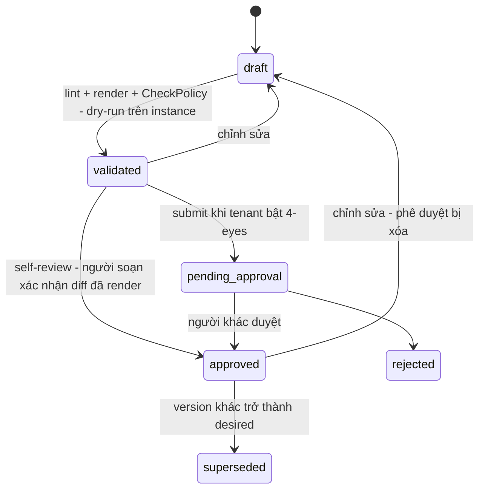

# Zero Trust Design

> **Trích sinh tự động** từ [implementation-master-plan.md](../planning/implementation-master-plan.md) bằng `tools/split_plan.py` — **không sửa tay**; sửa bản master rồi sinh lại.
> Nguồn: §7. Số mục `§` và các mã (HS-…, ADR-…, AC-…, T-…) tham chiếu theo bản master. Nhãn bằng chứng: xem [README](../README.md).

## 7. Zero Trust Security Architecture

### 7.1 Nguyên tắc → kiểm soát cụ thể

| Nguyên tắc | Kiểm soát trong thiết kế |
|---|---|
| Never trust, always verify | Mọi request Portal qua session + authz 5 lớp (§8.8); mọi node phải đăng ký qua luồng do Portal môi giới; relay chỉ nhận node của tenant (`verify_clients`) |
| Least privilege | Role theo permission (§8.5–8.6); policy mạng theo user/group/tag + **cổng** cụ thể; API tách khỏi Docker (chỉ Agent có socket); network tenant chỉ 2 thành viên |
| Explicit identity | Portal identity = `iss+sub` từ IdP của đúng tenant; tailnet identity = Headscale user do backend tạo/ánh xạ; machine identity = node key |
| Device-level authorization | Enrollment theo thiết bị, có hạn key (`node.expiry` đặt tường minh và được nền tảng kẹp sau đăng ký — §7.4), thu hồi theo thiết bị, tag cho thiết bị dịch vụ |
| Deny-by-default | Baseline `{"grants": [], "ssh": []}` được áp **trước khi** instance có đường mạng (§11.3 bước 12); không `autoApprovers`; edge allow-list theo path |
| Resource-scoped policies | Network Resource Catalog → alias `hosts` + grant theo `ip` (proto:port) |
| Auditable administrative actions | `audit_events` append-only cho mọi thao tác ghi và mọi lần từ chối; hành động của support hiển thị cho tenant |
| Separation of duties | Platform ≠ tenant; dual control cho thao tác phá hủy; tùy chọn 4-eyes cho policy/route; người soạn ≠ người duyệt |

### 7.2 Mô hình policy (ADR-15)

- **Grants-first**: policy do nền tảng sinh chỉ dùng `grants` (upstream khuyến nghị; ACLs là legacy — HS-07). `policy.mode: database` để quản lý qua API (PL-03).
- **Nguồn sự thật là PostgreSQL** (`policy_versions`): Headscale API không có version/ETag/rollback (PL-05). Ghi policy được **tuần tự hóa theo tenant** (advisory lock) vì `SetPolicy` là last-write-wins.
- **Render tất định** từ mô hình có cấu trúc sang HuJSON gồm các phần do nền tảng quản lý:

| Khóa policy | Nguồn | Ghi chú |
|---|---|---|
| `groups` | Bảng `groups`/`group_members` | Thành viên render dạng `mg-<membership_uuid>@` (chế độ portal) hoặc `<issuer>/@` (chế độ OIDC gốc) — **không bao giờ** dùng email; group không lồng nhau (PL-07); đổi thành viên ⇒ một lần áp dụng mới (có debounce) |
| `hosts` | `network_resources` | Alias cho host/subnet nội bộ |
| `tagOwners` | Danh mục tag của tenant (bảng `tenant_tags`, §6.3) | Mọi tag được tham chiếu phải khai báo ở đây và được render với **danh sách owner rỗng** (`"tag:x": []`): chỉ nền tảng gắn tag qua API (PL-09). Owner khác rỗng cho phép user tự gắn tag bằng `--advertise-tags` khi đăng ký ⇒ node thành tagged (không còn chủ sở hữu, không hết hạn key) — bị lint chặn trừ khi Owner xác nhận kèm lý do |
| `grants` | Rule do admin soạn (form hoặc HuJSON) | **Luôn có mặt**, kể cả mảng rỗng |
| `ssh` | Mặc định `[]`; opt-in | Cảnh báo: rule `accept` luôn cho phép port forwarding; không có session recording (PL-13) |
| `autoApprovers` | Mặc định không sinh | Chỉ cho tag router/exit do nền tảng kiểm soát; lưu ý được chạy lại ở mọi lần set (PL-10) |
| `tests`, `sshTests` | **Sinh lúc apply** từ inventory hiện tại, không lưu cùng rule | Test fail khi src/dst không có node (PL-04) ⇒ test lưu sẵn có thể chặn rollback |

- **Tham chiếu principal có kiểu:** trong `policy_versions.source`, principal là `{type:user, membership_id}`, `{type:group, group_id}` hoặc `{type:tag, tag_id}` (tag phải có trong danh mục `tenant_tags` của tenant — §6.3); các kiểu còn lại (`resource`, `autogroup`, `cidr`) theo schema `PolicySource` ở §13.3 — không phải chuỗi tự do. Lý do: Headscale khớp token `x@` với cả **Email lẫn Name** của user, không có khái niệm email đã xác minh, và từ chối toàn bộ policy khi một token khớp nhiều user (kể cả lúc khởi động instance — HS-09). Vì vậy: (1) renderer chỉ phát user ở dạng `mg-<membership_uuid>@` (hoặc `<issuer>/@` ở chế độ OIDC gốc); (2) import/export HuJSON dịch email ↔ membership ở Portal; (3) `CreateUser` chỉ gửi `name` + `display_name`, **không gửi email**.
- **Không bao giờ gửi nguyên văn văn bản của người dùng tới Headscale:** HuJSON do admin nhập được parse vào mô hình có kiểu rồi **render lại dạng chuẩn**; bộ parse từ chối tên khóa không đúng chính tả chuẩn ở mọi cấp (decoder của Headscale khớp tên không phân biệt hoa thường), mọi khóa bắt đầu bằng `#` (bị Headscale lặng lẽ loại bỏ), giá trị `null` cho `grants`/`acls`/`ssh`/`tagOwners`, và khóa trùng khác kiểu chữ. Lint chạy trên **mô hình** và trên **đầu ra đã render**. Hành vi decoder nêu trên đã được xác nhận trên Headscale 0.29.7 bằng contract test (VERIFIED — V-06, P2-T10): `Grants`/`GRANTS` được nhận như `grants`; khóa `#…` bị bỏ im lặng ở mọi mức (chỉ có `#grants` ⇒ allow-all); `"grants": null` ⇒ allow-all; khai cả `grants` lẫn `Grants` ⇒ bị từ chối. Contract test chạy lại ở mỗi bản Headscale để phát hiện khi decoder đổi.
- **Guardrail lint (chạy trước mọi lời gọi Headscale):**

| # | Luật | Mức |
|---|---|---|
| L1 | Thiếu khóa `grants` (hoặc chỉ có khóa khác) ⇒ sẽ thành allow-all (PL-02) | **Chặn** |
| L2 | Chuỗi policy rỗng (PL-06) | **Chặn** |
| L3 | Khóa top-level ngoài 11 khóa hợp lệ (PL-01); `nodeAttrs` không có trong mô hình `PolicySource` ⇒ bị **từ chối** ở MVP (không bỏ lặng lẽ) — khi mở về sau chỉ nhận attribute trong allow-list của nền tảng và luôn chặn `https://tailscale.com/cap/data-plane-audit-logs` (HS-22) | **Chặn** |
| L4 | `*` ở `dst` (bao gồm subnet route và exit node — PL-08) | **Chặn** (trừ khi Owner xác nhận tường minh kèm lý do) |
| L5 | `autogroup:danger-all` ở `src` | **Chặn** |
| L6 | Tag/group/host được tham chiếu nhưng chưa khai báo; user không tồn tại trong membership | **Chặn** |
| L7 | `autogroup:internet` không kèm `via` tag; `autoApprovers` ngoài tag nền tảng | Cảnh báo, cần xác nhận |
| L8 | `autogroup:self` ở tenant lớn (cảnh báo hiệu năng — HS-08) | Cảnh báo |
| L9 | Có section `acls` (legacy) | Thông tin |
| L10 | Rule SSH `accept` (forwarding luôn bật); rule SSH `check` (check mode là Post-MVP — §7.5; Auth ID của phiên SSH-check dùng chung cache với Auth ID đăng ký — §7.4) | `accept`: cảnh báo, cần xác nhận · `check`: **Chặn** — V-26 (P2-T10) xác nhận `AuthRegister` với Auth ID của phiên SSH-check làm Headscale 0.29.7 panic và thoát; chỉ gỡ khi upstream sửa và contract test chứng minh an toàn (bản vá của dự án — P2-T10, sửa đổi 2026-11-17 — sửa crash nhưng **không** gỡ L10: check mode là Post-MVP) |
| L11 | Token user trong đầu ra đã render không khớp `^mg-[0-9a-f-]{36}@$` hoặc dạng provider identifier | **Chặn** |
| L12 | `tagOwners` có danh sách owner khác rỗng | **Chặn** (trừ khi Owner xác nhận kèm lý do) |
| L13 | `autogroup:member` trong tenant dùng chế độ danh tính `headscale_oidc` | Cảnh báo, cần xác nhận |

### 7.3 Vòng đời policy: Validate → Version → Review → Apply → Audit → Rollback

**Review là bước bắt buộc, có hai chế độ:** *peer* — tenant bật 4-eyes: người duyệt phải khác người soạn (`submit` → `approve`); *self* — tenant không bật 4-eyes: chính người soạn gọi `approve` kèm `content_sha256` của bản đã xem, tức xác nhận tường minh diff có cấu trúc và kết quả lint của bản đã render, rồi version mới thành `approved`. Chế độ được lưu ở `policy_versions.review_mode` (`peer` hoặc `self`) và ghi trong audit event `policy.approved`; không có đường nào từ `validated` sang `approved` mà không có một lần xác nhận được ghi lại.

Sơ đồ trên là vòng đời của **nội dung** (`policy_versions`). Việc **áp dụng** được theo dõi riêng ở `policy_applications`:

- **Version ≠ lần áp dụng.** Chuỗi byte gửi tới Headscale gồm nội dung đã duyệt **cộng** phần render từ bảng tại thời điểm đó (`groups`, `hosts`) và `tests` sinh lúc apply — `tagOwners` thuộc nội dung version; vì thế hash dùng để đối chiếu là `applied_sha256` của đúng chuỗi đã gửi, lưu ở `policy_applications`.
- **Apply là job level-triggered theo tenant** (tham số chỉ có `tenant_id`): đọc `tenants.desired_policy_version_id` + trạng thái bảng hiện tại → render → `CheckPolicy` → `SetPolicy` → `GetPolicy`; thành công khi `GetPolicy` khớp `applied_sha256`. `SetPolicy` là thay thế toàn bộ nên **retry an toàn**. Mọi phản hồi không phải 2xx hoặc timeout ⇒ trạng thái `unknown` → **luôn** gửi lại bản `applied` gần nhất rồi mới ghi `failed`, không dựa vào so hash của `GetPolicy`: handler của Headscale hoán đổi policy trong bộ nhớ trước khi ghi DB, và trên 0.29.7 một lần ghi DB lỗi để lại policy mới **đang thực thi** trong khi `GetPolicy` (đọc DB) vẫn trả bản cũ — bản chỉ-trong-bộ-nhớ mất khi restart (VERIFIED — V-26, P2-T10).
- **Stale base:** đặt một version làm desired yêu cầu `parent_version_id` = desired hiện tại, nếu không ⇒ `409 stale_base` (tránh hai bản nháp cùng gốc ghi đè nhau).
- **Đổi thành viên group / resource / danh mục tag** tạo một `policy_applications` mới (trigger tương ứng) trên cùng version đã duyệt: không cần duyệt lại nhưng được audit và thông báo; riêng group được đánh dấu **sensitive** thì đổi thành viên cần phê duyệt qua `approval_requests` phạm vi tenant — §8.6 (để `tenant.group:manage` không lách được 4-eyes).
- **Rollback** = tạo version N+1 từ nội dung của một version trước; phê duyệt chỉ được kế thừa khi `content_sha256` trùng một nội dung đã từng được duyệt.
- Version `baseline` và `suspension` không kèm `tests`. Khi suspend, `desired_policy_version_id` giữ nguyên (là policy sẽ khôi phục); trạng thái đang áp dụng nằm ở `policy_applications` (trigger `suspend`).
- Trạng thái hiển thị tách bạch "đã áp dụng lên Headscale lúc …" với "client đã hội tụ" (không quan sát được — T-18).
- **Drift detection**: job định kỳ `policy.drift_check` (§13.5) so sha256 của `GetPolicy` với `applied_sha256` mới nhất; lệch ⇒ `security_event` + cảnh báo (có thay đổi ngoài luồng).
- **Kiểm tra tác động trước khi áp dụng** — mức độ tin cậy hiện có: (1) `POST /api/v1/policy/check` + `tests` sinh tự động (đáng tin trong phạm vi global filter; tính năng tests còn gắn nhãn beta; chưa rõ có khẳng định được quyền chỉ đến từ `via`/`autogroup:self` — REQUIRES VALIDATION, V-24); (2) diff văn bản + diff rule có cấu trúc cho người duyệt. **Chưa có** what-if trả về quyền hiệu lực (PL-05); bộ đánh giá phía nền tảng hoặc shadow instance là backlog sau MVP (TD-07, chưa có task), không được trình bày như đã có.
- **Trước mỗi lần nâng cấp, restart có kế hoạch, reconfigure và restore**: chạy `CheckPolicy` cho đúng chuỗi đang áp dụng (`policy_applications.applied_hujson`) trên instance đang chạy (với nâng cấp: thêm trên canary ở version mới); thất bại ⇒ chạy lại job `policy.apply` một lần (ghi trigger `drift_repair`) rồi kiểm lại, vì `tests` sinh lúc apply có thể sai chỉ do inventory đã đổi (PL-04); vẫn thất bại ⇒ **chặn** thao tác và cảnh báo — policy lưu không hợp lệ làm instance từ chối khởi động (HS-09). Riêng restore khi instance không còn chạy được thì bỏ qua bước này: policy được đặt lại trước khi start và đối chiếu lại sau khi gắn edge (§17.2 bước 4 và 6).

### 7.4 Device Enrollment (ADR-14)

Ba phương thức; mỗi tenant chọn **một** chế độ danh tính tailnet (`portal` hoặc `headscale_oidc`) để tránh user trùng lặp (ID-08); chế độ này **bất biến** sau khi tenant có Headscale user đầu tiên — đổi chế độ sẽ sinh user thứ hai cho cùng một người.

| Phương thức | Dùng cho | Cơ chế Headscale | Kiểm soát của nền tảng |
|---|---|---|---|
| **A. Web auth do Portal môi giới** (mặc định) | Thiết bị cá nhân | `tailscale up --login-server` → URL `/register/<auth_id>` → backend gọi `POST /api/v1/auth/register` (ID-05, ID-06) | SSO + MFA tại Portal, authz, quota, audit; không có key nào để sao chép |
| **B. Pre-auth key ngắn hạn** | Server, container, CI, thiết bị không có trình duyệt | `CreatePreAuthKey` (user-owned hoặc tag-only) | Dùng một lần, hạn ≤ 15 phút, **luôn gửi `expiration` tường minh**, hiển thị một lần; key reusable/ephemeral/gắn tag cần quyền `issue_privileged`; tag phải có trong policy |
| C. OIDC gốc của Headscale (tùy chọn) | Tenant muốn luồng đăng nhập trực tiếp | Khối `oidc` + trang xác nhận tích hợp (ID-07) | Issuer riêng theo tenant; không có bước admin phê duyệt (UNSUPPORTED); cần restart khi đổi cấu hình; phụ thuộc IdP lúc khởi động (ID-03) |

**Luồng A — ánh xạ 10 bước yêu cầu:**

1. User đăng nhập Tenant Portal (OIDC + MFA tại IdP).
2. User chọn "Thêm thiết bị".
3. Backend kiểm tra `tenant.enrollment:request`, trạng thái tenant, quota (đếm thiết bị đang có trong sổ **cộng** credential/yêu cầu enrollment còn hạn, trong cùng transaction tạo yêu cầu dưới `SELECT … FOR UPDATE` trên hàng `subscriptions` của tenant — hai yêu cầu đồng thời không cùng vượt hạn mức); bảo đảm Headscale user của membership tồn tại (`CreateUser` với tên ổn định `mg-<membership_uuid>`, chỉ kèm display name — không gửi email). Khi tenant bật phê duyệt enrollment, request dừng ở `pending_approval` cho tới khi được duyệt (đoạn "Phê duyệt enrollment" dưới danh sách).
4. Backend tạo `enrollment_requests` (method `web_auth`, gắn với phiên Portal hiện tại, hạn 10 phút) kèm một **mã enrollment dùng một lần**, và trả lệnh theo hệ điều hành: `tailscale up --login-server https://<slug>.<mesh_domain> --hostname mg-<mã>`.
5. User cài official Tailscale Client và chạy lệnh.
6. Client đăng ký với đúng Headscale của tenant; nhận URL `/register/<auth_id>`. Edge kiểm tra định dạng `auth_id` (`hskey-authreq-` + 24 ký tự) rồi chuyển hướng về trang claim của Portal (`app.<domain>`). Claim **chỉ được chấp nhận** khi chính user đó có một `enrollment_requests` đang chờ (trạng thái `issued`), được phát mã trong cùng phiên, chưa quá hạn; khi đó backend gọi `AuthRegister(user, auth_id)`. Mở link claim mà không có yêu cầu đang chờ ⇒ trang cảnh báo phishing, **không** có nút xác nhận, sự kiện được đếm và cảnh báo.
7. Headscale ghi nhận node (`register_method = CLI`).
8. Backend xác minh **node trả về**: tên phải bằng `mg-<mã>` (kẻ tự khởi tạo luồng trên máy của họ không thể biết trước mã), `user.name` đúng user mong đợi, `tags` rỗng, `register_method = CLI`. Cách xử lý tùy node là mới hay đã có: (a) node **mới** — `machine_key` chưa có trong sổ thiết bị và `created_at` không sớm hơn lúc tạo yêu cầu: sai bất kỳ điều nào ở trên ⇒ `DeleteNode` ngay + `security_event`; (b) node **đã có từ trước** — `AuthRegister` trên machine key đã có node của chính user là re-auth node hiện hữu chứ không tạo node mới (VERIFIED trên 0.29.7 — V-28, P2-T10; với user **khác**, Headscale tạo node mới và node cũ vẫn còn): **không bao giờ xóa** (xóa sẽ phá một thiết bị đang dùng: IP, tag, route đã duyệt); thiết bị thuộc chính thành viên đang claim được chấp nhận như một lần re-auth (không kiểm tên, giữ nguyên tên), mọi trường hợp khác ⇒ `ExpireNode` + `security_event` và chờ chủ thiết bị xác nhận trong Portal. Expiry vượt giới hạn của tenant **không** phải lý do xóa: áp quy tắc kẹp hạn bên dưới. Đạt ⇒ đổi tên node theo nhãn người dùng chọn, ghi `device_inventory_cache`, audit, thông báo.
9. Policy hiện hành áp dụng cho node mới (deny-by-default nếu chưa có grant).
10. Thiết bị chỉ truy cập được tài nguyên được cấp.

**Trạng thái yêu cầu (`enrollment_requests.status`).** Web-auth: `requested` → (`pending_approval` → `approved` hoặc `rejected`) → `awaiting_device` → `claimed` → `registered` → `verified`. Pre-auth key: `requested` → (`pending_approval` → `approved` hoặc `rejected`) → `credential_issued` → `consumed`. Mọi trạng thái chưa kết thúc có thể sang `expired`, `revoked` hoặc `failed` (kèm `failure_code`). Khi tenant bật `enrollment.requires_approval`, yêu cầu của người không có quyền `tenant.enrollment:approve` phải được duyệt **trước** bước thiết bị: mã enrollment/lệnh (hoặc pre-auth key) chỉ được phát khi chủ yêu cầu gọi `POST /enrollment/requests/{id}/start` trên yêu cầu đã `approved`; hạn 10 phút và ràng buộc phiên Portal tính từ lúc phát mã. Tenant không bật duyệt: bước tạo yêu cầu đi thẳng tới `awaiting_device`/`credential_issued` và trả mã/key ngay trong response tạo. Claim chỉ thành công với yêu cầu `awaiting_device` của chính thành viên đó và gọi `AuthRegister` đồng bộ; **không có bước duyệt nào sau claim** (pending registration chỉ sống 15 phút trong bộ nhớ Headscale và nền tảng không giữ Auth ID dạng rõ).

**Phê duyệt enrollment (tùy tenant; chen giữa bước 3 và 4).** `TenantSettings.enrollment.approval` ∈ {`none` (mặc định), `required`}. Khi `required` và người yêu cầu **không** có quyền `tenant.enrollment:approve` (thực tế là End User), `POST /enrollment/requests` chỉ tạo request ở trạng thái `pending_approval` — **chưa** phát mã enrollment, lệnh hay pre-auth key; TO/TA/TP gọi `/approve` hoặc `/reject` (ghi `approver_membership_id`, audit, thông báo cho người yêu cầu). Phê duyệt gắn với **request** (người yêu cầu, nhãn thiết bị, phương thức), **không** gắn với Auth ID, nên không phụ thuộc cửa sổ 15 phút của pending registration; request chờ duyệt hoặc đã duyệt mà chưa dùng hết hạn sau 24 giờ (job `enrollment.reconcile`). Sau khi `approved`, chính người yêu cầu gọi `POST /enrollment/requests/{id}/issue` trong phiên Portal của mình để nhận mã + lệnh (hoặc pre-auth key, hiển thị một lần): request chuyển `issued`, ràng buộc phiên và cửa sổ 10 phút của bước 4 và 6 tính từ lúc này. Khi `approval = none`, hoặc người yêu cầu có quyền duyệt, request được tạo và phát mã ngay trong một lời gọi (`issued`) — hành động vẫn được audit và thông báo. Key đặc quyền qua `POST /enrollment/keys` không qua bước này vì đã cần quyền `issue_privileged`.

Giới hạn đã biết của luồng A: (1) endpoint control là public nên **bất kỳ ai** cũng khởi tạo được một yêu cầu đăng ký và nhận link hợp lệ của nền tảng — vì vậy claim phải gắn với yêu cầu do chính user tạo trong Portal và với mã enrollment (bước 4, 6, 8), không dựa vào việc "user xem thông tin thiết bị"; (2) Headscale API **không** liệt kê được pending registration (UNSUPPORTED) nên Portal không hiển thị được hostname/OS **trước** khi phê duyệt; (3) pending auth sống 15 phút trong bộ nhớ và mất khi instance restart (ID-05); (4) client di động không đặt được hostname tùy ý ⇒ dùng pre-auth key một lần do Portal cấp; (5) `AuthRegister` với Auth ID của phiên SSH-check làm Headscale 0.29.7 **chính thức panic và thoát** (hai loại phiên dùng chung một cache; dữ liệu còn nguyên sau khi khởi động lại, phiên SSH-check mất — VERIFIED, V-26/P2-T10); bản vá của dự án (image `mg-headscale`, ADR-02 sửa đổi 2026-11-17 — P2-T10) trả `400` (adapter: `validation_failed`), instance vẫn chạy, phiên SSH-check vẫn duyệt/từ chối được, và recover mọi panic của handler gRPC (VERIFIED, contract test kèm đối chứng âm trên image chính thức) ⇒ cho tới khi upstream sửa và contract test chứng minh an toàn: policy không được chứa rule SSH `check` (lint L10), `web-auth/claim` bị giới hạn tần suất theo membership, và phương án lùi "dán Auth ID" bị tắt với tenant có rule SSH `check`; `AuthApprove` trên Auth ID đăng ký trả thành công nhưng không đăng ký node nào; các ràng buộc này giữ nguyên cả khi chạy bản vá (phòng thủ nhiều lớp; check mode là Post-MVP), và chủ dự án quyết **không báo upstream** («Chưa báo», 2026-11-17; upstream không có SECURITY.md). Tenant có thể **tắt hẳn** web-auth claim và chỉ dùng phương thức B. Việc edge chuyển hướng `/register/<auth_id>` mà không ảnh hưởng client là **REQUIRES VALIDATION** (V-07, gate G4a); phương án lùi: giữ trang gốc của Headscale và để user dán Auth ID vào Portal (vẫn áp dụng ràng buộc yêu cầu đang chờ + mã).

**Vòng đời khóa:** `node.expiry` được đặt tường minh theo tenant (đề xuất mặc định 90 ngày; mặc định upstream là không hết hạn — HS-19). Lưu ý `node.expiry` chỉ là **giá trị mặc định**: client có thể tự yêu cầu expiry khác khi đăng ký và Headscale chấp nhận (VERIFIED trên 0.29.7 — V-21, P2-T10: `RegisterRequest.Expiry` do client yêu cầu luôn thắng, qua pre-auth key lẫn `AuthRegister`, kể cả `9999-12-31`). Vì vậy nền tảng **kẹp expiry**: sau mỗi lần đăng ký và ở mỗi lần inventory sync, node thuộc user có expiry rỗng hoặc vượt `thời điểm đăng ký + node_expiry` bị đặt lại bằng `ExpireNode(expiry=…)` kèm `security_event`; quyền tắt expiry (`disable_expiry`) chỉ dành cho Owner. Tagged node không hết hạn ⇒ có báo cáo rà soát định kỳ; pre-auth key ≤ 15 phút; API key của instance ≤ 90 ngày, xoay tự động; **không** tồn tại enrollment credential quyền cao vô thời hạn.

**Thu hồi thiết bị:** `ExpireNode` (giữ bản ghi, buộc re-auth) hoặc `DeleteNode` (xóa và đóng session), kèm expire mọi pre-auth key còn hiệu lực của user đó để thiết bị không tự đăng ký lại; chỉ báo "đã áp dụng" sau khi đọc lại xác minh (T-17).

### 7.5 Application-level ZTNA — phân loại (Mesh VPN ≠ Application ZTNA)

Headscale + WireGuard + grants cho ta **kiểm soát truy cập tầng mạng theo danh tính**; các năng lực dưới đây **không** tự có.

| Module | Phân loại | Ghi chú thực tế |
|---|---|---|
| Enrollment theo danh tính, default-deny, grant theo user/group/tag/cổng, key expiry, thu hồi, audit | **MVP Required** | Trong phạm vi Headscale hỗ trợ |
| Per-application access ở tầng 4 (host:port qua Resource Catalog) | **MVP Required** | Grant với `ip: ["tcp:443"]` |
| Time-bound access | Post-MVP (P7-T07) | Thuần ở tầng nền tảng: version policy có TTL + job tự hoàn nguyên |
| Just-in-time access | Post-MVP (P7-T07) | Yêu cầu/duyệt → thành viên group tạm thời → render lại policy |
| Tailscale SSH (check mode) | Post-MVP (opt-in; chưa có task) | Phê duyệt qua `auth/approve`; lưu ý forwarding |
| Identity-aware application proxy / HTTP application gateway | Enterprise Extension | Cần gateway node trong tailnet do nền tảng quản lý; Funnel/Serve không được hỗ trợ (HS-06) |
| Device posture integration | Enterprise Extension | Posture trong policy UNSUPPORTED (HS-08) ⇒ chỉ làm được ở tầng nền tảng: tín hiệu từ MDM/agent → cách ly/expire node qua API |
| Session auditing | Enterprise Extension | Không có SSH session recording, không có network flow logs ⇒ chỉ khả thi ở gateway tầng ứng dụng |

### 7.6 Secrets management (ADR-17)

`SecretStore` là interface (`Put/Get/Rotate/Destroy` theo secret reference). Implementation MVP: **envelope encryption trong PostgreSQL** — mỗi tenant một DEK có version, cộng hai DEK phạm vi nền tảng — `platform` (secret mà api cần khi phục vụ request, ví dụ client secret OIDC của IdP platform) và `platform_ops` (secret chỉ worker dùng: thông tin quản trị IdP, mật khẩu SMTP) — đều AES-256-GCM, được bọc bởi KEK với `wrap_nonce` riêng và AAD bọc khóa `scope|tenant_id|version` (khác với AAD của từng secret nêu ở cuối đoạn). Có **hai KEK**: `kek-app` (mount vào api và worker; bọc DEK của tenant và DEK `platform`) và `kek-ops` (**chỉ** mount vào worker; bọc DEK `platform_ops`) — api bị chiếm không giải mã được secret vận hành của nền tảng. Mỗi KEK nạp từ một **keyring** dạng file Docker secret (`/opt/meshguard/secrets/kek-app/`, `kek-ops/`: mỗi phiên bản một file `<kek_id>`, quyền đọc đặt ở phía host cho đúng service dùng KEK đó (§14.2; api/worker chạy non-root nên file chỉ root đọc được là không nạp được — ST-05), kèm file `ACTIVE` ghi `kek_id` hiện hành — KEK cũ và mới cùng tồn tại trong lúc rewrap), **không** nằm trong DB hay backup DB; AAD = `tenant_id|name|version`. Driver OpenBao/Vault là lựa chọn Phase 7.

| Secret | Nơi lưu | Thành phần dùng | Xoay |
|---|---|---|---|
| KEK | Keyring file trên host (`kek-app`, `kek-ops`) + bản sao offline | `kek-app`: api, worker · `kek-ops`: **chỉ worker** | Hằng năm / khi có sự cố (rewrap DEK) |
| Mật khẩu role PostgreSQL | Docker secret (file) | api, worker, migrate | Theo lịch |
| Headscale API key (mỗi instance) | SecretStore | api, worker | ≤ 90 ngày, tự động (§11.4) |
| Noise key, DERP key của instance | `data/` của tenant (`0600`, `run_uid`) | Chỉ container Headscale của tenant | Không xoay định kỳ (xoay Noise key có thể buộc client đăng ký lại — REQUIRES VALIDATION, V-11) |
| OIDC client secret (Portal; Headscale nếu dùng luồng C) | SecretStore; render ra `secrets/oidc_client_secret` cho `client_secret_path` | api; Headscale của tenant | Theo chính sách IdP |
| Token DNS provider (ACME DNS-01) | Docker secret | Chỉ edge | Theo lịch; chỉ có quyền trên zone ủy quyền ACME (§15.4) |
| Khóa bouncer CrowdSec, token Agent | Docker secret | edge / worker ↔ agent | Theo lịch |
| Khóa backup (mô hình hai đường — §17.1) | Mỗi archive có **data key ngẫu nhiên**, được bọc hai lần: (a) bằng khóa backup của tenant trong SecretStore (dưới DEK của tenant) — đường online; (b) bằng **recovery public key** của nền tảng, private key giữ offline — đường DR | (a) Worker mở bọc và trao data key cho Agent qua Unix socket trong thời gian của job restore/rollback/kiểm tra restore; (b) chỉ người vận hành khi mất host | Khi có sự cố; hủy DEK của tenant vô hiệu đường (a) |
| Khóa ký manifest backup (Ed25519) | Chỉ Agent giữ | Agent ký; Worker **và** Agent kiểm chữ ký + tenant/instance đích trước khi giải nén | Khi có sự cố |
| Thông tin quản trị IdP (cho driver) | SecretStore (DEK `platform_ops`) | worker (lời gọi IdP driver cần quyền quản trị luôn chạy trong job, không trong api) | Theo lịch |
| Token nội bộ của listener admin / listener metrics của edge | Docker secret (file) | edge (đối chiếu); api, worker (admin); prometheus (metrics) | Theo lịch |
| Credential SMTP; secret SSO của Grafana (nếu có); mật khẩu DB của postgres-exporter và của `pg-backup` (role `mg_backup`); URL webhook cảnh báo | Docker secret (file) | worker / grafana / postgres-exporter / pg-backup / alertmanager | Theo lịch |
| Credential kho backup offsite (append-only) | Docker secret (file) | Chỉ backup-shipper | Theo lịch; khi có sự cố |
| Mật khẩu SMTP (gửi thông báo) | SecretStore (DEK `platform_ops`) | worker | Theo lịch |

Quy tắc: không secret trong biến môi trường, file compose, image, repo hay log; mọi output chứa key (bootstrap API key, pre-auth key) đi qua kênh nội bộ và chỉ hiển thị cho người dùng **một lần**.

### 7.7 Network segmentation & edge protection

- Mạng Docker: `mg-edge` (edge ↔ api/web/idp), `mg-data` (api/worker ↔ PostgreSQL), `mg-obs` (monitoring), `mg-admin` (api/worker/prober ↔ listener admin của edge), `mg-egress` (đường ra có kiểm soát), `mg-sec` (edge ↔ crowdsec), socket riêng cho worker ↔ agent, và **một network cho mỗi tenant** `mg-t-<slug>` chỉ gồm Headscale của tenant + edge. Chi tiết ở §14.
- Edge là điểm thực thi chính sách duy nhất giữa Internet/Management Plane và instance của tenant: allow-list path public, listener nội bộ cho `/api/v1/*`, listener metrics chỉ cho `/metrics`.
- CrowdSec dùng chung một bộ tại edge, phạm vi xử lý được tinh chỉnh để không khóa nhầm IP NAT egress của cả một tenant; CrowdSec **không** thấy nội dung kênh Noise và không thấy UDP STUN (§14, §16).
